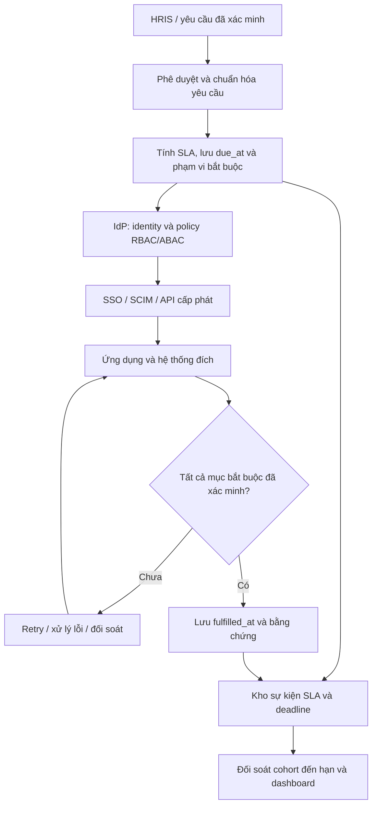

# Tỷ lệ provisioning đúng hạn trong IAM: định nghĩa SLA và đo lường chính xác

**Tỷ lệ provisioning đúng hạn** (*on-time provisioning rate*) đo phần trăm yêu cầu cấp phát danh tính, tài khoản hoặc quyền truy cập được **hoàn tất và xác minh trước hoặc đúng thời hạn cam kết**. Trong quản lý vòng đời danh tính (*Identity Lifecycle Management*), đây là chỉ số giúp đánh giá liệu một nhân viên mới (*Joiner*), người chuyển vai trò (*Mover*) hay một workload mới có được khả năng làm việc đúng thời điểm mà vẫn tuân thủ kiểm soát truy cập hay không.

Chỉ số này nằm trong nhóm **IAM metrics** của mô-đun `SECURITY_IDENTITY_ACCESS_MANAGEMENT_IDENTITY_LIFECYCLE`. Phạm vi học tập kết nối sự kiện Joiner–Mover–Leaver với nguồn nhân sự, nhà cung cấp danh tính (*Identity Provider — IdP*), đăng nhập một lần (*Single Sign-On — SSO*), đồng bộ cấp phát (*System for Cross-domain Identity Management — SCIM*), chính sách quyền **RBAC/ABAC**, tài khoản dịch vụ và bằng chứng kiểm toán. Đo provisioning đúng hạn phải đi cùng việc cấp **đúng quyền**, vì hoàn tất nhanh nhưng cấp thừa quyền có thể làm tăng rủi ro bảo mật.

Sau bài này, người học có thể xác định mốc bắt đầu và kết thúc SLA, xây dựng tử số/mẫu số nhất quán, tính chỉ số trên dữ liệu mẫu, thiết kế truy vấn báo cáo và phát hiện các cách đo làm đẹp số liệu nhưng che giấu yêu cầu bị trễ.

## 1. Provisioning là gì, và thế nào là “đúng hạn”?

**Provisioning** trong IAM là quá trình tạo và cấu hình danh tính hoặc tài khoản cùng các quyền cần thiết tại hệ thống đích dựa trên một nhu cầu đã xác minh và được phê duyệt. Ví dụ: khi một nhân viên gia nhập, hệ thống nguồn phát sinh sự kiện; IdP tạo bản ghi danh tính; SCIM/API tạo tài khoản tại ứng dụng; RBAC/ABAC giúp xác định vai trò hay thuộc tính cần thiết; bước kiểm tra cuối xác nhận người đó đã được cấp quyền sử dụng theo đúng chính sách.

Không nên đồng nhất những sự kiện sau:

| Mốc kỹ thuật | Điều đã xảy ra | Đã đủ điều kiện “provisioning hoàn tất”? |
|---|---|---|
| Có yêu cầu từ HRIS hoặc hệ thống quản lý danh tính | Đã phát sinh nhu cầu | **Chưa**; có thể còn thiếu xác minh/phê duyệt |
| IdP tạo identity hoặc account | Có bản ghi trong kho danh tính | **Chưa chắc**; ứng dụng bắt buộc có thể chưa nhận account |
| Người dùng đăng nhập được qua SSO | Xác thực liên kết thành công | **Chưa chắc**; chưa xác nhận đủ tài nguyên và quyền cần thiết |
| SCIM/API trả mã phản hồi thành công | Hệ thống đích đã tiếp nhận thao tác | **Chưa chắc**; có thể cần đối soát trạng thái cuối hoặc quyền thực tế |
| Tất cả tài nguyên bắt buộc có account/quyền đúng và đã xác minh | Đạt tiêu chí hoàn thành của yêu cầu | **Có**, nếu việc cấp phát phù hợp yêu cầu và có bằng chứng |

Một yêu cầu được coi là **đúng hạn** khi:

1. Yêu cầu thuộc phạm vi đo và có **deadline hợp lệ** (`due_at`).
2. Hệ thống ghi được mốc **hoàn tất thực tế** (`fulfilled_at`) khi **mọi bước bắt buộc** đã đạt điều kiện nghiệm thu.
3. `fulfilled_at <= due_at`, với cả hai mốc sử dụng cùng cơ sở thời gian và quy tắc SLA.

Nếu quá hạn nhưng chưa hoàn tất, yêu cầu vẫn phải được tính là **trễ** khi kỳ đo đã đến hạn. Điều này rất quan trọng: chỉ thống kê các yêu cầu đã đóng sẽ làm tỷ lệ đúng hạn tăng giả tạo vì bỏ mất công việc tồn đọng.

## 2. Định nghĩa đơn vị đo và mốc SLA

Trước khi tính, cần thống nhất **đơn vị quan sát** (*measurement unit*). Có hai cách hợp lý nhưng giải đáp hai câu hỏi khác nhau:

| Đơn vị | Cách kết luận hoàn tất | Dùng khi nào |
|---|---|---|
| **Yêu cầu provisioning** (`request_id`) | Tất cả tài nguyên/quyền **bắt buộc** trong phạm vi yêu cầu đã xác minh hoàn tất | Đo trải nghiệm Joiner/Mover và cam kết với nghiệp vụ |
| **Tác vụ cấp phát tới hệ thống đích** (`target_task_id`) | Một account hoặc nhóm quyền cụ thể trên một hệ thống đã hoàn tất | Chẩn đoán năng lực từng connector IdP/SCIM/API |

Ví dụ, yêu cầu cấp bốn ứng dụng bắt buộc có ba ứng dụng hoàn thành đúng hạn, một ứng dụng trễ. Kết quả theo **yêu cầu** là **0/1 đúng hạn**; kết quả theo **tác vụ đích** có thể là **3/4 đúng hạn** nếu bốn tác vụ đều cùng deadline. Hai số không mâu thuẫn: chúng đo hai đơn vị khác nhau. Không thay mẫu số theo tác vụ khi muốn báo cáo trải nghiệm đầu cuối của người dùng.

Một bản ghi SLA tối thiểu cần có:

| Trường | Nội dung và lưu ý |
|---|---|
| `request_id`, `identity_id` | Khóa yêu cầu duy nhất và định danh chủ thể; một identity có thể có nhiều yêu cầu |
| `request_type` | Joiner, Mover, service-account provisioning, hoặc loại khác có kiểm soát |
| `requested_at` | Thời điểm tiếp nhận đề nghị, dùng phân tích tổng thời gian chờ |
| `approved_at`/`eligible_at` | Mốc đủ điều kiện bắt đầu SLA theo chính sách; cần lưu riêng khỏi `requested_at` |
| `effective_at` | Thời điểm thay đổi nhân sự/quyền có hiệu lực, nếu dùng deadline theo lịch làm việc |
| `sla_policy_id`, `sla_version` | Chính sách áp dụng khi yêu cầu bắt đầu, tránh tự thay deadline khi policy đổi |
| `due_at` | Mốc cam kết hoàn tất đã tính theo chính sách |
| `fulfilled_at` | Thời điểm xác minh toàn bộ phần bắt buộc hoàn tất; rỗng nếu còn mở |
| `status`, `cancelled_at` | Trạng thái hiện hành và bằng chứng hủy hợp lệ, tránh loại trừ tùy tiện |
| `required_targets`, `verified_targets` | Danh sách tài nguyên bắt buộc và kết quả đối soát có bằng chứng |
| `owner`, `correlation_id`, `trace_id` | Người/nhóm phụ trách và liên kết tới log, sự kiện hoặc connector |

### Mốc bắt đầu nào là đúng?

Thời điểm bắt đầu được quyết định bởi **cam kết nghiệp vụ**, không phải thời điểm thuận tiện cho hệ thống đo:

- **SLA sau phê duyệt:** bắt đầu tại `eligible_at`/`approved_at` khi dữ liệu định danh đầy đủ, phê duyệt có hiệu lực và yêu cầu có thể xử lý. Ví dụ, SLA 4 giờ làm việc kể từ lúc đủ điều kiện.
- **Cam kết sẵn sàng vào ngày bắt đầu làm việc:** deadline có thể là **08:00 ngày nhân viên bắt đầu làm việc**, cho dù yêu cầu được gửi nhiều ngày trước. Với mô hình này, thời điểm cấp phát phải đáp ứng mốc hiệu lực; không chỉ đo khoảng cách từ lúc worker bắt đầu chạy.
- **Mốc theo dịch vụ và độ ưu tiên:** cấp quyền tiêu chuẩn, quyền đặc quyền cần phê duyệt bổ sung, đối tác ngoài giờ hay tài khoản dịch vụ có thể có SLA khác nhau. Cần công bố từng lớp chính sách.

Ví dụ: yêu cầu đã được duyệt lúc **10:00 ngày làm việc**, SLA là **4 giờ làm việc**, lịch làm việc liên tục đến 17:00. Deadline là **14:00**. Nếu ứng dụng cuối xác nhận đủ quyền lúc **14:12**, yêu cầu **trễ 12 phút**, dù worker gửi lệnh SCIM thành công lúc 13:55.

Nếu SLA tính theo giờ làm việc, phải xác định múi giờ, ngày nghỉ và lịch từng khu vực. Lưu timestamp ở dạng có offset hoặc UTC, đồng thời lưu phiên bản lịch tính deadline. Một số chính sách cho phép tạm dừng SLA khi đợi phê duyệt bổ sung hoặc thông tin từ người yêu cầu; chỉ dừng nếu **quy tắc pause đã được định nghĩa trước, có lý do và dấu thời gian**, không dời `due_at` sau khi phát hiện yêu cầu đang trễ.

## 3. Công thức tỷ lệ provisioning đúng hạn

Chọn một kỳ báo cáo theo **ngày đến hạn** (*due-date cohort*), chẳng hạn các yêu cầu có `due_at` trong tháng 11 và **đã đến hạn tính tới thời điểm chốt số liệu**. Đây là cách giúp các yêu cầu còn tồn đọng không bị bỏ sót.

Gọi:

- (E): tập **yêu cầu hợp lệ đã đến hạn** trong kỳ, sau khi áp dụng các ngoại lệ hủy được quy định và phê duyệt.
- (T): tập con của (E) đã hoàn tất và xác minh tại `fulfilled_at <= due_at`.
- (L): tập yêu cầu trong (E) hoàn tất **sau deadline** hoặc **chưa hoàn tất khi deadline đã qua**.

Khi mỗi yêu cầu được phân loại đúng một lần, (E=T\cup L) và (T\cap L=\varnothing). Tỷ lệ là:

\[
\boxed{\text{On-time provisioning rate}=\frac{|T|}{|E|}\times100\%}
\]

Tỷ lệ **trễ hạn** tương ứng bằng (100\%-\text{On-time provisioning rate}\), chỉ khi mọi yêu cầu hợp lệ đã đến hạn đều được phân loại đúng vào nhóm đúng hạn hoặc trễ hạn.

**Không đưa vào mẫu số** các yêu cầu vẫn chưa đến deadline tại thời điểm chốt, vì chúng chưa có đủ thời gian thực hiện; cũng không tự đưa yêu cầu đã hủy **hợp lệ trước khi đến hạn hoặc trước khi được triển khai** vào nhóm trễ. Yêu cầu hủy sau khi đã trễ cần có quy tắc riêng, có vết kiểm toán; không xóa khỏi lịch sử để cải thiện KPI. Khi một yêu cầu thay đổi phạm vi đáng kể, hệ thống phải lưu phiên bản yêu cầu/SLA hoặc tách thành một yêu cầu mới theo chính sách thống nhất.

### Ví dụ tính toán đầy đủ

Trong kỳ, hệ thống ghi nhận **120 yêu cầu provisioning** được xét để lập báo cáo:

| Nhóm yêu cầu | Số lượng | Thuộc mẫu số đã đến hạn? |
|---|---:|---|
| Hoàn tất đúng hoặc trước deadline | 84 | Có, đúng hạn |
| Hoàn tất sau deadline | 9 | Có, trễ hạn |
| Đã quá deadline nhưng còn mở | 7 | Có, trễ hạn |
| Chưa tới deadline tại thời điểm chốt | 8 | Chưa |
| Hủy hợp lệ trước khi xử lý, có bằng chứng và đúng quy tắc loại trừ | 12 | Không |
| **Tổng** | **120** | **100 yêu cầu hợp lệ đã đến hạn** |

Khi đó:

\[
\text{On-time rate}=\frac{84}{84+9+7}\times100\%=84\%
\]

Tỷ lệ trễ hạn là **16%**. Nếu chỉ lấy các yêu cầu **đã hoàn thành**, tỷ lệ sẽ bị báo cáo sai thành (84/(84+9)\approx90,32\%\), vì **7 yêu cầu đã quá hạn còn mở** biến mất khỏi mẫu số. Nếu cộng cả 8 yêu cầu chưa đến hạn, tỷ lệ lại bị thấp giả tạo vì chưa cho chúng đủ thời gian thực hiện.

Nên công bố cạnh tỷ lệ chính: **84 đúng hạn, 9 trễ nhưng đã xong, 7 trễ còn mở, 8 chưa đến hạn và 12 hủy hợp lệ**. Các con số giúp người đọc kiểm tra được cách tính và chất lượng backlog.

## 4. Liên hệ Joiner–Mover–Leaver và kiểm soát quyền

### Joiner: sẵn sàng làm việc ngay khi bắt đầu

Một nhân viên mới thường cần xác minh hồ sơ, identity tại IdP, MFA/SSO và account/quyền trên các ứng dụng bắt buộc. Yêu cầu provisioning đúng hạn khi đạt **tiêu chí sẵn sàng** đã định trước. Nếu email và SSO hoạt động nhưng hệ thống nghiệp vụ quan trọng chưa có quyền, yêu cầu đầu cuối vẫn chưa hoàn tất.

Ví dụ, HRIS báo một nhân viên bắt đầu lúc 08:00 thứ Hai; ứng dụng tài chính cần vai trò `finance_analyst` và một hệ thống quản lý nội bộ cần truy cập phù hợp. Nếu IdP xong Chủ nhật nhưng phân quyền ứng dụng tài chính xong 09:10 thứ Hai, SLA sẵn sàng lúc 08:00 đã **vi phạm**, kể cả nếu SCIM connector báo thành công từ trước mà quyền thực tế chưa hiện diện.

### Mover: cấp quyền mới đúng hạn, thu hồi quyền cũ đúng quy định

Khi người dùng chuyển vai trò, RBAC/ABAC xác định những quyền cần được **cấp mới** và **thu hồi**. Một chỉ số provisioning đúng hạn có thể theo dõi tốc độ cấp quyền mới; tuy nhiên nó **không chứng minh quyền cũ đã được gỡ**. Cần chỉ số deprovisioning/revocation riêng, có thể gắn cả hai nghĩa vụ vào một quy trình Mover tổng thể.

Ví dụ, nhân viên chuyển từ nhóm hỗ trợ sang nhóm phân tích: được cấp vai trò phân tích trước deadline nhưng vẫn giữ quyền xuất dữ liệu nhạy cảm của nhóm hỗ trợ. Provisioning mới có thể đúng hạn; **quy trình Mover chưa hoàn tất an toàn** vì phát sinh quyền tồn dư (*residual access*).

### Leaver: đo thu hồi quyền, không đánh đồng với provisioning

Leaver thường đặt trọng tâm vào **vô hiệu hóa danh tính, kết thúc phiên truy cập, thu hồi account/token và quyền tại ứng dụng đích**. Vì vậy cần một chỉ số **tỷ lệ deprovisioning đúng hạn** riêng với deadline thường ngắn hơn, tùy mức rủi ro. Không dùng tỷ lệ provisioning cao để khẳng định người đã nghỉ việc không còn truy cập.

### Service account và danh tính workload

Tài khoản dịch vụ, bot và workload identity cũng phát sinh nhu cầu cấp phát có thời hạn: tạo danh tính cho dịch vụ mới, gán quyền truy cập API theo nguyên tắc tối thiểu, gắn chủ sở hữu, quản lý secret/certificate hoặc sử dụng workload federation. SLA có thể tính theo thời điểm triển khai được phê duyệt. Tiêu chí nghiệm thu nên xác minh **owner, phạm vi quyền, vòng đời và khả năng xác thực an toàn**, thay vì chỉ kiểm tra đã tạo được tên tài khoản. Quyền break-glass hay quyền tạm thời cần quy trình phê duyệt, hết hạn và ghi log riêng.

## 5. Luồng triển khai và bằng chứng hoàn tất

Một thiết kế đo lường đáng tin cậy có thể mô tả như sau:



Khuyến nghị lưu **sự kiện bất biến** (*append-only event*) về: yêu cầu đủ điều kiện, được phê duyệt, deadline ban đầu, thay đổi SLA có căn cứ, gửi lệnh cấp phát, hệ thống đích phản hồi, xác minh quyền, hoàn tất và hủy. Dùng `request_id`/`correlation_id` liên kết các bước. Một số connector có thể gửi sự kiện trùng hoặc xử lý lại sau timeout; phải xử lý **idempotent** để không đếm một yêu cầu nhiều lần.

Đặc biệt:

- **Mốc hoàn tất phải là kết quả đã xác minh.** Trạng thái `HTTP 200`/`201` hoặc thao tác enqueue thành công có thể chỉ chứng tỏ API chấp nhận yêu cầu. Tùy ứng dụng, có thể cần đọc lại account, kiểm tra role/group mapping, hoặc nhận sự kiện xác thực hoàn tất.
- **Một request chỉ được đóng sau khi tất cả target bắt buộc hoàn tất.** Tài nguyên tùy chọn được xác định rõ từ đầu có thể theo dõi riêng; không âm thầm chuyển mục bị lỗi từ “bắt buộc” sang “tùy chọn” để đạt SLA.
- **Không xóa lịch sử lỗi khi retry thành công.** Lưu lần bắt đầu, số lần thử, mã lỗi, lần xác nhận và deadline gốc; retry qua SLA vẫn là trễ hạn.
- **Đảm bảo nhất quán theo snapshot.** Dashboard tại thời điểm (t) chỉ xét những trạng thái/sự kiện đã có hiệu lực trong hoặc trước (t); dữ liệu đến muộn phải được ghi nhận và có chính sách backfill minh bạch.
- **Bảo vệ dữ liệu cá nhân.** Báo cáo tổng hợp có thể tránh hiển thị tên/email; drill-down theo identity, trạng thái phê duyệt và log nên giới hạn theo RBAC/ABAC, lưu vết truy cập để kiểm toán.

## 6. Ví dụ SQL tính tỷ lệ theo kỳ đến hạn

Giả sử hệ thống đã chuẩn hóa bảng `iam_provisioning_requests` theo **mỗi `request_id` đúng một hàng**. Bảng chứa `approved_at`, `due_at`, `fulfilled_at`, `cancelled_at`, `eligibility`, `request_type` và bản ghi `fulfilled_at` chỉ được điền khi **toàn bộ điều kiện hoàn tất đã được xác minh**. Chỉ những trường hợp hủy đủ điều kiện theo chính sách mới có `eligibility = 'excluded'`; các yêu cầu bị hủy sau khi đã vi phạm SLA vẫn ở phạm vi đo.

Truy vấn PostgreSQL minh họa cohort **đến hạn trong tháng 11/2026**, chốt lúc **14:00 ngày 23/11/2026, giờ Việt Nam (UTC+7)**:

```sql
WITH eligible_due AS (
    SELECT request_id, request_type, due_at, fulfilled_at
    FROM iam_provisioning_requests
    WHERE eligibility = 'in_scope'
      AND approved_at IS NOT NULL
      AND due_at >= TIMESTAMPTZ '2026-11-01 00:00:00+07'
      AND due_at <  TIMESTAMPTZ '2026-12-01 00:00:00+07'
      AND due_at <= TIMESTAMPTZ '2026-11-23 14:00:00+07'
), counts AS (
    SELECT
        request_type,
        COUNT(*) AS due_requests,
        COUNT(*) FILTER (
            WHERE fulfilled_at IS NOT NULL
              AND fulfilled_at <= due_at
        ) AS on_time_requests,
        COUNT(*) FILTER (
            WHERE fulfilled_at > due_at
              AND fulfilled_at <= TIMESTAMPTZ '2026-11-23 14:00:00+07'
        ) AS completed_late,
        COUNT(*) FILTER (
            WHERE fulfilled_at IS NULL
               OR fulfilled_at > TIMESTAMPTZ '2026-11-23 14:00:00+07'
        ) AS overdue_open_as_of
    FROM eligible_due
    GROUP BY request_type
)
SELECT
    request_type,
    due_requests,
    on_time_requests,
    completed_late,
    overdue_open_as_of,
    ROUND(
        100.0 * on_time_requests / NULLIF(due_requests, 0), 2
    ) AS on_time_rate_pct
FROM counts
ORDER BY request_type;
```

**Lưu ý khi triển khai:** ví dụ này giả định các trường `eligibility`, `due_at`, `fulfilled_at` phản ánh đúng **trạng thái có hiệu lực tại thời điểm chốt**. Muốn tính lại báo cáo lịch sử một cách chính xác, cần dùng bảng snapshot hoặc dựng trạng thái *as-of* từ event log; việc truy vấn bảng trạng thái hiện tại có thể gây sai lệch nếu ngày hủy, SLA hoặc trạng thái được thay đổi sau thời điểm chốt. Nếu SLA cho phép pause, hãy dùng deadline đã tính theo **phiên bản quy tắc hợp lệ**, đồng thời giữ dấu vết deadline gốc và thay đổi. `NULLIF` ngăn chia cho 0; khi `due_requests = 0`, tỷ lệ nên hiển thị **N/A**, không mặc định là 100%.

Trước khi tin số liệu SQL, nên xác minh:

1. Mỗi request được đếm **đúng một lần**, kể cả có nhiều sự kiện SCIM hoặc nhiều target.
2. `fulfilled_at` tương ứng với **bằng chứng xác nhận cuối**, không phải lệnh được gửi đi hay ticket bị đóng thủ công.
3. Các yêu cầu chưa đến hạn, hủy hợp lệ và đã quá hạn còn mở được phân loại đúng như định nghĩa.
4. Khoảng thời gian, múi giờ và ranh giới kỳ (đầu kỳ bao gồm, cuối kỳ không bao gồm) là nhất quán.
5. Danh mục `request_type`, mức ưu tiên và chính sách SLA có thể phân nhóm mà không đổi đơn vị đếm.

## 7. Đọc dashboard và chẩn đoán nguyên nhân trễ hạn

Một tỷ lệ tổng hợp có thể che giấu một nhóm nhỏ bị trễ nghiêm trọng. Ví dụ, tỷ lệ toàn doanh nghiệp 96% có thể đồng thời tồn tại tỷ lệ 99% ở hệ thống văn phòng và 75% ở ứng dụng tài chính. Nên phân tách chỉ số theo:

- **Loại yêu cầu:** Joiner, Mover, service account, quyền tiêu chuẩn hoặc đặc quyền.
- **Hệ thống đích/connector:** IdP, SCIM, API tùy biến và ứng dụng có xử lý thủ công; phần này nên dùng chỉ số theo *target task*.
- **Đơn vị nghiệp vụ, tenant, khu vực và múi giờ:** đánh giá các lịch SLA khác nhau một cách công bằng.
- **Mức rủi ro, độ ưu tiên và mức phụ thuộc phê duyệt:** phát hiện hàng đợi bị tắc ở cấp xác minh, phê duyệt hay thực thi.
- **Trạng thái backlog:** trễ còn mở, trễ đã hoàn tất, đang chờ nhưng chưa đến hạn.

Các chỉ số hỗ trợ quan trọng:

| Chỉ số | Câu hỏi và cách đọc |
|---|---|
| **Overdue-open count** | Hiện có bao nhiêu yêu cầu quá hạn vẫn chưa xong? Ưu tiên xử lý theo độ quá hạn và rủi ro |
| **Thời gian xử lý p50/p95** | Các yêu cầu đã hoàn tất thường mất bao lâu? Đo từ mốc bắt đầu thống nhất tới mốc xác minh |
| **Age of open requests** | Những yêu cầu đang mở đã chờ bao lâu? Tránh chỉ nhìn số liệu yêu cầu đã hoàn tất |
| **Tỷ lệ lỗi connector và retry** | Khâu nào làm chậm cấp phát: API, rate limit, mapping hay dữ liệu đầu vào? |
| **Tỷ lệ hoàn tất đúng quyền** | Bao nhiêu yêu cầu được cấp đúng quyền theo tiêu chí phê duyệt? Phòng ngừa cấp quá mức để chạy KPI tốc độ |
| **Tỷ lệ deprovisioning đúng hạn** | Quyền cũ của Mover hoặc Leaver đã bị thu hồi đúng hạn chưa? Theo dõi riêng với provisioning |

**Bẫy phân vị:** chỉ tính p95 trên các yêu cầu đã hoàn thành có thể che khuất những yêu cầu còn mở quá lâu. Hãy luôn hiển thị backlog quá hạn và quy mô mẫu cùng p95. Ngoài ra, tỷ lệ trên nhóm được chọn quá hẹp có thể không đại diện cho toàn bộ nghiệp vụ; dashboard nên công bố rõ chính sách loại trừ, phương pháp cohort và thời điểm chốt.

Khi tỷ lệ giảm, nhóm vận hành cần truy theo sự kiện để nhận diện nguyên nhân: HRIS gửi dữ liệu thiếu, quy trình xác minh bị chậm, phê duyệt RBAC/ABAC không rõ chủ sở hữu, đồng bộ SCIM thất bại, ứng dụng đích quá tải, hay bước kiểm tra cuối không phản ánh trạng thái thực. Mục tiêu là **giảm thời gian từ lúc yêu cầu đủ điều kiện đến lúc người dùng được cấp đúng quyền** và khắc phục bottleneck có bằng chứng.

## 8. SLA, SLO và cảnh báo

**SLA** là cam kết thời hạn áp dụng cho một nhóm yêu cầu; **SLO** là mục tiêu vận hành theo tổng hợp, ví dụ: “Ít nhất 98% yêu cầu cấp quyền tiêu chuẩn đến hạn trong tháng được hoàn tất đúng SLA.” Con số 98% chỉ là ví dụ; doanh nghiệp phải xác định mục tiêu theo nhu cầu nghiệp vụ, nguồn lực, mức rủi ro và thỏa thuận thực tế.

Nếu có 1.000 yêu cầu hợp lệ đến hạn và SLO đặt ở 98%, số yêu cầu được phép trễ tối đa trong ví dụ là **20**. Khi có 21 yêu cầu trễ, mục tiêu không đạt. Đây là cách hiểu **error budget** trong phạm vi KPI, nhưng chỉ nên dùng khi mẫu số và loại trừ rõ ràng; không được đóng ticket, đổi deadline hoặc bỏ các yêu cầu trễ còn mở để giữ ngân sách.

Cảnh báo thực tế có thể kích hoạt khi yêu cầu còn thiếu target bắt buộc và gần đến `due_at`, khi đã vượt `due_at`, hoặc khi một connector có số lỗi bất thường. Tất cả cảnh báo nên có `request_id`, owner, deadline, hệ thống đích đang kẹt, sự kiện gần nhất và đường dẫn tới log để vận hành xử lý, đồng thời tránh lộ thông tin cá nhân không cần thiết trên kênh cảnh báo rộng.

## 9. Các sai lầm thường gặp

1. **Chỉ lấy yêu cầu đã hoàn thành làm mẫu số:** bỏ sót các yêu cầu quá hạn còn mở, làm tỷ lệ cao giả tạo.
2. **Dùng thời gian đóng ticket làm `fulfilled_at`:** ticket có thể đóng trước khi account/role thực sự sẵn sàng hoặc đóng muộn dù yêu cầu đã hoàn tất.
3. **Chỉ nhìn trạng thái IdP hoặc SSO:** người dùng xác thực được chưa chắc có đủ quyền ở ứng dụng đích.
4. **Cộng trực tiếp các target vào số request:** thay đổi đơn vị đếm làm KPI đầu cuối khó diễn giải.
5. **Dời deadline khi gần trễ mà không có chính sách:** khiến dữ liệu không còn phản ánh cam kết ban đầu.
6. **Cho tất cả yêu cầu cùng một SLA:** bỏ qua nhu cầu sẵn sàng vào ngày bắt đầu, ứng dụng trọng yếu, tài khoản dịch vụ và trường hợp đặc quyền.
7. **Tối ưu thời gian bằng cách cấp quyền rộng:** tỷ lệ đúng hạn cao nhưng vi phạm least privilege; cần kiểm tra quyền dựa trên RBAC/ABAC và bằng chứng phê duyệt.
8. **Bỏ qua Mover/Leaver:** đúng hạn cấp quyền mới không đồng nghĩa đã xóa quyền cũ; phải đo quy trình thu hồi riêng.
9. **Không đối soát sự kiện và mốc thời gian:** đồng hồ sai, xử lý sự kiện lặp hoặc thiếu log SCIM làm thời gian hoàn tất không đáng tin.

## 10. Câu hỏi tự kiểm tra

**Câu 1.** Có 50 yêu cầu đã đến hạn: 39 đúng hạn, 6 hoàn tất muộn, 5 đang mở và đã quá hạn. Tỷ lệ provisioning đúng hạn là bao nhiêu?  
**Giải:** (39/(39+6+5)\times100\%=78\%\). Không loại 5 yêu cầu chưa hoàn thành.

**Câu 2.** Một yêu cầu Joiner cần ba hệ thống bắt buộc. Hai hệ thống đã cấp xong trước 08:00; hệ thống cuối xác nhận xong lúc 08:20. Deadline sẵn sàng là 08:00. Có đúng hạn không?  
**Giải:** Không. Nếu KPI đo theo yêu cầu đầu cuối thì cả yêu cầu trễ; cần lưu và phân tích trạng thái của từng target để điều tra.

**Câu 3.** Một yêu cầu được duyệt lúc 10:00, SLA 4 giờ làm việc và hoàn tất lúc 13:50, nhưng tài khoản nhận thêm quyền quản trị không được phê duyệt. Có nên ghi là một provisioning thành công?  
**Giải:** Không được coi là hoàn tất **đúng yêu cầu** nếu tiêu chí nghiệm thu bao gồm cấp đúng quyền. Cần sửa sai, đối soát quyền và dùng mốc hoàn tất sau khi đáp ứng đầy đủ điều kiện; tuyệt đối không coi cấp thừa quyền là cách đạt SLA.

**Câu 4.** Sau chuyển phòng ban, nhân viên được cấp quyền mới trong SLA nhưng quyền cũ vẫn tồn tại. Điều gì xảy ra với KPI?  
**Giải:** Provisioning quyền mới có thể đúng hạn, nhưng tỷ lệ thu hồi quyền cũ không đạt; quy trình Mover tổng thể cần báo cả hai mặt để phát hiện quyền tồn dư.

**Câu 5.** Một yêu cầu có deadline ngày mai nhưng đã hoàn tất hôm nay. Tại sao không cộng ngay vào cohort “đã đến hạn tính tới hôm nay”?  
**Giải:** Cohort theo `due_at` chỉ chốt các yêu cầu đã đến hạn để so sánh nhất quán với tồn đọng trễ hạn; yêu cầu này sẽ được ghi nhận đúng hạn khi ngày đến hạn thuộc kỳ chốt. Nếu muốn quan sát tiến độ sớm, có thể hiển thị nhóm **hoàn tất trước hạn** riêng.

## Ghi nhớ

Tỷ lệ provisioning đúng hạn chỉ có ý nghĩa khi **đơn vị đếm**, **tiêu chí hoàn tất đã xác minh**, **mốc deadline** và **mẫu số của yêu cầu đã đến hạn** được công bố rõ. Công thức chính là **số yêu cầu hợp lệ đã đến hạn và hoàn tất đúng hạn / tổng số yêu cầu hợp lệ đã đến hạn**. Để quản lý vòng đời IAM hiệu quả, hãy đối soát thực tế ở IdP và ứng dụng đích, theo dõi lỗi SCIM, kiểm soát quyền bằng RBAC/ABAC, không quên tài khoản dịch vụ, và đặt tỷ lệ cấp phát đúng hạn cạnh chỉ số **thu hồi quyền đúng hạn** để giảm quyền truy cập tồn dư.
