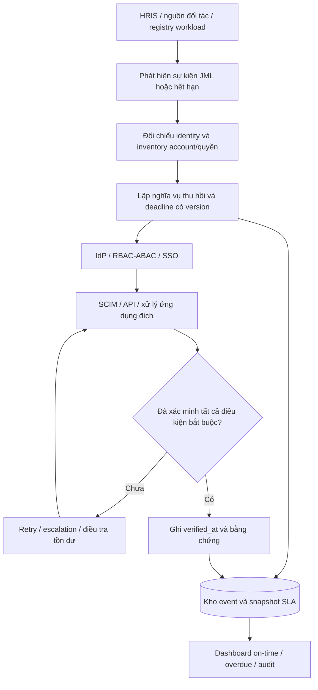

# Tỷ lệ deprovisioning đúng hạn trong IAM

**Tỷ lệ deprovisioning đúng hạn** (*on-time deprovisioning rate*) đo tỷ lệ nghĩa vụ **thu hồi quyền truy cập hoặc vô hiệu hóa danh tính/tài khoản** đã được thực hiện và xác minh trước hoặc đúng hạn cam kết. Đây là một chỉ số trọng yếu trong **IAM metrics**, vì một tài khoản không còn được phép truy cập nhưng vẫn sử dụng được có thể trở thành nguồn rủi ro bảo mật dù các quy trình nhân sự và cấp phát tài khoản đang vận hành bình thường.

Trong module **SECURITY_IDENTITY_ACCESS_MANAGEMENT_IDENTITY_LIFECYCLE**, việc đo chỉ số này gắn với vòng đời **Joiner–Mover–Leaver (JML)**: khi nhân viên gia nhập có thể cần hủy quyền tạm, khi đổi vai trò phải thu hồi quyền cũ, khi nghỉ việc phải chặn truy cập phù hợp thời điểm hiệu lực. Đối tượng còn gồm nhà thầu, đối tác, tài khoản dịch vụ và danh tính workload. Thực thi liên quan đến **Identity Provider (IdP)**, **Single Sign-On (SSO)**, **System for Cross-domain Identity Management (SCIM)**, chính sách **RBAC/ABAC**, nhật ký kiểm toán và đối soát quyền truy cập tồn dư.

Sau bài học, người học có thể xác định **điều gì phải thu hồi**, **khi nào nghĩa vụ đến hạn**, **bằng chứng nào xác nhận đã thu hồi**, và **cách tính tỷ lệ tránh bỏ sót những ca đã quá hạn nhưng còn mở**.

## 1. Deprovisioning là gì?

**Deprovisioning** là quá trình chấm dứt hoặc giảm những khả năng truy cập không còn được cho phép của một chủ thể số. Tùy tình huống, quá trình có thể bao gồm:

- Vô hiệu hóa một identity ở IdP hoặc đình chỉ đăng nhập.
- Khóa/xóa account tại ứng dụng đích thông qua SCIM, API, tác vụ quản trị hoặc quy trình thủ công có xác minh.
- Gỡ nhóm, vai trò, policy và entitlement theo **Role-Based Access Control (RBAC)** hoặc **Attribute-Based Access Control (ABAC)**.
- Thu hồi phiên truy cập, refresh token, credential, khóa API, chứng chỉ hoặc bí mật liên quan khi chính sách yêu cầu.
- Hủy quyền tạm, quyền đặc quyền, quyền được ủy quyền và liên kết truy cập với hệ thống khác.
- Lưu bằng chứng phục vụ kiểm toán, đối soát hệ thống đích và xác định phần truy cập còn tồn dư.

**Không đồng nhất deprovisioning với xóa dữ liệu người dùng.** Có thể cần bảo toàn hồ sơ, hộp thư, dữ liệu nghiệp vụ hoặc nhật ký kiểm toán theo chính sách lưu giữ. Mục tiêu của deprovisioning là **chấm dứt quyền không còn hợp lệ**; xóa identity hoặc dữ liệu là bước vòng đời riêng, chịu chính sách lưu giữ và quyền riêng tư.

Cũng không nên kết luận đã thu hồi đầy đủ chỉ vì:

| Sự kiện quan sát được | Có thể đã xảy ra | Vì sao chưa đủ kết luận? |
|---|---|---|
| HRIS đánh dấu nhân viên đã nghỉ | Trạng thái nhân sự thay đổi | IdP và ứng dụng đích có thể chưa nhận sự kiện |
| IdP chuyển identity sang `disabled` | Đăng nhập mới qua IdP bị chặn theo cấu hình | Phiên cũ, tài khoản ứng dụng cục bộ hoặc token đã cấp có thể còn hiệu lực |
| SSO thực hiện logout | Một số phiên đăng nhập đã kết thúc | Ứng dụng khác hoặc token không kiểm tra phiên tập trung có thể vẫn hoạt động |
| SCIM/API trả `200`, `204` hoặc chấp nhận job | Lệnh thu hồi đã được tiếp nhận/thực thi ở một tầng | Cần kiểm tra trạng thái mục tiêu, xử lý bất đồng bộ và khả năng truy cập thực tế |
| Ticket chuyển trạng thái `Closed` | Công việc hành chính đã được đóng | Thời điểm đóng ticket không tự chứng minh tài khoản/entitlement đã bị thu hồi |
| Mỗi target bắt buộc được xác minh không còn quyền thuộc phạm vi | Nghĩa vụ đã đạt tiêu chí nghiệm thu | Có thể ghi mốc `verified_at` làm thời điểm hoàn tất |

Nguyên tắc kiểm soát là: **đo thời điểm hoàn tất đã xác minh, theo phạm vi thu hồi được xác định trước**. Tổ chức có thể có các giai đoạn thu hồi khác nhau, ví dụ khóa truy cập khẩn cấp trước rồi dọn các bản ghi còn lại sau; mỗi giai đoạn có thể mang deadline riêng.

## 2. Xác định đơn vị đếm: ca nghiệp vụ hay nghĩa vụ thu hồi?

Số liệu sẽ sai nếu vừa đếm theo nhân viên vừa đếm theo ứng dụng mà không công bố quy ước. Hai đơn vị thường gặp:

| Đơn vị đếm | Điều kiện đúng hạn | Phù hợp để theo dõi |
|---|---|---|
| **Ca JML** (`case_id`) | Toàn bộ nghĩa vụ **bắt buộc** của ca đã hoàn tất trong thời hạn áp dụng cho từng nghĩa vụ | Chất lượng xử lý một ca nghỉ việc/chuyển vai trò từ đầu đến cuối |
| **Nghĩa vụ thu hồi** (`obligation_id`) | Một mục thu hồi cụ thể đã xác minh trước hoặc đúng `due_at` của mục đó | SLA theo hệ thống đích, loại quyền, mức độ khẩn cấp |

Giả sử một ca Leaver cần khóa IdP, gỡ quyền CRM và thu hồi khóa API. Hai mục đầu đúng hạn, khóa API trễ. Nếu ba nghĩa vụ đều hợp lệ và cùng nằm trong kỳ: **tỷ lệ theo nghĩa vụ là 2/3**, còn **ca Leaver đầu cuối chưa đạt đúng hạn** vì tồn tại một mục bắt buộc trễ. Phải công bố rõ cấp đo và không lấy 2/3 để khẳng định ca nghỉ việc đã hoàn tất an toàn.

Trong bài này, tỷ lệ chính được tính **theo nghĩa vụ thu hồi có ID riêng**. Khi trình bày số liệu ở cấp ca JML, nêu công thức riêng và không trộn mẫu số với số obligation.

### Thế nào là một nghĩa vụ hợp lệ?

Một nghĩa vụ deprovisioning cần chỉ rõ:

1. **Chủ thể:** `identity_id` của người dùng, nhà thầu, service account hoặc workload.
2. **Tài nguyên:** ứng dụng/tài khoản/nhóm/vai trò/token cần thu hồi; có thể định danh bằng `target_id` và `entitlement_id`.
3. **Hành động yêu cầu:** vô hiệu hóa, xóa tư cách thành viên nhóm, thu hồi credential hoặc biện pháp khác.
4. **Nguyên nhân:** Leaver, Mover, hết hạn hợp đồng, kết thúc quyền tạm, sự cố hoặc thay đổi chủ sở hữu service.
5. **Mốc hiệu lực và deadline:** khi nào quyền không còn hợp lệ và việc thu hồi phải được xác minh muộn nhất lúc nào.
6. **Tiêu chí nghiệm thu:** bằng chứng nào chứng tỏ quyền đã không còn khả dụng theo thiết kế của hệ thống đích.

Các thao tác retry của cùng một obligation không tạo thêm obligation mới. Nếu một quyền có hai bước kỹ thuật liên tiếp, ví dụ thu hồi session rồi vô hiệu hóa account, có thể biểu diễn thành một nghĩa vụ gồm hai điều kiện bắt buộc hoặc hai nghĩa vụ có deadline riêng. Cách chọn phải được chuẩn hóa **trước** khi kỳ đo diễn ra.

## 3. Mốc bắt đầu và deadline của SLA

**Service Level Agreement (SLA)** của deprovisioning định nghĩa thời hạn thu hồi. Không tồn tại một con số phút/giờ chung phù hợp cho mọi hệ thống. Với ca nhạy cảm, tổ chức có thể yêu cầu ngừng khả năng truy cập ngay khi sự kiện có hiệu lực; với thao tác dọn dẹp không ảnh hưởng truy cập, thời hạn có thể khác.

Nên ghi riêng các mốc sau:

| Trường | Ý nghĩa |
|---|---|
| `source_event_at` | Thời điểm sự kiện được ghi ở nguồn có thẩm quyền, ví dụ HRIS |
| `effective_at` | Thời điểm thay đổi quyền/nghỉ việc có hiệu lực theo nghiệp vụ |
| `received_at` | Thời điểm nền tảng IAM nhận sự kiện; hữu ích để đo độ trễ tích hợp |
| `eligible_at` | Thời điểm nghĩa vụ đã có đủ dữ liệu để xử lý, nếu SLA định nghĩa mốc này |
| `sla_policy_id`, `sla_version` | Quy tắc tạo deadline và phân loại mức rủi ro tại thời điểm áp dụng |
| `due_at` | Hạn cuối phải hoàn tất nghĩa vụ, đã tính theo quy tắc SLA |
| `verified_at` | Mốc kiểm chứng thu hồi thực tế; để trống khi chưa hoàn tất |
| `snapshot_at` | Thời điểm chốt báo cáo để xét nghĩa vụ đã đến hạn và còn mở |

Đối với Leaver có ngày nghỉ việc đã biết trước, hệ thống có thể **chuẩn bị** tác vụ trước `effective_at` nhưng không nên vô hiệu hóa quyền phục vụ công việc trước thời điểm cho phép. Nếu chính sách yêu cầu chặn truy cập tại 18:00, có thể thiết lập `due_at = effective_at` cho hành động khóa truy cập cốt lõi. Với một lớp nghiệp vụ khác có thời gian đáp ứng được cho phép, deadline có thể được tính sau `effective_at` theo quy tắc đã phê duyệt.

**Ví dụ giả định về SLA 15 phút:** Một nhân viên nghỉ việc hiệu lực lúc **18:00**; chính sách cho phép tối đa 15 phút để xác minh vô hiệu hóa truy cập ở các mục được xác định, nên `due_at = 18:15`. IdP được xác minh đã khóa lúc 18:03, CRM lúc 18:11, nhưng token riêng của một ứng dụng vẫn dùng được đến 18:17. Nghĩa vụ thu hồi token **trễ 2 phút**, dù ticket và hai thao tác còn lại đã xong trước 18:15.

Việc nguồn HRIS phát sự kiện muộn không nên làm biến mất vi phạm SLA. Cần tách **độ trễ phát hiện/tiếp nhận** khỏi **độ trễ xử lý**. Nếu chính sách thực sự bắt đầu từ `received_at`, phải ghi rõ như vậy trong SLA; nếu cam kết là ngừng truy cập tại thời điểm nghỉ việc có hiệu lực, không thể tự lùi deadline tới khi hệ thống IAM nhận thông báo. Cần quản lý múi giờ, lịch làm việc và quy tắc tính ngày nghỉ; với yêu cầu thu hồi khẩn cấp, thường không nên áp dụng mặc nhiên lịch giờ hành chính.

Các khoảng tạm dừng đồng hồ SLA, ngoại lệ theo pháp lý hay thay đổi phạm vi phải có quy định được phê duyệt, dấu thời gian và bằng chứng. Không thay `due_at` sau khi phát hiện trễ chỉ để cải thiện chỉ số.

## 4. Công thức tỷ lệ deprovisioning đúng hạn

Để các nghĩa vụ còn mở và đã trễ không bị bỏ sót, nên chọn **cohort theo ngày đến hạn** (*due-date cohort*) và chốt số liệu tại thời điểm `snapshot_at`.

Gọi:

- **E**: tập nghĩa vụ hợp lệ trong phạm vi đo, có `due_at` thuộc kỳ báo cáo và đã đến hạn tại `snapshot_at`.
- **T**: những nghĩa vụ thuộc E đã được xác minh hoàn tất với `verified_at <= due_at`.
- **L**: những nghĩa vụ thuộc E được xác minh **sau** deadline hoặc vẫn **chưa được xác minh** khi đã quá hạn.

Khi E được phân loại đầy đủ và không trùng lặp, ta có:

\[
\boxed{\text{Tỷ lệ deprovisioning đúng hạn} =
\frac{|T|}{|E|}\times100\%}
\]

\[
\text{Tỷ lệ trễ hạn} = \frac{|L|}{|E|}\times100\%
\]

Nếu không có nghĩa vụ hợp lệ đến hạn (`|E| = 0`), hãy hiển thị **N/A**, không mặc định 100%. Một nghĩa vụ vừa quá hạn vừa đang mở vẫn nằm trong E và thuộc L. Nghĩa vụ được hoàn tất sau deadline **vẫn là trễ** trong phân loại lịch sử.

### Cách loại trừ minh bạch

Một nghĩa vụ có thể không thuộc mẫu số nếu được xác nhận **không còn phát sinh hợp lệ** trước khi có nghĩa vụ thực hiện, ví dụ yêu cầu Mover bị hủy trước ngày hiệu lực hoặc phát hiện mục trùng được chứng minh bằng khóa liên kết. Việc loại trừ phải dựa trên chính sách, người duyệt và sự kiện kiểm toán. Không thể tùy tiện loại các ca lỗi, ca đã trễ rồi bị đóng, hoặc ca còn chờ xử lý thủ công.

Nghĩa vụ **chưa đến deadline** không nằm trong cohort đã đến hạn, kể cả nếu đã hoàn tất sớm. Có thể lập dashboard riêng để xem tiến độ dự kiến trong tương lai.

### Ví dụ tính toán

Một kỳ theo dõi có **125 nghĩa vụ** được xem xét tại thời điểm chốt:

| Trạng thái | Số nghĩa vụ | Xử lý trong phép tính |
|---|---:|---|
| Hoàn tất và xác minh đúng hạn | 80 | Thuộc E và T |
| Hoàn tất sau deadline | 20 | Thuộc E và L |
| Đã quá deadline nhưng còn mở | 10 | Thuộc E và L |
| Hủy/loại trừ hợp lệ theo quy tắc và có bằng chứng | 5 | Không thuộc E |
| Chưa đến deadline tại thời điểm chốt | 10 | Chưa thuộc E |
| **Tổng** | **125** | **E = 110, T = 80** |

Tỷ lệ deprovisioning đúng hạn là:

\[
\frac{80}{80+20+10}\times100\% \approx 72{,}73\%.
\]

Tỷ lệ trễ hạn tương ứng là **27,27%**. Nếu chỉ xét 100 nghĩa vụ đã hoàn tất, con số sẽ thành 80% và **che mất 10 nghĩa vụ đã trễ nhưng còn truy cập có nguy cơ tồn dư**.

Để báo cáo dễ kiểm chứng, luôn hiển thị cạnh phần trăm các nhóm **đúng hạn, hoàn tất muộn, quá hạn còn mở, chưa đến hạn, loại trừ có lý do**.

## 5. Ý nghĩa theo vòng đời Joiner–Mover–Leaver

### Joiner: thu hồi quyền khởi tạo hoặc quyền tạm đã hết hạn

Giai đoạn Joiner tập trung vào cấp phát, nhưng đôi khi phải thu hồi tài khoản dùng để onboarding, quyền truy cập tạm hoặc lời mời chưa được xác nhận khi thời hạn hiệu lực kết thúc. Các nghĩa vụ này chỉ nên được đưa vào KPI deprovisioning nếu phạm vi được quy định rõ.

### Mover: thu hồi quyền của vai trò cũ

Khi nhân viên chuyển phòng ban, việc **cấp đúng hạn quyền mới** và **thu hồi đúng hạn quyền cũ** là hai cam kết khác nhau. RBAC/ABAC có thể tính lại nhóm/role theo chức danh, đơn vị, dự án hoặc độ nhạy dữ liệu.

Ví dụ, nhân viên rời nhóm hỗ trợ khách hàng để sang nhóm phân tích. Họ có thể được cấp quyền báo cáo lúc 09:00 đúng SLA provisioning; quyền xuất dữ liệu khách hàng của nhóm cũ phải được gỡ theo SLA deprovisioning. Nếu quyền cũ vẫn tồn tại, quy trình Mover chưa an toàn ngay cả khi mọi quyền mới đã được cấp.

Cần phân biệt **thu hồi entitlement** với **xóa identity**: cùng một người và một định danh chuẩn tiếp tục tồn tại; chỉ những quyền không còn phù hợp bị xóa.

### Leaver: chấm dứt quyền khi quan hệ kết thúc

Leaver có thể là nhân viên nghỉ việc, nhà thầu hết hạn hợp đồng hoặc đối tác kết thúc hợp tác. Nguồn có thẩm quyền phải gửi thông tin thời điểm hiệu lực và phạm vi; IAM lập danh sách mục đích thu hồi theo ứng dụng, tài khoản và quyền.

Các mục thường cần đối soát:

- Vô hiệu hóa identity tại IdP và truy cập cục bộ ngoài SSO.
- Hủy phiên/refresh token và các cơ chế xác thực còn được chấp nhận.
- Khóa/xóa account đích qua SCIM/API hay quản trị thủ công có bằng chứng.
- Thu hồi vai trò đặc quyền, quyền ủy quyền, mật khẩu dùng chung đã bị lộ cho chủ thể, API key và credential khác trong phạm vi liên quan.
- Chuyển giao quyền sở hữu tài nguyên/dữ liệu nghiệp vụ cho người được chỉ định, tránh xóa dữ liệu không đúng chính sách.

Một danh sách đích không đầy đủ làm KPI **cao giả tạo**: nếu chỉ đo ba ứng dụng dễ tích hợp và bỏ ứng dụng legacy còn quyền cục bộ, tỷ lệ có thể đạt 100% trong khi quyền tồn dư vẫn tồn tại. Việc xác định phạm vi phải dựa vào **inventory ứng dụng và mối liên hệ identity–account**.

### Danh tính dịch vụ, bot và workload

Deprovisioning cũng áp dụng khi một workload ngừng chạy, dịch vụ bị loại bỏ, service account đổi chủ hoặc credential bị thay thế. Ngoài khóa account, có thể phải thu hồi service principal, token, chứng chỉ, khóa API, secret và role cloud theo nguyên tắc quyền tối thiểu. Mỗi danh tính phi con người cần owner chịu trách nhiệm và quy trình kết thúc vòng đời.

Cần bảo đảm việc thu hồi quyền cũ không làm hỏng dịch vụ còn hoạt động: xác minh thành phần phụ thuộc, lên lịch cắt chuyển credential an toàn và áp dụng deadline theo mức rủi ro. Không lấy việc dịch vụ chưa có owner làm lý do để bỏ nghĩa vụ khỏi mẫu số một cách âm thầm.

## 6. Quy trình đo và bằng chứng hoàn tất

Một luồng dữ liệu vận hành có thể mô tả như sau:



Trong thực tế, **khóa IdP**, **thu hồi phiên/token**, **gỡ entitlement** và **khóa account ứng dụng** có thể diễn ra song song. Sơ đồ thể hiện luồng nghiệp vụ, không ép buộc các bước phải chạy tuần tự. Hệ thống nên xác định các bước cần thiết cho từng loại target trước khi thực thi.

Đề xuất một số trường dữ liệu cho mỗi nghĩa vụ:

| Trường | Mục đích |
|---|---|
| `obligation_id`, `case_id`, `identity_id` | Chống đếm trùng, nhóm các obligation thuộc cùng ca JML |
| `case_kind`, `identity_type` | Phân loại Mover/Leaver/expiry và human/service/workload |
| `target_system`, `account_id`, `entitlement_id`, `action` | Truy vết chính xác quyền hoặc tài khoản cần thu hồi |
| `effective_at`, `received_at`, `due_at` | Phân tích độ trễ nguồn, deadline và khoảng thời gian xử lý |
| `sla_policy_id`, `sla_version`, `risk_tier` | Tái lập quy tắc deadline và kiểm tra nhóm rủi ro |
| `verification_method`, `verified_at`, `evidence_ref` | Dấu vết xác minh trạng thái ở ứng dụng đích |
| `state`, `exception_code`, `exception_approved_by` | Quản lý trạng thái, ngoại lệ được phép, lý do loại trừ |
| `owner_team`, `correlation_id` | Điều phối xử lý lỗi và tìm sự kiện xuyên hệ thống |

**Bằng chứng xác minh** có thể là kết quả đọc lại trạng thái `active=false` của account đích, không còn membership trong nhóm, credential đã bị revoke, hoặc kiểm tra kỹ thuật được ủy quyền theo hợp đồng của hệ thống. Tùy tính năng ứng dụng, không thể bảo đảm mọi token truy cập đã phát hành đều bị chặn ngay: token tự chứa có thể còn hiệu lực tới khi hết hạn nếu bên nhận không hỗ trợ kiểm tra trạng thái/revocation. Trong trường hợp đó, tiêu chí hoàn tất và rủi ro còn lại phải phản ánh rõ khả năng của hệ thống, đồng thời ưu tiên biện pháp chặn thực sự nếu SLA yêu cầu.

Giữ sự kiện **bất biến theo thời gian**, kể cả các lần thử lỗi và retry. Cần chống trùng sự kiện từ HRIS/SCIM, nhận diện các yêu cầu bị mất, đồng bộ clock và hạn chế quyền truy cập log chứa dữ liệu cá nhân. Bằng chứng kiểm toán được lưu theo chính sách và tách khỏi bản ghi identity đã xóa để không làm mất dấu vết xử lý sự cố.

## 7. SQL: tính tỷ lệ theo nghĩa vụ đã đến hạn

Giả sử có bảng PostgreSQL `iam_deprovision_obligation_snapshot`, mỗi hàng là **một obligation duy nhất tại một `snapshot_at`**. Các cột gồm:

- `obligation_id`, `case_kind`, `snapshot_at`, `due_at`, `verified_at`.
- `eligible_for_sla` là cờ đã được xác định bằng chính sách có bằng chứng, không thể tự đổi khi quá hạn.
- `verified_at` chỉ được ghi khi hoàn tất kiểm tra bắt buộc, có dấu vết ở hệ thống đích.

Ví dụ thống kê các obligation có **deadline trong tháng 11/2026** và **đã đến hạn trước hoặc đúng 14:00 ngày 23/11/2026 theo giờ Việt Nam**:

```sql
WITH due_obligations AS (
    SELECT
        obligation_id,
        case_kind,
        snapshot_at,
        due_at,
        verified_at
    FROM iam_deprovision_obligation_snapshot
    WHERE snapshot_at = TIMESTAMPTZ '2026-11-23 14:00:00+07'
      AND eligible_for_sla = TRUE
      AND due_at >= TIMESTAMPTZ '2026-11-01 00:00:00+07'
      AND due_at <  TIMESTAMPTZ '2026-12-01 00:00:00+07'
      AND due_at <= snapshot_at
),
classified AS (
    SELECT
        case_kind,
        COUNT(*) AS due_count,
        COUNT(*) FILTER (
            WHERE verified_at IS NOT NULL
              AND verified_at <= due_at
        ) AS on_time_count,
        COUNT(*) FILTER (
            WHERE verified_at > due_at
              AND verified_at <= snapshot_at
        ) AS late_completed_count,
        COUNT(*) FILTER (
            WHERE verified_at IS NULL
               OR verified_at > snapshot_at
        ) AS overdue_open_count
    FROM due_obligations
    GROUP BY case_kind
)
SELECT
    case_kind,
    due_count,
    on_time_count,
    late_completed_count,
    overdue_open_count,
    ROUND(
        100.0 * on_time_count / NULLIF(due_count, 0),
        2
    ) AS on_time_rate_pct
FROM classified
ORDER BY case_kind;
```

**Giả định cần giữ:** bảng snapshot phải là ảnh chụp nhất quán **as-of** thời điểm báo cáo. Nếu chỉ có bảng trạng thái hiện hành, việc truy vấn lại tháng cũ có thể dùng `verified_at` hoặc quy tắc loại trừ bị sửa sau kỳ chốt. Để đối soát lịch sử, dựng ảnh chụp từ event log (bao gồm các thay đổi hợp lệ về deadline, loại trừ và bằng chứng) hoặc lưu snapshot theo mốc.

Truy vấn trên đã tính các ca quá hạn còn mở vào mẫu số và xem hoàn tất muộn là trễ. Khi muốn tỷ lệ **theo ca JML**, phải nhóm tất cả obligation bắt buộc của từng `case_id` rồi kết luận ca đúng hạn chỉ khi **tất cả** mục đúng hạn; không dùng phép đếm `DISTINCT case_id` tùy tiện trên các nghĩa vụ đã hoàn thành vì sẽ bỏ sót các mục trễ của cùng ca.

## 8. Kiểm tra chất lượng dữ liệu và tránh KPI ảo

Độ tin cậy của tỷ lệ phụ thuộc mạnh vào khả năng đối chiếu dữ liệu nguồn với thực tế quyền truy cập.

| Kiểm tra | Dấu hiệu bất thường | Cách xử lý |
|---|---|---|
| Event Leaver trong HRIS nhưng không có nghĩa vụ tương ứng | Bỏ sót ca, KPI cao giả | Đối chiếu HRIS với identity inventory và kế hoạch deprovision |
| Account tại ứng dụng đích không ánh xạ identity chuẩn | Có thể bỏ sót quyền khi Leaver | Điều tra owner, tài khoản cục bộ, shared account và các ngoại lệ |
| IdP đã disable nhưng account đích còn active | SCIM lỗi/chậm hoặc có đường đăng nhập khác | Xác minh từng target và khắc phục truy cập tồn dư |
| `verified_at` có trước thời điểm gửi tác vụ mà không có giải thích | Sai clock, dữ liệu nhập tay hoặc ánh xạ event sai | Kiểm tra đồng bộ thời gian, nguồn bằng chứng, timestamp |
| Trùng `obligation_id` cùng snapshot | Tính trùng sau retry hoặc import | Thiết lập ràng buộc khóa duy nhất và idempotency |
| `due_at` bị thay đổi không có lịch sử | SLA bị điều chỉnh sau khi trễ | Ghi deadline ban đầu, phiên bản chính sách và phê duyệt |
| Số nghĩa vụ giảm bất thường sau một đợt tích hợp | Có thể mất target khỏi inventory | Đối chiếu CMDB, danh mục ứng dụng và account thực tế |
| Nhiều nghĩa vụ có `verified_at` đúng giờ đóng ticket | Có thể dùng thời gian hành chính làm bằng chứng | Yêu cầu sự kiện xác minh trạng thái hệ thống đích |

Không chỉ xem **tổng số obligation đúng hạn**. Một nghĩa vụ thu hồi tài khoản có quyền cao bị trễ có thể tạo rủi ro lớn hơn nhiều nghĩa vụ cấp thấp. Nên phân tách theo **mức rủi ro, loại tài khoản, hệ thống và phương thức xác minh**, đồng thời giữ một định nghĩa KPI nhất quán cho từng nhóm.

Cần theo dõi riêng các trường hợp danh tính đã bị khóa nhưng **token cũ còn hiệu lực**, tài khoản cục bộ không phụ thuộc SSO, quyền cloud inherited, secret dùng chung và liên kết bên thứ ba. Đây là các nguồn phổ biến của **residual access** mà một dashboard chỉ dựa trên trạng thái IdP có thể bỏ sót.

## 9. Kết hợp tỷ lệ đúng hạn với các chỉ số vận hành khác

Một tỷ lệ on-time duy nhất không cho biết **độ nghiêm trọng** hay **nguyên nhân** của các ca trễ. Nên hiển thị bên cạnh:

| Chỉ số | Câu hỏi quản trị |
|---|---|
| **Overdue-open count** | Có bao nhiêu nghĩa vụ đang quá hạn nhưng chưa xác minh hoàn tất? |
| **Time to revoke (p50/p95)** | Mất bao lâu từ mốc bắt đầu SLA tới khi đã xác minh thu hồi? |
| **Late exposure duration** | Các nghĩa vụ trễ kéo dài bao lâu sau deadline đến khi đã chặn truy cập? |
| **Coverage of required targets** | Bao nhiêu account/entitlement thuộc inventory đã được đưa vào phạm vi deprovision? |
| **Identity–account mapping coverage** | Có bao nhiêu account được ánh xạ tới identity/owner chịu trách nhiệm? |
| **Privileged access revocation on-time** | Quyền quản trị/đặc quyền được thu hồi đúng hạn ở mức nào? |
| **SCIM/API failure và retry** | Connector nào khiến nghĩa vụ trễ hoặc không có bằng chứng? |
| **Unverified completion count** | Bao nhiêu tác vụ tự báo thành công nhưng thiếu xác minh tại hệ thống đích? |

Phân vị thời gian chỉ trên những nghĩa vụ đã hoàn tất có thể che mất nhóm còn mở lâu ngày. Vì vậy, cần hiển thị **số lượng quá hạn còn mở** và độ trễ của nhóm này, thay vì công bố p95 độc lập.

**SLA** là cam kết xử lý theo từng loại nghĩa vụ; **SLO** là mục tiêu tổng hợp, ví dụ *“ít nhất 98% nghĩa vụ thu hồi chuẩn đến hạn trong tháng được xác minh đúng hạn”*. Mức 98% chỉ là ví dụ minh họa; các nghĩa vụ cấp cao có thể cần mục tiêu và thời hạn nghiêm ngặt hơn theo đánh giá rủi ro.

Nếu có 200 nghĩa vụ hợp lệ đến hạn trong kỳ và SLO = 98%, tối đa **4 nghĩa vụ** được trễ để vẫn đạt ngưỡng. Nhưng đạt tỷ lệ tổng thể không có nghĩa một nghĩa vụ quyền quản trị trễ là chấp nhận được; các nghĩa vụ rủi ro cao cần cảnh báo và cơ chế escalation riêng.

Cảnh báo nên phát sinh khi nghĩa vụ sắp đến hạn mà vẫn thiếu bằng chứng, khi đã quá hạn, khi IdP và ứng dụng đích không khớp trạng thái, hoặc khi deprovision của các quyền nhạy cảm thất bại. Mỗi cảnh báo nên kèm `obligation_id`, owner, deadline, hệ thống đích, trạng thái xác minh và liên kết log được phân quyền.

## 10. Những sai lầm thường gặp

1. **Chỉ đếm những nghĩa vụ đã hoàn tất:** bỏ qua các nghĩa vụ đã quá hạn còn mở nên tỷ lệ bị cao giả.
2. **Lấy thời điểm gửi lệnh SCIM làm lúc hoàn tất:** kết quả cuối ở hệ thống đích có thể chưa áp dụng hoặc quyền vẫn còn hiệu lực.
3. **Xem khóa IdP là toàn bộ deprovisioning:** account cục bộ, phiên cũ, refresh token hoặc credential độc lập có thể còn dùng được.
4. **Đổi mẫu số từ ca Leaver sang từng account mà không ghi rõ:** mất khả năng so sánh các kỳ.
5. **Tự loại ca khó hoặc ca xử lý thủ công:** che đi các ứng dụng legacy gây rủi ro lớn.
6. **Bỏ qua Mover:** tài khoản vẫn hợp lệ nhưng quyền cũ có thể không còn phù hợp, gây tích tụ đặc quyền.
7. **Không tính danh tính phi con người:** service account, workload, khóa API và cert cũ tiếp tục tồn tại.
8. **Điều chỉnh deadline sau khi trễ:** làm mất ý nghĩa của cam kết và dấu vết kiểm toán.
9. **Coi xóa dữ liệu là mục tiêu thu hồi:** có thể vi phạm chính sách lưu trữ hoặc làm mất bằng chứng cần giữ.
10. **Chỉ xem tổng tỷ lệ:** một số ít quyền đặc quyền thu hồi muộn vẫn tạo rủi ro nghiêm trọng dù KPI tổng thể cao.

## 11. Bài tập tự kiểm tra

**Tình huống 1.** Có 60 nghĩa vụ đã đến hạn: 42 xác minh đúng hạn, 8 xác minh muộn, 10 vẫn chưa xong. Tỷ lệ deprovisioning đúng hạn là bao nhiêu?

**Đáp án:** `42 / (42 + 8 + 10) × 100% = 70%`. Mười nghĩa vụ còn mở và quá hạn vẫn thuộc mẫu số.

**Tình huống 2.** Một ca Leaver có ba target bắt buộc. IdP và CRM đã disable đúng hạn nhưng quyền trên một ứng dụng cũ trễ. Tỷ lệ theo nghĩa vụ là bao nhiêu? Ca Leaver có đúng hạn không?

**Đáp án:** Nếu mỗi target là một nghĩa vụ và cùng thuộc kỳ, tỷ lệ là `2/3 ≈ 66,67%`. Ca tổng thể **không đúng hạn** do còn mục bắt buộc trễ.

**Tình huống 3.** IdP trả `disabled` lúc 17:55 nhưng ứng dụng đã phát token có hạn dùng đến 18:30, không kiểm tra trạng thái token khi nhận request. Deadline chặn truy cập là 18:00. Có thể tự đánh dấu tất cả quyền đã được thu hồi đúng hạn không?

**Đáp án:** **Không.** Phải kiểm tra tiêu chí thu hồi áp dụng cho ứng dụng và khả năng sử dụng token. Nếu quyền truy cập theo token vẫn còn được chấp nhận, chưa đủ bằng chứng rằng khả năng truy cập đã chấm dứt trước deadline.

**Tình huống 4.** Người dùng đổi bộ phận; quyền mới đã cấp đúng hạn, quyền cũ ở hệ thống báo cáo vẫn còn. KPI nào cần phản ánh vấn đề?

**Đáp án:** **Deprovisioning đúng hạn cho quyền cũ** và chỉ số quyền tồn dư. Provisioning quyền mới là cam kết khác và không thay thế kiểm tra thu hồi.

**Tình huống 5.** Một service account bị gỡ khỏi ứng dụng nhưng khóa API vẫn còn dùng được. Có thể tính nghĩa vụ “thu hồi toàn bộ truy cập của service account” là hoàn tất không?

**Đáp án:** **Không** nếu việc thu hồi khóa API là điều kiện bắt buộc của nghĩa vụ. Cần xác minh vô hiệu hóa credential, xác định owner và theo dõi deadline đã cam kết.

## Ghi nhớ

**Tỷ lệ deprovisioning đúng hạn** bằng **số nghĩa vụ thu hồi hợp lệ đã đến hạn và được xác minh hoàn tất đúng hạn chia cho tổng số nghĩa vụ hợp lệ đã đến hạn**. Đo đúng đòi hỏi chốt đơn vị đếm, nguồn sự kiện, deadline, tiêu chí nghiệm thu, lịch sử trạng thái và kiểm tra những ca **đã quá hạn nhưng còn mở**. Trong IAM Lifecycle, KPI cần bao phủ Mover, Leaver, người dùng bên ngoài và danh tính dịch vụ; đối soát IdP/SSO/SCIM với quyền thực tế ở ứng dụng đích; kết hợp RBAC/ABAC, kiểm toán và chỉ số **residual access** để phát hiện những quyền đáng lẽ đã bị thu hồi nhưng vẫn tồn tại.
