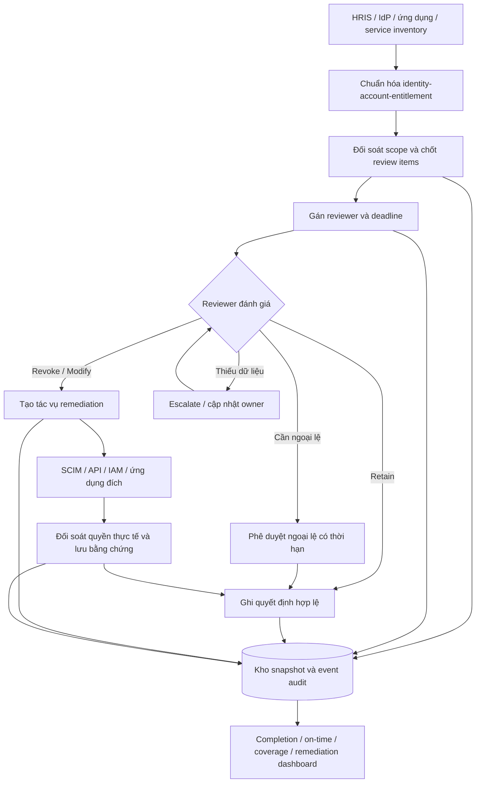

# Tỷ lệ access review trong IAM: đo mức hoàn tất rà soát quyền truy cập

**Tỷ lệ access review** (*access review completion rate*) cho biết **bao nhiêu mục quyền truy cập thuộc phạm vi cần rà soát đã được người có thẩm quyền xem xét và đưa ra quyết định hợp lệ** trong một kỳ. Đây là chỉ số của nhóm **IAM metrics**, thường được dùng để đánh giá chương trình *access certification* hoặc *access recertification*: quyền hiện có còn cần thiết, đúng người, đúng vai trò và đúng chính sách hay không.

Trong mô-đun **SECURITY_IDENTITY_ACCESS_MANAGEMENT_IDENTITY_LIFECYCLE**, access review kết nối trực tiếp với vòng đời danh tính **Joiner–Mover–Leaver (JML)**. Dữ liệu danh tính và tài khoản có thể đến từ **Identity Provider (IdP)**, **Single Sign-On (SSO)**, nguồn nhân sự, ứng dụng đích và các luồng cấp phát **SCIM**. Tiêu chí xét duyệt dựa vào chủ sở hữu tài nguyên, mô hình **RBAC/ABAC**, quyền đặc quyền và mức độ rủi ro. Quy trình review giúp phát hiện quyền dư thừa, nhưng quyết định thu hồi chỉ thực sự giảm rủi ro khi được **thực thi và xác minh** tại hệ thống đích.

Bài học tập trung vào cách thiết kế KPI, xác định đúng tử số/mẫu số, đo đúng hạn và chất lượng kết quả, dựng dashboard, xử lý các tình huống thường gặp và tránh báo cáo 100% review trong khi vẫn còn quyền truy cập tồn dư.

## 1. Access review là gì?

**Access review** là quá trình người có trách nhiệm xem xét quyền đã được cấp cho một chủ thể số và quyết định quyền đó **được giữ lại, sửa đổi, thu hồi hoặc xử lý theo ngoại lệ được phê duyệt**. Việc đánh giá phải căn cứ nhu cầu công việc, vai trò hiện tại, thuộc tính của chủ thể, chính sách và mức rủi ro.

Một mục rà soát có thể tương ứng với **một account trong ứng dụng**, **một vai trò**, **một entitlement cụ thể**, hoặc **một tổ hợp identity–resource–permission**. Chương trình phải chọn một **đơn vị đếm thống nhất** trước khi tạo chiến dịch. Chẳng hạn, nếu mục đích là rà soát quyền hiệu lực chi tiết, đơn vị có thể là một cặp identity–entitlement tại một hệ thống; nếu mục đích là chứng nhận cả gói role, đơn vị có thể là một role assignment.

Phân biệt những khái niệm gần nhau:

| Khái niệm | Câu hỏi chính | Kết quả mong đợi |
|---|---|---|
| **Access review** | Những quyền đang tồn tại có còn phù hợp không? | Quyết định có thẩm quyền, có bằng chứng và thời hạn |
| **Provisioning** | Quyền được yêu cầu đã được cấp đúng và đủ chưa? | Account/quyền mới xuất hiện tại hệ thống đích |
| **Deprovisioning** | Quyền không còn hợp lệ đã bị gỡ bỏ chưa? | Quyền/account/token được thu hồi hoặc vô hiệu hóa có xác minh |
| **Access monitoring** | Ai thực sự đã đăng nhập, thực thi hành động nào? | Sự kiện xác thực, sử dụng tài nguyên, cảnh báo |
| **Privileged access review** | Quyền quản trị/nhạy cảm có còn cần thiết không? | Chứng nhận, giảm quyền hoặc thu hồi quyền đặc quyền |

**Review hoàn tất không đồng nghĩa quyền đã được thu hồi.** Ví dụ, người quản lý chọn “Revoke” đúng hạn nhưng tác vụ SCIM bị lỗi. Mục review đã có quyết định, song việc xử lý quyền tồn dư vẫn chưa xong. Vì vậy, dashboard nên có ít nhất **completion rate** và **remediation rate** tách biệt.

## 2. Phạm vi review và các đối tượng cần tính

Một chiến dịch (*review campaign*) có thể diễn ra hàng tháng, hàng quý, theo sự kiện thay đổi vai trò hoặc theo mức độ rủi ro. Các tiêu chí phạm vi cần công bố gồm:

- **Chủ thể:** nhân viên, nhà thầu, người dùng ngoài tổ chức, danh tính đặc quyền, tài khoản dịch vụ, bot và workload identity.
- **Tài nguyên:** ứng dụng, cơ sở dữ liệu, nhóm thư mục, vai trò cloud, repository, kho dữ liệu nhạy cảm, khóa API và các quyền trực tiếp/gián tiếp.
- **Loại quyền:** vai trò RBAC, chính sách ABAC, membership nhóm, entitlement ứng dụng, quyền admin, quyền tạm thời và ủy quyền.
- **Chu kỳ:** snapshot các quyền tại thời điểm chốt (*scope cutoff*), ngày mở chiến dịch, hạn review và hạn xử lý quyết định thu hồi.
- **Chủ thể phê duyệt:** manager, application owner, data owner hoặc người được ủy quyền đúng chính sách; tránh trường hợp tự phê duyệt quyền của chính mình khi có xung đột lợi ích.

Có nhiều cách gán quyền cho một người. Ví dụ, một entitlement đọc dữ liệu được cấp trực tiếp và thông qua nhóm lồng nhau. **Không tự cộng hai đường cấp phát thành hai mục quyền hiệu lực** nếu chiến dịch đã định nghĩa đơn vị là một quyền hiệu lực duy nhất; ngược lại, nếu mục tiêu là dọn từng đường cấp quyền, có thể tạo hai *grant-path review items* riêng. Cả hai cách đều hợp lý khi đơn vị đếm, khóa chống trùng và mục tiêu quản trị nhất quán.

Một review item nên có khóa bền vững, ví dụ:

```text
review_item_id = campaign_id + canonical_identity_id
                 + target_system_id + entitlement_id + grant_path_id
```

Đây là ví dụ về **khóa logic** cho chiến dịch đếm theo từng đường cấp quyền. Nếu chiến dịch đếm theo quyền hiệu lực, phải bỏ hoặc chuẩn hóa `grant_path_id` để không đếm trùng. Email, tên hiển thị và username không nên là khóa duy nhất vì có thể thay đổi hoặc tái sử dụng.

### Scope phải có mốc chốt

Tại thời điểm mở chiến dịch, hãy cố định hoặc phiên bản hóa **danh sách item cần xét**. Nếu một nhân viên nghỉ việc hay bị gỡ quyền giữa kỳ, item ban đầu không được biến mất khỏi lịch sử mà không có quyết định hoặc quy tắc loại trừ có bằng chứng. Ngược lại, quyền được cấp mới sau mốc chốt có thể đi vào một chiến dịch khác hoặc một luồng review theo sự kiện; không nên âm thầm thêm vào mẫu số kỳ đã công bố.

Ngoại lệ hợp lệ, như quyền đã bị thu hồi trước mốc chốt, entitlement trùng do import hoặc tài nguyên không thuộc phạm vi chiến dịch, phải có **lý do, người xác nhận và dấu thời gian**. Không loại các item khó review chỉ vì chưa xác định được người duyệt; đó thường là một vấn đề quản trị cần được đo riêng.

## 3. Định nghĩa tỷ lệ access review cơ bản

Giả sử một chiến dịch đã xác định được tập \(S\) gồm các **review item hợp lệ trong phạm vi** tại thời điểm chốt. Một item được coi là **completed** khi có quyết định cuối cùng hợp lệ, người duyệt được phân quyền, thời điểm quyết định và bằng chứng kèm theo.

Các quyết định thường gặp:

| Quyết định | Nghĩa nghiệp vụ | Khi nào tính hoàn tất review? |
|---|---|---|
| **Retain / Approve** | Tiếp tục giữ quyền vì còn nhu cầu hợp lệ | Khi người có thẩm quyền xác nhận và có bằng chứng |
| **Revoke** | Gỡ bỏ quyền không còn cần thiết | Khi quyết định thu hồi đã được ghi hợp lệ; thực thi thu hồi đo riêng |
| **Modify** | Giảm/chỉnh phạm vi quyền | Khi quyết định sửa đổi đủ rõ để triển khai, có lý do và người duyệt |
| **Approved exception** | Tạm giữ quyền có rủi ro theo ngoại lệ | Chỉ khi ngoại lệ được phê duyệt đúng thẩm quyền, có phạm vi, thời hạn và kiểm soát bổ sung cần thiết |
| **Pending / In review** | Chưa có quyết định cuối | Không tính hoàn tất |
| **Delegated / Escalated** | Đã chuyển người xử lý | Chưa tính hoàn tất cho đến khi có quyết định hợp lệ |
| **System auto-closed** | Hệ thống tự đóng theo cấu hình | Chỉ tính nếu chính sách cho phép rõ ràng và có bằng chứng quyết định hợp lệ; không mặc nhiên coi là đã chứng nhận |

Ký hiệu:

- \(N_{\text{scope}}\): số item hợp lệ thuộc \(S\).
- \(N_{\text{completed}}(t)\): số item có quyết định cuối cùng hợp lệ vào hoặc trước thời điểm báo cáo \(t\).

Khi đó:

\[
\boxed{\text{Access review completion rate}(t)=
\frac{N_{\text{completed}}(t)}{N_{\text{scope}}}\times100\%}
\]

**Nếu mẫu số bằng 0**, báo cáo **N/A** và ghi rõ không có item thuộc phạm vi; không mặc định hoàn thành 100%.

Ví dụ, chiến dịch có 200 item hợp lệ. Đến thời điểm báo cáo:

| Kết quả | Số item | Tính hoàn tất? |
|---|---:|---|
| Retain có phê duyệt | 118 | Có |
| Revoke đã quyết định | 42 | Có |
| Modify đã quyết định | 18 | Có |
| Ngoại lệ đã phê duyệt hợp lệ | 2 | Có |
| Chưa được duyệt / đang xử lý | 20 | Chưa |
| **Tổng** | **200** | **180 hoàn tất** |

\[
\text{Completion rate}=
\frac{118+42+18+2}{200}\times100\%=90\%.
\]

Con số 90% thể hiện **tiến độ quyết định review**. Nó **không có nghĩa 90% quyền an toàn**, không bảo đảm 42 quyền được yêu cầu thu hồi đã thực sự biến mất và cũng không có nghĩa 20 item còn mở đều mang rủi ro bằng nhau.

## 4. Những biến thể KPI phải tách rõ

Từ dữ liệu review, tổ chức thường tính thêm các chỉ số khác. Không dùng chung một tên “tỷ lệ access review” cho tất cả chúng.

| KPI | Tử số | Mẫu số | Diễn giải |
|---|---|---|---|
| **Completion rate** | Item đã có quyết định hợp lệ tại thời điểm chốt | Toàn bộ item thuộc phạm vi chiến dịch | Mức hoàn tất review |
| **On-time review rate** | Item có quyết định hợp lệ **trước hoặc đúng deadline** | Item thuộc phạm vi **đã đến hạn** | Mức tuân thủ thời hạn review |
| **Coverage rate** | Identity/account/entitlement được đưa vào ít nhất một review phù hợp | Tổng đối tượng **phải** được review theo chính sách | Chương trình có bỏ sót phạm vi không? |
| **Revocation / modification decision rate** | Item được quyết định revoke/modify | Item đã có quyết định hợp lệ, hoặc toàn bộ item nếu báo cáo chỉ rõ | Tỷ lệ item bị phát hiện cần điều chỉnh |
| **Remediation completion rate** | Hành động thu hồi/sửa quyền đã **thực thi và xác minh** | Hành động phát sinh từ quyết định review phải xử lý | Mức thực thi các quyết định |
| **Overdue review rate** | Item đã quá hạn nhưng chưa có quyết định | Item thuộc phạm vi đã đến hạn | Tồn đọng review quá hạn |

### 4.1. Đúng hạn khác hoàn tất

Giả sử trong 200 item ở ví dụ trên, đến hạn review đã qua và có:

- 166 item có quyết định hợp lệ trước hoặc đúng deadline.
- 14 item chỉ được quyết định sau deadline.
- 20 item vẫn chưa có quyết định tại thời điểm chốt.

**Completion rate hiện tại:** \(180/200=90\%\).

**On-time review rate:** \(166/200=83\%\).

Vì vậy, tổ chức có thể tăng completion từ 83% lên 90% bằng cách xử lý 14 item trễ, nhưng **tỷ lệ đúng hạn lịch sử vẫn là 83%**. Không được sửa ngày deadline hoặc ghi lùi thời điểm review để làm thay đổi kết luận về SLA.

Nếu báo cáo được chốt **trước deadline**, cần phân biệt item **chưa đến hạn** với item **đã quá hạn**, hoặc chỉ tính on-time trên cohort các item đã đến hạn tại thời điểm chốt. Một item chưa đến hạn và chưa hoàn tất **không phải** overdue.

### 4.2. Coverage khác completion

Một ứng dụng có 1.000 quyền thuộc diện phải review nhưng quá trình trích xuất chỉ đưa 800 quyền vào chiến dịch. Nếu cả 800 được duyệt, completion rate có thể đạt **100%**, nhưng **coverage mới đạt 80%** theo tiêu chí đơn vị đếm quyền. Đây là lý do phải đối soát inventory của IdP/ứng dụng với scope chiến dịch.

**Coverage denominator** phải là toàn bộ đối tượng bắt buộc review được xác định theo chính sách ở một thời điểm. Hệ thống không được dùng chính danh sách 800 item đã thu thập làm mẫu số coverage rồi tự công bố 100%.

### 4.3. Quyết định Revoke chưa phải remediation

Nếu 42 item có quyết định “Revoke” và 18 item “Modify”, hệ thống có **60 hành động cần xử lý** (trong ví dụ, mỗi quyết định tạo một hành động). Giả sử 47 hành động được xác minh đúng hạn, 7 được xác minh trễ và 6 vẫn mở:

\[
\text{Remediation completion rate}=
\frac{47+7}{60}\times100\%=90\%.
\]

\[
\text{On-time remediation rate}=
\frac{47}{60}\times100\%\approx78{,}33\%.
\]

Các hành động đó phải có **deadline xử lý riêng**; không lấy hạn review thay cho hạn thu hồi nếu hai cam kết khác nhau. Một quyết định có thể tạo nhiều tác vụ hệ thống đích; cần chọn đơn vị hành động độc lập, bảo đảm phân nhóm và chống đếm trùng trước khi tính.

## 5. Access review nằm ở đâu trong Joiner–Mover–Leaver?

### Joiner: kiểm tra quyền ban đầu và ngoại lệ

Sau khi xác minh nhân sự, IdP có thể tạo identity, SSO cho đăng nhập và SCIM/API cấp account tới ứng dụng. Chính sách RBAC/ABAC quyết định role hoặc entitlement theo chức năng. Dữ liệu cấp quyền ban đầu cần được lưu để phục vụ review định kỳ hoặc review theo rủi ro.

Đối với các quyền ngoại lệ, quyền quản trị hoặc quyền tạm cấp trong giai đoạn onboarding, có thể yêu cầu review sớm hơn chu kỳ thông thường. Người duyệt cần đánh giá quyền đó có phù hợp công việc thực tế, thời hạn và nguyên tắc **least privilege** hay không.

**Ví dụ:** Một người mới vào nhóm kế toán được cấp role chuẩn nhưng có thêm quyền xuất tất cả dữ liệu khách hàng do cấu hình sai. Quy trình cấp phát có thể đã chạy “thành công”; access review phải nhận diện quyền bổ sung không phù hợp, yêu cầu thu hồi và kiểm tra đã xử lý.

### Mover: rà soát quyền cũ và quyền mới

Khi một nhân viên chuyển vai trò, mục tiêu là bảo đảm **quyền mới đủ cho công việc** và **quyền cũ không còn cần thiết được gỡ**. Access review theo sự kiện Mover có thể ưu tiên các quyền chồng chéo giữa hai vị trí, quyền quản trị, quyền dữ liệu nhạy cảm và xung đột **Segregation of Duties (SoD)**.

**Ví dụ:** Người dùng từ nhóm mua hàng chuyển sang kiểm soát thanh toán. Vai trò mới cho phép kiểm tra giao dịch, còn quyền tạo nhà cung cấp ở vai trò cũ cần thu hồi để tránh xung đột nhiệm vụ. Nếu review chỉ xác nhận quyền mới mà bỏ quyền cũ, completion rate có thể cao nhưng vẫn tồn tại rủi ro SoD.

### Leaver: review hỗ trợ phát hiện sót, không thay thế thu hồi khẩn cấp

Khi người dùng nghỉ việc hoặc hợp đồng đối tác kết thúc, hệ thống phải chủ động vô hiệu hóa identity, thu hồi account/quyền/token theo thời hạn. **Không được đợi đến kỳ access review tiếp theo mới xử lý Leaver.**

Review có thể phát hiện các account cục bộ, kết nối bên thứ ba, role cũ hoặc quyền ủy quyền còn tồn tại dù IdP đã disable identity. Các trường hợp này cần chuyển sang quy trình **deprovisioning** với người chịu trách nhiệm và bằng chứng xác minh. Chỉ số review đo việc **phát hiện/quyết định**; KPI deprovisioning đo việc **thu hồi đúng hạn**.

### Danh tính dịch vụ và workload

Service account, bot, API client và workload identity thường không có người sử dụng trực tiếp nhưng có quyền truy cập dài hạn hoặc phạm vi rộng. Review cần ghi rõ **technical owner**, **business owner**, ứng dụng phụ thuộc, credential đang hoạt động, thời hạn và tính cần thiết của từng quyền.

Với danh tính phi con người (*non-human identity — NHI*), “không thấy người đăng nhập” không chứng minh quyền không dùng, vì dịch vụ có thể xác thực bằng token, certificate hoặc workload federation. Quyết định cần dựa trên dependency, usage log phù hợp và kiến trúc truy cập. Một NHI không xác định được owner phải được **escalate và kiểm soát** thay vì tự động “Retain”.

## 6. Thiết kế quy trình review có thể kiểm toán

Một chu kỳ review điển hình:



Sơ đồ cho thấy **quyết định review** và **xác minh remediation** có thể được theo dõi tách biệt. Trong hệ thống thực, một quyết định “Revoke” có thể được ghi hoàn tất ở bước đánh giá trước khi tác vụ hệ thống đích hoàn thành; không phải chờ K rồi mới tính item đã có quyết định review. Nếu tổ chức chọn khái niệm *campaign closed* chỉ sau remediation, cần đặt tên và công bố định nghĩa KPI khác.

Một bộ dữ liệu tối thiểu:

| Trường | Vai trò |
|---|---|
| `campaign_id`, `review_item_id` | Định danh chiến dịch và mục review, chống đếm trùng |
| `canonical_identity_id`, `identity_type` | Liên kết người dùng, nhà thầu hoặc NHI với nguồn chủ thể chuẩn |
| `account_id`, `target_system_id`, `entitlement_id` | Xác định chính xác quyền và ứng dụng |
| `grant_path`, `privilege_level`, `risk_level` | Truy vết quyền trực tiếp/gián tiếp, độ nhạy và ưu tiên |
| `reviewer_id`, `reviewer_role` | Người có thẩm quyền quyết định; kiểm soát trường hợp tự phê duyệt |
| `scope_cutoff_at`, `assigned_at`, `due_at` | Định nghĩa phạm vi chiến dịch, thời điểm giao việc và hạn |
| `decision`, `decided_at`, `decision_reason` | Quyết định cuối, dấu thời gian và lý do |
| `exception_id`, `exception_expires_at` | Truy vết ngoại lệ có thời hạn; không biến ngoại lệ thành quyền thường trực |
| `remediation_task_id`, `remediation_due_at`, `verified_at` | Liên kết việc thu hồi/sửa quyền và bằng chứng hoàn tất |
| `snapshot_at`, `source_system`, `correlation_id` | Tái lập báo cáo, nguồn dữ liệu và chuỗi sự kiện kiểm toán |

Để dữ liệu đáng tin, mỗi quyết định nên được ghi dưới dạng **sự kiện kiểm toán** có danh tính reviewer, trạng thái/phạm vi quyền lúc xét, thời điểm, lý do và nguồn chứng cứ. Nếu người duyệt thay đổi quyết định, cần giữ lịch sử trước đó, không âm thầm ghi đè.

### Ai nên là reviewer?

- **Line manager** xác nhận nhu cầu công việc và thay đổi vai trò.
- **Application/data owner** hiểu hệ quả của quyền truy cập vào tài nguyên cụ thể.
- **Security/IAM** định nghĩa chính sách, phân nhóm rủi ro, SoD và kiểm tra độc lập.
- **Service owner** xác nhận phụ thuộc và quyền của NHI.

Không phải mọi quyền đều phù hợp để line manager tự duyệt: quyền đặc quyền, môi trường production hoặc dữ liệu nhạy cảm có thể đòi hỏi owner chuyên trách hoặc nhiều tầng phê duyệt. Nếu reviewer vắng mặt, cần có cơ chế chuyển giao và escalation có audit; chuyển tiếp nhiệm vụ **không phải** là một quyết định hoàn tất.

## 7. Ví dụ SQL tính completion và on-time review

Giả sử nền tảng đã có bảng snapshot PostgreSQL `iam_access_review_item_snapshot`. Mỗi dòng là **một `review_item_id` duy nhất cho một `campaign_id` và `snapshot_at`**, gồm các trường:

- `in_scope`: đã xác định theo quy tắc phạm vi và ngoại lệ được phép.
- `review_status`: `completed` chỉ khi có quyết định cuối cùng hợp lệ, đủ thẩm quyền và bằng chứng.
- `decided_at`: thời điểm quyết định hợp lệ; NULL nếu chưa hoàn tất.
- `due_at`: deadline đã tính theo chính sách và lưu phiên bản.
- `identity_type`: `human` hoặc `non_human`.

Truy vấn sau tính **completion rate tại thời điểm chốt** và **on-time rate trên những item đã đến hạn** của một chiến dịch. Ngày và mã chiến dịch chỉ là dữ liệu minh họa:

```sql
WITH scoped_items AS (
    SELECT
        campaign_id,
        review_item_id,
        identity_type,
        due_at,
        review_status,
        decided_at
    FROM iam_access_review_item_snapshot
    WHERE campaign_id = 'IAM-Q4-2026'
      AND snapshot_at = TIMESTAMPTZ '2026-11-23 14:00:00+07'
      AND in_scope = TRUE
),
metrics AS (
    SELECT
        identity_type,
        COUNT(*) AS scoped_count,
        COUNT(*) FILTER (
            WHERE review_status = 'completed'
              AND decided_at IS NOT NULL
              AND decided_at <= TIMESTAMPTZ '2026-11-23 14:00:00+07'
        ) AS completed_count,
        COUNT(*) FILTER (
            WHERE due_at <= TIMESTAMPTZ '2026-11-23 14:00:00+07'
        ) AS due_count,
        COUNT(*) FILTER (
            WHERE due_at <= TIMESTAMPTZ '2026-11-23 14:00:00+07'
              AND review_status = 'completed'
              AND decided_at IS NOT NULL
              AND decided_at <= due_at
        ) AS completed_on_time_count,
        COUNT(*) FILTER (
            WHERE due_at < TIMESTAMPTZ '2026-11-23 14:00:00+07'
              AND (
                  review_status <> 'completed'
                  OR decided_at IS NULL
                  OR decided_at > TIMESTAMPTZ '2026-11-23 14:00:00+07'
              )
        ) AS overdue_open_count
    FROM scoped_items
    GROUP BY identity_type
)
SELECT
    identity_type,
    scoped_count,
    completed_count,
    ROUND(100.0 * completed_count / NULLIF(scoped_count, 0), 2)
        AS completion_rate_pct,
    due_count,
    completed_on_time_count,
    ROUND(100.0 * completed_on_time_count / NULLIF(due_count, 0), 2)
        AS on_time_review_rate_pct,
    overdue_open_count
FROM metrics
ORDER BY identity_type;
```

**Điều kiện áp dụng:** snapshot phải lưu **trạng thái đúng tại thời điểm chốt**; nếu chỉ đọc bảng trạng thái hiện tại, kết quả tái tính lịch sử có thể sai khi item được duyệt muộn hoặc deadline bị cập nhật. Với item có nhiều lần quyết định, phải xác định **quyết định hợp lệ dùng để chứng nhận hoàn tất** theo quy trình, giữ lịch sử thay đổi và chỉ đưa một dòng/item vào snapshot.

Truy vấn cũng giả định `due_at` không NULL cho item đã gán SLA; các item thiếu hạn cần được xử lý như **lỗi chất lượng dữ liệu** chứ không tự loại khỏi mẫu số để làm đẹp on-time rate. Có thể thêm cột đếm `due_at IS NULL` để báo cáo riêng. Với việc hoàn tất đúng tại thời điểm deadline, dùng `decided_at <= due_at` để tính đúng hạn. Khi mẫu số bằng 0, `NULLIF` cho ra NULL, hiển thị **N/A** trên dashboard.

Muốn tính **coverage**, phải truy vấn thêm inventory tổng thể của quyền nằm trong chính sách bắt buộc review; bảng item trong chiến dịch **không đủ** để chứng minh scope đã bao phủ hết.

## 8. Rủi ro thường gặp khi diễn giải chỉ số

Một tỷ lệ review cao chỉ cho biết mức thực hiện **một phần** của chương trình kiểm soát. Các yếu tố sau có thể làm KPI tốt trên giấy nhưng rủi ro thực tế vẫn cao.

| Dấu hiệu | Vấn đề tiềm ẩn | Kiểm soát bổ sung |
|---|---|---|
| 100% review completed, 75% coverage | 25% quyền bắt buộc bị bỏ khỏi chiến dịch | Đối chiếu IAM với inventory ứng dụng và NHI |
| 100% review completed, nhiều quyết định Revoke còn pending | Quyền tồn dư chưa được xử lý | Theo dõi remediation đến khi xác minh thu hồi |
| Mọi item tự động nhận “Retain” trước deadline | Chứng nhận hình thức, thiếu đánh giá | Yêu cầu lý do, mẫu kiểm tra chất lượng và escalation |
| Reviewer tự duyệt quyền admin của chính mình | Xung đột lợi ích | Phân tách trách nhiệm và chỉ định reviewer độc lập |
| Item “exception” không có ngày hết hạn | Giữ quyền nhạy cảm vô thời hạn | Ngoại lệ có owner, thời hạn, phạm vi và tái đánh giá |
| Tỷ lệ review tăng khi scope giảm mạnh | Bỏ sót application/tenant/entitlement | Cố định snapshot, theo dõi biến động scope |
| Reviewer duyệt trên thông tin vai trò cũ | Dữ liệu Mover/Leaver không cập nhật | Liên kết HRIS, IdP và thông tin chủ sở hữu hiện hành |
| Account tồn tại ngoài SSO hoặc ứng dụng legacy | Quyền không hiện diện trong dữ liệu IdP | Inventory ứng dụng đích và reconciliation |
| NHI không có owner nhưng vẫn đánh dấu completed | Quyết định thiếu trách nhiệm | Xác lập owner hoặc chuyển tuyến kiểm soát |

Thành tích “đúng hạn” có thể mâu thuẫn với chất lượng quyết định nếu reviewer được khuyến khích nhấn phê duyệt hàng loạt cho xong. Để hạn chế, theo dõi tỷ lệ item bị đổi quyết định sau QA, số trường hợp SoD, số quyền đặc quyền giữ lại thiếu lý do và số ngoại lệ quá hạn. Không nên dùng một chỉ số duy nhất làm thước đo tuyệt đối về an toàn IAM.

### Dữ liệu và bằng chứng được kiểm soát như thế nào?

Báo cáo tổng hợp có thể hiển thị số liệu theo nhóm và mức rủi ro; danh sách chi tiết cần giới hạn theo quyền của reviewer và auditor. Tránh phát tán dữ liệu định danh hoặc quyền truy cập nhạy cảm vào email, file tạm không được quản lý. Khi hệ thống ghi log, cần lưu lịch sử quyết định, thay đổi người duyệt, kết quả remediation và thông tin chứng minh đã xác minh tại hệ thống đích.

Các quyền quản trị có thể được đánh giá bằng kiểm tra sâu hơn, nhưng đây là **quy tắc theo rủi ro** do tổ chức định nghĩa, không phải một ngưỡng phần trăm áp dụng cho mọi doanh nghiệp.

## 9. Thiết kế dashboard và mục tiêu vận hành

Một dashboard dễ sử dụng nên có:

1. **Scope:** số item thuộc phạm vi, số identity, hệ thống và entitlement đã bao phủ; tỷ lệ coverage so với danh mục bắt buộc.
2. **Progress:** completed, pending, delegated, escalated và những mục sắp đến hạn.
3. **Timeliness:** completed on time, completed late, overdue open, deadline gần nhất và thời điểm chốt.
4. **Decision distribution:** retain, revoke, modify, exception approved; phân theo người duyệt, ứng dụng và mức rủi ro.
5. **Remediation:** cần xử lý, đã xác minh, còn mở, đã quá hạn; nêu đường dẫn đến bằng chứng.
6. **Risk:** quyền đặc quyền, xung đột SoD, NHI thiếu owner, các quyền gắn identity đã nghỉ việc và item thiếu dữ liệu.

Ví dụ chính sách mục tiêu (*Service Level Objective — SLO*) có thể đặt “ít nhất 95% review item hợp lệ đã đến hạn trong quý được quyết định đúng hạn”. **95% chỉ là ví dụ**, phải dựa vào tần suất chiến dịch, mức rủi ro, nguồn lực và cam kết của tổ chức. Với quyền đặc quyền, một item chưa quyết định đúng hạn có thể cần escalation ngay, dù tỷ lệ tổng vẫn trên ngưỡng.

Khi completion rate giảm, đừng chỉ gửi nhắc nhở hàng loạt. Hãy kiểm tra các nguyên nhân: reviewer nghỉ việc, phân quyền reviewer sai, dữ liệu quyền quá khó hiểu, inventory chưa đầy đủ, hàng đợi phê duyệt tích lũy, thiếu SLA hoặc connector chưa cập nhật trạng thái. Từ kết quả này mới chọn tự động nhắc hạn, bổ sung thông tin cho reviewer, cải thiện mapping dữ liệu hoặc điều chỉnh quy trình chuyển tuyến.

## 10. Câu hỏi tự kiểm tra

**Câu 1.** Một chiến dịch có 150 item hợp lệ; 120 item đã có quyết định cuối cùng đúng thẩm quyền, 20 đang chờ reviewer và 10 đã được chuyển cấp nhưng chưa có quyết định. Completion rate là bao nhiêu?

**Đáp án:** \(120/150\times100\%=80\%\). Các item chuyển cấp chưa có quyết định vẫn thuộc nhóm chưa hoàn tất.

**Câu 2.** Trong 150 item thuộc phạm vi, 105 quyết định đúng hạn, 15 quyết định trễ và 30 chưa hoàn tất sau deadline. On-time rate là bao nhiêu? Completion rate hiện tại?

**Đáp án:** On-time \(=105/150=70\%\); completion hiện tại \(=(105+15)/150=80\%\). Hoàn tất muộn không sửa được tỷ lệ đúng hạn lịch sử.

**Câu 3.** Dashboard ghi 100% review completed đối với 800 entitlement, nhưng inventory cho thấy 1.000 entitlement thuộc chính sách bắt buộc review. Cần báo cáo thêm chỉ số gì?

**Đáp án:** **Coverage rate = 800/1.000 = 80%**. Completion của những item đã đưa vào chiến dịch không phản ánh mức bao phủ quyền bắt buộc.

**Câu 4.** Reviewer chọn “Revoke” cho role quản trị, nhưng SCIM báo lỗi và ứng dụng vẫn còn quyền. Item review đã hoàn tất chưa? Quyền đã được thu hồi chưa?

**Đáp án:** Item review **có thể đã hoàn tất** nếu quyết định hợp lệ đã được ghi; remediation **chưa hoàn tất** vì chưa có bằng chứng thu hồi thực tế. Hai chỉ số phải được theo dõi riêng.

**Câu 5.** Một nhân viên chuyển bộ phận, được cấp quyền mới qua RBAC nhưng còn quyền cũ trên ứng dụng legacy. Access review cần làm gì?

**Đáp án:** Rà soát quyền cũ theo nhu cầu vị trí mới, xác định quyền không còn phù hợp, ghi quyết định thu hồi, tạo nhiệm vụ deprovisioning và kiểm tra ứng dụng đích đã thực sự gỡ quyền.

**Câu 6.** Một service account không có owner nhưng đã từng dùng API 90 ngày trước. Có nên mặc định Retain để chiến dịch đạt 100% đúng hạn?

**Đáp án:** **Không.** Cần xác minh dependency và owner, chuyển cấp người có thẩm quyền, đánh giá phạm vi quyền theo rủi ro, rồi mới quyết định. Thiếu owner là vấn đề quản trị phải thể hiện trong dashboard.

## Ghi nhớ

**Tỷ lệ access review** thường chỉ **tỷ lệ review item thuộc phạm vi đã có quyết định cuối hợp lệ**, theo một snapshot và đơn vị đếm nhất quán. Muốn diễn giải đúng, phải công bố **completion, on-time, coverage và remediation** dưới các tên riêng; xử lý rõ item pending và ngoại lệ; kiểm tra reviewer có thẩm quyền; lưu bằng chứng quyết định và thực thi thu hồi. Access review kết nối **Joiner–Mover–Leaver** với IdP, SSO, SCIM, RBAC/ABAC, tài khoản dịch vụ và quy trình kiểm toán để giúp giảm **quyền truy cập tồn dư**, nhưng bản thân một quyết định review chưa phải bằng chứng quyền đã được gỡ ở ứng dụng đích.
