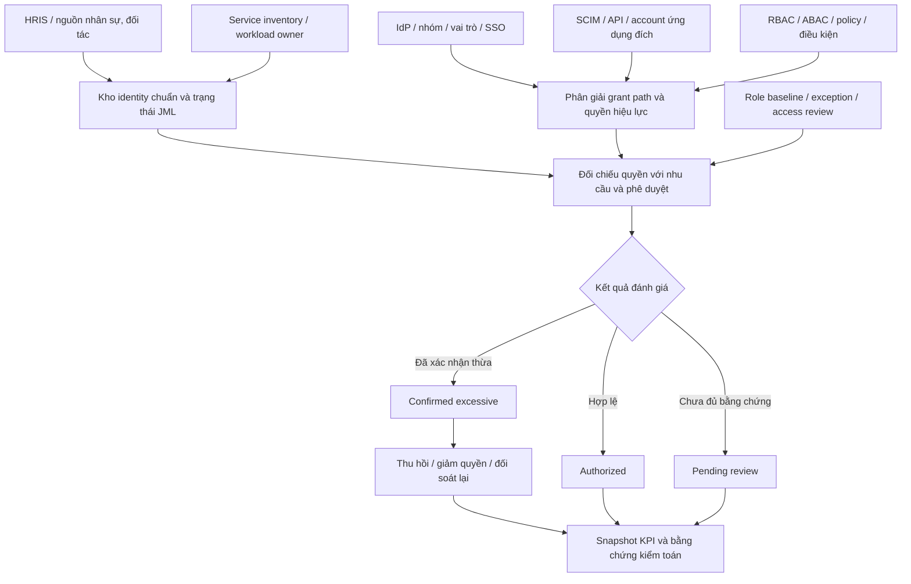

# Số quyền thừa trong IAM: xác định, đo lường và giảm quyền truy cập tồn dư

**Số quyền thừa** (*excessive permission count*) là số quyền truy cập **đang có hiệu lực nhưng không còn cơ sở nghiệp vụ hoặc chính sách hợp lệ để chủ thể tiếp tục nắm giữ**, trong một phạm vi và thời điểm đo xác định. Chỉ số này giúp phát hiện tình trạng *overprivilege* (được cấp nhiều quyền hơn mức cần thiết), **privilege creep** (tích lũy quyền qua thời gian) và **residual access** (quyền đáng lẽ đã thu hồi nhưng vẫn còn).

Trong chủ đề **IAM metrics** của mô-đun `SECURITY_IDENTITY_ACCESS_MANAGEMENT_IDENTITY_LIFECYCLE`, phép đo phải gắn với vòng đời danh tính **Joiner–Mover–Leaver (JML)**: quyền được cấp khi gia nhập, thay đổi khi chuyển vai trò và phải thu hồi khi không còn hợp lệ. Nguồn dữ liệu liên quan đến hệ thống nhân sự, **Identity Provider (IdP)**, **Single Sign-On (SSO)**, **SCIM**, chính sách **RBAC/ABAC**, tài khoản dịch vụ, kiểm toán và đối soát ứng dụng đích.

Đếm quyền thừa không chỉ là tìm các account lâu ngày không đăng nhập. Một người có thể dùng account thường xuyên nhưng vẫn nắm quyền quản trị vượt nhu cầu; ngược lại, quyền chưa được sử dụng gần đây vẫn có thể cần thiết cho ca trực khẩn cấp hợp lệ. Vì vậy, cần **xác minh quyền hiệu lực, đối chiếu nhu cầu đã được phê duyệt và lưu bằng chứng đánh giá**.

## 1. Phân biệt quyền được cấp, quyền hiệu lực và quyền thừa

Trong IAM, một **identity** là chủ thể cần quản lý; **account** là bản ghi tại một ứng dụng; **role/group/policy** là cơ chế biểu diễn hoặc cấp quyền; **entitlement/permission** là khả năng thực hiện một hành động trên tài nguyên theo điều kiện nhất định.

Ví dụ, identity `H-120` có account ở hệ thống báo cáo, thuộc nhóm `analyst` và được phép đọc dashboard. Nếu nhóm `analyst` vô tình được gán thêm quyền `delete_report`, quyền đó có thể trở thành quyền thừa của `H-120`.

Cần phân biệt:

| Khái niệm | Ý nghĩa | Ví dụ |
|---|---|---|
| **Assigned grant** | Một đường cấp quyền trực tiếp hoặc gián tiếp | Người dùng thuộc nhóm `analyst` |
| **Effective permission** | Khả năng truy cập thực tế sau khi xét role, kế thừa, policy và điều kiện | Có thể gọi API `DELETE /reports/{id}` trong một phạm vi |
| **Required/authorized permission** | Quyền cần thiết và được phép theo vai trò, nhiệm vụ, phê duyệt, ngoại lệ | `read_report` trên dự án A |
| **Excessive permission** | Quyền hiệu lực đã xác nhận vượt quá tập được phép/cần thiết | `delete_report` không thuộc trách nhiệm của người dùng |
| **Unused permission** | Quyền không quan sát thấy hoạt động sử dụng trong khoảng thời gian đo | Không có log gọi `delete_report` suốt 90 ngày |

**Quyền chưa dùng là dấu hiệu cần rà soát, không tự động là quyền thừa.** Thời gian quan sát có thể không bao phủ kỳ chốt sổ, ca trực, quy trình dự phòng hoặc API không ghi log đầy đủ.

Tương tự, **nhiều role không đồng nghĩa nhiều quyền thừa**. Một role có thể chứa quyền trùng với role khác; một quyền có thể được cấp qua nhiều đường. Phép đo cần thống nhất đang đếm **khả năng truy cập thực tế** hay **đường cấp phát cần gỡ**, vì hai số phục vụ hai mục đích khác nhau.

## 2. Xác định phạm vi và đơn vị đếm

Một dashboard quyền thừa chỉ có ý nghĩa nếu trả lời được:

1. **Đếm chủ thể nào?** Nhân viên, nhà thầu, đối tác, admin, service account, workload identity, bot hay toàn bộ?
2. **Đếm tài nguyên nào?** Ứng dụng SaaS, cloud, cơ sở dữ liệu, thư mục, API, secret, repository, tài nguyên production?
3. **Đếm loại quyền nào?** Quyền đọc/ghi/xóa, quyền quản trị, vai trò, membership nhóm, policy cloud, hành động đặc quyền, quyền truy cập tạm?
4. **Đếm theo đơn vị nào?** Một quyền hiệu lực trên một tài nguyên cho một identity hay một bản ghi grant trực tiếp/gián tiếp?
5. **Chốt tại thời điểm nào?** Ngày giờ, múi giờ, phiên bản role/policy và tình trạng ngoại lệ hợp lệ lúc đó.

Đối với **số quyền thừa chính**, nên bắt đầu bằng đơn vị **một bộ (identity, tài nguyên/phạm vi, hành động hoặc entitlement hiệu lực)**. Mỗi bộ được đếm tối đa **một lần tại một snapshot**, bất kể có bao nhiêu group hoặc role cùng tạo ra quyền ấy.

Ví dụ, một nhân viên có quyền `export_customer` qua hai group khác nhau. Nếu quyền hiệu lực này không hợp lệ, **số quyền thừa theo khả năng truy cập tăng 1**. Để thu hồi triệt để có thể cần xử lý **2 đường cấp phát**; đó là chỉ số *redundant/excessive grant paths* riêng.

Với quyền có điều kiện, bộ đếm cần phản ánh đủ ngữ cảnh: `read:data` ở dự án A không tương đương `read:data` trên toàn tổ chức; `delete` ở môi trường thử nghiệm khác `delete` trong production. Không cộng một chuỗi tên quyền trống ngữ cảnh rồi kết luận.

Có thể dùng khóa logic minh họa:

```text
effective_permission_key =
  canonical_identity_id
  + target_system_id
  + resource_scope
  + action
  + environment
  + relevant_policy_context
```

Đây là **mô hình khóa tham khảo**, không phải schema bắt buộc. `relevant_policy_context` chỉ cần các điều kiện ảnh hưởng kết luận, ví dụ tenant, nhãn dữ liệu, thời gian hiệu lực hoặc đặc tính thiết bị. Với ABAC động, có thể phải báo cáo theo **kịch bản quyền được đánh giá** thay vì khẳng định một identity luôn có quyền trong mọi ngữ cảnh.

### Ba trạng thái phải phân biệt khi đánh giá

| Phân loại | Điều kiện | Cách đưa vào KPI |
|---|---|---|
| **Confirmed excessive** | Quyền đang có hiệu lực, đã đối chiếu đủ chính sách/nhu cầu và xác nhận không hợp lệ | Tính vào số quyền thừa |
| **Candidate / pending review** | Có dấu hiệu bất thường nhưng chưa đủ bằng chứng hoặc chưa có reviewer có thẩm quyền | Báo cáo riêng, không tự khẳng định đã xác nhận thừa |
| **Authorized / valid exception** | Quyền có cơ sở hợp lệ, hoặc ngoại lệ được phê duyệt đúng hạn và đúng phạm vi | Không tính là quyền thừa trong thời gian hợp lệ |

Ngoại lệ không được là nhãn vô thời hạn. Nó phải có **người duyệt, lý do, phạm vi quyền, thời gian hết hạn và kiểm soát bù trừ** khi chính sách yêu cầu. Quyền theo ngoại lệ **hết hạn** cần được đánh giá lại; nếu vẫn hiệu lực mà không có phê duyệt hợp lệ, nó có thể chuyển thành quyền thừa đã xác nhận.

## 3. Công thức tính số quyền thừa

Tại thời điểm \(t\), gọi:

- \(E(t)\): tập các **bộ quyền hiệu lực duy nhất** trong phạm vi đo.
- \(A(t)\): tập các quyền có **cơ sở nghiệp vụ/chính sách hợp lệ** tại cùng thời điểm và ngữ cảnh, bao gồm ngoại lệ còn hiệu lực đúng điều kiện.
- \(X(t)\): tập các quyền **đã xác minh** thuộc \(E(t)\) nhưng không thuộc \(A(t)\).

Trong điều kiện đã đánh giá đầy đủ và biểu diễn quyền cùng cấp độ chi tiết:

\[
X(t)=E(t)\setminus A(t)
\]

\[
\boxed{N_{\text{excess}}(t)=|X(t)|}
\]

Đây là **số quyền thừa tuyệt đối**, không phải phần trăm. Để so sánh qua các kỳ có quy mô khác nhau, có thể dùng thêm:

\[
R_{\text{excess}}(t)=
\frac{N_{\text{excess}}(t)}{N_{\text{assessed effective permissions}}(t)}
\times100\%
\]

Trong thực tế, không phải mọi quyền đều đã được đánh giá. Vì vậy, phép trừ tập hợp \(E\setminus A\) chỉ cho kết luận **đã xác nhận** khi tập \(A\) đủ đầy và đáng tin. Nếu có quyền chưa xác định được cơ sở hợp lệ, **không mặc định chúng là thừa chỉ vì thiếu dữ liệu**; gắn trạng thái `pending_review`.

Nên báo cáo thêm:

\[
R_{\text{assessment coverage}}=
\frac{N_{\text{effective permissions assessed}}}
     {N_{\text{effective permissions in scope}}}
\times100\%
\]

Với tỷ lệ quyền thừa **trong tập đã đánh giá**, mẫu số chỉ chứa các quyền đã được phân loại hợp lệ; trên dashboard phải ghi rõ để tránh gây hiểu nhầm rằng con số đại diện toàn hệ thống. Khi mẫu số bằng 0, hiển thị **N/A** thay vì 0% hoặc 100%.

### Ví dụ tính toán: 4 identity, 9 quyền hiệu lực

Một doanh nghiệp kiểm kê tại cùng thời điểm và đã được reviewer có thẩm quyền xác nhận toàn bộ các quyền sau:

| Identity | Quyền hiệu lực tại tài nguyên tương ứng | Quyền có cơ sở hợp lệ | Số quyền thừa |
|---|---|---|---:|
| **An** — nhân viên hỗ trợ | `read_ticket`, `edit_ticket`, `export_customer` | `read_ticket`, `edit_ticket` | **1** |
| **Bình** — nhân viên báo cáo | `read_report`, `admin_user` | `read_report` | **1** |
| **svc-monitor** — tài khoản dịch vụ | `read_metrics`, `write_logs`, `delete_backup` | `read_metrics`, `write_logs` | **1** |
| **Chi** — nhân viên hỗ trợ | `read_ticket` | `read_ticket` | **0** |
| **Tổng** | **9 bộ quyền hiệu lực** | **6 bộ quyền hợp lệ** | **3** |

Giả định mỗi quyền trong bảng là một bộ quyền hiệu lực đã chuẩn hóa gồm hành động và phạm vi tương ứng; không có quyền trùng do nhiều grant path, không có ngoại lệ còn hiệu lực, và tất cả đều đã được đánh giá.

Kết quả:

- **Số quyền thừa = 3**: `export_customer` của An, `admin_user` của Bình và `delete_backup` của `svc-monitor`.
- **Tỷ lệ quyền thừa trong tập đã đánh giá = 3/9 × 100% ≈ 33,33%**.
- **Số identity có ít nhất một quyền thừa = 3/4**.
- **Tỷ lệ identity bị ảnh hưởng = 3/4 × 100% = 75%**.

Ba quyền thừa **không nhất thiết có cùng mức rủi ro**. Quyền `delete_backup` của service account có thể tạo khả năng xóa bản sao lưu quan trọng; quyền `admin_user` cho phép thao tác đặc quyền. Tỷ lệ 33,33% chỉ đo quy mô quyền, không phải xác suất xảy ra sự cố hay mức thiệt hại.

## 4. Tại sao quyền thừa phát sinh trong vòng đời JML?

### Joiner: quyền mặc định quá rộng

Khi người mới gia nhập, HRIS hoặc nguồn định danh được xác minh kích hoạt tạo identity tại IdP. SSO kết nối xác thực và SCIM/API cấp account tới ứng dụng. Nếu **RBAC** gắn role mặc định quá rộng, người mới có thể nhận cả quyền chưa cần cho vị trí.

Ví dụ, mọi nhân viên nhóm phân tích được gán `analytics_admin` vì cấu hình cũ thay vì `analytics_reader`. Việc provisioning thành công không nói gì về **tính tối thiểu của quyền**. Phải đối chiếu entitlement thực tế với chính sách chức danh, dự án, mức dữ liệu và phê duyệt.

### Mover: giữ quyền cũ sau khi đổi vai trò

Đây là nguồn phổ biến của *privilege creep*. Khi một người chuyển từ hỗ trợ khách hàng sang tài chính, hệ thống cấp vai trò mới nhưng quên gỡ quyền xuất dữ liệu khách hàng của nhóm cũ. Quyền cũ vẫn có hiệu lực ở ứng dụng đích dù thuộc tính nhân sự đã thay đổi.

Trong **ABAC**, thuộc tính như department, project, employment status và location có thể làm thay đổi quyết định truy cập động; nhưng nếu ứng dụng đích lưu vai trò hoặc account cục bộ và không đồng bộ lại, quyền cũ vẫn tồn tại.

Một quy trình Mover đầy đủ cần hai phía: **cấp đủ quyền mới** và **xác minh thu hồi quyền cũ**. Chỉ số số quyền thừa giúp nhận diện phần quyền bị tích lũy sau mỗi lần chuyển vai trò.

### Leaver: quyền còn sống sau thời điểm kết thúc

Khi một người nghỉ việc, mục tiêu thường là chấm dứt khả năng truy cập theo thời điểm hiệu lực. IdP có thể đã đặt identity thành `disabled`, nhưng một ứng dụng legacy vẫn giữ account cục bộ hoặc token độc lập; chúng cần được đối soát với nguồn nhân sự và danh sách account đích.

**Quyền của người đã nghỉ việc vẫn hiệu lực** là dấu hiệu rủi ro nghiêm trọng. Tùy chính sách và mục tiêu báo cáo, có thể đưa các quyền này vào số quyền thừa hoặc nhóm **residual access after Leaver** riêng để không che khuất sự kiện cần xử lý khẩn cấp. Cần nhất quán về phạm vi khi phân kỳ thống kê.

### Danh tính phi con người: service account và workload identity

Service account, robot và workload identity thường ít thay đổi chủ sở hữu trên giấy nhưng quyền có thể tồn tại lâu. Ví dụ, một service chỉ đọc log có vai trò cloud với quyền xóa storage, hoặc workload đã ngừng chạy vẫn giữ khóa API.

Cần gắn **business owner / technical owner**, mục đích sử dụng, tài nguyên phụ thuộc, thời hạn và chính sách luân chuyển credential. Chỉ số số quyền thừa nên phân tách NHI vì mật độ quyền, cách xác thực và cơ chế sử dụng khác tài khoản con người. Không kết luận account dịch vụ dư quyền chỉ vì không có `last_login` theo cơ chế đăng nhập của người dùng.

## 5. Xác định quyền hiệu lực qua IdP, SSO, SCIM, RBAC và ABAC

Một nhóm IAM không thể đếm đủ quyền thừa chỉ bằng cách lấy danh sách role của IdP. Cần dựng **bức tranh quyền hiệu lực tại tài nguyên đích**.



**RBAC:** tính quyền kế thừa từ role, nhóm lồng nhau và policy liên quan. Khi một quyền xuất hiện qua nhiều grant path, phải phân biệt việc **đếm quyền hiệu lực** với **đếm đường cần gỡ**.

**ABAC:** xem xét điều kiện và thuộc tính khi policy được thực thi. Quyền `read_document` chỉ khi `department == Finance` không tương đương quyền đọc toàn bộ tài liệu. Để đánh giá, phải cố định **ngữ cảnh** hoặc dùng cách biểu diễn quyền theo điều kiện/phạm vi. Không kết luận chỉ từ chuỗi action mà bỏ qua điều kiện.

**SSO:** cho biết kênh xác thực hoặc liên kết danh tính, nhưng không chứng minh mọi quyền nội bộ ứng dụng đích. **SCIM** hỗ trợ cấp và gỡ account/group; độ trễ và lỗi đồng bộ có thể làm quyền hiệu lực khác với dự định của IdP.

**Ứng dụng đích:** là nguồn đối soát cần thiết cho local accounts, permission trực tiếp, token/API key, cloud IAM, database grants và ngoại lệ ngoài IdP. Nếu một ứng dụng không cung cấp API liệt kê quyền, có thể phải sử dụng export định kỳ hoặc cơ chế kiểm toán thủ công có xác minh.

## 6. Đánh giá quyền thừa bằng bằng chứng

Một quyền chỉ nên chuyển sang **confirmed excessive** sau khi xác minh các yếu tố cần thiết. Có thể tổ chức thành quy trình:

1. **Chụp snapshot quyền hiệu lực:** lưu thời điểm, source, account, entitlement, role/grant path và thông tin scope, context.
2. **Đối soát chủ thể chuẩn:** liên kết account tới identity hoặc service owner; phân loại account mồ côi hay identity không có owner để điều tra.
3. **Kiểm tra baseline và chính sách:** vai trò công việc, nhiệm vụ hiện tại, phạm vi dự án, cấp dữ liệu, SoD, quyền tối thiểu.
4. **Kiểm tra phê duyệt/ngoại lệ:** ai duyệt, khi nào, mức quyền, lý do, deadline và điều kiện hết hạn.
5. **Xem usage như tín hiệu bổ sung:** log, thời gian quan sát, tần suất xử lý nghiệp vụ, chức năng dự phòng; tránh tự suy luận `unused = excessive`.
6. **Người có thẩm quyền xác nhận:** line manager, application owner, data owner hoặc security reviewer phù hợp loại quyền.
7. **Tạo remediation task:** xóa entitlement, giảm role, thay credential hoặc chấm dứt account, có deadline và người phụ trách.
8. **Đối soát sau sửa:** đọc lại trạng thái hệ thống đích để bảo đảm quyền thực sự không còn hiệu lực, lưu bằng chứng.

Đối với quyền đặc quyền, một reviewer đơn lẻ có thể chưa đủ; chính sách có thể yêu cầu đối chiếu độc lập, phân tách nhiệm vụ hoặc phê duyệt nhiều cấp. **Không dùng KPI để tự động tước quyền ngay khi phát hiện dấu hiệu** nếu chưa đánh giá tác động nghiệp vụ và các tình huống an toàn vận hành, trừ các quy trình vô hiệu hóa khẩn cấp đã được phê duyệt sẵn.

Bảng sau minh họa sự khác biệt giữa **nghi ngờ** và **kết luận**:

| Tín hiệu | Có thể gợi ý điều gì? | Cần thêm gì trước khi kết luận? |
|---|---|---|
| Không dùng entitlement 90 ngày | Quyền có thể không cần thiết | Chu kỳ nghiệp vụ, dữ liệu log, ca trực khẩn cấp, owner xác nhận |
| Có quyền admin dù role là `viewer` | Sai baseline hoặc cấu hình | Kiểm tra task, phê duyệt, exception hợp lệ và quyền hiệu lực thực |
| Người đổi phòng ban nhưng còn role cũ | Privilege creep | Xác định role có còn cần cho nhiệm vụ chuyển tiếp đã được phê duyệt |
| Identity đã disabled nhưng account đích active | Deprovisioning chưa hoàn tất | Khả năng đăng nhập/token, chính sách Leaver và đối soát account |
| Service account không có owner | Lỗ hổng quản trị và accountability | Xác minh hệ thống phụ thuộc, nguồn tạo account và quyền thực tế |
| Role có wildcard `*` | Phạm vi tiềm năng rất rộng | Xét resource scope, explicit deny, policy boundary và điều kiện thực thi |

## 7. SQL: đếm quyền thừa đã xác nhận và độ bao phủ đánh giá

Giả sử tổ chức đã xây dựng bảng snapshot `iam_permission_assessment_snapshot` trong PostgreSQL. **Mỗi dòng đại diện cho một bộ quyền hiệu lực duy nhất tại một `snapshot_at`** và chứa:

- `effective_permission_key`: khóa quyền đã chuẩn hóa (identity, tài nguyên, action, scope, context).
- `identity_id`, `identity_type`, `target_system`.
- `snapshot_at`, `in_scope`, `effective`.
- `assessment_status` thuộc một trong `authorized`, `approved_exception`, `confirmed_excess`, `pending_review`.

Giả định pipeline đã xác minh hiệu lực, kiểm tra **ngoại lệ còn thời hạn** tại snapshot và xử lý grant path trùng. Nếu chưa có bằng chứng đủ để khẳng định, trường phải là `pending_review`, không tự gán `confirmed_excess` bằng phép nối thiếu khóa.

Ví dụ lấy snapshot tại 14:00 ngày 23/11/2026, giờ Việt Nam:

```sql
WITH effective_scoped AS (
    SELECT
        effective_permission_key,
        identity_id,
        identity_type,
        assessment_status
    FROM iam_permission_assessment_snapshot
    WHERE snapshot_at = TIMESTAMPTZ '2026-11-23 14:00:00+07'
      AND in_scope = TRUE
      AND effective = TRUE
),
counts AS (
    SELECT
        identity_type,
        COUNT(*) AS effective_permission_count,
        COUNT(*) FILTER (
            WHERE assessment_status IN (
                'authorized', 'approved_exception', 'confirmed_excess'
            )
        ) AS assessed_permission_count,
        COUNT(*) FILTER (
            WHERE assessment_status = 'confirmed_excess'
        ) AS confirmed_excess_count,
        COUNT(*) FILTER (
            WHERE assessment_status = 'pending_review'
        ) AS pending_review_count,
        COUNT(DISTINCT identity_id) AS identities_in_scope,
        COUNT(DISTINCT identity_id) FILTER (
            WHERE assessment_status = 'confirmed_excess'
        ) AS identities_with_excess
    FROM effective_scoped
    GROUP BY identity_type
)
SELECT
    identity_type,
    effective_permission_count,
    assessed_permission_count,
    confirmed_excess_count,
    pending_review_count,
    identities_in_scope,
    identities_with_excess,
    ROUND(
        100.0 * assessed_permission_count
        / NULLIF(effective_permission_count, 0), 2
    ) AS assessment_coverage_pct,
    ROUND(
        100.0 * confirmed_excess_count
        / NULLIF(assessed_permission_count, 0), 2
    ) AS confirmed_excess_rate_among_assessed_pct
FROM counts
ORDER BY identity_type;
```

Truy vấn trả lời: đã đánh giá bao nhiêu quyền hiệu lực, **xác nhận thừa bao nhiêu**, có bao nhiêu danh tính bị ảnh hưởng và phần trăm trong tập đã đánh giá. Hai điểm cần lưu ý:

- **Ràng buộc duy nhất:** `(snapshot_at, effective_permission_key)` phải không trùng. Nếu có nhiều bản ghi event, nhiều nguồn hoặc nhiều đường cấp phát, cần chuẩn hóa **trước** khi chạy `COUNT(*)`.
- **Độ bao phủ:** khi `pending_review` lớn, tỷ lệ thừa trong tập đã đánh giá không đại diện toàn bộ. Phải hiển thị `assessment_coverage_pct` cùng KPI để người xem không diễn giải sai.

SQL không tự chứng minh quyền nào thực sự thừa; nó chỉ tổng hợp các **kết luận đánh giá đã có bằng chứng**. Những trường hợp không thể phân giải đầy đủ ABAC, quyền kế thừa, scope cloud hoặc tài khoản ngoài IdP cần được đưa vào hàng đợi đối soát.

### Theo dõi tồn đọng và lịch sử

Để biết chương trình giảm quyền thừa có tiến bộ hay không, hãy lưu cùng một định nghĩa theo từng snapshot. Khi một quyền đã được thu hồi, lưu **remediation event** với `requested_at`, `due_at`, `verified_at` và bằng chứng tại hệ thống đích. Sự kiện này cho phép đo thời gian thu hồi và tồn đọng đã quá hạn.

Không xóa hoàn toàn lịch sử quyền thừa khi quyền được gỡ: giữ audit evidence theo chính sách. Một đồ thị KPI giảm mạnh có thể là kết quả tốt, nhưng cũng có thể do mất connector, thay scope, lọc sai account hoặc biến quyền chưa đánh giá thành “không có”. Do đó, báo cáo cần kèm coverage, số hệ thống được quét và thay đổi quy tắc phân loại.

## 8. Ưu tiên xử lý quyền thừa theo rủi ro

Không phải mọi quyền thừa đều có hậu quả như nhau. Khi không thể xử lý đồng thời, nên sắp xếp theo:

| Yếu tố | Gợi ý mức ưu tiên cao |
|---|---|
| **Độ nhạy tài nguyên** | Dữ liệu cá nhân, tài chính, bí mật, production, bản sao lưu |
| **Mức hành động** | Quản trị người dùng, cấp quyền tiếp, xóa dữ liệu, thay đổi policy |
| **Mức phơi bày** | Truy cập qua Internet, key tồn tại lâu, thiếu MFA hoặc điều kiện truy cập |
| **Tư cách chủ thể** | Đã nghỉ việc, nhà thầu hết hợp đồng, NHI không có owner |
| **Khả năng lạm dụng lan truyền** | Một quyền có thể tạo grant mới hoặc truy cập nhiều hệ thống |
| **Trùng lặp/đường cấp phát** | Nhiều role/group cấp cùng quyền khiến thu hồi một đường chưa đủ |
| **Bằng chứng lạm dụng hoặc vi phạm SoD** | Sử dụng bất thường, quyền xung đột nhiệm vụ, điều tra sự cố |

Có thể xây dựng điểm rủi ro nội bộ dựa trên các yếu tố này, nhưng **không tự gán hệ số hay tuyên bố ngưỡng phổ quát** khi chưa có mô hình được phê duyệt. Số lượng quyền thừa là KPI quy mô; điểm rủi ro là công cụ ưu tiên; hai thứ nên được công bố riêng.

**Ví dụ:** Ba quyền thừa trong mục 3 gồm quyền export dữ liệu khách hàng, quyền admin tài khoản và quyền xóa backup của service account. Dù số lượng chỉ là ba, nhóm vận hành có thể ưu tiên kiểm tra quyền xóa backup và quyền admin vì tác động tiềm năng lớn, đồng thời bảo đảm việc giảm quyền không làm gián đoạn service thiết yếu.

## 9. Theo dõi sửa sai và đánh giá hiệu quả

Với mỗi quyền thừa đã xác nhận, lập mục xử lý có thông tin identity/owner, hệ thống đích, entitlement, đường cấp phát, deadline, mức rủi ro, thay đổi dự kiến và tiêu chí xác minh. Quy trình thông thường:

```text
Confirmed excessive
  -> assigned remediation owner
  -> change approved / scheduled
  -> revoke or reduce access
  -> verify effective permission at target
  -> close with evidence
```

Nếu quyền vẫn xuất hiện qua một nhóm lồng nhau hoặc policy thứ hai, chưa thể đóng remediation dù một grant đã bị gỡ. Nếu quyền là đặc quyền khẩn cấp cần thiết cho kịch bản dự phòng, hãy chuyển sang mô hình kiểm soát thích hợp (ví dụ yêu cầu kích hoạt theo thời gian, giám sát và phê duyệt), thay vì giữ đặc quyền thường trực không rõ hạn.

Các chỉ số bổ sung nên đi cùng `N_excess`:

| Chỉ số | Câu hỏi trả lời |
|---|---|
| **Assessment coverage** | Bao nhiêu quyền hiệu lực thuộc phạm vi đã được đánh giá đủ bằng chứng? |
| **Affected identity count** | Bao nhiêu danh tính có ít nhất một quyền thừa? |
| **Privileged excessive count** | Bao nhiêu quyền thừa là quyền quản trị/đặc quyền? |
| **Confirmed excess by target** | Ứng dụng hoặc tenant nào có nhiều quyền thừa nhất? |
| **Remediation completion rate** | Bao nhiêu hành động giảm quyền đã được xác minh hoàn tất? |
| **On-time remediation rate** | Bao nhiêu hành động được xử lý trước hoặc đúng hạn? |
| **Overdue excess count / age** | Bao nhiêu quyền đã xác nhận thừa vẫn hiệu lực và quá hạn xử lý? |
| **Residual access after Leaver** | Bao nhiêu quyền vẫn có hiệu lực sau mốc thu hồi bắt buộc của người đã rời tổ chức? |
| **SoD conflict count** | Bao nhiêu tổ hợp quyền hiệu lực vi phạm quy tắc phân tách nhiệm vụ? |

Cần tránh so sánh trực tiếp **số quyền thừa tuyệt đối** giữa hai đơn vị có quy mô và coverage khác nhau. Có thể phân tích thêm tỷ lệ trong tập đã đánh giá, cơ cấu mức rủi ro, tốc độ remediation và xu hướng sau các đợt Mover/Leaver lớn.

## 10. Những sai lầm thường gặp

1. **Đếm tất cả quyền không dùng trong 30/90 ngày là thừa:** bỏ qua ngữ cảnh, nhiệm vụ định kỳ và log không đầy đủ.
2. **Đếm số role/grant thay cho quyền hiệu lực:** dễ đếm đôi quyền kế thừa hoặc bỏ qua scope và điều kiện.
3. **Chỉ xem IdP:** không phát hiện account cục bộ, quyền ứng dụng, cloud policy và token độc lập.
4. **Coi ABAC như role tĩnh:** bỏ qua thuộc tính, điều kiện, hiệu lực thời gian và phạm vi tài nguyên.
5. **Xem quyền chưa phân loại là chắc chắn thừa:** thiếu dữ liệu hoặc thiếu owner phải thể hiện thành `pending_review`.
6. **Bỏ qua quyền của Mover/Leaver:** quyền cũ tồn dư dù identity hiện tại đã đổi role hoặc bị disabled.
7. **Không xét tài khoản dịch vụ/workload:** secret, khóa API, chứng chỉ và service principal có thể tồn tại lâu.
8. **Không kiểm tra nhiều đường cấp phát:** gỡ một group nhưng quyền vẫn còn qua group khác.
9. **Đóng task khi lệnh SCIM thành công:** chưa chắc quyền hiệu lực ở hệ thống đích đã bị gỡ.
10. **KPI giảm vì phạm vi quét bị thu hẹp:** connector lỗi hoặc đổi quy tắc có thể làm số giảm giả tạo.
11. **Không giữ bằng chứng phê duyệt ngoại lệ:** quyền nhạy cảm có thể bị giữ lại vô thời hạn.
12. **Chỉ theo dõi số đếm mà bỏ qua mức nguy hiểm:** một quyền đặc quyền thừa có thể nghiêm trọng hơn nhiều quyền đọc thông thường.

## 11. Câu hỏi tự kiểm tra

**Câu 1.** Một nhân viên có quyền `delete_report` qua hai group. Quyền đó đã được xác nhận là không phù hợp. Nếu KPI đếm quyền hiệu lực theo identity–resource–action, số quyền thừa tăng mấy?

**Đáp án:** Tăng **1** bộ quyền hiệu lực, dù có **2 đường cấp phát** cần kiểm tra/thu hồi.

**Câu 2.** Trong một snapshot có 100 bộ quyền hiệu lực. Đã đánh giá được 80 bộ, phát hiện 12 bộ confirmed excessive; 20 bộ còn pending. Hãy tính coverage và tỷ lệ quyền thừa trong tập đã đánh giá.

**Đáp án:** Assessment coverage = \(80/100=80\%\). Tỷ lệ thừa trong tập đã đánh giá = \(12/80=15\%\). Không tự kết luận 20 bộ pending đều thừa hay đều hợp lệ.

**Câu 3.** Một tài khoản service chưa từng đăng nhập theo phương thức username/password trong 90 ngày, nhưng vẫn gọi API bằng workload token. Có thể kết luận quyền của nó là thừa không?

**Đáp án:** **Không.** Cần kiểm tra hoạt động API, dependency, owner và phạm vi quyền thực tế.

**Câu 4.** Một nhân viên đã đổi từ nhóm hỗ trợ sang nhóm phân tích. Quyền xuất dữ liệu khách hàng của vai trò cũ vẫn có hiệu lực, không có phê duyệt chuyển tiếp. Quyền này thuộc loại vấn đề nào?

**Đáp án:** Có dấu hiệu **privilege creep/residual access khi Mover**; sau khi đối chiếu đầy đủ với vai trò mới và chính sách, có thể xác nhận là **quyền thừa**, tạo tác vụ thu hồi và kiểm chứng.

**Câu 5.** SCIM báo đã xóa membership `admin`, nhưng người dùng vẫn có quyền admin nhờ policy trực tiếp. Đã hoàn tất remediation chưa?

**Đáp án:** **Chưa**, nếu tiêu chí là không còn quyền admin hiệu lực. Phải đối soát tất cả grant path và xác minh quyền thật sự bị chặn.

**Câu 6.** Tháng trước xác nhận 40 quyền thừa trên 1.000 quyền đã đánh giá; tháng này xác nhận 20 quyền thừa trên 200 quyền đã đánh giá do nhiều connector ngừng hoạt động. Có thể kết luận tình hình cải thiện vì 20 nhỏ hơn 40?

**Đáp án:** **Không.** Coverage suy giảm; tỷ lệ trong phần đã đánh giá lần lượt là \(40/1000=4\%\) và \(20/200=10\%\). Cần khôi phục phạm vi quét và so sánh trên cùng định nghĩa, cùng mức coverage trước khi kết luận xu hướng.

## Ghi nhớ

**Số quyền thừa** là **số bộ quyền hiệu lực đã được xác nhận vượt quá nhu cầu hoặc chính sách hợp lệ** trong một snapshot và phạm vi đo rõ ràng. Để đo đúng, phải chuẩn hóa identity–account–permission, phân giải quyền từ role/group/RBAC/ABAC và ứng dụng đích, loại đếm đôi, phân biệt **confirmed excessive** với **pending review**, đối soát phê duyệt và ngoại lệ còn hiệu lực. Chỉ số cần theo dõi cùng **assessment coverage**, mức rủi ro, số identity bị ảnh hưởng và trạng thái **remediation đã xác minh**. Trong vòng đời Joiner–Mover–Leaver, đo và giảm quyền thừa giúp hạn chế privilege creep, thu hồi quyền tồn dư và tăng khả năng kiểm toán IAM.
