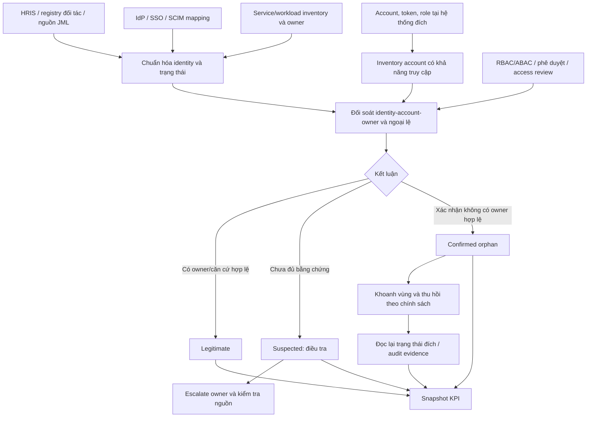

# Số account mồ côi trong IAM: phát hiện, đối soát và xử lý quyền truy cập không còn chủ sở hữu

**Số account mồ côi** (*orphan account count*) là một chỉ số của **IAM metrics** dùng để theo dõi những tài khoản đang tồn tại mà tổ chức **không xác nhận được chủ thể hoặc chủ sở hữu chịu trách nhiệm hợp lệ**, hoặc không chứng minh được căn cứ tiếp tục cho phép truy cập theo quy tắc đã công bố. Những tài khoản này dễ trở thành điểm mù khi cấp quyền, rà soát định kỳ, ứng phó sự cố và thu hồi quyền.

Trong mô-đun **SECURITY_IDENTITY_ACCESS_MANAGEMENT_IDENTITY_LIFECYCLE**, chỉ số này gắn với quản lý vòng đời danh tính theo **Joiner–Mover–Leaver (JML)**: người mới được tạo danh tính và tài khoản; người chuyển vai trò cần cập nhật quyền; người nghỉ việc cần bị vô hiệu hóa và thu hồi truy cập đúng hạn. Cùng lúc, **Identity Provider (IdP)**, **Single Sign-On (SSO)**, **SCIM**, **RBAC/ABAC** và tài khoản dịch vụ tạo thành các nguồn dữ liệu phải đối soát. Nếu chỉ dựa vào danh sách người dùng trên IdP, tổ chức có thể bỏ sót account cục bộ, tài khoản kỹ thuật, API key hoặc quyền còn hiệu lực tại ứng dụng đích.

Bài này trình bày cách định nghĩa **account mồ côi đã xác nhận**, phân biệt nó với account *chưa ánh xạ*, *không hoạt động* hoặc *còn quyền sau Leaver*, xác định đơn vị đếm, tính KPI, xây dựng truy vấn, phân loại tình huống và xử lý an toàn với bằng chứng kiểm toán.

## 1. Account mồ côi là gì?

**Account** là bản ghi được một hệ thống sử dụng để xác thực hoặc gắn quyền truy cập, ví dụ account trong ứng dụng SaaS, database, hệ điều hành, cloud, kho mã nguồn hoặc dịch vụ nội bộ. Một **identity** là chủ thể số cần được quản lý vòng đời. Một identity có thể có nhiều account, và một account kỹ thuật có thể được nhiều tiến trình sử dụng dưới trách nhiệm của một owner được chỉ định.

Trong bài này, **account mồ côi theo định nghĩa chính** là account thuộc phạm vi kiểm soát, **còn có khả năng truy cập hoặc quyền hiệu lực**, nhưng sau quá trình đối soát đã xác nhận **không có chủ thể/chủ sở hữu chịu trách nhiệm hợp lệ và không có ngoại lệ cho phép được phê duyệt** tại thời điểm chốt.

Hai yếu tố đều quan trọng:

1. **Khả năng truy cập có hiệu lực:** account vẫn có thể xác thực, sử dụng credential/token, hoặc được hệ thống chấp nhận quyền theo cơ chế của nó. Chỉ riêng trạng thái `enabled` ở database chưa đủ chứng minh account đang sử dụng được; cần chính sách đánh giá trạng thái tại từng hệ thống.
2. **Trách nhiệm và căn cứ hợp lệ:** có identity hoặc owner đáng tin cậy, còn thuộc phạm vi được phép sử dụng, có thể giải thích mục đích, quyền và quy trình thu hồi khi hết vòng đời.

Với một account **đã bị khóa hoàn toàn** nhưng còn bản ghi vì chính sách lưu trữ, tổ chức có thể theo dõi ở kho tồn đọng dọn dẹp, không nhất thiết tính vào chỉ số mồ côi **còn khả năng truy cập**. Nếu account bị khóa tại IdP nhưng vẫn đăng nhập qua đường ứng dụng cục bộ, phải đánh giá khả năng truy cập thực tế.

### Các khái niệm dễ nhầm lẫn

| Khái niệm | Dấu hiệu | Có mặc nhiên là account mồ côi không? |
|---|---|---|
| **Unlinked account** — chưa ánh xạ | Chưa tìm thấy liên kết account → identity chuẩn hoặc owner trong bảng mapping | **Chưa**; có thể do đồng bộ chậm, ID đổi hoặc thiếu connector |
| **Orphan account đã xác nhận** | Còn khả năng truy cập, không có identity/owner hợp lệ và không có ngoại lệ phù hợp sau đối soát | **Có**, theo định nghĩa chính |
| **Dormant/inactive account** | Không thấy hoạt động trong một khoảng thời gian | **Chưa**; có thể là tài khoản dự phòng hợp lệ |
| **Residual access after Leaver** | Tài khoản vẫn còn khả năng truy cập sau thời điểm phải thu hồi | Rủi ro cần xử lý; **đo riêng**, trừ khi chính sách quy định gộp |
| **Stale account** | Lâu không sử dụng, không cập nhật hoặc quá vòng đời dự kiến | Dấu hiệu rà soát; chưa đủ chứng minh thiếu owner |
| **Shared/service account** | Nhiều người hoặc workload sử dụng một account kỹ thuật | **Không**, nếu có owner, mục đích, phê duyệt và kiểm soát phù hợp |
| **Break-glass account** | Account quản trị phục vụ tình huống khẩn cấp | **Không**, nếu được phê duyệt, quản lý chặt và kiểm toán |
| **Guest/federated account** | Người dùng ngoài tổ chức, định danh tại tenant/IdP khác | **Không**, nếu sponsor, hợp đồng và vòng đời còn hợp lệ |

**Không xem thiếu trường `canonical_identity_id` trong một bản xuất dữ liệu là bằng chứng đã xác nhận account mồ côi.** Có thể cần dùng khóa khác như SCIM `externalId`, immutable user ID, ID liên kết liên tenant hoặc registry tài khoản dịch vụ. Việc không có ánh xạ tạo **candidate** để điều tra, không phải kết luận cuối.

## 2. Chọn định nghĩa KPI và cách phân loại

Trong thực tế, doanh nghiệp có thể dùng từ *orphan* theo hai nghĩa:

- **Định nghĩa hẹp (khuyến nghị cho KPI chính):** account còn khả năng truy cập nhưng **không xác nhận được chủ thể/owner chịu trách nhiệm hợp lệ** sau điều tra. Kết quả phải có bằng chứng phân loại.
- **Định nghĩa mở rộng:** hợp nhất account không có owner hợp lệ **với** các account còn truy cập sau sự kiện Leaver hoặc hết hạn phê duyệt, dù vẫn ánh xạ được tới một identity. Phép gộp này chỉ nên dùng nếu quy chế nội bộ định nghĩa rõ và báo cáo cho biết các nhóm thành phần.

Bài này sử dụng **định nghĩa hẹp** cho `confirmed_orphan_count` và đo **residual-access-after-Leaver** riêng. Nếu muốn tạo chỉ số hợp nhất rủi ro, phải dùng phép **hợp trên account duy nhất**, tránh cộng đôi account thuộc cả hai nhóm.

Phân loại tối thiểu trong hàng đợi đối soát:

| Nhãn | Ý nghĩa vận hành | Đưa vào KPI chính? |
|---|---|---|
| `confirmed_orphan` | Đã xác minh thiếu chủ thể/owner hợp lệ hoặc căn cứ sử dụng đã mất theo quy tắc, account vẫn có khả năng truy cập | Có |
| `suspected_unlinked` | Chưa ánh xạ, thiếu thông tin hoặc chưa điều tra xong | Không, nhưng phải báo số tồn đọng |
| `legitimate_human` | Ánh xạ tới human identity hợp lệ, đúng phạm vi | Không |
| `legitimate_nonhuman` | Service/workload account có owner, mục đích và quyền được duyệt | Không |
| `approved_exception` | Trường hợp ngoại lệ có người duyệt, giới hạn và ngày hết hạn | Không trong thời hạn hợp lệ |
| `disabled_retained` | Đã vô hiệu hóa thực sự, giữ bản ghi phục vụ vận hành/lưu trữ | Không trong KPI account có khả năng truy cập |
| `residual_leaver` | Account còn khả năng truy cập sau mốc thu hồi của Leaver | Báo riêng; có thể trùng nhóm orphan |

Không được bỏ một account ra khỏi hàng đợi chỉ vì reviewer chưa xác định được ai chịu trách nhiệm: đó là lý do cần **escalation**, không phải ngoại lệ tự động.

## 3. Phạm vi, đơn vị đếm và thời điểm chốt

Muốn số liệu có thể so sánh, cần công bố:

1. **Phạm vi hệ thống**: IdP chính, tenant phụ, ứng dụng SaaS, database, cloud, máy chủ, hệ thống legacy, mạng quản trị, các ứng dụng đối tác thuộc phạm vi quản lý.
2. **Loại account**: nhân viên, nhà thầu, guest, admin, service account, bot, workload/service principal, account tích hợp, account khẩn cấp.
3. **Trạng thái truy cập**: account enabled, token/credential còn hiệu lực, local login, federated login, tài khoản tạm hoặc lưu trữ.
4. **Khóa đếm duy nhất**: `(target_system_id, tenant_id, account_native_id)` hoặc khóa tương đương không thay đổi khi username/email đổi.
5. **Thời điểm snapshot**: `snapshot_at`, múi giờ, phiên bản dữ liệu, độ trễ đồng bộ và chính sách phân loại.

Một người có bốn account tại bốn ứng dụng, trong đó hai account thực sự mồ côi theo định nghĩa, sẽ làm **số account mồ côi tăng 2**, không phải 1. Ngược lại, một account xuất hiện ba lần trong log hoặc được nhiều connector nhìn thấy vẫn chỉ được đếm **một lần** nếu khóa định danh account chứng minh đó là cùng một đối tượng.

Không dùng email làm khóa duy nhất: email có thể thay đổi, được tái sử dụng hoặc là alias chung. Cũng không cộng các số `orphan_count` theo nhiều ứng dụng nếu cùng một account có thể xuất hiện hai lần trong quá trình hợp nhất nguồn mà chưa khử trùng lặp.

### Công thức

Tại thời điểm \(t\), gọi:

- \(A(t)\): tập **account duy nhất đang có khả năng truy cập** và thuộc phạm vi giám sát.
- \(O(t)\): tập con của \(A(t)\) đã được **xác nhận mồ côi** theo quy tắc và bằng chứng.
- \(P(t)\): tập account **nghi vấn/chưa đủ bằng chứng** trong \(A(t)\).

Khi đó:

\[
\boxed{N_{\mathrm{orphan}}(t)=|O(t)|}
\]

Tỷ lệ account mồ côi đã xác nhận trong tập đang giám sát:

\[
R_{\mathrm{orphan}}(t)=
\frac{|O(t)|}{|A(t)|}\times100\%
\]

Hai chỉ số đi cùng nên được công bố là **\(|P(t)|\)** và **tỷ lệ bao phủ đối soát**:

\[
R_{\mathrm{coverage}}=
\frac{\text{Số account có khả năng truy cập đã đưa vào kiểm kê}}
     {\text{Tổng account có khả năng truy cập phải được kiểm kê theo phạm vi}}
\times100\%
\]

Nếu tổng inventory bắt buộc chưa xác định đáng tin cậy, **không được tự nhận coverage = 100%** chỉ vì đã xử lý hết những account hiện có trong báo cáo. Khi mẫu số bằng 0, hiển thị **N/A** thay vì mặc định 0% hay 100%.

**Chú ý:** tỷ lệ mồ côi trên tập \(A(t)\) có thể **thấp giả tạo** nếu \(|P(t)|\) lớn vì thiếu khả năng xác nhận owner. Có thể báo thêm \(\text{reviewed count}\) và \(\text{candidate count}\) để phản ánh độ tin cậy; không tự chuyển candidate thành hợp lệ hoặc thành mồ côi.

## 4. Ví dụ thống kê hoàn chỉnh

Giả sử một tổ chức có **1.000 account đang có khả năng truy cập** trong các hệ thống đã đưa vào phạm vi, chốt ngày 23/11/2026. Công cụ phát hiện **40 account chưa ánh xạ** rõ tới identity/owner chuẩn. Nhóm IAM điều tra đủ cả 40 và thu được:

| Kết quả đối soát của 40 account nghi vấn | Số account | Xử lý |
|---|---:|---|
| Xác nhận không có owner/chủ thể hợp lệ, vẫn còn truy cập | **15** | `confirmed_orphan` |
| Guest có sponsor và thời hạn hợp lệ | 8 | `legitimate_human` |
| Tài khoản dịch vụ có owner/phê duyệt hợp lệ nhưng chưa sync registry | 7 | `legitimate_nonhuman` |
| Liên kết identity có thật, lỗi đồng bộ khóa ID được sửa | 10 | Hợp lệ sau đối soát |
| **Tổng candidate đã giải quyết** | **40** | **15 confirmed orphan** |

Kết quả theo **định nghĩa hẹp**:

\[
N_{\mathrm{orphan}}=15
\]

\[
R_{\mathrm{orphan}}=\frac{15}{1000}\times100\%=1{,}5\%
\]

Nhóm IAM còn kiểm tra sự kiện Leaver và phát hiện **6 account vẫn có khả năng truy cập sau hạn thu hồi**. Trong đó **2 account** đồng thời nằm trong nhóm 15 account đã xác nhận mồ côi; **4 account còn lại** vẫn liên kết được tới nhân viên đã nghỉ nhưng bị lỗi thu hồi tại ứng dụng đích.

Vì vậy:

- **Confirmed orphan count (hẹp): 15**.
- **Residual-access-after-Leaver count: 6**.
- **Hợp của hai nhóm rủi ro, đếm account duy nhất: \(15+6-2=19\)**.

Không báo tổng **21** bằng cách cộng thẳng 15 và 6 vì sẽ đếm đôi hai account giao nhau. Đặc biệt, bốn account Leaver còn liên kết được tới nhân viên cũ **vẫn có rủi ro phải xử lý ngay**, dù không thỏa tiêu chí thiếu owner của KPI hẹp.

Tỷ lệ 1,5% chỉ phản ánh **1.000 account trong phạm vi đã giám sát**. Nếu còn nhiều ứng dụng legacy chưa kiểm kê, phải công khai giới hạn bao phủ; không suy rộng con số ra toàn doanh nghiệp.

## 5. Tại sao account mồ côi phát sinh qua Joiner–Mover–Leaver?

### Joiner: tạo trùng, đồng bộ sai hoặc thiếu liên kết

Khi một người gia nhập, nguồn nhân sự hoặc hệ thống đối tác xác minh tư cách, IdP tạo identity chuẩn, SSO hỗ trợ xác thực và SCIM/API cấp account ở ứng dụng đích. Nếu hệ thống tạo account bằng email nhưng chưa lưu khóa bền vững như `externalId`, lần cập nhật tên/email có thể tạo bản ghi thứ hai hoặc đánh mất liên kết account–identity.

**Ví dụ:** HRIS xác lập nhân viên `H-204`, nhưng hệ thống CRM tự tạo `crm-user-88` và không ghi `H-204` trong mapping. Đây trước hết là **account chưa ánh xạ**. Chỉ sau đối soát chủ thể, dữ liệu nguồn, quyền và owner mới có thể kết luận nó hợp lệ hoặc mồ côi.

Với account được tạo theo **just-in-time (JIT) provisioning**, một bản ghi có thể xuất hiện khi đăng nhập đầu tiên, trước khi tiến trình đối soát kịp cập nhật. Cần giám sát độ trễ và quy tắc ánh xạ; không tự coi mọi account JIT vừa xuất hiện là mồ côi.

### Mover: chuyển bộ phận, tenant hoặc kiểu hợp đồng

Một identity có thể đổi phòng ban, đơn vị chủ quản, role RBAC hoặc thuộc tính ABAC. Nếu hệ thống đích tạo account mới mà account cũ không bị đóng hoặc chuyển owner, có thể phát sinh account không còn người chịu trách nhiệm. Trường hợp khác, account vẫn có owner hợp lệ nhưng **giữ quyền cũ quá mức**; đây là **excessive permission/residual entitlement**, không nhất thiết là orphan account.

**Ví dụ:** Nhà thầu trở thành nhân viên chính thức. Tài khoản contractor portal không được liên kết/đóng; một account mới tại IdP được tạo cho nhân viên. Cần xác định account contractor cũ còn khả năng truy cập và ai chịu trách nhiệm. Nếu đã hết tư cách, account còn truy cập cần được xử lý theo chính sách; đừng chỉ dựa vào tên người dùng để gộp hai account.

### Leaver: thu hồi chậm hoặc bỏ sót ứng dụng

Khi nhân viên/nhà thầu nghỉ việc, hệ thống nguồn phát sự kiện Leaver và IdP thường vô hiệu hóa identity. Các ứng dụng đích phải thu hồi account, phiên, token và quyền theo quy trình đã định. Độ trễ SCIM, account local, API key hoặc đường đăng nhập không phụ thuộc SSO có thể khiến quyền còn hoạt động.

**Nhân viên đã nghỉ nhưng account ứng dụng vẫn active là dấu hiệu residual access**, kể cả khi vẫn còn thông tin owner lịch sử. Nếu chính sách nội bộ coi mọi account còn hiệu lực sau Leaver là orphan thì cần nêu rõ quy tắc mở rộng đó; phương pháp đo chính ở bài này **giữ riêng** để tránh trộn nguyên nhân quản trị owner với lỗi thu hồi.

### Service account, bot và workload

Danh tính phi con người có thể thiếu mối liên hệ HRIS nhưng vẫn hợp lệ. Account của một pipeline, ứng dụng hoặc workload phải có **technical owner/business owner**, mục đích, môi trường, phụ thuộc, quyền tối thiểu và quy tắc kết thúc vòng đời. Việc không tìm được `employee_id` không đủ để kết luận mồ côi.

Rủi ro tăng khi người tạo service account đã nghỉ việc, team giải thể, ứng dụng ngừng chạy nhưng account/credential vẫn tồn tại. Khi đó, owner cũ không còn là owner hợp lệ; cần tìm người chịu trách nhiệm mới hoặc thực hiện quy trình thu hồi.

## 6. Thiết kế nguồn dữ liệu và đối soát

Một kiến trúc tổng hợp chỉ số có thể dùng các nguồn:

| Nguồn | Thông tin đóng góp | Giới hạn cần lưu ý |
|---|---|---|
| **HRIS / đối tác / hợp đồng** | Chủ thể con người, tư cách, ngày hiệu lực Joiner–Mover–Leaver | Không bao quát service account hay mọi guest |
| **IdP / directory** | Identity chuẩn, khóa liên kết, trạng thái, nhóm và vai trò | Không bảo đảm quan sát mọi account cục bộ |
| **SSO / federation** | Quan hệ xác thực, sign-in events, subject claim | Thiếu login không đồng nghĩa account không sử dụng được |
| **SCIM / provisioning logs** | Tạo/sửa/disable account, kết quả connector, mapping và retry | Thành công API chưa luôn chứng minh trạng thái đích cuối |
| **Ứng dụng đích** | Account thực tế, enabled status, membership, token/credential, login method | Có thể thiếu API hoặc export đầy đủ |
| **CMDB / service inventory** | Owner dịch vụ, workload, ứng dụng phụ thuộc và kỳ thay đổi | Owner có thể quá hạn hoặc không còn chịu trách nhiệm |
| **Access review / ngoại lệ** | Quyết định giữ/thu hồi, sponsor, phạm vi và ngày hết hạn | Quyết định review không đồng nghĩa remediation đã thực thi |
| **RBAC/ABAC / policy** | Điều kiện truy cập, vai trò, quyền hiệu lực và ngoại lệ | Policy động phụ thuộc tài nguyên, thời điểm, thuộc tính |

Phần tổng hợp có thể minh họa:



**Điểm cần nhớ:** việc kiểm kê bắt đầu từ **account ở hệ thống đích**, không chỉ từ danh sách identity của IdP. Nếu chỉ lấy những account đã liên kết với IdP rồi đối soát, các account thực sự chưa ánh xạ sẽ bị bỏ khỏi phép đo ngay từ đầu.

## 7. Quy trình phân loại một account nghi vấn

Có thể triển khai quy trình lặp theo ngày hoặc gần thời gian thực:

1. **Thu thập inventory đầy đủ nhất có thể:** lấy tài khoản ứng dụng, local user, service principal, API client và credential theo nguồn dữ liệu; ghi hệ thống, tenant, account-native ID, trạng thái và dấu thời gian.
2. **Chuẩn hóa và khử trùng lặp:** dùng khóa account bất biến; phân biệt một account với nhiều grant, nhiều event hay nhiều nguồn import.
3. **Xác định trạng thái truy cập:** kiểm tra account enabled, phương thức đăng nhập độc lập, session/token, expiry và tài nguyên chịu tác động. Nếu trạng thái không rõ, đánh dấu chưa xác minh.
4. **Ánh xạ tới identity/owner chuẩn:** đối chiếu immutable identity ID, SCIM `externalId`, owner registry, HRIS, guest sponsor, team/workload owner; kiểm tra mapping stale hoặc quan hệ nhiều-nhiều.
5. **Kiểm tra hợp lệ của owner và căn cứ sử dụng:** owner còn hoạt động? Hợp đồng/quan hệ đối tác còn hiệu lực? Service còn tồn tại? Ngoại lệ có đúng người duyệt và chưa hết hạn?
6. **Phân loại trạng thái bằng bằng chứng:** `legitimate`, `suspected_unlinked`, `confirmed_orphan`, `residual_leaver` hoặc `disabled_retained`. Tách nguyên nhân để remediation phù hợp.
7. **Phân hạng rủi ro và tạo tác vụ:** quyền quản trị, hệ thống trọng yếu, Internet-exposed, token dài hạn và account không có MFA thường cần ưu tiên cao.
8. **Thu hồi/khoanh vùng theo runbook:** thông báo owner liên quan, xử lý phê duyệt, chặn quyền theo mức khẩn cấp, chuyển giao ownership nếu hợp lệ hoặc disable credential.
9. **Xác minh lại tại đích:** kiểm tra account và quyền hiệu lực, token/phiên, các đường đăng nhập thay thế; lưu `verified_at` và bằng chứng.
10. **Đóng hồ sơ với audit trail:** giữ snapshot trước/sau, người quyết định, lý do, ngoại lệ, thời hạn, kết quả xử lý để chứng minh hệ thống đã giảm rủi ro thực sự.

Một account có nhiều người cùng được giao xử lý không nên tạo nhiều bản ghi `confirmed_orphan`. Mọi task phải liên kết cùng `account_key` và dùng cơ chế xử lý **idempotent** để không làm KPI tăng giả vì retry.

### Không tắt account vô điều kiện

Account không có owner dễ gây nguy hiểm nhưng có thể phục vụ batch cuối tháng, sao lưu, xử lý sự cố hoặc quy trình nghiệp vụ chưa được kiểm kê. Cần xác định tác động và dùng cách xử lý theo rủi ro: tạm khóa/quarantine khi cần, thay khóa API, giảm quyền, tách account dùng chung, chuyển giao owner hoặc thu hồi triệt để.

Các quy trình vô hiệu hóa khẩn cấp đối với rủi ro cao cần được phê duyệt trước trong runbook. Không trì hoãn xử lý sự cố nghiêm trọng chỉ để hoàn thành quy trình điều tra thông thường, nhưng cũng không âm thầm xóa dữ liệu nghiệp vụ hay bản ghi kiểm toán theo cách làm mất khả năng khôi phục hợp lệ.

## 8. Ví dụ SQL tính số account mồ côi

Giả sử đã có bảng PostgreSQL `iam_account_assessment_snapshot` chứa **mỗi account duy nhất một bản ghi tại mỗi `snapshot_at`**, với các cột:

- `account_key`: khóa định danh account ổn định, gồm hệ thống/tenant/account native ID đã chuẩn hóa.
- `target_system`, `account_type`: hệ thống và loại account.
- `snapshot_at`, `in_scope`, `access_active`: trạng thái tại thời điểm chốt.
- `classification`: một trong `confirmed_orphan`, `suspected_unlinked`, `legitimate`, `approved_exception`, `disabled_retained`.
- `residual_leaver_confirmed`: dấu hiệu truy cập tồn dư sau Leaver đã xác minh bằng nguồn có thẩm quyền.

Quan trọng: `classification` là **kết quả của quy trình đối soát có bằng chứng**, không đơn thuần là giá trị `NULL` ở trường `identity_id`. Snapshot phải có thời điểm hiệu lực rõ ràng và không chứa bản ghi lặp từ nhiều connector.

Ví dụ tính theo `account_type` lúc **14:00 ngày 23/11/2026 (UTC+7)**:

```sql
WITH accounts AS (
    SELECT
        account_key,
        account_type,
        classification,
        residual_leaver_confirmed
    FROM iam_account_assessment_snapshot
    WHERE snapshot_at = TIMESTAMPTZ '2026-11-23 14:00:00+07'
      AND in_scope = TRUE
      AND access_active = TRUE
),
metrics AS (
    SELECT
        account_type,
        COUNT(*) AS active_account_count,
        COUNT(*) FILTER (
            WHERE classification = 'confirmed_orphan'
        ) AS confirmed_orphan_count,
        COUNT(*) FILTER (
            WHERE classification = 'suspected_unlinked'
        ) AS suspected_unlinked_count,
        COUNT(*) FILTER (
            WHERE residual_leaver_confirmed = TRUE
        ) AS residual_leaver_count,
        COUNT(*) FILTER (
            WHERE classification = 'confirmed_orphan'
              AND residual_leaver_confirmed = TRUE
        ) AS overlap_count,
        COUNT(*) FILTER (
            WHERE classification = 'confirmed_orphan'
               OR residual_leaver_confirmed = TRUE
        ) AS distinct_combined_risk_count
    FROM accounts
    GROUP BY account_type
)
SELECT
    account_type,
    active_account_count,
    confirmed_orphan_count,
    suspected_unlinked_count,
    residual_leaver_count,
    overlap_count,
    distinct_combined_risk_count,
    ROUND(
        100.0 * confirmed_orphan_count
        / NULLIF(active_account_count, 0), 2
    ) AS confirmed_orphan_rate_pct
FROM metrics
ORDER BY account_type;
```

Ở đây `distinct_combined_risk_count` dùng **OR trên mỗi account** nên tránh đếm đôi giữa orphan và residual Leaver. Nếu snapshot chứa nhiều hàng cho cùng `account_key`, **phải sửa bước hợp nhất nguồn** trước khi `COUNT(*)`; `COUNT(DISTINCT account_key)` có thể giúp kiểm tra nhưng không tự giải quyết xung đột trạng thái giữa các bản ghi.

Phần trăm `confirmed_orphan_rate_pct` là tỷ lệ **trong tập account đang có khả năng truy cập đã nằm trong phạm vi**. Muốn đo coverage trên toàn hệ thống, cần bảng danh mục/kiểm kê account bắt buộc tương ứng; câu truy vấn này **không đủ** để suy ra mức bao phủ ứng dụng.

**Đọc báo cáo lịch sử:** nếu truy vấn bảng trạng thái *hiện tại*, một account đã được thu hồi vào tuần sau có thể biến mất khi truy vấn lại tuần trước. Dùng snapshot bất biến hoặc dựng *as-of state* từ event log, giữ các mốc `first_detected_at`, `classification_at`, `remediated_at` và `verified_at`.

## 9. Các chỉ số cần xem cùng orphan account count

Một số account mồ côi thấp có thể là tin tốt, nhưng cũng có thể do hệ thống không phát hiện đủ. Vì vậy KPI cần đi cùng các thước đo chất lượng dữ liệu, tốc độ xử lý và mức rủi ro:

| Chỉ số | Câu hỏi trả lời |
|---|---|
| **Confirmed orphan count** | Có bao nhiêu account còn truy cập và đã xác nhận không có owner hợp lệ? |
| **Suspected/unlinked count** | Có bao nhiêu account chưa ánh xạ hoặc chưa thể kết luận? |
| **Identity–account mapping coverage** | Bao nhiêu account đã được liên kết tới identity/owner có căn cứ? |
| **Discovery coverage** | Bao nhiêu hệ thống/tài khoản bắt buộc đã được kiểm kê? |
| **Orphan detection age** | Một account nằm trong diện nghi vấn hoặc confirmed đã bao lâu? |
| **Remediation completion rate** | Bao nhiêu account mồ côi đã được chặn truy cập hoặc chuyển owner hợp lệ và xác minh? |
| **On-time remediation rate** | Bao nhiêu trường hợp được xử lý trong SLA sau khi phát hiện/xác nhận? |
| **Overdue orphan count** | Bao nhiêu case còn khả năng truy cập đã quá hạn xử lý? |
| **Privileged orphan count** | Có bao nhiêu account mồ côi mang quyền admin/đặc quyền? |
| **Residual access after Leaver** | Bao nhiêu account còn truy cập sau deadline thu hồi của Leaver? |
| **NHI without owner** | Bao nhiêu service/workload account không có owner chịu trách nhiệm hợp lệ? |

Không suy luận rằng `0 confirmed orphan` đồng nghĩa `0 rủi ro` khi còn hàng trăm `suspected_unlinked` hoặc nhiều ứng dụng chưa được kiểm kê. Báo cáo nên hiển thị số account tuyệt đối, tỷ lệ, mức bao phủ, độ trễ cập nhật, số ca đang điều tra và trạng thái xử lý.

### Ưu tiên theo mức rủi ro

Thực tế một account mồ côi có quyền quản trị production có thể nghiêm trọng hơn nhiều account chỉ đọc trong môi trường thử nghiệm. Các yếu tố ưu tiên gồm: quyền đặc quyền, dữ liệu nhạy cảm, Internet-exposed login, session/token dài hạn, credential dùng chung, account có khả năng tạo quyền mới, hệ thống trọng yếu và dấu hiệu truy cập bất thường.

Có thể phân nhóm **critical/high/medium/low** nếu doanh nghiệp có mô hình rủi ro và tiêu chí phê duyệt rõ. Không tự gán các trọng số hay ngưỡng cảnh báo phổ quát không có căn cứ. Mức ưu tiên hỗ trợ điều phối xử lý; **không thay đổi cách đếm account mồ côi**.

## 10. Phương án xử lý và bằng chứng đóng case

| Tình huống | Hành động phù hợp | Bằng chứng đóng case |
|---|---|---|
| Account human hợp lệ nhưng thiếu mapping | Khôi phục liên kết ID chuẩn, kiểm tra sponsor/HRIS | Mapping hợp lệ, owner và quyền được xác minh |
| Guest còn hợp đồng và sponsor | Cập nhật metadata, thời hạn và lịch review | Sponsor/phê duyệt đúng kỳ, account nằm trong phạm vi cho phép |
| Service account có owner sai hoặc người tạo đã nghỉ | Xác minh nhu cầu, chỉ định lại owner hoặc thu hồi | Owner mới chấp nhận trách nhiệm, hoặc quyền đã bị chặn |
| Account local không còn người dùng hợp lệ | Vô hiệu hóa và đối soát phiên/credential theo runbook | Trạng thái đích, log vô hiệu hóa và xác minh quyền không còn |
| Account thuộc nhân viên đã nghỉ còn active | Thực thi Leaver deprovisioning và truy vết lỗi SCIM | Bằng chứng chặn account/token và thời điểm hoàn tất |
| Account đặc quyền không xác nhận được owner | Escalate khẩn, khoanh vùng theo chính sách, điều tra | Quyết định có thẩm quyền và trạng thái truy cập đã kiểm chứng |
| Account đã disable nhưng còn bản ghi phục vụ lưu trữ | Chuyển sang trạng thái lưu giữ có kiểm soát | Không còn khả năng truy cập; thời hạn lưu trữ được xác định |

Khi đóng case `confirmed_orphan`, cần phân biệt hai kết quả:

- **Đã thu hồi:** account không còn khả năng truy cập theo phạm vi yêu cầu; thông tin nghiệp vụ và audit được xử lý theo chính sách.
- **Đã xác lập quyền sở hữu hợp lệ:** xác nhận owner/sponsor, nhu cầu sử dụng, phê duyệt và quyền thích hợp; account không còn là orphan theo định nghĩa, nhưng có thể cần **access review** nếu quyền quá rộng.

Không đủ điều kiện đóng chỉ vì ticket ghi `Resolved`, admin nhấn nút disable hoặc connector SCIM báo đã gửi lệnh. Phải có xác nhận từ hệ thống đích, tính đến local login, token còn hiệu lực, membership lồng nhau và các cơ chế xác thực thay thế.

## 11. Những lỗi phân tích thường gặp

1. **Đếm mọi account không có `employee_id` là mồ côi:** service account, guest và federated identity có cơ sở xác nhận khác.
2. **Đếm thiếu liên kết là kết luận cuối:** mapping lỗi/đồng bộ chậm có thể làm false positive; cần tách `suspected` với `confirmed`.
3. **Chỉ xuất danh sách người dùng từ IdP:** không tìm được account cục bộ và đường truy cập không qua SSO.
4. **Dùng username/email làm khóa account:** thay đổi tên, reuse email hoặc alias gây đếm sai.
5. **Lẫn số identity với số account:** một người có nhiều account; KPI này đếm account duy nhất ở hệ thống đích.
6. **Coi account inactive là mồ côi:** không thấy login không đủ chứng minh owner không tồn tại hay quyền không hợp lệ.
7. **Coi service account có `created_by` là luôn có owner:** người tạo có thể đã nghỉ, không còn chịu trách nhiệm nghiệp vụ.
8. **Gộp residual Leaver vào orphan mà không công bố:** làm khó so sánh kỳ và dễ cộng đôi những account thuộc cả hai nhóm.
9. **Đếm trùng account qua nhiều connector hoặc event retry:** cần khóa duy nhất, snapshot và idempotency.
10. **Tự loại các account khó xác minh:** sẽ làm tỷ lệ thấp giả; nhóm thiếu bằng chứng cần có backlog và SLA điều tra.
11. **Bỏ qua quyền thực tế của token/session:** IdP đã disable không luôn đồng nghĩa ứng dụng không còn truy cập.
12. **Đóng case trước khi đối soát trạng thái đích:** có thể còn credential hoặc grant path thay thế.
13. **Số orphan giảm khi connector hỏng:** phải đối chiếu inventory, độ trễ và coverage trước khi kết luận KPI cải thiện.
14. **Xóa dữ liệu hoặc audit chỉ để xóa account:** thu hồi truy cập và thời hạn giữ dữ liệu là hai trách nhiệm khác nhau.

## 12. Câu hỏi tự kiểm tra

**Câu 1.** Một hệ thống có 500 account đang truy cập được, trong đó 30 account chưa ánh xạ được tới identity. Sau điều tra, 12 account được xác nhận thiếu owner hợp lệ, 18 account là guest/service hợp lệ. Số account mồ côi và tỷ lệ trong phạm vi là bao nhiêu?

**Đáp án:** `confirmed_orphan_count = 12`; tỷ lệ \(12/500\times100\%=2{,}4\%\). Không dùng 30 làm tử số vì 18 account đã được xác minh hợp lệ.

**Câu 2.** Một nhân viên nghỉ việc vẫn có account ở CRM, hệ thống có thể ánh xạ đầy đủ tới identity cũ nhưng app chưa disable. Có nên bỏ qua vì không mồ côi theo định nghĩa hẹp?

**Đáp án:** **Không.** Đây là **residual access after Leaver** cần ưu tiên deprovisioning. Có thể không thuộc KPI orphan hẹp nhưng phải được đo, cảnh báo và xử lý theo SLA thu hồi.

**Câu 3.** Một service account không có `employee_id`, nhưng có technical owner, business owner, phạm vi sử dụng và phê duyệt còn hiệu lực. Có coi là orphan không?

**Đáp án:** **Không.** Cần đối soát với registry dịch vụ và owner hợp lệ; thiếu dữ liệu HRIS của người dùng không có nghĩa tài khoản máy thiếu chủ sở hữu.

**Câu 4.** Một account có ba dòng từ ba nguồn log, cùng `account_native_id` và tenant. Có nên đếm thành ba account?

**Đáp án:** **Không.** Chuẩn hóa theo khóa account duy nhất trong hệ thống/tenant và snapshot để tránh đếm trùng.

**Câu 5.** Có 10 confirmed orphan, 7 residual Leaver và 3 account đồng thời thuộc cả hai nhóm. Số account nằm trong hợp của hai nhóm rủi ro là bao nhiêu?

**Đáp án:** \(10+7-3=14\) account duy nhất.

**Câu 6.** Dashboard orphan count giảm từ 50 xuống 8 sau khi một connector ứng dụng tài chính không còn trả dữ liệu. Có thể kết luận remediation thành công không?

**Đáp án:** **Không.** Phải kiểm tra dữ liệu nguồn, coverage, số account được quét và bằng chứng đóng case. Thiếu connector có thể làm số giảm giả tạo.

**Câu 7.** Account đã disable ở IdP nhưng token ứng dụng độc lập vẫn dùng được. Việc đánh dấu `disabled_retained` và loại khỏi KPI có chắc đúng không?

**Đáp án:** **Không.** Cần xác minh thực tế các đường truy cập, token và hệ thống đích. Account còn khả năng truy cập phải được đánh giá theo chính sách rủi ro và vòng đời tương ứng.

## Ghi nhớ

**Số account mồ côi** nên được đo bằng **số account duy nhất còn khả năng truy cập đã xác nhận không có chủ thể/chủ sở hữu và căn cứ sử dụng hợp lệ** tại một thời điểm chốt. Hãy kiểm kê từ **hệ thống đích**, ánh xạ tới **IdP/HRIS/service inventory**, đối soát SCIM và đường đăng nhập ngoài SSO, phân biệt **chưa ánh xạ**, **đã xác nhận mồ côi** và **quyền tồn dư sau Leaver**. Kết hợp chỉ số với **discovery coverage, mapping coverage, overdue remediation, privileged orphan count** và bằng chứng kiểm toán để xử lý đúng account, bảo toàn dữ liệu cần giữ và giảm quyền truy cập tồn dư trong toàn bộ vòng đời Joiner–Mover–Leaver.
