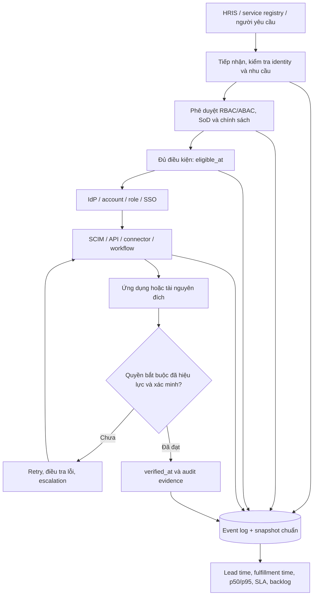

# Thời gian cấp quyền trong IAM: đo từ nhu cầu đến truy cập thực sự sử dụng được

**Thời gian cấp quyền** (*access provisioning time*, *time to grant access*) đo khoảng thời gian cần thiết để một yêu cầu truy cập hợp lệ được **cấp đúng quyền và xác minh đã có hiệu lực tại hệ thống đích**. Chỉ số này cho biết tốc độ đáp ứng nhu cầu công việc của quy trình Identity and Access Management (IAM), giúp phát hiện tắc nghẽn tại bước xác minh, phê duyệt, IdP, SCIM, ứng dụng đích hoặc kiểm tra hoàn tất.

Trong chương **IAM metrics** của mô-đun `SECURITY_IDENTITY_ACCESS_MANAGEMENT_IDENTITY_LIFECYCLE`, chỉ số này gắn với vòng đời **Joiner–Mover–Leaver (JML)**: cấp tài khoản và quyền ban đầu cho người mới (*Joiner*), bổ sung quyền mới khi chuyển vị trí (*Mover*), quản lý cấp quyền tạm và thu hồi quyền khi không còn phù hợp. Dữ liệu có thể đi qua **Identity Provider (IdP)**, **Single Sign-On (SSO)**, **System for Cross-domain Identity Management (SCIM)**, cơ chế **RBAC/ABAC**, kho ứng dụng đích và các tài khoản dịch vụ. Mọi mốc đo cần có bằng chứng kiểm toán, bởi cấp nhanh nhưng **nhầm hoặc thừa quyền** vẫn là một kết quả không đạt yêu cầu bảo mật.

Bài học hướng dẫn cách chọn đơn vị đếm, phân biệt *end-to-end lead time* với *fulfillment time*, xử lý nhiều ứng dụng đích, tính trung bình và phân vị p50/p95, theo dõi yêu cầu đang mở, xây dựng SQL và đọc số liệu trong bối cảnh SLA.

## 1. “Cấp quyền” phải có điểm kết thúc rõ ràng

Một yêu cầu có thể trải qua các bước: ghi nhận nhu cầu, xác minh danh tính, phê duyệt, tạo tài khoản, gán nhóm/vai trò, đồng bộ hệ thống đích và xác nhận người dùng thực sự có quyền đã được phê duyệt.

Không thể lấy mọi mốc kỹ thuật làm thời điểm kết thúc:

| Mốc | Điều đã biết | Có đủ coi là quyền được cấp xong? |
|---|---|---|
| Yêu cầu được tạo trong ticket | Nhu cầu đã được ghi nhận | Chưa; có thể chưa đủ dữ liệu hoặc chưa được duyệt |
| Người quản lý phê duyệt | Đã cho phép thực hiện | Chưa; ứng dụng có thể chưa có account/role |
| IdP tạo identity và bật SSO | Danh tính và xác thực có thể sẵn sàng | Chưa chắc; tài nguyên đích có thể chưa cấp quyền |
| SCIM/API trả kết quả chấp nhận lệnh | Connector đã tiếp nhận hoặc xử lý một thao tác | Chưa chắc; phải kiểm tra trạng thái cuối và lỗi bất đồng bộ |
| Group được thêm tại directory | Một nguồn cấp quyền đã thay đổi | Chưa chắc; ứng dụng có thể đồng bộ chậm hoặc có điều kiện bổ sung |
| Quyền được phê duyệt đã có hiệu lực và được xác minh tại tất cả hệ thống bắt buộc | Đạt tiêu chí nghiệm thu của yêu cầu | **Có**; ghi `verified_at` hoặc `fulfilled_at` |

Tình huống quen thuộc: nhân viên đã đăng nhập được qua SSO nhưng ứng dụng kế toán báo “Access denied”. Nếu yêu cầu bao gồm quyền dùng ứng dụng kế toán thì **thời gian cấp quyền chưa kết thúc**. Kết luận chỉ dựa trên thành công của SSO sẽ làm chỉ số thấp giả tạo.

Tổ chức cần xác định trước **tiêu chí hoàn tất** cho từng loại yêu cầu: danh sách target bắt buộc, entitlement theo phê duyệt, hiệu lực policy, điều kiện MFA/SSO khi bắt buộc, và phương thức xác minh. Một tài nguyên tùy chọn được định nghĩa ngay từ đầu có thể đo riêng, nhưng không được tự chuyển mục bắt buộc thành tùy chọn khi gặp lỗi để làm đẹp số.

## 2. Chọn đơn vị đo: request, tài nguyên hay entitlement?

Thời gian cấp quyền có thể được đo theo nhiều cấp. Mỗi cấp giải quyết một câu hỏi khác nhau:

| Đơn vị | Mốc hoàn tất | Công dụng |
|---|---|---|
| **Yêu cầu cấp quyền** (`request_id`) | Tất cả account/entitlement **bắt buộc** của yêu cầu đã được xác minh | Trải nghiệm đầu cuối của người dùng hoặc workload |
| **Tác vụ cấp phát tới ứng dụng** (`target_task_id`) | Một target đã được xác minh đúng | Chẩn đoán thời gian tại từng SCIM connector hoặc ứng dụng |
| **Entitlement assignment** | Một quyền cụ thể trên tài nguyên/phạm vi đã có hiệu lực | Phân tích từng role, group, permission hoặc policy |
| **Yêu cầu quyền đặc quyền tạm thời** | Quyền được kích hoạt hợp lệ trong thời hạn và có bằng chứng | Đo thời gian đáp ứng yêu cầu JIT/PAM theo chính sách |

**Không trộn các cấp trong cùng một mẫu số hoặc tập thời gian.** Ví dụ, một `request_id` cấp ba ứng dụng, trong đó hai target hoàn tất sau 5 phút và target cuối sau 40 phút. Thời gian đầu cuối theo request là **40 phút**, trong khi thời gian theo target là **5, 5 và 40 phút** (nếu cả ba cùng có mốc bắt đầu), với trung bình khoảng **16,67 phút**. Hai kết quả trả lời hai câu hỏi khác nhau; không thể thay số 16,67 cho trải nghiệm của người chờ cả ba ứng dụng.

Nếu một identity có nhiều yêu cầu độc lập trong một tuần, KPI theo **request** có thể đếm nhiều lần; đó là đúng khi đo hiệu suất xử lý yêu cầu. Nếu muốn đo “thời gian một Joiner sẵn sàng làm việc”, phải xây dựng đơn vị **ca onboarding** và xác định tập quyền thiết yếu của ca đó. Không tự lấy trung bình của nhiều task để thay cho mốc sẵn sàng hoàn toàn.

## 3. Ba khoảng thời gian cần phân biệt

Nên lưu các mốc:

- `requested_at`: lúc yêu cầu được ghi nhận.
- `approved_at`: lúc được phê duyệt theo chính sách.
- `eligible_at`: lúc đủ điều kiện để IAM bắt đầu thực hiện (đủ phê duyệt, dữ liệu, thời điểm được phép thực thi).
- `verified_at`: lúc **toàn bộ phần bắt buộc đã có hiệu lực và được xác minh**.
- `effective_at`: thời điểm quyền được phép bắt đầu có hiệu lực, hữu ích cho Joiner có ngày nhận việc trong tương lai.
- `due_at`: deadline cam kết theo SLA, có thể khác với `requested_at + một khoảng cố định` nếu áp dụng giờ làm việc, ngày nghỉ hoặc mốc hiệu lực.

Với các mốc thời gian hợp lệ, ba thước đo chính:

**1. Thời gian đầu cuối (end-to-end lead time)**

\[
T_{\mathrm{end\text{-}to\text{-}end}} =
t_{\mathrm{verified}}-t_{\mathrm{requested}}
\]

Khoảng này bao gồm thời gian chờ xác minh/phê duyệt, chờ kỹ thuật và xác minh. Phù hợp với trải nghiệm của người yêu cầu, nhưng cần diễn giải riêng nếu request được nộp rất sớm trước ngày bắt đầu hợp lệ.

**2. Thời gian từ khi đủ điều kiện đến khi cấp xong (fulfillment time)**

\[
T_{\mathrm{fulfillment}} =
t_{\mathrm{verified}}-t_{\mathrm{eligible}}
\]

Phản ánh tốc độ của quy trình cấp phát sau khi đã có đủ điều kiện. Không được định nghĩa `eligible_at` bằng thời điểm worker bắt đầu xử lý nếu cam kết nghiệp vụ tính từ lúc hệ thống **có thể** xử lý; làm vậy sẽ che mất thời gian chờ trong hàng đợi.

**3. Thời gian trước khi đủ điều kiện (pre-fulfillment lead time)**

\[
T_{\mathrm{pre}} = t_{\mathrm{eligible}}-t_{\mathrm{requested}}
\]

Nếu cùng một request đi qua các mốc liên tục, không bị định nghĩa lại và thỏa `requested_at <= eligible_at <= verified_at`:

\[
T_{\mathrm{end\text{-}to\text{-}end}}=T_{\mathrm{pre}}+T_{\mathrm{fulfillment}}
\]

Điều kiện trên là **giả định mô hình đo**, không phải điều luôn đúng trong mọi tích hợp. Với yêu cầu nộp trước ngày hiệu lực, có phê duyệt nhiều bước hoặc có trạng thái sửa đổi, tổ chức cần quy tắc chốt mốc nhất quán.

### Ví dụ từng giai đoạn

Một yêu cầu cấp quyền CRM được tạo lúc **08:10**, được phê duyệt và đủ điều kiện lúc **08:40**. IdP bổ sung group lúc **08:45**, SCIM đồng bộ account lúc **09:00**, ứng dụng đích xác nhận đúng role lúc **09:15**.

- `T_pre = 08:40 - 08:10 = 30 phút`.
- `T_fulfillment = 09:15 - 08:40 = 35 phút`.
- `T_end-to-end = 09:15 - 08:10 = 65 phút`.

Nếu chỉ dùng mốc IdP lúc 08:45, hệ thống sẽ báo fulfillment **5 phút** và bỏ sót 30 phút còn lại trước khi CRM xác nhận quyền thực sự sẵn sàng. Đây là lý do mốc **verified** cần dựa trên hệ thống đích.

## 4. Đo thời gian theo đồng hồ thực hay giờ làm việc?

Có hai quy tắc đo phổ biến:

| Cách đo | Đặc điểm | Ví dụ |
|---|---|---|
| **Elapsed / wall-clock time** | Khoảng thời gian thực giữa hai timestamp, gồm đêm và ngày nghỉ | 17:00 thứ Sáu → 09:00 thứ Hai là 64 giờ, nếu không có đổi giờ theo múi giờ |
| **Business time** | Chỉ cộng thời gian nằm trong lịch làm việc có hiệu lực | Với lịch 09:00–17:00 thứ Hai–thứ Sáu, cùng khoảng là 0 phút giờ làm việc |

**Business time** chỉ hợp lệ khi có lịch, múi giờ, ngày nghỉ và chính sách dừng/tiếp tục được duyệt. Đừng lấy số giờ thực rồi loại cuối tuần bằng phép trừ cố định; cách đó sai ở những kỳ nghỉ, ca trực và những khu vực có lịch làm việc khác nhau.

Với tài khoản đặc quyền, quyền sự cố hoặc Leaver, SLA thường có yêu cầu xử lý liên tục theo rủi ro; với quyền thông thường, SLA có thể theo giờ làm việc. Dù chọn phương pháp nào, dashboard phải ghi **đơn vị, lịch và phiên bản chính sách**. Lưu timestamp theo UTC hoặc kiểu có offset, ví dụ `2026-11-23T09:15:00+07:00`; chuyển sang múi giờ địa phương để hiển thị, không dùng chuỗi giờ thiếu timezone làm phép trừ.

**Ví dụ SLA:** yêu cầu đã đủ điều kiện lúc 13:00 ngày làm việc; SLA fulfillment là 2 giờ làm việc, lịch 09:00–17:00. Deadline là **15:00**. Nếu xác minh vào 15:12, thời gian fulfillment là 132 phút giờ làm việc trong ví dụ này và trễ SLA **12 phút**.

Có thể có chính sách tạm dừng khi chờ dữ liệu từ bên ngoài hoặc phê duyệt pháp lý. Chỉ loại thời gian đó khỏi clock nếu có lý do, bắt đầu/kết thúc pause, người phê duyệt và lịch sử kiểm toán. Không được đặt lại `eligible_at` hoặc `due_at` sau khi phát hiện yêu cầu đã trễ chỉ để cải thiện KPI.

## 5. Trung bình, median và p95: mỗi số nói lên điều gì?

Giả sử lấy **10 yêu cầu đã hoàn tất**, cùng loại và cùng phương pháp đo elapsed fulfillment time, có thời gian (phút) đã sắp xếp:

```text
5, 10, 15, 20, 25, 30, 40, 55, 70, 90
```

### Trung bình (mean)

\[
\overline T = \frac{1}{N}\sum_{i=1}^{N} T_i
\]

Tổng các thời gian là **360 phút**; do đó:

\[
\overline T=360/10=\boxed{36\text{ phút}}
\]

Trung bình dễ hiểu và hữu ích cho hoạch định năng lực, nhưng bị ảnh hưởng bởi các ca rất chậm hoặc rất nhanh.

### Trung vị (p50)

**Median/p50** là mốc mà xấp xỉ một nửa quan sát ở dưới hoặc bằng, tùy quy ước tính. Với 10 giá trị đã sắp xếp, trung vị là trung bình của giá trị thứ 5 và thứ 6:

\[
p50=(25+30)/2=\boxed{27{,}5\text{ phút}}
\]

Vì p50 thấp hơn mean 36 phút, nhóm có một số ca chậm kéo mức trung bình lên.

### Phân vị p95

**p95** là thước đo phần đuôi chậm: khoảng 95% quan sát nằm ở hoặc dưới một ngưỡng theo định nghĩa phân vị sử dụng. Với mẫu rất nhỏ, phương pháp tính có thể khác nhau:

- **Nearest-rank:** hạng \(\lceil 0{,}95\times10\rceil=10\) → **90 phút**.
- **Nội suy liên tục** kiểu `PERCENTILE_CONT(0.95)` của PostgreSQL: vị trí \(1+0{,}95(10-1)=9{,}55\); nội suy giữa 70 và 90 → **81 phút**.

Hai giá trị đều xuất phát từ **hai quy ước khác nhau**, không phải lỗi dữ liệu. Báo cáo cần ghi phương pháp tính và tránh diễn giải p95 quá mạnh trên mẫu nhỏ. Trong thực tế, chọn một cách tính ổn định và áp dụng nhất quán giữa các kỳ.

**Tại sao cần p95?** Khi đa số yêu cầu xong nhanh nhưng một nhóm ít được xử lý rất lâu, trung bình có thể che đi vấn đề connector, phê duyệt hoặc ứng dụng có quyền phức tạp. Xem cùng **p50, p95, số mẫu, backlog và số quá hạn** sẽ rõ hơn chỉ có mean.

### Bẫy của nhóm yêu cầu đã hoàn tất

Giả sử ngoài 10 yêu cầu trên còn **một yêu cầu đang mở đã chờ 180 phút**, trong khi SLA là 60 phút. Thời gian mean 36 phút và p95 81/90 phút nêu trên **không bao gồm** ca 180 phút vì chưa có `verified_at`. Không thể kết luận thời gian cấp quyền toàn bộ yêu cầu đã tốt. Phải hiển thị đồng thời:

- **Open request count** và số đang mở quá hạn.
- **Age of open requests** = thời điểm chốt trừ mốc bắt đầu phù hợp.
- **Oldest open age**, phân bố tuổi backlog và mức rủi ro.
- **On-time provisioning rate** theo cohort yêu cầu đến hạn, gồm những yêu cầu quá hạn nhưng chưa hoàn tất.

Về thống kê, các yêu cầu còn mở là những quan sát **chưa biết thời điểm hoàn tất** (*right-censored*) nếu nghiên cứu thời gian đến sự kiện. Không tự đưa tuổi hiện tại của chúng vào tập thời gian đã hoàn thành như giá trị cuối, cũng không bỏ qua backlog khi đánh giá chất lượng vận hành.

## 6. Liên hệ Joiner–Mover–Leaver và nguyên tắc quyền tối thiểu

### Joiner: sẵn sàng làm việc đúng thời điểm

Khi có người mới, nguồn nhân sự xác minh identity và thời điểm bắt đầu; IdP tạo tài khoản, SSO hỗ trợ đăng nhập, SCIM/API cấp phát account/role tới các ứng dụng bắt buộc. **Time to grant access** có thể đo thời gian cấp từng quyền hoặc thời gian từ khi đủ điều kiện tới lúc nhân viên **có đủ bộ quyền cần cho ngày đầu**.

Ví dụ, danh mục onboarding gồm email, công cụ nội bộ và CRM. Nếu hai ứng dụng đã sẵn sàng lúc 08:00, CRM tới 11:00 mới có quyền, thì ca Joiner chỉ sẵn sàng đầy đủ lúc 11:00 theo tiêu chí đã quy định. Nhưng không vì muốn giảm thời gian mà cấp role rộng `admin` cho mọi nhân viên: **RBAC/ABAC** phải giới hạn đúng chức năng, dự án và dữ liệu.

Yêu cầu được gửi trước ngày nhận việc có thể được **chuẩn bị trước** nhưng chỉ kích hoạt quyền nhạy cảm khi được phép. Mốc đo và SLA cần tách *thời gian chuẩn bị*, *mốc hiệu lực* và *trải nghiệm ngày đầu* để không phạt một hệ thống vì đã chờ đúng thời điểm kích hoạt theo chính sách.

### Mover: cấp quyền mới có kiểm soát

Khi đổi phòng ban, hệ thống tính lại vai trò RBAC, thuộc tính ABAC và quyền cần thiết. KPI thời gian cấp quyền mới thường bắt đầu khi yêu cầu Mover đã có hiệu lực/được phê duyệt. Nhưng **cấp quyền mới xong chưa có nghĩa quyền cũ đã bị gỡ**.

Ví dụ, nhân viên chuyển từ hỗ trợ khách hàng sang phân tích dữ liệu: quyền đọc báo cáo mới được cấp sau 30 phút, nhưng quyền xuất danh sách khách hàng của nhóm cũ vẫn tồn tại. **Thời gian cấp quyền mới** có thể tốt trong khi **deprovisioning quyền cũ** thất bại. Dashboard cần đối chiếu cả hai nghĩa vụ và phát hiện *privilege creep*.

### Leaver: ưu tiên thời gian thu hồi, không dùng KPI cấp quyền thay thế

Khi nhân viên nghỉ việc, trọng tâm là **thời gian chặn và thu hồi truy cập**, không phải cấp quyền mới. Mốc `disabled_at`, `revoked_at`, trạng thái account/token tại ứng dụng đích và deadline Leaver cần thuộc KPI **deprovisioning time/on-time rate** riêng.

Một KPI cấp quyền thấp không chứng minh tổ chức ngăn được **residual access**. Cần báo cáo hai phía JML để phát hiện trường hợp IdP disable nhưng account cục bộ còn hoạt động.

### Service account và workload identity

Dịch vụ mới, bot, API client, CI/CD pipeline hoặc workload có thể cần service principal, role cloud, token/certificate và quyền truy cập hệ thống khác. Thời gian cấp quyền cho NHI nên đo tới khi **quyền tối thiểu và credential được cấu hình đúng** và workload có thể truy cập tài nguyên được cho phép.

Các bước gắn **technical owner, business owner, mục đích sử dụng, phạm vi quyền và thời hạn** có thể là điều kiện bắt buộc. Không rút ngắn thời gian bằng cách bỏ qua phê duyệt đặc quyền hoặc dùng secret dùng chung không kiểm soát. Với quyền truy cập tạm kiểu *just-in-time*, thời gian kích hoạt, thời hạn và tự động thu hồi phải được thiết kế chung.

## 7. Nguồn dữ liệu và đường đi của một yêu cầu

Để tính chính xác, dữ liệu phải liên kết các sự kiện xuyên hệ thống:



Sơ đồ là mô tả logic; việc tạo account, gán group và cấp quyền ứng dụng có thể thực hiện song song khi thỏa điều kiện. Với yêu cầu đa target, hệ thống phải lưu **mốc hoàn tất từng target** và xác định `verified_at` của request khi **tất cả target bắt buộc** đã đạt tiêu chí nghiệm thu.

### Trường dữ liệu khuyến nghị

| Trường | Công dụng |
|---|---|
| `request_id`, `canonical_identity_id` | Định danh yêu cầu và chủ thể, chống đếm đôi khi retry |
| `request_type`, `identity_type`, `risk_tier` | Phân nhóm Joiner/Mover/NHI, quyền thường/đặc quyền |
| `requested_at`, `approved_at`, `eligible_at` | Phân tách thời gian chờ và thời gian xử lý |
| `effective_at`, `due_at` | Ràng buộc thời điểm cho phép và deadline SLA |
| `required_targets`, `target_task_id`, `target_verified_at` | Định nghĩa và kiểm tra tiêu chí hoàn tất từng hệ thống |
| `verified_at`, `verification_method`, `evidence_ref` | Mốc hoàn tất và bằng chứng thực tế ở hệ thống đích |
| `sla_policy_id`, `sla_version`, `business_calendar_id` | Tái dựng lịch SLA và các ngoại lệ được phê duyệt |
| `status`, `cancelled_at`, `exclusion_reason` | Phân biệt hoàn tất, còn mở, hủy hợp lệ, lỗi |
| `correlation_id`, `owner_team`, `snapshot_at` | Truy vết xuyên HRIS/IdP/SCIM/app, điều phối, báo cáo theo thời điểm |

Mỗi sự kiện nên có **event ID**, timestamp và correlation ID. Có thể gặp sự kiện đến trễ, retry hoặc bản ghi trùng từ connector; tính **idempotent** và kiểm tra ràng buộc là điều kiện quan trọng để không đếm một yêu cầu nhiều lần. Snapshot báo cáo cần phản ánh trạng thái *as-of*, đồng thời giữ log để tái lập kết quả kiểm toán.

## 8. SQL: thời gian trung bình, p50, p95 và backlog

Giả sử đã có bảng PostgreSQL `iam_access_grant_request_snapshot`, **mỗi `request_id` duy nhất tại mỗi `snapshot_at`**, gồm các cột:

- `request_id`, `request_type`, `snapshot_at`, `in_scope`.
- `requested_at`, `eligible_at`, `verified_at`, `due_at`.
- `verified_at` chỉ được ghi sau khi **tất cả target bắt buộc đã có đúng quyền và được xác minh**.
- Khoảng thời gian được tính theo **elapsed wall-clock time**; chính sách business hours cần phép tính lịch riêng trước khi đưa vào KPI.

Truy vấn minh họa chốt dữ liệu **14:00 ngày 23/11/2026 tại Việt Nam (UTC+7)**. Nó tách thống kê cho request đã hoàn tất với backlog đang mở:

```sql
WITH scoped AS (
    SELECT
        request_id,
        request_type,
        eligible_at,
        verified_at,
        due_at,
        snapshot_at
    FROM iam_access_grant_request_snapshot
    WHERE snapshot_at = TIMESTAMPTZ '2026-11-23 14:00:00+07'
      AND in_scope = TRUE
      AND eligible_at IS NOT NULL
),
completed AS (
    SELECT
        request_type,
        EXTRACT(EPOCH FROM (verified_at - eligible_at)) / 60.0
            AS fulfillment_minutes
    FROM scoped
    WHERE verified_at IS NOT NULL
      AND verified_at <= snapshot_at
      AND verified_at >= eligible_at
),
completion_metrics AS (
    SELECT
        request_type,
        COUNT(*) AS completed_count,
        ROUND(AVG(fulfillment_minutes)::numeric, 2)
            AS mean_minutes,
        ROUND((
            PERCENTILE_CONT(0.50)
                WITHIN GROUP (ORDER BY fulfillment_minutes)
        )::numeric, 2) AS p50_minutes,
        ROUND((
            PERCENTILE_CONT(0.95)
                WITHIN GROUP (ORDER BY fulfillment_minutes)
        )::numeric, 2) AS p95_minutes
    FROM completed
    GROUP BY request_type
),
backlog_metrics AS (
    SELECT
        request_type,
        COUNT(*) AS eligible_request_count,
        COUNT(*) FILTER (
            WHERE verified_at IS NULL
               OR verified_at > snapshot_at
        ) AS open_count,
        COUNT(*) FILTER (
            WHERE due_at < snapshot_at
              AND (
                  verified_at IS NULL
                  OR verified_at > snapshot_at
              )
        ) AS overdue_open_count,
        ROUND(AVG(
            EXTRACT(EPOCH FROM (snapshot_at - eligible_at)) / 60.0
        ) FILTER (
            WHERE verified_at IS NULL
               OR verified_at > snapshot_at
        )::numeric, 2) AS mean_open_age_minutes
    FROM scoped
    GROUP BY request_type
)
SELECT
    b.request_type,
    b.eligible_request_count,
    COALESCE(c.completed_count, 0) AS completed_count,
    c.mean_minutes,
    c.p50_minutes,
    c.p95_minutes,
    b.open_count,
    b.overdue_open_count,
    b.mean_open_age_minutes
FROM backlog_metrics b
LEFT JOIN completion_metrics c
       ON c.request_type = b.request_type
ORDER BY b.request_type;
```

**Cách đọc:** `mean_minutes`, `p50_minutes`, `p95_minutes` chỉ tính **yêu cầu đã hoàn tất**; `open_count` và `mean_open_age_minutes` nêu nhóm đang chờ; `overdue_open_count` đếm các yêu cầu đã trễ mà chưa hoàn tất. Nếu muốn **tỷ lệ hoàn tất đúng hạn**, phải tính thêm cohort theo `due_at`, bao gồm cả những yêu cầu đã quá hạn còn mở và tách yêu cầu chưa đến hạn. Không dùng tỷ lệ `completed_count / eligible_request_count` thay cho on-time rate.

Ví dụ SQL giả định snapshot chỉ chứa trạng thái hợp lệ tại thời điểm chốt. Khi dữ liệu lịch sử bị cập nhật muộn, cần dùng **snapshot bất biến** hoặc dựng trạng thái từ event log. Yêu cầu `verified_at < eligible_at`, `due_at` thiếu, target chưa xác minh hoặc có thời gian không cùng timezone phải được ghi vào hàng đợi kiểm tra dữ liệu; không âm thầm sửa timestamp để kết quả đẹp hơn.

### Khi dùng Java để tính khoảng thời gian

Với hệ thống Java, có thể lưu timestamp thành `Instant` để biểu diễn một thời điểm tuyệt đối và dùng `Duration` cho **elapsed time**:

```java
import java.time.Duration;
import java.time.Instant;

public class AccessGrantTiming {
    public static double minutes(Instant eligibleAt, Instant verifiedAt) {
        if (eligibleAt == null || verifiedAt == null) {
            throw new IllegalArgumentException("Missing timestamps");
        }
        if (verifiedAt.isBefore(eligibleAt)) {
            throw new IllegalArgumentException("Verified before eligible");
        }
        return Duration.between(eligibleAt, verifiedAt).toMillis() / 60_000.0;
    }
}
```

Phương pháp này hợp lý cho **elapsed minutes**; nó **không** tự tính số giờ làm việc, ngày nghỉ hay thời gian SLA được tạm dừng. Nếu cần các quy tắc đó, hệ thống phải có lịch và logic nghiệp vụ riêng được kiểm thử, sau đó lưu mốc deadline đã tính cùng phiên bản chính sách.

## 9. Chẩn đoán nguyên nhân thời gian cấp quyền chậm

Thời gian tăng có thể đến từ các bước rất khác nhau. Để cải thiện, nên đo các mốc trung gian như `identity_verified_at`, `approved_at`, `provisioning_started_at`, `idp_updated_at`, `target_updated_at` và `verified_at`.

| Vấn đề | Tín hiệu trong dữ liệu | Hướng điều tra |
|---|---|---|
| Thiếu thông tin nhân sự/đối tác | `requested_at → eligible_at` kéo dài | Tính đầy đủ dữ liệu HRIS, xác minh danh tính, người chịu trách nhiệm |
| Chậm phê duyệt | Thời gian chờ approver lớn | RBAC/ABAC, SoD, cấp phê duyệt, phân quyền người duyệt, lịch nghỉ |
| Hàng đợi provisioning | `eligible_at → provisioning_started_at` lớn | Năng lực worker, priority, giới hạn đồng thời, scheduler |
| Lỗi SCIM/API | Retry nhiều, rate limit, timeout, mapping sai | Connector logs, idempotency, retry policy, API quota |
| App đích đồng bộ chậm | IdP/SCIM đã xong nhưng target chưa hiệu lực | Cơ chế cache, eventual consistency, batch sync |
| Kiểm chứng cuối chậm | Target có quyền nhưng `verified_at` cập nhật trễ | Cải thiện health check, readback API và event xác nhận |
| Cấp quyền quá rộng để làm nhanh | “Hoàn tất” nhanh nhưng xuất hiện entitlement ngoài phê duyệt | Chặn cấp thừa, policy baseline, least privilege, review |
| Yêu cầu đa target chậm một bước | Các target khác đã xong; một target kéo dài | Phân tách task-level metrics, ưu tiên connector gây nghẽn |
| Khóa tài khoản dịch vụ/secret | Cấp account xong nhưng workload chưa xác thực được | Owner, token/cert, federation, key policy và runtime config |

Khi xem dashboard, nên phân nhóm theo **loại yêu cầu, độ nhạy quyền, hệ thống đích, nhóm xử lý, múi giờ, tenant và trạng thái nghiệp vụ**. Không so sánh p95 quyền truy cập cơ bản với p95 quyền đặc quyền có nhiều bước phê duyệt mà không thể hiện khác biệt chính sách.

Một chỉ số có thể cải thiện **do cắt bớt bước kiểm soát**. Vì vậy, theo dõi song song **tỷ lệ cấp đúng quyền, số vi phạm SoD, số quyền thừa, số quyết định review cần sửa và sự cố rollback**. Mục tiêu là **cấp đúng quyền nhanh hơn trong giới hạn cho phép**, không phải chỉ rút ngắn timestamp.

## 10. Kết hợp với SLA và các KPI IAM khác

**Thời gian cấp quyền** trả lời “Mất bao lâu?”. **Tỷ lệ provisioning đúng hạn** trả lời “Bao nhiêu yêu cầu đạt deadline?”. Cả hai cần thiết nhưng không thay thế nhau.

Ví dụ, hai yêu cầu đều mất **45 phút**; yêu cầu A có SLA 30 phút nên trễ, yêu cầu B có SLA 60 phút nên đúng hạn. Thời gian giống nhau, kết quả SLA khác nhau. Tương tự, một yêu cầu 15 phút có thể vẫn trễ nếu deadline nghiệp vụ là 10 phút hoặc thời điểm nhân viên cần sẵn sàng đã qua.

Một dashboard nên có:

| Chỉ số | Mục đích |
|---|---|
| **Mean fulfillment time** | Mức thời gian xử lý trung bình sau khi đủ điều kiện |
| **p50 / p95 fulfillment time** | Trải nghiệm phổ biến và nhóm xử lý chậm |
| **End-to-end lead time** | Tổng thời gian người yêu cầu chờ, gồm phê duyệt |
| **Approval/eligibility lead time** | Phân biệt vấn đề nghiệp vụ/phê duyệt với thực thi kỹ thuật |
| **On-time provisioning rate** | Tỷ lệ nghĩa vụ/yêu cầu đã đến hạn hoàn tất đúng SLA |
| **Overdue-open count và age** | Số/tình trạng yêu cầu quá hạn còn mở |
| **Connector retry/error rate** | Nơi phát sinh lỗi đồng bộ và delay |
| **Correct-permission fulfillment rate** | Tỷ lệ yêu cầu cấp đúng quyền đã phê duyệt |
| **Deprovisioning time / on-time rate** | Thời gian và hạn thu hồi quyền cũ của Mover/Leaver |
| **Residual access / excessive permissions** | Rủi ro còn lại do quyền chưa được thu hồi hoặc cấp quá rộng |

Đặt **SLO** theo mục tiêu thực tế, ví dụ “p95 fulfillment time của quyền chuẩn dưới 120 phút trong tháng, đồng thời trên 98% yêu cầu đã đến hạn đáp ứng SLA”. Đây chỉ là **minh họa**, không phải tiêu chuẩn chung. Cần ghi mức ưu tiên, phạm vi yêu cầu, đơn vị thời gian và giới hạn nguồn dữ liệu khi công bố.

Có thể cảnh báo khi một yêu cầu đến gần deadline mà target bắt buộc chưa xong, khi backlog vượt khả năng xử lý, khi p95 tăng kéo dài hoặc khi một connector có tỷ lệ lỗi cao. Đối với quyền đặc quyền và các thao tác nhạy cảm, cảnh báo phải xét **rủi ro, phê duyệt và bằng chứng kiểm toán** chứ không chỉ độ trễ.

## 11. Sai lầm thường gặp

1. **Bắt đầu clock khi worker chạy, thay vì khi yêu cầu đủ điều kiện:** che mất thời gian chờ queue.
2. **Kết thúc clock khi gửi lệnh SCIM/API:** chưa bảo đảm quyền đã có hiệu lực trên hệ thống đích.
3. **Chỉ dùng login SSO để xác nhận quyền:** đăng nhập thành công chưa chắc có entitlement cần thiết.
4. **Lấy trung bình thời gian từng target để đại diện yêu cầu nhiều target:** bỏ qua target chậm nhất quyết định mốc hoàn tất đầu cuối.
5. **Gộp các loại quyền/SLA khác nhau:** p95 dễ bị ảnh hưởng bởi thay đổi cơ cấu, khó tìm nguyên nhân thực.
6. **Chỉ phân tích yêu cầu đã đóng:** bỏ sót những yêu cầu đang mở quá lâu và quá hạn.
7. **Xem `last_login` là thời điểm cấp quyền:** người dùng có thể đăng nhập muộn dù quyền đã sẵn sàng, hoặc sử dụng API thay vì login tương tác.
8. **Bỏ qua timezone, giờ làm việc và ngày nghỉ:** gây sai số lớn khi yêu cầu qua cuối tuần hoặc nhiều địa bàn.
9. **Không lưu SLA version và deadline ban đầu:** thay đổi policy làm mất khả năng tái lập báo cáo lịch sử.
10. **Tính cả request bị hủy hợp lệ mà không có quy tắc:** so sánh sai hoặc khuyến khích loại ca khó khỏi mẫu.
11. **Đếm retry thành request mới:** làm thay đổi số mẫu và phân vị.
12. **Giảm thời gian bằng cách cấp quyền admin mặc định:** tăng quyền thừa và nguy cơ SoD.
13. **Coi cấp quyền mới đúng hạn là hoàn tất Mover:** quyền cũ có thể vẫn tồn tại.
14. **Chỉ đo account con người:** bỏ sót service/workload identity, quyền cloud, API token và các quy trình JIT.
15. **Báo p95 mà không ghi phương pháp tính và số mẫu:** đặc biệt gây hiểu lầm với vài quan sát hoặc dữ liệu không đầy đủ.

## 12. Bài tập tự kiểm tra

**Câu 1.** Một yêu cầu được tạo lúc 09:00, đủ điều kiện lúc 09:30 và được xác minh đủ quyền lúc 10:15. Tính end-to-end lead time, pre-fulfillment time và fulfillment time.

**Đáp án:** End-to-end **75 phút**, pre-fulfillment **30 phút**, fulfillment **45 phút**. Tổng 30 + 45 = 75 phút khi ba mốc tuân theo cùng một dòng thời gian.

**Câu 2.** Một yêu cầu cấp ba hệ thống, tất cả đều bắt đầu đủ điều kiện lúc 08:00. Target A hoàn tất 08:05, B lúc 08:20, C lúc 09:00. Thời gian cấp quyền của cả yêu cầu là bao lâu? Thời gian trung bình target là bao nhiêu?

**Đáp án:** Yêu cầu đầu cuối **60 phút** vì cần đủ A, B, C. Trung bình target **(5+20+60)/3 ≈ 28,33 phút**. Hai chỉ số dùng đơn vị khác nhau.

**Câu 3.** Có 10 yêu cầu đã hoàn tất với fulfillment time (phút) lần lượt 5, 10, 15, 20, 25, 30, 40, 55, 70, 90. Mean và median là bao nhiêu?

**Đáp án:** Mean **36 phút**; median **27,5 phút**. Nếu dùng `PERCENTILE_CONT(0.95)` thì p95 là **81 phút**; nếu dùng nearest-rank thì p95 là **90 phút**.

**Câu 4.** Ngoài 10 yêu cầu đã hoàn thành còn một yêu cầu mở từ 180 phút trước và đã trễ hạn. Có nên bỏ yêu cầu này khỏi mọi báo cáo vì chưa có `verified_at`?

**Đáp án:** **Không.** Không thể đưa nó vào phân phối thời gian hoàn tất như một kết quả cuối, nhưng phải ghi vào **open/overdue backlog** và đánh giá SLA đúng hạn theo cohort đến hạn.

**Câu 5.** SCIM báo thành công lúc 13:50, nhưng ứng dụng đích xác nhận quyền sẵn sàng lúc 14:10. SLA deadline là 14:00. Yêu cầu có đúng hạn không?

**Đáp án:** **Không**, nếu tiêu chí hoàn tất là quyền đã hiệu lực tại ứng dụng đích. Mốc `verified_at = 14:10` nên trễ **10 phút**; việc nhận lệnh SCIM trước 14:00 chưa đủ.

**Câu 6.** Một nhân viên Mover được cấp quyền vị trí mới sau 20 phút, nhưng vẫn có quyền quản trị của vai trò cũ. Có thể kết luận quy trình JML an toàn chỉ vì thời gian cấp quyền ngắn?

**Đáp án:** **Không.** Cần đo riêng **deprovisioning** quyền cũ, quyền thừa và khả năng vi phạm SoD, đồng thời xác minh đã gỡ quyền tại hệ thống đích.

**Câu 7.** Một workload cần quyền đọc bucket và dùng certificate được cấp phát qua pipeline. Connector tạo role cloud sau 2 phút nhưng certificate bị lỗi và workload không truy cập được. Mốc kết thúc đã đạt chưa?

**Đáp án:** **Chưa**, nếu tiêu chí của yêu cầu gồm khả năng xác thực và đọc đúng tài nguyên. Cần sửa certificate, kiểm tra owner/phạm vi quyền và xác minh workload thực sự được phép truy cập.

## Ghi nhớ

**Thời gian cấp quyền** cần được tính từ **mốc bắt đầu được định nghĩa rõ** (`requested_at` hoặc `eligible_at`) đến **khi đúng quyền đã được xác minh tại mọi hệ thống bắt buộc** (`verified_at`). Hãy tách **end-to-end lead time** với **fulfillment time**, phân biệt request với target task, dùng **mean/p50/p95** có phương pháp thống nhất và luôn kèm **backlog đang mở, số quá hạn và tỷ lệ provisioning đúng hạn**. Khi áp dụng cho Joiner–Mover–Leaver, IdP, SSO, SCIM, RBAC/ABAC và tài khoản dịch vụ, việc đo tốc độ phải đi cùng **cấp đúng quyền, kiểm toán và thu hồi quyền cũ** để giảm quyền truy cập tồn dư.
