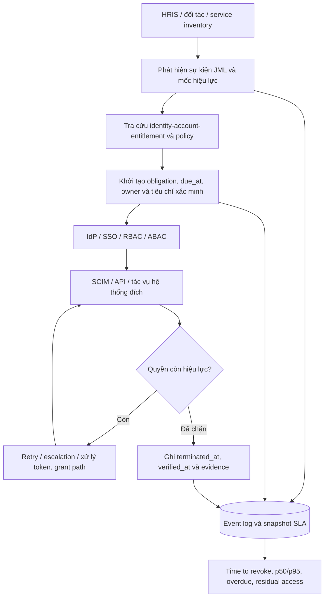

# Thời gian thu hồi quyền trong IAM: đo từ thời điểm phải chặn truy cập đến khi xác minh đã thu hồi

**Thời gian thu hồi quyền** (*time to revoke access*, *access revocation time*, đôi khi gọi *deprovisioning lead time*) đo khoảng thời gian từ một **mốc bắt đầu được quy định rõ** cho đến khi quyền truy cập không còn hợp lệ đã được **chấm dứt và xác minh tại hệ thống đích**. Đây là chỉ số trọng yếu của **IAM metrics**: một quyền còn hiệu lực sau khi nhân viên nghỉ việc, chuyển vai trò hoặc tài khoản dịch vụ ngừng sử dụng có thể tạo khoảng phơi bày rủi ro.

Trong mô-đun `SECURITY_IDENTITY_ACCESS_MANAGEMENT_IDENTITY_LIFECYCLE`, thước đo phải phản ánh quản lý vòng đời danh tính theo **Joiner–Mover–Leaver (JML)**: từ xác minh, tạo tài khoản, cấp quyền đến đánh giá và thu hồi khi vai trò thay đổi. Dữ liệu liên quan đến **Identity Provider (IdP)**, **Single Sign-On (SSO)**, giao thức **SCIM**, phân quyền **RBAC/ABAC**, ứng dụng đích, tài khoản dịch vụ, kiểm toán và những đường truy cập tồn dư (*residual access*).

Điểm khó nhất không phải phép trừ hai timestamp. Vấn đề là thống nhất **quyền nào phải thu hồi**, **từ thời điểm nào**, **bằng chứng nào đủ xác nhận chặn được truy cập**, và **cách phản ánh các tác vụ còn mở hoặc token chưa hết hiệu lực**. Bài này giải quyết các câu hỏi đó, kèm công thức, ví dụ, SQL và cách đọc kết quả.

## 1. “Thu hồi quyền” bao gồm những gì?

Trong IAM, **deprovisioning** có thể là vô hiệu hóa một identity/account, gỡ vai trò hoặc entitlement, xóa membership nhóm, thu hồi khóa API, session, refresh token hoặc chứng chỉ, tùy mục tiêu kiểm soát. Một quy trình có thể yêu cầu nhiều hành động để chấm dứt cùng một khả năng truy cập.

Ví dụ, nhân viên nghỉ việc đang có:

- Identity tại IdP, có thể xác thực qua SSO.
- Account ở ứng dụng CRM, được cấp quyền đọc/xuất dữ liệu.
- Phiên đăng nhập CRM còn hoạt động hoặc access token đã phát hành.
- Account database cục bộ, không phụ thuộc IdP.
- Quyền quản trị tạm thời đã được gán trực tiếp ở một ứng dụng.

Khóa identity tại IdP có thể ngăn đăng nhập mới, nhưng **chưa bảo đảm** phiên cũ, token không được kiểm tra thu hồi hay account database cục bộ đã bị chặn. Muốn kết luận *thu hồi xong*, cần định nghĩa **tập khả năng truy cập bắt buộc phải chấm dứt** và kiểm tra từng phần.

| Khái niệm | Câu hỏi đang giải đáp | Có đủ làm mốc kết thúc thu hồi? |
|---|---|---|
| **Sự kiện Leaver/Mover** | Chủ thể đã đổi tư cách hoặc vai trò? | Chưa; chỉ xác định nghĩa vụ |
| **IdP disabled** | Đăng nhập mới qua IdP đã bị chặn? | Chỉ đủ cho nghĩa vụ IdP, chưa đủ cho mọi target |
| **SSO logout** | Một số phiên hoặc luồng xác thực đã kết thúc? | Chưa chắc; còn token, phiên và đường xác thực khác |
| **SCIM/API success** | Lệnh thu hồi được hệ thống nhận hoặc xử lý? | Chưa chắc; cần xác minh trạng thái cuối |
| **Role/group removed** | Một đường cấp quyền đã bị xóa? | Chưa chắc; có thể còn quyền qua group/policy khác |
| **Verified no access** | Khả năng truy cập thuộc phạm vi đã bị chặn và có bằng chứng? | **Có**, cho nghĩa vụ có tiêu chí nghiệm thu tương ứng |

**Thu hồi quyền không đồng nghĩa xóa tài khoản hoặc dữ liệu.** Doanh nghiệp có thể giữ account disabled để phục vụ audit, điều tra hoặc lưu giữ dữ liệu. KPI cần đo **khả năng truy cập còn hay mất**, tránh coi thao tác xóa bản ghi là mục tiêu duy nhất.

## 2. Chọn đơn vị đo trước khi tính thời gian

Một ca Leaver có thể yêu cầu chặn quyền tại nhiều ứng dụng. Để không làm sai chỉ số, cần phân biệt ba cấp:

| Đơn vị | Tiêu chí hoàn tất | Phục vụ mục đích |
|---|---|---|
| **Nghĩa vụ thu hồi** (`obligation_id`) | Một khả năng truy cập hoặc nhóm điều kiện đã định nghĩa được xác minh chặn | Đo từng quyền/account/token và SLA của nó |
| **Tác vụ kỹ thuật** (`task_id`) | Một bước như gửi SCIM, gỡ group, hủy session thành công | Tìm bottleneck connector; không nhất thiết là quyền đã mất |
| **Ca JML đầu cuối** (`case_id`) | **Tất cả nghĩa vụ bắt buộc** thuộc ca đạt tiêu chí | Đo thời gian để một Mover/Leaver hết những quyền phải gỡ |

Ví dụ, một ca Leaver bắt đầu hiệu lực lúc **18:00** và có ba nghĩa vụ:

| Nghĩa vụ | Xác minh hoàn tất | Thời gian sau 18:00 |
|---|---|---:|
| Khóa IdP | 18:03 | 3 phút |
| Thu hồi quyền CRM | 18:12 | 12 phút |
| Chặn credential database | 18:25 | 25 phút |

Nếu cùng mốc bắt đầu, thời gian **đầu cuối ca Leaver là 25 phút**, vì chỉ khi đó cả ba nghĩa vụ bắt buộc đều hoàn tất. Trung bình thời gian của ba nghĩa vụ là \((3+12+25)/3 \approx 13{,}33\) phút. Hai con số khác nhau và **không thể thay thế nhau**.

Nếu các nghĩa vụ có deadline khác nhau, ví dụ vô hiệu hóa đặc quyền ngay khi Leaver có hiệu lực nhưng xóa một account lưu trữ trong 24 giờ, thì phải theo dõi **thời gian và SLA của từng nghĩa vụ**, đồng thời định nghĩa rõ mốc “hoàn tất ca” đang bao phủ những điều kiện nào. Một số bước vệ sinh dữ liệu dài hạn có thể thuộc pha khác với **chặn truy cập khẩn cấp**.

## 3. Định nghĩa mốc thời gian và timestamp

Hệ thống cần lưu mốc riêng thay vì dùng duy nhất `ticket_closed_at`:

| Trường | Ý nghĩa | Dùng để phân tích |
|---|---|---|
| `source_event_at` | Nguồn có thẩm quyền ghi sự kiện, ví dụ HRIS xác nhận nghỉ việc | Kiểm tra độ trễ thông báo |
| `effective_at` | Thời điểm quyền **không còn được phép** theo nghiệp vụ/chính sách | Mốc tham chiếu phơi bày sau hiệu lực |
| `received_at` | Hệ thống IAM nhận sự kiện hoặc yêu cầu có thể xử lý | Đo độ trễ từ nguồn tới IAM |
| `eligible_at` | Nghĩa vụ có đủ dữ liệu/ủy quyền để xử lý, theo định nghĩa vận hành | Đo thời gian xử lý sau khi đủ điều kiện |
| `revocation_started_at` | Tác vụ kỹ thuật đầu tiên bắt đầu chạy | Kiểm tra độ trễ queue |
| `access_terminated_at` | Thời điểm hệ thống đích xác nhận quyền **đã không còn hiệu lực** | Mốc kết thúc nếu có bằng chứng đáng tin |
| `verified_at` | Thời điểm IAM xác minh và ghi nhận bằng chứng rằng điều kiện thu hồi đã đạt | Mốc báo cáo có thể kiểm toán |
| `due_at` | Deadline của SLA theo quy tắc và mức rủi ro đã phê duyệt | Đánh giá đúng/trễ hạn |
| `snapshot_at` | Thời điểm chốt số liệu báo cáo | Xác định phần đang mở, còn quá hạn |

**Quan trọng:** `access_terminated_at` và `verified_at` không nhất thiết bằng nhau. Ví dụ, app thực sự chặn quyền lúc 18:05 nhưng hệ thống giám sát kiểm tra vào 18:09. Nếu có audit log tin cậy ghi trạng thái chặn hiệu lực lúc 18:05, có thể dùng 18:05 cho **thời điểm thực thi**, còn 18:09 cho **độ trễ xác minh**. Nếu không có bằng chứng nào xác định được thời điểm chặn trước 18:09, dùng 18:09 làm thời điểm đã xác minh là cách đo thận trọng; không tự ghi lùi dựa vào thời điểm gửi lệnh.

### Mốc bắt đầu theo mục tiêu nghiệp vụ

Có nhiều cách đo hợp lý, nhưng chúng trả lời những câu hỏi khác nhau:

**A. Thời gian phơi bày sau hiệu lực** (*post-effective access exposure*):

\[
T_{\mathrm{exposure}} =
\max(0,\;t_{\mathrm{terminated}}-t_{\mathrm{effective}})
\]

Cách đo này phù hợp khi cần biết quyền còn tồn tại **bao lâu sau thời điểm nó không được phép nữa**. Nếu không có mốc chặn truy cập đáng tin, có thể dùng `verified_at` làm chỉ số thận trọng và ghi rõ đây là **thời gian đến khi xác minh**, không khẳng định toàn bộ khoảng là thời gian có thể bị khai thác.

**B. Thời gian xử lý từ khi IAM nhận yêu cầu** (*IAM handling time*):

\[
T_{\mathrm{handling}} =
t_{\mathrm{verified}}-t_{\mathrm{received}}
\]

Giúp đánh giá hiệu suất hệ thống IAM từ lúc nhận tín hiệu. Nhưng nếu HRIS gửi Leaver muộn 2 giờ thì handling nhanh **không xóa được khoảng phơi bày trước đó**.

**C. Thời gian từ khi đủ điều kiện đến hoàn tất** (*eligible-to-verified time*):

\[
T_{\mathrm{fulfillment}} =
t_{\mathrm{verified}}-t_{\mathrm{eligible}}
\]

Dùng khi quy trình phụ thuộc phê duyệt/dữ liệu. Việc xác định `eligible_at` phải công bằng: không được đặt bằng lúc worker bắt đầu sau một hàng đợi dài nếu nghĩa vụ đã đủ điều kiện sớm hơn.

Trong trường hợp `effective_at <= received_at <= verified_at` và các mốc cùng định nghĩa, có thể phân rã:

\[
t_{\mathrm{verified}}-t_{\mathrm{effective}}
=
(t_{\mathrm{received}}-t_{\mathrm{effective}})
+
(t_{\mathrm{verified}}-t_{\mathrm{received}})
\]

Vế đầu đo **độ trễ tiếp nhận sau hiệu lực**, vế sau đo **thời gian xử lý và xác minh**. Nếu Leaver được thông báo **trước ngày có hiệu lực**, `received_at < effective_at`, phải phân tích theo quy tắc đã thiết kế; không dùng phép phân rã trên một cách máy móc. Hệ thống có thể chuẩn bị thu hồi trước, nhưng chỉ chặn quyền đúng thời điểm được phép.

## 4. Công thức KPI và điều kiện đối soát

Gọi \(C\) là tập nghĩa vụ thu hồi **đã được xác minh hoàn tất** trong cohort báo cáo, mỗi nghĩa vụ chỉ xuất hiện một lần. Gọi \(s_i\) là mốc bắt đầu đã chọn theo chính sách và \(f_i\) là mốc kết thúc có bằng chứng.

Với từng nghĩa vụ \(i\):

\[
T_i = f_i-s_i
\]

Chỉ tính khi có đủ mốc hợp lệ, thời điểm kết thúc không trước mốc bắt đầu nếu dùng thời lượng xử lý, và nghĩa vụ thuộc phạm vi đo. Với trường hợp **thu hồi đúng thời điểm hiệu lực nhưng đã chuẩn bị từ trước**, hãy xử lý bằng quy tắc riêng thay vì coi thời lượng âm là thành tích tốt.

### Trung bình, p50 và p95

**Thời gian thu hồi trung bình** của các nghĩa vụ đã hoàn tất:

\[
\overline{T} = \frac{1}{|C|}\sum_{i\in C} T_i
\]

**Median/p50** là trung vị của tập thời gian. **p95** phản ánh phần đuôi chậm, tức các ca kéo dài khác biệt với nhóm phổ biến. Nên ghi cách tính phân vị: ví dụ nearest-rank hoặc nội suy `PERCENTILE_CONT(0.95)` của PostgreSQL cho kết quả có thể khác nhau trên mẫu nhỏ.

Giả sử 10 nghĩa vụ đã hoàn tất có thời gian thu hồi (phút) đã xếp tăng:

```text
2, 4, 6, 8, 10, 12, 15, 20, 50, 120
```

Tổng bằng 247 phút nên **trung bình = 24,7 phút**. Trung vị bằng \((10+12)/2=11\) phút. Nếu dùng nội suy `PERCENTILE_CONT(0.95)`, vị trí là \(1+0{,}95(10-1)=9{,}55\), do đó **p95 = 88,5 phút**; nearest-rank cho **120 phút**. Cần giữ cố định phương pháp giữa các kỳ.

Một ca rất chậm có thể kéo mean và p95 lên cao dù đa số ca xong nhanh. Vì vậy, chỉ công bố mean có thể làm người đọc bỏ qua rủi ro của nhóm thu hồi quá chậm.

### Các nghĩa vụ còn mở có được bỏ qua?

**Không.** Những nghĩa vụ chưa hoàn tất **không có \(f_i\)** nên không thể được xem là quan sát đã hoàn thành trong công thức mean/p95 ở trên. Tuy nhiên, chúng phải xuất hiện trong dashboard dưới dạng:

- **Open revocation obligations:** số nghĩa vụ đang chờ hoặc xử lý.
- **Overdue open obligations:** số nghĩa vụ đã vượt deadline mà chưa có bằng chứng hoàn tất.
- **Open age:** thời gian tính từ mốc SLA tới snapshot của nghĩa vụ còn mở.
- **Oldest pending exposure:** trường hợp chờ lâu nhất, đặc biệt ở quyền đặc quyền và Leaver.
- **On-time deprovisioning rate:** tỷ lệ nghĩa vụ đã đến hạn được xác minh hoàn tất đúng hạn, bao gồm các nghĩa vụ quá hạn còn mở trong mẫu số.

Dữ liệu đã hoàn thành chịu **thiên lệch chọn mẫu**: yêu cầu xử lý lâu có xu hướng còn mở và bị bỏ khỏi phân phối thời gian hoàn tất. Khi cần mô hình hóa thời gian đến sự kiện trên toàn bộ ca, có thể dùng phương pháp phân tích dữ liệu kiểm duyệt phải (*right-censoring*) với quy tắc thống kê phù hợp; ở mức vận hành thông thường, hãy hiển thị backlog và tuổi yêu cầu cạnh mean/p95.

## 5. Phân biệt “thời gian thu hồi quyền” với “thu hồi đúng hạn”

Hai KPI bổ sung cho nhau:

| Chỉ số | Trả lời câu hỏi | Phép tính |
|---|---|---|
| **Time to revoke** | Cần bao nhiêu phút/giờ để thu hồi? | \(f_i-s_i\), tổng hợp mean/p50/p95 |
| **On-time deprovisioning rate** | Có bao nhiêu nghĩa vụ hoàn tất trước hoặc đúng deadline? | Nghĩa vụ đến hạn và đúng hạn / tổng nghĩa vụ hợp lệ đã đến hạn |
| **Late exposure duration** | Quyền kéo dài bao nhiêu thời gian sau deadline? | \(\max(0,\; f_i-due_i)\) cho ca hoàn tất muộn; ca mở cần chốt theo snapshot |
| **Time to containment** | Mất bao lâu để chặn luồng truy cập nguy cơ cao trong giai đoạn đầu? | Mốc chặn truy cập khẩn cấp trừ mốc bắt đầu được quy định |

Ví dụ cùng thu hồi trong **20 phút**: một nghĩa vụ có SLA 15 phút là **trễ 5 phút**, nghĩa vụ khác có SLA 60 phút là **đúng hạn**. Không thể suy ra tỷ lệ on-time từ mean của thời gian thu hồi nếu các deadline và loại nghĩa vụ khác nhau.

**Ví dụ tính đủ ba mốc:** Nhân viên nghỉ việc có hiệu lực lúc **18:00**. HRIS gửi sự kiện tới IAM lúc **18:07**. Connector hoàn tất chặn tại ứng dụng lúc **18:16**, hệ thống đối soát xác minh lúc **18:19**. SLA được quy định 15 phút kể từ thời điểm hiệu lực nên deadline là **18:15**.

- **Độ trễ sự kiện tới IAM:** 7 phút.
- **Thời gian IAM nhận tới khi xác minh:** 12 phút.
- **Thời gian từ hiệu lực tới khi quyền thực sự chấm dứt:** 16 phút nếu log ứng dụng 18:16 đáng tin.
- **Thời gian từ hiệu lực tới khi xác minh:** 19 phút.
- **Vi phạm SLA:** quyền bị chặn **trễ 1 phút** nếu SLA lấy mốc chặn thực tế và có bằng chứng 18:16; hoặc xác minh **trễ 4 phút** nếu SLA yêu cầu bằng chứng xác nhận cuối 18:19.

Điều này cho thấy **tiêu chí nghiệm thu SLA** phải được quy định trước. Không thể tự đổi giữa `access_terminated_at` và `verified_at` sau khi đã nhìn thấy kết quả.

## 6. Đồng hồ thực, giờ làm việc và thời gian phơi bày

**Elapsed time** là thời gian thực giữa hai timestamp. Đây thường là thước đo quan trọng với rủi ro an ninh vì một quyền không hợp lệ vẫn có thể bị lạm dụng vào ban đêm hoặc cuối tuần.

**Business time** chỉ tính thời gian thuộc lịch làm việc có hiệu lực. Nó có thể thích hợp cho một số tác vụ quản trị ít nhạy cảm, nhưng cần khai báo lịch, múi giờ, ngày nghỉ, ca trực và quy tắc pause. Không lấy thời gian đồng hồ rồi tự trừ cuối tuần theo công thức cố định.

| Tình huống | Quy tắc nên xem xét |
|---|---|
| Nhân viên nghỉ việc với quyền truy cập production | Deadline theo thời điểm hiệu lực và mức rủi ro, có thể yêu cầu 24/7 |
| Quyền quản trị bị thu hồi do sự cố | Quy trình chặn khẩn cấp; đo time to containment riêng |
| Nhà thầu hết hợp đồng cuối tuần | Giữ mốc hết hạn hợp đồng, không tự hoãn vì hết giờ làm |
| Gỡ role không còn cần thiết trong Mover đã phê duyệt | SLA theo mốc thay đổi có hiệu lực hoặc khoảng thời gian cho phép đã công bố |
| Dọn bản ghi account đã disable, bảo quản dữ liệu | Có thể thuộc SLA vận hành khác; không trộn với thời gian chặn quyền |

Ví dụ, từ **17:00 thứ Sáu tới 09:00 thứ Hai** là **64 giờ elapsed** nếu cùng offset UTC và không đổi giờ mùa hè. Với lịch làm việc 09:00–17:00 từ thứ Hai tới thứ Sáu, thời lượng **business time** trong đúng khoảng đó bằng 0 phút. Nếu account vẫn truy cập được suốt cuối tuần, báo cáo business time bằng 0 không thể được dùng để kết luận **rủi ro phơi bày bằng 0**.

Với truy cập tạm có thời hạn, có thể chủ động đặt expiration. Nếu quyền hết hiệu lực **đúng lúc `effective_at`** nhờ policy được kiểm chứng, thời gian phơi bày sau hiệu lực có thể bằng 0. Thời gian cấu hình hệ thống trước đó vẫn là công việc vận hành, nhưng nó là một khoảng khác.

## 7. Thời gian thu hồi quyền trong Joiner–Mover–Leaver

### Joiner: xử lý những quyền tạm phát sinh trong onboarding

Joiner chủ yếu cấp danh tính và quyền để người mới sẵn sàng làm việc. Tuy nhiên, quy trình onboarding có thể cấp quyền tạm cho người đào tạo, tài khoản thử nghiệm hoặc đường truy cập dùng một lần. Khi thời gian sử dụng kết thúc, những quyền này trở thành nghĩa vụ thu hồi có deadline riêng.

**Ví dụ:** Một tài khoản onboarding có quyền tạm đọc hồ sơ hướng dẫn đến 17:00 ngày làm việc đầu tiên. Nếu quyền vẫn có hiệu lực lúc 19:00, đây là vấn đề thu hồi quyền tạm, dù việc cấp quyền ban đầu thành công.

### Mover: rút quyền vai trò cũ đồng thời cấp quyền mới

Mover là nguồn phát sinh **privilege creep** khi người dùng chuyển đơn vị nhưng nhóm/quyền cũ chưa bị gỡ. Hệ thống cần tính lại **RBAC** theo role hoặc **ABAC** theo thuộc tính và chính sách, rồi xác nhận quyền tại ứng dụng đích.

Ví dụ, lúc 09:00 nhân viên bắt đầu vai trò phân tích tài chính. Quyền phân tích mới được cấp lúc 09:10, nhưng quyền duyệt đơn hàng của vai trò mua sắm cũ đến 11:30 mới được gỡ. **Thời gian cấp mới là 10 phút** và **thời gian thu hồi cũ là 150 phút** nếu mốc thu hồi tính từ 09:00. Cả hai cần được đo; chỉ nhìn provisioning sẽ bỏ sót nguy cơ xung đột nhiệm vụ (*Segregation of Duties — SoD*).

Nếu doanh nghiệp có thời gian chuyển giao được phê duyệt, phải lưu rõ **phạm vi quyền tạm còn được phép**, người duyệt, ngày hết hạn và deadline gỡ. Không được giả định mọi quyền cũ được phép duy trì vô thời hạn.

### Leaver: chặn truy cập khi quan hệ kết thúc

Khi hợp đồng lao động, hợp tác hoặc tư cách thành viên kết thúc, hệ thống nguồn xác nhận **thời điểm hiệu lực**. IdP có thể khóa identity, SSO có thể kết thúc một số phiên và SCIM/API xử lý tài khoản/entitlement tại các ứng dụng đích. Các **account cục bộ**, token độc lập và đường xác thực không qua SSO phải được xem xét riêng.

Một ca Leaver có thể cần hai mốc: **ngăn truy cập khẩn cấp** và **hoàn thành toàn bộ deprovisioning**. Nếu tiêu chí khẩn cấp là chặn mọi khả năng truy cập rủi ro cao trong 5 phút, trong khi việc lưu trữ/xóa bản ghi diễn ra sau, hãy duy trì **hai KPI và hai loại nghĩa vụ**. Không lấy thời gian xóa account lưu trữ để đại diện cho thời gian ngăn truy cập.

### Service account và workload identity

Quyền cloud, service principal, API key, chứng chỉ và token của **non-human identity (NHI)** cũng cần thu hồi khi workload bị thay thế, dịch vụ ngừng chạy, secret bị lộ hoặc owner thay đổi. Không thể dùng `last_login` của con người để chứng minh service đã ngừng sử dụng; cần quan sát API calls, dependency, runtime và inventory.

**Ví dụ:** Pipeline cũ được loại bỏ lúc 20:00 nhưng API key vẫn có thể gọi hệ thống tới 23:00. Nếu chính sách yêu cầu khóa key tại 20:00, **khoảng chậm chặn key là 3 giờ**. Trường hợp key được tạo cho nhiều workload dùng chung có thể cần phương án thay thế và cắt chuyển có kiểm soát; chủ sở hữu dịch vụ phải chịu trách nhiệm về thời hạn và bằng chứng.

## 8. Thách thức kỹ thuật: token, session, quyền kế thừa và đồng bộ

### 8.1. Vô hiệu hóa IdP không luôn vô hiệu hóa token đã cấp

Một **access token tự chứa**, ví dụ JWT do bên nhận kiểm tra chữ ký và hạn dùng mà không truy vấn trạng thái thu hồi, có thể tiếp tục được chấp nhận đến khi hết hạn. Vô hiệu hóa tài khoản IdP hoặc thu hồi refresh token không tự làm mọi access token đã phát hành trở nên không hợp lệ.

Các cơ chế có thể giảm khoảng tồn dư tùy kiến trúc: token ngắn hạn, token introspection, denylist, thay khóa ký theo quy trình phù hợp, thu hồi phiên ở ứng dụng, policy đánh giá lại khi request tới hoặc vô hiệu hóa trực tiếp quyền ở tài nguyên đích. Không có một giải pháp phù hợp cho mọi hệ thống; tiêu chí kiểm chứng phải căn cứ hành vi thực tế.

**Ví dụ:** IdP disable lúc 18:02 nhưng ứng dụng còn chấp nhận access token đến 18:30. Nếu chính sách yêu cầu **không còn truy cập** sau 18:00, không thể kết luận thành công lúc 18:02 chỉ từ trạng thái IdP.

### 8.2. Group đã gỡ nhưng quyền còn qua đường khác

RBAC có thể có nhiều role, nhóm lồng nhau hoặc grant trực tiếp. ABAC có thể có điều kiện về tenant, dự án, nhãn dữ liệu, thiết bị hay thời điểm. Gỡ một group **không đảm bảo** quyền hiệu lực chấm dứt nếu cùng permission vẫn được cấp qua role/policy khác.

Với nghĩa vụ “xóa toàn bộ quyền `delete_backup`”, tiêu chí kết thúc nên là **không còn khả năng thực hiện hành động đó trong scope liên quan**, đã kiểm tra các đường cấp quyền. Mốc gỡ một grant đơn lẻ chỉ kết thúc **tác vụ grant path**, chưa chắc kết thúc nghĩa vụ thu hồi khả năng truy cập.

### 8.3. SCIM, API và trạng thái đích có thể bất đồng bộ

SCIM hoặc API của ứng dụng đích có thể trả thành công cho **việc tiếp nhận job**, sau đó mới cập nhật bản ghi account. Mạng lỗi, quota, retry, eventual consistency hoặc đồng bộ theo lô có thể khiến trạng thái cuối đến chậm.

Nếu log chỉ có `request_sent_at` và `response_received_at`, hãy đo **connector handling time** tách biệt, đồng thời xây dựng bước **readback/verification**. Không dùng timestamp hoàn thành của queue để giả làm thời điểm quyền đã mất.

### 8.4. Account cục bộ và thông tin xác thực chia sẻ

Ứng dụng legacy có account riêng, database có local user và script có thể mang API key không đăng nhập qua SSO. Khóa identity IdP không tự thu hồi các đường này. Hệ thống cần inventory và quan hệ identity–account–credential để tạo nghĩa vụ đầy đủ, tránh dashboard thời gian thu hồi “nhanh” vì chỉ đo các ứng dụng dễ tích hợp.

Với credential dùng chung, phải đánh giá đối tượng chịu ảnh hưởng và kế hoạch thay thế/rotate; việc thu hồi có thể làm gián đoạn service nếu không chuẩn bị. Không vì vậy mà bỏ nghĩa vụ hoặc xóa timestamp gốc khỏi báo cáo.

## 9. Dòng dữ liệu đo lường và bằng chứng kiểm toán

Một kiến trúc tổng thể:



Các bước thu hồi có thể chạy song song; sơ đồ chỉ mô tả logic. Để báo cáo có thể kiểm toán, lưu ít nhất:

| Trường dữ liệu | Công dụng |
|---|---|
| `obligation_id`, `case_id`, `canonical_identity_id` | Khóa nghĩa vụ, liên kết ca JML, chống đếm trùng |
| `identity_type`, `case_kind`, `risk_tier` | Phân loại human/NHI, Mover/Leaver, mức rủi ro |
| `target_system_id`, `account_id`, `entitlement_id`, `action` | Xác định chính xác quyền hoặc credential cần thu hồi |
| `effective_at`, `source_event_at`, `received_at`, `eligible_at` | Phân tách độ trễ nguồn, nhận sự kiện và xử lý |
| `due_at`, `sla_policy_id`, `sla_version` | Đánh giá cam kết và tái lập deadline |
| `revocation_started_at`, `access_terminated_at`, `verified_at` | Phân biệt thao tác, hiệu lực và bằng chứng kiểm tra |
| `verification_method`, `evidence_ref` | Chứng minh trạng thái ở ứng dụng đích |
| `state`, `exception_code`, `owner_team` | Quản lý backlog, ngoại lệ được duyệt và xử lý |
| `snapshot_at`, `correlation_id`, `source_system` | Tái hiện trạng thái theo thời điểm, liên kết log xuyên hệ thống |

Mỗi sự kiện nên có **event ID** bất biến, timezone/UTC đúng, dấu thời gian nguồn và xử lý, cùng correlation ID. Khi SCIM gửi lại một lệnh hoặc workflow retry, nghĩa vụ phải giữ **cùng `obligation_id`** và không biến thành nhiều ca trong dashboard. Lịch sử thay đổi deadline, loại trừ, các lần thất bại và lần xác minh cuối cần được lưu đầy đủ.

## 10. Ví dụ SQL: mean, p50, p95 và các ca còn mở

Giả sử bảng PostgreSQL `iam_revocation_obligation_snapshot` chứa **mỗi `obligation_id` một dòng tại mỗi `snapshot_at`**, với:

- `obligation_id`, `case_kind`, `snapshot_at`, `in_scope`.
- `effective_at`: mốc bắt đầu của KPI **thời gian từ hiệu lực đến khi xác minh** cho ví dụ này.
- `verified_at`: chỉ được ghi khi toàn bộ điều kiện thu hồi thuộc nghĩa vụ đã được xác minh; có thể là `NULL`.
- `due_at`: deadline cam kết.
- Dữ liệu tại snapshot phản ánh trạng thái **as-of** thời điểm chốt.

Để không trộn các nghĩa vụ có mốc bắt đầu khác nhau, truy vấn này sử dụng một quy tắc thống nhất: **thời gian đo = `verified_at - effective_at`**, đơn vị phút theo đồng hồ thực. Nếu muốn đo từ `received_at` hoặc thời điểm quyền thực sự chấm dứt, cần tạo KPI và cột tương ứng.

```sql
WITH scoped AS (
    SELECT
        obligation_id,
        case_kind,
        effective_at,
        verified_at,
        due_at,
        snapshot_at
    FROM iam_revocation_obligation_snapshot
    WHERE snapshot_at = TIMESTAMPTZ '2026-11-23 14:00:00+07'
      AND in_scope = TRUE
      AND effective_at IS NOT NULL
      AND effective_at <= snapshot_at
),
completed AS (
    SELECT
        case_kind,
        EXTRACT(EPOCH FROM (verified_at - effective_at)) / 60.0
            AS revocation_minutes
    FROM scoped
    WHERE verified_at IS NOT NULL
      AND verified_at <= snapshot_at
      AND verified_at >= effective_at
),
completion_metrics AS (
    SELECT
        case_kind,
        COUNT(*) AS completed_count,
        ROUND(AVG(revocation_minutes)::numeric, 2)
            AS mean_minutes,
        ROUND((
            PERCENTILE_CONT(0.50)
                WITHIN GROUP (ORDER BY revocation_minutes)
        )::numeric, 2) AS p50_minutes,
        ROUND((
            PERCENTILE_CONT(0.95)
                WITHIN GROUP (ORDER BY revocation_minutes)
        )::numeric, 2) AS p95_minutes
    FROM completed
    GROUP BY case_kind
),
backlog_metrics AS (
    SELECT
        case_kind,
        COUNT(*) AS applicable_count,
        COUNT(*) FILTER (
            WHERE verified_at IS NULL
               OR verified_at > snapshot_at
        ) AS open_count,
        COUNT(*) FILTER (
            WHERE due_at < snapshot_at
              AND (
                  verified_at IS NULL
                  OR verified_at > snapshot_at
              )
        ) AS overdue_open_count,
        ROUND(AVG(
            EXTRACT(EPOCH FROM (snapshot_at - effective_at)) / 60.0
        ) FILTER (
            WHERE verified_at IS NULL
               OR verified_at > snapshot_at
        )::numeric, 2) AS mean_open_age_minutes
    FROM scoped
    GROUP BY case_kind
)
SELECT
    b.case_kind,
    b.applicable_count,
    COALESCE(c.completed_count, 0) AS completed_count,
    c.mean_minutes,
    c.p50_minutes,
    c.p95_minutes,
    b.open_count,
    b.overdue_open_count,
    b.mean_open_age_minutes
FROM backlog_metrics b
LEFT JOIN completion_metrics c
       ON c.case_kind = b.case_kind
ORDER BY b.case_kind;
```

**Đọc kết quả:** `mean_minutes`, `p50_minutes` và `p95_minutes` dựa vào **nghĩa vụ đã xác minh hoàn tất**; `open_count`, `overdue_open_count` và `mean_open_age_minutes` phản ánh backlog. Tập `scoped` chỉ xét nghĩa vụ có mốc hiệu lực đã qua. `due_at` thiếu phải được theo dõi như lỗi dữ liệu SLA; chúng sẽ không tự xuất hiện ở nhóm overdue của truy vấn.

**Giả định quan trọng:** nếu một nghĩa vụ được thu hồi **hợp lệ trước `effective_at`**, nó cần quy tắc riêng, không phải tính thời gian âm. Ví dụ này loại các giá trị `verified_at < effective_at` khỏi thời gian completed; trong triển khai thực phải gắn cờ và phân loại riêng để chúng không bị nhầm thành “open” hoặc biến mất khỏi tổng hợp. Cũng cần xử lý yêu cầu bị hủy hợp lệ, thay deadline, ngoại lệ và bản ghi thiếu thời gian bằng event log/snapshot có kiểm toán.

### SQL bổ sung: tỷ lệ deprovisioning đúng hạn

Để đo **on-time** theo deadline, cần dùng cohort nghĩa vụ đến hạn. Ví dụ snapshot trên:

```sql
SELECT
    case_kind,
    COUNT(*) AS due_obligations,
    COUNT(*) FILTER (
        WHERE verified_at IS NOT NULL
          AND verified_at <= due_at
    ) AS on_time_obligations,
    COUNT(*) FILTER (
        WHERE verified_at IS NULL
           OR verified_at > TIMESTAMPTZ '2026-11-23 14:00:00+07'
    ) AS overdue_open_obligations,
    ROUND(
        100.0 * COUNT(*) FILTER (
            WHERE verified_at IS NOT NULL
              AND verified_at <= due_at
        ) / NULLIF(COUNT(*), 0), 2
    ) AS on_time_rate_pct
FROM iam_revocation_obligation_snapshot
WHERE snapshot_at = TIMESTAMPTZ '2026-11-23 14:00:00+07'
  AND in_scope = TRUE
  AND due_at >= TIMESTAMPTZ '2026-11-01 00:00:00+07'
  AND due_at <  TIMESTAMPTZ '2026-11-23 14:00:00+07'
GROUP BY case_kind
ORDER BY case_kind;
```

Cohort này chỉ xét deadline **đã qua** tại thời điểm chốt, bao gồm nghĩa vụ hoàn tất muộn và nghĩa vụ còn mở. Nếu `due_obligations = 0`, kết quả tỷ lệ là **NULL/N/A**, không mặc định 100%. Phương pháp xét `verified_at <= due_at` ngụ ý SLA yêu cầu **xác minh hoàn tất**, không chỉ có lệnh gửi thành công. Chính sách loại trừ hợp lệ phải được áp dụng vào `in_scope` bằng bằng chứng, không tự bỏ các ca khó.

## 11. Kiểm soát chất lượng dữ liệu

Một dashboard thời gian thu hồi có thể trông rất tốt khi thực tế còn rủi ro, nếu nguồn dữ liệu hoặc quy tắc phân loại sai. Những kiểm tra cần duy trì:

| Kiểm tra | Dấu hiệu bất thường | Hướng xử lý |
|---|---|---|
| Không có obligation cho một sự kiện Leaver/Mover | Bỏ sót ca thu hồi | Đối soát HRIS, account inventory và policy |
| IdP disabled nhưng ứng dụng còn active | Chưa thu hồi đầy đủ | Kiểm tra SCIM, account cục bộ, token, session |
| `verified_at` bằng thời điểm ticket đóng hàng loạt | Dùng log hành chính làm bằng chứng | Đòi readback tại target hoặc event có hiệu lực |
| `verified_at < effective_at` ngoài quy tắc đã chuẩn hóa | Có thể chuẩn bị thu hồi sớm hoặc dữ liệu lệch clock | Phân loại ngoại lệ hợp lệ, kiểm tra mốc thời gian |
| Trùng `obligation_id` trong snapshot | Retry/import gây đếm đôi | Khóa duy nhất và xử lý idempotent |
| `due_at` thay đổi sau khi trễ | SLA bị điều chỉnh không có căn cứ | Giữ deadline gốc, version và phê duyệt |
| Chỉ số giảm mạnh khi connector bị lỗi | Quyền bị mất khỏi phạm vi đo | Kiểm tra discovery coverage và số target được quét |
| Nghĩa vụ luôn có kết quả nhanh 0–1 giây | Có thể ghi nhận lúc enqueue, chưa chặn truy cập | Kiểm tra định nghĩa kết thúc và bằng chứng |
| NHI không có owner hoặc workload bị thay thế | Không ai chịu trách nhiệm thu hồi | Service inventory, gán owner hoặc xử lý theo runbook |
| Không có overdue nhưng nhiều bản ghi thiếu `due_at` | Bỏ sót trường hợp vi phạm | Cảnh báo dữ liệu thiếu SLA, không công bố KPI thiếu điều kiện |

Ngoài ra, cần lưu **mốc chốt, múi giờ, phiên bản policy, phương pháp tính phân vị, số mẫu, phạm vi hệ thống và độ trễ đồng bộ**. Nếu dữ liệu đến muộn sau kỳ chốt, công bố chính sách hiệu chỉnh/backfill thay vì sửa âm thầm một báo cáo đã dùng cho kiểm toán.

## 12. Tối ưu thời gian thu hồi theo nguyên nhân thực tế

Tùy vị trí nghẽn, biện pháp cải tiến khác nhau:

| Điểm nghẽn | Biện pháp cải thiện |
|---|---|
| HRIS/nguồn đối tác gửi sự kiện muộn | Tích hợp event đáng tin, kiểm tra thiếu dữ liệu và cảnh báo trước ngày hiệu lực |
| Không có inventory account–identity | Đồng bộ định danh chuẩn, quan hệ owner và danh sách ứng dụng đích |
| Người duyệt không rõ trách nhiệm | Phân vai, escalation và điều kiện phê duyệt trước sự kiện |
| Connector SCIM lỗi hoặc rate limit | Retry có idempotency, hàng đợi lỗi, backoff và quan sát target |
| Ứng dụng không hỗ trợ revoke token/phiên | Kiến trúc token ngắn hạn, kiểm tra trạng thái hoặc cơ chế chặn tại tài nguyên |
| Role lồng nhau hoặc grant trực tiếp bị sót | Phân giải quyền hiệu lực, gỡ mọi đường cấp phát không hợp lệ |
| Account dịch vụ dùng chung credential | Gán owner, inventory dependency, quản lý secret/rotation và tách quyền |
| Kiểm chứng sau thu hồi chậm | Readback tự động, sự kiện trạng thái thực tế và audit trail |
| Nhiều ca mở nhưng không có SLA | Deadline theo loại quyền/rủi ro, hàng đợi ưu tiên và cảnh báo overdue |

**Không tối ưu KPI bằng cách đóng ticket sớm, chuyển ca trễ thành “ngoại lệ” không chứng cứ hoặc bỏ ứng dụng legacy khỏi scope.** Những hành động này chỉ rút ngắn số đo, không rút ngắn thời gian quyền truy cập thực sự còn hiệu lực.

Với quyền đặc quyền, dữ liệu nhạy cảm hoặc sự cố nghiêm trọng, có thể tách **thời gian đến khi chặn đường truy cập rủi ro cao** khỏi **thời gian hoàn tất mọi hạng mục dọn dẹp**. Cách đo theo lớp phù hợp để phân công và giảm rủi ro mà vẫn minh bạch về việc còn gì chưa hoàn tất.

## 13. Bộ dashboard đề xuất

Một dashboard **IAM metrics** theo dõi thời gian thu hồi quyền nên đặt cạnh nhau các chỉ số:

| Chỉ số | Ý nghĩa |
|---|---|
| **Mean/p50/p95 time to revoke** | Tốc độ thu hồi trên những nghĩa vụ đã hoàn tất |
| **Time from effective to verified** | Khoảng từ mốc phải chặn tới khi có bằng chứng hoàn tất |
| **Source notification delay** | Độ trễ từ sự kiện hiệu lực tới khi IAM nhận thông báo |
| **On-time deprovisioning rate** | Tỷ lệ nghĩa vụ đã đến hạn được xác minh hoàn tất đúng hạn |
| **Open và overdue-open count** | Quy mô tồn đọng, nhất là ca đã quá hạn còn truy cập |
| **Age of oldest overdue** | Trường hợp chưa xử lý kéo dài nhất |
| **Privileged revocation time** | Thời gian chặn quyền quản trị/nhạy cảm |
| **Residual access after Leaver** | Số account/quyền còn hiệu lực sau mốc bắt buộc |
| **Mover old-role revocation time** | Tốc độ gỡ quyền cũ khi đổi vai trò |
| **SCIM/API failures, retry và verification delay** | Lỗi kết nối hoặc khâu xác minh làm tăng thời gian |
| **Unowned NHI và stale credentials** | Danh tính máy thiếu chủ sở hữu/credential quá vòng đời |

Cần phân tách theo **loại sự kiện JML, target system, loại quyền, risk tier, tenant, loại identity (human/NHI)** và đội xử lý. Tránh dùng tỷ lệ tổng hợp để che khuất một số ít ca quyền quản trị bị trễ nghiêm trọng.

Ví dụ, SLO vận hành có thể quy định “p95 thu hồi quyền tiêu chuẩn dưới 30 phút” và “100% nghĩa vụ chặn quyền quản trị khẩn cấp được xác minh trong thời hạn riêng”. Những con số này chỉ là minh họa; SLA/SLO thực phải phù hợp chính sách rủi ro, kiến trúc token, năng lực ứng dụng và cam kết nghiệp vụ.

## 14. Sai lầm thường gặp

1. **Bắt đầu đo từ lúc IAM nhận sự kiện nhưng lại tuyên bố đo phơi bày sau khi Leaver có hiệu lực:** bỏ qua độ trễ thông báo.
2. **Dùng thời điểm gửi SCIM/API để kết thúc:** lệnh thành công chưa chứng minh quyền thực sự bị chặn ở target.
3. **Chỉ khóa IdP mà bỏ local account, session và token:** còn đường truy cập độc lập ngoài SSO.
4. **Gỡ một role rồi đóng nghĩa vụ:** quyền có thể vẫn đến từ group lồng nhau hoặc policy trực tiếp.
5. **Trộn thời gian xử lý tác vụ với thời gian của cả ca Leaver:** ca hoàn tất khi tất cả nghĩa vụ bắt buộc đạt tiêu chí.
6. **Chỉ tính mean/p95 trên ca đã đóng, bỏ qua ca quá hạn còn mở:** làm biến mất các ca kéo dài nhất.
7. **Không ghi clock theo timezone hoặc đồng bộ thời gian:** phép trừ sai và khó tái lập audit.
8. **Xem thời gian bằng 0 giờ làm việc là không có rủi ro:** account vẫn có thể truy cập ngoài giờ.
9. **Tự kéo deadline vì HRIS gửi thông báo chậm:** che lấp việc còn truy cập sau mốc hiệu lực.
10. **Không phân biệt chặn tạm và xóa dữ liệu:** tác vụ dọn dữ liệu lâu không nên thay thế đo chặn truy cập khẩn cấp.
11. **Quên Mover hoặc tài khoản dịch vụ:** tập trung Leaver người dùng nhưng bỏ quyền cũ và credential workload.
12. **Không lưu phiên bản SLA và log xác minh:** không thể giải thích tại sao một ca được xếp đúng/trễ hạn.
13. **Giảm scope khi connector hỏng:** KPI “cải thiện” do mất dữ liệu thay vì quyền đã bị thu hồi.
14. **Dùng một SLO cho mọi quyền:** bỏ qua rủi ro lớn của quyền quản trị và dữ liệu nhạy cảm.

## 15. Bài tập tự kiểm tra

**Câu 1.** Một nhân viên nghỉ việc hiệu lực lúc 18:00, IAM nhận sự kiện lúc 18:08 và hệ thống đích xác minh đã chặn truy cập lúc 18:20. Tính thời gian từ hiệu lực đến xác minh và từ IAM nhận đến xác minh.

**Đáp án:** **20 phút** từ hiệu lực đến xác minh; **12 phút** từ khi IAM nhận đến xác minh. Độ trễ tiếp nhận sau hiệu lực là **8 phút**. Không chỉ báo 12 phút nếu mục tiêu là thời gian phơi bày sau hiệu lực.

**Câu 2.** Một ca Leaver có ba nghĩa vụ bắt đầu lúc 09:00; chúng được xác minh lúc 09:02, 09:10 và 09:40. Thời gian hoàn tất ca đầu cuối là bao lâu? Mean thời gian từng nghĩa vụ?

**Đáp án:** Ca đầu cuối hoàn tất sau **40 phút**. Mean của ba nghĩa vụ \(=(2+10+40)/3\approx17{,}33\) phút; hai con số có đơn vị quan sát khác nhau.

**Câu 3.** IdP bị disable lúc 18:03, nhưng ứng dụng vẫn chấp nhận access token đã phát hành tới 18:45. SLA yêu cầu chặn mọi truy cập thuộc phạm vi lúc 18:15. Có đạt SLA không?

**Đáp án:** **Không**, nếu token vẫn cho phép truy cập tới 18:45 và thuộc nghĩa vụ phải chặn. Thao tác disable IdP lúc 18:03 không đủ làm bằng chứng toàn bộ quyền đã chấm dứt.

**Câu 4.** Có 20 nghĩa vụ đã hoàn tất trong kỳ nhưng 5 nghĩa vụ quá hạn còn mở. Có thể chỉ dùng p95 của 20 nghĩa vụ để kết luận khả năng thu hồi đang tốt không?

**Đáp án:** **Không.** p95 hoàn tất bỏ qua 5 nghĩa vụ chậm chưa có kết quả. Cần xem thêm **overdue-open count, tuổi backlog và tỷ lệ deprovisioning đúng hạn**.

**Câu 5.** Một quyền bị gỡ khỏi group A đúng hạn nhưng vẫn có hiệu lực nhờ group B. Nghĩa vụ “không còn quyền `delete_backup`” đã hoàn tất chưa?

**Đáp án:** **Chưa.** Phải phân giải tất cả đường cấp quyền và xác minh khả năng `delete_backup` bị chặn tại scope cần thiết.

**Câu 6.** Mười nghĩa vụ đã xác minh có thời gian (phút) 2, 4, 6, 8, 10, 12, 15, 20, 50, 120. Tính mean, median và p95 theo `PERCENTILE_CONT`.

**Đáp án:** Mean **24,7 phút**; median **11 phút**; p95 nội suy **88,5 phút**. Nếu dùng nearest-rank, p95 là **120 phút**; báo cáo phải nêu cách tính.

**Câu 7.** Một workload ngừng hoạt động lúc 21:00, nhưng API key chỉ bị vô hiệu hóa lúc 22:30. Nếu bắt buộc vô hiệu hóa tại 21:00, thời gian chậm chặn key là bao nhiêu?

**Đáp án:** **90 phút**, nếu log hệ thống đích xác nhận key còn có hiệu lực đến 22:30. Cần xem lại owner, dependency, kế hoạch xoay vòng secret và chính sách deprovision NHI.

## Ghi nhớ

**Thời gian thu hồi quyền** cần đo tới **khi khả năng truy cập được yêu cầu chấm dứt và có bằng chứng xác minh**, với **mốc bắt đầu được công bố rõ**. Hãy phân biệt **thời gian phơi bày sau hiệu lực**, **thời gian IAM xử lý**, **thời gian từng nghĩa vụ** và **thời gian hoàn tất cả ca JML**. Cùng với mean/p50/p95, luôn báo cáo **backlog quá hạn, tỷ lệ deprovisioning đúng hạn, độ trễ HRIS–IdP–SCIM và quyền tồn dư tại ứng dụng đích**. Các biện pháp quản lý RBAC/ABAC, token/session, tài khoản dịch vụ và kiểm toán chỉ tạo giá trị khi chúng giúp thu hồi **đúng quyền, đúng hạn và thực sự ngăn truy cập**.
