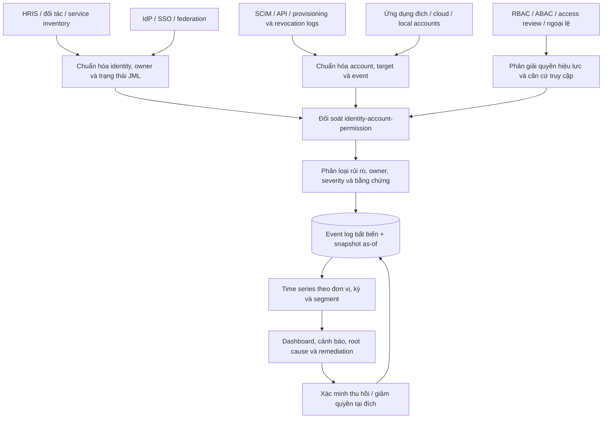

# Xu hướng rủi ro IAM: đo lường thay đổi theo thời gian và ưu tiên hành động

**Xu hướng rủi ro IAM** (*IAM risk trends*) là cách theo dõi **mức độ, tần suất và thời gian tồn tại của những trạng thái truy cập có rủi ro** qua nhiều thời điểm, thay vì chỉ xem một con số tại ngày báo cáo. Mục tiêu là nhận biết rủi ro đang tăng hay giảm, hệ thống hoặc nhóm danh tính nào bị ảnh hưởng, thay đổi có phản ánh thực chất hay chỉ do cách thu thập dữ liệu, và biện pháp nào cần được ưu tiên.

Trong chương **IAM metrics** của mô-đun `SECURITY_IDENTITY_ACCESS_MANAGEMENT_IDENTITY_LIFECYCLE`, dữ liệu rủi ro phải được hiểu trong **vòng đời danh tính Joiner–Mover–Leaver (JML)**: xác minh danh tính, tạo account, cấp quyền, thay đổi vai trò, rà soát, thu hồi và kết thúc quyền truy cập. Các tín hiệu có thể đến từ **Identity Provider (IdP)**, **Single Sign-On (SSO)**, **System for Cross-domain Identity Management (SCIM)**, các chính sách **RBAC/ABAC**, ứng dụng đích, account cục bộ, tài khoản dịch vụ và nhật ký kiểm toán.

Bài này hướng dẫn định nghĩa nhóm chỉ số rủi ro, chuẩn hóa cách đếm, xây dựng chuỗi thời gian, so sánh đúng mẫu số và độ bao phủ, tìm nguyên nhân thay đổi, dùng SQL tổng hợp xu hướng và chuyển kết quả thành hành động giảm **quyền truy cập tồn dư** (*residual access*).

## 1. Vì sao cần xem xu hướng thay vì một ảnh chụp?

Một dashboard ghi **35 account mồ côi** tại cuối tháng chưa đủ trả lời tình hình đang tốt hay xấu:

- Tháng trước có 70 hay chỉ có 10 account mồ côi?
- Tổng số account đang quản lý là 2.000 hay 200.000?
- Việc kiểm kê có vừa bổ sung thêm các ứng dụng legacy?
- Các account được phát hiện là **confirmed orphan** hay mới chỉ **chưa ánh xạ được owner**?
- Bao nhiêu account có quyền quản trị, còn token hoạt động hoặc đã quá hạn thu hồi?
- Những vấn đề được khắc phục trong tháng có bị tái xuất hiện ở tháng sau?

**Xu hướng rủi ro** đặt các câu hỏi đó trên một trục thời gian. Nó giúp phân biệt **tồn lượng rủi ro** (*stock*: số quyền thừa đang tồn tại), **phát sinh mới** (*inflow*: số case mới phát hiện) và **được xử lý** (*outflow*: số case đã thu hồi hoặc khắc phục có bằng chứng).

Ví dụ, 20 quyền thừa đã được xử lý trong tháng nhưng 30 quyền thừa khác phát sinh. Nếu không có điều chỉnh phạm vi hay phân loại, tồn lượng có thể **tăng 10**; báo cáo chỉ ghi “đã xử lý 20 quyền” sẽ tạo ấn tượng sai.

Cần nhớ **chỉ số đại diện rủi ro không đồng nghĩa xác suất xảy ra sự cố**. Tỷ lệ account mồ côi cao là tín hiệu kiểm soát vòng đời yếu, nhưng không tự chứng minh account đã bị khai thác. Sự kiện đăng nhập bất thường cũng không mặc nhiên là xâm nhập thành công.

## 2. Bản đồ nhóm rủi ro trong IAM lifecycle

Các nguồn rủi ro cần theo dõi không chỉ là người dùng con người. Một chương trình tốt bao quát **human identity**, **non-human identity (NHI)**, người dùng bên thứ ba, quyền đặc quyền và khả năng truy cập thực tế ở ứng dụng đích.

| Nhóm rủi ro | Dấu hiệu cần theo dõi | Liên hệ vòng đời |
|---|---|---|
| **Identity không được quản lý tốt** | Identity trùng, nguồn chủ thể mâu thuẫn, tài khoản không gắn owner | Joiner, chuyển hợp đồng, đồng bộ IdP |
| **Account mồ côi** | Account còn truy cập nhưng đã xác nhận thiếu owner/chủ thể hợp lệ | Joiner sai mapping, Mover đổi hệ thống, Leaver bỏ sót |
| **Quyền thừa và privilege creep** | Entitlement vượt vai trò, quyền cũ tồn tại sau Mover, cấp quyền quản trị quá rộng | Joiner và Mover; RBAC/ABAC |
| **Thu hồi trễ hoặc không đủ** | Leaver quá hạn chưa disable; token, session, account local còn truy cập | Mover và Leaver; deprovisioning |
| **Access review không đầy đủ** | Quyền không được rà soát, reviewer thiếu thẩm quyền, quyết định revoke chưa thực thi | Kiểm toán định kỳ hoặc theo sự kiện |
| **Đặc quyền lâu dài** | Admin trực tiếp, quyền không có expiry, tài khoản break-glass không kiểm soát | PAM, Just-in-Time, truy cập khẩn cấp |
| **Tài khoản dịch vụ/workload** | Service account không owner, API key tồn tại dài, cloud role quá rộng | NHI lifecycle, xoay vòng credential |
| **Người dùng bên thứ ba** | Sponsor hết hiệu lực, hợp đồng đã hết nhưng account còn active | Joiner/Leaver của contractor và guest |
| **Thất bại tích hợp IAM** | Lỗi SCIM, lệch trạng thái IdP–app, thiếu dữ liệu inventory | Mọi giai đoạn JML |
| **Dấu hiệu lạm dụng truy cập** | Đăng nhập bất thường, thay đổi quyền ngoài quy trình, sử dụng quyền nhạy cảm bất thường | Giám sát xác thực và truy cập |

Không nên trộn mọi tín hiệu vào một “điểm rủi ro tổng” khi chưa chuẩn hóa, phân tích tác động và có chính sách trọng số được phê duyệt. Một account mồ côi có quyền xóa backup production có thể quan trọng hơn hàng chục account chỉ đọc ở môi trường thử nghiệm.

## 3. Định nghĩa chính xác từng chỉ số trước khi vẽ đồ thị

**Định nghĩa nhất quán** là điều kiện đầu tiên để so sánh xu hướng. Ví dụ, “số quyền thừa” tháng này đếm theo từng role, tháng sau đếm theo quyền hiệu lực sẽ không so sánh trực tiếp được.

Bộ KPI tham khảo:

| KPI | Đơn vị đếm và tử số | Mẫu số / cách diễn giải | Xu hướng mong muốn |
|---|---|---|---|
| **Confirmed orphan accounts** | Số account **duy nhất**, còn khả năng truy cập và đã xác nhận không có owner hợp lệ | Tổng account đang có khả năng truy cập trong phạm vi; báo cả số tuyệt đối | Giảm |
| **Confirmed excessive permissions** | Số quyền hiệu lực đã xác nhận vượt cơ sở được phép | Quyền hiệu lực **đã được đánh giá**; kèm độ bao phủ đánh giá | Giảm |
| **Residual access after Leaver** | Số account/quyền vẫn truy cập sau thời điểm phải thu hồi | Có thể đo tỷ lệ trên toàn bộ nghĩa vụ Leaver **đã đến hạn**; giữ định nghĩa đơn vị | Giảm |
| **On-time deprovisioning rate** | Nghĩa vụ thu hồi đã đến hạn được xác minh hoàn tất không trễ | Tổng nghĩa vụ hợp lệ đã đến hạn, **kể cả còn mở quá hạn** | Tăng |
| **On-time provisioning rate** | Yêu cầu cấp đúng quyền trước deadline | Tổng yêu cầu hợp lệ đến hạn, kể cả quá hạn còn mở | Tăng |
| **Access review completion** | Review item có quyết định cuối hợp lệ | Item thuộc scope chốt của campaign | Tăng |
| **Access review coverage** | Đối tượng bắt buộc review đã được đưa vào review hợp lệ | Toàn bộ đối tượng chính sách yêu cầu rà soát | Tăng |
| **Remediation overdue count** | Case đã xác nhận rủi ro, quá hạn mà chưa có bằng chứng xử lý | Số tuyệt đối theo mức rủi ro và hệ thống; có thể thêm tỷ lệ trên case đến hạn | Giảm |
| **Privileged standing access count** | Account/identity có đặc quyền thường trực trong phạm vi | Cần phân loại quyền được phép, ngoại lệ, loại tài nguyên | Giảm ở nhóm không cần thiết |
| **NHI without valid owner** | NHI hoạt động không có owner hợp lệ | Tổng NHI hoạt động được kiểm kê | Giảm |
| **Connector reconciliation mismatch** | Account/quyền đích không khớp trạng thái dự kiến sau cửa sổ đồng bộ | Tổng account/quyền có nghĩa vụ đối soát | Giảm |

**Đúng đơn vị đếm quan trọng hơn nhiều chữ số sau dấu phẩy.** Một identity có thể có năm account, một account có nhiều role, và một entitlement có thể được cấp qua hai group. Tổ chức phải công bố đang đếm **identity**, **account**, **quyền hiệu lực**, **đường cấp quyền** hay **nghĩa vụ**.

Các chỉ số tốc độ như **p50/p95 thời gian cấp quyền**, **p50/p95 thời gian thu hồi** và **tuổi của backlog quá hạn** cần đặt cạnh tỷ lệ đúng hạn. Chỉ lấy phân vị của những request đã hoàn tất sẽ bỏ sót các trường hợp còn mở quá lâu.

### Phân biệt kết quả kiểm soát và tín hiệu dẫn dắt

- **Chỉ số dẫn dắt (leading indicators):** độ bao phủ inventory, độ đầy đủ owner, độ trễ đồng bộ SCIM, tỷ lệ access review đúng hạn, số ngoại lệ sắp hết hạn. Những chỉ số này cảnh báo điều kiện dễ tạo rủi ro.
- **Chỉ số kết quả (lagging indicators):** quyền còn hiệu lực sau Leaver, đặc quyền thừa được xác nhận, sự cố sử dụng account không hợp lệ, số nghĩa vụ quá hạn đã gây phơi bày. Chúng cho biết hậu quả hoặc trạng thái đã xuất hiện.

Hai nhóm nên được xem cùng nhau. Tỷ lệ hoàn tất access review tăng không bảo đảm quyền tồn dư giảm nếu các quyết định “Revoke” không được SCIM/ứng dụng thực thi.

## 4. Mẫu số, coverage và phân loại: ba nguồn gây sai lệch lớn

### 4.1. Số tuyệt đối có thể tăng dù tỷ lệ giảm

Tổng account tăng khi tổ chức mở rộng, kể cả các kiểm soát đang tốt lên. So sánh **orphan count** mà không có mẫu số dễ gây kết luận sai.

Ví dụ:

| Kỳ | Account đang có khả năng truy cập | Confirmed orphan | Tỷ lệ orphan |
|---|---:|---:|---:|
| Tháng 7 | 4.000 | 48 | 1,20% |
| Tháng 8 | 4.200 | 42 | 1,00% |
| Tháng 9 | 4.500 | 36 | 0,80% |

Số tuyệt đối giảm từ 48 xuống 36; tỷ lệ cũng giảm từ 1,20% xuống 0,80%. Mức giảm tỷ lệ từ tháng 7 đến tháng 9 là **0,40 điểm phần trăm**, không phải “giảm 0,40%” theo nghĩa tương đối. Mức giảm tương đối của tỷ lệ là \((0,80-1,20)/1,20 \times 100\% \approx -33,33\%\).

### 4.2. Coverage tăng có thể làm số phát hiện tăng

Giả sử tháng 7 hệ thống chỉ kiểm kê 60% ứng dụng bắt buộc và phát hiện 20 account mồ côi; tháng 8 coverage lên 95% và phát hiện 45. **Không thể tự kết luận mức rủi ro thực tế đã tăng hơn gấp đôi.** Có thể tháng 8 chỉ nhìn thấy những account đã tồn tại từ trước nhưng trước đó bị bỏ sót.

Cần phân biệt:

- **Discovery coverage:** tỷ lệ hệ thống/account thuộc phạm vi đã thực sự được kiểm kê.
- **Assessment coverage:** tỷ lệ account/quyền thu thập được đã được đánh giá đủ bằng chứng.
- **Data freshness:** thời gian từ lần thu thập/đối soát cuối tới thời điểm báo cáo.
- **Unknown/pending:** đối tượng chưa xác minh được chủ thể, quyền hoặc owner.

**Không xem pending là an toàn, cũng không mặc nhiên gọi tất cả pending là vi phạm đã xác nhận.** Số confirmed thấp cùng backlog chưa đánh giá rất lớn là tình trạng cần hành động, không phải dấu hiệu rủi ro thấp.

### 4.3. Chính sách đổi thì chuỗi có thể bị đứt

Nếu giữa hai kỳ tổ chức thay định nghĩa *privileged access*, đổi cách tính ABAC, thay quy tắc ngoại lệ hoặc thêm một tenant, chuỗi thời gian có thể xuất hiện **điểm gãy phương pháp** (*methodology break*).

Phải lưu **metric_definition_version**, danh mục hệ thống, scope, quy tắc phân loại và thời điểm áp dụng. Khi thay đổi đáng kể, có thể tính lại lịch sử bằng quy tắc mới từ dữ liệu gốc hoặc vẽ hai chuỗi có chú thích. Không nối các giá trị bằng nhau về tên nhưng khác nghĩa rồi diễn giải như một xu hướng liên tục.

## 5. Kiến trúc dữ liệu đo xu hướng IAM

Để phát hiện rủi ro qua thời gian, cần liên kết các sự kiện vòng đời và quyền ở ứng dụng thực tế, không chỉ tài khoản IdP.



Luồng này chỉ là sơ đồ logic; nhiều bước có thể xử lý bất đồng bộ. Với SCIM/API, phản hồi thành công đôi khi chỉ cho biết hệ thống đã **nhận lệnh**, không chứng minh quyền đích đã thay đổi. Để đo rủi ro còn lại, cần **readback hoặc kiểm chứng hiệu lực quyền** ở hệ thống đích.

### Event, snapshot và state

Ba lớp dữ liệu có vai trò khác nhau:

| Lớp | Nội dung | Câu hỏi trả lời |
|---|---|---|
| **Event log** | Sự kiện Joiner, Mover, Leaver, yêu cầu cấp/thu hồi, quyết định access review, connector retry, xác minh quyền | Chuyện gì đã diễn ra và lúc nào? |
| **Snapshot state** | Trạng thái account, entitlement, owner, ngoại lệ, deadline, mức rủi ro **tại thời điểm \(t\)** | Rủi ro đang tồn tại bao nhiêu tại ngày chốt? |
| **Metric fact/time series** | Các giá trị đã tính theo kỳ, segment, định nghĩa, mẫu số, coverage | Xu hướng qua tháng/quý và những nhóm biến động thế nào? |

**Không trộn sự kiện và trạng thái.** Một account mồ côi tồn tại qua 30 ngày có thể có 30 snapshot nhưng chỉ **một account** trong ảnh chụp cuối tháng. Một connector retry năm lần không tạo năm nghĩa vụ. Ngược lại, nếu đo *risk exposure days*, 30 ngày tồn tại lại là điều cần tính. Mỗi KPI phải công bố **đơn vị thời gian và đơn vị quan sát**.

### Các trường dữ liệu tối thiểu

Một bản ghi KPI theo kỳ nên lưu:

| Trường | Ý nghĩa |
|---|---|
| `metric_code`, `metric_definition_version` | Tên chỉ số và phiên bản công thức/phạm vi |
| `period_start`, `period_end`, `snapshot_at` | Khoảng báo cáo và thời điểm chốt |
| `unit_type`, `segment_key` | Account, permission, obligation, review item; nhóm theo tenant, app, risk tier… |
| `numerator`, `denominator`, `value` | Tử số, mẫu số, tỷ lệ hoặc số tuyệt đối được tính |
| `discovery_coverage_pct`, `assessment_coverage_pct` | Chất lượng bao phủ và phần đã đánh giá |
| `source_count`, `source_freshness_at` | Độ đầy đủ và độ mới của dữ liệu |
| `risk_tier`, `policy_version`, `scope_version` | Ngữ cảnh, mức rủi ro và điều kiện so sánh |
| `generated_at`, `data_cutoff_at`, `quality_status` | Lần xử lý, giới hạn sự kiện và trạng thái kiểm tra |
| `evidence_ref`, `owner_team` | Truy vết bằng chứng và đơn vị chịu trách nhiệm |

Nên lưu timestamp ở UTC hoặc kiểu có offset, cộng với timezone sử dụng khi hiển thị kỳ. Với cohort theo ngày đến hạn, dùng ranh giới **bao gồm đầu kỳ, không bao gồm cuối kỳ** để tránh đếm một nghĩa vụ vào hai tháng.

## 6. Công thức theo dõi biến động và tốc độ giảm rủi ro

Giả sử \(X_t\) là giá trị cùng một KPI, cùng đơn vị, cùng định nghĩa, tại kỳ \(t\).

**Thay đổi tuyệt đối:**

\[
\Delta_t = X_t-X_{t-1}
\]

**Thay đổi tương đối (%):**

\[
\text{Relative change}_t =
\frac{X_t-X_{t-1}}{X_{t-1}}\times100\%
\]

Nếu \(X_{t-1}=0\), **không tính phần trăm thay đổi** bằng cách chia cho 0; báo “N/A / xuất hiện mới” và nêu số tuyệt đối.

Với một **tỷ lệ phần trăm**, cần phân biệt:

- **Điểm phần trăm** (*percentage points — pp*): tỷ lệ tháng này trừ tỷ lệ tháng trước.
- **Phần trăm thay đổi tương đối**: chênh lệch tỷ lệ chia cho tỷ lệ trước đó.

Ví dụ, tỷ lệ deprovisioning đúng hạn tăng từ **92% lên 97%** là tăng **5 điểm phần trăm**, tương đương tăng tương đối khoảng **5,43%** so với tỷ lệ 92%. Tăng đúng hạn thường là kết quả tốt; cùng công thức tăng số quyền thừa thường là kết quả xấu. Cần gắn **chiều tốt/xấu** với mỗi metric thay vì chỉ tô màu dựa vào dấu `+` hoặc `-`.

### Trung bình trượt để giảm nhiễu

Với số liệu biến động theo tháng, một **trung bình trượt 3 tháng** có thể mô tả xu hướng mượt hơn:

\[
MA_3(t)=\frac{X_t+X_{t-1}+X_{t-2}}{3}
\]

Chỉ nên dùng khi có đủ dữ liệu, cùng quy tắc và các kỳ tương đương; không coi giá trị trung bình trượt là thay thế hoàn toàn cho dữ liệu gốc. Khi công bố, nêu cửa sổ tính và cách xử lý kỳ thiếu dữ liệu.

Đối với quyền quản trị hoặc tài khoản Leaver có rủi ro cao, **một ca vượt ngưỡng nghiêm trọng vẫn cần xử lý**, cho dù trung bình trượt toàn hệ thống đẹp.

### Dòng vào, dòng ra và tồn lượng rủi ro

Nếu cùng một loại **case duy nhất** được ghi nhận ổn định và không có thay đổi phạm vi:

\[
B_{\mathrm{end}} =
B_{\mathrm{start}}+N_{\mathrm{new}}-N_{\mathrm{remediated}}
\]

Trong đó \(B\) là backlog rủi ro chưa xử lý. Công thức này chỉ chính xác nếu các sự kiện **mở mới**, **đóng đã xác minh**, **mở lại** và **tái phân loại** được xử lý nhất quán.

Ví dụ, đầu tháng có 60 ca quá hạn, phát sinh 25 ca mới, xử lý xác minh 30 ca và không có ngoại lệ/điều chỉnh: cuối tháng còn **55 ca**. Số ca được xử lý (30) lớn hơn số ca phát sinh (25), nên backlog giảm 5. Nếu tồn lượng không khớp phép cân bằng, phải điều tra các case mất nguồn, trùng khóa, đổi scope hoặc thay phân loại.

## 7. Phân tích ví dụ: nhiều chỉ số cùng lúc cho kết luận khác nhau

Giả sử một tổ chức theo dõi ba tháng liên tiếp với **định nghĩa và coverage tương đối ổn định**:

| Chỉ số | Tháng 7 | Tháng 8 | Tháng 9 | Diễn giải |
|---|---:|---:|---:|---|
| Account hoạt động trong scope | 4.000 | 4.200 | 4.500 | Quy mô hệ thống tăng |
| Confirmed orphan | 48 | 42 | 36 | Giảm về số lượng |
| Tỷ lệ orphan | 1,20% | 1,00% | 0,80% | Giảm đều |
| Access review coverage | 80% | 90% | 95% | Kiểm soát phạm vi tốt hơn |
| On-time deprovisioning | 92% | 95% | 97% | Thu hồi đúng hạn tăng |
| p95 thời gian thu hồi đã hoàn tất (phút) | 60 | 42 | 35 | Nhóm ca chậm có vẻ cải thiện |
| Residual-access-after-Leaver còn mở tại cuối tháng | 12 | 11 | 14 | **Tăng trở lại** ở tháng 9 |
| NHI không có owner hợp lệ | 3 | 5 | 9 | **Xu hướng xấu đi** |

Nhìn tổng thể, **một số kiểm soát đang tốt hơn**: account orphan giảm, coverage review tăng, on-time deprovisioning tăng. Tuy nhiên, **14 ca residual access sau Leaver** và **9 NHI thiếu owner** ở tháng 9 là tín hiệu phải điều tra, không thể kết luận toàn bộ rủi ro IAM đã giảm.

Đặc biệt, p95 thời gian thu hồi chỉ xét các ca **đã hoàn tất**. Nếu số ca còn mở tăng, p95 giảm có thể chỉ phản ánh những ca dễ xử lý đã hoàn thành trong khi nhóm khó vẫn chờ. Cần đối chiếu **tuổi backlog, quyền còn hiệu lực và mức rủi ro**.

### Một giả thuyết cần kiểm tra

Giả sử tháng 9 tổ chức tích hợp thêm ứng dụng SaaS mới và tự động hóa SCIM. Việc tích hợp có thể giúp **các target đã hỗ trợ SCIM hoàn tất nhanh hơn**, trong khi các Leaver còn mở tập trung ở ứng dụng legacy không có API. NHI thiếu owner cũng có thể đến từ workload được tạo mới nhưng service inventory chưa cập nhật.

Đây chỉ là **giả thuyết**, không phải kết luận từ bảng số liệu. Cần kiểm tra log, danh sách target, thay đổi phạm vi, thời điểm on-call, nhóm owner và bằng chứng quyền thực sự còn hiệu lực.

### Tại sao không nên xây một điểm tổng duy nhất ngay?

Giả sử cho phép các chỉ số tốt bù trừ chỉ số xấu bằng một điểm cộng trừ tùy ý. Tỷ lệ review tốt có thể “bù” cho một API key production không owner và vẫn hoạt động sau khi workload bị bỏ. Về quản trị, một số tín hiệu nghiêm trọng phải là **điều kiện cảnh báo độc lập**, không được bị che bởi giá trị trung bình.

Chỉ xây *composite IAM risk score* khi tổ chức đã xác định **mô hình rủi ro, trọng số, nguồn bằng chứng, phương pháp chuẩn hóa, cách xử lý dữ liệu thiếu và ngưỡng escalation**. Công bố rõ điểm là công cụ **ưu tiên**, không phải xác suất sự cố được chứng minh bằng thống kê nếu chưa có hiệu chuẩn.

## 8. SQL PostgreSQL: từ snapshot KPI đến xu hướng tháng

Giả sử có bảng `iam_risk_monthly_fact`, mỗi hàng đại diện cho một **metric, segment, tháng và phiên bản định nghĩa** duy nhất. Các trường minh họa:

- `month_start` (DATE, ngày đầu tháng), `metric_code`, `segment_key`.
- `metric_definition_version`, `numerator`, `denominator`.
- `discovery_coverage_pct`, `quality_status`.
- `denominator` được chuẩn hóa theo đúng metric, không gộp account với obligation.
- Các metric trong ví dụ tính tỷ lệ: `orphan_account_rate`, `excess_permission_rate`, `on_time_deprovision_rate`.

Truy vấn lấy **tháng 7–9/2026**, tính tỷ lệ, chênh lệch **điểm phần trăm**, biến động tương đối và trung bình trượt. Nó chỉ so sánh những tháng có **cùng phiên bản định nghĩa** và một segment nhất quán:

```sql
WITH monthly AS (
    SELECT
        month_start,
        metric_code,
        segment_key,
        metric_definition_version,
        numerator,
        denominator,
        discovery_coverage_pct,
        ROUND(
            100.0 * numerator / NULLIF(denominator, 0), 4
        ) AS rate_pct
    FROM iam_risk_monthly_fact
    WHERE month_start >= DATE '2026-07-01'
      AND month_start <  DATE '2026-10-01'
      AND quality_status = 'validated'
      AND metric_definition_version = 'v1'
      AND segment_key = 'all-in-scope'
      AND metric_code IN (
          'orphan_account_rate',
          'excess_permission_rate',
          'on_time_deprovision_rate'
      )
),
trend AS (
    SELECT
        *,
        LAG(rate_pct) OVER (
            PARTITION BY metric_code, segment_key, metric_definition_version
            ORDER BY month_start
        ) AS previous_rate_pct,
        LAG(discovery_coverage_pct) OVER (
            PARTITION BY metric_code, segment_key, metric_definition_version
            ORDER BY month_start
        ) AS previous_coverage_pct,
        AVG(rate_pct) OVER (
            PARTITION BY metric_code, segment_key, metric_definition_version
            ORDER BY month_start
            ROWS BETWEEN 2 PRECEDING AND CURRENT ROW
        ) AS moving_avg_pct
    FROM monthly
)
SELECT
    month_start,
    metric_code,
    numerator,
    denominator,
    rate_pct,
    previous_rate_pct,
    ROUND(rate_pct - previous_rate_pct, 4)
        AS change_percentage_points,
    ROUND(
        100.0 * (rate_pct - previous_rate_pct)
        / NULLIF(previous_rate_pct, 0), 2
    ) AS relative_change_pct,
    ROUND(moving_avg_pct, 4) AS moving_avg_pct,
    discovery_coverage_pct,
    previous_coverage_pct
FROM trend
ORDER BY metric_code, month_start;
```

**Điều cần lưu ý khi áp dụng:**

1. `LAG` so sánh với **dòng trước đó có trong bảng**, không nhất thiết là **tháng liền trước theo lịch** nếu dữ liệu tháng nào đó thiếu. Để phát hiện tháng thiếu, cần sinh lịch tháng chuẩn, đối chiếu và đánh dấu `missing data` thay vì mặc định so liên tiếp.
2. `moving_avg_pct` ở tháng đầu chỉ dựa trên một giá trị, tháng thứ hai dựa trên hai; nếu mục tiêu là **MA3 có đủ ba tháng**, phải ẩn giá trị cho đến khi đủ ba quan sát hợp lệ.
3. Chỉ số `on_time_deprovision_rate` có chiều tốt là **tăng**, còn `orphan_account_rate` và `excess_permission_rate` có chiều tốt là **giảm**. Không thể dùng một điều kiện `rate_pct > previous_rate_pct` để báo xấu/tốt cho mọi metric.
4. Tỷ lệ chênh lệch có thể bị đánh lừa khi `denominator` đổi mạnh hoặc discovery coverage thấp. Dashboard phải hiển thị **numerator, denominator, coverage, quality_status** cạnh đường xu hướng.
5. Tính từ bảng fact đã được kiểm tra. **SQL tổng hợp không thay thế việc xác minh** account mồ côi, quyền hiệu lực hoặc bằng chứng thu hồi tại target.

### Từ log tới snapshot: vì sao phải giữ dữ liệu lịch sử?

Nếu dashboard tháng 7 được tính lại vào tháng 11 chỉ bằng bảng account **hiện tại**, các account đã thu hồi trong tháng 8 sẽ biến mất khỏi bức tranh tháng 7. Số liệu lịch sử sẽ thay đổi vì thông tin hiện tại, không phải vì tháng 7 thực sự khác.

Cách làm đáng tin là:

- Lưu snapshot bất biến ở thời điểm chốt, cùng **định nghĩa chỉ số, scope, nguồn và evidence**; hoặc
- Dựng trạng thái *as-of* từ event log có version, sử dụng sự kiện có hiệu lực vào thời điểm cần tái lập.

Dữ liệu đến muộn có thể cần **backfill**. Khi điều chỉnh số lịch sử vì thiếu nguồn hoặc sai phân loại, lưu phiên bản công bố và lý do hiệu chỉnh; không âm thầm sửa dashboard kiểm toán.

## 9. Tính rủi ro theo thời gian tồn tại, không chỉ số lượng

Một quyền truy cập không hợp lệ tồn tại 3 phút có ý nghĩa vận hành khác quyền vẫn tồn tại 30 ngày. Do đó, bên cạnh **count tại snapshot**, có thể đo **exposure duration**.

Với case rủi ro \(i\):

- `risk_started_at`: thời điểm quyền trở nên không hợp lệ hoặc bắt đầu phơi bày theo định nghĩa.
- `risk_ended_at`: thời điểm xác minh đã loại bỏ khả năng truy cập không hợp lệ.
- `snapshot_at`: mốc chốt cho những case còn mở.

Thời lượng tồn tại được quan sát:

\[
D_i =
\begin{cases}
t_{\mathrm{ended},i}-t_{\mathrm{started},i},
 & \text{nếu đã kết thúc và xác minh};\\
t_{\mathrm{snapshot}}-t_{\mathrm{started},i},
 & \text{nếu còn mở}.
\end{cases}
\]

Đây là **thời lượng phơi bày quan sát được hoặc thời gian đến khi xác minh** tùy chất lượng timestamp. Nếu `risk_started_at` chỉ là thời điểm phát hiện chứ không phải thời điểm rủi ro xuất hiện, số đo sẽ **thấp hơn thời lượng thực có thể đã tồn tại**; cần ghi rõ.

Để đo **account-days of exposure** trong một tháng, tích phân số account còn rủi ro qua từng ngày hoặc cộng **thời lượng giao với tháng** của từng account chia cho 24 giờ. Không dùng tổng thời lượng toàn vòng đời của case để gán hết cho tháng nó được đóng.

Ví dụ một account mồ côi tồn tại từ 28/7 đến 04/8 (giả sử chặn quyền đúng 00:00 ngày 04/8 theo UTC+7) đóng góp **4 ngày** cho tháng 7 (28, 29, 30, 31) và **3 ngày** cho tháng 8 (1, 2, 3). Phép đo giúp xác định tồn lượng rủi ro thay đổi nhanh hay chỉ dịch chuyển giữa các kỳ.

Đặc biệt, nếu sự kiện chặn quyền bị ghi muộn so với hiệu lực thực, hãy lưu **mốc quyền không còn sử dụng được** và **mốc được xác minh** tách biệt. Không tự backdate dựa trên lệnh SCIM đã gửi nếu không có bằng chứng target.

## 10. Phân tích theo từng giai đoạn JML và hệ thống

### Joiner: ngăn rủi ro từ lúc cấp phát

Các tín hiệu cần theo dõi:

- Quyền admin được cấp mặc định thay vì role tối thiểu.
- Tài khoản được tạo trước khi xác minh danh tính/quan hệ lao động.
- Account tạo trùng vì ánh xạ SCIM `externalId` hoặc source identity sai.
- MFA/điều kiện SSO chưa được áp dụng cho quyền nhạy cảm.
- Ngoại lệ onboarding không có thời hạn.

Xu hướng **provisioning đúng hạn tăng** chưa đủ tốt nếu **quyền thừa mới phát sinh** cũng tăng. Đánh giá kết hợp tốc độ và **correct-permission rate**; đối soát RBAC/ABAC tại hệ thống đích.

### Mover: phòng ngừa tích lũy quyền theo thời gian

Một người chuyển vai trò có thể nhận entitlement mới nhưng vẫn giữ quyền vai trò cũ. Dấu hiệu xu hướng gồm:

- Tỷ lệ Mover có ít nhất một quyền cũ còn hiệu lực sau deadline.
- Số quyền thừa mới phát sinh từ sự kiện Mover.
- Tuổi của các quyền cũ quá hạn thu hồi.
- Số xung đột **Segregation of Duties (SoD)** sau chuyển vai trò.

**Ví dụ:** Mover từ mua hàng sang kiểm toán có quyền mới để rà soát đơn hàng, nhưng quyền tạo nhà cung cấp của bộ phận cũ vẫn hiệu lực. Nếu số trường hợp như vậy tăng qua ba tháng, cần điều tra mapping role, các ứng dụng không hỗ trợ revoke tự động và quy trình ngoại lệ chuyển giao công việc.

### Leaver: đo tốc độ chặn và quyền tồn dư

Sự kiện Leaver cần **nguồn thời điểm hiệu lực** đáng tin và quy tắc thu hồi tương ứng. Theo dõi:

- Tỷ lệ deprovisioning đúng hạn theo **nghĩa vụ đã đến hạn**.
- Số account/entitlement còn truy cập được sau deadline.
- p50/p95 thời gian từ thời điểm phải thu hồi đến khi có bằng chứng.
- Số ca có IdP disabled nhưng account đích vẫn active hoặc token vẫn được ứng dụng chấp nhận.

**Không mặc định IdP disabled = Leaver đã an toàn.** SSO có thể chặn đăng nhập mới nhưng token tự chứa còn hạn, account local hay API key có thể sử dụng độc lập. Phải dựa trên khả năng truy cập thực tế của hệ thống đích.

### Tài khoản dịch vụ và đối tác

Với NHI, cần đo xu hướng service principal không owner, secret chưa có chính sách quay vòng, quyền cloud wildcard, workload đã ngừng chạy nhưng credential còn hiệu lực. Thời gian tạo service account có thể ngắn nhờ tự động hóa, nhưng **không có owner** làm giảm khả năng thu hồi khi dịch vụ kết thúc.

Với đối tác/guest, căn cứ hợp lệ là hợp đồng, sponsor và thời hạn truy cập. Chỉ số “người dùng vẫn active sau khi hợp đồng hết hạn” nên tách rõ khỏi “guest chưa ánh xạ employee ID”, vì guest không nhất thiết có bản ghi HRIS như nhân viên.

## 11. Phân tích nguyên nhân biến động: đừng nhầm tương quan với nguyên nhân

Khi một chỉ số rủi ro tăng, cần khảo sát **cơ chế thay đổi** trước khi khẳng định quy trình kém đi.

| Hiện tượng trên dashboard | Giả thuyết hợp lý | Bằng chứng cần kiểm tra |
|---|---|---|
| Orphan account count tăng đột ngột | Thêm ứng dụng vào inventory; connector tạo account trùng; owner thực sự mất | Số nguồn được quét, mapping, `account_key`, lịch triển khai |
| Quyền thừa tăng sau Mover hàng loạt | Gỡ role cũ bị lỗi hoặc quy tắc baseline thay đổi | HRIS Mover events, effective permissions, version RBAC/ABAC |
| On-time deprovisioning tăng nhưng residual access cũng tăng | Ca dễ xử lý xong nhanh, ca legacy còn mở; coverage mở rộng | Target breakdown, overdue backlog, dữ liệu token/local account |
| p95 thu hồi giảm mạnh | Tự động hóa hiệu quả hoặc các ca chậm chưa được đóng | Số lượng sample, open age, kết quả xác minh tại đích |
| Access review completion = 100% | Quy trình tốt hoặc người duyệt chọn Retain hàng loạt không xem xét | Coverage, decision distribution, mẫu QA, remediation |
| NHI without owner tăng | Workload mới được tạo, service registry chậm cập nhật | CI/CD, cloud IAM, owner registry, thời điểm tạo workload |
| Sự kiện SSO bất thường tăng | Lạm dụng truy cập hoặc rule phát hiện mới, thay log source | Rule version, traffic volume, false positive và xác minh sự cố |
| Số vi phạm giảm về 0 khi nguồn im lặng | Collector/connector hỏng, chưa có event mới | Data freshness, heartbeat, số hệ thống/tenant gửi dữ liệu |

Một số kỹ thuật hữu ích:

1. **So sánh theo segment:** tenant, ứng dụng đích, loại identity, quyền đặc quyền, đơn vị nghiệp vụ, risk tier và connector.
2. **Đánh dấu thời điểm thay đổi hệ thống:** roll-out IdP, SCIM, policy RBAC, dự án di trú, thay rule phát hiện.
3. **Đối soát dân số mẫu:** số identity/account, số yêu cầu đã đến hạn, số mục review và coverage.
4. **Theo dõi cohort:** ví dụ nhóm Leaver có thời điểm hiệu lực trong tháng, nhóm Mover đã đến deadline, thay vì trộn ticket phát sinh theo tháng với ticket đóng theo tháng.
5. **Kiểm tra chuỗi sự kiện thực:** sample một số case, đọc trạng thái ứng dụng đích và bằng chứng để xác minh dashboard.

Nếu muốn xác định một thay đổi **gây ra** giảm rủi ro, có thể so sánh nhóm chịu tác động và không chịu tác động khi có điều kiện tương đương, kiểm soát biến ngoại lai, hoặc triển khai thử nghiệm có giám sát. Một đường xu hướng giảm sau khi cài SCIM **không tự chứng minh** mọi giảm sút là do SCIM.

## 12. Dashboard, cảnh báo và quản trị chương trình IAM

Một dashboard phục vụ vận hành và kiểm toán nên có bốn tầng.

**Tầng tổng quan:** số account/quyền có rủi ro tại snapshot, tỷ lệ theo phạm vi, các chỉ số đúng hạn, trạng thái nguồn dữ liệu và thời điểm chốt. Mỗi thẻ chỉ số phải ghi **định nghĩa, đơn vị, chiều tốt/xấu và phiên bản chính sách**.

**Tầng xu hướng:** biểu đồ ngày/tuần/tháng theo cùng định nghĩa, hiển thị số tuyệt đối và tỷ lệ, độ bao phủ, số mẫu và các mốc thay đổi hệ thống. Đánh dấu các tháng thiếu dữ liệu thay vì nối đường liền như không có vấn đề.

**Tầng phân tích:** lọc theo JML, ứng dụng, tenant, loại identity, owner, quyền quản trị, loại credential, connector và risk tier. Có thể xem riêng backlog chưa xử lý, các ca đã mở lại và những quyền thừa tái phát.

**Tầng hành động:** case owner, deadline, mức rủi ro, trạng thái remediation, bằng chứng đóng case, tác vụ escalation và lần đối soát tiếp theo.

### Ngưỡng và cảnh báo

Cảnh báo có thể dựa trên:

- **Ngưỡng tuyệt đối:** một trường hợp Leaver có quyền đặc quyền vẫn truy cập sau deadline có thể đủ điều kiện cảnh báo nghiêm trọng.
- **Ngưỡng tỷ lệ:** tỷ lệ NHI không owner hoặc quyền thừa đã đánh giá vượt mục tiêu nội bộ.
- **Độ lệch xu hướng:** tăng liên tiếp qua nhiều kỳ hoặc tăng bất thường so với mức nền có cùng coverage.
- **Chất lượng dữ liệu:** connector ngừng gửi dữ liệu, snapshot quá cũ, nhiều quyền chưa thể phân loại, mốc SLA bị thiếu.

Ngưỡng, khoảng lấy mẫu và mức ưu tiên phải dựa trên đánh giá rủi ro thực tế, không có một mức 95% hay 99% áp dụng cho mọi loại IAM metric. Đừng dùng cảnh báo xu hướng để thay thế xử lý một sự kiện nghiêm trọng đã được xác minh.

### Trách nhiệm và kiểm toán

- **IAM/Security** sở hữu định nghĩa, chính sách, giải thích rủi ro và kiểm soát chất lượng.
- **HR/đối tác** chịu trách nhiệm nguồn sự kiện JML và thời điểm hiệu lực.
- **Application/data owner** xác nhận căn cứ truy cập, quyền hiệu lực và remediation.
- **Service owner** chịu trách nhiệm NHI, credential và dependency.
- **Đội vận hành/connector** xử lý độ trễ SCIM/API, lỗi đồng bộ và đối soát trạng thái đích.
- **Kiểm toán** dùng snapshot, event log, thay đổi định nghĩa và bằng chứng kiểm tra để tái lập kết luận.

Thông tin chi tiết về identity, entitlement, đường truy cập và quyền đặc quyền có thể nhạy cảm. Dashboard tổng hợp nên hạn chế dữ liệu cá nhân; drill-down tới case và log cần **RBAC/ABAC**, lưu vết truy cập và chính sách lưu giữ. Việc lưu bằng chứng thu hồi không đòi hỏi công khai token, mật khẩu hay secret trong báo cáo.

## 13. Quy trình điều tra một xu hướng rủi ro tăng

Ví dụ, **tỷ lệ account orphan đã xác nhận** tăng từ 0,6% lên 1,1% trong hai kỳ. Một runbook ngắn:

1. **Xác minh KPI:** cùng khóa account, cùng định nghĩa orphan, cùng trạng thái `access_active`, cùng thời điểm chốt và scope? Nếu không, làm rõ điểm gãy phương pháp.
2. **Xác minh dữ liệu:** kiểm tra connector heartbeat, số account inventory, mapping identity–account, số candidate/pending và coverage.
3. **Phân nhóm:** account human/NHI/guest, target application, tenant, mức đặc quyền, phòng ban hoặc service owner.
4. **Kiểm tra nguyên nhân:** sự kiện Leaver chưa xử lý, thay đổi SCIM `externalId`, tài khoản local mới, application migration, service owner đã nghỉ.
5. **Ưu tiên rủi ro:** account còn quyền admin production, credential Internet-exposed, token dài hạn hoặc không có MFA/owner được xử lý trước.
6. **Thực thi remediation:** tìm owner hợp lệ, sửa mapping có bằng chứng, hoặc chặn/thu hồi quyền theo runbook được phê duyệt.
7. **Xác minh tại target:** readback trạng thái, kiểm tra grant path và token/session thích hợp; không đóng vì ticket hay API báo thành công.
8. **Theo dõi hiệu quả:** số confirmed orphan còn lại, backlog quá hạn, thời gian xử lý, recurrence, coverage và phạm vi mới mở rộng.
9. **Rà soát kiểm toán:** giữ kết luận, thời điểm, owner, evidence và phiên bản dashboard có thể tái lập.

Cách làm tương tự áp dụng cho **quyền thừa**, **Leaver residual access**, **access review chưa hoàn tất** và **service account thiếu chủ sở hữu**, nhưng phải dùng **đơn vị và điều kiện nghiệm thu riêng** cho từng nhóm.

## 14. Những sai lầm thường gặp

1. **So sánh số account tuyệt đối mà bỏ qua mẫu số:** tổ chức lớn hơn không tự động đồng nghĩa kiểm soát kém hơn.
2. **Coi mọi số tăng là xấu:** tỷ lệ review coverage hay thu hồi đúng hạn tăng thường là tốt.
3. **Xem candidate chưa đối soát như confirmed risk:** thiếu bằng chứng có thể làm false positive tăng; cần công bố nhóm pending.
4. **Xem số confirmed thấp là an toàn khi coverage thấp:** các ứng dụng chưa thu thập có thể chứa phần rủi ro lớn.
5. **Đổi metric giữa kỳ mà không lưu version:** biến động do phương pháp bị diễn giải thành xu hướng.
6. **Trộn identity với account, role với entitlement và ca JML với task:** không thể cộng so sánh đơn vị khác nhau.
7. **Chỉ xem trạng thái IdP hoặc SSO:** bỏ qua account local, token đã phát, policy cloud hoặc ứng dụng không đồng bộ.
8. **Coi `SCIM success` là đã thu hồi:** phản hồi API chưa đủ chứng minh quyền đích hết hiệu lực.
9. **Bỏ ca quá hạn còn mở khỏi on-time rate:** tỷ lệ được thổi phồng vì chỉ đo những ca đã xong.
10. **Chỉ xem mean/p95 của ca đóng:** nhóm khó xử lý có thể đang mắc kẹt trong backlog.
11. **Chỉ vẽ đường xu hướng tổng:** các ca quyền đặc quyền hoặc Leaver nghiêm trọng bị chìm trong trung bình.
12. **Bỏ qua NHI, đối tác và credential:** xu hướng có thể tốt ở employee account nhưng xấu ở workload.
13. **Lấy sự kiện cảnh báo làm bằng chứng sự cố:** rule mới hoặc log volume tăng có thể làm cảnh báo tăng mà không có xâm nhập.
14. **Tạo điểm rủi ro tổng tùy ý:** số có vẻ chính xác nhưng không chứng minh mức độ ảnh hưởng hay xác suất.
15. **Đóng case trên ticket, không kiểm tra hệ thống đích:** rủi ro thực tế vẫn còn mặc dù remediation dashboard ghi xanh.
16. **Không lưu snapshot/as-of, audit trail và backfill:** báo cáo lịch sử thay đổi âm thầm, khó kiểm toán.
17. **Bỏ qua thời gian tồn tại rủi ro:** hai kỳ cùng có 10 account orphan nhưng một kỳ quyền tồn tại vài phút, kỳ còn lại kéo dài nhiều tuần.
18. **Không tách trạng thái chính sách và thực thi:** quyết định Revoke trong access review chưa phải bằng chứng đã thu hồi.

## 15. Câu hỏi tự kiểm tra

**Câu 1.** Tháng trước có 40 confirmed orphan trên 2.000 account hoạt động; tháng này có 45 trên 3.000 account. Số tuyệt đối tăng hay giảm, tỷ lệ thay đổi thế nào?

**Đáp án:** Số tuyệt đối **tăng 5**, nhưng tỷ lệ giảm từ **2% xuống 1,5%**, tức giảm **0,5 điểm phần trăm**. Cần kiểm tra coverage và sự khác biệt scope trước khi kết luận rủi ro cải thiện.

**Câu 2.** Tỷ lệ on-time deprovisioning tăng từ 90% lên 96%. Đây là tăng mấy điểm phần trăm và tăng tương đối khoảng bao nhiêu?

**Đáp án:** Tăng **6 điểm phần trăm**; tăng tương đối \((96-90)/90 \times100\%\approx 6,67\%\).

**Câu 3.** Công cụ mới mở rộng inventory từ 50% lên 95% ứng dụng bắt buộc, khiến confirmed orphan count tăng từ 15 lên 40. Có thể kết luận quy trình cấp phát/thu hồi đã xấu đi không?

**Đáp án:** **Chưa thể.** Khả năng phát hiện thay đổi mạnh. Cần so sánh trên cùng scope, đối soát account mới được quan sát và xem số case phát sinh thực sự, backlog, thời điểm tồn tại.

**Câu 4.** Một đơn vị có p95 thời gian thu hồi giảm từ 80 xuống 30 phút, nhưng số Leaver quá hạn còn mở tăng từ 2 lên 12. Kết luận phù hợp là gì?

**Đáp án:** Nhóm **đã hoàn tất** có p95 tốt hơn, nhưng tồn đọng quá hạn tăng, nên **không thể khẳng định rủi ro tổng giảm**. Cần điều tra các target/ca chưa xử lý và khả năng truy cập thực tế.

**Câu 5.** Một account có quyền thừa được cấp qua hai group, tồn tại qua 15 snapshot ngày liên tiếp. Nếu KPI là “số quyền hiệu lực thừa duy nhất cuối tháng”, đếm bao nhiêu? Nếu KPI là “quyền-ngày tồn tại rủi ro” trong 15 ngày, đếm bao nhiêu?

**Đáp án:** Cuối tháng đếm **1 bộ quyền hiệu lực** nếu vẫn tồn tại tại thời điểm chốt và cùng identity/resource/action/scope; phép đo quyền-ngày tương ứng **15 quyền-ngày** nếu tồn tại đủ mỗi ngày. Không đếm 2 chỉ vì có hai grant path.

**Câu 6.** Một service account không có `employee_id` nhưng có owner dịch vụ, policy và phê duyệt hợp lệ. Có nên đưa vào số NHI không owner?

**Đáp án:** **Không.** NHI có mô hình chủ sở hữu khác human identity. Cần dựa vào registry owner, phạm vi và vòng đời được phê duyệt.

**Câu 7.** Access review completion đạt 100%, nhưng có 25 quyết định Revoke chưa được thực hiện ở ứng dụng đích. KPI nào phải phản ánh tồn đọng này?

**Đáp án:** **Remediation backlog/overdue, remediation completion hoặc on-time rate**, và kiểm tra quyền hiệu lực còn tồn tại. Completion 100% chỉ chứng minh quyết định review đã được ghi hợp lệ.

**Câu 8.** Chỉ số orphan từ 10 giảm về 0 ngay khi hệ thống nguồn của một ứng dụng legacy ngừng gửi dữ liệu. Đó là cải thiện chắc chắn?

**Đáp án:** **Không.** Phải kiểm tra source freshness, inventory coverage và số account còn tồn tại. KPI thiếu dữ liệu không được diễn giải như rủi ro đã biến mất.

## Ghi nhớ

**Xu hướng rủi ro IAM** là câu chuyện của **đúng đơn vị đếm + cùng định nghĩa + mẫu số phù hợp + dữ liệu có độ bao phủ + chuỗi thời gian có thể tái lập**. Hãy xem cả **số tuyệt đối, tỷ lệ, thời lượng phơi bày, ca mới phát sinh, backlog và remediation đã xác minh**. Một KPI cải thiện không có nghĩa mọi rủi ro đều giảm: quyền thừa khi Mover, tài khoản còn truy cập sau Leaver, token/session ngoài SSO, account dịch vụ thiếu owner hoặc các ứng dụng ngoài SCIM có thể tạo điểm mù. Đo lường có giá trị khi nó dẫn tới hành động **thu hồi đúng quyền, chặn truy cập thực tế, lưu bằng chứng kiểm toán và giảm quyền truy cập tồn dư** trong toàn bộ vòng đời danh tính.
