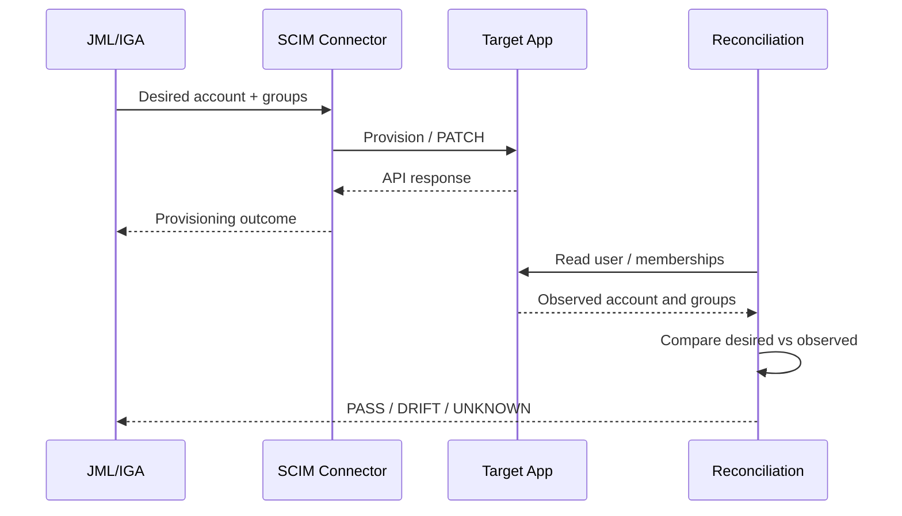
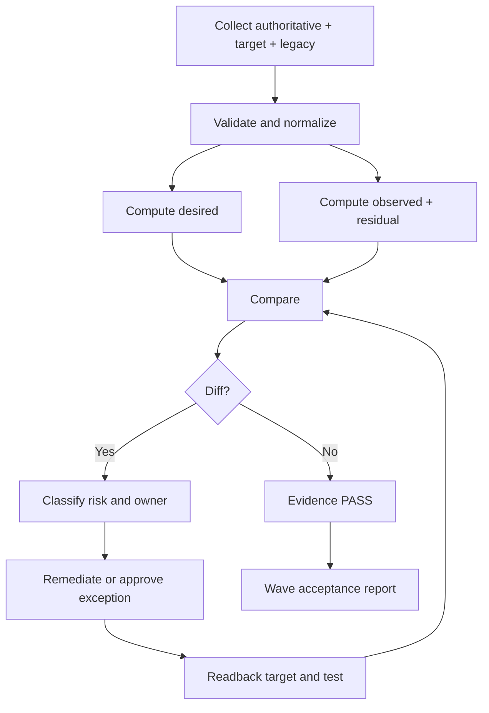

# Đối soát sau di trú IAM: xác minh danh tính, quyền và vòng đời sau cutover

Trong một dự án **IAM migration** (di trú hệ thống quản lý định danh và truy cập), việc chuyển dữ liệu và đổi điểm đăng nhập sang nền tảng mới chỉ là một phần công việc. Sau khi cutover, tổ chức phải chứng minh rằng **đúng chủ thể được liên kết đúng tài khoản, đúng quyền còn hiệu lực trên đúng tài nguyên, và các quyền phải thu hồi đã thực sự không còn sử dụng được**. Hoạt động này được gọi là **đối soát sau di trú** (*post-migration reconciliation*).

Ví dụ: tổ chức chuyển từ IdP cũ sang IdP mới, đồng bộ người dùng vào các ứng dụng SaaS qua SCIM. Một báo cáo có thể cho thấy “10.000/10.000 người dùng đã import thành công”, nhưng điều đó **không chứng minh** rằng tài khoản đã nghỉ việc bị khóa, role quản trị không bị mở rộng, người dùng thuộc đúng tenant hoặc API key cũ đã bị xử lý. Khi migration làm thay đổi nhóm, account ID, thuộc tính hoặc ánh xạ role, quyền hiệu lực có thể **khác** dù số lượng bản ghi bằng nhau.

Bài học này đặt **đối soát sau di trú** trong phạm vi **Identity Lifecycle Management** theo **Joiner–Mover–Leaver (JML)**; liên kết nguồn nhân sự, **IdP**, **SSO**, **SCIM**, **RBAC/ABAC**, tài khoản dịch vụ, kiểm toán và mục tiêu giảm **quyền truy cập tồn dư**.

> **Thông điệp chính:** Migration chỉ có thể được xem là đã kiểm soát khi **trạng thái mong muốn, trạng thái thực tế ở hệ thống mới và các đường truy cập còn hoạt động ở hệ thống cũ** được đối chiếu, giải thích sai lệch và xử lý theo mức rủi ro. “Import thành công” không đồng nghĩa “truy cập đúng và an toàn”.

## 1. Mục tiêu học tập

Sau bài này, người học có thể:

1. Phân biệt **migration**, **validation**, **reconciliation**, **access certification** và **post-cutover monitoring** trong IAM.
2. Xác định dữ liệu có thẩm quyền để đối soát danh tính, tài khoản, quan hệ nhân sự, role, entitlement, ACL, phiên và credential.
3. Thiết kế **mapping source → canonical identity → target account** không nhầm người, tenant hoặc danh tính dịch vụ.
4. Kiểm tra **effective access** chứ không chỉ so tên role và tổng số bản ghi.
5. Đối soát các sự kiện JML phát sinh trong thời gian migration, kể cả sự kiện đến trễ hoặc sai thứ tự.
6. Phát hiện **orphan account, duplicate account, missing grant, excess grant, stale session, residual credential** và quyền truy cập ngoài luồng.
7. Phân loại sai lệch theo mức rủi ro, giao owner, thiết kế remediation và điều kiện readback.
8. Tổ chức đối soát theo nhiều đợt migration, xử lý rollback, đồng bộ hai chiều và thời gian chờ nhất quán.
9. Xây dựng bằng chứng kiểm toán, chỉ số chất lượng, ngưỡng chấp nhận và tiêu chí đóng một đợt di trú.
10. Vận dụng các ví dụ dữ liệu, thuật toán và tình huống kiểm thử để thiết kế quy trình có thể triển khai.

## 2. Đối soát sau di trú thực chất là gì?

**Reconciliation** là quá trình so sánh **trạng thái kỳ vọng** với **trạng thái quan sát được** tại từng hệ thống, sau đó phân tích và giải quyết các sai lệch.

Đối với IAM, câu hỏi không chỉ là “bản ghi đã được copy chưa?” mà là:

- Người được chuyển sang IdP mới có đúng **định danh nguồn** và quan hệ đang hiệu lực không?
- Những tài khoản phải **ACTIVE, PENDING, SUSPENDED, DISABLED, TERMINATED** đang ở trạng thái nào?
- Role, nhóm, entitlement, quyền trực tiếp, ACL và quyền kế thừa có tạo ra **đúng effective permissions** không?
- Chính sách **RBAC/ABAC, tenant isolation, SoD** còn giữ ý nghĩa như trước hay đã thay đổi?
- Quyền tạm/JIT và hạn hợp đồng có bị kéo dài ngoài dự kiến không?
- App dùng SSO mới có còn giữ **local session, refresh token, PAT, API key hoặc tài khoản cũ** không?
- Sự kiện Joiner, Mover, Leaver xảy ra sát cutover đã được xử lý đúng thứ tự và đủ hệ thống chưa?
- Mỗi sai lệch có **căn cứ, mức rủi ro, người chịu trách nhiệm, deadline và bằng chứng khắc phục** chưa?

Có thể hình dung ba tập dữ liệu:

```text
DESIRED = trạng thái IAM phải đạt theo nguồn có thẩm quyền
          + chính sách hiện hành + phê duyệt hợp lệ

TARGET_OBSERVED = trạng thái tài khoản, quyền và phiên thực tế
                  tại IdP mới, ứng dụng đích, cloud, database

LEGACY_RESIDUAL = đường truy cập ở IdP cũ / ứng dụng cũ /
                  credential cũ vẫn có thể hoạt động

Kết quả đối soát:
  TARGET_OBSERVED phải phù hợp DESIRED
  LEGACY_RESIDUAL phải được đóng theo kế hoạch được phê duyệt
```

Không nên lấy **snapshot của hệ thống cũ** làm nguồn sự thật duy nhất. Hệ thống cũ có thể đã chứa quyền dư thừa, tài khoản mồ côi hoặc dữ liệu stale. Migration là cơ hội làm sạch, nhưng mọi thay đổi quyền ngoài mapping kỹ thuật cần có **phê duyệt/chính sách mới**.

## 3. Phân biệt các bước thường bị đánh đồng

| Hoạt động | Mục đích | Bằng chứng chính |
| --- | --- | --- |
| **Data migration** | Chuyển bản ghi danh tính, nhóm hoặc cấu hình. | Số bản ghi import, mapping và lỗi kỹ thuật. |
| **Configuration validation** | Kiểm tra SSO/SCIM, certificate, attribute mapping, role mapping. | Kết quả cấu hình, integration test. |
| **Identity reconciliation** | Xác nhận một chủ thể ↔ đúng account, trạng thái và quan hệ. | So canonical ID, account mapping và status readback. |
| **Entitlement reconciliation** | Kiểm tra quyền hiệu lực và scope so với chính sách mong muốn. | Permission/role/ACL ở đích, đường cấp và sai lệch. |
| **Lifecycle reconciliation** | Bảo đảm Joiner/Mover/Leaver trong và sau cutover không bị bỏ sót. | Event/version, trạng thái đích, mốc thời gian xác nhận. |
| **Legacy-access cleanup** | Đóng quyền, session, credential còn dùng được từ hệ cũ. | Revocation readback và kiểm thử đường truy cập. |
| **Access certification** | Owner có thẩm quyền xác nhận nhu cầu của những quyền cần rà soát. | Quyết định review, lý do, hành động và kết quả. |
| **Post-cutover monitoring** | Quan sát lỗi, drift, quyền tồn dư và trải nghiệm theo thời gian. | KPI, alert, báo cáo và finding lifecycle. |

Một quyền vừa được import có thể hợp lệ về **cấu trúc** nhưng không hợp lệ về **nghiệp vụ**. Ví dụ role `ERP_ADMIN` tồn tại ở cả hai nền tảng, nhưng role mới thêm quyền export toàn bộ khách hàng; so sánh tên role sẽ không phát hiện sự mở rộng đặc quyền.

## 4. Xác định phạm vi và ranh giới của đợt đối soát

Đối soát cần danh mục rõ **cái gì thuộc đợt migration và cái gì nằm ngoài phạm vi**. Mỗi hạng mục nên có owner, cách lấy observed state và mức rủi ro.

| Hạng mục | Ví dụ | Kiểm tra bắt buộc |
| --- | --- | --- |
| **Human identities** | Nhân viên, nhà thầu, đối tác | Mapping, status, ngày hiệu lực, tenant, account. |
| **Non-human identities** | Service account, workload, bot, CI/CD | Owner, ứng dụng dùng, credential, role, môi trường. |
| **IdP & SSO** | OIDC/SAML app, nhóm, liên kết federation | Issuer, subject, login, claim, app assignment, phiên. |
| **SCIM / provisioning** | Tạo/khóa User, Group, thành viên | Attribute mapping, trạng thái `active`, target account ID. |
| **RBAC/ABAC** | Role catalog, policy, thuộc tính | Permission hiệu lực, scope, SoD, owner, policy version. |
| **Ứng dụng SaaS** | ERP, CRM, ticket, HR portal | Account local, role, ACL, chia sẻ, phiên. |
| **Hạ tầng** | Cloud IAM, SSH/VPN, database | Role binding, API key, credential, account đặc quyền. |
| **Tài nguyên** | Tenant, project, bucket, repository | Ownership, resource policy, group inheritance. |
| **Luồng JML** | Event trong cutover và sau cutover | Không bỏ Joiner/Mover/Leaver; xử lý đúng mốc hiệu lực. |

### 4.1. Phân nhóm theo mức độ quan trọng

Các hệ thống có dữ liệu nhạy cảm, quyền đặc quyền, môi trường production hoặc rủi ro tác động lớn thường cần xác nhận kỹ hơn. Có thể phân:

- **Tier 0 / critical:** IdP, PAM, hệ thống quản trị quyền, secrets, production cloud, dữ liệu mật.
- **Tier 1 / high:** ERP, dữ liệu khách hàng/nhân sự, hệ thống tài chính.
- **Tier 2 / standard:** ứng dụng nội bộ ít nhạy cảm.
- **Out of scope được công bố:** những hệ thống chưa di trú, có lý do và kiểm soát riêng.

Các tier là **mô hình minh họa**, không phải chuẩn phân loại chung. Điều quan trọng là ngưỡng chấp nhận và phương pháp kiểm tra **phù hợp rủi ro**, không chỉ một tỷ lệ đếm chung.

## 5. Nguồn sự thật: không dùng dữ liệu cũ làm chính sách mới

Đối soát chỉ đáng tin khi xác định **nguồn có thẩm quyền** của mỗi thuộc tính.

| Thuộc tính | Nguồn ưu tiên theo thiết kế | Lưu ý |
| --- | --- | --- |
| Quan hệ lao động, hợp đồng và ngày hiệu lực | HRIS / hệ thống quản lý đối tác | Có thể có sự kiện tương lai và tạm đình chỉ. |
| Định danh chủ thể | Kho canonical identity / IAM | Không tái sử dụng ID, bảo vệ liên kết. |
| Account tại IdP mới | Target IdP | Dùng đúng issuer/tenant/account ID. |
| Quyền công việc nền | Role/entitlement catalog được phê duyệt | Bản quyền hiện hành, không copy nguyên quyền dư từ legacy. |
| Quyền ngoại lệ và hạn sử dụng | IGA/PAM/approval system | Chỉ giữ ngoại lệ còn hiệu lực và đúng scope. |
| Owner/resource/tenant | Ứng dụng nghiệp vụ / resource registry | Không tin tenant do client tự khai. |
| Effective permissions | API đọc quyền của target app/cloud/DB | Tính đủ kế thừa, ACL, deny và role cục bộ. |
| Phiên/credential đang hoạt động | IdP, ứng dụng, token/secret systems | Token ký offline có giới hạn quan sát/thu hồi riêng. |
| Kết quả JML | Orchestrator + readback target | Lệnh gửi thành công không thay thế xác nhận. |

**Ví dụ:** HRIS cho biết một nhà thầu hết hạn hợp đồng từ hôm qua, legacy IdP vẫn đang `ACTIVE` do lỗi đồng bộ. Nếu copy trạng thái `ACTIVE` sang IdP mới và gọi đó là “đồng bộ chính xác”, migration có thể bảo toàn một lỗi bảo mật. Desired state phải dựa trên **quan hệ và chính sách có hiệu lực**, không dựa vào giá trị cũ sai.

## 6. Khóa liên kết danh tính khi đổi IdP

Một khó khăn lớn là **account identifier thay đổi**, nhưng tổ chức phải giữ liên kết với cùng chủ thể.

Ví dụ:

```text
HRIS personId: P-1842
Legacy IdP:
    issuer: https://legacy-idp.example.org
    subject: legacy-88421
    accountId: old-acct-210

New IdP:
    issuer: https://new-idp.example.org
    subject: new-194032
    accountId: new-acct-809

Target ERP:
    externalId: P-1842
    accountId: erp-u-5521
```

Đối soát cần dựa vào **mapping được xác minh** từ nguồn có thẩm quyền tới từng account, không dùng mỗi email, tên hoặc giá trị `sub` đơn lẻ.

### 6.1. Vì sao email là khóa đối soát nguy hiểm?

Email có thể đổi do đổi tên, chuyển domain, đổi bộ phận hoặc được tái sử dụng. Hai tài khoản service cũng có thể chia sẻ email liên hệ. Nếu nối hoàn toàn theo email, công cụ có thể:

- Gộp hai người thành một danh tính.
- Tạo duplicate account cho cùng một người.
- Gán quyền của người cũ cho người mới dùng email cũ.
- Bỏ sót account khi người dùng đổi alias trong cutover.

Ưu tiên khóa ổn định như `personId`/`canonicalSubjectId` hoặc định danh nguồn đã xác minh. Với federation/OIDC, luôn xem **issuer + subject**, không coi `sub` là duy nhất giữa mọi IdP.

### 6.2. Bảng mapping cần quản lý như dữ liệu bảo mật

Một bảng minh họa:

| Canonical subject | Legacy IdP subject | New IdP subject | Target account | Trạng thái |
| --- | --- | --- | --- | --- |
| `P-1842` | `legacy-88421` | `new-194032` | `erp-u-5521` | MATCHED |
| `P-1843` | `legacy-99290` | Không thấy | `erp-u-5522` | MISSING_TARGET |
| `P-1844` | `legacy-30011` | Hai account mới | Không xác định | DUPLICATE_CANDIDATE |

Trường hợp `DUPLICATE_CANDIDATE` cần xử lý có chứng cứ, **không tự chọn account có email gần giống nhất**. Có thể cần kiểm tra nguồn nhân sự, trạng thái liên kết và dấu vết tạo tài khoản.

### 6.3. Nhận diện sai lệch mức danh tính

- **Missing target:** có chủ thể phải có account nhưng không tìm thấy đích.
- **Unexpected target:** account đích không thuộc tập chủ thể/loại account được phê duyệt.
- **Duplicate identity:** một chủ thể liên kết nhiều account không có căn cứ.
- **Wrong-person linkage:** account được gắn nhầm chủ thể khác; rủi ro rất cao.
- **Wrong tenant:** account đúng người nhưng thuộc tenant/org sai.
- **Status mismatch:** quan hệ `TERMINATED` nhưng account mới `ACTIVE`.
- **Attribute drift:** tên phòng ban, manager, sponsor hoặc thuộc tính policy không đúng.

Không phải mọi trường hợp “nhiều account” đều là lỗi: một người có thể có account quản trị riêng có chủ đích. Nhưng từng account phải có **mục đích, owner và liên kết rõ**, không bị gộp thành một account quyền rộng một cách ngẫu nhiên.

## 7. Chụp baseline và xác định cửa sổ di trú

Đối soát sau cutover cần biết **so với mốc nào**. Nếu dữ liệu nguồn thay đổi liên tục, snapshot trước di trú và observed state sau di trú có thể khác nhau vì các thay đổi **hợp lệ**.

Một kế hoạch có thể gồm:

```text
T0: Chụp baseline legacy accounts / grants / app mappings.
T1: Ghi nhận watermark của luồng sự kiện JML.
T2: Chuyển dữ liệu + cấu hình SSO/SCIM sang đích.
T3: Cutover xác thực / provisioning theo kế hoạch.
T4: Áp dụng các delta JML phát sinh trong (T1, T3].
T5: Đọc trạng thái thực tế IdP mới và ứng dụng đích.
T6: Đối soát desired vs observed + kiểm tra legacy residual.
T7: Khắc phục, kiểm tra lại, quyết định đóng/hypercare.
```

Các thời điểm chỉ là mô hình. Với migration theo wave, mỗi wave có thể có baseline và watermark riêng.

### 7.1. Watermark không có nghĩa ngừng xử lý JML

Trong thực tế, người mới vào làm, nhân sự chuyển bộ phận và người nghỉ việc vẫn diễn ra trong lúc migration. Kế hoạch phải nói rõ:

- Nguồn nào đang **authoritative** trong từng giai đoạn?
- Các thay đổi nào được **freeze có kiểm soát**, những thay đổi nào phải xử lý ngay?
- Event ID, source version hoặc offset nào đánh dấu phần đã đồng bộ?
- Event nào được replay sau cutover?
- Chống cấp trùng hoặc áp dụng sự kiện cũ bằng cách nào?
- Ai có quyền xử lý thay đổi khẩn cấp khi đường provisioning mới chưa sẵn sàng?

**Không nên đóng băng yêu cầu Leaver khẩn cấp** chỉ để đơn giản hóa migration. Cần một đường thực thi thu hồi ưu tiên và được kiểm chứng trên cả hệ thống đang còn cho phép truy cập.

### 7.2. Biến động hợp lệ và biến động bất thường

Nếu một Mover xảy ra sau baseline và trước readback, khác biệt role có thể **hợp lệ**. Vì vậy, so sánh cần tái dựng desired state **tại thời điểm đánh giá**, bao gồm những sự kiện đã có hiệu lực, thay vì yêu cầu mọi thuộc tính bằng hệt snapshot cũ.

## 8. So sánh danh tính, account và trạng thái

Một bảng kiểm thử minh họa:

| Kiểm tra | Desired state | Target observed state | Kết luận |
| --- | --- | --- | --- |
| Chủ thể có hiệu lực | Có 1 account nghiệp vụ phù hợp | Có 1 account đúng mapping | PASS |
| Nhân sự chưa bắt đầu | Chưa được quyền truy cập sản xuất | Account `ACTIVE` có app role | EXCESS_ACCESS |
| Nhà thầu hết hạn | Account/access bị vô hiệu hóa | Account `ACTIVE` | CRITICAL |
| User chuyển tenant | Tenant mới theo nguồn | Vẫn tenant cũ | WRONG_SCOPE |
| Người có admin account tách biệt | Account thường + admin theo chính sách | Hai account có liên kết đúng | PASS |
| Người dùng không có quan hệ hợp lệ | Không có đường truy cập | Một SaaS local account tồn tại | ORPHAN_CANDIDATE |
| User đổi email | Một canonical subject | Hai account vì alias cũ/mới | DUPLICATE_CANDIDATE |

### 8.1. Trạng thái không nên đối soát bằng một Boolean duy nhất

Một nguồn có thể phân biệt `PENDING, ACTIVE, SUSPENDED, TERMINATED`, còn target IdP chỉ hỗ trợ `enabled/disabled`. Cần **bảng ánh xạ trạng thái được phê duyệt**, ví dụ:

| Source lifecycle | Trạng thái đích mong muốn | Hạn chế sử dụng |
| --- | --- | --- |
| PENDING, chưa đến ngày bắt đầu | Account có thể pre-provision nhưng chưa mở quyền sản xuất | Theo chính sách onboarding. |
| ACTIVE | Enabled và có baseline tương ứng | Vẫn phải kiểm tra entitlement/scope. |
| SUSPENDED | Chặn truy cập theo quy định | Không để job cũ mở lại quyền. |
| TERMINATED | Disabled/deprovisioned theo chính sách | Thu hồi session/credential độc lập. |

Cần nhớ **disabled account tại IdP không tự đồng nghĩa mọi access token và session của app đã bị vô hiệu hóa**.

## 9. Đối soát role, nhóm và effective permissions

Số lượng role hoặc tên nhóm không đủ để kết luận quyền tương đương. Cần so sánh ở các lớp:

1. **Role catalog:** role mới đại diện cho cùng trách nhiệm nghiệp vụ hay không?
2. **Permission set:** các action thực tế có bị mở rộng/thu hẹp?
3. **Scope:** tenant, project, namespace, data classification, resource owner.
4. **Inheritance:** nhóm lồng nhau, role kế thừa, policy tài nguyên, ACL trực tiếp.
5. **Conditions:** ABAC, SoD, hạn mức, mốc hiệu lực, MFA/context khi áp dụng.
6. **Direct grants:** quyền cấp thủ công ngoài nhóm/SCIM.
7. **Deny semantics:** quy tắc explicit deny và cách hợp nhất nhiều policy tại nền tảng đích.
8. **Session/token:** token cũ có claim hoặc quyền đã lỗi thời không?

### 9.1. Tình huống role tương đương về tên nhưng khác quyền

Legacy:

```yaml
role: SUPPORT_AGENT
permissions:
  - ticket:read-assigned
  - ticket:reply-assigned
scope:
  tenant: TENANT-A
```

Target:

```yaml
role: SUPPORT_AGENT
permissions:
  - ticket:read-all
  - ticket:reply-all
  - customer:export
scope:
  tenant: "*"
```

**Kết luận:** tên role trùng nhưng quyền hiệu lực **đã mở rộng rất lớn**. Nếu chỉ đếm người thuộc nhóm `SUPPORT_AGENT`, hệ thống có thể báo PASS sai.

### 9.2. So sánh theo chuẩn hóa permission

Có thể tạo một **canonical access representation** cho quyền, thay vì so các chuỗi role riêng của nhà cung cấp:

```json
{
  "subjectId": "P-1842",
  "targetSystem": "ticketing",
  "action": "ticket:read",
  "resourceScope": {
    "tenantId": "TENANT-A",
    "projectIds": ["ALPHA"]
  },
  "constraints": {
    "onlyAssignedTickets": true
  },
  "validUntil": "2027-02-01T00:00:00Z",
  "grantSource": "BASELINE_ROLE"
}
```

Đây là biểu diễn **khái niệm**, không phải cấu hình dùng trực tiếp ở tất cả nền tảng. Để so sánh có giá trị, bộ chuẩn hóa phải bảo toàn khác biệt về wildcard, điều kiện, deny, inheritance và hiệu lực thời gian.

### 9.3. Chênh lệch cần phân loại rõ

Có thể dùng:

```text
MISSING_REQUIRED_ACCESS = desired permission không có ở target
EXCESS_ACCESS          = target có quyền ngoài desired
SCOPE_EXPANSION        = action giống nhưng phạm vi rộng hơn
SCOPE_REDUCTION        = action giống nhưng phạm vi hẹp hơn
CONDITION_DRIFT        = mất hoặc thay đổi điều kiện ABAC/SoD
STALE_LEGACY_ACCESS    = hệ cũ vẫn cho phép sau cutover
UNKNOWN_EFFECTIVE      = không lấy đủ dữ liệu để kết luận
```

**EXCESS_ACCESS, SCOPE_EXPANSION và CONDITION_DRIFT** trên tài nguyên nhạy cảm có thể nghiêm trọng hơn một role bị thiếu. Nhưng **MISSING_REQUIRED_ACCESS** ở hệ thống sống còn cũng có thể gây gián đoạn nghiêm trọng; xử lý theo rủi ro, không chỉ thứ tự cố định.

## 10. Đối soát thuộc tính ABAC và ranh giới tenant

Một migration có thể thay tên trường, quy ước giá trị hoặc định dạng thuộc tính. Ví dụ:

| Legacy attribute | Target attribute | Lỗi tiềm ẩn |
| --- | --- | --- |
| `department=FINANCE` | `orgUnit=Finance` | Mapping sai chữ hoa/thường hoặc phân cấp tổ chức. |
| `tenant=ACME-A` | `tenantId=101` | Nhầm tenant khi ID số bị tái sử dụng ở môi trường khác. |
| `employeeType=CONTRACTOR` | `workerCategory=EXTERNAL` | Quyền của đối tác bị nâng thành quyền nhân viên. |
| `location=VN` | `region=APAC` | Phạm vi truy cập được mở rộng ngoài ý định. |
| `clearanceLevel=2` | `classification=INTERNAL` | Thứ tự phân loại không tương đương. |
| `managerId` | `approverId` | Nhầm người quản lý với người có thẩm quyền phê duyệt dữ liệu. |

Các phép biến đổi cần có **mapping spec**, owner và test case. Không nên tự giả định các giá trị tương đương chỉ vì tên gần giống.

### 10.1. Kiểm tra chính sách trên tài nguyên thật

Giả sử một người có role `DOCUMENT_READER`. Bài kiểm thử phải kiểm tra:

- Đọc tài liệu được giao trong tenant A → **ALLOW** theo chính sách.
- Đọc tài liệu tenant B → **DENY**.
- Đọc tài liệu trong project chưa tham gia → **DENY**.
- Export hàng loạt dữ liệu nhạy cảm khi thiếu entitlement riêng → **DENY**.
- Sau khi Mover đổi dự án → quyền cũ bị thu hồi đúng hạn.

Kiểm tra ở **API/backend và hệ thống dữ liệu**, không chỉ dựa trên giao diện ẩn nút hoặc danh sách menu.

### 10.2. Access policy cần được version hóa

Bản ghi kiểm thử nên lưu `policyVersion`, trạng thái tài nguyên/thuộc tính đã sử dụng và thời điểm quyết định. Nếu chính sách đổi trong migration, phải phân biệt **thay đổi được phê duyệt** với **sai lệch ngoài kế hoạch**.

## 11. Đối soát Joiner, Mover, Leaver trong và sau cutover

Hệ thống IAM mới có thể hoạt động tốt ở thời điểm import nhưng bỏ mất một sự kiện nhân sự khi đổi luồng đồng bộ. Vì vậy, cần đối soát theo **sự kiện vòng đời**, không chỉ snapshot.

### 11.1. Joiner

Đối với mỗi Joiner trong cửa sổ di trú:

1. Xác định canonical subject từ nguồn nhân sự/đối tác.
2. Kiểm tra `effectiveStartAt` và trạng thái quan hệ.
3. Xác nhận account ở IdP mới đã tạo đúng mapping.
4. Kiểm tra role nền trong chính sách hiện hành.
5. Xác nhận SCIM/API đã cấp account và entitlement ở ứng dụng cần dùng.
6. Xác nhận không kích hoạt quyền production trước ngày hiệu lực.
7. Đánh dấu lỗi nếu target account thiếu, dư hoặc không thuộc đúng tenant.

### 11.2. Mover

Đối với mỗi Mover:

- Xác định bộ quyền **trước và sau** theo nguồn và chính sách.
- Xác định quyền cần thêm/gỡ, đặc biệt quyền đặc quyền và ACL cục bộ.
- Kiểm tra sự kiện mới nhất được xử lý đúng **sourceVersion**.
- Kiểm tra quyền mới ở target và quyền cũ ở cả target lẫn legacy.
- Ngoại lệ bàn giao phải có scope, owner, approval và `validUntil`.
- Với role xung đột, đánh giá **Separation of Duties (SoD)**.

**Tình huống:** Mover xảy ra lúc 09:00, migration replay nhầm event cũ lúc 09:05 và thêm lại nhóm hỗ trợ đã thu hồi. Phải bảo đảm luồng sự kiện **idempotent**, có thứ tự đáng tin, không được phục hồi trạng thái cũ chỉ vì nó đến sau.

### 11.3. Leaver

Đối với mỗi Leaver:

- Kiểm tra mốc cần khóa theo nguồn có thẩm quyền.
- Xác minh IdP cũ và mới đã chặn quyền trong phạm vi yêu cầu.
- Kiểm tra SCIM/API deprovision tại tất cả đích.
- Rà soát phiên, refresh token, PAT, SSH key, API key và local account.
- Xác nhận tài nguyên/ownership cần bàn giao được xử lý.
- Đo thời gian **từ mốc hiệu lực đến mốc chặn quyền thực tế**.

Không được báo Leaver hoàn tất nếu account ERP đã disabled nhưng token Git hoặc VPN vẫn hoạt động không có lý do ngoại lệ hợp lệ.

## 12. Dữ liệu SCIM sau di trú: đồng bộ trạng thái hay chỉ copy cấu trúc?

SCIM thường hỗ trợ đồng bộ User/Group và một số thuộc tính giữa identity provider và service provider. Trong migration, cấu hình connector có thể bị thay đổi:

- ID tài khoản đích có được giữ nguyên hay tạo mới?
- `externalId` hoặc khóa liên kết được thiết lập đúng không?
- `active=false` có được đồng bộ đúng khi Leaver?
- Group membership có bị gán trùng hoặc bỏ sót?
- Ứng dụng có ánh xạ nhóm sang role theo cấu hình cũ hay mới?
- SCIM có quản lý tất cả quyền hay chỉ một phần role?
- Retry có tạo account thứ hai không?
- Lệnh được nhận đồng bộ hay ứng dụng xử lý bất đồng bộ?

### 12.1. Quy trình readback ở đích



Phản hồi HTTP thành công không thay thế **xác minh quyền hiệu lực**, đặc biệt ở ứng dụng có role local hoặc session riêng.

### 12.2. Phát hiện connector vẫn ghi vào legacy

Một lỗi cutover phổ biến là hệ thống nguồn vẫn gửi provisioning đến connector cũ, trong khi một connector khác ghi sang đích mới. Điều này có thể tạo **split-brain identity management**: account tại hai IdP được cập nhật khác nhau.

Cần xác định:

1. Connector nào là **writer có thẩm quyền** trong từng giai đoạn.
2. Có đường ghi hai chiều hoặc đồng bộ đảo ngược không?
3. Sự kiện được chuyển tiếp/đồng bộ có thể tạo vòng lặp không?
4. Đã khóa những đường ghi cũ không còn được sử dụng chưa?
5. Nếu vẫn cần chạy song song, có chính sách phân xử xung đột và thời điểm kết thúc không?

## 13. Đối soát SSO, phiên và token tồn dư

Chuyển sang IdP mới không chỉ thay form đăng nhập. Ứng dụng có thể cần cập nhật issuer, metadata, certificate, audience, subject mapping và logic cấp phiên.

### 13.1. Các tình huống cần kiểm tra

| Tình huống | Kỳ vọng |
| --- | --- |
| User active, đúng role | Có thể đăng nhập qua IdP mới và chỉ sử dụng tài nguyên đúng scope. |
| User không có role ứng dụng | Xác thực có thể thành công nhưng truy cập app bị từ chối rõ ràng. |
| User đã Leaver | Không tạo được phiên mới, phiên cũ được xử lý theo chính sách. |
| Token do issuer cũ phát | Chỉ được chấp nhận nếu chính sách chuyển tiếp còn cho phép và trong phạm vi đã duyệt. |
| Token do issuer mới phát | App xác minh đúng issuer, audience, chữ ký, hạn và claim cần thiết. |
| Logout/khóa tài khoản | Kiểm tra cả phiên IdP và session local ở các app quan trọng. |
| Account mapping đổi | Không nối nhầm user cũ với account của người khác. |
| Break-glass | Vẫn có đường khẩn cấp được quản trị khi IdP mới gặp sự cố. |

### 13.2. Token đã cấp trước cutover

Ví dụ, app đang chấp nhận JWT của issuer cũ trong một khoảng chuyển tiếp. Sau cutover, có thể tồn tại **hai nguồn phát token** với mức bảo đảm khác nhau. Cần quyết định có chủ đích:

- Có còn cho phép issuer cũ không, với **audience và thời hạn** nào?
- Có endpoint nào chỉ kiểm tra chữ ký mà không kiểm tra issuer/audience?
- Làm sao rút lại trust với issuer cũ mà không gây outage không cần thiết?
- Với access token ký tự xác minh offline, cửa sổ còn dùng được tới `exp` là bao lâu nếu không có kiểm tra trạng thái?
- Refresh token và phiên local được xử lý bằng cơ chế nào?

Không được tuyên bố “đã khóa tài khoản cũ” đồng nghĩa **mọi token và phiên cũ đã bị thu hồi tức thì** nếu hệ thống đích không hỗ trợ điều đó.

## 14. Workload identity, service account và đường truy cập phi con người

Migration dễ bỏ qua danh tính phi con người vì không xuất hiện trong danh sách nhân sự. Tuy nhiên, service account, robot, pipeline CI/CD và API key có thể giữ quyền production rất rộng.

Đối soát cần biết:

| Trường | Câu hỏi |
| --- | --- |
| Workload ID | Dịch vụ/job nào sử dụng? Có danh tính riêng theo môi trường? |
| Owner | Đội/người chịu trách nhiệm đang hoạt động? |
| Credential | API key, secret, certificate, federated identity còn hợp lệ? |
| Scope | Quyền trong cloud, database, bucket, queue và secret store? |
| Environment | Dev/staging/prod có bị dùng chung credential không? |
| Trust | Issuer/audience, workload federation, mTLS identity có đổi không? |
| Lifetime | Credential dài hạn cần rotation hay quyền tạm/JIT cần hết hạn? |
| Legacy | Secret hoặc service principal cũ còn có thể truy cập không? |
| Evidence | Dịch vụ có chạy thành công mà không phải giữ quyền admin dư thừa không? |

### 14.1. Một ví dụ migration an toàn

Job `billing-reporter-prod` trước đây dùng API key chung để đọc database và ghi báo cáo. Sau migration, dự kiến chuyển sang workload identity federation với quyền đọc bảng báo cáo và ghi đúng bucket.

Kết quả đối soát không chỉ là “job chạy thành công”; cần chứng minh:

1. Job mới chạy bằng **workload identity đúng nguồn và môi trường**.
2. Permission chỉ trên tài nguyên và action được duyệt.
3. Có log actor/run/owner phục vụ kiểm toán.
4. Legacy API key đã bị thu hồi hoặc còn trong cửa sổ chuyển tiếp được phê duyệt.
5. Job test/staging không thể dùng identity production.
6. Khi chủ sở hữu nhân sự rời đội, service account được chuyển owner hoặc xử lý theo lifecycle.

### 14.2. Không phá dịch vụ khi dọn credential

Không nên thu hồi một secret production không rõ mục đích bằng thao tác thiếu kiểm chứng rồi để hệ thống ngừng hoạt động. Cần điều tra dependency, owner, đường dùng thực tế, kế hoạch rotation và kiểm thử rollback. Với credential nghi bị lộ hoặc có rủi ro khẩn cấp, ưu tiên biện pháp chặn theo quy trình ứng phó sự cố.

## 15. Đối soát quyền đặc quyền, JIT, PAM và break-glass

Quyền admin là nhóm phải kiểm tra kỹ trong và sau migration:

- Admin của IdP cũ có tự động thành admin IdP mới không?
- Group mapping có vô tình tạo quyền global admin?
- Tài khoản PAM có còn gắn danh tính người thực, approval và session?
- Quyền JIT có được cấp theo scope và hết hạn tự động?
- Credential break-glass còn hoạt động ở hệ thống mới và không phải đường admin thường ngày?
- Các role cũ, local admin, SSH/sudo, database superuser đã được rà soát chưa?
- Có người nào giữ quyền admin ở **cả hai nền tảng** ngoài cửa sổ chuyển tiếp?

Ví dụ:

```text
Legacy: role CLOUD_OPS_READER -> chỉ xem trạng thái cluster
Target: role CLOUD_OPERATOR   -> xem, deploy, xóa workload

Kết quả: ROLE_MAPPING_NOT_EQUIVALENT
Không tự nhận đây là permission tương đương.
```

Với quyền đặc quyền, nên thử cả **negative authorization tests**: người chỉ đọc không thể deploy/xóa, user tenant A không thao tác tài nguyên tenant B, JIT hết hạn không còn được restart service.

## 16. Phân loại và ưu tiên các sai lệch

Một đợt migration lớn có thể sinh hàng nghìn khác biệt; không thể xử lý theo thứ tự ngẫu nhiên. Nên phân loại theo **khả năng truy cập sai, dữ liệu bị tác động, quy mô, mức tin cậy và hiệu quả biện pháp giảm rủi ro**.

| Loại sai lệch | Ví dụ | Hướng ưu tiên |
| --- | --- | --- |
| **Wrong identity / wrong tenant** | Account A liên kết chủ thể B; user tenant A đọc được tenant B. | Chặn sớm, điều tra khẩn cấp. |
| **Privilege escalation** | Role viewer thành admin hoặc mất điều kiện SoD. | Ưu tiên rất cao, cô lập quyền mở rộng. |
| **Leaver residual access** | Nhân viên nghỉ vẫn dùng PAT/token/app local. | Ưu tiên cao, xử lý thu hồi và điều tra. |
| **Missing critical access** | On-call không thể truy cập khả năng khôi phục production. | Ưu tiên cao theo tác động vận hành, đường cứu hộ có kiểm soát. |
| **Duplicate active account** | Một người có hai account nhận quyền khác nhau. | Xác minh mapping, ngăn gán nhầm/đường bypass. |
| **Role/attribute mismatch** | Sai department dẫn đến scope không đúng. | Phân loại theo tài nguyên chịu ảnh hưởng. |
| **Missing low-risk entitlement** | User không đọc được ứng dụng không quan trọng. | Theo SLA phù hợp. |
| **Unknown evidence** | Chưa thể đọc effective permissions ở một SaaS. | Không báo PASS; giao owner và thời hạn điều tra. |

### 16.1. Trạng thái finding nên rõ ràng

Có thể dùng:

```text
OPEN -> TRIAGED -> REMEDIATION_IN_PROGRESS
                  -> AWAITING_TARGET_CONFIRMATION
                  -> RESOLVED_VERIFIED

OPEN -> ACCEPTED_EXCEPTION (approved, scoped, expiresAt)
OPEN -> FALSE_POSITIVE (evidence-backed)
OPEN -> NOT_OBSERVABLE (tracked gap, not PASS)
```

Một finding chỉ được **RESOLVED_VERIFIED** khi có bằng chứng đủ mạnh rằng target đạt desired state. Việc chạy một script sửa dữ liệu mà không đọc lại đích là **REMediation attempted**, chưa phải xác nhận hoàn tất.

### 16.2. Không tự động sửa tất cả sai lệch

Một sai lệch có thể là thay đổi nghiệp vụ hợp lệ đến muộn. Xóa quyền theo snapshot cũ dễ làm gián đoạn công việc hoặc thu hồi nhầm quyền cần thiết. Đối với quyền nhạy cảm không có căn cứ, chính sách có thể yêu cầu tạm chặn trước; với quyền ít rủi ro, có thể kiểm tra owner trước khi sửa. Tự động hóa phải đi kèm **nguồn sự thật, version, idempotency, phân loại rủi ro và readback**.

## 17. Thuật toán đối soát có thể triển khai

Một quy trình hợp lý gồm các bước:

1. **Collect:** lấy snapshots từ HRIS, IdP cũ, IdP mới, connector, app, cloud, database và hệ thống token theo phạm vi.
2. **Validate:** kiểm tra dữ liệu thiếu, namespace, timestamp, schema, coverage và mapping.
3. **Normalize:** chuyển về canonical subject/account/entitlement/resource representation có bảo toàn semantics.
4. **Compute desired state:** dùng nguồn có thẩm quyền, role catalog, ngoại lệ có hiệu lực và JML delta.
5. **Compute observed state:** đọc effective access từ target; đo legacy residual riêng.
6. **Diff:** phân loại missing, excess, wrong scope/status, orphan, duplicate, unknown.
7. **Prioritize:** theo rủi ro và tác động nghiệp vụ.
8. **Remediate:** tác vụ có owner, version, hành động và rollback nếu cần.
9. **Readback:** xác nhận từ hệ thống đích, kiểm thử hành vi quan trọng.
10. **Report:** lưu evidence, KPI, ngoại lệ và quyết định hoàn tất wave.



### 17.1. Pseudocode minh họa

```text
reconcile(subjectId, asOf):
    source = authoritativeIdentityState(subjectId, asOf)
    desired = policyEngine.computeDesired(source, approvedGrants(asOf))

    mappedAccounts = verifiedAccountMappings(subjectId)
    observed = collectTargetEffectiveAccess(mappedAccounts, asOf)
    residual = collectLegacyActiveAccess(mappedAccounts, asOf)

    if not observed.hasRequiredCoverage():
        createFinding("UNKNOWN_EFFECTIVE", subjectId)
        return INCOMPLETE

    differences = semanticDiff(desired, observed)

    for diff in differences:
        finding = classify(diff, subjectId, resourceRisk(diff))
        registerFindingWithEvidence(finding)

    for path in residual.activePaths:
        registerFindingWithEvidence(
            type = "STALE_LEGACY_ACCESS",
            subjectId = subjectId,
            path = path
        )

    return summaryFor(subjectId)
```

Đây là **pseudocode** về tư duy, không phải thuật toán production hoàn chỉnh. Triển khai thực tế phải giải quyết timezone, snapshot consistency, dữ liệu bí mật, pagination, API rate limits, retry, version/cas, kết quả bất đồng bộ, giao dịch đa hệ thống và quyền hạn của bộ đối soát.

### 17.2. “Semantic diff” tốt hơn “string diff”

Hai policy có thể khác cú pháp nhưng **tương đương hành vi**, hoặc giống tên nhưng **khác quyền thực tế**. Semantic diff cần biết:

- wildcard và inheritance.
- allow/deny precedence.
- role vs permission granularity.
- điều kiện ABAC và resource relationship.
- hiệu lực thời gian.
- namespace/tenant/project.
- các đường truy cập độc lập với role.

Không nên rút toàn bộ quyền về danh sách chuỗi permission không có scope rồi gọi là đối soát đầy đủ.

## 18. Ví dụ tập dữ liệu và phát hiện sai lệch

Giả sử migration một nhóm năm danh tính:

| Subject | Desired | Target observed | Legacy residual | Finding |
| --- | --- | --- | --- | --- |
| `P-1001` | ACTIVE, `ticket:read` tenant A | Đúng | Không | PASS |
| `P-1002` | TERMINATED, không quyền | ACTIVE, `ticket:read` | Session cũ active | LEAVER_RESIDUAL |
| `P-1003` | ACTIVE, `invoice:read` tenant A | `invoice:read` tenant A+B | Không | SCOPE_EXPANSION |
| `P-1004` | ACTIVE, `cloud:read` project X | Không thấy account target | Không rõ | MISSING_TARGET |
| `service:reporter` | Read dataset X, write bucket Y | Role cloud admin | API key cũ active | PRIVILEGE_ESCALATION + LEGACY_CREDENTIAL |

Điều cần rút ra: nếu chỉ so **5 source records với 5 target records**, nhóm này có thể được báo đủ số lượng, nhưng bốn loại sai lệch quan trọng vẫn tồn tại. Chỉ số **record count** là bước kiểm tra cấu trúc, không đại diện cho an toàn truy cập.

### 18.1. Một record finding hữu ích

```json
{
  "findingId": "IAM-MIG-008-104",
  "waveId": "WAVE-03",
  "subjectId": "P-1003",
  "targetSystem": "ERP",
  "findingType": "SCOPE_EXPANSION",
  "desired": {
    "action": "invoice:read",
    "tenants": ["TENANT-A"]
  },
  "observed": {
    "action": "invoice:read",
    "tenants": ["TENANT-A", "TENANT-B"]
  },
  "severity": "HIGH",
  "evidenceRef": "ev-92a",
  "ownerTeam": "finance-iam",
  "status": "OPEN",
  "detectedAt": "2026-12-03T03:00:00Z"
}
```

Bản ghi này phải được liên kết với **nguồn desired**, bằng chứng observed, policy/mapping version và lịch sử remediation. Không cần sao chép tài liệu/hồ sơ cá nhân nhạy cảm vào ticket.

## 19. Ví dụ SQL để tìm account lệch trạng thái

Giả sử dữ liệu đã được chuẩn hóa và đưa vào bảng phục vụ đối soát. Các trường chỉ là **schema giả định**:

- `desired_identity(subject_id, expected_status, expected_tenant)`.
- `target_account(target_system, subject_id, target_account_id, observed_status, observed_tenant)`.
- `approved_account_exception(subject_id, target_system, expires_at)`.

Tìm account thiếu hoặc trạng thái/tenant sai:

```sql
-- SQL minh họa. Kiểu dữ liệu và cú pháp có thể cần điều chỉnh theo DBMS.
SELECT
    d.subject_id,
    t.target_account_id,
    d.expected_status,
    t.observed_status,
    d.expected_tenant,
    t.observed_tenant,
    CASE
        WHEN t.target_account_id IS NULL THEN 'MISSING_TARGET'
        WHEN d.expected_status <> t.observed_status THEN 'STATUS_MISMATCH'
        WHEN d.expected_tenant <> t.observed_tenant THEN 'TENANT_MISMATCH'
        ELSE 'MATCHED'
    END AS finding_type
FROM desired_identity AS d
LEFT JOIN target_account AS t
  ON t.subject_id = d.subject_id
 AND t.target_system = 'ERP'
WHERE t.target_account_id IS NULL
   OR d.expected_status <> t.observed_status
   OR d.expected_tenant <> t.observed_tenant;
```

**Giới hạn:** ví dụ giả định một target account cho mỗi subject tại ERP. Nếu một người có nhiều account hợp lệ hoặc target không cung cấp `subject_id` trực tiếp, cần join qua **bảng mapping đã xác minh** và quy tắc uniqueness theo hệ thống/tenant. SQL trên cũng không tính role, group, ACL, token hoặc trạng thái entitlement thực tế.

### 19.1. Tìm account đích không có chủ thể phù hợp

```sql
SELECT
    t.target_system,
    t.target_account_id,
    t.subject_id,
    t.observed_status
FROM target_account AS t
LEFT JOIN desired_identity AS d
  ON d.subject_id = t.subject_id
WHERE d.subject_id IS NULL;
```

Kết quả là **orphan candidates** cần phân loại, không tự động là lỗi chắc chắn. Một service account hoặc tài khoản khẩn cấp hợp lệ có thể không xuất hiện trong bảng nhân sự; nó phải có **nguồn danh tính và owner khác** trong tập desired state.

### 19.2. Xác định grant dư và grant thiếu

Nếu có hai bảng canonical grants cùng cấu trúc, có thể so bằng anti-join hoặc toán tử tập hợp tương thích DBMS:

```text
EXCESS = observed_effective_grants - desired_effective_grants
MISSING = desired_effective_grants - observed_effective_grants

Một grant chuẩn hóa phải có tối thiểu:
  subject, targetSystem, action, resourceScope, conditions, validity
```

Việc so cần có quy tắc semantic equivalence được phê duyệt; không dùng phép trừ chuỗi đơn giản nếu wildcard, deny hoặc inheritance làm thay đổi ý nghĩa.

## 20. Lập lịch chạy đối soát: one-off hay liên tục?

Một cuộc kiểm tra ngay sau cutover chưa đủ vì:

- Provisioning có thể chạy bất đồng bộ hoặc chậm.
- Sự kiện JML đến trễ hoặc retry nhiều lần.
- Người dùng còn giữ session/token từ hệ cũ.
- Mapping role/attribute được chỉnh trong giai đoạn hypercare.
- Một số ứng dụng có cache hoặc chu kỳ đồng bộ riêng.
- Quyền cục bộ có thể được cấp thủ công để giải quyết sự cố trong cutover.

Một nhịp tham khảo, phải điều chỉnh theo rủi ro:

| Giai đoạn | Mục tiêu | Loại bằng chứng |
| --- | --- | --- |
| Ngay sau cutover | Chặn sai lệch định danh và quyền nguy hiểm rõ ràng. | High-risk diff, smoke test SSO/ABAC/SoD. |
| Hypercare sớm | Xử lý provisioning lag, mapping và quyền thiếu/dư. | Reconciliation runs, error queue, owner actions. |
| Hypercare kéo dài | Phát hiện event trễ, token legacy và quyền cấp thủ công. | Access residual scans, event replay evidence. |
| Vận hành thường xuyên | Giữ trạng thái IAM không drift trở lại. | Periodic access review, event-driven reconciliation. |

Không nên áp một **chu kỳ cố định cho mọi hệ thống**. Privileged systems và Leaver có thể yêu cầu kiểm tra/thu hồi gần thời gian thực; ứng dụng ít rủi ro có thể có lịch ít dày hơn theo SLA.

## 21. Rollback, chạy song song và tránh phục hồi quyền cũ

Nếu xảy ra lỗi migration nghiêm trọng, tổ chức có thể kích hoạt **rollback** hoặc quay tạm về IdP cũ. Đây là thời điểm dễ phục hồi quyền đã bị thu hồi.

### 21.1. Rollback không đồng nghĩa trả mọi trạng thái về snapshot cũ

Giả sử sau snapshot legacy, một nhân viên đã Leaver. Nếu rollback bằng cách khôi phục nguyên snapshot trước đó, account của người nghỉ việc có thể trở lại `ACTIVE`.

Quy tắc quan trọng:

1. Giữ **nguồn nhân sự và các sự kiện JML mới** làm dữ liệu có thẩm quyền.
2. Khi rollback, tái áp dụng hoặc bảo toàn các sự kiện chặn quyền mới.
3. Xác minh không có hai writer đồng thời cấp quyền trái nhau.
4. Thu hồi phiên/credential không còn hợp lệ theo chính sách.
5. Lưu sự kiện rollback, thời điểm, người duyệt và phạm vi ảnh hưởng.
6. Đối soát lại quyền sau rollback, không coi rollback thành công kỹ thuật là hoàn tất kiểm soát.

### 21.2. Chạy song song tạo quyền trùng

Trong giai đoạn parallel run, nếu cả hai IdP đều phát role/claim được ứng dụng chấp nhận, người dùng có thể sở hữu **hai đường truy cập**. Cần biết:

- Token từ issuer nào đang được ứng dụng tin?
- Group/role có được cấp ở cả hai hệ thống không?
- Khi rút quyền ở hệ mới, legacy còn có thể cấp lại không?
- Cửa sổ chấp nhận song song kết thúc vào ngày nào?
- Có bằng chứng đã tắt trust/connector cũ và vô hiệu hóa credential cũ chưa?

Một kế hoạch rollback an toàn cần tập trung vào **khả năng duy trì chặn truy cập theo chính sách**, không chỉ phục hồi tính sẵn có.

## 22. Bộ tiêu chí chấp nhận sau migration

Tiêu chí phải được định nghĩa **trước khi tuyên bố wave hoàn tất**. Một ví dụ checklist:

- [ ] 100% danh tính đặc quyền trong phạm vi có mapping xác minh được và owner hợp lệ.
- [ ] Không có wrong-person mapping hoặc cross-tenant access chưa khắc phục.
- [ ] Không có Leaver residual access nghiêm trọng chưa được xử lý/đóng theo quy định.
- [ ] Mọi quyền **EXCESS** nguy hiểm đã bị chặn hoặc có ngoại lệ được phê duyệt, giới hạn và hết hạn.
- [ ] Tất cả ứng dụng bắt buộc có readback entitlement hoặc cơ chế kiểm chứng thay thế được tài liệu hóa.
- [ ] Các sự kiện JML trong cutover window được đối soát, không bị mất và không khôi phục quyền cũ.
- [ ] Role/ABAC/SoD mappings vượt qua các negative authorization tests quan trọng.
- [ ] Tài khoản dịch vụ và workload có owner, scope, credential và legacy cleanup plan.
- [ ] Cơ chế khẩn cấp/break-glass được kiểm thử và giám sát.
- [ ] Các finding chưa đóng có owner, mức rủi ro, deadline và phê duyệt chấp nhận rủi ro khi cần.
- [ ] Dashboard/biên bản ghi phạm vi, snapshot time, source version, evidence refs và các giới hạn.
- [ ] Kế hoạch hypercare, giám sát drift, rollback và trách nhiệm vận hành đã được bàn giao.

**Lưu ý:** những tỷ lệ hoặc ngưỡng cụ thể như “100% critical identities” là **tiêu chí mục tiêu tham khảo**, không phải ngưỡng bắt buộc cho mọi doanh nghiệp. Mức chấp nhận thực tế phải được phê duyệt theo rủi ro, yêu cầu tuân thủ và phạm vi migration.

### 22.1. “PASS”, “EXCEPTION” và “UNKNOWN” không được gộp chung

- **PASS:** có bằng chứng đạt trạng thái mục tiêu.
- **ACCEPTED_EXCEPTION:** sai lệch đã được người có thẩm quyền chấp thuận tạm thời, có scope, thời hạn và biện pháp giảm rủi ro.
- **UNKNOWN:** thiếu dữ liệu hoặc khả năng kiểm chứng; **không phải PASS**.
- **FAIL:** có sai lệch ngoài ngưỡng cho phép hoặc vi phạm điều kiện bắt buộc.

Nếu app không cung cấp API truy vấn quyền, có thể cần quy trình kiểm tra thủ công hoặc bằng chứng truy cập ở mức đủ tin theo chính sách. Nhưng báo cáo phải ghi rõ **độ bao phủ và giới hạn**, không tự điền PASS.

## 23. Bằng chứng kiểm toán và traceability sau di trú

Mỗi reconciliation run nên có **định danh, thời điểm, phạm vi và phiên bản dữ liệu**.

Một metadata record minh họa:

```yaml
reconciliationRunId: REC-W03-20261203-01
waveId: WAVE-03
asOf: "2026-12-03T03:00:00Z"
sourceWatermark: HRIS-EVENT-88420
policyVersion: identity-policy-2026-12
mappingVersion: migration-map-v7
systems:
  - new-idp
  - erp
  - ticketing
  - cloud-iam
legacySystems:
  - legacy-idp
status: COMPLETED_WITH_FINDINGS
```

Bằng chứng cần nối được:

- **Input:** nguồn desired, observed snapshot, account mapping, watermark.
- **Transformation:** phiên bản mapping, policy/normalizer và quy tắc loại trừ.
- **Finding:** subject/entitlement/resource, loại sai lệch, severity, evidence ref.
- **Decision:** remediation, owner, phê duyệt ngoại lệ hoặc chấp nhận rủi ro.
- **Execution:** API/tác vụ đã chạy, kết quả và retry.
- **Verification:** readback và kiểm thử thực tế, timestamp.
- **Closure:** ai đóng finding, lý do, trạng thái cuối và sự kiện liên quan.

Không nên đưa password, access token, secret, private key hoặc bản sao dữ liệu nhạy cảm vào evidence store. Cần kiểm soát quyền xem theo nhiệm vụ, thời gian lưu và bảo vệ toàn vẹn, đồng thời ghi lại hoạt động truy cập/xuất bằng chứng quan trọng.

## 24. Chỉ số đo chất lượng đối soát

| Chỉ số | Cách hiểu | Lỗi có thể bị che giấu |
| --- | --- | --- |
| **Identity match coverage** | Số chủ thể thuộc phạm vi có mapping đích xác minh / tổng chủ thể cần di trú. | Duplicate và wrong-person nếu chỉ so số lượng. |
| **Account status match rate** | Account có trạng thái đúng chính sách / account đã kiểm tra. | Trạng thái app local hoặc session riêng. |
| **Effective access match rate** | Bộ quyền/scope/condition được xác minh phù hợp / tổng bộ cần kiểm tra. | Role name giống nhưng quyền khác. |
| **Critical excess privilege count** | Sai lệch quyền dư mức cao chưa khắc phục. | Quyền admin qua nhóm kế thừa. |
| **Leaver residual access count** | Đường truy cập còn hoạt động sau mốc phải thu hồi. | Token, PAT, local account ngoài SCIM. |
| **JML event replay/coverage** | Event trong cửa sổ cutover đã xử lý và xác nhận / tổng event nguồn. | Event đến trễ hoặc sai thứ tự. |
| **SCIM provisioning confirmation rate** | Hệ thống đích có readback đạt desired / tổng tác vụ provisioning cần xác nhận. | API `200` nhưng trạng thái đích khác. |
| **Reconciliation observability coverage** | Hệ thống có dữ liệu đủ để đánh giá / tổng hệ thống thuộc phạm vi. | Unknown bị báo thành PASS. |
| **Mean/percentile time-to-remediate** | Khoảng phát hiện tới xác nhận sửa xong theo mức rủi ro. | Script chạy xong nhưng chưa readback. |
| **Legacy decommission readiness** | Đường truy cập cũ đã được đóng/xác nhận / tổng đường cần đóng. | IdP cũ vẫn là issuer được tin cậy. |
| **Service identity ownership coverage** | Workload/service account có owner xác minh / tổng danh tính phi con người. | Key mồ côi và pipeline đặc quyền. |
| **Access review exception age** | Thời gian các quyền chưa thể kết luận tồn tại. | Quyền ngoại lệ kéo dài vô hạn. |

Khi báo cáo cần ghi **mẫu số, wave, thời điểm chốt, loại danh tính, tầng hệ thống** và trạng thái UNKNOWN. Một chỉ số trung bình toàn doanh nghiệp có thể che vấn đề nghiêm trọng ở một hệ thống Tier 0.

## 25. Runbook xử lý một finding sau migration

**Finding:** nhân viên `P-1003` có quyền xem hóa đơn tenant B, trong khi chính sách chỉ cho tenant A.

**Bước 1 – Xác định phạm vi và rủi ro:** tìm account đích, tài nguyên tenant B, permission thực tế và khả năng sử dụng. Nếu có cross-tenant exposure đang hoạt động, áp dụng biện pháp giảm rủi ro khẩn cấp theo quy trình.

**Bước 2 – Xác minh danh tính:** đối chiếu canonical subject, issuer, account mapping, không gộp nhầm tài khoản.

**Bước 3 – Tính desired state:** từ HRIS role hiện tại, entitlement catalog, ngoại lệ còn hiệu lực và chính sách tenant isolation.

**Bước 4 – Tìm đường cấp quyền:** nhóm IdP, SCIM mapping, role trực tiếp, ACL, resource policy, token cũ. Tìm xem scope tenant B đến từ đâu.

**Bước 5 – Xác định nguyên nhân:** giả sử nhóm `finance-apac` được ánh xạ nhầm sang `ALL_TENANTS_READER` ở ERP mới.

**Bước 6 – Khắc phục đúng nguồn:** sửa role mapping với owner, thu hẹp quyền; xử lý các grant/phiên đang còn hiệu lực theo chính sách. Không chỉ gỡ thủ công ở một account rồi để connector cấp lại.

**Bước 7 – Readback:** truy xuất role và permission thực ở ERP, dùng test truy cập hóa đơn tenant A (**ALLOW**) và tenant B (**DENY**).

**Bước 8 – Mở rộng kiểm tra:** tìm mọi subject khác dùng mapping sai, không đóng finding ở một người rồi bỏ phần ảnh hưởng chung.

**Bước 9 – Ghi bằng chứng:** lưu mapping version trước/sau, approver, remediation action, thời điểm chặn và kết quả test.

**Bước 10 – Đóng và giám sát:** finding ở trạng thái `RESOLVED_VERIFIED`, lập alert hoặc kiểm thử hồi quy để phát hiện mapping bị tái tạo sai.

## 26. Tình huống thực hành

### Tình huống A – Số bản ghi bằng nhau nhưng sai người

Legacy IdP có 5.000 account; IdP mới cũng có 5.000 account. Một nhân viên đổi email trong lúc di trú và có hai target account, còn một nhà thầu khác không được tạo account.

**Câu hỏi:** Vì sao đối soát theo số lượng báo PASS sai? Cách phát hiện?

**Gợi ý:** Số lượng không chứng minh quan hệ một-một. Dùng canonical ID, nguồn HRIS, issuer+subject, kiểm tra duplicate/missing/orphan và mapping theo từng tenant.

### Tình huống B – Role cùng tên nhưng scope rộng

Role `REPORT_VIEWER` cũ chỉ đọc báo cáo Project Alpha; role mới cùng tên đọc tất cả project trong tenant. Bộ kiểm tra so tên role nên báo PASS.

**Câu hỏi:** Thiếu loại so sánh gì?

**Gợi ý:** So effective permissions, resource scope và ABAC, thử request ngoài Project Alpha để xác nhận DENY. So sánh tên role không thay thế semantic diff.

### Tình huống C – Leaver xảy ra giữa cutover

Nhân viên nghỉ lúc 18:00, sự kiện Leaver được ghi ở HRIS nhưng queue bị delay tới 18:10. Snapshot import vào IdP mới lúc 18:05 vẫn thể hiện `ACTIVE`.

**Câu hỏi:** Cần làm gì để không tạo cửa sổ truy cập tồn dư?

**Gợi ý:** Desired state theo mốc hiệu lực và nguồn có thẩm quyền; replay delta JML, kiểm tra source version, khóa khẩn cấp, đối soát cả legacy/target, đo từ 18:00 tới xác nhận chặn thật.

### Tình huống D – SCIM đồng bộ nhưng app vẫn có quyền

Sau khi Mover gỡ nhóm, SCIM trả thành công; SaaS vẫn còn một role `EXPORT_ADMIN` cấp thủ công trong ứng dụng.

**Câu hỏi:** Đối soát trạng thái nào?

**Gợi ý:** Đọc effective access ở ứng dụng, tìm role/ACL trực tiếp, đưa quyền ngoài luồng vào danh mục và remediation. API provisioning không quản lý toàn bộ đường cấp.

### Tình huống E – Rollback khôi phục tài khoản nghỉ việc

Sau cutover có lỗi SSO, đội kỹ thuật restore snapshot legacy trước migration. Một tài khoản vừa bị TERMINATED lại được bật.

**Câu hỏi:** Biện pháp phòng ngừa?

**Gợi ý:** Giữ nguồn HRIS/JML mới có thẩm quyền, áp lại sự kiện chặn quyền khi rollback, kiểm tra account/phiên/token ở cả hai IdP, không khôi phục mù snapshot cũ.

### Tình huống F – Service account không rõ owner

Một CI pipeline vẫn dùng API key cũ có quyền cloud admin sau migration. Job production chạy được, nhưng không ai biết key được tạo khi nào.

**Câu hỏi:** Đã di trú thành công chưa?

**Gợi ý:** Chưa thể kết luận an toàn. Cần tìm workload/owner, kiểm tra scope và môi trường, chuyển credential theo phương án thích hợp, thu hồi key cũ có kiểm chứng, không gây outage ngoài kế hoạch.

### Tình huống G – Không lấy được quyền từ target SaaS

Ứng dụng SaaS không có API đọc quyền hiệu lực; báo cáo đối soát ghi PASS vì không có lỗi provisioning.

**Câu hỏi:** Phải báo cáo thế nào?

**Gợi ý:** Ghi UNKNOWN/NOT_OBSERVABLE, owner, mức rủi ro, hạn xử lý và kiểm chứng thay thế như kiểm tra có kiểm soát hoặc báo cáo xuất từ ứng dụng. Không đồng nhất thiếu bằng chứng với trạng thái an toàn.

## 27. Anti-pattern trong đối soát sau di trú

| Anti-pattern | Hậu quả | Cách cải thiện |
| --- | --- | --- |
| Đếm số account import thành công rồi đóng migration | Bỏ qua wrong-person, duplicate, quyền sai. | Đối soát canonical identity và effective access. |
| Sao chép quyền legacy thành desired state | Bảo toàn quyền dư và tài khoản đã nghỉ. | Dùng HRIS, policy và entitlement được duyệt hiện hành. |
| Ghép user theo email | Nhầm người khi đổi alias/tái sử dụng email. | Khóa định danh ổn định và mapping xác minh. |
| So role name, bỏ permission/scope | Role mới mở quyền ngoài mong muốn. | Semantic diff + negative authorization tests. |
| Bỏ qua quyền cục bộ/ACL | Mover/Leaver vẫn có đường truy cập. | Inventory toàn bộ effective grants. |
| Coi SCIM HTTP success là quyền đã đúng | Quyền chưa áp dụng hoặc session còn sống. | Target readback và test hành vi khi cần. |
| Freeze tất cả thay đổi JML | Leaver/Mover quan trọng bị trễ. | Watermark, delta replay, đường xử lý khẩn cấp. |
| Chạy hai writer không kiểm soát | Split-brain, quyền bị cấp lại qua hệ cũ. | Quy tắc authoritative writer và cutover rõ. |
| Rollback chỉ restore snapshot cũ | Hồi sinh quyền của người đã nghỉ. | Reapply lifecycle deltas, reconcile sau rollback. |
| Tự xóa mọi quyền khác snapshot | Cắt quyền mới hợp lệ, gây outage. | Tính desired theo trạng thái hiện hành và phê duyệt. |
| Quên service account/PAT | Credential cũ tồn dư ở production. | Owner, inventory, migration và revocation evidence. |
| Ghi UNKNOWN thành PASS | Báo cáo sai mức kiểm soát. | Tách đủ dữ liệu, ngoại lệ, chưa thể quan sát. |
| Chỉ chạy đối soát một lần ngay cutover | Bỏ event trễ, cache, token cũ. | Hypercare và giám sát drift liên tục. |
| Đóng finding khi script báo OK | Không biết hệ thống đích đã áp dụng. | Readback + kiểm thử đường truy cập. |

## 28. Checklist tổng kết cho đội triển khai

Trước khi trình phê duyệt hoàn tất một wave migration:

- [ ] Có danh mục đầy đủ human, external và non-human identities trong phạm vi.
- [ ] Có nguồn có thẩm quyền, canonical key và mapping tới IdP/ứng dụng đích.
- [ ] Đã xác định thời điểm snapshot, watermark, delta JML và mốc cutover.
- [ ] Chạy kiểm tra missing, duplicate, wrong-person, wrong-tenant và orphan account.
- [ ] Kiểm tra trạng thái PENDING/ACTIVE/SUSPENDED/TERMINATED theo chính sách hiện hành.
- [ ] So role catalog và effective permissions, gồm scope, inheritance, ACL, ABAC và SoD.
- [ ] Kiểm tra ứng dụng SSO thực tế, issuer/audience, quyền qua token cũ và session local.
- [ ] SCIM/connector được readback, không có writer cũ vô tình cấp lại quyền.
- [ ] Mọi Joiner/Mover/Leaver trong cutover window được đối soát có bằng chứng.
- [ ] Quyền JIT/PAM, break-glass và đặc quyền đứng được xác minh.
- [ ] Service account/workload có owner, scope, credential và đường cleanup legacy.
- [ ] Hệ thống cũ còn trust/credential nào đang hoạt động đều được ghi và xử lý.
- [ ] Các sai lệch được phân loại, owner nhận trách nhiệm, có remediation/exception có thời hạn.
- [ ] Tất cả finding critical/high theo tiêu chí phê duyệt có quyết định rõ và biện pháp giảm rủi ro.
- [ ] Các finding RESOLVED có readback và negative/positive tests phù hợp.
- [ ] Tỷ lệ đối soát và độ phủ bằng chứng nêu đầy đủ mẫu số, UNKNOWN và out-of-scope.
- [ ] Có phương án rollback không khôi phục quyền JML đã thu hồi.
- [ ] Có kế hoạch hypercare và chu kỳ đối soát sau bàn giao.
- [ ] Audit trail, metadata run, policy/mapping version và dữ liệu evidence được bảo vệ.
- [ ] Những điều còn chưa xác minh được được công bố trung thực trước quyết định đóng wave.

## 29. Ghi nhớ

**Đối soát sau di trú** là bước chứng minh **trạng thái IAM sau cutover đúng với quyền và quan hệ có hiệu lực hiện tại**, không phải chỉ xác nhận dữ liệu import đủ số lượng. Cần kiểm tra **identity mapping, account status, effective permissions, resource scope, JML events, SSO/SCIM, session/token, quyền cục bộ và credential legacy**.

Đối với **Joiner**, phải chứng minh người mới nhận đúng quyền và không được mở sớm. Đối với **Mover**, phải chứng minh quyền mới đã cấp và quyền cũ đã được gỡ. Đối với **Leaver**, phải chứng minh các đường truy cập, kể cả token/PAT và account local, đã bị xử lý theo mốc hiệu lực. Với **service account**, cần owner, scope và bằng chứng thu hồi credential cũ.

Các quyết định an toàn dựa trên **nguồn sự thật, so sánh theo ngữ nghĩa, bằng chứng readback, phân loại sai lệch, kiểm thử thực tế và kiểm toán**, không dựa vào dấu check xanh của công cụ migration.

Câu hỏi quan trọng nhất khi kết thúc một wave là: **“Nếu hôm nay một chủ thể có thể hoặc không thể thực hiện một thao tác, chúng ta có thể giải thích bằng chính sách hiện hành và chứng minh trên hệ thống đích rằng đó đúng là kết quả mong muốn — đồng thời không còn đường truy cập bất hợp lệ từ hệ cũ — hay chưa?”**
