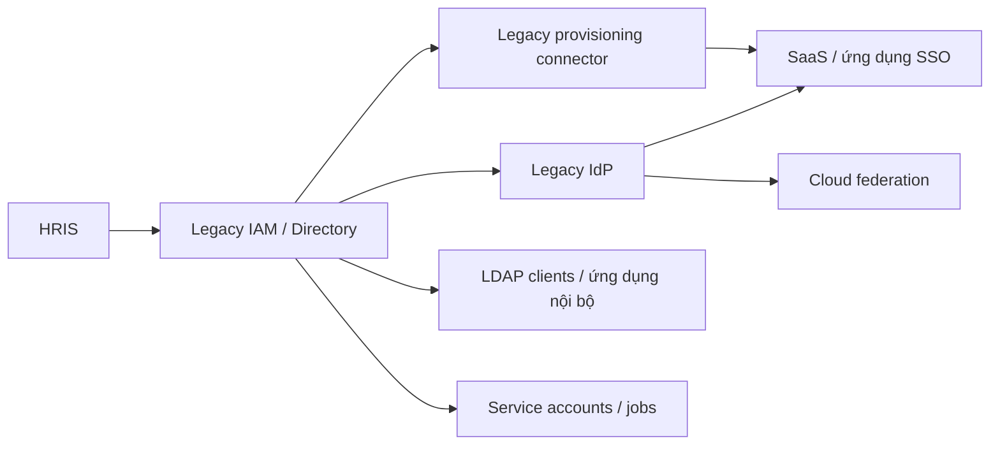
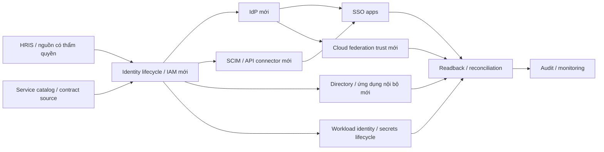

# Kết thúc hệ thống cũ

## 1. Vì sao kết thúc hệ thống IAM cũ là một giai đoạn bảo mật riêng?

Một doanh nghiệp chuyển từ nền tảng quản lý danh tính cũ sang một **Identity Provider (IdP)** và hệ thống quản trị vòng đời IAM mới. Người dùng đã đăng nhập được bằng SSO mới, nhân viên mới đã được tạo tài khoản tự động và giao diện quản trị cũ gần như không còn được truy cập.

Đội dự án đề xuất tắt ngay máy chủ identity cũ để giảm chi phí. Tuy nhiên, kết quả kiểm kê cho thấy:

- Một ứng dụng nội bộ vẫn xác thực qua LDAP của directory cũ.
- Một số tài khoản quản trị cloud còn trust với issuer/role cũ.
- Connector SCIM cũ vẫn có credential đủ quyền tạo và vô hiệu hóa người dùng trên SaaS.
- Một dịch vụ tự động vẫn dùng service account và khóa API của hệ thống cũ.
- Một số session và token đã phát hành vẫn còn hiệu lực dù IdP mới đã tiếp quản đăng nhập.
- Lịch sử phê duyệt và thu hồi quyền chỉ tồn tại trong cơ sở dữ liệu cũ, chưa được lưu trữ theo chính sách.

**Kết thúc hệ thống cũ (legacy IAM decommissioning)** không chỉ là dừng dịch vụ hay xóa máy chủ. Đây là quá trình **xác nhận mọi chức năng và đường truy cập cần thiết đã chuyển giao**, chặn các luồng không còn hợp lệ, xử lý dữ liệu và bí mật, thu hồi trust, xác minh phụ thuộc không còn, rồi ngừng và loại bỏ tài sản cũ theo thứ tự có kiểm soát.

Bài thuộc chương **IAM migration**, trong module `SECURITY_IDENTITY_ACCESS_MANAGEMENT_IDENTITY_LIFECYCLE`. Mục tiêu là vận dụng quản lý vòng đời danh tính theo **Joiner–Mover–Leaver (JML)** khi chuyển hạ tầng: duy trì nguồn danh tính đáng tin, cấp/đổi/thu hồi quyền qua IdP, SSO, SCIM, RBAC/ABAC, không bỏ sót tài khoản dịch vụ, giữ bằng chứng kiểm toán và giảm **quyền truy cập tồn dư**.

> **Nguyên tắc:** Một hệ thống IAM cũ chỉ được coi là đã kết thúc khi mọi phụ thuộc được xử lý, dữ liệu cần giữ được bảo vệ, các đường truy cập cũ đã bị chặn và kết quả được xác minh — không phải khi giao diện quản trị cũ không còn người dùng.

## 2. Phân biệt cutover, retirement, decommission và deletion

Những thuật ngữ sau mô tả các mốc khác nhau:

| Khái niệm | Ý nghĩa | Có thể vẫn tồn tại |
| --- | --- | --- |
| **Cutover** | Chuyển luồng sử dụng sang hệ thống IAM mới | Hệ thống cũ để theo dõi/rollback |
| **Read-only / quiesced** | Ngừng cho thay đổi mới tại hệ thống cũ, chỉ duy trì đọc hoặc chức năng được phê duyệt | Dữ liệu lịch sử, connector chưa tháo, công cụ đối chiếu |
| **Retirement / sunset** | Rút dần chức năng và ngừng cho hệ thống cũ phục vụ nghiệp vụ | Bản lưu trữ, một số thành phần vận hành phụ trợ |
| **Decommissioning** | Vô hiệu hóa và tháo bỏ thành phần hệ thống, quyền, kết nối, cấu hình, hạ tầng | Dữ liệu lưu trữ tuân thủ và bằng chứng cần giữ |
| **Deletion / disposal** | Xóa dữ liệu hoặc tiêu hủy tài sản theo chính sách | Hồ sơ cần giữ trong hệ thống lưu trữ khác |

Một lần **cutover thành công** không bảo đảm đã có thể **decommission**: ứng dụng cũ có thể vẫn nhận phiên đăng nhập, credential hoặc luồng provisioning độc lập. Ngược lại, decommission không có nghĩa xóa ngay mọi log và hồ sơ mà tổ chức còn nghĩa vụ lưu giữ.

### Hai mục tiêu cần đạt đồng thời

1. **Không phá vỡ nghiệp vụ hợp lệ:** người dùng và workload vẫn xác thực, được cấp quyền, thay đổi quyền, thu hồi và phục hồi dịch vụ theo chính sách của hệ thống mới.
2. **Không để lại bề mặt truy cập cũ:** trust, tài khoản, session, token, secret, role và endpoint của hệ thống cũ không trở thành đường vòng vượt qua chính sách IAM mới.

## 3. Phạm vi: Chính xác những gì phải được kết thúc?

Một “hệ thống IAM cũ” có thể bao gồm nhiều thành phần hơn một server.

| Lớp tài sản | Ví dụ | Câu hỏi trước khi kết thúc |
| --- | --- | --- |
| **Danh tính và directory** | LDAP/AD, identity store, group store | Identity mapping và quyền có còn phụ thuộc dữ liệu cũ? |
| **Xác thực liên kết** | SAML IdP, OIDC provider, federation gateway | Relying party/SP nào vẫn tin issuer cũ? |
| **Xác thực nội bộ** | LDAP bind, Kerberos, RADIUS, VPN integration | Client nào còn xác thực trực tiếp vào endpoint cũ? |
| **Provisioning** | SCIM client, API connector, batch import/export | Ai đang có quyền ghi account và nhóm tại từng đích? |
| **Authorization** | Role/group engine, policy store, ABAC attributes | Ứng dụng nào còn lấy quyết định quyền từ nguồn cũ? |
| **Quyền đặc quyền** | Admin accounts, PAM vault, break-glass, cloud role | Có đường quản trị nào chưa chuyển đổi hoặc chưa thu hồi? |
| **Non-human identity** | Service account, robot account, API key, mTLS cert | Workload nào vẫn dùng credential hoặc trust cũ? |
| **Phiên và token** | Session store, refresh token, signing key, token issuer | Token nào còn được chấp nhận; thời gian sống tối đa là bao nhiêu? |
| **Dữ liệu và bằng chứng** | Approval, JML event, access review, audit log | Hồ sơ nào cần lưu và có thể truy xuất độc lập không? |
| **Vận hành** | Monitoring, backup, DNS, load balancer, firewall, CMDB | Hệ thống nào còn route tới thành phần cũ hoặc dựa vào báo cáo của nó? |

Định nghĩa rõ **in scope** và **out of scope**, owner, kế hoạch xử lý, trạng thái xác minh cho từng tài sản. Nếu một thành phần cần giữ lại vì chức năng chưa chuyển được, hãy ghi thành **ngoại lệ có thời hạn và kiểm soát**, không lặng lẽ coi nó đã được loại bỏ.

## 4. Kiểm kê phụ thuộc trước khi ngắt hệ thống

Mục tiêu là tìm cả các phụ thuộc đã biết và đường truy cập “ẩn” không nằm trong sơ đồ kiến trúc.

### 4.1. Các nguồn bằng chứng kiểm kê

- Danh sách ứng dụng đăng ký tại IdP cũ: SAML SP, OIDC/OAuth client, redirect URI, audience, issuer và certificate.
- Cấu hình LDAP/Kerberos/RADIUS hoặc các loại authentication backend legacy.
- Log đăng nhập và API: ứng dụng/client nào còn kết nối, tần suất, dấu vết request gần nhất.
- Danh sách connector SCIM, API token provisioning, job đồng bộ và lịch chạy batch.
- Danh sách group, role, policy và service principal còn sử dụng ở SaaS/cloud.
- Service catalog, CI/CD configuration và owner của ứng dụng/workload.
- Firewall/load balancer/DNS và log mạng để tìm endpoint đang được gọi.
- CMDB, asset inventory, danh sách backup và lịch vận hành hỗ trợ.
- Ticket/tài liệu ngoại lệ và ghi chú vận hành từ chủ ứng dụng.

**Lưu ý:** không thấy log truy cập gần đây **không chứng minh** phụ thuộc đã biến mất. Một tác vụ chạy mỗi quý, quy trình khôi phục khẩn cấp hoặc một ứng dụng hiếm được sử dụng có thể chưa phát sinh trong khoảng quan sát. Cần kết hợp chứng cứ từ cấu hình, telemetry, owner xác nhận và kiểm thử có kiểm soát.

### 4.2. Ma trận phụ thuộc và kết quả chuyển đổi

| Hệ thống tiêu thụ | Phụ thuộc cũ | Phụ thuộc mới | Owner | Chứng cứ xác nhận | Trạng thái |
| --- | --- | --- | --- | --- | --- |
| CRM | SAML IdP cũ | OIDC/SAML qua IdP mới | Chủ CRM | Đăng nhập, logout, JML và quyền đã kiểm thử | Verified |
| Git | OIDC issuer cũ | IdP mới | Chủ nền tảng Git | Subject mapping và role đã đối soát | Verified |
| App legacy | LDAP bind cũ | Directory/API mới | Chủ ứng dụng | Kiểm thử xác thực trực tiếp | Pending |
| SaaS HR | SCIM client cũ | Connector IAM mới | Chủ HR SaaS | Tạo/sửa/disable account có readback | Verified |
| Pipeline | Secret cũ | Workload identity mới | Platform owner | Job chạy đúng, secret cũ đã revoke | Pending |
| Cloud | Federation trust cũ | Federation trust mới | Cloud owner | Role trust/policy review | In review |

Đây là **bảng minh họa**. Trạng thái phải phản ánh bằng chứng thực tế chứ không chỉ phản hồi “đã chuyển xong” của người phụ trách.

## 5. Vẽ luồng phụ thuộc trước và sau migration

### 5.1. Kiến trúc cũ



Các mũi tên không chỉ là luồng giao tiếp; mỗi mũi tên có thể mang **quyền tin cậy**, credential, định danh chủ thể hoặc dữ liệu chính sách.

### 5.2. Kiến trúc mục tiêu



**Tiêu chí kết thúc:** Mọi luồng hợp lệ được chuyển sang kiến trúc mới; những mũi tên cũ không còn nhiệm vụ phải được vô hiệu hóa hoặc có ngoại lệ được phê duyệt. Bản vẽ mục tiêu là kỳ vọng; cần đối chiếu với cấu hình và traffic thực tế.

## 6. Điều kiện đầu vào của kế hoạch decommission

Không nên lên lịch tắt hệ thống cũ trước khi có các điều kiện tối thiểu:

1. **Owner và phạm vi:** có chủ dự án, chủ hệ thống cũ, chủ ứng dụng đích, security, IAM operations và đầu mối quyết định go/no-go.
2. **Inventory hoàn chỉnh trong phạm vi rủi ro:** ứng dụng, connector, workload, trust, token, account, dữ liệu và endpoint cũ được liệt kê.
3. **Kiến trúc mới vận hành:** xác thực, provisioning, cấp và thu hồi quyền, phân quyền đặc biệt, kiểm toán và giám sát đã hoạt động.
4. **Mapping danh tính đáng tin:** identity ID ổn định và account ID tại các hệ thống đích được kiểm chứng, không chỉ ghép theo email.
5. **Dữ liệu và lịch sử cần lưu đã có nơi nhận:** có kế hoạch lưu trữ, kiểm tra quyền truy cập và khả năng truy xuất.
6. **JML còn hoạt động khi nguồn cũ ngừng:** Joiner, Mover, Leaver và các ngoại lệ khẩn cấp có người chịu trách nhiệm.
7. **Kế hoạch kiểm thử:** có ca thành công, ca từ chối, trường hợp token/phiên cũ và trường hợp connector lỗi.
8. **Kế hoạch bảo toàn/khôi phục:** xác định phần nào có thể rollback, phần nào đã không thể quay lại và cách fail-forward.
9. **Cửa sổ thay đổi và truyền thông:** thống nhất lịch với ứng dụng tiêu thụ, helpdesk, security và đơn vị nghiệp vụ.
10. **Bằng chứng go/no-go:** có checklist và người có thẩm quyền phê duyệt chuyển trạng thái.

Không đạt một điều kiện quan trọng thì **hoãn hoặc chia nhỏ decommission**, không dùng áp lực tiết kiệm chi phí để bỏ qua phụ thuộc chưa được xử lý.

## 7. Chuyển nguồn có thẩm quyền về identity và quyền thay đổi

Giai đoạn kết thúc không được tạo ra hai “nguồn sự thật” đồng thời cùng ghi dữ liệu.

### 7.1. Source of truth theo thuộc tính

| Dữ liệu/quyết định | Nguồn có thẩm quyền sau migration | Điểm cần kiểm tra |
| --- | --- | --- |
| Trạng thái nhân viên và ngày nghỉ | HRIS | IAM mới nhận được sự kiện có hiệu lực |
| Ngày hết hợp đồng nhà thầu | Contract/vendor management | Account/role có expiry hợp lệ |
| Định danh nội bộ ổn định | Identity registry được chỉ định | Mapping không bị đổi khi email thay đổi |
| Account trạng thái thực tế | Ứng dụng/IdP đích | IAM mới đọc được readback |
| Vai trò và chính sách quyền | IGA/chủ tài nguyên/policy authority | Căn cứ cấp quyền và approval còn đúng |
| MFA/credential status | IdP mới/hệ thống xác thực | Đăng ký và recovery không phụ thuộc IdP cũ |
| Ownership workload | Service catalog/đội được ủy quyền | Mọi service account có owner hợp lệ |
| Log và bản ghi lịch sử | Hệ thống lưu trữ được chỉ định | Có thể truy xuất mà không chạy IAM cũ |

**HRIS không nhất thiết là nguồn của mọi thuộc tính.** Ví dụ trạng thái token hay phiên do hệ thống phát hành và resource server quyết định trong kiến trúc tương ứng.

### 7.2. Nguy cơ dual write

Trong giai đoạn chạy song song, cả IAM cũ và mới cùng cập nhật nhóm SaaS có thể gây ra:

- Role bị ghi đè liên tục.
- Sự kiện Mover cũ cấp lại quyền đã thu hồi bởi hệ thống mới.
- Trạng thái `active` cũ mở lại account đã bị Leaver.
- Audit không thể xác định connector nào là nguồn thay đổi cuối.

Đối với từng đích, chỉ định **một writer có thẩm quyền** tại mỗi thời điểm. Nếu cần hai luồng vì lý do chuyển tiếp, phải định nghĩa rõ ownership theo thuộc tính, thứ tự xử lý, idempotency và cách chặn ghi xung đột.

## 8. Bảo toàn Joiner–Mover–Leaver khi tắt hệ thống cũ

### 8.1. Joiner: Không mất khả năng onboard

Đảm bảo sự kiện HRIS hoặc nguồn hợp lệ đi vào IAM mới; identity được xác minh, account tạo đúng tenant, quyền nền theo RBAC/ABAC được cấp và IdP/SSO hoạt động.

**Test cần có:** tạo một danh tính thử nghiệm được phép, xác minh account xuất hiện trong các hệ thống cần thiết; kiểm tra không cấp quyền trước ngày hiệu lực và không tạo duplicate account.

### 8.2. Mover: Thu hồi quyền cũ, không chỉ cấp quyền mới

Trong migration, sự khác biệt mapping role/group cũ và mới có thể khiến quyền bị nhân đôi.

Ví dụ:

```text
Trước migration:
  legacy_group = "ops_read"
  effective_entitlement = {logs.read}

Sau migration:
  new_role = "OpsViewer"
  effective_entitlement = {logs.read}

Nếu giữ cả hai đường cấp:
  việc gỡ "ops_read" chưa đủ để kết luận logs.read đã bị thu hồi.

Yêu cầu:
  ánh xạ nguồn quyền, loại bỏ đường cấp cũ,
  kiểm tra effective access tại tài nguyên đích.
```

**Test cần có:** thay đổi phòng ban cho một account thử nghiệm; xác nhận role cũ bị thu hồi cả ở IdP và ứng dụng, quyền mới chỉ được cấp với căn cứ phù hợp, không có vi phạm SoD.

### 8.3. Leaver: Không để IAM cũ trở thành đường vòng

Sau cutover, sự kiện Leaver phải dẫn tới:

- Chặn đăng nhập mới ở IdP hiện hành.
- Deprovision tài khoản đích qua SCIM/API/connector mới.
- Thu hồi role, nhóm và đặc quyền cũ nếu còn tồn tại.
- Xử lý token, phiên, credential, PAT, SSH key hoặc API key có liên quan trong khả năng nền tảng.
- Đối soát trạng thái thực tế, có cảnh báo và xử lý trường hợp ứng dụng đích lỗi.

**Test cần có:** một danh tính Leaver thử nghiệm không còn truy cập qua **hệ thống mới lẫn đường cũ**; kiểm tra ứng dụng có account cục bộ độc lập, phiên hiện hữu hoặc token còn hạn.

### 8.4. Không đánh dấu hoàn tất chỉ vì event đã xử lý

Phân biệt `event_received`, `policy_evaluated`, `provisioning_sent` và `target_verified`. Với Leaver, mốc có ý nghĩa bảo mật là **thời điểm truy cập thực tế bị chặn**, không phải chỉ lúc queue đã xử lý xong.

## 9. Tháo phụ thuộc Authentication, SSO và federation

### 9.1. SAML Service Provider

Với ứng dụng dùng SAML, cần kiểm tra:

- SP không còn trỏ về SSO URL hoặc entity ID issuer cũ.
- Metadata và signing/encryption certificate được cấu hình cho IdP mới theo thỏa thuận tin cậy.
- Audience, recipient/ACS URL, NameID mapping và thời hạn assertion đã được kiểm thử.
- Việc logout hoặc hết phiên phù hợp thiết kế ứng dụng, không tự suy ra từ việc đổi IdP.
- SP không còn tin issuer/certificate cũ nếu quan hệ không được duy trì có căn cứ.

### 9.2. OIDC / OAuth client và resource server

Cần đối chiếu:

- Issuer và discovery metadata, authorization/token/userinfo/JWKS endpoints.
- `client_id`, redirect URI, logout URI, audience/resource, scope và trust.
- Cách ánh xạ `iss` và `sub` sang identity/account ổn định; không mặc định email là ID bất biến.
- Chính sách kiểm tra chữ ký, issuer, audience, thời hạn, loại token và ngữ cảnh.
- Resource server không tiếp tục chấp nhận token của issuer cũ ngoài thời hạn chuyển tiếp được phê duyệt.

**Lưu ý bảo mật:** Tắt IdP cũ không tự làm mọi access token JWT đã phát hành hết hiệu lực. Nếu API chỉ xác minh chữ ký từ khóa cũ và token còn hạn, đường truy cập vẫn tồn tại. Phải có chính sách cho thời gian sống tối đa, khả năng thu hồi, key/trust retirement và điều kiện ngừng chấp nhận token.

### 9.3. LDAP/Kerberos/RADIUS và ứng dụng cũ

Không chỉ quan sát web SSO. Ứng dụng nội bộ, thiết bị mạng, job hoặc VPN có thể kết nối trực tiếp tới directory/bộ xác thực cũ.

Cần kiểm tra:

- Endpoint, hostname, port, service bind account và trust.
- Cơ chế xác thực thay thế đã được cấu hình và chạy được với cả ca thành công và ca bị từ chối.
- Dữ liệu nhóm/thuộc tính được ánh xạ đúng; việc đổi directory không làm tăng quyền.
- Kết nối chỉ dành cho fallback không còn là đường mở trái chính sách.

Nếu chưa có phương án thay thế, phụ thuộc này phải được ghi **blocker** hoặc ngoại lệ có thời hạn với kiểm soát phù hợp; không nên tắt bất chấp.

## 10. Kết thúc connector SCIM và quyền provisioning cũ

**SCIM 2.0** cùng API/connector thường cấp quyền quản trị tài khoản ở nhiều ứng dụng. Một connector cũ còn credential hoạt động có thể tạo hoặc kích hoạt lại account sau khi IAM mới đã thu hồi.

### Ma trận chuyển giao provisioning

| Mục cần kiểm tra | Trước khi tắt | Sau khi tắt |
| --- | --- | --- |
| Writer duy nhất | Connector mới có thẩm quyền ghi đúng scope | Connector cũ không thể tạo/sửa/enable tài khoản |
| Định danh | Mapping `externalId`/`id` đúng hệ thống, tenant | Không có account trùng hoặc liên kết nhầm |
| Group/role | Quy tắc đồng bộ mới tương đương hoặc chặt hơn | Không có group cũ tự ghi trở lại |
| JML | Joiner/Mover/Leaver đã thử thực tế | Không phát sinh backlog chưa xử lý |
| Credential | Token cũ được kiểm kê và owner xác định | Token/secret cũ bị revoke/rotate |
| Monitoring | Hệ thống mới có alert/error queue | Không còn job legacy bị gọi lại âm thầm |

### Trình tự xử lý

1. Xác định chính xác **ứng dụng và tenant** do connector cũ ghi.
2. Ngừng phát sinh yêu cầu mới từ writer cũ theo cutover đã duyệt.
3. Xử lý hoặc chuyển tiếp có kiểm soát **backlog** còn pending; không xóa queue trước khi phân loại.
4. Chạy thử đầy đủ **create, update, deactivate, group membership** trên connector mới.
5. Đối soát trạng thái account và quyền thực tế.
6. Vô hiệu hóa scheduled jobs/connector cũ.
7. Thu hồi API token, secret, service account và quyền admin của connector cũ.
8. Xác minh từ ứng dụng đích rằng connector cũ không còn là nguồn ghi hợp lệ.

**Không** chỉ “disable job” mà bỏ nguyên API token admin: token vẫn là một đường tác động tới danh tính và quyền nếu bị lộ.

## 11. Chấm dứt quyền, role, group và đường phân quyền cũ

Chuyển account không có nghĩa chuyển đổi quyền đã hoàn tất. Trong migration, role mapping có thể thay đổi tên và cách cấp.

### 11.1. Quyền trực tiếp, gián tiếp và kế thừa

Một principal có thể được phép đọc dữ liệu vì:

- thuộc một nhóm IdP cũ;
- thuộc nhóm IdP mới;
- được gán role trực tiếp trong SaaS;
- được cấp quyền trên một project hoặc tài nguyên cha;
- có exception được phê duyệt;
- có token/session đang chứa claim từ thời điểm trước cutover.

Gỡ nhóm cũ chỉ loại bỏ **một** đường cấp. Cần kiểm tra **effective access** theo khả năng hệ thống, đặc biệt với dữ liệu nhạy cảm và quyền đặc quyền.

### 11.2. RBAC và ABAC

- **RBAC**: xác nhận mapping role/group cũ → role/group mới; không mang theo role admin rộng nếu không có căn cứ.
- **ABAC**: xác nhận thuộc tính như `employmentStatus`, `department`, `region`, `tenantId` có nguồn đáng tin, độ mới phù hợp và được API sử dụng đúng.
- **SoD**: kiểm tra tổ hợp quyền sau migration không tạo xung đột, ví dụ tự tạo rồi tự phê duyệt giao dịch.
- **JIT/PAM**: quyền đặc quyền có thời hạn phải hoạt động ở hệ thống mới và được thu hồi dù hệ thống cũ ngừng.

### 11.3. Đối soát theo principal và tài nguyên

```text
desired = quyền được phép tại hệ thống mới
actual  = quyền thực tế ở SaaS/cloud/API

unexpected = actual - desired  # quyền thừa cần điều tra/thu hồi
missing    = desired - actual  # quyền thiếu ảnh hưởng nghiệp vụ

Không kết luận "no residual access" chỉ bằng việc role cũ
không còn trong một directory.
```

Đây là mô hình đơn giản: hệ thống thực tế có deny rules, resource hierarchy, entitlement động, nhóm lồng nhau và các quyền không thể liệt kê đầy đủ. Kết quả cần có phương pháp kiểm thử bổ sung phù hợp.

## 12. Tài khoản dịch vụ, workload identity và bí mật không phải con người

Một nguồn thất bại phổ biến khi decommission là **non-human identity (NHI)**: service account, bot, CI/CD, batch job, integration client hoặc workload cloud.

### 12.1. Những thứ phải kiểm kê

| Loại | Dấu hiệu phụ thuộc cũ | Hành động trước khi kết thúc |
| --- | --- | --- |
| Service account | Account bind LDAP cũ, user robot | Ánh xạ workload, chuyển cơ chế auth, thu hồi account cũ |
| OAuth client credential | `client_id` và secret tại issuer cũ | Chuyển client/trust, giới hạn scope, revoke secret cũ |
| API key/PAT | Key dùng gọi SaaS hoặc Git | Rotate hoặc cấp credential mới, thu hồi key cũ |
| SSH key | Khóa của automation hoặc cá nhân | Cập nhật authorized access, thu hồi key không còn cần |
| Chứng chỉ mTLS | Cert/CA được issuer cũ cấp | Cập nhật trust, gia hạn/revoke chứng chỉ theo thiết kế |
| Cloud federation | Trust role tới issuer cũ | Cập nhật audience/subject conditions; gỡ trust cũ |
| Secrets vault | Secret cũ còn lưu hoặc replicated | Chuyển ownership, hạn quyền và lịch rotation |
| Scheduled job | Job gọi endpoint cũ theo lịch hiếm | Chuyển endpoint, xác nhận lịch chạy và owner |

### 12.2. Chọn cách thay thế

Ưu tiên **workload identity federation** hoặc credential ngắn hạn khi nền tảng hỗ trợ. Điều này giảm phụ thuộc vào secret tĩnh lâu dài, nhưng vẫn cần **least privilege**, owner và kiểm soát trust.

Ví dụ một pipeline chỉ cần tải artifact không nên được cấp quyền admin toàn bộ storage. Migration là dịp thu hẹp phạm vi và bỏ credential vô chủ, không phải sao chép mọi quyền rộng từ hệ thống cũ sang hệ thống mới.

### 12.3. Không xóa nhầm workload còn hoạt động

Nhân viên tạo service account đã nghỉ việc không có nghĩa workload đó phải ngừng. Cần phân biệt:

- **Owner con người thay đổi:** chuyển ownership, rà soát credential cá nhân, tiếp tục workload nếu có căn cứ.
- **Workload thật sự decommission:** thu hồi identity/service principal, trust, role, key, secret và xác minh quyền không còn tồn tại.

## 13. Phiên, token, signing key và trust: Cửa sổ tồn dư khó quan sát

Khi hệ thống IAM cũ ngừng phát hành token, **token đã phát hành trước đó có thể còn hiệu lực** ở hệ thống đích.

### Những câu hỏi quan trọng

- Session SSO cũ có thời hạn tối đa bao lâu?
- Access token có dạng JWT tự chứa hay opaque token được kiểm tra online?
- Resource server có cache JWKS/signing key cũ hay không?
- API có kiểm tra issuer và audience chính xác, hay chấp nhận nhiều issuer?
- Refresh token có thể tiếp tục đổi token mới tại issuer cũ không?
- Có session/refresh-token revocation hoặc token introspection khi cần không?
- Có secret/chứng chỉ/trust cấu hình dự phòng không nằm trong inventory không?

### Kế hoạch loại bỏ trust

1. Xác định toàn bộ **relying parties/resource servers** còn chấp nhận issuer/khóa cũ.
2. Ghi rõ thời điểm ngừng cấp token, thời gian sống lớn nhất và cơ chế thu hồi.
3. Kiểm thử hệ thống mới với issuer/audience mới.
4. Thay đổi từng ứng dụng để **không còn tin issuer cũ** ngoài ngoại lệ đã phê duyệt.
5. Xác minh client cũ không còn có thể lấy token/phiên mới và token cũ không còn được hệ thống đích chấp nhận sau mốc chính sách.
6. Thu hồi/rotate credential của client, signing key/certificate và trust có liên quan theo quy trình phù hợp.
7. Theo dõi các yêu cầu dùng issuer/token cũ; phân loại trước khi đóng hệ thống.

**Cẩn trọng:** Không phải cứ xóa signing key cũ khỏi một máy là tất cả resource server đã ngừng chấp nhận chữ ký cũ; nhiều server cache public key. Cần kiểm chứng tại điểm chấp nhận token. Ngược lại, xóa khóa ký hoặc metadata đột ngột khi còn token hợp lệ cần xử lý có thể gây gián đoạn; thứ tự hành động phải theo đánh giá rủi ro và kế hoạch cutover.

## 14. Lưu trữ hồ sơ, audit và nghĩa vụ dữ liệu

Dữ liệu IAM cũ có thể là bằng chứng bắt buộc cho kiểm toán, điều tra, tranh chấp hoặc yêu cầu tuân thủ.

### 14.1. Dữ liệu cần phân loại

| Nhóm dữ liệu | Ví dụ | Cách xử lý |
| --- | --- | --- |
| Danh tính, account lịch sử | Bản ghi user, source ID, mapping | Giữ theo chính sách; kiểm soát quyền truy cập |
| Phê duyệt và access request | Ai yêu cầu, ai duyệt, thời điểm | Lưu có khả năng truy xuất và liên kết |
| Event JML | Joiner, Mover, Leaver và trạng thái | Giữ correlation/temporal context |
| Audit truy cập/quyền | Sign-in, role changes, revoke results | Bảo vệ tính toàn vẹn, thời hạn lưu phù hợp |
| Chính sách và cấu hình | RBAC/ABAC rules, mapping version | Lưu bản ghi để tái hiện quyết định lịch sử |
| Ticket và ngoại lệ | Quyền tạm, admin approval, break-glass | Giữ owner và quyết định đóng ngoại lệ |
| Secret/credential nhạy cảm | Password, token, signing private key | Thu hồi/xử lý riêng; không đưa rõ vào kho audit |
| Backup | Snapshot, database, cấu hình hệ thống cũ | Kiểm soát hạn truy cập, retention và tiêu hủy |

### 14.2. Bảo đảm truy xuất độc lập

Trước khi tắt hệ thống, phải kiểm tra:

- Có thể tra cứu một danh tính theo ID cũ và ID mới qua mapping lịch sử không?
- Có thể truy xuất sự kiện **ai cấp/thu hồi quyền gì, vì sao, khi nào** không?
- Dữ liệu lưu trữ có metadata thời gian, múi giờ, nguồn và phiên bản chính sách không?
- File/bản ghi xuất có được kiểm tra tính toàn vẹn và quyền đọc phù hợp không?
- Người được ủy quyền có thể lấy thông tin mà **không cần khởi động lại IAM cũ** không?
- Backup có chính sách xóa an toàn sau khi hết thời hạn lưu không?

**Không xóa hồ sơ chỉ vì account đã bị disabled.** Ngược lại, không giữ dữ liệu cá nhân vô thời hạn với lý do mơ hồ “phòng khi cần”: thời hạn lưu phải theo chính sách và nghĩa vụ áp dụng, hạn chế dữ liệu không cần.

### 14.3. Tách dữ liệu lịch sử với đường xác thực

Một archive phục vụ tra cứu không nên vô tình tiếp tục cung cấp **API xác thực, phát token hoặc sửa account** như hệ thống cũ. Cần đặt quyền truy cập tối thiểu, giám sát, kiểm soát truy vấn và cách ly phù hợp.

## 15. Giai đoạn chạy song song và điểm không thể rollback

### 15.1. Chạy song song để kiểm chứng, không để duy trì hai authority vô hạn

Một giai đoạn song song có thể hữu ích để so sánh kết quả của hệ thống cũ và mới:

- Đối chiếu identity/account mapping và quyền mục tiêu.
- So sánh JML events, provisioning results, access review.
- Đánh giá tỷ lệ login thành công, quyền bị từ chối sai và lỗi connector.
- Kiểm thử thay đổi role, Leaver, guest và workload.

Tuy nhiên, **chạy song song có kiểm soát** khác với **dual write không kiểm soát**. Từng target/attribute phải có writer chính; luồng còn lại nên chỉ đọc/đối chiếu hoặc tuân thủ quy tắc phân quyền ghi rõ ràng.

### 15.2. Rollback không phải bật lại hệ thống cũ vô điều kiện

Việc bật lại legacy IdP sau cutover có thể:

- Tái mở tài khoản đã Leaver.
- Khôi phục nhóm/role cũ xung đột quyền mới.
- Cho phép client lấy token từ issuer cũ.
- Làm sai lệch lịch sử audit và state của connector.
- Gây vòng lặp cập nhật nếu hai hệ thống cùng ghi.

Vì vậy, kế hoạch rollback phải có **mốc dừng**, điều kiện, owner, dữ liệu cần reconcile trước khi quay lại và kiểm soát ngăn **replay quyền cũ**.

### 15.3. Point of no return

Tổ chức cần xác định mốc sau đó rollback trực tiếp không còn an toàn hoặc khả thi, ví dụ sau khi đã:

- Xóa credential/trust vĩnh viễn không có đường khôi phục được phê duyệt.
- Ngừng dịch vụ và tháo hạ tầng vật lý.
- Chuyển toàn bộ bản ghi và thay đổi schema theo cách không thể ghi ngược.
- Thực thi thay đổi JML trên hệ thống mới mà hệ thống cũ không hiểu.

Sau mốc này, phương án chính thường là **fail-forward**: khắc phục trên hệ thống mới hoặc phục hồi thành phần có kiểm soát từ backup/DR, không tự ý mở lại luồng legacy.

## 16. Quy trình decommission theo từng pha

Một runbook rõ ràng nên có **điều kiện bắt đầu, thao tác, người phụ trách, kết quả mong đợi, cách xác minh và lối thoát khi lỗi**.

### Pha A – Discovery và phân loại

- Chốt danh sách ứng dụng, source, account, role/group, connector, token, secret, workload, endpoint và hồ sơ.
- Xác nhận owner; thành phần không có owner được chuyển xử lý, không bỏ qua.
- Phân loại phụ thuộc **must-migrate / retire / archive / exception**.
- Ưu tiên các đường xác thực và đặc quyền có tác động lớn.

**Exit gate:** inventory đủ phạm vi, phụ thuộc rủi ro cao không còn trạng thái “unknown”.

### Pha B – Chuyển giao và kiểm thử

- Xác minh JML, IdP/SSO, SCIM và các ứng dụng đích.
- Chuyển quyền, nguồn thuộc tính, service accounts, logging/monitoring.
- Chạy kiểm thử tích cực và tiêu cực, kiểm tra rollback plan.
- Đối soát desired vs actual cho cả người dùng và workload.

**Exit gate:** các phụ thuộc nghiệp vụ quan trọng đã chuyển và có bằng chứng thực thi.

### Pha C – Quiesce hệ thống cũ

- Ngừng nhận yêu cầu mới hoặc thay đổi từ những luồng legacy đã chuyển.
- Đóng hoặc xử lý backlog còn tồn tại; tránh mất sự kiện JML.
- Chặn việc hệ thống cũ làm writer tại target đã thuộc IAM mới.
- Giới hạn quyền admin cũ và ghi lại snapshot cấu hình đã duyệt.

**Exit gate:** không còn luồng ghi cũ có thể làm tái cấp quyền trái chính sách.

### Pha D – Thu hồi trust và quyền truy cập

- Tháo trust SSO/OIDC/SAML, LDAP clients, connector credentials theo thứ tự đã duyệt.
- Thu hồi hoặc rotate secret/API key/PAT/SSH key/cert.
- Deactivate account/service principal và role legacy không còn cần.
- Xử lý token/session còn hạn theo khả năng nền tảng và chính sách.
- Theo dõi log request tới issuer/endpoint cũ.

**Exit gate:** các đường xác thực/cấp quyền cũ không còn sử dụng được, ngoại trừ ngoại lệ đã phê duyệt.

### Pha E – Lưu trữ, ngừng dịch vụ và tháo hạ tầng

- Xuất dữ liệu lịch sử và xác nhận khả năng truy xuất độc lập.
- Kiểm tra backup, retention, tính toàn vẹn, quyền truy cập archive.
- Ngừng service/process, endpoint và tuyến mạng; cập nhật DNS/load balancer/firewall.
- Tháo tài sản/hạ tầng, xử lý key/cert và dữ liệu theo quy trình.
- Cập nhật CMDB, service catalog, runbook/helpdesk và ownership.

**Exit gate:** dịch vụ cũ không còn hoạt động; dữ liệu và bằng chứng được bảo vệ theo chính sách.

### Pha F – Giám sát sau ngừng và đóng dự án

- Theo dõi lỗi login/JML/connector, request tới endpoint cũ và quyền tồn dư.
- Đối soát theo lịch, xử lý ngoại lệ và xác nhận owner đã đóng.
- Thu thập bằng chứng acceptance, quyết định rủi ro còn lại và chữ ký bàn giao vận hành.
- Đóng hạ tầng và hợp đồng/license chỉ khi không còn phụ thuộc hợp lệ.

**Exit gate:** tiêu chí nghiệm thu đạt và trạng thái thực tế được xác minh.

## 17. Runbook mẫu cho một lần ngắt hệ thống

Bảng sau là ví dụ công việc theo **thứ tự phụ thuộc**, không phải thời lượng bắt buộc. Thứ tự thực tế phải khớp kiến trúc và change window của tổ chức.

| Bước | Người phụ trách | Hành động | Điều kiện đạt | Nếu không đạt |
| --- | --- | --- | --- | --- |
| 1 | Change owner | Xác nhận go/no-go, phạm vi, backup và người trực | Phê duyệt hợp lệ | Hoãn |
| 2 | IAM Ops | Chụp trạng thái account/role/trust và backlog | Có inventory/snapshot được bảo vệ | Dừng, bổ sung |
| 3 | IAM Ops | Chặn writer legacy, bật connector mới theo kế hoạch | Không phát sinh double-write | Quiesce, reconcile |
| 4 | App owners | Test đăng nhập mới, refresh/renewal, role, API | Pass những ca quan trọng | Dừng cutover cho app lỗi |
| 5 | Security/IAM | Test JML Joiner/Mover/Leaver và quyền âm tính | Không còn quyền trái mục tiêu | Remediate trước khi tiếp |
| 6 | Platform | Revoke token/secret/trust legacy và kiểm tra đích | Không còn đường truy cập cũ | Chặn bù trừ/escalate |
| 7 | Data owner | Xác minh archive/audit và retention | Truy xuất độc lập, toàn vẹn | Không xóa nguồn |
| 8 | Infra | Stop service/route và tháo tài sản đúng thủ tục | Không còn kết nối hợp lệ đến legacy | Phân tích phụ thuộc |
| 9 | SRE/IAM | Giám sát lỗi, lệch state, request legacy | Không có blocker, cảnh báo có owner | Incident/change rollback hoặc fail-forward |
| 10 | Sponsor | Nghiệm thu và bàn giao | Bằng chứng đầy đủ | Giữ trạng thái chưa hoàn tất |

Không sử dụng `SUCCESS` như nhãn tổng thể khi một ứng dụng quan trọng chưa hoàn thành **readback** hoặc một secret đặc quyền chưa được thu hồi.

## 18. Các bài kiểm thử bắt buộc trước và sau khi ngắt

### 18.1. Kiểm thử tích cực (positive tests)

- Nhân viên active đăng nhập qua IdP mới vào ứng dụng liên kết.
- Ứng dụng nội bộ từng dùng LDAP/Kerberos/RADIUS có cơ chế thay thế hoạt động.
- Joiner tạo account với thuộc tính và quyền đúng ngày hiệu lực.
- Mover cấp quyền mới **và thu hồi quyền cũ**.
- Workload có identity mới gọi API trong scope cho phép.
- Tác vụ quản trị khẩn cấp được ủy quyền vẫn có cơ chế truy cập an toàn khi IdP mới gặp sự cố (nếu yêu cầu nghiệp vụ).
- Audit log mới lưu đủ sự kiện và correlation ID.

### 18.2. Kiểm thử từ chối (negative tests)

| Thử nghiệm | Kỳ vọng |
| --- | --- |
| Account terminated cố đăng nhập bằng IdP mới | Bị từ chối theo chính sách |
| Account Leaver thử đường SSO/LDAP cũ đã kết thúc | Không còn đường xác thực hợp lệ |
| API nhận token issuer cũ sau thời hạn được chấp nhận | Từ chối |
| Service account dùng secret cũ đã revoke | Không còn được xác thực |
| Người dùng Mover thử quyền cũ trên SaaS | Bị từ chối bởi backend/API hoặc cơ chế quyền đích |
| Người dùng đổi ID tài nguyên sang tenant khác | Không đọc/sửa được dữ liệu ngoài phạm vi |
| Connector cũ cố dùng API token provisioning đã thu hồi | Không còn quyền ghi |
| Quyền admin được gán trực tiếp ngoài desired state | Được phát hiện, cảnh báo hoặc khắc phục theo chính sách |
| Sự kiện Mover cũ tới sau Leaver mới | Không mở lại account/quyền |
| Ứng dụng đích không thể thực hiện revoke | Workflow thể hiện lỗi, có owner, retry và cảnh báo |

Các bài kiểm thử phải được thực hiện trong môi trường/điều kiện **đã được ủy quyền**, tránh tạo truy cập trái phép hoặc làm gián đoạn dữ liệu thật. Có thể dùng tài khoản thử nghiệm, token có phạm vi hẹp và endpoint kiểm thử. Kiểm tra âm tính bằng response/status và bằng chứng từ hệ thống đích, không cần cố khai thác dữ liệu thật.

### 18.3. Kiểm thử theo vòng đời token

Không chỉ test đăng nhập mới. Cần xem xét:

- Session đang mở trước cutover có bị xử lý đúng chính sách không.
- Refresh token của client cũ còn có thể làm mới ở issuer cũ không.
- Access token cũ còn được resource server chấp nhận trong khoảng nào.
- Cache signing key/JWKS và issuer allowlist của API đã cập nhật chưa.
- Khi nhóm/role bị thu hồi, API còn dựa vào claim cũ quá lâu không.

## 19. Phương án ứng phó khi ngắt làm phát hiện phụ thuộc còn sót

Không có inventory nào chắc chắn đầy đủ tuyệt đối. Khi shutdown gây lỗi, cần ưu tiên **giảm tác động nhưng không mở lại quyền cũ bừa bãi**.

### Dấu hiệu sự cố

- Tỷ lệ login lỗi tăng trên một nhóm ứng dụng.
- Job tự động thất bại do không còn LDAP bind, client secret hoặc issuer.
- Một connector gửi thay đổi từ hệ thống cũ làm ghi đè account mới.
- Người dùng đã nghỉ vẫn có thể truy cập bằng token cũ.
- Ứng dụng không lấy được khóa xác minh token sau khi endpoint cũ ngừng.
- Helpdesk không tra được lịch sử phê duyệt/thu hồi đã lưu trữ.

### Runbook ứng phó

1. **Phân loại:** sự cố khả dụng, sai quyền, tồn dư quyền, dữ liệu/audit hay sự cố kết hợp?
2. **Chặn rủi ro trước:** với quyền trái phép, giới hạn đường truy cập hoặc revoke thông qua nguồn kiểm soát có thẩm quyền.
3. **Khoanh phạm vi:** xác định ứng dụng, principal, tài nguyên, thời điểm và mức tác động.
4. **Kiểm tra trạng thái nguồn:** HRIS/IGA, IdP mới, SaaS/cloud, issuer cũ và queue.
5. **Chọn khắc phục:** sửa cấu hình mới, chuyển phụ thuộc còn sót, rollback có kiểm soát trong cửa sổ được phép hoặc fail-forward.
6. **Nếu kích hoạt lại thành phần cũ:** bảo đảm Leaver/Mover mới nhất không bị đảo ngược; chặn connector cũ ghi dữ liệu quyền sai.
7. **Xác minh:** kiểm thử lại trường hợp lỗi và negative authorization, đối soát actual state.
8. **Ghi incident/audit:** nguyên nhân gốc, hành động khắc phục, owner và cải tiến kiểm soát.

Việc khởi động lại legacy IdP chỉ vì ứng dụng báo lỗi có thể vô tình tạo một **đường truy cập không còn chịu JML**. Quyết định phải có người có thẩm quyền và kiểm soát khẩn cấp.

## 20. Đo lường: Khi nào kết thúc hệ thống cũ được coi là thành công?

Một số chỉ số nên được theo dõi theo **nhóm ứng dụng và mức rủi ro**, không chỉ tổng số:

| Chỉ số | Ý nghĩa | Cách tránh đo sai |
| --- | --- | --- |
| **Legacy authentication traffic** | Còn bao nhiêu request hợp lệ tới issuer/LDAP cũ? | Xem cửa sổ đủ dài và cả các job chạy hiếm |
| **Legacy federation trust count** | Có SP/RP/cloud nào còn tin issuer cũ? | Kiểm cấu hình thực tế, không chỉ danh sách dự án |
| **Legacy credential exposure** | Còn bao nhiêu secret/token/key có quyền hoạt động? | Đối soát với hệ thống đích/vault và owner |
| **Provisioning writer ownership** | Target nào vẫn có hai writer hoặc connector cũ? | Kiểm tra API token và job thực tế |
| **JML event processing success** | Joiner/Mover/Leaver được chuyển đúng qua IAM mới? | Đo kết quả tại đích, không chỉ nhận event |
| **Mover residual entitlement** | Quyền cũ còn sau đổi vai trò? | Xem effective access, gồm quyền gián tiếp |
| **Leaver revocation latency** | Thời gian đến khi từng hệ thống chặn thực sự | Không lấy timestamp gửi lệnh thay cho enforced/verified |
| **Orphan account count** | Account không gắn identity/owner hợp lệ | Bao gồm guest và NHI |
| **Audit archive retrieval success** | Tra cứu được lịch sử khi không chạy IAM cũ? | Thử phục hồi/tra cứu dữ liệu thật theo quyền |
| **Post-cutover incident rate** | Sự cố đăng nhập/quyền sau ngắt | Phân tách sai quyền và lỗi khả dụng |
| **Outstanding exception age** | Bao nhiêu phụ thuộc chưa đóng và tồn tại bao lâu? | Mỗi ngoại lệ phải có owner và hạn xử lý |

Mục tiêu SLO/SLA phụ thuộc nghiệp vụ và độ nhạy; không có một con số chung áp dụng mọi tổ chức.

### Không dùng chỉ số giả tạo

`100% users migrated` không chứng minh **100% quyền cũ đã bị thu hồi**. `0 login errors` không chứng minh không còn một app tin issuer cũ. Cần cả **kết quả nghiệp vụ hợp lệ** và **bằng chứng không còn đường truy cập legacy trái chính sách**.

## 21. Bằng chứng nghiệm thu và bàn giao vận hành

Một gói bàn giao nên có:

| Bằng chứng | Nội dung tối thiểu |
| --- | --- |
| **Inventory phiên bản cuối** | Ứng dụng, owner, account, connector, trust, NHI, endpoint, ngoại lệ |
| **Change approval và timeline** | Mốc cutover, quiesce, revoke, shutdown, point of no return |
| **Mapping** | Identity/account ID, role/group mapping, policy version đã dùng |
| **JML test results** | Joiner/Mover/Leaver và trường hợp âm tính |
| **AuthN/AuthZ test results** | SSO, LDAP/federation, token cũ, scope/tenant, privileged path |
| **Credential/trust revocation** | Danh sách đã thu hồi/rotate và kết quả xác minh |
| **Reconciliation report** | Desired vs actual, sai lệch còn lại, owner và xử lý |
| **Data/archive evidence** | Danh mục hồ sơ cần giữ, nơi lưu, integrity và kiểm thử retrieval |
| **Monitoring handover** | Dashboard, alert, runbook, on-call, điều kiện escalation |
| **Risk acceptance** | Ngoại lệ hợp lệ, người chấp nhận, biện pháp bù trừ, thời hạn |
| **Asset disposal record** | Hạ tầng/service/license/CMDB đã xử lý theo quy định |

Ví dụ log decommission ở mức một phụ thuộc:

```json
{
  "eventType": "iam.legacy-trust.revoked",
  "changeId": "iam-migration-010",
  "legacySystem": "idp-old",
  "targetSystem": "crm",
  "trustType": "saml-federation",
  "expectedState": "legacy-issuer-not-trusted",
  "result": "verified",
  "verifiedAt": "2026-11-23T09:30:00Z",
  "actor": "iam-operator",
  "approvalRef": "change-approved-871",
  "correlationId": "decom-wave-03"
}
```

Các tên trường là ví dụ. Log nên phản ánh **kết quả xác minh**, không chỉ ý định. Không ghi secret, private key, password hoặc bearer token ở dạng rõ.

## 22. Phân công trách nhiệm (RACI) và quyền quyết định go/no-go

Một dự án decommission dễ gặp khoảng trống trách nhiệm giữa nhóm IAM, đội ứng dụng và hạ tầng.

| Công việc | Accountable/owner đề xuất | Nhóm tham gia |
| --- | --- | --- |
| Chốt phạm vi và quyết định go/no-go | Migration/change sponsor được ủy quyền | IAM, Security, App owners, Ops |
| Xác minh nguồn identity và JML | IAM/IGA owner | HRIS, chủ hợp đồng, service catalog |
| Chuyển SSO/federation | Identity platform owner | Chủ ứng dụng, Security |
| Chuyển connector/SCIM | IAM provisioning owner | Chủ SaaS/API |
| RBAC/ABAC và quyền nghiệp vụ | Chủ tài nguyên/dữ liệu | IAM, Security, App owners |
| PAM/break-glass/đặc quyền | Privileged access owner | Security, Cloud/Platform |
| Service accounts và secrets | Service/Platform owner | IAM, DevOps, Cloud |
| Archive/retention/audit | Data/Compliance owner | IAM, Security, Audit |
| Shutdown/asset disposal | Infrastructure/asset owner | IAM, Operations |
| Giám sát hậu cutover | Operations owner | Helpdesk, Security, SRE |

Đây là **phân công tham khảo**; sơ đồ RACI thực tế cần xác định Responsible, Accountable, Consulted và Informed rõ với từng tổ chức. Không chấp nhận trạng thái “đã xử lý” từ một đội nếu không có owner chịu trách nhiệm cho kết quả cuối của ứng dụng.

## 23. Case study: Chấm dứt IdP cũ trong hệ thống 120 ứng dụng

Giả sử một tổ chức có **120 ứng dụng** đang sử dụng nhiều cơ chế: SAML SSO, OIDC, LDAP và tài khoản cục bộ. Đây là dữ liệu **giả định phục vụ bài học**, không mô tả hệ thống thật.

### Bước 1: Kiểm kê theo loại phụ thuộc

| Nhóm giả định | Số lượng | Rủi ro cần ưu tiên |
| --- | ---: | --- |
| SAML/OIDC SSO | 70 | Issuer/trust cũ, token/session và subject mapping |
| LDAP/Kerberos | 20 | Bind account/endpoint cũ, job legacy |
| SaaS có SCIM | 15 | Duplicate writer, disable/group sync |
| Ứng dụng tài khoản cục bộ | 10 | Deprovision và quyền cục bộ |
| Cloud/workload integrations | 5 | Service principal, credential, federation trust |
| **Tổng** | **120** | Cần owner và bằng chứng từng ứng dụng |

Phân nhóm giả định không loại trừ nhiều phụ thuộc trong cùng một ứng dụng; khi lập inventory thật có thể cần bảng quan hệ nhiều-nhiều thay vì chỉ phân loại một lần.

### Bước 2: Cắt theo đợt có mức rủi ro

- **Wave 1 – ít nhạy cảm:** xác nhận quy trình SSO, logout, helpdesk và readback.
- **Wave 2 – nghiệp vụ chính:** chuyển SCIM/JML và mapping tài khoản.
- **Wave 3 – dữ liệu nhạy cảm/đặc quyền:** kiểm thử mạnh về AuthZ, SoD, token, PAM và Leaver.
- **Wave 4 – legacy khó:** xử lý LDAP, batch job ít chạy, workload integration và ngoại lệ.

Đợt nào chưa vượt acceptance gate thì không chuyển tiếp phần phụ thuộc có thể gây tác động dây chuyền.

### Bước 3: Phát hiện phụ thuộc ẩn

Sau cutover, log cho thấy một job báo cáo chạy hằng tháng vẫn LDAP bind vào directory cũ. Đây là một **blocker cho shutdown toàn bộ**, dù 119 ứng dụng khác đã chuyển.

Kế hoạch phù hợp:

1. Owner xác nhận mục đích và khả năng chuyển job.
2. Triển khai cơ chế xác thực mới; không chép nguyên mật khẩu bind cũ sang chỗ khác vô hạn.
3. Test job trong lịch hoặc mô phỏng được ủy quyền.
4. Thu hồi bind account/credential cũ và readback.
5. Cập nhật inventory và bằng chứng.
6. Mới tiếp tục shutdown directory cũ.

### Bước 4: Nghiệm thu Leaver

Chọn một identity thử nghiệm đã kết thúc: IdP mới disabled, CRM inactive, cloud roles revoked; nhưng một PAT Git cũ còn hiệu lực. Không được kết luận decommission hoàn tất cho đường truy cập này.

**Hành động:** thu hồi PAT, xác minh Git không chấp nhận token, rà soát nguyên nhân inventory bỏ sót và cập nhật quy trình Leaver mới.

### Kết luận tình huống

Chỉ số “119/120 ứng dụng chuyển thành công” hữu ích cho tiến độ nhưng không đủ cho go/no-go. **Một phụ thuộc LDAP đặc quyền hoặc một token cũ có quyền cao có thể khiến rủi ro còn lại không chấp nhận được.**

## 24. Các anti-pattern khi kết thúc IAM cũ

| Anti-pattern | Hậu quả | Thay bằng |
| --- | --- | --- |
| **“SSO mới chạy nên tắt IdP cũ ngay”** | Bỏ sót federation, LDAP, session/token, job hiếm | Kiểm kê, test cả auth và downstream trust |
| **Giữ hai provisioning writer vô hạn** | Ghi đè quyền, account bị mở lại sau Leaver | Chỉ định writer/authority rõ và quiesce writer cũ |
| **Dùng email để ghép account** | Duplicate hoặc gán nhầm danh tính | Stable ID, namespace, mapping đã xác minh |
| **Chỉ kiểm tra login thành công** | AuthZ sai hoặc quyền tồn dư không được phát hiện | Test quyền trên tài nguyên/tenant, JML âm tính |
| **Xóa server rồi mới xem audit** | Mất bằng chứng phê duyệt/thu hồi | Archive kiểm thử truy xuất trước shutdown |
| **Disable connector nhưng không revoke credential** | Secret admin cũ còn hiệu lực | Revoke/rotate và xác minh target |
| **Không kiểm tra token đang lưu hành** | Resource server còn tin issuer cũ | Token/trust retirement tại điểm chấp nhận |
| **Coi phản hồi API là kết quả cuối** | Bỏ sót lỗi từng phần và quyền kế thừa | Readback/reconciliation, retry và alert |
| **Rollback bằng cách mở lại mọi nhóm cũ** | Tái cấp quyền đã thu hồi | Kế hoạch rollback có state reconciliation |
| **Xóa service account theo người tạo** | Dừng workload hợp lệ | Xác định service owner và chuyển credential an toàn |
| **Ngoại lệ không có hạn** | Legacy IAM tồn tại mãi không được bảo vệ | Owner, expiry, compensating controls và theo dõi |
| **Đóng dự án nhưng không bàn giao alert** | Drift/tồn dư không ai xử lý | Runbook, on-call, acceptance và ownership |

## 25. Checklist quyết định có được tắt hệ thống cũ hay không

Đánh giá theo từng nhóm; với hạng mục chưa đạt, ghi rõ owner, mức rủi ro và điều kiện khắc phục.

### Danh tính và vòng đời

- [ ] Nguồn có thẩm quyền của employee/contractor/workload đã được xác định.
- [ ] Identity ID và target account mapping ổn định, không phụ thuộc email.
- [ ] Joiner, Mover, Leaver và emergency suspension chạy qua hệ thống mới.
- [ ] Quyền Mover cũ đã thu hồi; quyền Leaver được chặn thực tế.
- [ ] Không có sự kiện queue/backlog cũ chưa được phân loại.

### Authentication và quyền

- [ ] Mọi SAML/OIDC relying party và issuer trust đã chuyển hoặc có ngoại lệ hợp lệ.
- [ ] LDAP/Kerberos/RADIUS bind clients và endpoint cũ đã được xử lý.
- [ ] Session, refresh/access tokens và JWKS/signing trust được đánh giá theo thời hạn thực tế.
- [ ] RBAC/ABAC, group mapping, quyền ứng dụng cục bộ và SoD đã được kiểm tra.
- [ ] Các đường PAM/JIT/break-glass hoạt động ở hệ thống mới và không mở quyền ngoài chính sách.

### Provisioning và non-human identities

- [ ] Chỉ một writer được phép thay đổi account/nhóm tại mỗi target thuộc phạm vi.
- [ ] SCIM/connector mới đã thử create/update/deactivate và readback.
- [ ] Connector/automation cũ đã ngừng ghi; token/secret admin cũ đã thu hồi.
- [ ] Service accounts, API keys, PAT, SSH keys, certificates, cloud trust có owner và trạng thái xử lý.
- [ ] Workload quan trọng chạy được sau cutover, credential cũ bị thu hồi theo chính sách.

### Dữ liệu, vận hành và kiểm toán

- [ ] Dữ liệu lịch sử, approval, access review và audit đã được lưu và kiểm tra truy xuất độc lập.
- [ ] Backup và retention có owner, quyền truy cập và kế hoạch tiêu hủy phù hợp.
- [ ] Positive/negative tests và trạng thái quyền đích đã được xác minh.
- [ ] Monitoring phát hiện request tới legacy endpoint/trust, provisioning errors và quyền tồn dư.
- [ ] Go/no-go, rollback/fail-forward, point of no return và runbook có người phê duyệt.
- [ ] CMDB, sơ đồ kiến trúc, helpdesk, on-call và chủ sở hữu vận hành đã cập nhật.
- [ ] Mọi ngoại lệ còn lại có owner, thời hạn, biện pháp bù trừ và quyết định rủi ro hợp lệ.

### Ghi nhớ

**Kết thúc hệ thống IAM cũ là bài kiểm tra cuối của một cuộc migration, không phải thao tác tắt máy.** Cần chứng minh hệ thống mới kiểm soát được Joiner–Mover–Leaver, IdP/SSO, SCIM, RBAC/ABAC, tài khoản dịch vụ, quyền đặc quyền và audit; đồng thời issuer, connector, account, token, secret và trust cũ không còn tạo ra đường truy cập trái chính sách. Chỉ khi các phụ thuộc đã được tháo bỏ, dữ liệu cần giữ được bảo vệ và **trạng thái thực tế tại hệ thống đích được xác minh**, quá trình decommission mới được coi là hoàn tất và giúp giảm quyền truy cập tồn dư.

