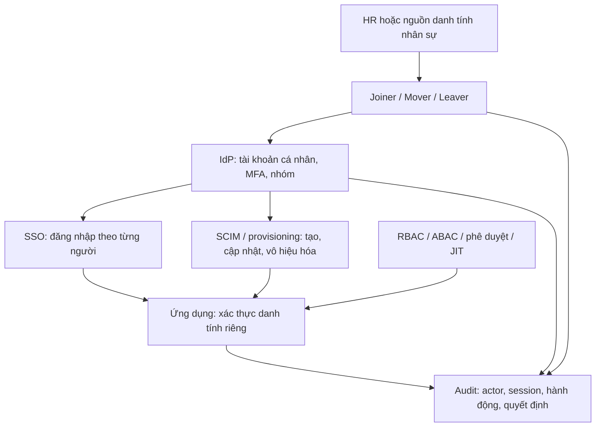

# Tài khoản dùng chung: anti-pattern trong quản lý vòng đời danh tính IAM

## 1. Bối cảnh và mục tiêu

Trong quản lý định danh và truy cập (Identity and Access Management – IAM), một nguyên tắc nền tảng là **mỗi hành động của con người phải có thể gắn với một danh tính cá nhân xác định**. Từ lúc nhân sự gia nhập (Joiner), chuyển vai trò (Mover) cho đến lúc rời tổ chức (Leaver), hệ thống cần biết chính xác ai có quyền gì, quyền đó được cấp vì lý do nào và khi nào phải thu hồi.

**Tài khoản dùng chung** xuất hiện khi hai hay nhiều người đăng nhập, vận hành hoặc thực hiện tác vụ bằng **cùng một danh tính đăng nhập** của ứng dụng/hệ thống, chẳng hạn cả đội hỗ trợ dùng `support-admin` và cùng biết mật khẩu. Cách làm này có thể tạo cảm giác thuận tiện nhưng phá vỡ mối liên hệ giữa *người thực hiện* và *hành động được ghi nhận*.

Sau bài học, người đọc có thể:

- Nhận diện tài khoản dùng chung của con người và phân biệt nó với nhóm quyền, danh tính dịch vụ và tài khoản khẩn cấp.
- Giải thích hệ quả với truy vết, MFA, SSO, RBAC/ABAC, kiểm toán và quy trình Joiner–Mover–Leaver.
- Đề xuất cách chuyển đổi ứng dụng sang tài khoản cá nhân; đồng thời áp dụng biện pháp kiểm soát bù trừ khi hệ thống cũ chưa hỗ trợ.
- Xây dựng dấu hiệu phát hiện, tiêu chí nghiệm thu và quy trình rà soát để tránh quyền truy cập tồn dư.

## 2. Anti-pattern xảy ra chính xác ở đâu?

Trong một phiên làm việc có ba khái niệm khác nhau:

1. **Người dùng thực tế (human actor):** cá nhân thực hiện hành động, ví dụ nhân viên An.
2. **Danh tính/principal:** chủ thể được hệ thống xác thực và cấp quyền, ví dụ `an.nguyen` hoặc `ops-admin`.
3. **Thông tin xác thực và phiên:** mật khẩu, khóa, MFA, token, cookie phiên hoặc vé truy cập dùng để chứng minh và duy trì danh tính đó.

Vấn đề cốt lõi là **nhiều human actor cùng sử dụng một principal tương tác**. Việc chia sẻ mật khẩu là cách triển khai phổ biến, nhưng ngay cả khi mỗi người đi qua cổng SSO riêng rồi bị ánh xạ vào cùng một user `admin` ở ứng dụng đích, nhật ký của ứng dụng vẫn có thể mất thông tin về người thực hiện.

| Trường hợp | Có phải anti-pattern tài khoản dùng chung? | Lý do |
|---|---|---|
| An và Bình đều đăng nhập vào `ops-admin` bằng cùng thông tin xác thực | **Có** | Ứng dụng chỉ nhìn thấy một principal cho hai người |
| An và Bình có tài khoản cá nhân, cùng thuộc nhóm IdP `operations` | **Không** | Nhóm chia sẻ *quyền*, mỗi hoạt động vẫn mang danh tính riêng |
| Mỗi người đăng nhập qua SSO nhưng ứng dụng gộp mọi người thành `local-admin` | **Có nguy cơ tương đương** | Cần kiểm tra khả năng gắn hoạt động tại đích với người thật |
| Job sao lưu tự động dùng danh tính workload riêng, không ai đăng nhập tương tác | **Không mặc nhiên** | Đây là danh tính phi con người; vẫn phải kiểm soát chủ sở hữu, quyền và khóa |
| Tài khoản khẩn cấp được giữ trong kho bảo mật và chỉ truy cập theo quy trình kiểm soát | **Ngoại lệ cần quản trị** | Mục đích hạn chế; phải có dấu vết người lấy quyền, cảnh báo và rà soát |

**Phân biệt quan trọng:** chia sẻ *role* hoặc *group* là cơ chế RBAC thông thường; chia sẻ *định danh đăng nhập* làm suy yếu tính quy trách nhiệm. Tài khoản dịch vụ có thể được dùng bởi một workload hoặc một tập thành phần được thiết kế rõ ràng, nhưng không phải lý do hợp lệ để nhiều nhân viên dùng nó như tài khoản cá nhân.

## 3. Vì sao tài khoản dùng chung gây rủi ro?

### 3.1. Mất khả năng quy trách nhiệm trong kiểm toán

Nếu nhật ký chỉ ghi `principal=ops-admin` và hành động `DELETE_USER`, tổ chức chưa thể khẳng định An hay Bình đã xóa user. Địa chỉ IP, thời gian hoặc máy trạm có thể giúp điều tra nhưng không luôn xác định được con người, nhất là khi dùng VPN, máy nhảy, phiên chung hoặc NAT.

Quy trình kiểm toán thường cần chuỗi bằng chứng: **người yêu cầu → phê duyệt → đăng nhập/phiên → quyền được sử dụng → hành động tại ứng dụng**. Tài khoản dùng chung làm đứt chuỗi tại mắt xích danh tính.

### 3.2. Thu hồi quyền theo Joiner–Mover–Leaver trở nên không đáng tin cậy

| Giai đoạn | Với tài khoản cá nhân | Với tài khoản dùng chung |
|---|---|---|
| **Joiner** | Xác minh cá nhân; tạo principal riêng trong IdP; cấp nhóm/role theo công việc | Gửi một mật khẩu hoặc token đang được nhiều người biết; thiếu dấu vết cấp riêng |
| **Mover** | Gỡ nhóm/role cũ và cấp quyền mới theo vai trò, kiểm tra phiên còn hiệu lực | Người chuyển bộ phận có thể tiếp tục dùng credential cũ của cả đội |
| **Leaver** | Vô hiệu danh tính, chấm dứt phiên, thu hồi token/khóa và quyền liên quan | Disable tài khoản của cá nhân tại IdP chưa chắc vô hiệu được credential chung |
| **Rà soát định kỳ** | Đối chiếu từng người với nhu cầu nghiệp vụ và người phê duyệt | Người quản lý có thể chỉ thấy một account mà không biết tất cả người đang sử dụng |

**Đổi mật khẩu chung sau khi một người nghỉ việc chỉ giảm một phần rủi ro.** Người đó có thể còn token, cookie, API key, SSH key hoặc phiên sống; mật khẩu mới cũng có thể bị chia sẻ lại. Phải kiểm tra và thu hồi tất cả đường truy cập còn hiệu lực.

### 3.3. MFA, SSO và các điều kiện truy cập khó bảo đảm

- **MFA:** nếu nhiều người dùng chung một thiết bị OTP, mã phục hồi hoặc phiên đã đăng nhập, bước xác thực yếu đi. MFA gắn riêng từng cá nhân sẽ đáng tin cậy hơn.
- **SSO/IdP:** một IdP có thể quản lý người dùng tốt nhưng không sửa được vấn đề khi ứng dụng đích vẫn dùng chung principal hoặc chấp nhận đăng nhập local ngoài SSO.
- **SCIM:** SCIM giúp đồng bộ vòng đời tài khoản và nhóm từ IdP sang ứng dụng; nếu mọi người vẫn dùng account chung không được quản lý theo từng người, provisioning/deprovisioning không giải quyết được việc thu hồi theo cá nhân.
- **RBAC/ABAC:** role, thuộc tính bộ phận, cấp bậc, thiết bị và ngữ cảnh chỉ có ý nghĩa khi hệ thống biết đúng chủ thể. Principal dùng chung thường phải nhận **hợp quyền** của nhiều người, dễ dẫn tới thừa đặc quyền.
- **Kiểm soát phiên:** khó xác định ai cần bị chặn, ai có thể tiếp tục và phiên nào cần vô hiệu mà không ảnh hưởng toàn đội.

### 3.4. Tăng phạm vi ảnh hưởng khi lộ bí mật

Một credential được phổ biến cho nhiều người thường có nhiều bản sao: tin nhắn nhóm, ghi chú, file cấu hình, trình quản lý mật khẩu cá nhân hoặc pipeline. Khi bí mật lộ, bên phòng thủ khó biết ai đã thấy nó và khó xoay vòng mà không làm gián đoạn người dùng hoặc dịch vụ phụ thuộc.

## 4. Tình huống thực tế: tài khoản `ops-admin` của đội vận hành

Giả sử ứng dụng quản trị đơn hàng có một user `ops-admin` với quyền tạo đơn hoàn tiền và sửa cấu hình. Ba nhân viên An, Bình, Chi cùng dùng user đó:

1. **Tháng 1 – Joiner:** Chi vào đội và được gửi mật khẩu `ops-admin` qua nhóm chat. Không có bản ghi cấp quyền trực tiếp cho Chi tại ứng dụng.
2. **Tháng 3 – Mover:** Bình chuyển sang phòng khác. Nhóm IdP cũ của Bình bị gỡ nhưng Bình vẫn biết credential local của ứng dụng.
3. **Tháng 4 – Leaver:** An rời công ty. Tài khoản cá nhân của An bị khóa nhưng các phiên `ops-admin` chưa được kiểm kê hoặc hủy.
4. **Tháng 5 – Incident:** một đơn hoàn tiền bất thường được tạo lúc 22:15. Log chỉ lưu `actor=ops-admin`; cả ba người đều từng có khả năng truy cập.

Ví dụ nhật ký chưa đủ để quy trách nhiệm:

```text
2026-05-10T22:15:03Z actor=ops-admin action=REFUND_CREATE order=O-2048
```

Sau khi mỗi người có principal riêng, sự kiện có thể được liên kết với chủ thể và quyết định cấp quyền:

```text
2026-05-10T22:15:03Z actor=chi.tran action=REFUND_CREATE order=O-2048
  session=s-982 request=r-551 role=refund-operator decision=allowed
```

Log thứ hai **tăng khả năng truy vết**, nhưng vẫn cần log xác thực, chính sách lưu giữ, tính toàn vẹn và tương quan sự kiện để điều tra đầy đủ. `actor` ở ứng dụng cũng không được lấy từ header do client tự khai báo mà phải đến từ xác thực đáng tin cậy.

## 5. Nguyên nhân phổ biến và dấu hiệu nhận biết

Tài khoản dùng chung thường hình thành do ứng dụng đời cũ chỉ có một user quản trị; đội ngũ dùng chung để tiết kiệm thời gian cấp quyền; hạn chế license; nhà cung cấp chỉ hỗ trợ một account tích hợp; quy trình cấp quyền chậm; hoặc việc xử lý sự cố dựa trên mật khẩu “truyền đời”. Một tài khoản ban đầu được lập để chạy dịch vụ cũng có thể dần bị dùng để đăng nhập thủ công.

Dấu hiệu đáng điều tra:

- Tài khoản tên `admin`, `team`, `support`, `shared`, `operator` hoặc `svc-*` có nhiều người biết credential. **Tên chỉ là gợi ý, không phải bằng chứng kết luận.**
- Một tài khoản người dùng xuất hiện trên nhiều thiết bị, vị trí hoặc phiên cùng lúc với mẫu hoạt động bất thường.
- Không xác định được **một người chịu trách nhiệm nghiệp vụ** và một người quản trị kỹ thuật cho account đặc quyền.
- Bằng chứng cấp/thu hồi quyền dựa vào “đã gửi mật khẩu cho nhóm” thay vì ticket, phê duyệt và đối tượng người dùng cụ thể.
- Tài khoản local vẫn hoạt động sau khi người dùng đã bị khóa tại IdP; token hoặc phiên không bị thu hồi khi nghỉ việc.
- Danh tính service có đăng nhập interactive; cùng secret xuất hiện trong nhiều script, máy chủ hoặc kho mã.
- Nhật ký ứng dụng ghi toàn bộ tác vụ rủi ro cao dưới một tên account và không có mã phiên đối chiếu được với người thực hiện.

Đánh giá dựa trên **bằng chứng kết hợp**: cấu hình ứng dụng, quy trình cấp quyền, bản ghi PAM/vault, IdP, danh sách người được quyền truy cập và log hệ thống. Không tự động kết luận vi phạm chỉ từ việc một user dùng nhiều máy.

## 6. Kiến trúc thay thế: danh tính người dùng riêng, quyền có thể chia sẻ

Thiết kế mục tiêu nối đúng vòng đời nhân sự với danh tính và phiên truy cập:



**Joiner:** xác minh người, tạo tài khoản cá nhân trong IdP, buộc MFA, gán nhóm/role tối thiểu; tạo user ứng dụng bằng SCIM hoặc cơ chế được hỗ trợ; đảm bảo SSO có thể truyền định danh ổn định tới ứng dụng.

**Mover:** sự kiện đổi vai trò kích hoạt **thu hồi quyền cũ trước hoặc cùng thời điểm cấp quyền mới** theo quy trình kiểm soát; cập nhật group và thuộc tính ABAC; xét lại vai trò đặc quyền, tài khoản phụ, quyền local và các phiên đang hoạt động.

**Leaver:** vô hiệu tài khoản trong IdP và hệ thống đích; thu hồi phiên, refresh token, API token, quyền liên kết, quyền truy cập kho bí mật và tài khoản phụ do nhân sự sở hữu; kiểm tra những ứng dụng không được SCIM bao phủ. Ghi nhận bằng chứng hoàn tất và ngoại lệ.

Nếu nghiệp vụ cần nhiều người cùng quyền, cấp cho mỗi người một account riêng rồi **gán chung role/group**. Khi cần đặc quyền tạm thời, cân nhắc just-in-time (JIT), phê duyệt và session audit qua Privileged Access Management (PAM), thay cho mật khẩu quản trị chia sẻ thường trực.

## 7. Kế hoạch loại bỏ tài khoản dùng chung

### Bước 1. Lập danh mục và phân loại

Với từng tài khoản nghi vấn, xác nhận: hệ thống; môi trường; có thể đăng nhập tương tác hay không; người đang sử dụng; owner nghiệp vụ/kỹ thuật; quyền thực tế; phương thức xác thực; loại secret/token; tích hợp phụ thuộc; yêu cầu sẵn sàng; mức độ rủi ro. Không công bố mật khẩu trong báo cáo kiểm kê.

Phân loại thành **human shared**, **non-human/workload**, **break-glass**, hoặc **chưa xác định**. Dùng bằng chứng từ ứng dụng và owner để phân loại thay vì chỉ dựa vào tiền tố `svc` hoặc `admin`.

### Bước 2. Ưu tiên xử lý theo ảnh hưởng

Ưu tiên tài khoản quản trị hạ tầng, IAM, dữ liệu nhạy cảm, thanh toán, production và tài khoản có thể vượt chính sách SSO/MFA. Tạm ngăn việc cấp mới credential chung; thiết lập giám sát bổ sung đối với những tài khoản chưa thể chuyển ngay.

### Bước 3. Tạo danh tính và phân quyền theo từng người

- Tích hợp IdP và SSO nếu ứng dụng hỗ trợ; triển khai SCIM hoặc provisioning được kiểm soát để tạo/cập nhật/vô hiệu user.
- Chỉ định danh tính ổn định cho từng người; tách quyền chuẩn và quyền quản trị theo nhu cầu.
- Xây role RBAC dựa trên công việc; dùng thuộc tính ABAC (bộ phận, loại thiết bị, ngữ cảnh) khi hệ thống hỗ trợ và dữ liệu thuộc tính đáng tin cậy.
- Kiểm thử các tác vụ nghiệp vụ với quyền tối thiểu và quy trình phê duyệt cho thao tác nhạy cảm.
- Yêu cầu tài khoản cá nhân có MFA phù hợp và chính sách phiên. Kiểm tra rằng ứng dụng ghi **actor cá nhân tại đích**, kể cả khi xác thực diễn ra ở IdP.

### Bước 4. Cắt quyền khỏi tài khoản cũ an toàn

Kiểm tra lần cuối tất cả tác vụ, lịch chạy, integration, webhook và token có thể đang phụ thuộc vào tài khoản cũ. Chuyển tác vụ máy móc sang workload identity riêng, chuyển người dùng sang tài khoản cá nhân, rồi **vô hiệu tài khoản tương tác chung** khi các luồng đã chạy ổn định.

Thu hồi phiên và token còn hiệu lực; xóa quyền local, khóa truy cập và secret không còn cần thiết; xoay vòng secret đối với luồng hợp lệ buộc phải duy trì. Ghi nhận thời điểm cắt, các phụ thuộc đã chuyển, người xác nhận và kế hoạch khôi phục nếu có sự cố. Tránh chỉ “đổi mật khẩu rồi coi như hoàn tất”.

### Bước 5. Đối soát và duy trì

Chạy kiểm tra Joiner–Mover–Leaver trên các ứng dụng được tích hợp và cả ứng dụng ngoại lệ. Đối chiếu danh sách người được phê duyệt với quyền thực tế, log sử dụng và danh tính owner. Đặt lịch rà soát định kỳ, cảnh báo khi account chung tái xuất hiện hoặc danh tính dịch vụ đăng nhập tương tác.

## 8. Khi ứng dụng cũ không hỗ trợ tài khoản cá nhân

Không phải hệ thống nào cũng có SSO, SCIM hoặc user riêng. Khi chưa thể thay ứng dụng, có thể áp dụng **kiểm soát bù trừ có thời hạn**:

| Biện pháp | Giá trị | Giới hạn cần hiểu |
|---|---|---|
| PAM hoặc vault có checkout gắn user cá nhân | Biết ai đã yêu cầu lấy credential, thời điểm, lý do và phê duyệt | Log của ứng dụng đích vẫn có thể chỉ hiện một account |
| Proxy/jump host cấp phiên riêng, ghi log thao tác | Tăng khả năng liên kết phiên với nhân viên, hỗ trợ điều tra | Cần bảo vệ log và ngăn đường truy cập trực tiếp ngoài proxy |
| Cấp quyền trong cửa sổ thời gian ngắn, yêu cầu JIT/approval | Thu hẹp thời gian tồn tại của đặc quyền | Không thay thế nguyên tắc một người một principal khi ứng dụng hỗ trợ |
| Cất secret trong vault, giới hạn người biết, rotate sau mỗi đợt cấp | Giảm lan truyền credential, hỗ trợ thu hồi | Không thể khẳng định ai thao tác chỉ từ việc ai đã xem secret |
| Giới hạn mạng, thiết bị, nguồn đăng nhập và cảnh báo | Thu hẹp bề mặt tấn công | Không khắc phục thiếu định danh con người ở lớp ứng dụng |

Mỗi ngoại lệ cần có **owner, lý do nghiệp vụ, phạm vi hệ thống, người được phép sử dụng, quyền tối thiểu, ngày xem xét lại, kế hoạch thay thế và bằng chứng giám sát**. Nếu nhà cung cấp chỉ bán một license được chia sẻ, bộ phận nghiệp vụ và pháp lý cần kiểm tra điều kiện sử dụng; khó khăn về chi phí hoặc khả năng kỹ thuật không làm rủi ro biến mất.

Tránh cho nhiều người biết secret vĩnh viễn. Nếu PAM dùng một account chung phía sau, cấu hình để mỗi checkout có xác thực cá nhân, giới hạn phiên, ghi nhận người sử dụng và ngăn dùng ngoài PAM ở mức khả thi. Một lớp proxy hoạt động đúng vẫn **không tự động biến log của ứng dụng thành log định danh cá nhân**; phải duy trì tương quan chứng cứ.

## 9. Tài khoản dịch vụ và tài khoản khẩn cấp: quản trị đúng ngoại lệ

### 9.1. Danh tính phi con người (service/workload identity)

Service account phục vụ ứng dụng, batch job, pipeline hoặc tích hợp hệ thống; nó không nên được sử dụng làm tài khoản người dùng tương tác hằng ngày. Quản trị tối thiểu bao gồm:

- Một mục đích/workload được định danh rõ; tách danh tính cho các dịch vụ có phạm vi và quyền khác nhau khi khả thi.
- Có owner chịu trách nhiệm, môi trường sử dụng, lịch rà soát, quyền tối thiểu và nhật ký hoạt động.
- Ưu tiên danh tính liên kết workload/federation hoặc chứng chỉ/token ngắn hạn do nền tảng cấp; tránh secret tĩnh phân phối rộng.
- Cất secret còn bắt buộc trong secrets manager; giới hạn nơi truy cập, xoay vòng và thu hồi khi thay ứng dụng/owner.
- Cấm hoặc cảnh báo interactive login không nằm trong thiết kế; không cho nhân viên dùng service account để né MFA.
- Khi owner rời công ty, chuyển quyền sở hữu và quyền truy cập quản trị secret, rà soát các phụ thuộc; không tùy tiện xóa danh tính đang phục vụ production.

Một service principal có thể được nhiều thành phần hợp lệ sử dụng theo kiến trúc, nhưng phải đánh giá khả năng tách workload để giảm quyền chéo và phạm vi ảnh hưởng. Khái niệm “nhiều tiến trình” khác với “nhiều nhân viên dùng chung thông tin đăng nhập”.

### 9.2. Tài khoản truy cập khẩn cấp (break-glass)

Để tránh bị khóa toàn bộ quyền quản trị khi IdP/SSO gặp sự cố, tổ chức có thể cần danh tính khẩn cấp ngoài luồng bình thường. Ưu tiên các account khẩn cấp **riêng theo người được ủy quyền** nếu nền tảng cho phép. Trường hợp bất khả kháng phải có account chung, chỉ sử dụng với các kiểm soát như lưu credential trong vault được bảo vệ; phê duyệt hoặc quy tắc truy cập khẩn; cảnh báo tức thời; log phiên; ghi ticket lý do; rà soát sau sự kiện; thu hồi phiên và xoay vòng credential khi kết thúc.

Break-glass phải được kiểm thử khả năng hoạt động theo lịch kiểm soát nhưng **không trở thành đường đăng nhập thuận tiện thường ngày**. Không vô hiệu cơ chế cứu hộ chỉ để đạt mục tiêu “xóa sạch mọi tài khoản chung” khi chưa có giải pháp thay thế an toàn.

## 10. Chính sách mẫu và phát hiện liên tục

Ví dụ sau là **quy định minh họa do tổ chức tự định nghĩa**, không phải schema chuẩn của SCIM/IdP hay cấu hình sẵn dùng của một nhà cung cấp:

```yaml
identityPolicy:
  human:
    uniquePrincipalPerPerson: true
    mfaRequired: true
    interactiveSharedLoginAllowed: false
    accessReviewOnRoleChange: true
    revokeSessionsOnTermination: true
  workload:
    ownerRequired: true
    interactiveLoginAllowed: false
    leastPrivilege: true
    shortLivedCredentialsPreferred: true
  exceptions:
    documentedBusinessReason: true
    namedOwner: true
    approvedUsers: true
    auditAndAlerting: true
    reviewDeadlineRequired: true
```

Có thể phát hiện *ứng viên cần kiểm tra* qua số thiết bị mà một human principal sử dụng trong thời gian ngắn. Ví dụ truy vấn minh họa trên bảng log giả định `auth_events`:

```sql
SELECT principal_id,
       COUNT(DISTINCT device_id) AS device_count
FROM auth_events
WHERE event_time >= CURRENT_TIMESTAMP - INTERVAL '7 days'
  AND result = 'SUCCESS'
  AND principal_type = 'HUMAN'
GROUP BY principal_id
HAVING COUNT(DISTINCT device_id) >= 5;
```

Truy vấn này **không chứng minh tài khoản bị chia sẻ**: một cá nhân có thể sử dụng nhiều thiết bị. Cần bổ sung sự kiện PAM, phiên, danh sách người được phê duyệt, thông tin chủ tài khoản và điều tra các ngoại lệ. Với dữ liệu checkout PAM (nếu có), một account đích được nhiều người checkout là bằng chứng trực tiếp hơn để xác định nó đang được chia sẻ:

```sql
SELECT target_principal,
       COUNT(DISTINCT checked_out_by) AS human_count
FROM pam_checkouts
WHERE checkout_time >= CURRENT_TIMESTAMP - INTERVAL '30 days'
GROUP BY target_principal
HAVING COUNT(DISTINCT checked_out_by) > 1;
```

Trước khi phát cảnh báo vi phạm, đối chiếu account với danh mục workload/break-glass và hồ sơ ngoại lệ hợp lệ. Dữ liệu log nên có actor, principal, session/correlation ID, timestamp đồng bộ, hành động, tài nguyên, kết quả, nguồn xác thực và quyết định cấp quyền. Bảo vệ log khỏi sửa/xóa trái phép và quy định thời gian lưu theo nhu cầu kiểm toán.

## 11. Tiêu chí nghiệm thu và chỉ số theo dõi

Một chương trình xử lý tài khoản dùng chung chỉ hoàn tất khi chứng minh được **tính riêng biệt của danh tính, khả năng thu hồi và quy trách nhiệm**:

| Câu hỏi kiểm tra | Bằng chứng mong đợi |
|---|---|
| Mỗi nhân viên có principal riêng ở ứng dụng quan trọng? | Danh sách IdP và user ứng dụng đối chiếu được với nguồn nhân sự |
| Tác vụ nhạy cảm có liên kết đến người thật? | Log ứng dụng + xác thực + phiên + phê duyệt truy vết được cùng một actor |
| Khi Mover, quyền cũ có bị thu hồi? | Sự kiện thay đổi vai trò, bản ghi gỡ nhóm/role và kiểm tra quyền thực tế |
| Khi Leaver, mọi đường truy cập có bị đóng? | Disable tại IdP/đích; revoke phiên/token; kiểm tra tài khoản local, vault và ngoại lệ |
| Service identity có mục đích, owner và quyền phù hợp? | Inventory workload, quyền hiện hành, secret/rotation và log thực thi |
| Ngoại lệ tài khoản chung có được kiểm soát? | Hồ sơ phê duyệt, log PAM, owner, ngày xem xét lại, lộ trình thay thế |

Chỉ số tham khảo gồm **số tài khoản interactive dùng chung còn tồn tại**, **số tài khoản đặc quyền không có owner**, **tỷ lệ ứng dụng có deprovisioning tự động**, **thời gian thu hồi quyền khi Mover/Leaver**, **số phiên bất thường của service account**, và **số ngoại lệ quá hạn rà soát**. Đọc xu hướng kết hợp phạm vi hệ thống được giám sát; số lượng phát hiện tăng có thể do khả năng quan sát tốt hơn chứ chưa chắc do rủi ro tăng.

## 12. Tự kiểm tra tư duy

**Tình huống A:** Năm nhân viên hỗ trợ đều ở nhóm RBAC `refund-operator`; mỗi người đăng nhập bằng user cá nhân, MFA riêng và log ghi định danh từng người. Đây có phải tài khoản dùng chung?  
**Không.** Họ chia sẻ quyền theo vai trò, không chia sẻ principal.

**Tình huống B:** Công ty tắt account IdP của nhân sự nghỉ việc, nhưng người này vẫn biết mật khẩu quản trị local mà cả nhóm đang dùng. Đã hoàn thành Leaver chưa?  
**Chưa.** Phải thu hồi đường truy cập local, kiểm soát các phiên/token còn sống và chuyển sang danh tính cá nhân hoặc biện pháp bù trừ có bằng chứng.

**Tình huống C:** Một job CI/CD dùng token riêng được cấp quyền deploy; token nằm trong secrets manager và có owner. Có cần xóa token vì đó là “tài khoản dùng chung”?  
**Không mặc nhiên.** Đây là danh tính workload cần quản trị quyền, nguồn sử dụng, thời hạn và secret; nên ưu tiên credential ngắn hạn khi khả thi. Không được dùng nó để con người đăng nhập thay account cá nhân.

**Tình huống D:** Hệ thống legacy chỉ có `root`. Mỗi kỹ sư lấy quyền qua PAM cá nhân, phiên được ghi hình. Đã giải quyết hoàn toàn anti-pattern?  
**Chưa.** PAM giúp quy trách nhiệm ở lớp truy cập, nhưng ứng dụng đích vẫn ghi `root`. Cần kiểm soát đường vòng và duy trì kế hoạch nâng cấp sang account riêng.

## Kết luận

Trong IAM, **tài khoản dùng chung của con người là một anti-pattern vì làm đứt mối liên hệ giữa người, quyền và hành động**. Rủi ro lan xuyên suốt Joiner–Mover–Leaver: cấp quyền không theo cá nhân, thay đổi vai trò không thu hồi triệt để, người rời tổ chức còn khả năng truy cập, và kiểm toán không quy trách nhiệm rõ ràng. Thiết kế phù hợp dùng **danh tính người dùng riêng + SSO/MFA + RBAC/ABAC + provisioning/deprovisioning + nhật ký có thể tương quan**, đồng thời quản trị tách biệt danh tính workload và truy cập khẩn cấp. Với hệ thống legacy, các kiểm soát bù trừ phải được theo dõi như ngoại lệ có thời hạn và có bằng chứng.
