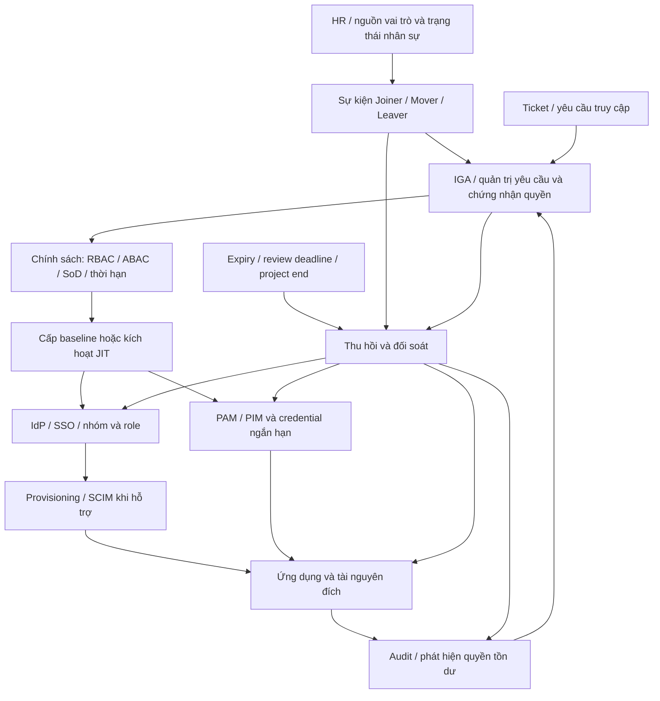
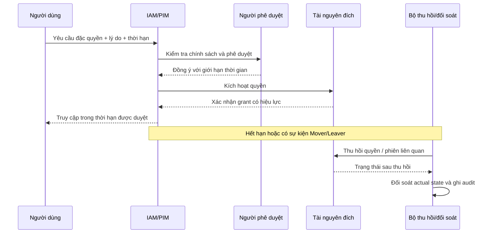

# Quyền cấp vĩnh viễn: anti-pattern trong quản lý vòng đời danh tính IAM

## 1. Quyền cấp vĩnh viễn là gì?

Trong Identity and Access Management (IAM), **quyền cấp vĩnh viễn** (*permanent access*, *indefinite entitlement*, đôi khi gọi là *standing access*) là tình trạng một danh tính được cấp quyền và có thể tiếp tục sử dụng quyền đó vô thời hạn, **không có điều kiện kết thúc, không có cơ chế rà soát hữu hiệu hoặc không có sự kiện thu hồi đáng tin cậy**. Quyền có thể là thành viên một nhóm, role quản trị, quyền trên tài nguyên, khóa API, quyền truy cập dữ liệu, quyền đăng nhập môi trường production hoặc khả năng phê duyệt giao dịch.

Trong chương **Anti-pattern IAM**, vấn đề cần nhận diện không đơn thuần là một trường `expires_at` bị bỏ trống. Anti-pattern xuất hiện khi **thời gian tồn tại của quyền không còn gắn với nhu cầu nghiệp vụ, trạng thái nhân sự và mức rủi ro**. Một quyền được cấp để xử lý sự cố trong hai giờ nhưng tiếp tục có hiệu lực sau một năm là ví dụ điển hình.

Không phải mọi quyền thường trực đều sai. Một nhân viên đang làm đúng vị trí có thể cần quyền đọc tài liệu nội bộ mỗi ngày trong suốt thời gian còn đảm nhiệm vai trò. Quyền nền tảng có thể tồn tại theo *vòng đời vai trò*, miễn là được quản trị, rà soát và thu hồi khi vai trò hay trạng thái làm việc thay đổi. Ngược lại, đặc quyền production, khả năng xuất dữ liệu nhạy cảm hoặc quyền thay đổi cấu hình bảo mật thường cần **giới hạn thời gian và kích hoạt khi có nhu cầu (Just-in-Time, JIT)**.

Mục tiêu bài học:

- Phân biệt quyền thường trực có kiểm soát với quyền cấp vô thời hạn ngoài nhu cầu thực tế.
- Phân tích cách quyền tồn dư (*residual access*) tích tụ qua Joiner–Mover–Leaver (JML).
- Thiết kế cấp quyền có thời hạn, rà soát định kỳ và thu hồi theo sự kiện.
- Liên kết IdP, SSO, SCIM, RBAC/ABAC, PAM/PIM, kiểm toán và quản trị danh tính dịch vụ.
- Xây dựng quy trình phát hiện, xử lý quyền tồn dư và kiểm tra hiệu lực thu hồi ở hệ thống đích.

## 2. Nhận diện anti-pattern qua một tình huống

Giả sử Minh là kỹ sư vận hành. Trong tháng 2, Minh được cấp role `production-admin` để xử lý một sự cố trong đêm. Ticket có phê duyệt, nhưng không ghi thời hạn. Hệ thống chỉ thực hiện tác vụ **thêm người vào nhóm** IdP; sau sự cố không có bước gỡ nhóm.

- **Joiner:** Minh có quyền thông thường của kỹ sư, được cấp qua nhóm vai trò.
- **Yêu cầu khẩn:** Minh được thêm vào nhóm đặc quyền, từ đó có thể xóa dữ liệu hoặc thay đổi dịch vụ production.
- **Mover:** Ba tháng sau Minh chuyển sang nhóm phát triển tính năng. Role cũ vẫn còn vì quy trình đổi bộ phận chỉ bổ sung nhóm mới.
- **Leaver:** Khi Minh rời công ty, IdP có thể bị khóa, nhưng khóa API cá nhân, role local hoặc phiên còn hiệu lực tại ứng dụng đích chưa chắc được thu hồi.

Đến thời điểm phát hiện, quyền khẩn ban đầu đã trở thành một **đặc quyền tồn dư**. Không cần có hành vi ác ý mới xảy ra rủi ro: token bị đánh cắp, lỗi thao tác, thiết bị bị xâm nhập hoặc chính người được cấp nhầm quyền đều có thể gây sự cố.

Ví dụ sổ cấp quyền chưa đủ thông tin:

```text
2026-02-15 request=INC-482
subject=minh.nguyen
entitlement=production-admin
action=GRANT
approver=team-lead
expires_at=NULL
review_due=NULL
```

Phiên bản có ràng buộc thời gian và mục đích:

```text
2026-02-15T21:00:00Z request=INC-482
subject=minh.nguyen
entitlement=production-admin
action=ACTIVATE
reason="Khắc phục sự cố INC-482"
approved_by=production-owner
activated_at=2026-02-15T21:00:00Z
expires_at=2026-02-15T23:00:00Z
max_duration=PT2H
```

Ví dụ trên thể hiện dữ liệu minh họa, không phải cấu trúc log bắt buộc của một sản phẩm IAM. **Dòng `expires_at` chỉ hữu ích nếu hệ thống thực sự cưỡng chế hết hạn và xác nhận quyền tại đích đã mất hiệu lực.**

## 3. Vì sao quyền không được thu hồi tích tụ?

### 3.1. Cấp quyền theo yêu cầu một chiều

Nhiều tổ chức có quy trình phê duyệt khi **cấp** quyền, nhưng không có owner chịu trách nhiệm theo dõi việc **gỡ** quyền. Ticket hoàn tất sau khi thao tác `GRANT` thành công; không có ngày kết thúc, kiểm tra lại nhu cầu hay bằng chứng thu hồi.

### 3.2. Role chỉ được cộng dồn khi thay đổi vị trí

Khi nhân viên chuyển nhóm, hệ thống cấp thêm role cho vị trí mới nhưng giữ tất cả role cũ vì sợ ảnh hưởng công việc. Sau nhiều lần chuyển vai trò, người đó nắm một tập quyền vượt quá nhu cầu hiện tại, đôi khi còn gây xung đột phân nhiệm (*Separation of Duties – SoD*), chẳng hạn vừa tạo vừa phê duyệt cùng giao dịch.

### 3.3. Quyền nằm rải rác ngoài IdP

IdP thường quản lý danh tính và nhóm tập trung, nhưng ứng dụng có thể còn:

- Role cục bộ chỉ tồn tại trong cơ sở dữ liệu ứng dụng.
- Khóa API, personal access token, SSH key hoặc cloud access key.
- Session dài hạn hoặc refresh token không bị vô hiệu sau khi thay đổi nhóm.
- Quyền được cấp trực tiếp lên thư mục, kho dữ liệu, tài nguyên cloud, tài khoản SaaS hoặc môi trường triển khai.
- Tài khoản khẩn cấp, tài khoản phụ hoặc danh tính dịch vụ do cá nhân từng vận hành.

Việc xóa một người khỏi nhóm IdP không tự động chứng minh mọi quyền ở các hệ thống đích đã bị thu hồi. Cần xác minh cơ chế đồng bộ, phiên và các đường đăng nhập thay thế.

### 3.4. Không có người sở hữu và tín hiệu kết thúc

Người phê duyệt có thể đã rời dự án; quản lý mới không biết lý do tồn tại của quyền. Nếu quyền không có owner, business justification, nguồn cấp, thời điểm cấp hoặc hạn rà soát, không thể đánh giá nó còn cần thiết hay không.

## 4. Tác hại đối với bảo mật và vận hành

| Hậu quả | Cơ chế gây ra | Ví dụ |
|---|---|---|
| Vi phạm nguyên tắc **đặc quyền tối thiểu** (*least privilege*) | Quyền cũ tiếp tục cộng dồn dù công việc thay đổi | Người làm báo cáo vẫn có quyền xóa database production |
| Tăng phạm vi ảnh hưởng khi tài khoản bị chiếm | Kẻ tấn công kế thừa mọi entitlement hiện hữu | Một phiên SSO bị đánh cắp có thể kích hoạt chức năng quản trị |
| Truy cập tồn dư sau Mover/Leaver | Đồng bộ vòng đời không bao phủ ứng dụng, token hoặc quyền local | Nhân viên nghỉ việc vẫn dùng khóa API đã phát hành |
| Xung đột phân nhiệm | Nhiều role được giữ lại qua các đợt chuyển nhóm | Một người vừa tạo, vừa duyệt yêu cầu chi |
| Khó kiểm toán | Không có lý do, owner, lần sử dụng gần nhất hay bằng chứng thu hồi | Kiểm toán viên không xác định được vì sao còn role admin |
| Chi phí và độ phức tạp vận hành | Quyền bị bỏ quên làm danh mục entitlement tăng không kiểm soát | Hàng trăm role đặc quyền không rõ người chịu trách nhiệm |

**Sự không hoạt động không đồng nghĩa với an toàn.** Một quyền không được dùng trong sáu tháng vẫn có thể được tận dụng khi tài khoản hoặc token bị lộ. Ngược lại, tài khoản dùng thường xuyên cũng không mặc nhiên cần mọi đặc quyền mà nó đang có.

## 5. Liên hệ trực tiếp với vòng đời Joiner–Mover–Leaver

Một hệ thống IAM quản lý tốt phải ràng buộc tuổi thọ của mỗi quyền với **đối tượng, công việc, điều kiện truy cập và trạng thái danh tính**.

| Giai đoạn | Câu hỏi phải trả lời | Cơ chế quản trị cần có |
|---|---|---|
| **Joiner** | Nhân sự đã được xác minh chưa? Role cơ bản nào cần cho chức danh? | IdP tạo danh tính cá nhân; cấp baseline role theo vị trí; phê duyệt ngoại lệ; ghi nguồn cấp |
| **Mover** | Quyền nào của vai trò cũ không còn hợp lệ? Có phát sinh xung đột SoD? | Thu hồi role cũ theo sự kiện thay đổi; cấp role mới; rà soát tài khoản phụ, phiên và quyền trực tiếp |
| **Leaver** | Còn đường truy cập nào sau thời điểm kết thúc làm việc? | Disable IdP và tài khoản đích; gỡ entitlement, thu hồi token/session/secret; xác nhận hoàn tất |
| **Rà soát liên tục** | Quyền này còn chủ sở hữu, mục đích, người dùng và thời hạn hợp lệ? | Access certification, phát hiện privilege creep, auto-expiry, cảnh báo ngoại lệ quá hạn |

**Mốc thu hồi không phải lúc nào cũng giống nhau:** có quyền kết thúc khi ticket đóng, khi thời gian cấp tạm hết, khi dự án kết thúc, khi role thay đổi hoặc khi hợp đồng chấm dứt. Thiết kế phải hỗ trợ nhiều tín hiệu và lấy thời điểm kết thúc **sớm nhất** theo chính sách áp dụng.

Ví dụ: một quyền tạm hết hạn ngày 30/6, nhưng nhân viên chuyển bộ phận từ 25/6. Nếu vai trò mới không còn được phép sử dụng quyền đó, ngày 25/6 phải kích hoạt thu hồi; không đợi hết ngày 30/6.

## 6. Phân biệt quyền nền tảng, quyền tạm và đặc quyền JIT

| Mô hình | Phạm vi phù hợp | Thời gian hiệu lực | Điều kiện bắt buộc |
|---|---|---|---|
| **Baseline access** theo vai trò | Đọc tài liệu công việc, dùng ứng dụng cần thiết hằng ngày | Còn hiệu lực khi nhân sự duy trì vai trò và chính sách cho phép | Kiểm tra JML, rà soát định kỳ, owner, thu hồi khi không còn phù hợp |
| **Time-bound entitlement** | Tham gia dự án, hỗ trợ nhà cung cấp, truy cập tài liệu tạm | Có ngày bắt đầu và kết thúc rõ ràng | Hết hạn tự động; gia hạn phải được xem xét lại |
| **JIT privilege** | Quản trị production, thay đổi IAM, truy cập kho bí mật nhạy cảm | Kích hoạt theo yêu cầu, tồn tại ngắn | Xác thực mạnh, lý do, phê duyệt theo rủi ro, giới hạn phiên, audit |
| **Emergency/break-glass** | Khắc phục sự cố khi đường IAM thông thường không hoạt động | Chỉ trong điều kiện khẩn được quy định | Bảo quản credential, cảnh báo, giám sát, kiểm tra sau sự kiện, thu hồi |
| **Workload identity** | Máy hoặc dịch vụ gọi hệ thống khác | Theo vòng đời workload, không gắn lịch làm việc của nhân viên | Owner, quyền tối thiểu, credential ngắn hạn/rotation, thu hồi khi workload ngừng |

Quyền luôn bật (*standing privilege*) là điều cần hạn chế đặc biệt đối với **đặc quyền cao**. Việc đưa toàn bộ quyền thông thường vào mô hình yêu cầu phê duyệt từng lần có thể gây tắc nghẽn mà không cải thiện kiểm soát tương xứng. Áp dụng chính sách dựa trên độ nhạy cảm tài nguyên, hậu quả thao tác và mức tin cậy của ngữ cảnh.

### Một nguyên tắc thiết kế

Mỗi entitlement nên có **căn cứ cấp quyền** (*grant basis*) rõ ràng: “nhân viên thuộc role kế toán”, “cộng tác viên tham gia dự án đến ngày X” hoặc “kỹ sư được cấp quyền sự cố Y trong 60 phút”. Khi căn cứ không còn đúng, quyền phải được thu hồi hoặc chuyển về trạng thái cần phê duyệt lại.

## 7. Kiến trúc cấp quyền gắn với sự kiện và thời hạn



Trong luồng trên:

1. **Nguồn chuẩn về con người và công việc** phát sinh Joiner/Mover/Leaver. Không dựa riêng vào việc người dùng tự báo thay đổi.
2. **Lớp quản trị quyền** xác định ai được phép sở hữu entitlement, owner nào phê duyệt, yêu cầu SoD nào phải tuân theo và thời điểm thu hồi.
3. **IdP và SSO** đảm nhiệm xác thực và truyền danh tính. RBAC liên kết quyền với role; ABAC đánh giá các thuộc tính như bộ phận, dự án, độ tin cậy thiết bị, thời gian và ngữ cảnh.
4. **SCIM hoặc connector provisioning** đồng bộ user và nhóm/role mà ứng dụng hỗ trợ. SCIM không tự bảo đảm việc vô hiệu mọi loại token, session hoặc quyền được cấp ngoài phạm vi connector.
5. **PAM/PIM hoặc hệ thống cấp credential ngắn hạn** xử lý đặc quyền nhạy cảm; nên giữ role ở trạng thái *eligible* và chỉ *activate* khi cần.
6. **Bộ thực thi thu hồi** nhận sự kiện hết hạn hoặc JML, đối soát trạng thái tại đích, phát hiện lỗi và cảnh báo. Log ở mỗi điểm giúp chứng minh *quyền đã ngừng sử dụng được*, không chỉ có bản ghi gửi lệnh thu hồi.

Ứng dụng đích là nơi **thực thi quyết định ủy quyền** cuối cùng. Nếu ứng dụng giữ cache quyền quá lâu hoặc tự duy trì phiên độc lập, xóa role trên IdP có thể chưa có hiệu lực ngay. Cần xác định độ trễ cho phép và biện pháp invalidation theo khả năng từng hệ thống.

## 8. Thiết kế một bản ghi cấp quyền có thể thu hồi

Với entitlement nhạy cảm, nên có đủ dữ liệu:

| Trường | Ý nghĩa |
|---|---|
| `subject_id` | Danh tính người hoặc workload nhận quyền |
| `resource_id`, `entitlement_id` | Tài nguyên và quyền cụ thể |
| `grant_type` | Baseline, time-bound, JIT hoặc exception |
| `grant_basis`, `request_id` | Căn cứ nghiệp vụ và yêu cầu liên quan |
| `owner_id`, `approved_by` | Người chịu trách nhiệm và người phê duyệt |
| `valid_from`, `expires_at` | Khoảng thời gian cho phép nếu chính sách yêu cầu |
| `role_version` hoặc thuộc tính JML | Bối cảnh vai trò mà quyền phụ thuộc |
| `review_due_at` | Thời điểm rà soát bắt buộc đối với quyền tiếp tục tồn tại |
| `status`, `revoked_at`, `target_verified_at` | Trạng thái logic, thời điểm thu hồi và thời điểm xác minh đích |

Đây là cấu trúc dữ liệu **minh họa**, không phải schema bắt buộc của SCIM, IdP hoặc sản phẩm PAM:

```yaml
accessGrant:
  subjectId: "user:minh.nguyen"
  resourceId: "cloud:production"
  entitlementId: "role:production-operator"
  type: "JIT"
  reason: "INC-482 - xử lý sự cố"
  requestId: "INC-482"
  ownerId: "team:platform-operations"
  approvedBy: "user:production-owner"
  validFrom: "2026-02-15T21:00:00Z"
  expiresAt: "2026-02-15T23:00:00Z"
  maxDurationMinutes: 120
  status: "ACTIVE"
  revokeOn:
    - "EXPIRED"
    - "ROLE_CHANGED"
    - "IDENTITY_DISABLED"
    - "INCIDENT_CLOSED"
  evidence:
    activationId: "PAM-981"
    targetSystem: "production-cloud"
```

Nếu quyền là baseline theo vai trò, `expiresAt` có thể không được đặt, nhưng **sự kiện thay đổi vai trò/trạng thái và lịch `reviewDueAt` vẫn bắt buộc có hiệu lực**. `reviewDueAt` là hạn cần *chứng nhận lại* chứ không đồng nhất với thời điểm quyền tự mất hiệu lực; chính sách phải quy định điều gì xảy ra khi quá hạn rà soát.

## 9. Các cơ chế thu hồi phải hoạt động thật

### 9.1. Hết hạn theo thời gian (time-to-live)

Hệ thống cần từ chối sử dụng quyền sau mốc `expires_at`, thay vì chỉ gửi một email nhắc. Có thể triển khai qua token ngắn hạn có kiểm tra hạn dùng, policy engine kiểm tra hiệu lực entitlement hoặc scheduler tự động gỡ role. Khi dùng scheduler, phải xử lý độ trễ, retry và xác nhận trạng thái đích.

Một quy tắc ủy quyền dạng mã giả:

```text
function canAccess(subject, action, resource, context, now):
    if not subject.isActive:
        return DENY

    grants = resolveCurrentGrants(subject, resource)
    for grant in grants:
        if grant.status != ACTIVE:
            continue
        if grant.validFrom > now:
            continue
        if grant.expiresAt != null and now >= grant.expiresAt:
            continue
        if not grant.basisStillValid(subject.currentRole, context):
            continue
        if grant.permits(action, resource, context):
            return ALLOW
    return DENY
```

Ví dụ chỉ minh họa phần kiểm tra hiệu lực quyền. Triển khai thực tế còn cần ưu tiên chính sách từ chối, phân nhiệm SoD, kiểm tra thuộc tính đáng tin cậy, quyền lồng nhau, trạng thái phiên và xử lý lỗi. Khi không xác định được hiệu lực của một **đặc quyền nhạy cảm**, thiết kế nên ưu tiên từ chối an toàn theo chính sách đã định, đồng thời vẫn có đường khẩn cấp được quản trị riêng.

### 9.2. Thu hồi theo sự kiện

Hạn thời gian **không thay thế** việc xử lý Mover/Leaver. Hệ thống phải phản ứng khi:

- Nhân viên nghỉ việc hoặc danh tính bị vô hiệu.
- Vai trò, bộ phận, dự án hoặc hợp đồng thay đổi.
- Tài nguyên ngừng hoạt động hoặc dự án đóng.
- Ticket khẩn hoàn tất trước hạn.
- Owner hoặc người chứng nhận quyền từ chối gia hạn.
- Phát hiện SoD conflict, credential bị lộ hoặc yêu cầu ứng cứu sự cố.

Việc đồng bộ cần có cơ chế chống xử lý trùng (*idempotent*) và đối soát lại khi API đích thất bại. Đừng coi việc phát đi sự kiện `REVOKE_REQUESTED` là bằng chứng đủ; phải biết quyền ở đích đã không còn hiệu lực.

### 9.3. Thu hồi phiên và credential phát sinh

Mất entitlement không luôn đồng nghĩa mất quyền trên **phiên đã cấp trước đó**. Ví dụ ứng dụng kiểm tra role lúc login và chép quyền vào session dài hạn, hoặc token đã phát hành chứa claim cũ cho đến khi hết hạn. Cần xem xét:

- Thời gian sống của access token và refresh token; khả năng revoke hoặc invalidation.
- Re-evaluation quyền trên mỗi thao tác nhạy cảm, hoặc giới hạn thời gian cache của authorization.
- Session SSO và session riêng tại ứng dụng; cơ chế logout/back-channel logout nếu được hỗ trợ.
- Khóa API, access key, SSH key, tài khoản local và permission gắn trực tiếp vào tài nguyên.
- Quyền do nhóm lồng nhau hoặc role kế thừa mang lại; chỉ gỡ một đường có thể chưa đủ nếu còn đường khác.

Khi cắt đặc quyền production, tổ chức cần định nghĩa **thời gian thu hồi có hiệu lực tại đích** chấp nhận được, đo được độ trễ thực tế và xử lý tài nguyên không đạt.

## 10. Quy trình thực hành: từ yêu cầu đến kết thúc quyền

### Bước 1 — Xác minh nhu cầu và phạm vi

Người yêu cầu chọn đúng tài nguyên, tác vụ, mức quyền và lý do. Đối chiếu với entitlement tối thiểu và chính sách SoD; xác định quyền thuộc baseline, dự án có hạn hay đặc quyền JIT. Không mặc định cấp role quản trị chỉ vì thao tác khó.

### Bước 2 — Phê duyệt gắn với owner và thời hạn

Owner của tài nguyên hoặc người có thẩm quyền phê duyệt phù hợp mức rủi ro. Với quyền tạm, người yêu cầu phải cung cấp thời hạn; hệ thống áp trần theo chính sách. Gia hạn cần quyết định mới, không tự động tăng thời hạn vô hạn chỉ vì người dùng vẫn hoạt động.

### Bước 3 — Cấp qua kênh có quản trị

Ghi grant vào hệ thống quản trị quyền; thực hiện qua connector IdP, SCIM, PIM/PAM hoặc API ứng dụng. Tránh cấp ngoài hệ thống rồi chỉ cập nhật spreadsheet sau. Nếu phải thao tác thủ công, cần đối soát chứng cứ tại đích.

### Bước 4 — Theo dõi, tự hết hạn và thu hồi sớm

Kích hoạt job kiểm tra expiry và trình xử lý sự kiện JML. Khi ticket đóng, vai trò thay đổi hoặc quyền không còn cần, thu hồi ngay theo chính sách dù `expires_at` chưa tới. Thu hồi cả token/phiên liên quan khi có hỗ trợ hoặc áp dụng bù trừ nếu không.

### Bước 5 — Đối soát kết quả và rà soát định kỳ

Đối chiếu **desired state** (được phép có) với **actual state** (thực tế tại IdP, ứng dụng, cloud, vault). Phát hiện quyền trực tiếp và quyền local không nằm trong nguồn quản trị. Cập nhật ticket với thời điểm thu hồi, kết quả xác minh, lỗi còn tồn đọng và người chịu trách nhiệm.



## 11. Khi nào dùng RBAC, ABAC, PAM/PIM và SCIM?

Các công nghệ này giải quyết những phần khác nhau của cùng bài toán:

| Thành phần | Đóng góp cho chống quyền cấp vĩnh viễn | Giới hạn |
|---|---|---|
| **RBAC** | Gán entitlement theo role, dễ cấp/thu hồi đồng bộ khi thay đổi công việc | Role cũ có thể tồn dư nếu quy trình Mover không gỡ; role quá rộng gây thừa quyền |
| **ABAC** | Chỉ cho phép khi thuộc tính/ngữ cảnh còn đúng, ví dụ thuộc dự án đang hoạt động | Phụ thuộc độ chính xác thuộc tính và việc policy được đánh giá tại thời điểm truy cập |
| **IdP/SSO** | Xác thực tập trung, áp dụng MFA và tín hiệu trạng thái tài khoản | Không mặc nhiên xóa role local, token độc lập hoặc session tại đích |
| **SCIM/provisioning** | Đồng bộ user và entitlement hỗ trợ tới ứng dụng; xử lý thay đổi trạng thái danh tính | Phạm vi entitlement/thu hồi tùy ứng dụng, connector và triển khai |
| **IGA/access certification** | Quản lý owner, căn cứ, chiến dịch chứng nhận và yêu cầu thu hồi | Nếu chỉ thu thập xác nhận mà không cưỡng chế thay đổi tại đích thì quyền vẫn còn |
| **PAM/PIM/JIT** | Giữ đặc quyền ở trạng thái đủ điều kiện, chỉ kích hoạt có thời hạn và kiểm toán | Cần chặn đường truy cập ngoài PAM và bảo đảm đặc quyền ở đích thật sự ngừng hiệu lực |

Một thiết kế hiệu quả thường phối hợp nhiều thành phần. Ví dụ IdP quản lý identity, RBAC cho quyền nền tảng, ABAC chặn truy cập khi dự án kết thúc, PIM cấp admin trong 60 phút, IGA xác nhận role theo quý và connector đối soát trạng thái tại cloud/ứng dụng.

## 12. Quyền vĩnh viễn ở tài khoản dịch vụ và truy cập khẩn cấp

### 12.1. Danh tính dịch vụ (*non-human identity*)

Một workload có thể cần quyền gọi API liên tục, nên không thể xử lý giống một ca đăng nhập 60 phút của nhân viên. Tuy vậy, **workload tồn tại dài hạn không đồng nghĩa credential hoặc đặc quyền phải tồn tại không kiểm soát**. Nên:

- Gán owner nghiệp vụ và owner kỹ thuật, môi trường, workload, mục đích, phạm vi quyền và thời điểm rà soát.
- Cấp quyền tối thiểu cho từng workload; không dùng một principal quyền rộng cho nhiều môi trường nếu không cần.
- Ưu tiên workload identity federation, managed identity, token/chứng chỉ ngắn hạn hoặc cơ chế xoay vòng tự động thay vì access key tĩnh sống nhiều năm.
- Rà soát khi chuyển owner, thay kiến trúc, bỏ dịch vụ hoặc thay thông tin tích hợp.
- Thu hồi token, secret và quyền cũ sau khi migrate; kiểm tra mọi phụ thuộc để tránh làm gián đoạn production.
- Phát hiện principal phi con người lâu không dùng, secret lâu không rotate, role đặc quyền không có owner, và tài khoản dịch vụ bị dùng đăng nhập tương tác.

**Token hết hạn** và **entitlement hết hạn** là hai tầng khác nhau. Dù token 15 phút hết hạn đúng lúc, workload vẫn có thể xin token mới vô hạn nếu role cấp nền tảng không được rà soát hoặc thu hồi. Phải quản trị cả **quyền phát hành credential** và **quyền truy cập tài nguyên**.

### 12.2. Truy cập khẩn cấp (*break-glass*)

Một số môi trường cần khả năng quản trị ngoài đường IdP/SSO thường lệ để khôi phục khi bị sự cố. Không xóa khả năng cứu hộ chỉ để không còn “quyền vĩnh viễn”. Thay vào đó, tách tài khoản khẩn cấp ra khỏi truy cập hằng ngày, bảo quản an toàn, cảnh báo khi dùng, ghi bằng chứng người sử dụng, rà soát sau sự cố và kiểm tra khả năng hoạt động định kỳ.

Nếu nền tảng cho phép tài khoản khẩn cấp luôn hiện hữu, kiểm soát trọng tâm là **tính hạn chế và khả năng truy vết việc sử dụng**, cộng với quy trình thu hồi phiên và credential sau lần kích hoạt. Ngoại lệ cần được phê duyệt và có owner, không được dùng như đường vòng để né MFA/JIT trong hoạt động thông thường.

## 13. Phát hiện quyền tồn dư bằng dữ liệu

Chương trình rà soát nên kiểm tra ba chiều: **quyền hiện có**, **căn cứ nghiệp vụ còn hợp lệ** và **khả năng sử dụng quyền thực tế**. Dưới đây là câu truy vấn **minh họa** trên bảng giả định `iam_grants` (cú pháp gần PostgreSQL); không phải schema chuẩn của sản phẩm cụ thể.

### 13.1. Tìm quyền đặc quyền chưa có hạn kết thúc

```sql
SELECT subject_id, resource_id, entitlement_id,
       granted_at, owner_id, review_due_at
FROM iam_grants
WHERE status = 'ACTIVE'
  AND privilege_level = 'HIGH'
  AND expires_at IS NULL
  AND grant_type <> 'BREAK_GLASS';
```

Kết quả là **danh sách cần rà soát** chứ không tự động kết luận sai phạm. Cần xác định quyền là baseline hợp lệ, workload có owner hay đặc quyền JIT bị cấu hình sai. Truy vấn không phát hiện trường hợp quyền có ngày hết hạn nhưng cơ chế tại đích không thực thi.

### 13.2. Tìm quyền đã hết hạn nhưng còn hoạt động

```sql
SELECT grant_id, subject_id, entitlement_id,
       expires_at, revoked_at, target_verified_at
FROM iam_grants
WHERE status = 'ACTIVE'
  AND expires_at IS NOT NULL
  AND expires_at <= CURRENT_TIMESTAMP;
```

Nếu nguồn dữ liệu chỉ là trạng thái *mong muốn* tại IAM, phải kiểm tra thêm ở hệ thống đích. Cũng cần tìm các grant đã đánh dấu `REVOKED` nhưng role/token thực tế còn dùng được, vì đó là lỗi nguy hiểm hơn một bản ghi chưa cập nhật.

### 13.3. Tìm quyền cần chứng nhận lại hoặc không rõ owner

```sql
SELECT grant_id, subject_id, entitlement_id,
       owner_id, review_due_at, last_used_at
FROM iam_grants
WHERE status = 'ACTIVE'
  AND (
      owner_id IS NULL
      OR review_due_at < CURRENT_TIMESTAMP
      OR (
          privilege_level = 'HIGH'
          AND last_used_at < CURRENT_TIMESTAMP - INTERVAL '90 days'
      )
  );
```

Trường `last_used_at` không được cập nhật ở một số hệ thống, nên trường hợp null hoặc không đủ telemetry phải đưa sang luồng xác minh, không mặc nhiên coi là quyền an toàn. Khoảng 90 ngày chỉ là ví dụ để xác định quyền ít dùng; tần suất rà soát thực tế cần phù hợp rủi ro và quy định của tổ chức.

### 13.4. Chú ý quyền kế thừa và cache

Không chỉ quét quyền gán trực tiếp. Một principal có thể thừa hưởng quyền qua nhiều nhóm lồng nhau, role của tổ chức, resource policy, group ở ứng dụng đích hoặc credential cũ. Khi thu hồi một grant, cần đánh giá **quyền hiệu lực** (*effective permissions*) và xác nhận liệu còn con đường khác dẫn tới cùng hành động hay không.

## 14. Kiểm toán: bằng chứng phải nối từ phê duyệt đến trạng thái đích

Một vết kiểm toán đầy đủ nên nối được:

```text
Yêu cầu / lý do nghiệp vụ
    -> owner và người phê duyệt
    -> chính sách và thời hạn
    -> thao tác grant/activate
    -> principal, session, tài nguyên, hành động
    -> sự kiện expiry / Mover / Leaver / revocation
    -> xác nhận quyền tại đích đã bị gỡ
    -> cảnh báo hoặc ngoại lệ nếu còn tồn dư
```

Log cần thời gian chuẩn hóa, correlation/request ID, subject, tài nguyên, entitlement, người phê duyệt, kết quả tại đích và lỗi kỹ thuật. Tổ chức cần bảo vệ tính toàn vẹn log, phân quyền xem dữ liệu nhạy cảm và định nghĩa thời hạn lưu.

Ví dụ: hệ thống IAM ghi `REVOKE_SUCCESS` vì HTTP 200 khi gọi API xóa role. Điều đó mới chứng minh API đã trả phản hồi thành công, chưa chứng minh cache quyền, session đã cấp hoặc token cũ không còn tác dụng. Với đặc quyền cao, cần kiểm chứng bằng cách truy vấn trạng thái đích và/hoặc thử một thao tác bị từ chối theo phương pháp an toàn đã được thiết kế.

## 15. Kế hoạch loại bỏ quyền cấp vô thời hạn

Có thể triển khai theo năm giai đoạn:

1. **Kiểm kê:** tổng hợp grant từ IdP, ứng dụng, cloud IAM, DB, vault, PAM, source control và danh mục workload; gắn owner, lý do, vai trò và mức rủi ro.
2. **Phân loại:** tách baseline theo vai trò, quyền dự án có hạn, đặc quyền yêu cầu JIT, workload và break-glass; ghi rõ entitlement nào chưa có expiry/review hoặc không thu hồi được tại đích.
3. **Ưu tiên:** xử lý trước admin production, quyền đổi chính sách IAM, truy cập dữ liệu nhạy cảm, khóa API vĩnh viễn và quyền của người đã Mover/Leaver.
4. **Chuyển đổi:** triển khai entitlement có owner và review, time-bound grant, JIT và chính sách SoD; bổ sung trigger thu hồi theo JML, job expiry và cơ chế kiểm chứng trạng thái đích. Đối với hệ thống legacy, đặt kiểm soát bù trừ kèm hạn nâng cấp.
5. **Duy trì:** chạy đối soát định kỳ, access certification, cảnh báo drift; buộc phê duyệt lại khi gia hạn; đo thời gian thu hồi thực tế và khắc phục các lỗi lặp lại.

Khi thay role vĩnh viễn bằng JIT, cần kiểm thử đường làm việc thông thường, quyền ứng cứu và phụ thuộc hệ thống trước khi cắt quyền cũ. Với thay đổi diện rộng, nên có giai đoạn quan sát và rollback được kiểm soát; **rollback không được tái lập đặc quyền không có owner hoặc thời hạn**.

## 16. Tiêu chí nghiệm thu và chỉ số theo dõi

| Tiêu chí | Cách kiểm tra |
|---|---|
| Mỗi đặc quyền cao có căn cứ nghiệp vụ và owner | Đối chiếu entitlement, ticket, danh sách owner và sự kiện cấp quyền |
| Quyền tạm tự hết hạn trong giới hạn chính sách | Cấp thử, đợi qua `expires_at`, kiểm tra tại đích và thử tác vụ bị từ chối an toàn |
| Mover không còn role không phù hợp | Chuyển vai trò thử; xem cập nhật IdP/SCIM, quyền local, token và nhóm kế thừa |
| Leaver không còn đường truy cập | Disable identity; revoke session/token/API key; đối soát trạng thái ứng dụng và tài nguyên |
| Grant quá hạn rà soát có xử lý | Có quyết định chứng nhận, thu hồi hoặc ngoại lệ có thời hạn và người phê duyệt |
| Không có quyền tồn dư sau lệnh revoke | Đo trạng thái đích và thời gian đến khi quyền thực tế không còn sử dụng được |
| Workload và break-glass được quản trị | Có owner, mục đích, quyền tối thiểu, lịch review, log và quy trình khẩn cấp |

Một số KPI hữu ích:

- **Tỷ lệ đặc quyền cao luôn bật:** số entitlement đặc quyền high-risk đang active thường trực trên tổng entitlement high-risk đã kiểm kê.
- **Tỷ lệ grant tạm được thu hồi đúng hạn:** phân biệt lệnh thu hồi thành công với xác nhận thực thi tại đích.
- **Thời gian thu hồi sau Mover/Leaver:** tính từ sự kiện nguồn đến khi tất cả đường truy cập cần thu hồi mất hiệu lực; đo theo từng ứng dụng.
- **Số quyền không có owner/không có ngày review**, **số quyền quá hạn**, **số ngoại lệ quá hạn**, **số vi phạm SoD**.
- **Tỷ lệ entitlement không sử dụng nhưng vẫn active**, có điều chỉnh theo mức đầy đủ của telemetry.

Không đặt mục tiêu giảm mọi quyền thường trực về số không; mục tiêu thực tế là **quyền phù hợp nhu cầu, có owner, có căn cứ và kết thúc đúng lúc**. Đọc KPI cùng phạm vi hệ thống giám sát: số quyền tồn dư phát hiện tăng có thể do việc kiểm kê được mở rộng.

## 17. Tình huống tự kiểm tra

**Câu 1.** Nhân viên kế toán được cấp quyền đọc hệ thống hóa đơn trong thời gian còn thuộc phòng kế toán; hệ thống gỡ role khi Mover và chứng nhận lại mỗi quý. Không có ngày `expires_at` cố định. Đây có phải quyền cấp vĩnh viễn sai thiết kế?

**Trả lời:** Không nhất thiết. Đây là quyền nền tảng phụ thuộc trạng thái vai trò, có trigger thu hồi và rà soát. Cần kiểm chứng các cơ chế thực thi.

**Câu 2.** Kỹ sư được cấp quyền admin một ngày để xử lý incident. Đến giờ hết hạn, IAM đánh dấu `EXPIRED` nhưng session của ứng dụng vẫn cho xóa dữ liệu thêm sáu giờ. Đã xử lý được anti-pattern chưa?

**Trả lời:** Chưa. Hạn quyền trong cơ sở dữ liệu chưa đủ; phải cưỡng chế tại đích và xử lý session/token/cache, đồng thời định nghĩa độ trễ thu hồi chấp nhận được.

**Câu 3.** Nhân viên đã chuyển nhóm nhưng vẫn nằm trong hai nhóm RBAC. Cả hai nhóm đều được gắn thông qua provisioning. Cách xử lý nào đúng?

**Trả lời:** So sánh vai trò hiện hành với nhu cầu của cả hai nhóm, thu hồi nhóm cũ không còn phù hợp, kiểm tra SoD và xác nhận quyền hiệu lực sau khi đồng bộ.

**Câu 4.** Một workload dùng managed identity lâu dài nhưng mỗi lần gọi tài nguyên cần token sống 15 phút. Có còn rủi ro cấp quyền vĩnh viễn?

**Trả lời:** Có thể. Token ngắn hạn giảm rủi ro credential nhưng quyền nền tảng của managed identity vẫn có thể quá rộng hoặc không được thu hồi khi workload ngừng. Phải quản trị entitlement và vòng đời workload.

**Câu 5.** Đội hỗ trợ gia hạn role admin 24 giờ mỗi ngày mà không cần phê duyệt mới. Quyền này có thật sự là JIT?

**Trả lời:** Về hình thức có thời hạn, nhưng hiệu quả gần tương đương đặc quyền thường trực. Cần giới hạn thời gian kích hoạt, xác minh nhu cầu mỗi lần, giám sát tần suất kích hoạt và thiết kế role nhỏ hơn.

## Kết luận

**Quyền cấp vĩnh viễn trở thành anti-pattern khi tổ chức không còn kiểm soát được vì sao một danh tính vẫn có quyền và khi nào quyền phải kết thúc.** Trong IAM, cơ chế khắc phục cần đi xuyên suốt Joiner–Mover–Leaver: cấp quyền theo vai trò và mục đích, thời hạn phù hợp mức rủi ro, đặc quyền JIT, thu hồi theo sự kiện, xác minh ở hệ thống đích, quản trị phiên/credential và rà soát định kỳ. IdP, SSO, SCIM, RBAC/ABAC và PAM/PIM chỉ phát huy đầy đủ khi liên kết được chính sách **least privilege** với thời điểm quyền thực sự mất hiệu lực; đó là cách giảm quyền truy cập tồn dư mà vẫn duy trì vận hành an toàn.
