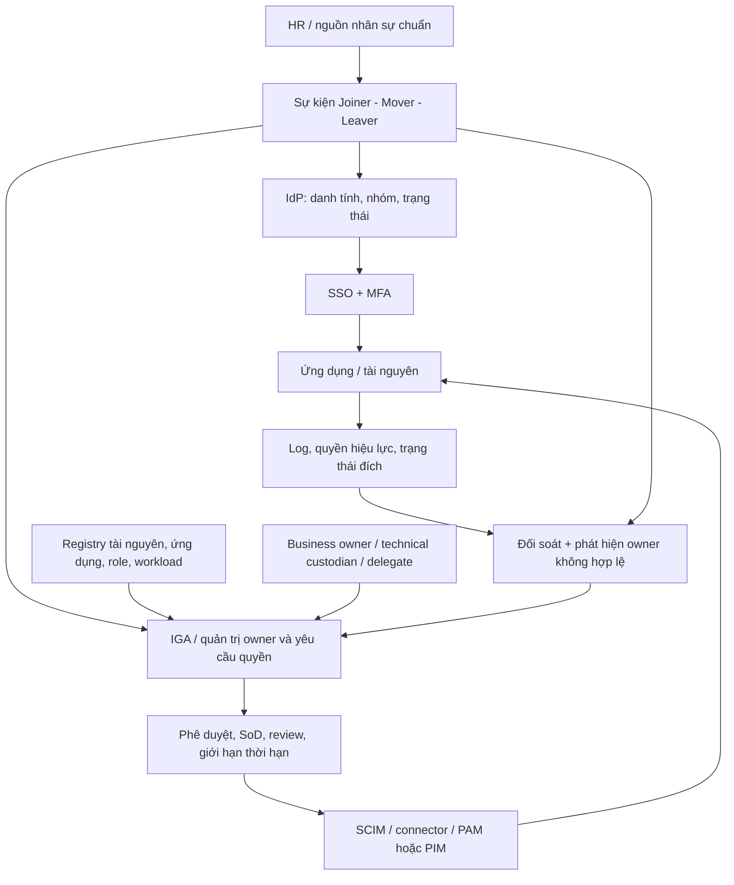
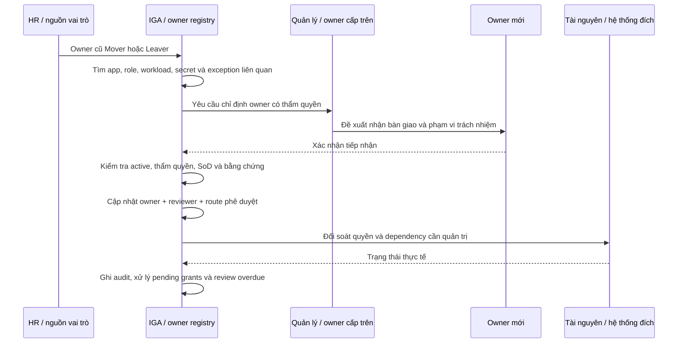

# Không có owner: anti-pattern trong quản lý vòng đời danh tính IAM

## 1. Vấn đề: ai chịu trách nhiệm cho danh tính và quyền truy cập?

Trong **Identity and Access Management (IAM)**, tài khoản, quyền truy cập, nhóm, role, chính sách, khóa API và ngoại lệ bảo mật đều cần có người hoặc bộ phận **chịu trách nhiệm ra quyết định và duy trì kiểm soát**. Khi một đối tượng tồn tại nhưng không có chủ sở hữu được xác định, hoặc owner trên giấy không còn khả năng thực hiện trách nhiệm, tổ chức đang gặp anti-pattern **“Không có owner”** (*missing ownership*, *orphaned resource/access*).

“Owner” ở đây không có nghĩa người sở hữu tài sản về mặt pháp lý, cũng không nhất thiết là người đang sử dụng tài khoản. Trong IAM, owner là vai trò có trách nhiệm rõ ràng đối với **mục đích, phạm vi, vòng đời, phê duyệt, rà soát và kết thúc quyền**. Với một quyền nhạy cảm, câu hỏi cốt lõi gồm:

- **Ai có thẩm quyền phê duyệt?** Ai có quyền quyết định một người hoặc workload cần quyền đó?
- **Ai phải rà soát?** Ai biết quyền này còn phù hợp với nhu cầu nghiệp vụ hay không?
- **Ai xử lý khi owner thay đổi?** Khi người chịu trách nhiệm nghỉ việc, chuyển bộ phận hoặc dự án giải thể, ai tiếp quản?
- **Ai chứng minh đã thu hồi?** Ai đối soát quyền thực tế ở hệ thống đích khi kết thúc vai trò, dự án hoặc hợp đồng?
- **Ai nhận cảnh báo khi có sự cố?** Ai có khả năng giải thích rủi ro và phê duyệt biện pháp khắc phục?

Trong module quản lý vòng đời danh tính theo **Joiner–Mover–Leaver (JML)**, owner là mắt xích liên kết nguồn nhân sự, IdP, SSO, SCIM/provisioning, RBAC/ABAC, tài khoản dịch vụ, kiểm toán và việc giảm **quyền truy cập tồn dư**. Khi mắt xích này mất, một quy trình cấp hoặc thu hồi quyền tự động vẫn có thể thực thi sai chính sách nghiệp vụ.

Sau bài học, người đọc có thể nhận diện đối tượng IAM bị “mồ côi”, phân biệt các loại owner, gắn ownership với JML, thiết kế cơ chế bàn giao owner, kiểm tra dữ liệu bằng truy vấn và xây dựng kế hoạch khắc phục có bằng chứng.

## 2. “Không có owner” không chỉ là trường dữ liệu để trống

Một đối tượng IAM có thể thiếu owner dưới nhiều hình thức:

| Trạng thái | Ví dụ | Vì sao nguy hiểm? |
|---|---|---|
| **Owner rỗng** | Service account `svc-billing-sync` không có người chịu trách nhiệm | Không ai xác nhận workload còn cần tài khoản hoặc secret |
| **Owner đã rời tổ chức** | Owner role `payment-approver` là nhân sự đã Leaver | Quy trình phê duyệt, chứng nhận quyền và cảnh báo đi vào ngõ cụt |
| **Owner không còn liên quan** | Dự án đã chuyển đội nhưng owner vẫn thuộc đội cũ | Người duyệt không còn đủ ngữ cảnh đánh giá nhu cầu |
| **Owner chỉ là hộp thư/nhóm không ai quản** | `security-team@...` không còn thành viên phụ trách | Trông như có owner nhưng không có người thực hiện việc cần làm |
| **Owner tự phê duyệt toàn bộ quyền của mình** | Quản trị viên là người yêu cầu, owner và người duyệt role nhạy cảm | Xung đột trách nhiệm, thiếu kiểm soát độc lập |
| **Owner không có thẩm quyền** | Nhân viên kỹ thuật tự cho phép truy cập dữ liệu khách hàng | Kỹ thuật có thể cấp quyền nhưng không đại diện chủ sở hữu dữ liệu |
| **Owner không quản nổi đối tượng** | Vendor bên ngoài được ghi là owner nhưng không có nhân viên nội bộ sponsor | Khi hết hợp đồng, không ai bên trong chịu trách nhiệm thu hồi |
| **Không có người thay thế** | Chủ dự án duy nhất nghỉ việc trong lúc ứng dụng vẫn chạy | Cảnh báo và công việc rà soát bị treo |

**Owner hợp lệ phải có khả năng hành động.** Một email, tên nhóm hoặc mã nhân sự xuất hiện trong metadata chỉ là bằng chứng khởi đầu. Cần kiểm tra owner đang hoạt động, có thẩm quyền, biết phạm vi tài sản, nhận được yêu cầu và có người thay thế khi vắng mặt.

Ngược lại, không nên gọi mọi quyền được dùng bởi nhiều người là “không có owner”. Một nhóm RBAC có thể có hàng trăm thành viên nhưng có owner chịu trách nhiệm định nghĩa tiêu chí thành viên và chứng nhận định kỳ. **Người dùng** của role và **owner** của role là hai khái niệm khác nhau.

## 3. Những đối tượng IAM nào phải có owner?

Ownership tồn tại ở nhiều lớp, không chỉ ở tài khoản người dùng.

| Đối tượng | Owner nên là ai? | Trách nhiệm chính |
|---|---|---|
| **Danh tính nhân viên** | Nguồn nhân sự và quản lý theo cơ cấu được xác minh | Xác nhận quan hệ làm việc, vai trò, chuyển bộ phận, chấm dứt |
| **Danh tính nhà thầu, đối tác, người ngoài** | Sponsor nội bộ và owner nghiệp vụ của hợp đồng/hợp tác | Xác nhận nhu cầu, thời hạn, gia hạn, thu hồi khi kết thúc |
| **Ứng dụng/tài nguyên** | Application owner hoặc resource owner có thẩm quyền | Xác định ai được truy cập, mức rủi ro, quy định dữ liệu |
| **Role/entitlement** | Role owner hoặc entitlement owner | Định nghĩa mục đích, điều kiện cấp, SoD, rà soát danh sách người có quyền |
| **Nhóm IdP/SSO** | Group owner gắn với mục đích nhóm | Duy trì tiêu chí thành viên, chấp thuận thay đổi, tránh nhóm “vô chủ” |
| **Service/workload identity** | Owner nghiệp vụ và owner kỹ thuật đang hoạt động | Quản trị quyền, secret, vận hành, vòng đời workload và phụ thuộc |
| **Credential/secret** | Owner của workload/tích hợp tương ứng và đội quản trị kho bí mật | Xác định nơi dùng, xoay vòng, thu hồi, xử lý lộ bí mật |
| **Chính sách IAM, ABAC và ngoại lệ** | Policy/risk owner được giao thẩm quyền | Đánh giá tác động, phê duyệt ngoại lệ, ngày rà soát, kết thúc ngoại lệ |
| **Tài khoản khẩn cấp (break-glass)** | Nhóm chịu trách nhiệm an ninh/vận hành cùng người được ủy quyền | Bảo đảm sẵn sàng, kiểm soát sử dụng, cảnh báo và kiểm toán sau sự kiện |

Một đối tượng có thể có nhiều trách nhiệm, nhưng mỗi trách nhiệm phải **có đầu mối được chỉ định**. Thường cần tách:

- **Business/data owner:** quyết định nhu cầu truy cập và hậu quả nghiệp vụ; có quyền phê duyệt mức truy cập vào dữ liệu/tài nguyên mình quản.
- **Technical custodian/technical owner:** vận hành tài khoản, connector, secret, log, lịch xoay vòng; triển khai cấp/thu hồi theo quyết định hợp lệ.
- **Identity lifecycle owner:** quản trị dữ liệu nhân sự và trạng thái danh tính; kích hoạt sự kiện JML, tránh việc tài khoản người dùng tồn tại mà không có nguồn xác minh.
- **Risk/security reviewer:** kiểm tra chính sách, SoD, đặc quyền cao và ngoại lệ; có thể tham gia phê duyệt độc lập tùy mức rủi ro.

Một người có thể kiêm nhiều vai trò ở môi trường nhỏ nếu được chính sách cho phép, nhưng quyền tự phê duyệt đối với đặc quyền nhạy cảm cần được ngăn chặn hoặc kiểm soát độc lập.

## 4. Bối cảnh thực tế: tài khoản tích hợp không ai nhận trách nhiệm

Giả sử ứng dụng đặt hàng dùng service account `svc-order-export` để đẩy dữ liệu sang kho phân tích:

1. **Tháng 1:** Dự án mới tạo service account và cấp quyền đọc toàn bộ cơ sở dữ liệu production. Một kỹ sư làm nhanh, trường owner để trống.
2. **Tháng 3:** Kỹ sư chuyển sang sản phẩm khác (**Mover**). Pipeline vẫn chạy, nên không ai xem xét lại quyền.
3. **Tháng 5:** Dự án ngừng vận hành, nhưng token và role cũ vẫn tồn tại. Người quản lý của dự án đã nghỉ việc (**Leaver**).
4. **Tháng 7:** Hệ thống phát hiện khóa API gọi tới bảng chứa dữ liệu nhạy cảm. Đội an ninh không biết tích hợp còn hợp lệ, ai phê duyệt hoặc có thể thu hồi token mà không phá hỏng tác vụ quan trọng.

Ví dụ kiểm kê ban đầu:

```yaml
identityId: "svc-order-export"
identityType: "WORKLOAD"
system: "production-orders"
entitlements:
  - "db:SELECT_ALL"
businessOwnerId: null
technicalOwnerId: null
lastSeenAt: "2026-07-10T08:12:00Z"
credentialExpiresAt: null
reviewDueAt: null
```

Rủi ro ở đây gồm **quyền quá rộng, credential khó thu hồi, thiếu owner và thiếu mốc rà soát**. Một dòng log ghi `actor=svc-order-export` có thể giúp xác định workload, nhưng không cho biết người có trách nhiệm nghiệp vụ phê duyệt việc xử lý dữ liệu.

Biện pháp đúng không phải luôn là xóa ngay account. Trước hết phải xác định dependency, người nhận trách nhiệm hợp lệ và cách chuyển tác vụ sang danh tính/quyền phù hợp. Nếu phát hiện credential đang bị khai thác, xử lý theo quy trình ứng cứu sự cố và áp dụng biện pháp cô lập theo mức rủi ro.

## 5. Owner ảnh hưởng thế nào đến Joiner–Mover–Leaver?

### 5.1. Joiner: ai xác nhận quyền cấp ban đầu?

Nguồn nhân sự xác minh người gia nhập và quan hệ làm việc; quản lý hoặc owner hệ thống xác nhận nhu cầu truy cập. IdP có thể tạo tài khoản, SSO xác thực, SCIM/provisioning tạo user và gán nhóm tại ứng dụng. Tuy nhiên, các công cụ chỉ thực hiện được logic đã cấu hình.

Nếu role được tạo mà không có owner, hệ thống không biết người nào có thẩm quyền đưa nhân viên mới vào role đó. Nếu người xin quyền tự chấp thuận, việc cấp quyền dễ vượt khỏi đặc quyền tối thiểu (*least privilege*).

Ví dụ: role `finance-payments-approve` phải có chủ sở hữu nghiệp vụ của quy trình thanh toán, tiêu chí thành viên và người phê duyệt độc lập khi áp dụng nguyên tắc phân nhiệm (*Separation of Duties – SoD*).

### 5.2. Mover: ai xác định quyền cũ phải rút?

Khi người dùng chuyển vị trí, các nhóm/role mới có thể được thêm tự động. **Quyền ở vai trò cũ cần được đánh giá lại**, trong đó owner cũ hoặc owner ứng dụng xác định những grant không còn căn cứ; owner mới xác nhận nhu cầu mới.

Một vai trò không có owner thường gây **role accumulation/privilege creep**: quyền được cộng dồn qua nhiều lần chuyển nhóm. Trường hợp người chịu trách nhiệm role cũng chuyển bộ phận, bản thân ownership của role phải được bàn giao để không kéo theo hàng loạt quyền “vô chủ”.

### 5.3. Leaver: ai kiểm tra những quyền ngoài IdP?

Khóa danh tính tại IdP là một bước cần thiết nhưng chưa bảo đảm mọi quyền bị thu hồi. Ứng dụng cũ có thể còn local account, role trực tiếp, refresh token, API key hoặc session không phụ thuộc IdP. Với mỗi ứng dụng, owner và technical custodian cần biết các điểm cần kiểm tra.

Khi một **owner rời tổ chức**, có hai việc độc lập:

1. **Thu hồi quyền cá nhân của owner cũ** như mọi nhân sự Leaver khác.
2. **Bàn giao trách nhiệm ownership** cho owner mới hợp lệ đối với ứng dụng, group, entitlement, workload, secret và ngoại lệ mà người đó quản.

Không được nhầm việc đổi `businessOwnerId` trong metadata với việc thu hồi các quyền người cũ từng có. Cả hai luồng phải hoàn tất và được đối soát.

### 5.4. Access review: ai chịu trách nhiệm kết luận?

Chiến dịch chứng nhận quyền (*access certification*) yêu cầu người có đủ ngữ cảnh xác nhận hoặc từ chối từng grant. Nếu reviewer là nhân viên đã nghỉ, danh sách quyền sẽ treo. Nếu người thay thế không biết mục đích role, họ có thể nhấn “approve all” chỉ để hoàn tất thủ tục.

Thiết kế review phải hỗ trợ **ủy quyền có kiểm soát, chuyển nhiệm vụ khi owner không hoạt động, cảnh báo quá hạn và xử lý fail-safe cho quyền rủi ro cao**. Kết luận review phải dẫn đến thao tác cập nhật/thu hồi thực tế ở hệ thống đích.

## 6. Ownership là trách nhiệm, không phải một địa chỉ email

Một thiết kế tốt phân biệt **người chịu trách nhiệm cuối cùng** với **người trực tiếp thao tác**. RACI là một cách mô tả:

| Hoạt động | Business/resource owner | Technical custodian | IAM/IGA team | HR/nguồn nhân sự | Security/risk |
|---|---|---|---|---|---|
| Xác nhận mục đích role/quyền | **A/R** | C | C | I | C |
| Kiểm tra và thực thi grant tại đích | A | **R** | **R** theo luồng | I | C |
| Phát hiện sự kiện JML | I | I | R xử lý | **A/R** cho dữ liệu nguồn | I |
| Chứng nhận lại entitlement | **A/R** | C | R điều phối | I | C |
| Thu hồi quyền sau Mover/Leaver | A về quyết định quyền | **R** ở ứng dụng | **R** điều phối/đối soát | R phát sự kiện | C |
| Chấp thuận ngoại lệ đặc quyền cao | A về nhu cầu nghiệp vụ | C | R vận hành workflow | I | **A/R** về chấp nhận rủi ro theo chính sách |

Chữ **R** (*Responsible*) là người thực hiện; **A** (*Accountable*) chịu trách nhiệm kết quả; **C** (*Consulted*) được tham vấn; **I** (*Informed*) được thông báo. Ma trận trên chỉ là **ví dụ phân công**: tổ chức phải quy định rõ một đầu mối A cho từng quyết định cụ thể và tránh thiết kế nhiều người “A” không thống nhất. Không phải chủ sở hữu dữ liệu nào cũng có quyền chấp nhận rủi ro bảo mật; các quyết định ngoại lệ cần cơ chế phân quyền riêng.

Nên ghi owner bằng **mã danh tính ổn định (ID)** và phân giải tới dữ liệu hiện hành, thay vì chỉ lưu tên hiển thị hoặc địa chỉ email dễ đổi. Với group owner, cần có nhóm còn hoạt động, đầu mối chính, người dự phòng và cơ chế kiểm tra khi không có ai đủ thẩm quyền.

## 7. Kiến trúc liên kết owner với vòng đời danh tính và tài nguyên



Luồng này tách bốn vấn đề:

1. **Dữ liệu sự thật:** HR biết người đang làm việc và quan hệ quản lý; danh mục ứng dụng biết tài nguyên; IdP biết principal và group.
2. **Quyết định nghiệp vụ:** owner có thẩm quyền xác nhận entitlement được cấp cho ai, vì sao và trong bao lâu.
3. **Thực thi kỹ thuật:** SCIM/connector hoặc tài khoản quản trị được kiểm soát thay đổi trạng thái tại ứng dụng; SSO/MFA bảo đảm xác thực.
4. **Bằng chứng kiểm soát:** log, kết quả đối soát và dữ liệu quyền hiệu lực chứng minh quyết định đã thực sự được áp dụng.

Một application owner không thay thế vai trò của HR đối với danh tính nhân viên; HR cũng không thay thế người có thẩm quyền quyết định quyền xem dữ liệu nhạy cảm. Cần nối được các vai trò đó bằng quan hệ có thể truy vết.

## 8. Mô hình dữ liệu ownership tối thiểu

Một registry có thể lưu các trường sau:

| Trường | Vai trò | Kiểm tra chất lượng |
|---|---|---|
| `objectType` / `objectId` | Phân loại và định danh app, role, group, account, secret, ngoại lệ | ID duy nhất, tài nguyên tồn tại |
| `businessOwnerId` | Người chịu trách nhiệm quyết định mục đích/quyền | Principal hợp lệ, đang hoạt động, đúng thẩm quyền |
| `technicalOwnerId` | Người chịu trách nhiệm vận hành ở đích | Active, đủ khả năng xử lý sự cố và thay đổi |
| `backupOwnerId` | Người nhận trách nhiệm khi owner chính vắng mặt | Không tự động thành người duyệt nếu chính sách không cho phép |
| `ownerTeamId` | Nhóm tổ chức duy trì quyền sở hữu qua thay đổi nhân sự | Nhóm đang hoạt động, có đầu mối cá nhân |
| `purpose` / `classification` | Nhu cầu nghiệp vụ, mức nhạy cảm | Không chỉ là mô tả chung như “cần thiết” |
| `approvalPolicyId` | Quy tắc phê duyệt, SoD, cơ chế ủy quyền | Không có tự phê duyệt trái chính sách |
| `lastReviewedAt` / `reviewDueAt` | Lịch sử và hạn tái chứng nhận | Rà soát theo mức rủi ro |
| `validUntil` | Hạn kết thúc cho ngoại lệ, dự án, tài khoản đối tác | Khi có hạn phải được cưỡng chế thu hồi |
| `ownerEvidence` | Ticket hoặc quyết định bàn giao | Truy vết được người quyết định |
| `lifecycleStatus` | ACTIVE, TRANSFER_PENDING, EXCEPTION, RETIRED... | Trạng thái phù hợp thực tế |

Ví dụ YAML **minh họa nội bộ**; đây không phải schema chuẩn của SCIM/IdP:

```yaml
iamOwnership:
  objectType: "WORKLOAD_IDENTITY"
  objectId: "svc-order-export"
  resourceId: "application:orders"
  purpose: "Đồng bộ dữ liệu đơn hàng vào báo cáo"
  classification: "SENSITIVE"
  businessOwnerId: "user:lan.pham"
  technicalOwnerId: "user:quang.tran"
  backupOwnerId: "user:hoa.nguyen"
  ownerTeamId: "team:data-platform"
  approvalPolicyId: "policy:sensitive-data-access"
  lastReviewedAt: "2026-10-01T09:00:00Z"
  reviewDueAt: "2027-01-01T09:00:00Z"
  lifecycleStatus: "ACTIVE"
  ownerEvidence: "TICKET-7834"
```

**Mã user có trong metadata chưa đủ để kết luận ownership hợp lệ.** Quy trình đối soát cần phân giải ID qua nguồn nhân sự/IdP để phát hiện tài khoản inactive, người đã Mover, owner bị vô hiệu hoặc trường hợp vai trò mới không còn có thẩm quyền.

Đối với đối tượng không có một cá nhân duy nhất đủ thẩm quyền, có thể chỉ định nhóm chịu trách nhiệm theo cơ cấu tổ chức, nhưng vẫn cần cơ chế phân giải đến **người có thể nhận và xử lý quyết định**.

## 9. Quy trình bàn giao owner khi nhân sự thay đổi

Tổ chức cần xem **thay đổi owner** là một phần chính thức của vòng đời JML, không chỉ là công việc hành chính.



### Khi Mover

Rà soát các tài sản và quyền mà người chuyển nhóm đang làm owner. Owner mới có thể thuộc đội nhận bàn giao dự án; nếu người chuyển nhóm vẫn đủ thẩm quyền sở hữu tài nguyên, việc giữ nguyên owner phải được xác nhận, không tự suy diễn. Bàn giao luôn bao gồm việc cập nhật người duyệt, nơi nhận cảnh báo, lịch chứng nhận và quyền quản trị kỹ thuật.

### Khi Leaver

Trước hoặc đồng thời với thời điểm nhân sự rời tổ chức theo quy trình, lập danh sách các đối tượng mà họ sở hữu. Chuyển ownership có phê duyệt, xử lý các nhiệm vụ đang chờ và kiểm tra người nhận còn hoạt động. Vô hiệu account cá nhân, thu hồi token/phiên/khóa của người cũ qua luồng Leaver. Không làm rơi các service account đang phục vụ hệ thống production chỉ vì owner nhân sự đã bị khóa.

### Khi owner không thể xác định ngay

Đặt đối tượng vào trạng thái **ownership remediation**: có người tiếp nhận điều phối tạm thời, mức rủi ro, hạn xử lý, khả năng ngăn cấp quyền mới và quy tắc escalation. Đối với đặc quyền nhạy cảm, có thể tạm đóng khả năng **cấp mới hoặc gia hạn** cho tới khi tìm được owner; với quyền hiện hữu, quyết định thu hồi hay giữ tạm phải dựa trên mức rủi ro và phụ thuộc nghiệp vụ. Người điều phối tạm thời **không tự động** trở thành người được phép phê duyệt quyền nhạy cảm.

## 10. Thiết kế kiểm soát ở điểm cấp, gia hạn và thu hồi

### 10.1. Trước khi cấp quyền

Một yêu cầu truy cập nên được gắn với: subject, tài nguyên, entitlement, lý do, owner có thẩm quyền, người phê duyệt phù hợp, điều kiện SoD và thời hạn (nếu là quyền tạm). Nếu owner rỗng hoặc inactive, hệ thống không nên chuyển thẳng sang cấp quyền đặc quyền theo nhánh mặc định “approve”.

Quy tắc dạng mã giả:

```text
function approveAccess(request):
    resource = findResource(request.resourceId)
    owner = resolveActiveOwner(resource.businessOwnerId)

    if owner == null:
        return ESCALATE_TO_OWNERSHIP_REMEDIATION

    if not owner.canApprove(request.entitlementId):
        return DENY_OR_ESCALATE

    if violatesSeparationOfDuties(request, owner):
        return INDEPENDENT_REVIEW_REQUIRED

    return evaluatePolicyAndRequestOwnerApproval(request, owner)
```

Đây là logic minh họa, không phải API hoặc ngôn ngữ policy chính thức của nhà cung cấp. Trường hợp khẩn cấp cần đường **break-glass** có giám sát riêng; không nên biến “không biết owner” thành lý do mở quyền tự do.

### 10.2. Khi gia hạn hoặc tái chứng nhận

Owner phải nhìn thấy bằng chứng: danh sách người dùng, role thực tế, lần truy cập gần nhất (nếu đáng tin), thuộc tính vai trò, mục đích ban đầu và xung đột SoD. Nếu không còn đủ ngữ cảnh, chuyển yêu cầu đến chủ sở hữu nghiệp vụ có thẩm quyền; tránh approve hàng loạt chỉ để đóng chiến dịch.

Rà soát phải có các lựa chọn và hậu quả rõ: **tiếp tục**, **giảm quyền**, **thu hồi**, hoặc **ngoại lệ có hạn và có phê duyệt**. Kết quả cần được thực thi và đối soát tại đích.

### 10.3. Khi thu hồi

Với Leaver/Mover, tác vụ thu hồi có thể được kích hoạt tự động theo chính sách mà không cần đợi owner cũ đọc email, đặc biệt với quyền hết căn cứ nghiệp vụ. Technical custodian và IAM chịu trách nhiệm xác nhận quyền ở đích đã mất hiệu lực, bao gồm role local, session, refresh token, access key và quyền kế thừa qua nhóm khác.

Một thao tác `REVOKE_REQUESTED` hoặc API phản hồi thành công chưa luôn chứng minh quyền hết hiệu lực; cần xem dữ liệu **effective permissions** và độ trễ đồng bộ.

## 11. Đặc thù của service account và danh tính phi con người

Workload identity khác danh tính nhân viên ở chỗ **workload không có quản lý nhân sự trực tiếp**. Nếu owner của nó là cá nhân từng tạo token, việc người đó nghỉ việc thường làm mất thông tin liên hệ với hệ thống mà không tự động kết thúc workload.

Đối với mỗi service account cần biết:

- **Ứng dụng hoặc workload** nào sử dụng, môi trường production/test nào, endpoint nào và thông tin phụ thuộc có thể kiểm tra.
- **Business owner** nào xác nhận workload còn cần thiết, dữ liệu được phép xử lý và thời điểm ngừng.
- **Technical owner** nào triển khai rotation, vận hành incident, giám sát secret và connector.
- **Quyền thực tế** nào đã cấp, có thể giảm về least privilege hay không.
- **Credential** nào tồn tại, được cất ở đâu, thời hạn/rotation ra sao, có thể chuyển sang managed identity/workload federation không.
- **Thời điểm kiểm tra gần nhất**, người dự phòng và kế hoạch bàn giao.

Một tài khoản dịch vụ không có owner, sở hữu khóa tĩnh sống nhiều năm và có quyền ghi/xóa rộng trên production là đối tượng cần ưu tiên. Trước khi vô hiệu, phải phát hiện job và hệ thống phụ thuộc; có thể giảm quyền, chuyển sang identity mới có owner và credential ngắn hạn, chạy kiểm thử rồi mới thu hồi secret cũ.

Đừng đặt trường `ownerId` của workload trỏ đến **chính service account đó**: như vậy không có người hay bộ phận có trách nhiệm ra quyết định.

## 12. Tài khoản đối tác, ứng dụng SaaS và ngoại lệ

### Danh tính bên ngoài

Nhà thầu có thể có account cá nhân trong IdP nhưng không có người quản lý chính thức trong sơ đồ HR. Cần **sponsor nội bộ** và owner ứng dụng hoặc dữ liệu xác nhận quyền. Hồ sơ phải ghi hợp đồng, dự án, đối tác, hạn kết thúc và cách thu hồi khi sponsor thay đổi hoặc hợp đồng đóng.

Một email của đối tác là **thông tin liên lạc**, không thay thế sponsor nội bộ chịu trách nhiệm. Khi sponsor rời công ty, các quyền của người ngoài cũng phải được gắn lại với sponsor hợp lệ hoặc bị đưa vào quy trình rà soát/thu hồi theo chính sách.

### Nhóm và ứng dụng SaaS

Một SaaS có thể được kết nối SSO/SCIM nhưng không có người chịu trách nhiệm chính sách quyền truy cập trong ứng dụng. Khi đó, tự động đồng bộ user vẫn có thể sao chép **group quá rộng hoặc entitlement không được ai xác nhận**. Cần registry owner ứng dụng, nhóm, role và cơ chế xác minh connector xử lý đúng các thay đổi.

### Break-glass và ngoại lệ tạm

Tài khoản khẩn cấp phải có owner chịu trách nhiệm kiểm tra tính sẵn sàng và hậu kiểm sử dụng, cùng một tuyến escalation đáng tin khi chính hệ thống IdP gặp sự cố. Ngoại lệ bảo mật phải có người chấp nhận rủi ro có thẩm quyền, lý do, tài nguyên, phạm vi, hạn xem lại và quy trình kết thúc. Ngoại lệ “chờ owner mới” không được trở thành quyền vĩnh viễn vô kiểm soát.

## 13. Phát hiện owner rỗng, vô hiệu hoặc không còn đúng chức năng

Có thể dùng đối soát với các bảng giả định `iam_objects`, `people` và `access_grants`. Các truy vấn sau dùng cú pháp SQL gần PostgreSQL để minh họa ý tưởng; tên bảng và schema cần điều chỉnh theo tổ chức.

### 13.1. Tìm đối tượng chưa chỉ định owner

```sql
SELECT object_id, object_type, risk_level, lifecycle_status
FROM iam_objects
WHERE lifecycle_status = 'ACTIVE'
  AND (
    business_owner_id IS NULL
    OR business_owner_id = ''
    OR (
      object_type = 'WORKLOAD_IDENTITY'
      AND technical_owner_id IS NULL
    )
  );
```

Truy vấn phát hiện trường hợp thiếu field, nhưng **không đủ** để khẳng định owner có hợp lệ và có khả năng hành động.

### 13.2. Tìm owner đã nghỉ việc hoặc không tồn tại

```sql
SELECT o.object_id, o.object_type, o.business_owner_id,
       p.employment_status
FROM iam_objects o
LEFT JOIN people p ON p.person_id = o.business_owner_id
WHERE o.lifecycle_status = 'ACTIVE'
  AND o.business_owner_id IS NOT NULL
  AND (
    p.person_id IS NULL
    OR p.employment_status <> 'ACTIVE'
  );
```

Ví dụ áp dụng khi `business_owner_id` trỏ tới **cá nhân** trong bảng `people`. Nếu registry hỗ trợ owner dạng nhóm, cần giải quyết nhóm thành đầu mối cá nhân và kiểm tra trạng thái cả nhóm; không được mặc định mọi `team:*` là orphan chỉ vì thiếu bản ghi trong bảng people.

### 13.3. Tìm owner có nhiều quyền rủi ro cao chưa rà soát

```sql
SELECT o.object_id, o.business_owner_id,
       COUNT(g.grant_id) AS active_high_risk_grants
FROM iam_objects o
JOIN access_grants g ON g.resource_id = o.object_id
WHERE o.lifecycle_status = 'ACTIVE'
  AND g.status = 'ACTIVE'
  AND g.risk_level = 'HIGH'
  AND (
    g.review_due_at < CURRENT_TIMESTAMP
    OR g.review_due_at IS NULL
  )
GROUP BY o.object_id, o.business_owner_id
HAVING COUNT(g.grant_id) > 0;
```

Đây là truy vấn **ưu tiên xử lý**, không có nghĩa owner đã gây ra mọi quyền quá hạn. Cần tìm lỗi scheduler, chiến dịch review, connector và tính đầy đủ dữ liệu.

### 13.4. Tìm grant không có người chịu trách nhiệm tại thời điểm ra quyết định

Khi ứng dụng ghi `approved_by` cho từng grant, có thể phát hiện trường hợp trường này rỗng hoặc principal người duyệt đã inactive. Nên bổ sung kiểm tra xem người duyệt **có thẩm quyền tại thời điểm duyệt** và có xung đột tự phê duyệt hay không, thay vì chỉ so trạng thái hiện tại. Dữ liệu lịch sử vai trò/phê duyệt là cần thiết để phân biệt một quyết định đúng trong quá khứ với lỗi ownership hiện tại.

## 14. Xử lý tồn đọng theo mức rủi ro và không gây mất dịch vụ

Không phải mọi đối tượng không có owner đều xử lý giống nhau. Ưu tiên dựa trên **đặc quyền hiệu lực, dữ liệu/tài nguyên, mức tiếp xúc, cách xác thực, thời điểm sử dụng và phụ thuộc vận hành**.

| Mức ưu tiên | Dấu hiệu | Hướng xử lý |
|---|---|---|
| **Khẩn** | Admin IAM/production, secret lộ, quyền truy cập dữ liệu nhạy cảm đang có dấu hiệu lạm dụng | Kích hoạt incident response; cô lập phù hợp, bảo toàn bằng chứng, tìm owner chịu trách nhiệm |
| **Cao** | Service account đặc quyền không owner, người ngoài đã hết hợp đồng, nhóm cho phép thay đổi bảo mật | Chặn cấp/gia hạn mới trái chính sách; bàn giao owner, giảm quyền và xác minh tại đích |
| **Trung bình** | Nhóm nghiệp vụ chưa có owner, reviewer nghỉ việc, review quá hạn | Chỉ định owner và người dự phòng; rà soát thành viên và hợp thức hóa quy trình |
| **Thấp hơn** | Metadata thiếu backup owner, tài nguyên đã retire nhưng còn trong inventory | Làm sạch hồ sơ; xác minh retirement và không còn đường truy cập |

Thứ tự thực hành:

1. **Khám phá và hợp nhất:** thu thập app, group, role, principal, workload, secret, integration, ngoại lệ từ nhiều hệ thống.
2. **Xác minh sự tồn tại:** đối chiếu mã owner với nguồn nhân sự/IdP và trạng thái đội; kiểm tra ứng dụng/tài nguyên vẫn đang hoạt động.
3. **Gắn người có thẩm quyền:** resource/business owner quyết định nhu cầu; technical owner bảo đảm khả năng thực thi; thiết lập backup hoặc route escalation.
4. **Kiểm tra quyền:** đối soát active grants, phân loại quyền đặc quyền, quyền trực tiếp và quyền qua nhóm lồng nhau; xác định SoD và khả năng bị lạm dụng.
5. **Khắc phục:** chuyển ownership bằng phê duyệt, cập nhật phê duyệt và cảnh báo, giảm/thu hồi entitlement dư thừa, chuyển workload và credential khi cần.
6. **Xác nhận:** đọc lại owner, quyền hiệu lực, trạng thái tại đích và bằng chứng ticket; đóng finding sau khi kiểm tra đạt.
7. **Chặn tái diễn:** bắt buộc owner khi tạo đối tượng mới, trigger khi owner Mover/Leaver, rà soát định kỳ và cảnh báo khi không có người nhận.

Nếu không tìm được owner cho một hệ thống production quan trọng, phải có **đầu mối điều phối tạm được chỉ định và hạn xử lý**, cùng quyết định duy trì hoặc thu hồi phù hợp rủi ro. Không để tài nguyên vận hành dài hạn trong trạng thái “pending” vô hạn.

## 15. Tránh các “giải pháp” chỉ che khuất vấn đề

Một số cách xử lý tạo cảm giác registry đã sạch nhưng không phục hồi trách nhiệm:

- **Đổ tất cả owner vào `admin` hoặc `security`:** làm mất ngữ cảnh ai hiểu nghiệp vụ và ai được phép chấp thuận. Nhóm an ninh có thể điều phối, nhưng không nên tự nhận toàn bộ trách nhiệm nghiệp vụ.
- **Đặt owner bằng tên người tạo tài khoản:** người tạo chỉ là người thao tác ban đầu, có thể đã chuyển bộ phận, không có quyền quyết định về lâu dài.
- **Tự động duyệt khi owner không phản hồi:** biến thiếu người chịu trách nhiệm thành đường vượt kiểm soát.
- **Chỉ đổi metadata:** reviewer, alert, secret, quyền hiệu lực và owner ở ứng dụng đích vẫn có thể không được cập nhật.
- **Xóa mọi account vô chủ ngay lập tức:** có nguy cơ gây gián đoạn tác vụ production nếu chưa phân tích dependency. Cần đánh giá rủi ro và chọn hành động phù hợp.
- **Chỉ gửi email định kỳ:** không có xác nhận tiếp nhận, SLA và escalation nên không bảo đảm vấn đề được xử lý.
- **Không bàn giao khi owner Mover/Leaver:** các công cụ có thể tiếp tục ghi mã owner cũ dù mọi nghiệp vụ đã thay đổi.

Để ownership có hiệu lực, cần **ràng buộc quyền với người ra quyết định, áp dụng thay đổi trong hệ thống đích và giữ bằng chứng có thể kiểm toán**.

## 16. Tiêu chí nghiệm thu và chỉ số theo dõi

Một chương trình giải quyết ownership IAM nên kiểm tra:

| Câu hỏi nghiệm thu | Bằng chứng mong đợi |
|---|---|
| Mọi role và quyền rủi ro cao có owner hợp lệ? | Danh mục entitlement, ID owner active và quy tắc phê duyệt |
| Owner có đúng thẩm quyền? | Quyết định phân công, phạm vi ứng dụng/dữ liệu, kiểm tra SoD |
| Owner Mover/Leaver có được bàn giao? | Sự kiện HR, danh sách đối tượng được chuyển, xác nhận owner mới |
| Service account có owner nghiệp vụ và kỹ thuật? | Workload inventory, mapping ứng dụng, quyền, secret và dependency |
| Quyền bên ngoài có sponsor nội bộ còn hợp lệ? | Hồ sơ hợp đồng, hạn, sponsor, bằng chứng thu hồi khi kết thúc |
| Access review có người chịu trách nhiệm thực chất? | Lịch review, quyết định kèm lý do, xử lý quá hạn, xác nhận ở đích |
| Cảnh báo có tới đúng người? | Kiểm tra route thông báo, backup/escalation và việc tiếp nhận ticket |
| Thu hồi quyền của người cũ đã hoàn tất? | Disabled IdP, deprovisioning tại đích, revoke session/token, đối soát effective permissions |

KPI tham khảo: **tỷ lệ đối tượng active thiếu owner**, **tỷ lệ owner inactive**, **thời gian trung vị từ phát hiện đến bàn giao**, **số entitlement đặc quyền có reviewer không hợp lệ**, **tỷ lệ workload có hai đầu mối nghiệp vụ/kỹ thuật**, **số quyền không được tái chứng nhận do thiếu owner**, **số tài khoản bên ngoài không có sponsor**, **số trường hợp Leaver còn tài sản chưa bàn giao**.

Chỉ số phải gắn với phạm vi kiểm kê. Tỷ lệ thiếu owner có thể tăng sau khi thêm một hệ thống vào diện giám sát; điều đó có thể phản ánh khả năng phát hiện tốt hơn, chưa đủ kết luận rủi ro thực tế tăng.

## 17. Tình huống tự kiểm tra

**Tình huống A:** Nhóm `finance-readonly` có 70 người, do trưởng phòng tài chính làm owner, có tiêu chí thành viên và đợt rà soát mỗi quý. Có phải anti-pattern không có owner?

**Không.** Nhiều người cùng hưởng role không đồng nghĩa thiếu owner. Cần xác minh owner vẫn active và có thẩm quyền.

**Tình huống B:** `svc-backup` có owner là kỹ sư đã nghỉ việc, trong khi backup vẫn chạy mỗi đêm. Có nên xóa tài khoản ngay khi phát hiện?

**Không tự động.** Phải phân tích dependency, chỉ định owner thay thế có thẩm quyền, rà soát quyền/credential và chuyển đổi an toàn; nếu thấy dấu hiệu xâm nhập thì ưu tiên quy trình ứng cứu.

**Tình huống C:** Ứng dụng có SSO và SCIM đầy đủ nhưng role cho phép xuất dữ liệu khách hàng không có role owner. SSO/SCIM đã giải quyết vấn đề chưa?

**Chưa.** SSO/SCIM xử lý xác thực và đồng bộ theo cấu hình; thiếu người quyết định ai nên được cấp quyền xuất dữ liệu và ai phải rà soát.

**Tình huống D:** Một contractor có sponsor nội bộ đã Mover và không còn tham gia dự án. Hợp đồng của contractor vẫn còn hiệu lực. Hệ thống nên làm gì?

**Cần xác minh lại sponsorship và nhu cầu truy cập.** Chỉ định sponsor hợp lệ hoặc xử lý quyền theo chính sách hết căn cứ; không mặc định giữ nguyên hoặc chấm dứt mọi quyền chỉ dựa trên trạng thái hợp đồng.

**Tình huống E:** Hệ thống tự động thay owner một role nhạy cảm bằng tài khoản `global-admin` khi owner cũ nghỉ việc, rồi mọi yêu cầu được duyệt tự động. Cách làm này sai ở đâu?

**Nó không phục hồi ownership thực chất.** Không có người/đơn vị có đủ thẩm quyền ra quyết định, dễ gây tự phê duyệt và không bảo đảm nguyên tắc đặc quyền tối thiểu.

## Kết luận

**“Không có owner” là anti-pattern IAM vì không còn xác định được ai chịu trách nhiệm về mục đích, phạm vi và thời điểm kết thúc một danh tính hoặc quyền truy cập.** Trong vòng đời Joiner–Mover–Leaver, ownership phải được tạo và xác minh khi cấp quyền, được đánh giá và bàn giao khi thay đổi vai trò, đồng thời được xử lý riêng khi owner rời tổ chức. IdP, SSO, SCIM, RBAC/ABAC, PAM/PIM và công cụ kiểm toán giúp thực thi, nhưng chỉ hiệu quả khi có owner có thẩm quyền, người vận hành có trách nhiệm và bằng chứng thu hồi tại hệ thống đích. Kiểm soát ownership theo cách đó giúp giảm tài khoản mồ côi, quyền tồn dư và những quyết định truy cập không ai chịu trách nhiệm.
