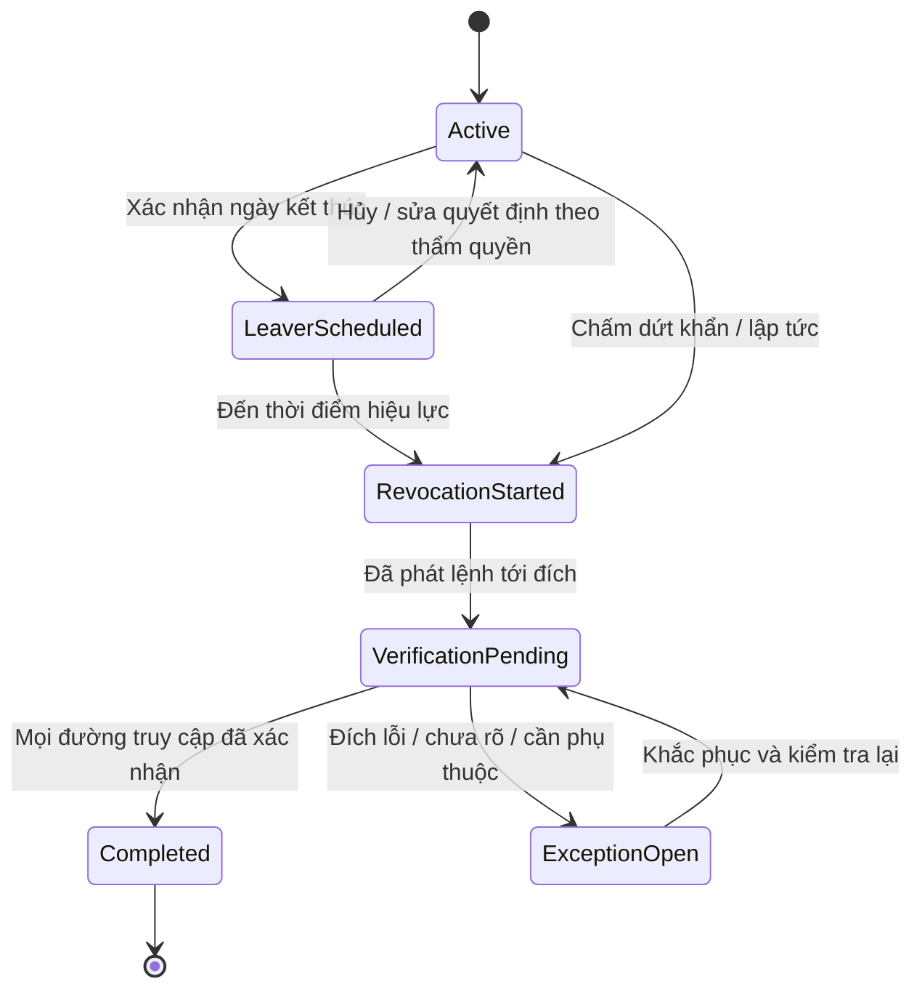
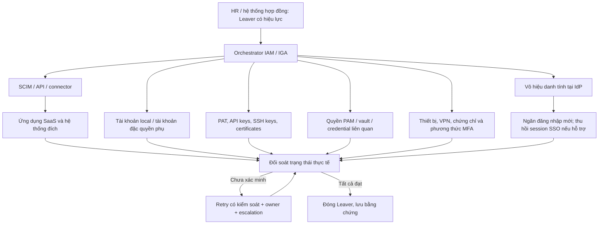

# Không thu hồi khi nghỉ việc: anti-pattern trong quản lý vòng đời danh tính IAM

## 1. Bản chất của anti-pattern

Trong quản lý danh tính và truy cập (**Identity and Access Management – IAM**), giai đoạn **Leaver** là lúc quan hệ làm việc, hợp đồng hoặc tư cách được cấp quyền của một cá nhân kết thúc. Hệ thống phải ngăn người đó tiếp tục dùng những đường truy cập gắn với quan hệ đã chấm dứt. **“Không thu hồi khi nghỉ việc”** là anti-pattern xảy ra khi tài khoản, phiên, quyền hoặc thông tin xác thực vẫn có thể sử dụng sau thời điểm phải kết thúc quyền.

Ví dụ, HR đã ghi nhân viên nghỉ việc và IdP đã khóa danh tính chính, nhưng nhân viên vẫn còn đăng nhập được ứng dụng bằng tài khoản local, dùng khóa API đã phát hành hoặc tiếp tục thao tác qua phiên SSO/ứng dụng còn sống. Quy trình offboarding đã có bước xử lý trên giấy nhưng **mục tiêu bảo mật chưa đạt**: người cũ vẫn có con đường truy cập thực tế.

Rủi ro không chỉ giới hạn ở người cố ý truy cập sau khi rời tổ chức. Thiết bị chưa thu hồi, token bị lộ, mật khẩu tài khoản dùng chung, tài khoản đặc quyền phụ và quyền truy cập tồn dư có thể bị người khác khai thác. Bài học thuộc chương **Anti-pattern IAM** tập trung vào cách phát hiện và loại bỏ các đường truy cập này, kết nối với kiến trúc **Joiner–Mover–Leaver (JML), IdP, SSO, SCIM, RBAC/ABAC, service account và kiểm toán**.

Sau bài học, bạn có thể:

- Phân biệt **disable tài khoản** với **thu hồi toàn bộ khả năng truy cập**.
- Liệt kê các loại tài khoản, quyền, phiên, token và bí mật phải được kiểm tra khi Leaver.
- Thiết kế quy trình offboarding theo sự kiện từ HR đến IdP và các ứng dụng đích.
- Xử lý trường hợp SCIM, SSO hoặc connector báo thành công nhưng quyền thực tế còn tồn tại.
- Kiểm tra bằng chứng thu hồi, kiểm soát ngoại lệ và giảm thời gian tồn tại của quyền truy cập sau nghỉ việc.

## 2. Những gì còn tồn tại sau ngày nghỉ việc

Một cá nhân có thể có nhiều danh tính và nhiều phương thức đăng nhập. Chúng hình thành trong suốt giai đoạn **Joiner** (cấp lần đầu), **Mover** (thêm, thay hoặc giữ quyền khi đổi vai trò) và các lần cấp tạm thời.

| Đường truy cập | Ví dụ tồn dư sau Leaver | Điểm kiểm tra quan trọng |
|---|---|---|
| **Danh tính chính tại IdP** | Tài khoản vẫn enabled; nhóm đặc quyền chưa gỡ | Trạng thái account, membership, authentication policy |
| **Phiên SSO và ứng dụng** | Browser/session cookie được chấp nhận dù IdP đã disable | Khả năng revoke session, timeout, logout tại ứng dụng |
| **Tài khoản local** | Admin ứng dụng có mật khẩu riêng ngoài SSO | Inventory và disable tại từng ứng dụng |
| **Quyền RBAC/ABAC** | Người cũ còn role hoặc thuộc tính cho phép vào tài nguyên | Quyền hiệu lực ở đích, nhóm lồng nhau, policy cache |
| **Token và khóa cá nhân** | Personal access token, API key, SSH key, cloud access key | Danh sách credential, revoke/rotate, audit lần dùng |
| **Tài khoản đặc quyền phụ** | Tài khoản `-admin` tách khỏi user thường | Liên kết mọi principal phụ với cùng một người |
| **Kho bí mật / PAM** | Người cũ còn quyền checkout secret hoặc biết mật khẩu chung | Quyền trên vault, phiên PAM, secret đã bị biết |
| **SaaS và tài khoản đối tác** | Ứng dụng chưa hỗ trợ SCIM hoặc đã bị gỡ khỏi SSO | Disable theo API/manual, kiểm tra local fallback |
| **VPN, máy chủ, database** | VPN profile, bastion session, database credential | Trạng thái kết nối, key, certificate, quyền local |
| **Thiết bị, chứng chỉ, MFA** | Thiết bị được tin cậy hoặc chứng chỉ dùng được độc lập | Thu hồi chứng chỉ/thiết bị phù hợp và phương thức MFA |
| **Chia sẻ tài khoản** | Người nghỉ việc vẫn biết mật khẩu tài khoản dùng chung | Đổi/thu hồi credential, kiểm soát toàn bộ session/token |
| **Danh tính workload** | Token do người cũ tự quản hoặc service account không còn owner | Bàn giao owner, kiểm kê phụ thuộc và xoay vòng secret |

**Xóa nhân viên khỏi bảng HR, khóa email hoặc disable IdP không đồng nghĩa với kết thúc mọi quyền.** Mỗi đường truy cập phải được kiểm tra theo cách hệ thống đó thực sự xác thực và phân quyền.

## 3. Tình huống thực tế: một lần Leaver chưa hoàn tất

Giả sử một kỹ sư vận hành tên Nam có các quyền:

1. Tài khoản công ty `nam.nguyen` trong IdP, dùng SSO/MFA để đăng nhập.
2. Thành viên nhóm `prod-operators`, được đồng bộ đến một phần ứng dụng qua SCIM.
3. Một tài khoản `nam-admin` để quản trị hệ thống legacy, không liên kết SSO.
4. Personal access token cho kho mã; SSH key trên bastion; cloud access key từng tạo để chạy thử.
5. Quyền đọc secret của một service account và một phiên ứng dụng tồn tại đến 24 giờ.

Ngày 15/6, HR xác nhận Nam nghỉ việc. Hệ thống nhận sự kiện và vô hiệu `nam.nguyen` tại IdP. Tuy nhiên, tác vụ provisioning tới ứng dụng legacy không tồn tại, token của kho mã chưa bị thu hồi và SSH public key vẫn có trên máy chủ.

Ngày 16/6, Nam không còn đăng nhập SSO mới được, nhưng **token kho mã hoặc tài khoản admin local vẫn có thể sử dụng**. Báo cáo “IdP disabled: success” vì thế chỉ chứng minh **một phần** của quy trình Leaver.

Trạng thái mong muốn và kết quả thực tế có thể mô tả:

```text
HR employment status: TERMINATED
IdP user: DISABLED                       -> PASS ở lớp IdP
SSO sessions: revocation unknown         -> CHƯA XÁC MINH
Legacy admin: ACTIVE                     -> FAIL
Code repository personal token: ACTIVE   -> FAIL
Bastion authorized_keys: contains old key -> FAIL
SCIM applications: 9/10 confirmed        -> 1 MỤC TỒN ĐỌNG
```

Một quy trình tốt phải cho biết **tài nguyên nào đã hoàn tất, tài nguyên nào chưa, ai chịu trách nhiệm và khi nào phải xử lý**. Không được gộp tất cả thành một trạng thái “offboarding thành công” chỉ vì webhook HR hoặc lời gọi API đầu tiên đã trả về HTTP 200.

## 4. Vì sao anti-pattern hình thành?

### 4.1. Vòng đời bị tách rời giữa HR, IdP và ứng dụng

HR biết thời điểm kết thúc quan hệ làm việc, nhưng IAM không nhận sự kiện kịp thời; dữ liệu HR thiếu ID liên kết; job chạy hàng đêm có độ trễ lớn; ứng dụng SaaS không có connector; hoặc danh tính ở ứng dụng không được ánh xạ đúng với principal của IdP. Một người có thể có nhiều email/username khác nhau nên việc dò theo email đơn thuần dễ bỏ sót.

### 4.2. Chỉ triển khai provisioning, thiếu deprovisioning

Tạo user lúc Joiner thường được ưu tiên vì giúp nhân sự làm việc ngay. Đến Leaver, quy trình có thể chỉ disable account ở IdP, còn các thao tác gỡ role, xóa group, revoke credential và kiểm tra ứng dụng đích không có owner hoặc không được tự động hóa.

### 4.3. Phụ thuộc sai vào SSO

SSO thường ngăn đăng nhập mới khi IdP disable, nhưng ứng dụng có thể:

- Tiếp tục chấp nhận **phiên đã tạo trước đó**.
- Có **đăng nhập local** hoặc tài khoản quản trị nằm ngoài SSO.
- Dùng token riêng của ứng dụng, không tra cứu IdP mỗi lần.
- Cache quyền hoặc thông tin nhóm trong khoảng dài.

Không có cơ chế logout hoặc vô hiệu hóa tại đích thì việc khóa IdP không bảo đảm ngừng truy cập ngay.

### 4.4. Quyền tích lũy qua nhiều lần Mover

Nhân sự chuyển vai trò nhưng quyền cũ không được gỡ. Đến khi Leaver, danh sách cấp quyền chính thức có thể chỉ phản ánh vai trò gần nhất, trong khi người đó vẫn có quyền trực tiếp ở hệ thống cũ, tài khoản phụ, khóa API hoặc quyền chia sẻ ngoài chính sách.

### 4.5. Không rõ owner, không có kiểm tra cuối

Ứng dụng không có owner nhận yêu cầu, người quản lý nghỉ việc, vendor không phản hồi hoặc IAM không biết ai được phép thu hồi secret đang dùng. Ticket Leaver bị đóng theo điều kiện “đã gửi yêu cầu”, không dựa trên bằng chứng quyền đã biến mất.

### 4.6. Dùng chung thông tin xác thực

Nhiều người biết một mật khẩu hoặc secret. Khi một người rời tổ chức, disable danh tính cá nhân không làm họ quên credential đã biết. Nếu vẫn bắt buộc sử dụng account chung, cần kiểm soát qua vault/PAM, rotation và phiên có thể truy vết; về lâu dài nên chuyển người dùng sang principal riêng.

## 5. Rủi ro kỹ thuật và nghiệp vụ

| Rủi ro | Diễn giải | Hệ quả |
|---|---|---|
| **Truy cập trái phép sau nghỉ việc** | Quan hệ làm việc đã kết thúc nhưng quyền vẫn hoạt động | Xem, sửa, xóa hoặc xuất dữ liệu không còn được phép |
| **Đặc quyền tồn dư** | Role cao, admin phụ hoặc quyền cloud không được gỡ | Sai sót hoặc xâm nhập có phạm vi ảnh hưởng lớn |
| **Rò rỉ dữ liệu qua token** | Credential không gắn với phiên SSO hiện tại | Truy cập API có thể tiếp tục dù tài khoản IdP bị khóa |
| **Không thể quy trách nhiệm** | Account dùng chung, log không phân biệt từng người | Điều tra và kiểm toán khó xác định chủ thể |
| **Vi phạm phân nhiệm SoD** | Role cũ cộng với quyền khác còn tồn tại | Một danh tính có khả năng thực hiện thao tác xung đột |
| **Sai số báo cáo tuân thủ** | Hệ thống đếm `DISABLE_REQUESTED` là đã hoàn tất | Rủi ro thực tế bị che khuất bởi chỉ số thành công ảo |
| **Gián đoạn dịch vụ khi xử lý nóng** | Xóa nhầm service account hoặc key đang chạy production | Job bị ngắt và hệ thống không sẵn sàng |

Mục tiêu kiểm soát là **thu hồi đúng quyền, đúng người, đúng thời điểm và xác nhận tại đích**, đồng thời tránh xóa nhầm danh tính của workload đang hoạt động.

## 6. Nguồn chuẩn và trạng thái vòng đời

Quy trình Leaver cần một **nguồn thẩm quyền** về tình trạng nhân sự, chẳng hạn HRIS hoặc nguồn quản lý danh tính đối tác/hợp đồng. Dữ liệu nên gồm mã người ổn định, thời điểm hiệu lực, loại quan hệ làm việc, đơn vị và người quản lý/sponsor.

Không nên chỉ dựa vào email hoặc tên hiển thị vì chúng có thể thay đổi hoặc trùng. Cần một **mã định danh liên kết ổn định** từ HR tới IdP và các ứng dụng. Với nhân sự quay lại (*rehire*), phải có quy tắc rõ về tái kích hoạt hay cấp lại, tránh vô tình khôi phục mọi quyền cũ chưa được xác minh.

Một mô hình trạng thái đơn giản:



**Không đồng nhất “Leaver được lên lịch” với “được phép khóa ngay”.** Với nghỉ việc theo kế hoạch, chính sách nhân sự có thể yêu cầu tài khoản còn hoạt động cho đến thời điểm hiệu lực. Với chấm dứt khẩn cấp, có thể cần vô hiệu ngay. Thời điểm xử lý phải lấy từ nguồn được ủy quyền, lưu múi giờ rõ ràng và áp dụng các quy tắc bảo mật thích hợp.

Nghỉ phép dài hạn, tạm đình chỉ, thay đổi hợp đồng hoặc Mover là các sự kiện khác với Leaver. Chúng có thể cần tạm khóa hoặc giảm quyền, nhưng không nên mặc định hủy mọi tài sản/dữ liệu của nhân viên như một quyết định chấm dứt quan hệ làm việc.

## 7. Luồng deprovisioning từ HR đến từng hệ thống đích



Quy trình trên yêu cầu nhiều nhánh độc lập vì các hệ thống có độ trễ và cơ chế revoke khác nhau. Không nên để lỗi của một SaaS ít quan trọng ngăn hành động khóa danh tính chính, nhưng cũng không được đánh dấu hoàn tất toàn bộ khi SaaS đó vẫn có quyền truy cập.

### Vai trò từng thành phần

- **HR hoặc hệ thống hợp đồng:** phát sự kiện với danh tính chính xác và thời gian hiệu lực.
- **IGA/IAM orchestrator:** tìm mọi account liên quan, phân công tác vụ, điều phối retry và giữ bằng chứng.
- **IdP:** vô hiệu danh tính, ngừng xác thực mới, quản lý group và phương thức đăng nhập mà IdP kiểm soát.
- **SSO:** ngừng cấp đăng nhập mới; dùng khả năng logout/session revocation được hỗ trợ, kết hợp xử lý phiên ứng dụng.
- **SCIM/connector:** truyền thao tác deactivation hoặc gỡ quyền tới những hệ thống thực sự được tích hợp.
- **PAM/secret manager:** đóng quyền lấy secret, phiên đặc quyền; xử lý các secret chung từng được biết.
- **Ứng dụng đích:** vô hiệu user local, token và quyền nếu chúng độc lập; trả trạng thái để đối soát.
- **Resource/business owner:** xác nhận đối tượng, tài khoản phụ và ngoại lệ nghiệp vụ, phối hợp xử lý hệ thống legacy.
- **Security/SOC:** giám sát sử dụng bất thường và kích hoạt ứng cứu khi phát hiện truy cập trái phép.

## 8. SCIM, SSO và IdP: hiểu đúng giới hạn

### 8.1. SCIM không phải “công tắc thu hồi toàn bộ”

Với SCIM 2.0, một cách thường thấy để vô hiệu user là cập nhật thuộc tính `active` sang `false`. Việc một endpoint hỗ trợ SCIM không bảo đảm hỗ trợ đầy đủ mọi thao tác về group, entitlement, token hoặc session; hành vi của từng ứng dụng phải được kiểm thử.

Ví dụ payload **minh họa** của SCIM PATCH:

```http
PATCH /scim/v2/Users/281
Content-Type: application/scim+json
Authorization: Bearer <service-token>

{
  "schemas": ["urn:ietf:params:scim:api:messages:2.0:PatchOp"],
  "Operations": [
    { "op": "replace", "path": "active", "value": false }
  ]
}
```

Trong triển khai thật, token/endpoint phải được quản lý an toàn. Phản hồi thành công cần được xác nhận lại qua trạng thái user ở ứng dụng; với hệ thống yêu cầu thêm tác vụ xóa quyền hoặc revoke phiên, phải thực hiện riêng. Một số ứng dụng giữ account ở trạng thái inactive để bảo toàn dữ liệu và lịch sử kiểm toán, đây có thể là hành vi hợp lệ.

### 8.2. Ngừng xác thực mới không có nghĩa mọi phiên cũ chết ngay

Khi IdP disable user, khả năng login mới qua SSO thường bị chặn. Tuy nhiên:

1. Ứng dụng có thể giữ **session cookie** riêng và chưa hỏi IdP lại.
2. Access token dạng JWT tự chứa có thể được dịch vụ chấp nhận đến khi hết hạn nếu không có kiểm tra revocation/trạng thái chủ thể.
3. Refresh token cần được thu hồi theo cơ chế của issuer/ứng dụng; nếu không, nó có thể tiếp tục tạo access token.
4. App cũ có thể cho phép login local hoặc dùng mật khẩu đã lưu độc lập.
5. Quyền trong token hoặc cache có thể chưa phản ánh việc gỡ nhóm.

Giải pháp tùy nền tảng: session revocation, logout ở ứng dụng, token introspection/denylist hoặc token TTL ngắn, kiểm tra quyền tại thời điểm sử dụng và vô hiệu account tại chính ứng dụng. **Không giả định có thể “xóa” mọi JWT đã phát hành từ xa** nếu bộ xác minh token không có khả năng kiểm tra thu hồi.

### 8.3. RBAC/ABAC cũng phụ thuộc vào dữ liệu và nơi thực thi

Gỡ user khỏi nhóm RBAC tại IdP là cần thiết, nhưng ứng dụng có thể giữ role local hoặc quyền kế thừa từ nhóm khác. Với ABAC, thuộc tính `employmentStatus` hoặc `contractEndAt` chỉ chặn truy cập nếu policy engine nhận dữ liệu mới và đánh giá thực sự tại đích. Với mỗi tài nguyên quan trọng, cần xem **effective permissions**, không chỉ xem danh sách nhóm mong muốn.

## 9. Quy trình Leaver chuẩn theo từng giai đoạn

### Bước 1 — Tiếp nhận và xác minh sự kiện

Nhận sự kiện Leaver từ nguồn có thẩm quyền. Kiểm tra employee/contractor ID, mã principal, loại kết thúc, thời điểm hiệu lực, cấp độ khẩn và dữ liệu liên quan. Nếu sự kiện trùng, phải xử lý **idempotent** để không phá trạng thái; nếu sự kiện hủy hoặc đổi ngày, phải áp dụng quy tắc phê duyệt rõ ràng.

Không cho một email tự khai báo, thay đổi từ hệ thống không tin cậy hoặc dữ liệu nhập thiếu kiểm tra tự động vô hiệu danh tính quan trọng.

### Bước 2 — Lập bản đồ toàn bộ định danh và entitlement

Đối chiếu một người với:

- User chính trong IdP, danh tính phụ, tài khoản admin, tài khoản local và danh tính ở tenant/môi trường khác.
- Nhóm, role và quyền trực tiếp trên SaaS, cloud, database, repository, VPN, bastion và hệ thống legacy.
- Phiên hoạt động, phương thức MFA, thiết bị được quản lý và chứng chỉ có khả năng tạo kết nối độc lập.
- PAT, API key, SSH key, private key/certificate được cấp cho cá nhân, bot token do người đó kiểm soát.
- Các hệ thống người đó làm owner, tài khoản dịch vụ họ quản trị, secret họ có thể biết, đối tác họ làm sponsor.

Danh sách phải được cập nhật trong suốt vòng đời; **đợi đến ngày nghỉ việc mới khám phá tất cả tài khoản** thường dẫn đến bỏ sót.

### Bước 3 — Vô hiệu danh tính và chặn đường vào ưu tiên

Tại thời điểm có hiệu lực, vô hiệu principal chính, ngăn xác thực mới, thu hồi quyền truy cập mạng/thiết bị phù hợp và xử lý session IdP. Với nguy cơ cao, ưu tiên các hệ thống chứa dữ liệu nhạy cảm và đặc quyền production; áp dụng hành động đồng thời trong phạm vi kỹ thuật cho phép.

Hệ thống nên ghi lại thời điểm nhận sự kiện, thời điểm phát lệnh và thời điểm đích xác nhận, để phân biệt **độ trễ điều phối** với **độ trễ thực thi**.

### Bước 4 — Thu hồi ở ứng dụng, đặc quyền và credential

Thực thi SCIM hoặc API theo từng connector; gỡ role local, user/nhóm ở ứng dụng chưa tích hợp; revoke tài khoản admin phụ, token, SSH key, API key và quyền checkout secret. Nếu một secret dùng chung từng được người rời tổ chức biết, đánh giá rotation và loại bỏ các session sử dụng secret cũ; cần phối hợp với owner để tránh gián đoạn dịch vụ.

### Bước 5 — Xử lý ownership và phụ thuộc dịch vụ

Người nghỉ việc có thể là owner của role, application, workload, credential, khách hàng đối tác hoặc tài khoản break-glass. **Bàn giao trách nhiệm owner** cho người có thẩm quyền, cập nhật người nhận alert và người phê duyệt, đồng thời thu hồi quyền cá nhân của người cũ.

Không xóa service account chỉ vì owner cũ nghỉ việc: service account có thể vẫn chạy nghiệp vụ. Phải xác định workload và owner mới, giảm quyền khi cần, xoay vòng secret nếu người cũ biết và thu hồi đường quản trị mà họ từng có.

### Bước 6 — Xác minh kết quả và xử lý ngoại lệ

Với mỗi đích, phân biệt:

| Trạng thái | Ý nghĩa |
|---|---|
| `PENDING` | Chưa đến thời điểm hoặc chưa bắt đầu thao tác |
| `REVOKE_REQUESTED` | Đã phát yêu cầu, **chưa có bằng chứng tại đích** |
| `REVOKED_UNVERIFIED` | API báo thành công nhưng chưa xác nhận được quyền hiệu lực |
| `VERIFIED_REVOKED` | Đã kiểm tra quyền/credential/phiên liên quan không còn dùng được theo tiêu chí đã định |
| `EXCEPTION_OPEN` | Đích lỗi, chưa hỗ trợ, còn phụ thuộc hoặc cần xử lý thủ công |
| `NOT_APPLICABLE` | Đã chứng minh đối tượng không có account/quyền ở đích này |

Chỉ đóng Leaver là **hoàn tất kỹ thuật** khi tất cả đường truy cập được kiểm kê đã được xác minh, hoặc có ngoại lệ được phê duyệt và quản trị theo chính sách; nếu còn ngoại lệ, cần hiển thị rõ trạng thái **chưa hoàn tất toàn bộ**. Đối tượng `NOT_APPLICABLE` không được dùng để che việc thiếu dữ liệu kiểm kê.

## 10. Thiết kế dữ liệu và lệnh thu hồi idempotent

Một sổ theo dõi có thể ghi các thành phần sau. Đây là schema **minh họa để học**, không phải API chuẩn của SCIM hay nhà cung cấp IAM:

```yaml
leaverCase:
  caseId: "OFF-2026-0615-0081"
  personId: "person:0081"
  source: "HRIS"
  eventType: "EMPLOYMENT_TERMINATED"
  effectiveAt: "2026-06-15T17:00:00+07:00"
  severity: "NORMAL"
  orchestrationState: "EXCEPTION_OPEN"
  targets:
    - target: "corporate-idp"
      principal: "nam.nguyen"
      requiredActions:
        - "DISABLE_USER"
        - "REVOKE_SESSIONS"
      status: "VERIFIED_REVOKED"
      verifiedAt: "2026-06-15T10:01:05Z"
    - target: "legacy-admin"
      principal: "nam-admin"
      requiredActions:
        - "DISABLE_LOCAL_LOGIN"
      status: "EXCEPTION_OPEN"
      owner: "team:legacy-operations"
      reason: "API không hỗ trợ disable; cần thao tác có kiểm soát"
    - target: "code-hosting"
      principal: "nam.nguyen"
      requiredActions:
        - "REVOKE_PERSONAL_TOKENS"
      status: "REVOKED_UNVERIFIED"
  evidence:
    requestId: "SEC-1724"
    sourceEventId: "HR-TERM-0081-3"
```

Trong ví dụ, `effectiveAt` biểu diễn thời điểm hiệu lực ở múi giờ Việt Nam; thời điểm ghi audit dùng UTC. Các trường và giá trị phải được so sánh dưới dạng thời điểm tuyệt đối có offset, tránh lỗi múi giờ hoặc lệnh chạy sớm/chậm.

Một thuật toán điều phối dạng mã giả:

```text
function handleLeaver(event):
    assertTrustedSource(event)
    person = resolveStablePersonId(event)
    case = upsertLeaverCase(person, event.id, event.effectiveAt)

    if now() < case.effectiveAt and not case.isImmediateTermination:
        scheduleAt(case.effectiveAt)
        return SCHEDULED

    targets = discoverLinkedAccountsAndCredentials(person)
    for target in targets:
        revokeResult = revokeIdempotently(target, case.id)
        saveAttemptAndCorrelationId(target, revokeResult)

    for target in targets:
        verification = verifyEffectiveAccessRevoked(target)
        if verification.proven:
            markTargetVerified(target)
        else:
            markExceptionAndRouteToOwner(target, verification.reason)

    return summarizeActualCoverageAndOpenExceptions(case)
```

Không nên chỉ dùng trạng thái thành công của API để kết luận. Việc kiểm tra lại cũng cần chịu được **event được gửi trùng, event đến sai thứ tự, connector timeout hoặc lỗi mạng tạm thời**. Idempotent không đồng nghĩa bỏ qua xác minh khi lệnh được lặp lại.

## 11. Bằng chứng thu hồi ở hệ thống đích

Một kiểm soát Leaver tốt phải nối được chuỗi:

```text
HR / hợp đồng xác nhận kết thúc quan hệ
  -> mã người và thời điểm hiệu lực
  -> tập account + entitlement + credential liên quan
  -> yêu cầu vô hiệu / thu hồi / đổi secret
  -> phản hồi từ hệ thống đích
  -> đọc lại trạng thái / kiểm tra quyền hiệu lực
  -> đóng sự kiện hoặc mở ngoại lệ có owner và hạn xử lý
```

**Bằng chứng nên bao gồm** `caseId`, `sourceEventId`, ID principal, target, action, request/correlation ID, thời điểm, kết quả, owner và phiên bản chính sách. Cần bảo vệ log khỏi sửa/xóa trái phép; không ghi secret, token đầy đủ hoặc thông tin nhạy cảm không cần thiết vào log.

Ví dụ:

```text
2026-06-15T10:00:00Z event=LEAVER_EFFECTIVE person=person:0081
2026-06-15T10:00:02Z target=idp action=DISABLE requested case=OFF-0081
2026-06-15T10:00:03Z target=idp action=DISABLE api_result=SUCCESS
2026-06-15T10:01:05Z target=idp verification=DISABLED_AND_SESSION_REVOKED
2026-06-15T10:01:09Z target=legacy-admin verification=ACTIVE exception=OPEN
2026-06-15T10:01:12Z case=OFF-0081 state=EXCEPTION_OPEN
```

Không nên dùng kiểm thử truy cập bằng credential thực của người đã nghỉ việc nếu việc đó làm lộ thông tin hoặc vi phạm chính sách. Tùy hệ thống, có thể đối chiếu role hiện hành, token inventory, session inventory hoặc thực hiện bài kiểm thử âm tính được phê duyệt với danh tính thử nghiệm. Kiểm tra phải có mức độ tin cậy và giới hạn rõ ràng.

## 12. Phát hiện quyền tồn dư bằng đối soát dữ liệu

Giả sử hệ thống có các bảng `people`, `account_links`, `target_accounts` và `access_grants`. Các truy vấn SQL dưới đây chỉ minh họa cách suy nghĩ, theo cú pháp gần PostgreSQL.

### 12.1. Người đã nghỉ nhưng account tại đích còn active

```sql
SELECT p.person_id,
       p.terminated_at,
       a.target_system,
       a.target_principal,
       a.account_status
FROM people p
JOIN account_links l ON l.person_id = p.person_id
JOIN target_accounts a ON a.account_id = l.account_id
WHERE p.employment_status = 'TERMINATED'
  AND p.terminated_at <= CURRENT_TIMESTAMP
  AND a.account_status = 'ACTIVE';
```

Đây là **danh sách cần xử lý**. Chú ý dữ liệu danh tính đối tác hoặc hợp đồng ngắn hạn có thể nằm ngoài HR của nhân viên; cần bổ sung nguồn tương ứng. Account bị disable nhưng còn credential độc lập không nhất thiết xuất hiện trong truy vấn này.

### 12.2. Quyền vẫn active sau thời điểm kết thúc

```sql
SELECT p.person_id,
       g.target_system,
       g.entitlement_id,
       g.grant_status,
       g.last_verified_at
FROM people p
JOIN access_grants g ON g.person_id = p.person_id
WHERE p.employment_status = 'TERMINATED'
  AND p.terminated_at <= CURRENT_TIMESTAMP
  AND g.grant_status = 'ACTIVE';
```

Khi dùng dữ liệu `access_grants` từ IAM, cần phân biệt **desired state** với **actual state** được đối soát tại đích. Nếu ứng dụng có quyền qua group lồng nhau hoặc policy kế thừa, đánh giá quyền hiệu lực thay vì chỉ dò grant trực tiếp.

### 12.3. Tài khoản đã disable nhưng token còn hiệu lực

```sql
SELECT c.person_id, c.target_system, c.credential_type,
       c.credential_id, c.expires_at
FROM credentials c
JOIN people p ON p.person_id = c.person_id
WHERE p.employment_status = 'TERMINATED'
  AND p.terminated_at <= CURRENT_TIMESTAMP
  AND c.revoked_at IS NULL
  AND (c.expires_at IS NULL OR c.expires_at > CURRENT_TIMESTAMP);
```

Truy vấn trả về token/credential *có thể còn hợp lệ* dựa trên metadata. Nó không chứng minh chắc chắn token được chấp nhận bởi hệ thống; ngược lại, token không có trong inventory cũng không bảo đảm đã thu hồi. Cần kiểm tra issuer, ứng dụng đích và phiên đang hoạt động theo khả năng hỗ trợ.

### 12.4. Phát hiện sử dụng sau Leaver

Một cảnh báo mạnh hơn có thể dựa trên log **sự kiện sử dụng được chấp nhận** sau thời điểm chấm dứt, đã loại trừ những hoạt động máy hợp lệ và tránh nhầm ID:

```sql
SELECT e.person_id, e.target_system,
       e.event_time, e.action, e.session_id
FROM access_events e
JOIN people p ON p.person_id = e.person_id
WHERE p.employment_status = 'TERMINATED'
  AND e.event_time >= p.terminated_at
  AND e.outcome = 'ALLOWED';
```

Nếu phát hiện hành động được cho phép sau thời điểm thu hồi, phải xác minh nguồn log, độ lệch đồng hồ, ngữ cảnh ứng dụng và quan hệ actor–person; khi đáng tin cậy, mở điều tra và có thể kích hoạt incident response.

## 13. Ngoại lệ: hệ thống legacy, đối tác và kết thúc hợp đồng

### 13.1. Ứng dụng chưa hỗ trợ SCIM hoặc API thu hồi

Có thể tạo tác vụ thủ công gắn owner, quyền tối thiểu của người thao tác, thời hạn xử lý, bằng chứng màn hình/API và kiểm tra lại trạng thái. Cần có kiểm soát kỹ thuật bù trừ như chặn VPN/bastion hoặc vô hiệu cơ chế đăng nhập upstream nếu phù hợp; không lấy các biện pháp này làm bằng chứng tài khoản local đã bị disable.

Đối với ứng dụng trọng yếu không thể vô hiệu user kịp thời, ưu tiên đưa vào kế hoạch tích hợp, di trú hoặc giới hạn đường truy cập có kiểm soát. Ngoại lệ phải có ngày hết hạn, người chấp nhận rủi ro đúng thẩm quyền và kế hoạch xử lý.

### 13.2. Nhân sự hợp đồng, nhà cung cấp và người ngoài

Không phải mọi Leaver đều xuất phát từ HR của nhân viên chính thức. Nhà thầu và đối tác cần sponsor nội bộ, thời hạn quyền theo hợp đồng/dự án và sự kiện chấm dứt từ nguồn được ủy quyền. Khi hợp đồng hết hoặc sponsor nghỉ việc, phải xác nhận lại quyền, đổi sponsor hoặc thu hồi theo chính sách. Không cho account bên ngoài tồn tại vô thời hạn chỉ vì thiếu thông báo từ HR.

### 13.3. Người nghỉ việc là owner của service account

Service account thuộc **workload**, không nhất thiết thuộc cá nhân nghỉ việc. Leaver phải gỡ quyền cá nhân của người cũ đối với vault, cloud, pipeline và hệ thống quản trị; chuyển business/technical owner cho người có thẩm quyền, kiểm tra credential nào người cũ từng biết và xoay vòng nếu cần. Xóa service account đang chạy production mà chưa phân tích dependency có thể làm ngừng dịch vụ.

### 13.4. Bảo toàn dữ liệu và khả năng điều tra

**Thu hồi quyền truy cập không đồng nghĩa xóa ngay dữ liệu hoặc lịch sử tài khoản.** Tùy yêu cầu nghiệp vụ, pháp lý và chính sách lưu giữ, ứng dụng có thể giữ một user inactive và log để kiểm toán, điều tra hoặc bàn giao dữ liệu; vẫn phải bảo đảm user đó không thể dùng để truy cập trái phép. Nội dung mailbox/file cần được chuyển quyền hoặc lưu giữ theo quy trình có thẩm quyền.

## 14. Kiểm soát sự cố khi phát hiện Leaver vẫn truy cập được

Khi phát hiện credential hoặc session của người đã nghỉ vẫn được chấp nhận, cần xử lý theo mức rủi ro và tính xác thực của bằng chứng:

1. **Khoanh vùng:** xác định người, account, target, credential, thời điểm kết thúc và hành động được cho phép.
2. **Giảm khả năng truy cập ngay:** disable account đích, revoke token/session/khóa và giới hạn kết nối theo quyền được ủy quyền; ưu tiên đường có đặc quyền hoặc dữ liệu nhạy cảm.
3. **Bảo toàn bằng chứng:** giữ log, ID sự kiện, các mốc thời gian, chính sách và kết quả điều tra; không ghi lại token bí mật nguyên văn.
4. **Xác định phạm vi:** tìm các account, thiết bị, nhóm và secret khác gắn với người đó; kiểm tra có hành vi truy cập ngoài dự kiến hay không.
5. **Khắc phục nguyên nhân:** sửa mapping HR–IdP–target, connector, token revoke, session TTL, policy hoặc quy trình owner.
6. **Xác minh và báo cáo:** kiểm tra quyền hiệu lực tại từng đích, cập nhật trạng thái incident/Leaver, đưa nguyên nhân lặp lại vào kiểm soát phòng ngừa.

Một sự kiện `ALLOWED` sau nghỉ việc chưa tự chứng minh đã có đánh cắp hoặc sử dụng ác ý, nhưng là tín hiệu phải điều tra. Không bỏ qua chỉ vì có log cho thấy account IdP đã disable.

## 15. Kiểm thử end-to-end và tiêu chí nghiệm thu

Không đủ kiểm thử một API `disableUser`. Cần **mô phỏng toàn chuỗi** với danh tính thử nghiệm có quyền ở nhiều hệ thống và phiên/token được tạo trước:

| Kiểm thử | Điều kiện ban đầu | Kết quả cần chứng minh |
|---|---|---|
| **Đăng nhập mới qua SSO** | User thử nghiệm có session IdP | Bị từ chối sau mốc Leaver có hiệu lực |
| **Phiên ứng dụng còn sống** | Đã đăng nhập trước khi Leaver | Vô hiệu đúng theo thiết kế và thời hạn chấp nhận |
| **Access/refresh token** | Token còn thời hạn | Revoke/timeout hoặc từ chối ở đích trong giới hạn chính sách |
| **SCIM deactivation** | SaaS provisioned user | User inactive tại SaaS; xác minh quyền local liên quan |
| **Tài khoản quản trị phụ** | Principal `user-admin` liên kết với cùng người | Bị vô hiệu dù không nằm trong tài khoản IdP chính |
| **SSH/API key** | Credential đã cấp cho cá nhân | Không còn được chấp nhận; đã gỡ ở các đích liên quan |
| **RBAC/group nested** | User có quyền gián tiếp | Effective permissions đã mất ở tài nguyên được bảo vệ |
| **Connector lỗi hoặc timeout** | Một đích tạm mất kết nối | Mở ngoại lệ có owner, retry, không đóng case giả |
| **Sự kiện trùng / sai thứ tự** | Gửi Leaver nhiều lần hoặc thay ngày hợp lệ | Xử lý idempotent, không tái cấp quyền ngoài phê duyệt |
| **Leaver là owner workload** | Service account vẫn phục vụ sản xuất | Owner được bàn giao; credential/quyền của cá nhân được thu hồi |

Trong hệ thống có quyền rủi ro cao, nên thử thời gian từ lúc sự kiện có hiệu lực đến lúc **quyền thực sự không còn dùng được tại đích**. Tách sự cố provisioning với việc không có dữ liệu kiểm kê; cả hai đều không nên được diễn giải thành hoàn tất.

### Các chỉ số hữu ích

- **Thời gian thu hồi hiệu lực thực tế:** từ `effectiveAt` đến mốc xác nhận tại đích, theo độ quan trọng của ứng dụng.
- **Tỷ lệ Leaver hoàn tất đúng hạn:** chỉ tính khi toàn bộ đích cần thiết đã được xác minh.
- **Số tài khoản/credential active thuộc người đã nghỉ:** phân loại theo privileged, cloud, SaaS, legacy.
- **Số phiên/sự kiện được cho phép sau Leaver:** đo theo mức độ nghiêm trọng, có điều tra loại trừ false positive.
- **Tỷ lệ connector có kiểm tra deprovisioning end-to-end** và **số ngoại lệ quá hạn có owner**.
- **Tỷ lệ account không được ánh xạ về người** hoặc có owner inactive, vì chúng thường làm tăng nguy cơ bỏ sót.

Các mục tiêu thời gian (SLA/SLO) phải do tổ chức xác lập theo rủi ro và khả năng hệ thống. Không áp một ngưỡng chung cho mọi tài nguyên rồi coi thành công, vì token, session, API và ứng dụng legacy có cơ chế thực thi khác nhau.

## 16. Checklist thiết kế để không tái diễn

- [ ] Có nguồn HR/hợp đồng đủ thẩm quyền và mã người ổn định để phát sự kiện Leaver.
- [ ] Có thời điểm hiệu lực rõ ràng, hỗ trợ chấm dứt theo kế hoạch và khẩn cấp.
- [ ] Có inventory user chính, user phụ, local account, SaaS, cloud, khóa và tài khoản đối tác.
- [ ] Có owner nghiệp vụ và kỹ thuật cho mỗi ứng dụng/connector/ngoại lệ.
- [ ] IdP disable user, ngăn đăng nhập mới; xử lý phiên SSO theo khả năng nền tảng.
- [ ] SCIM hoặc connector thu hồi tại từng đích; đọc lại trạng thái sau tác vụ.
- [ ] Rà soát token, refresh token, PAT, API/SSH keys, chứng chỉ và quyền PAM/vault.
- [ ] Rà soát quyền role, group lồng nhau, quyền trực tiếp và policy ABAC hiệu lực.
- [ ] Có đường xử lý thủ công có bằng chứng với ứng dụng không tích hợp.
- [ ] Bàn giao owner cho role, app, workload, secret và sponsor của người nghỉ việc.
- [ ] Có retry idempotent, cảnh báo, escalation và trạng thái ngoại lệ chưa hoàn tất.
- [ ] Có báo cáo và kiểm thử xác nhận quyền **thực sự bị thu hồi** tại các hệ thống đích.

## 17. Câu hỏi tình huống tự đánh giá

**Tình huống A.** HR kết thúc hợp đồng lúc 17:00. IdP disable user thành công lúc 17:01 nhưng phiên ứng dụng vẫn truy cập dữ liệu tới 22:00. Có thể kết luận Leaver hoàn tất lúc 17:01 không?

**Trả lời:** Không. Mới có bằng chứng vô hiệu tại IdP. Cần đánh giá phiên tại ứng dụng, khả năng invalidate, thời hạn cho phép và biện pháp thu hồi thực tế.

**Tình huống B.** Ứng dụng SaaS có SCIM và trả HTTP 200 khi gửi deactivation. Có cần kiểm tra thêm không?

**Trả lời:** Có. Kiểm tra user inactive tại SaaS, role local/credential và session theo khả năng ứng dụng. SCIM không bảo đảm thu hồi mọi token hoặc phiên độc lập.

**Tình huống C.** Một nhân viên nghỉ việc từng tạo service account dùng để chạy backup. Đội IAM thấy người tạo đã Leaver, nên xóa service account ngay. Quyết định có vấn đề gì?

**Trả lời:** Service account thuộc workload, có thể đang phục vụ production. Cần bàn giao owner, kiểm kê credential và phụ thuộc, thu hồi quyền cá nhân của nhân viên cũ rồi chuyển đổi an toàn.

**Tình huống D.** Một nhà thầu không có hồ sơ trong HRIS nhưng vẫn có user SaaS sau khi hợp đồng kết thúc. Làm thế nào tránh bỏ sót?

**Trả lời:** Dùng nguồn lifecycle đối tác/hợp đồng và sponsor nội bộ, liên kết mã danh tính với tài khoản SaaS, gắn thời hạn quyền và kiểm tra deprovisioning khi hết hợp đồng.

**Tình huống E.** Đội bảo mật thấy sự kiện API `ALLOWED` của user đã nghỉ, dù IdP đã disable. Bước đầu tiên là gì?

**Trả lời:** Xác nhận identity–event mapping, thời gian và nguồn log; nhanh chóng hạn chế đường truy cập còn hiệu lực theo rủi ro, lưu chứng cứ, mở điều tra và kiểm tra các credential/đích khác.

**Tình huống F.** Một connector liên tục timeout. Workflow Leaver ghi `SUCCESS` vì đã đẩy yêu cầu vào queue. Sai ở đâu?

**Trả lời:** Queue nhận lệnh không chứng minh đã thu hồi. Trạng thái phải phản ánh `REVOKE_REQUESTED` hoặc ngoại lệ, retry có kiểm soát và chỉ xác nhận hoàn tất khi hệ thống đích đã được đối soát.

## Kết luận

**“Không thu hồi khi nghỉ việc” là anti-pattern nghiêm trọng vì một quan hệ làm việc đã chấm dứt vẫn có thể để lại các đường truy cập sử dụng được.** Quy trình Leaver đúng cần bắt đầu từ dữ liệu danh tính đáng tin cậy, xác định mọi principal và entitlement gắn với cá nhân, disable tại IdP, ngăn SSO mới, xử lý SCIM và tài khoản local, thu hồi phiên/token/khóa, kiểm tra các quyền RBAC/ABAC còn hiệu lực và bàn giao ownership của workload. Bằng chứng cuối cùng phải là **trạng thái thực tế tại từng hệ thống đích**, có kiểm soát ngoại lệ và khả năng kiểm toán. Khi liên kết được Joiner–Mover–Leaver với thu hồi có xác minh, tổ chức mới thực sự giảm quyền truy cập tồn dư và duy trì tính quy trách nhiệm trong IAM.
