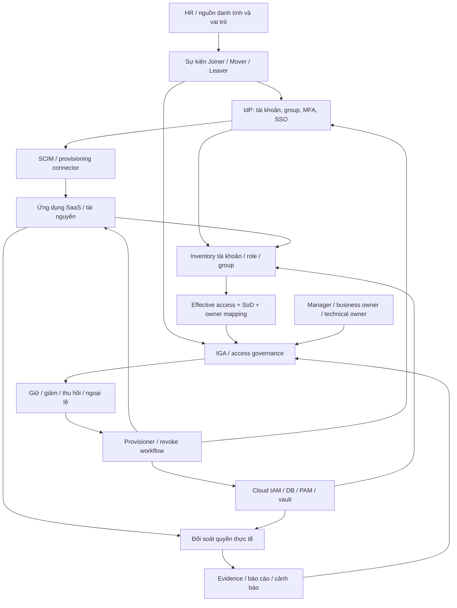
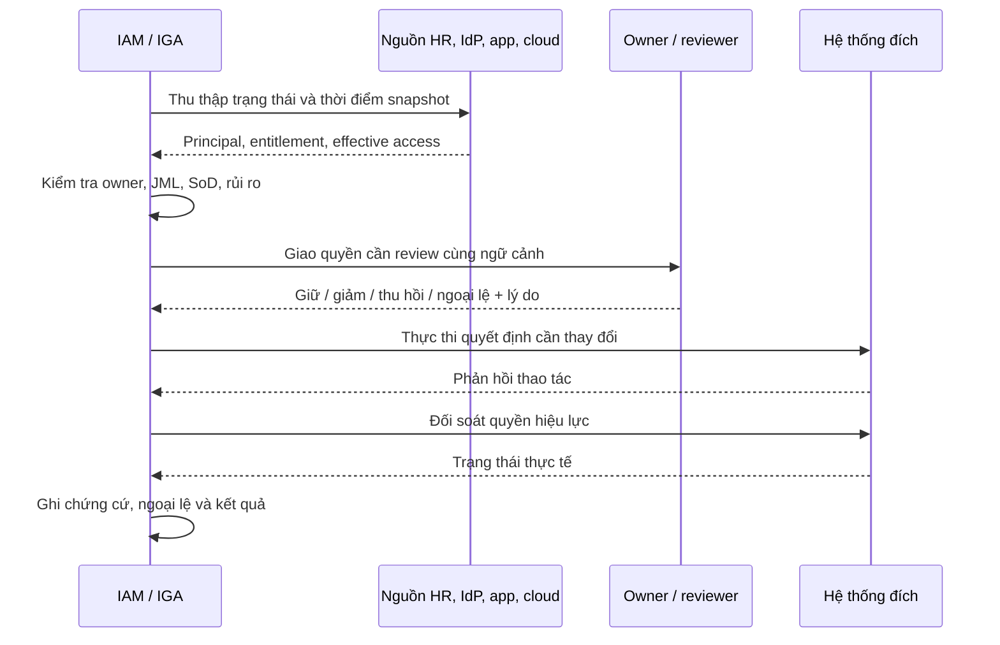

# Không review quyền: anti-pattern trong quản lý vòng đời danh tính IAM

## 1. Khái niệm và phạm vi

Trong **Identity and Access Management (IAM)**, *access review* hay *access certification* là quá trình có người đủ thẩm quyền **đánh giá lại quyền truy cập đang tồn tại** và quyết định quyền nào được giữ, giảm, thu hồi hoặc cần xử lý ngoại lệ. Review trả lời câu hỏi: **“Danh tính này có còn cần và được phép sử dụng quyền này tại thời điểm hiện tại không?”**

**Không review quyền** là anti-pattern khi tổ chức cấp quyền một lần rồi để quyền tiếp tục tồn tại mà thiếu cơ chế đánh giá lại có căn cứ, thiếu người chịu trách nhiệm chứng nhận hoặc không thực thi quyết định thu hồi. Tình trạng này đặc biệt nguy hiểm với đặc quyền quản trị, quyền xem dữ liệu nhạy cảm, quyền nhà thầu, tài khoản dịch vụ và hệ thống có nhiều con đường cấp quyền.

Ví dụ: khi vào công ty, nhân viên được thêm vào nhóm `finance-read`. Sau hai lần chuyển bộ phận, người đó vẫn thuộc nhóm, vẫn đọc được dữ liệu kế toán và không ai từng xác nhận quyền này còn cần thiết. Dù tài khoản có MFA, đăng nhập qua SSO và được đồng bộ bằng SCIM, **kiểm soát xác thực không tự trả lời được liệu quyền có còn phù hợp**.

Review quyền nằm trong tổng thể **Joiner–Mover–Leaver (JML)**:

- **Joiner:** xác minh danh tính, cấp quyền theo vai trò với căn cứ và người phê duyệt phù hợp.
- **Mover:** rà soát quyền cũ và quyền mới ngay khi vai trò, dự án hoặc phạm vi trách nhiệm thay đổi.
- **Leaver:** thu hồi quyền, phiên và credential; xác minh các tài khoản liên kết đã được xử lý.
- **Đang hoạt động:** định kỳ đối chiếu quyền thực tế với nhu cầu hiện tại; không phụ thuộc hoàn toàn vào các sự kiện HR.

Bài học giúp nhận diện anti-pattern, thiết kế review có bằng chứng, liên kết IdP/SSO/SCIM với RBAC/ABAC, xử lý tài khoản phi con người, tránh chứng nhận hình thức và đo mức giảm quyền truy cập tồn dư.

## 2. Vì sao phải review khi quyền đã được phê duyệt lúc cấp?

**Phê duyệt ban đầu** kiểm tra một yêu cầu tại một thời điểm; **review** kiểm tra quyền **đang tồn tại** trong bối cảnh mới. Sau ngày cấp quyền có thể xảy ra nhiều thay đổi:

1. Người dùng đổi vai trò, nhóm, đơn vị, địa điểm hoặc dự án.
2. Chính sách truy cập, phân loại dữ liệu hoặc mức rủi ro của ứng dụng thay đổi.
3. Role mới được tạo, nhóm cũ mở rộng phạm vi và quyền được kế thừa ngoài dự kiến.
4. Quyền tạm thời không được gỡ sau khi ticket kết thúc.
5. Owner của ứng dụng hoặc người phê duyệt đã nghỉ việc.
6. Nhân viên hoặc nhà thầu không còn sử dụng tài nguyên; tài khoản vẫn hoạt động do lỗi deprovisioning.
7. Khóa API, token và workload identity tiếp tục tồn tại sau khi ứng dụng hoặc integration ngừng hoạt động.

Review có giá trị khi phát hiện sự **lệch nhau giữa quyền cần có và quyền thực sự đang có** (*access drift*).

| Kiểm soát | Câu hỏi chính | Điểm dễ bỏ sót |
|---|---|---|
| Xác minh danh tính | Người này/workload này là ai? | Không xác định nhu cầu quyền |
| Authentication/MFA/SSO | Chủ thể có chứng minh được danh tính? | Không đánh giá entitlement có phù hợp |
| Phê duyệt cấp quyền | Có nên cấp quyền tại thời điểm yêu cầu? | Không bảo đảm quyền còn cần về sau |
| Provisioning/SCIM | Hệ thống đích đã nhận thay đổi được hỗ trợ? | Có thể còn quyền local và token ngoài phạm vi |
| **Access review** | Quyền hiện tại còn hợp lý, có owner và được chứng nhận? | Nếu không thực thi quyết định, review chỉ là giấy tờ |
| Kiểm toán sử dụng | Ai đã làm gì, khi nào, ở đâu? | Log hoạt động không chứng minh quyền chưa dùng là an toàn |
| Deprovisioning | Quyền phải rút đã mất hiệu lực tại đích? | Cần đối soát session, token và quyền hiệu lực |

Review quyền hỗ trợ nguyên tắc **đặc quyền tối thiểu** (*least privilege*), **phân nhiệm** (*Separation of Duties – SoD*) và khả năng giải trình. Nó không thay thế chính sách kiểm tra quyền trong thời gian thực hoặc thu hồi tự động theo JML.

## 3. Hậu quả của việc không review quyền

### 3.1. Quyền cũ cộng dồn qua nhiều lần Mover

Một người chuyển từ bộ phận vận hành sang phát triển rồi sang phân tích có thể vẫn giữ role của cả ba vị trí. Đây là *privilege creep*: quyền ngày càng rộng dù phạm vi công việc không tăng tương ứng. Khi một tài khoản bị xâm nhập, kẻ tấn công cũng được hưởng những đặc quyền tồn dư đó.

### 3.2. Xung đột phân nhiệm không được phát hiện

Giả sử role A cho phép **tạo lệnh thanh toán**, role B cho phép **phê duyệt lệnh thanh toán**. Hai role có thể hợp lệ riêng lẻ nhưng tổ hợp trên một người tạo rủi ro SoD. Nếu review chỉ nhìn từng nhóm riêng, người chứng nhận có thể bỏ qua xung đột phát sinh từ quyền kế thừa.

### 3.3. Quyền đặc biệt trở thành quyền thường trực

Một quyền admin production được cấp để xử lý sự cố vài giờ nhưng không có thời điểm hết hạn, không có review và không có JIT. Sau nhiều tháng, nó vẫn còn hoạt động mà không có owner xác nhận. Quyền “không được dùng” chưa chắc an toàn: token, mật khẩu hoặc phiên bị đánh cắp vẫn có thể khai thác.

### 3.4. Tài khoản và quyền không còn người chịu trách nhiệm

Nhóm SSO, tài khoản dịch vụ, hệ thống SaaS hoặc entitlement có thể còn hiện diện nhưng owner đã nghỉ việc. Nếu không review danh tính owner và mối quan hệ với ứng dụng, yêu cầu cấp/gỡ quyền có thể bị bỏ qua hoặc phê duyệt sai thẩm quyền.

### 3.5. Báo cáo tuân thủ đánh lừa

Dashboard có thể báo “100% access review completed” vì mọi người đã bấm nút chứng nhận. Tuy nhiên, nếu người duyệt không có thông tin, chọn *approve all* hoặc quyết định “revoke” không được thực thi ở đích, kết quả không phản ánh mức an toàn thực tế.

## 4. Ví dụ xuyên suốt: quyền đọc dữ liệu khách hàng sau Mover

Lan là nhân viên hỗ trợ khách hàng. Khi gia nhập, Lan được gán hai quyền:

- `support-console-read`: xem thông tin yêu cầu hỗ trợ.
- `customer-export`: xuất dữ liệu khách hàng để xử lý một dự án chuyển đổi ngắn hạn.

Ba tháng sau dự án kết thúc. Sáu tháng sau Lan chuyển sang đội đào tạo nội bộ. IdP cập nhật nhóm mới, nhưng quyền `customer-export` được cấp trực tiếp ở ứng dụng SaaS nên không bị gỡ. Đội IAM chỉ chạy báo cáo tài khoản inactive; tài khoản Lan vẫn active, vì vậy không có cảnh báo.

Đến kỳ review, owner cần thấy:

| Trường | Giá trị minh họa |
|---|---|
| Nhân viên | `user:lan.tran` |
| Vai trò hiện tại | Đào tạo nội bộ |
| Tài nguyên | CRM khách hàng |
| Quyền hiệu lực | `customer-export` |
| Nguồn cấp | Gán trực tiếp tại ứng dụng |
| Căn cứ ban đầu | Dự án chuyển đổi, đã kết thúc |
| Lần sử dụng gần nhất | Bốn tháng trước, nếu log đầy đủ |
| Business owner | Owner dữ liệu khách hàng |
| Quyết định đúng | Thu hồi quyền xuất dữ liệu |
| Bằng chứng hoàn tất | Gỡ entitlement tại CRM và xác nhận quyền không còn hiệu lực |

Điểm then chốt: **không thể kết luận review thành công chỉ vì owner chọn “Revoke”**. Tác vụ gỡ quyền phải được gửi đến ứng dụng, xử lý lỗi và đối soát trạng thái sau gỡ. Nếu một connector không quản lý được quyền gán trực tiếp, cần tác vụ bổ sung có owner.

## 5. Review quyền gì, theo đối tượng nào?

Review cần bao phủ **quyền hiệu lực** (*effective access*), chứ không chỉ các nhóm hiển thị tại IdP.

| Lớp cần review | Nội dung đánh giá | Rủi ro nếu bỏ qua |
|---|---|---|
| User ↔ application | Người nào đang có tài khoản ở ứng dụng; trạng thái active | Ghost account, account local không theo JML |
| User ↔ group/role | Tư cách thành viên và lý do tồn tại | Role cũ, quyền dư khi Mover |
| Role ↔ permission | Một role thật sự cho phép thao tác nào | Role bị mở rộng ngoài nhu cầu đã chứng nhận |
| Group nesting/role inheritance | Quyền kế thừa qua nhiều nhóm hoặc cấp tài nguyên | Reviewer không thấy đường quyền gián tiếp |
| Direct grants | Quyền cấp trực tiếp trên cloud, database, SaaS, repository | Không thu hồi bằng thay đổi nhóm IdP |
| Privileged access | Admin, IAM policy, production, bí mật, khả năng thay cấu hình | Tăng phạm vi ảnh hưởng nếu bị xâm nhập |
| SoD combinations | Các quyền xung đột khi kết hợp | Một chủ thể vừa tạo vừa phê duyệt |
| External identities | Nhà thầu, đối tác, guest, sponsor và hạn hợp đồng | Quyền còn hoạt động sau hết hạn |
| Non-human identities | Service principal, API key, automation, workload | Credential lâu năm, chủ sở hữu không còn |
| Emergency/exception | Break-glass, waiver, access đặc biệt | Ngoại lệ bị biến thành đường sử dụng hằng ngày |

Cùng một người có thể được cấp cùng một quyền từ **hai con đường**. Chẳng hạn gỡ thành viên nhóm `group-A` chưa làm mất quyền nếu người đó vẫn thuộc `group-B` hoặc có direct grant. Review và thu hồi phải xét toàn bộ đường dẫn có thể tạo ra quyền.

### Review truy cập không đồng nhất với review role

- **User access review:** từ người dùng đến tất cả quyền của họ, hữu ích khi Mover/Leaver hoặc kiểm tra bộ phận.
- **Resource review:** từ một ứng dụng, hệ thống hoặc bộ dữ liệu đến những ai có quyền, phù hợp với người sở hữu tài nguyên.
- **Role review:** từ một role đến quyền mà role mang lại và danh sách thành viên; ngăn role bị phình to.
- **Privilege review:** tập trung các quyền nhạy cảm với tần suất, bằng chứng và quy trình phê duyệt nghiêm ngặt hơn.
- **Workload review:** đối chiếu service identity với workload đang chạy, owner, mức quyền và credential.

Các góc nhìn bổ sung cho nhau. Chỉ chạy một danh sách user–group không bảo đảm phát hiện direct grants hoặc quyền role vừa bị mở rộng.

## 6. Ai nên review và phê duyệt?

Người review phải **có ngữ cảnh và có thẩm quyền đối với quyết định**. Không nhất thiết người quản lý trực tiếp là reviewer phù hợp cho mọi tài nguyên:

| Loại quyết định | Người review điển hình | Thông tin cần cung cấp |
|---|---|---|
| Quyền cơ bản theo chức danh | Quản lý và/hoặc người quản trị role theo chính sách | Vai trò hiện tại, phòng ban, căn cứ role |
| Quyền đọc hoặc xuất dữ liệu nhạy cảm | Data owner/resource owner | Mục đích sử dụng, mức phân loại, quyền hiệu lực |
| Đặc quyền quản trị | Resource owner cùng quy trình kiểm tra an ninh độc lập khi cần | Lý do, tài nguyên, thời hạn, SoD, hoạt động |
| Quyền nhà thầu/đối tác | Sponsor nội bộ và owner ứng dụng | Hợp đồng, dự án, ngày kết thúc, phạm vi |
| Service identity | Business owner và technical owner của workload | Phụ thuộc job, quyền API, loại secret, lần dùng |
| Ngoại lệ chính sách | Người chấp nhận rủi ro được ủy quyền | Lý do, rủi ro còn lại, hạn xử lý và kiểm soát bù trừ |

Nếu reviewer đã nghỉ việc, không còn quyền quyết định hoặc là chính người tự cấp đặc quyền nhạy cảm, phải **chuyển người review qua luồng có kiểm soát**. Tài khoản chung hoặc hộp thư nhóm không có người chịu trách nhiệm cụ thể làm yếu khả năng quy trách nhiệm.

Một mô hình RACI minh họa:

- **Business/resource owner** chịu trách nhiệm nội dung quyết định: ai còn cần quyền gì.
- **Manager** xác nhận vai trò, quan hệ làm việc và nhu cầu của nhân viên.
- **IAM/IGA team** xây dựng chiến dịch, cung cấp dữ liệu, điều phối và đối soát tác vụ.
- **Technical custodian** thực hiện gỡ quyền hoặc sửa connector tại hệ thống đích.
- **Security/risk** tham gia các trường hợp đặc quyền, xung đột SoD và ngoại lệ theo chính sách.

Một quyết định cụ thể phải có người chịu trách nhiệm cuối cùng rõ ràng, đồng thời có cơ chế ủy quyền và escalations khi không ai có thẩm quyền đang hoạt động.

## 7. Review theo lịch và review theo sự kiện

Chỉ review định kỳ, chẳng hạn hàng quý, có thể để quyền tồn dư kéo dài từ lần thay đổi vai trò tới đợt review kế tiếp. Thiết kế cần phối hợp hai cơ chế:

### 7.1. Review theo sự kiện (*event-driven*)

- **Joiner:** đánh giá các quyền ngoài baseline khi yêu cầu cấp.
- **Mover:** đối chiếu ngay entitlement của vai trò cũ với vai trò mới, kiểm tra SoD và gỡ quyền không còn căn cứ.
- **Leaver:** thu hồi theo sự kiện chấm dứt, xác nhận tài khoản, token và phiên; **không đợi kỳ review**.
- **Kết thúc dự án/hợp đồng:** thu hồi hoặc xem xét lại quyền gắn với dự án.
- **Owner thay đổi:** bàn giao người chịu trách nhiệm và chuyển các tác vụ review chưa hoàn tất.
- **Đổi chính sách, phân loại dữ liệu hoặc role definition:** rà soát lại các subject đang nhận quyền bị ảnh hưởng.
- **Phát hiện sự cố hoặc credential bị lộ:** kích hoạt đánh giá và biện pháp thu hồi phù hợp.

### 7.2. Review định kỳ (*periodic certification*)

Chương trình định kỳ giúp phát hiện quyền trực tiếp ngoài workflow, role bị mở rộng, đồng bộ sai hoặc thông tin JML chưa đầy đủ. Khoảng thời gian review phải được lựa chọn theo **mức rủi ro, độ nhạy cảm dữ liệu, loại danh tính và yêu cầu áp dụng**.

Ví dụ chính sách nội bộ *mang tính tham khảo*:

| Nhóm quyền | Chu kỳ ví dụ | Căn cứ lựa chọn |
|---|---|---|
| Admin production, IAM admin, quyền xuất dữ liệu nhạy cảm | Hằng tháng hoặc hằng quý | Hậu quả cao khi bị lạm dụng |
| Quyền của nhà thầu hoặc quyền theo dự án | Theo hạn hợp đồng và định kỳ ngắn | Nhu cầu thay đổi nhanh |
| Role nghiệp vụ thông thường | Hằng quý hoặc nửa năm | Đối chiếu với vai trò và nhu cầu thực tế |
| Workload identity nhạy cảm | Theo độ rủi ro, kiến trúc và thay đổi owner | Phụ thuộc tích hợp, quyền/secret tồn tại dài |
| Break-glass, ngoại lệ | Sau mỗi lần sử dụng và theo chu kỳ kiểm soát | Phải bảo đảm luôn sẵn sàng nhưng không bị lạm dụng |

Các chu kỳ trên **không phải một tiêu chuẩn pháp lý mặc định**. Tổ chức cần quyết định theo yêu cầu và đặc tính hệ thống; thậm chí review hằng tháng cũng không thay thế thu hồi tức thời khi một nhân viên nghỉ việc.

## 8. Kiến trúc review quyền trong hệ sinh thái IAM



**IdP/SSO** cung cấp danh tính và xác thực. **SCIM** đồng bộ các user và nhóm/thuộc tính mà ứng dụng hỗ trợ. **RBAC** biểu diễn quyền theo role; **ABAC** đặt điều kiện dựa trên thuộc tính đáng tin cậy và ngữ cảnh. **IGA** hoặc bộ máy tương đương quản trị chứng nhận quyền, reviewer, ngoại lệ và yêu cầu thu hồi. **PAM/PIM** hỗ trợ kiểm soát đặc quyền và thời gian kích hoạt. Không thành phần nào đơn lẻ bảo đảm toàn bộ quyền ở mọi đích đã được rà soát và thu hồi.

Điều quan trọng là **nguồn dữ liệu review phải phản ánh trạng thái thực tế ở hệ thống đích**. Nếu chỉ chụp nhóm IdP, các tài khoản local, token và quyền trực tiếp ngoài nhóm có thể bị bỏ sót.

## 9. Dữ liệu tối thiểu để reviewer quyết định

Một dòng chứng nhận quyền nên liên kết các thông tin sau:

| Nhóm dữ liệu | Trường minh họa | Ý nghĩa |
|---|---|---|
| Chủ thể | `subjectId`, `subjectType`, `employmentStatus` | Định danh ổn định, người hay workload, trạng thái vòng đời |
| Tài nguyên | `resourceId`, `dataClassification` | Hệ thống và mức nhạy cảm |
| Quyền | `entitlementId`, `effectivePermissions` | Thao tác thực tế được phép |
| Nguồn quyền | `grantPath`, `sourceSystem`, `grantedAt` | Vai trò, nhóm lồng nhau hay direct grant |
| Căn cứ | `businessJustification`, `ticketId`, `validUntil` | Lý do và thời hạn ban đầu |
| Ngữ cảnh | `currentRole`, `project`, `lastUsedAt` | Nhu cầu hiện tại và tín hiệu sử dụng |
| Trách nhiệm | `ownerId`, `reviewerId`, `policyVersion` | Ai được quyền quyết định theo quy tắc nào |
| Review | `decision`, `decidedAt`, `reason` | Chứng cứ quyết định |
| Thực thi | `remediationStatus`, `verifiedAt` | Có áp dụng quyết định tại đích chưa |

Nếu không có dữ liệu `lastUsedAt` đáng tin, UI phải ghi rõ **“không có dữ liệu”**; không tự suy diễn người đó chưa bao giờ dùng quyền. Nếu quyền được cấp qua nhiều nhóm, reviewer cần xem cả quyền hiệu lực và đường dẫn cấp, để quyết định gỡ đúng nơi.

Quyết định **giữ quyền** cần căn cứ phù hợp, đặc biệt với quyền rủi ro cao. Quyết định **thu hồi** cần kết quả đồng bộ; **ngoại lệ** cần hạn xem lại, người chấp nhận rủi ro và kiểm soát bù trừ.

## 10. Quy trình access review có thể vận hành

### Bước 1 — Chọn phạm vi và chính sách

Xác định ứng dụng, dữ liệu, loại entitlement, môi trường, mức rủi ro và kỳ review. Liệt kê các nguồn sự thật: HR, IdP, ứng dụng SaaS, cloud IAM, database, PAM, secrets manager, hệ thống hợp đồng.

### Bước 2 — Thu thập snapshot và đối soát

Thu thập danh sách subject, account, role, group, direct grants, ownership và các đường cấp quyền. Gắn **thời điểm chụp snapshot** để xử lý trường hợp quyền thay đổi trong lúc reviewer làm việc. Các account không liên kết được với người/workload phải được đánh dấu để điều tra.

### Bước 3 — Phân giải reviewer có thẩm quyền

Với mỗi resource/entitlement, tìm owner đang active, quản lý hoặc sponsor phù hợp. Kiểm tra xung đột tự phê duyệt đối với đặc quyền nhạy cảm. Nếu reviewer thiếu, thiết lập escalation và hành động theo chính sách; không tự động chấp nhận tất cả.

### Bước 4 — Cung cấp ngữ cảnh để ra quyết định

Hiển thị tên quyền dễ hiểu cùng thao tác thực tế; cho biết người dùng đang ở vị trí nào, nguồn cấp quyền, ticket ban đầu, lần dùng gần nhất (nếu có) và các quyền SoD xung đột. Reviewer phải có thể chọn giữ, giảm, thu hồi hoặc yêu cầu điều tra.

### Bước 5 — Ghi quyết định và lý do

Lưu reviewer ID, vai trò phê duyệt, thời điểm, policy version, quyết định và lý do. Các trường hợp đặc quyền, tài khoản bên ngoài hoặc ngoại lệ nên yêu cầu giải trình cụ thể. Tránh xem một nút “Approve all” không có ngữ cảnh là chứng nhận chất lượng.

### Bước 6 — Thực thi remediation

Chuyển các quyết định revoke/modify thành công việc cụ thể cho connector hoặc người vận hành. Tác vụ cần idempotent, có retry, deadline và owner khi đích lỗi. Với quyền gán trực tiếp, phải sửa nguồn cấp phù hợp; gỡ một nhóm IdP không chắc làm mất quyền.

### Bước 7 — Kiểm tra tại đích và đóng vòng

Đọc lại trạng thái của ứng dụng, effective permissions, token và phiên liên quan trong phạm vi review. Chỉ xem remediation hoàn tất khi có bằng chứng quyền đã thay đổi thực tế. Cập nhật các thay đổi phát sinh sau snapshot để tránh tái cấp lại quyền từ kết quả cũ.



## 11. Mẫu dữ liệu review và trạng thái thực thi

Ví dụ YAML **minh họa của hệ thống quản trị nội bộ**, không phải schema chuẩn của SCIM hay một sản phẩm IGA:

```yaml
accessReview:
  campaignId: "REV-2026-Q4-CRM"
  resourceId: "saas:customer-crm"
  snapshotAt: "2026-10-01T00:00:00Z"
  policyVersion: "policy:access-review-v3"
  reviewDueAt: "2026-10-15T23:59:59Z"
  item:
    itemId: "REV-CRM-0048"
    subjectId: "user:lan.tran"
    subjectType: "HUMAN"
    employmentStatus: "ACTIVE"
    currentRole: "training-specialist"
    entitlementId: "customer-export"
    sourceSystem: "crm-local"
    grantPath: "DIRECT"
    lastUsedAt: "2026-06-04T08:00:00Z"
    businessOwnerId: "user:crm-owner"
    reviewerId: "user:crm-owner"
    decision: "REVOKE"
    reason: "Dự án chuyển dữ liệu đã kết thúc"
    decidedAt: "2026-10-05T10:00:00Z"
    remediation:
      state: "VERIFIED_REVOKED"
      target: "saas:customer-crm"
      verifiedAt: "2026-10-05T10:03:00Z"
      evidenceId: "EVID-2816"
```

Một mô hình trạng thái nên phân biệt **review decision** với **remediation outcome**:

| Trạng thái | Diễn giải |
|---|---|
| `NOT_ASSIGNED` | Chưa phân giải reviewer |
| `PENDING_REVIEW` | Reviewer đã nhận, chưa quyết định |
| `KEEP_APPROVED` | Owner có thẩm quyền xác nhận quyền còn cần |
| `REVOKE_REQUESTED` | Đã quyết định thu hồi, chưa xác nhận tại đích |
| `REMEDIATION_IN_PROGRESS` | Connector/người vận hành đang thay đổi quyền |
| `VERIFIED_REVOKED` | Đã kiểm tra quyền không còn hiệu lực theo tiêu chí |
| `EXCEPTION_OPEN` | Đích lỗi, thiếu owner, thiếu căn cứ hoặc cần phê duyệt khác |
| `OVERDUE` | Quá hạn quyết định hoặc quá hạn remediation |

Không được đổi mọi `REVOKE_REQUESTED` thành “COMPLETED” chỉ vì API nhận lệnh. Với một số ứng dụng, phiên và token cũ tiếp tục dùng được sau khi gỡ role; mức xác minh cần phù hợp rủi ro.

## 12. Các sai lầm khiến review trở thành hình thức

### 12.1. Reviewer chọn “Approve all”

Nếu một người phải duyệt hàng nghìn dòng thiếu giải thích, cách dễ nhất là xác nhận tất cả. Đó là dấu hiệu cần sửa **chất lượng dữ liệu, phân chia phạm vi, thời lượng review và đào tạo người duyệt**, không phải chỉ nhắc người duyệt bấm cẩn thận hơn.

Nên nhóm quyền theo rủi ro và mục đích, hiển thị vai trò hiện tại, diễn giải quyền bằng ngôn ngữ nghiệp vụ và yêu cầu lý do riêng cho đặc quyền cao. Có thể dùng gợi ý dựa trên dữ liệu nhưng **không mặc định gợi ý là quyết định cuối**.

### 12.2. Chỉ review user active

Nếu chiến dịch loại bỏ người đã nghỉ việc trước khi đối soát, các account local còn active có thể bị che khuất. Leaver phải được deprovisioning theo sự kiện; đồng thời review cần phát hiện **orphan account** không còn nguồn danh tính hợp lệ.

### 12.3. Chỉ review group trên IdP

Hệ thống đích có thể có direct grant, nested role, database permission, API token và local user. Nếu bỏ qua các quyền này, review có thể “sạch” nhưng khả năng truy cập thực tế vẫn quá rộng.

### 12.4. Chỉ quan sát lần sử dụng gần nhất

“Không dùng 90 ngày” là một tín hiệu, **không phải bằng chứng đủ để xóa**. Một quyền khẩn cấp hiếm khi dùng có thể cần tồn tại theo thiết kế; ngược lại một quyền bị lạm dụng thường xuyên không trở nên hợp lệ chỉ vì nó được dùng nhiều. Cần xem mục đích, owner và mức rủi ro.

### 12.5. Không xử lý kết quả thu hồi

Chiến dịch kết thúc khi 100% reviewer gửi quyết định nhưng một phần quyền vẫn đang chờ connector. Review phải bao gồm **remediation tracking**, retry, exception owner và kiểm chứng tại đích.

### 12.6. Reviewer không còn thẩm quyền hoặc tự duyệt

Owner đã Mover/Leaver, account nhóm không có đầu mối, hoặc người dùng tự giữ quyền admin mà không có kiểm soát độc lập. Phải phân giải người chịu trách nhiệm mới trước khi kết luận giữ quyền.

### 12.7. Không xem xét thiết kế role

Người dùng có thể hoàn toàn cần một role, nhưng bản thân role đó đã bị bổ sung quyền nguy hiểm. Nếu không review **role–permission mapping**, chiến dịch user–role không phát hiện được quyền dư ẩn trong role.

## 13. Những trường hợp đặc biệt

### 13.1. Tài khoản dịch vụ và workload identity

Danh tính phi con người thường không có nhân viên HR gắn trực tiếp. Review phải kiểm tra workload nào còn hoạt động, business owner và technical owner có còn hợp lệ, quyền API/cloud thực tế, credential hoặc certificate, loại secret, lịch rotation và phụ thuộc production.

Không kết luận một service account có thể xóa chỉ vì ít đăng nhập tương tác; nó có thể chạy theo lịch mỗi tháng hoặc chỉ dùng khi khôi phục dữ liệu. Trước khi thu hồi, xác định dependency và chuyển đổi có kiểm soát. Ưu tiên identity federation/managed identity và credential ngắn hạn khi nền tảng hỗ trợ, nhưng **token ngắn hạn không thay thế review entitlement gốc**.

### 13.2. Nhà thầu và người ngoài

Review cả sponsor nội bộ, ngày hợp đồng kết thúc và quyền local tại các SaaS. Khi sponsor nghỉ hoặc chuyển nhóm, phải chỉ định lại người chịu trách nhiệm. Quyền hết hạn cần thu hồi theo sự kiện; không chờ đợt review tiếp theo mới phát hiện.

### 13.3. Break-glass và ngoại lệ chính sách

Tài khoản cứu hộ có thể cần tồn tại dù rất ít được dùng. Review tập trung vào owner, bảo vệ credential, người được phép sử dụng, cảnh báo, kiểm tra sau sử dụng và khả năng khôi phục khi IdP/SSO lỗi. Ngoại lệ phải có lý do, người chấp nhận rủi ro, hạn xem lại và kế hoạch giảm rủi ro; không mặc định xóa đường cứu hộ đang cần.

### 13.4. Quyền JIT và quyền đủ điều kiện kích hoạt

Với PAM/PIM, một người có thể không giữ quyền admin đang hoạt động nhưng vẫn **đủ điều kiện kích hoạt** (*eligible*). Review phải kiểm tra **quyền đủ điều kiện**, không chỉ các phiên JIT đã kích hoạt. Nếu nhóm eligible quá rộng, mỗi lần bật quyền ngắn hạn vẫn có thể dẫn đến rủi ro đáng kể.

### 13.5. Ứng dụng legacy không có API

Tác vụ manual có thể được chấp nhận tạm thời nếu có owner, người thực hiện, thời hạn, bằng chứng và đối soát. Không đánh dấu auto-remediated khi thực tế chưa thay đổi trạng thái local account/role. Cần kế hoạch tích hợp hoặc thay thế khi giới hạn kỹ thuật gây tồn dư thường xuyên.

## 14. Phát hiện quyền cần review bằng SQL

Giả sử tổ chức có các bảng minh họa `people`, `effective_grants`, `resources`, `review_items` và `review_campaigns`. Các truy vấn dưới đây dùng cú pháp gần PostgreSQL và **không phải schema chuẩn**.

### 14.1. Quyền nhạy cảm chưa từng được chứng nhận

```sql
SELECT g.subject_id, g.resource_id, g.entitlement_id,
       g.granted_at, g.last_certified_at
FROM effective_grants g
WHERE g.grant_status = 'ACTIVE'
  AND g.risk_level = 'HIGH'
  AND g.last_certified_at IS NULL;
```

Kết quả là danh sách cần kiểm tra, không tự kết luận quyền sai: quyền mới cấp có thể chưa đến hạn review đầu tiên. Cần kết hợp `granted_at`, chính sách và hạn review tương ứng.

### 14.2. Quyền đã quá hạn rà soát

```sql
SELECT subject_id, resource_id, entitlement_id,
       reviewer_id, review_due_at
FROM effective_grants
WHERE grant_status = 'ACTIVE'
  AND review_due_at < CURRENT_TIMESTAMP;
```

Cần phân biệt trường hợp đã review nhưng hệ thống chưa đồng bộ trạng thái với trường hợp thực sự chưa có quyết định. `review_due_at` là ngày chứng nhận, không nhất thiết là ngày quyền tự mất hiệu lực; chính sách phải quy định xử lý khi quá hạn.

### 14.3. Leaver vẫn có entitlement hoạt động

```sql
SELECT p.person_id, p.terminated_at,
       g.resource_id, g.entitlement_id, g.grant_path
FROM people p
JOIN effective_grants g ON g.subject_id = p.identity_id
WHERE p.employment_status = 'TERMINATED'
  AND p.terminated_at <= CURRENT_TIMESTAMP
  AND g.grant_status = 'ACTIVE';
```

Đây là tín hiệu **cần thu hồi theo Leaver ngay**, không phải chỉ đưa vào hàng chờ review định kỳ. Nguồn người ngoài/hợp đồng phải được kết hợp riêng nếu không nằm trong bảng HR.

### 14.4. Quyết định thu hồi chưa thực thi xong

```sql
SELECT i.campaign_id, i.item_id, i.subject_id,
       i.entitlement_id, i.decided_at, i.remediation_status
FROM review_items i
WHERE i.decision = 'REVOKE'
  AND i.remediation_status <> 'VERIFIED_REVOKED';
```

Truy vấn này giúp theo dõi **khoảng cách từ quyết định tới kết quả**. Một hệ thống có 100% review decisions vẫn có thể tồn nhiều dòng chưa được thu hồi như trên.

### 14.5. Quyền được chứng nhận nhưng reviewer inactive

```sql
SELECT i.item_id, i.reviewer_id, i.decision, i.decided_at
FROM review_items i
LEFT JOIN people p ON p.identity_id = i.reviewer_id
WHERE i.decision IS NOT NULL
  AND (p.identity_id IS NULL OR p.employment_status <> 'ACTIVE');
```

Không tự kết luận mọi quyết định trong lịch sử là sai nếu reviewer hiện tại đã nghỉ việc: một người có thể từng có thẩm quyền **tại thời điểm quyết định**. Phải đối chiếu lịch sử trạng thái, chức vụ và thẩm quyền ở thời điểm `decided_at`; truy vấn trên là điểm bắt đầu để tìm vấn đề dữ liệu hoặc bàn giao.

## 15. Kiểm toán và bằng chứng chứng nhận

Để người kiểm toán hoặc đội an ninh tái hiện một quyết định, cần nối được:

```text
Snapshot quyền thực tế và nguồn cấp
    -> đối tượng, quyền, tài nguyên, mức rủi ro
    -> HR/vai trò và mục đích nghiệp vụ hiện tại
    -> owner/reviewer hợp lệ và policy áp dụng
    -> quyết định có thời gian và lý do
    -> tác vụ gỡ/giảm quyền nếu cần
    -> trạng thái quyền tại hệ thống đích
    -> ngoại lệ và xác nhận đóng vòng
```

Không lưu mật khẩu, token nguyên văn hoặc dữ liệu nhạy cảm không cần thiết trong báo cáo review. Log và snapshot cần được bảo vệ tính toàn vẹn, kiểm soát truy cập và lưu giữ theo chính sách tổ chức. Khi review diễn ra đồng thời với thay đổi entitlement, phải lưu phiên bản hoặc thời điểm snapshot, so sánh trạng thái trước khi áp dụng quyết định cũ để tránh tình trạng **review trên dữ liệu lỗi thời**.

Với reviewer chọn giữ quyền, bằng chứng nên chỉ ra căn cứ nghiệp vụ. Với quyết định thu hồi, bằng chứng phải có `requestId`/`correlationId`, phản hồi đích và thời điểm xác minh quyền hiệu lực. Với ngoại lệ, phải lưu owner, người chấp nhận rủi ro có thẩm quyền, hạn xử lý và lý do không thể khắc phục ngay.

## 16. Kế hoạch triển khai access review cho tổ chức chưa có quy trình

### Giai đoạn 1 — Lập danh mục và ưu tiên

Kiểm kê ứng dụng, user, group/role, entitlement, workload và nguồn tài khoản bên ngoài. Ưu tiên IAM admin, production, dữ liệu khách hàng, tài chính và các quyền có thể xuất hoặc thay đổi dữ liệu nhạy cảm.

### Giai đoạn 2 — Chuẩn hóa owner và dữ liệu

Xác định business/resource owner, reviewer, technical custodian và người dự phòng. Ánh xạ danh tính ổn định từ HR/IdP tới tài khoản đích. Phân giải group lồng nhau và direct grants để có bức tranh quyền hiệu lực đáng tin.

### Giai đoạn 3 — Chạy chiến dịch thử trên phạm vi nhỏ

Chọn một ứng dụng quan trọng với dữ liệu đủ tốt. Đưa cho reviewer quyền và mô tả thao tác, lý do, đối tượng, owner và lần dùng nếu có. Theo dõi các câu hỏi gây nhầm lẫn, SoD, các trường hợp không có owner và tỷ lệ quyết định cần gỡ.

### Giai đoạn 4 — Tự động hóa remediation và đối soát

Kết nối quyết định review với provisioning/SCIM/API khi hệ thống hỗ trợ; tạo công việc thủ công có bằng chứng cho đích còn lại. Đo thời gian từ quyết định đến khi quyền thực sự bị gỡ. Không mở rộng chiến dịch ồ ạt khi backlog remediation của đợt thử còn chưa giải quyết.

### Giai đoạn 5 — Mở rộng cùng JML và điều kiện truy cập

Đưa review Mover và thay đổi owner thành tác vụ theo sự kiện, tự thu hồi khi Leaver và hợp đồng kết thúc. Thiết lập vòng review theo mức rủi ro, đánh giá SoD và kiểm soát privileged eligibility/PAM. Đối với ABAC, bảo đảm thuộc tính kịp thời và chính sách tại đích thực thi đúng.

### Giai đoạn 6 — Kiểm tra chất lượng và chống hình thức hóa

Định kỳ chọn mẫu quyết định “KEEP” ở quyền rủi ro cao để kiểm tra căn cứ, kiểm tra các dòng “REVOKE” đã mất hiệu lực, đánh giá quyền chưa được đưa vào campaign và rà soát người duyệt không hợp lệ. Sửa role design và chất lượng inventory nếu nhiều lỗi lặp lại.

## 17. Tiêu chí nghiệm thu và KPI

| Tiêu chí | Bằng chứng cần có |
|---|---|
| Mọi quyền trọng yếu có chu kỳ hoặc trigger review | Chính sách mức rủi ro, lịch chiến dịch và sự kiện JML |
| Dữ liệu review phản ánh quyền hiệu lực | Snapshot nhóm, nested group, direct grant, quyền ứng dụng |
| Reviewer đúng owner và có thẩm quyền | Bản ghi owner active, quy tắc phê duyệt, xử lý SoD |
| Mover có review quyền cũ | Sự kiện thay vai trò, danh sách quyền gỡ/giữ, xác minh đích |
| Leaver được thu hồi kịp thời | Đối soát tài khoản/phiên/token/credential, không chờ campaign |
| Workload và external identity có trách nhiệm rõ | Business/technical owner, sponsor, hạn sử dụng và quyền hiện hành |
| Quyết định thu hồi hoàn tất ở đích | Remediation status, timestamp xác minh, request/correlation ID |
| Ngoại lệ không kéo dài vô hạn | Chủ sở hữu rủi ro, lý do, hạn review, biện pháp bù trừ |

KPI cần phân biệt **hoạt động review** với **kết quả an toàn**:

- **Coverage:** tỷ lệ tài nguyên và entitlement rủi ro cao có mặt trong chương trình review so với toàn bộ inventory.
- **Reviewer validity:** tỷ lệ dòng được giao cho reviewer active và đúng thẩm quyền.
- **On-time decision:** tỷ lệ quyết định review hoàn tất trước hạn.
- **Verified remediation:** tỷ lệ yêu cầu gỡ/giảm quyền đã được xác minh ở đích, không chỉ gửi lệnh.
- **Revocation latency:** thời gian từ quyết định thu hồi hoặc sự kiện JML đến quyền mất hiệu lực thực tế.
- **Residual access:** số grant đã hết căn cứ, tài khoản Leaver còn quyền, quyền quá hạn review, ngoại lệ quá hạn.
- **Decision quality:** tỷ lệ chứng nhận giữ quyền có căn cứ và số quyết định phải sửa sau kiểm tra mẫu.

Số quyền dư thừa phát hiện tăng sau một đợt review mới có thể do **coverage được mở rộng**, chưa chắc là chất lượng kiểm soát giảm. Luôn đọc chỉ số cùng phạm vi hệ thống, mức độ đầy đủ của telemetry và độ khó của remediation.

## 18. Tình huống tự kiểm tra

**Tình huống A.** Một nhân viên có MFA và SSO, vào nhóm `production-read` từ hai năm trước. Nhân viên đã chuyển nhóm nhưng không có review. Có thể coi quyền an toàn vì SSO hoạt động tốt?

**Không.** SSO/MFA giúp xác thực, không chứng minh quyền còn cần. Phải review theo vai trò mới và kiểm tra gỡ quyền ở đích nếu đã hết căn cứ.

**Tình huống B.** Owner chứng nhận thu hồi quyền xuất dữ liệu tại CRM. IGA hiển thị “Campaign 100% complete”, nhưng role local vẫn hoạt động. Kết quả nào chưa đạt?

**Remediation chưa hoàn tất.** Phải gỡ quyền local và xác minh effective access tại CRM; chiến dịch có đủ quyết định chưa đồng nghĩa rủi ro đã được xử lý.

**Tình huống C.** Account dịch vụ `svc-monthly-report` không có log đăng nhập tương tác trong 120 ngày nhưng chạy báo cáo mỗi quý. Có nên xóa ngay?

**Không tự động.** Xác minh workload, owner, lịch chạy, quyền thực tế và credential. Lần đăng nhập tương tác không phản ánh đầy đủ hoạt động service identity.

**Tình huống D.** Reviewer chọn giữ quyền admin cho chính mình. Làm thế nào xử lý?

**Phải áp dụng chính sách tránh tự phê duyệt và SoD.** Chuyển tới reviewer có thẩm quyền độc lập, kiểm tra nhu cầu JIT/least privilege, thời hạn và bằng chứng.

**Tình huống E.** Khi nhân viên nghỉ việc, tài khoản vẫn hiện ở báo cáo quyền và chiến dịch review định kỳ sẽ mở sau 60 ngày. Nên chờ không?

**Không.** Leaver là trigger thu hồi theo sự kiện; cần vô hiệu danh tính và các đường truy cập theo quy trình offboarding ngay khi đến thời điểm có hiệu lực, sau đó đối soát.

**Tình huống F.** Một quyền được cấp qua hai nested groups, reviewer yêu cầu thu hồi và hệ thống chỉ gỡ một nhóm. Chừng đó có đủ?

**Chưa đủ nếu quyền hiệu lực vẫn tồn tại.** Phải xác định các con đường cấp và kiểm tra quyền tại tài nguyên sau remediation.

**Tình huống G.** Một vai trò bình thường mới được bổ sung quyền export toàn bộ dữ liệu. Tất cả người thuộc role từng được chứng nhận trước đó. Cần làm gì?

**Cần đánh giá lại role–permission mapping** và phạm vi thành viên chịu tác động. Chứng nhận cũ không tự bao phủ đặc quyền mới thêm vào role.

## Kết luận

**Không review quyền là anti-pattern vì quyền được cấp ở quá khứ có thể tồn tại sau khi lý do nghiệp vụ, vai trò hoặc mức rủi ro đã thay đổi.** Một chương trình IAM hiệu quả phải kết hợp **review định kỳ, review theo sự kiện JML, owner có thẩm quyền, dữ liệu effective access và remediation được xác minh ở hệ thống đích**. IdP, SSO, SCIM, RBAC/ABAC, PAM/PIM, kiểm toán và quản trị tài khoản dịch vụ tạo điều kiện kỹ thuật, nhưng chỉ có quyết định dựa trên ngữ cảnh cùng hành động thu hồi thật mới giảm được quyền truy cập tồn dư. Giá trị của access review được đo bằng **những quyền không còn cần đã thực sự bị gỡ**, bên cạnh mức độ đầy đủ và đúng hạn của hoạt động chứng nhận.
