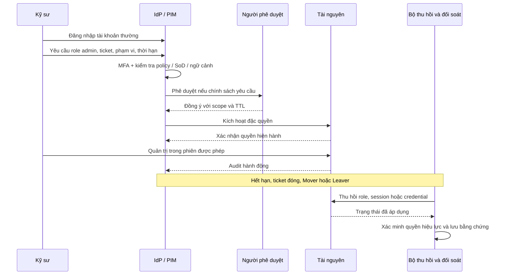
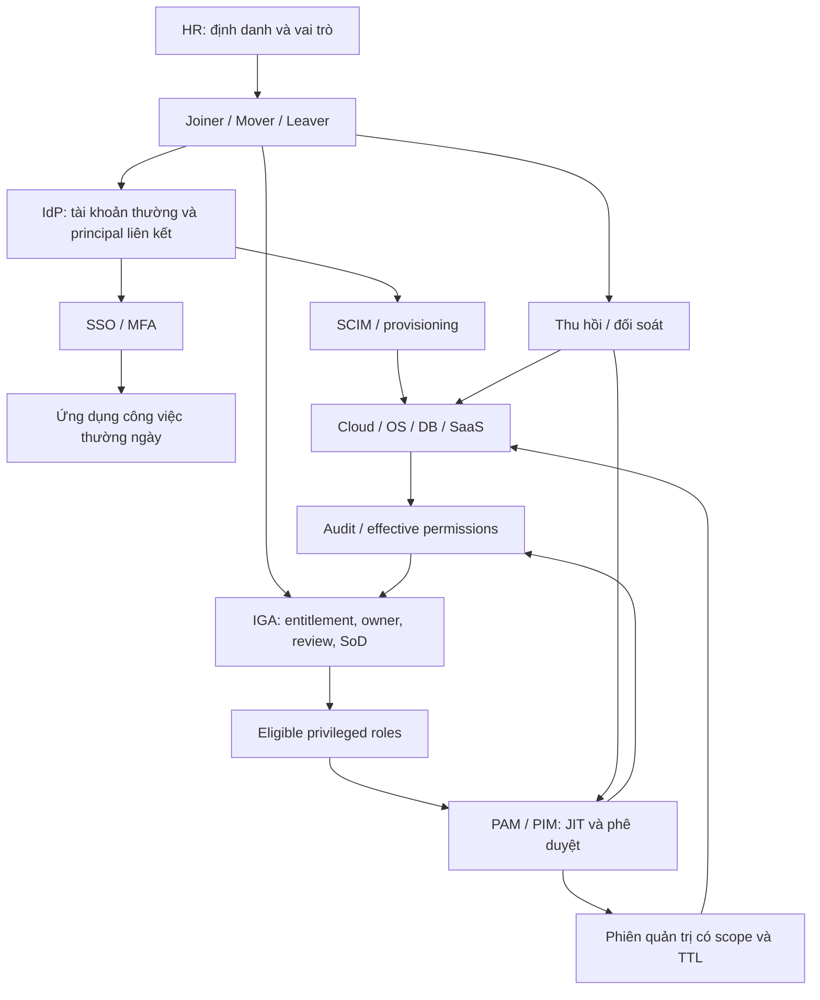

# Dùng admin cho mọi việc: anti-pattern trong quản lý vòng đời danh tính IAM

## 1. Khi tài khoản quản trị trở thành tài khoản làm việc hằng ngày

Trong **Identity and Access Management (IAM)**, tài khoản quản trị (*privileged/admin account*) là danh tính có khả năng thực hiện những hành động tác động lớn đến hệ thống: tạo/xóa người dùng, thay đổi chính sách, cấp role, đọc bí mật, triển khai ứng dụng, sửa cấu hình production hoặc truy cập dữ liệu nhạy cảm. Những quyền này cần được cấp và sử dụng trong phạm vi có kiểm soát.

**“Dùng admin cho mọi việc”** là anti-pattern khi người dùng thường xuyên dùng một principal có đặc quyền cao để thực hiện cả những công việc không cần quyền đó: đọc email, duyệt web, soạn tài liệu, trao đổi tin nhắn, lập trình, xem dashboard, xử lý ticket hoặc vận hành thông thường. Cũng có biến thể khi dịch vụ tự động chạy bằng tài khoản `root`, `Administrator`, database superuser hay service principal có quyền toàn bộ môi trường dù chỉ cần một vài thao tác.

Mấu chốt không nằm ở tên đăng nhập có chữ `admin` hay không: phải đánh giá **quyền hiệu lực thực sự** (*effective permissions*), thời gian quyền tồn tại và bối cảnh sử dụng. Một tài khoản có tên thông thường nhưng được gắn role `OrganizationOwner` cũng có thể tạo rủi ro tương đương.

Anti-pattern này vi phạm hoặc làm suy yếu:

- **Đặc quyền tối thiểu** (*least privilege*): chỉ cấp đúng quyền cho công việc cụ thể.
- **Phân tách nhiệm vụ** (*separation of duties, SoD*): không để một principal dễ dàng tự yêu cầu, tự phê duyệt và tự thực thi mọi thay đổi quan trọng.
- **Tách biệt bối cảnh sử dụng** (*privileged separation*): công việc phổ thông không được kéo theo một phiên đặc quyền có thể thay đổi hệ thống.
- **Truy xuất trách nhiệm và kiểm toán**: mỗi thao tác nhạy cảm cần gắn với con người, lý do, phiên và quyết định cấp quyền.
- **Quản lý vòng đời Joiner–Mover–Leaver (JML)**: đặc quyền phải được cấp, rà soát và thu hồi theo vai trò, không tồn dư qua thay đổi nhân sự.

Mục tiêu bài học là nhận biết các biểu hiện “admin everywhere”, phân tích rủi ro, thiết kế mô hình tài khoản chuẩn và tài khoản đặc quyền, tổ chức truy cập Just-in-Time, kiểm tra triển khai tại IdP/SSO/SCIM/RBAC/ABAC/PAM, đồng thời có phương pháp chuyển đổi và kiểm toán.

## 2. Một tình huống điển hình

Huy phụ trách vận hành nền tảng. Để “không phải đổi tài khoản”, Huy đăng nhập máy trạm và trình duyệt cả ngày bằng `huy-admin`, tài khoản có quyền quản trị cloud production, quản lý user và đọc các secret. Một buổi sáng, Huy mở liên kết trong email và đăng nhập vào một trang giả mạo. Nếu thông tin xác thực hoặc phiên bị đánh cắp, kẻ tấn công có thể sử dụng **cùng bối cảnh đặc quyền** để can thiệp vào tài nguyên quan trọng.

Giả sử sau đó phát hiện sự kiện:

```text
09:05 actor=huy-admin app=webmail action=OPEN_LINK
09:11 actor=huy-admin app=cloud-console action=CHANGE_IAM_POLICY
09:13 actor=huy-admin app=secret-vault action=READ_SECRET
09:15 actor=huy-admin app=production action=STOP_SERVICE
```

Log chỉ cho biết principal và các hành động, chưa kết luận chắc Huy hay kẻ khác thực hiện. Nhưng nó chỉ ra rủi ro: **một phiên làm việc phổ thông và một phiên đủ quyền thay đổi hạ tầng dùng chung danh tính**.

Thiết kế tốt hơn:

1. Huy sử dụng `huy` để làm việc thông thường; principal này không được phép đổi chính sách IAM hoặc đọc secret production.
2. Khi có ticket thay đổi, Huy yêu cầu kích hoạt role quản trị phù hợp cho một phiên hoặc thời gian giới hạn qua PAM/PIM/JIT.
3. Hệ thống yêu cầu xác thực mạnh, kiểm tra chính sách, nguồn thiết bị, mục đích và phê duyệt theo rủi ro.
4. Sau thời hạn hoặc khi công việc kết thúc, đặc quyền và phiên liên quan được thu hồi; log ghi người thực hiện, tài nguyên, hành động và mã yêu cầu.

Điểm cần nhớ: **chỉ tách hai tên tài khoản mà cả hai đều có quyền admin thường trực chưa đủ**. Mục tiêu là giảm đặc quyền hiệu lực trong công việc thường nhật và kiểm soát rõ thời điểm được kích hoạt.

## 3. Phân biệt những hình thức thường gặp

| Hình thức | Biểu hiện | Cần sửa ở đâu? |
|---|---|---|
| Dùng `root` hoặc `Administrator` làm tài khoản cá nhân | Duyệt web, chạy editor, xử lý email bằng principal có quyền hệ điều hành tối cao | Dùng tài khoản thường, nâng quyền có kiểm soát cho tác vụ cụ thể |
| Dùng tài khoản quản trị cloud cả ngày | Role Organization/Subscription Admin luôn active, dùng cả dashboard và ứng dụng phổ thông | RBAC phạm vi hẹp, eligible role/JIT, tách phiên quản trị |
| Dùng database superuser cho ứng dụng | Backend kết nối DB bằng quyền tạo/xóa schema và đọc mọi bảng | Tách runtime role, migration role và DBA emergency role |
| Chạy CI/CD bằng user admin | Pipeline dùng personal access token có toàn quyền tổ chức | Dùng workload identity và quyền triển khai đúng môi trường |
| Dùng chung một admin | Nhiều người biết cùng mật khẩu, log chỉ có `admin` | Cấp danh tính cá nhân, PAM với attribution và lộ trình bỏ account chung |
| Đặc quyền “tạm” nhưng không có hạn | Role cao được cấp trong incident rồi giữ mãi | Thiết lập expiry/JIT và thu hồi khi ticket kết thúc |
| Admin có quyền ở mọi môi trường | Một tài khoản có quyền production lẫn development, test và tenant khác | Tách role theo môi trường, tài nguyên và trách nhiệm |

**Tài khoản admin** có thể là một tài khoản cá nhân riêng, một role được kích hoạt tạm thời, một quyền nâng cấp tại thời điểm thực thi hoặc một tài khoản cứu hộ. Cách hiện thực phụ thuộc nền tảng, nhưng mọi phương án đều phải tránh để đặc quyền cao hiện diện không cần thiết trong hoạt động thường nhật.

## 4. Vì sao tổ chức rơi vào anti-pattern?

### 4.1. Dễ vận hành trước mắt

Người quản trị không muốn chuyển phiên hoặc yêu cầu phê duyệt mỗi lần sửa cấu hình. Quy trình cấp quyền chậm, role thiết kế chưa sát công việc hoặc hệ thống quản trị có giao diện phức tạp khiến quyền “cao nhất” trở thành cách giải quyết nhanh.

### 4.2. Chỉ có một role mặc định

Ứng dụng đời cũ đôi khi chỉ hỗ trợ `admin` và `viewer`. Đội vận hành buộc sử dụng admin dù tác vụ thực tế chỉ là xem log hoặc chạy một lệnh hỗ trợ. Đây là thiếu sót thiết kế ứng dụng và cần kiểm soát bù trừ trong thời gian chưa cải thiện được.

### 4.3. “Cứ cấp rộng để khỏi bị chặn”

Khi nhóm phát triển gặp lỗi permission, người sửa thường thêm role cao hơn thay vì xác định action/resource chính xác. Sau nhiều lần xử lý, tài khoản có bộ quyền lớn hơn nhu cầu, kéo dài xuyên suốt Mover và sang cả các dự án khác.

### 4.4. Không có owner hoặc cơ chế rà soát

Role đặc quyền do một người tạo, không có owner định nghĩa mục đích hoặc người chịu trách nhiệm thu hồi. IAM chỉ biết ai có account, không biết họ có còn cần đặc quyền hay không.

### 4.5. Dùng admin của con người cho máy

Ứng dụng và pipeline được cấu hình bằng token của admin cá nhân “cho tiện”. Khi người đó nghỉ việc, việc thu hồi token có thể phá hệ thống; nếu giữ token, quyền của người đã nghỉ tiếp tục tồn tại gián tiếp.

### 4.6. Coi MFA là đủ

MFA giảm nguy cơ chiếm quyền bằng mật khẩu đơn thuần, nhưng không sửa việc principal đang sở hữu quá nhiều quyền. Phiên đã xác thực có thể bị lợi dụng; người dùng có thể thao tác nhầm; mã độc chạy trong bối cảnh đặc quyền có thể gây tác động lớn.

## 5. Các rủi ro cụ thể

| Rủi ro | Cơ chế | Hậu quả |
|---|---|---|
| **Phạm vi ảnh hưởng lớn** (*blast radius*) | Một phiên, token hoặc credential có thể thay đổi nhiều tài nguyên | Sự cố nhỏ lan sang dữ liệu và hạ tầng trọng yếu |
| **Lateral movement** | Principal có quyền chéo môi trường/tenant | Kẻ tấn công mở rộng quyền và phạm vi truy cập |
| **Lỗi thao tác nghiêm trọng** | Công việc đọc/quan sát nhưng tài khoản có quyền xóa/sửa | Xóa nhầm dữ liệu, phá cấu hình, mất sẵn sàng |
| **Lạm dụng bí mật và định danh** | Admin đọc được vault hoặc cấp thêm role | Tạo persistence và mở rộng đặc quyền |
| **Khó phân nhiệm** | Một principal có thể tạo, phê duyệt và áp dụng thay đổi | Không có lớp kiểm tra độc lập |
| **Giảm chất lượng log** | Admin dùng cho mọi tác vụ tạo lượng lớn sự kiện lẫn lộn | Khó nhận diện thao tác nhạy cảm bất thường |
| **Quyền tồn dư khi Mover/Leaver** | Account admin phụ, PAT hoặc role cao không được kiểm kê | Người không còn trách nhiệm vẫn có đường truy cập |
| **Phụ thuộc vận hành vào account cá nhân** | Job chạy bằng token của admin | Thu hồi account có thể làm pipeline hoặc dịch vụ dừng |

Tác động thực tế tùy quyền hiệu lực và hệ thống đích. Ví dụ `root` trong một container không phải lúc nào cũng có quyền root trên host; tuy nhiên vẫn cần xem capability, volume mount, namespace và đường truy cập tài nguyên để đánh giá phạm vi ảnh hưởng thật.

## 6. Nguyên tắc thiết kế: đúng người, đúng quyền, đúng thời điểm, đúng ngữ cảnh

Một thiết kế IAM vững cần kiểm soát đồng thời các chiều:

| Chiều kiểm soát | Câu hỏi | Cơ chế |
|---|---|---|
| **Danh tính** | Ai thực sự thao tác? | Tài khoản cá nhân riêng, IdP/SSO, MFA, liên kết phiên |
| **Quyền** | Cần action nào trên resource nào? | RBAC, ABAC, permission ở phạm vi hẹp |
| **Thời gian** | Quyền cần tồn tại bao lâu? | JIT, expiry, giới hạn phiên, thu hồi theo sự kiện |
| **Ngữ cảnh** | Từ thiết bị/vị trí/phiên nào? | Conditional access, thiết bị quản trị đáng tin, session policy |
| **Phê duyệt** | Ai có thẩm quyền cho phép? | Owner, SoD, workflow và ticket |
| **Truy vết** | Có chứng minh được ai đã làm gì? | Audit, correlation ID, log PAM và log đích |
| **Vòng đời** | Khi đổi vai trò hoặc nghỉ việc có thu hồi? | JML, provisioning/deprovisioning, đối soát |

Đặc quyền tối thiểu không có nghĩa người vận hành phải xin duyệt từng hành động bình thường. Có thể thiết kế **baseline access** đủ cho tác vụ thường xuyên và dùng JIT cho tác vụ rủi ro cao.

## 7. Tách tài khoản thường và đặc quyền

Một mô hình dễ triển khai dùng **hai bối cảnh danh tính** cho người có nhiệm vụ quản trị:

| Tiêu chí | Tài khoản thường | Bối cảnh/tài khoản đặc quyền |
|---|---|---|
| Mục đích | Email, văn phòng, ticket, tài liệu, duyệt web, tác vụ chuẩn | Quản trị IAM, OS, cloud, DB, ứng dụng quan trọng |
| Quyền mặc định | Chỉ quyền công việc cơ bản | Không tự động active; eligible hoặc scope phù hợp |
| Thiết bị/phiên | Máy trạm làm việc theo chính sách | Thiết bị hoặc phiên quản trị đáng tin, có thể tách biệt |
| Xác thực | SSO/MFA theo rủi ro | MFA mạnh, xác thực lại khi kích hoạt theo chính sách |
| Thời gian | Theo vòng đời vai trò | Phiên/ticket/thời hạn ngắn; kết thúc thì thu hồi |
| Log | Truy cập và hoạt động nghiệp vụ | Log chi tiết lệnh/thay đổi, lý do, approval và session |
| Leaver | Disable và revoke các đường truy cập | Thu hồi cả principal phụ, eligible role, token và phiên PAM |

Tài khoản đặc quyền nên **gắn được với một người thật**, không dùng chung credential thường trực. Nếu nền tảng cho phép kích hoạt role ngay trên cùng principal sau bước xác thực/phê duyệt bổ sung, vẫn phải bảo đảm quyền chỉ active trong phạm vi và thời hạn phù hợp. Nếu nền tảng yêu cầu tài khoản admin riêng, chúng cần được ánh xạ về danh tính nhân viên để xử lý JML thống nhất.

Không gửi email và lướt web thông thường từ phiên quản trị. Nếu phải truy cập tài liệu trong phiên admin, nên dùng kênh được kiểm soát hoặc hiển thị thông tin cần thiết mà không mang toàn bộ bối cảnh duyệt web vào phiên đặc quyền.

### 7.1. Privileged Access Workstation (PAW) hoặc phiên quản trị cách ly

Đối với hạ tầng quan trọng, có thể sử dụng workstation chuyên cho quản trị hoặc phiên jump host/bastion được quản lý. Điều này giảm nguy cơ công cụ phổ thông, extension trình duyệt và tài liệu không tin cậy tương tác trực tiếp với phiên đặc quyền.

PAW vẫn cần patching, EDR phù hợp, hạn chế ứng dụng, chính sách đăng nhập, bảo vệ credential, log và cơ chế khôi phục. Chỉ đổi tên máy thành “admin workstation” không tự tạo lớp kiểm soát.

## 8. JIT, PAM và PIM thay quyền admin thường trực như thế nào?

**Just-in-Time (JIT)** nghĩa là quyền đặc biệt chỉ được kích hoạt khi có nhu cầu và kết thúc theo thời hạn/điều kiện rõ ràng. **PAM** tập trung kiểm soát tài khoản và phiên đặc quyền; **PIM** thường quản trị điều kiện và việc kích hoạt role đặc quyền. Tên sản phẩm khác nhau, nhưng các kiểm soát có thể gồm:

1. Danh tính có trạng thái **eligible** đối với role phù hợp, không mặc định **active** mọi lúc.
2. Người dùng tạo yêu cầu với lý do, ticket, tài nguyên, scope và thời hạn.
3. Kiểm tra MFA, trạng thái thiết bị, chính sách SoD, giới hạn số phiên và người phê duyệt theo mức rủi ro.
4. Kích hoạt quyền ở IdP, cloud hoặc ứng dụng trong phạm vi được phép.
5. Ghi log các thao tác và liên kết với danh tính người kích hoạt.
6. Khi hết hạn, ticket đóng, Mover hoặc Leaver, thu hồi quyền và xác minh tại đích.



**JIT hình thức** xuất hiện khi user có thể tự động gia hạn quyền admin mỗi giờ mà không cần xác minh nhu cầu hoặc khi quyền vẫn active ở đích sau khi TTL kết thúc. Review phải đánh giá cả **quyền đủ điều kiện kích hoạt** và **quyền đang active**, vì eligible role quá rộng cũng có thể tạo rủi ro.

## 9. RBAC và ABAC: thu hẹp phạm vi trước khi cấp quyền

Để bỏ thói quen “cho admin vì không có role phù hợp”, cần thiết kế quyền theo chức năng:

| Công việc | Cách cấp quyền phù hợp | Cách cấp quá rộng |
|---|---|---|
| Xem dashboard production | Role read-only đúng hệ thống | Cloud organization admin |
| Khởi động lại một dịch vụ | Quyền restart trên service được phép, có kiểm toán | Full admin mọi dịch vụ |
| Xem log sự cố | Quyền đọc log đúng scope và dữ liệu phù hợp | Database owner hoặc root |
| Triển khai phiên bản ứng dụng | Role deploy đúng repository/environment; credential workload | PAT cá nhân có quyền toàn tổ chức |
| Tạo user cho ứng dụng | Role user administrator của ứng dụng, có workflow | Global IAM administrator |
| Thay đổi IAM policy | Privileged role JIT có phê duyệt độc lập | Admin thường trực trên toàn tenant |

**RBAC** quy định các quyền theo role nghiệp vụ/kỹ thuật. **ABAC** bổ sung điều kiện như đội dự án, môi trường, phân loại dữ liệu, nhãn tài nguyên, giờ làm việc hoặc trạng thái thiết bị. ABAC chỉ có tác dụng nếu thuộc tính cập nhật đáng tin và hệ thống đích thực thi policy ở thời điểm quyết định truy cập.

Ví dụ chính sách minh họa (không phải cú pháp của nhà cung cấp cloud):

```yaml
accessPolicy:
  subjectType: "HUMAN"
  role: "service-operator"
  resourcePattern: "prod/services/payments/*"
  allowedActions:
    - "service.read"
    - "service.restart"
  denyActions:
    - "iam.policy.write"
    - "secrets.export"
    - "database.drop"
  conditions:
    projectMembershipRequired: "payments-operations"
    trustedDeviceRequired: true
    ticketRequiredForRestart: true
  privilegedActivation:
    type: "JIT"
    maxDurationMinutes: 60
```

**Đây là mô hình tư duy về quyền**, không phải policy có thể copy vào AWS/Azure/GCP hoặc IdP. Khi triển khai thật phải kiểm thử chính xác semantics, phạm vi deny/allow, nhóm lồng nhau, quyền kế thừa và behavior của từng hệ thống.

## 10. Tích hợp với Joiner–Mover–Leaver

Một thiết kế riêng tài khoản thường/đặc quyền phải gắn được với nguồn danh tính và vai trò nhân sự:

| Giai đoạn | Tài khoản thường | Quyền/tài khoản đặc quyền |
|---|---|---|
| **Joiner** | HR xác minh; IdP tạo danh tính; cấp nhóm theo vai trò; áp dụng SSO/MFA | Chỉ cấp eligible role hoặc principal admin khi công việc thực sự đòi hỏi, có owner/phê duyệt |
| **Mover** | Sửa nhóm/thuộc tính và quyền nghiệp vụ theo vai trò mới | Rà soát, gỡ role admin cũ, kiểm tra tài khoản phụ, JIT eligibility, token và phiên |
| **Leaver** | Disable IdP, chặn đăng nhập mới; xử lý phiên/token/ứng dụng | Thu hồi account admin phụ, role active và eligible, PAM sessions, SSH/API key, quyền vault |
| **Access review định kỳ** | Chứng nhận quyền nghiệp vụ theo owner | Kiểm tra đặc quyền đang active/eligible, tần suất dùng, SoD, exception và quyền thực tế ở đích |

### 10.1. Joiner

Việc một nhân viên gia nhập nhóm kỹ thuật **không mặc định** đồng nghĩa người đó cần quyền quản trị production. HR cung cấp dữ liệu danh tính; manager và owner tài nguyên xác nhận trách nhiệm. IAM cấp role chuẩn và chỉ cho phép kích hoạt đặc quyền khi đủ điều kiện.

### 10.2. Mover

Khi một kỹ sư chuyển từ vận hành production sang phân tích dữ liệu, giữ lại quyền `production-admin` chỉ vì trước đây từng có là sai. Sự kiện Mover phải kích hoạt **thu hồi entitlement không còn căn cứ**; chỉ cấp quyền mới sau khi kiểm tra SoD, phụ thuộc và nhu cầu hiện tại.

Tài khoản admin phụ dễ bị bỏ sót nếu không liên kết với một person ID ổn định. Vì vậy, IdP, IGA và danh mục tài khoản phải duy trì mapping:

```text
person:employee-1042
  ├─ user: huy.nguyen             (standard)
  ├─ user: huy.nguyen-admin       (privileged secondary)
  ├─ eligible-role: prod-operator (JIT)
  └─ credentials: ssh-key-7, pat-2
```

Sơ đồ minh họa không nhất thiết hàm ý tất cả secret phải lưu chung một nơi; mục tiêu là kiểm kê đủ các đường truy cập liên quan.

### 10.3. Leaver

Khi nhân sự nghỉ việc, **disable tài khoản thường ở IdP chưa đủ** nếu vẫn có:

- Tài khoản admin local hoặc principal đặc quyền ở cloud/DB/vault.
- Phiên PAM, phiên cloud console, token truy cập và refresh token còn hạn.
- Role eligible vẫn có khả năng kích hoạt qua một con đường ngoài IdP chính.
- Mật khẩu root dùng chung hoặc secret mà người nghỉ việc từng biết.
- PAT, API key, SSH key, certificate hoặc credential của pipeline gắn với cá nhân.

Quy trình Leaver cần đối soát tại từng đích, thu hồi phiên và credential theo khả năng hệ thống, chuyển ownership của workload, rồi xác nhận khả năng truy cập thực tế không còn. Một lệnh deactivation thành công qua SCIM không mặc nhiên hủy token hoặc session local của ứng dụng.

## 11. Vai trò của IdP, SSO và SCIM trong kiểm soát admin

**IdP** quản lý principal, nhóm và chính sách xác thực. **SSO** giúp người dùng đăng nhập tập trung với danh tính có thể truy vết. **SCIM hoặc connector** đồng bộ user và một phần trạng thái/nhóm/role mà ứng dụng đích hỗ trợ.

Chúng hữu ích nhưng có giới hạn:

1. **SSO không bảo đảm least privilege.** Người dùng có thể đăng nhập an toàn nhưng nhận role admin toàn cục.
2. **SCIM không tự thu hẹp role.** Nếu nguồn cấp nhóm admin sai, provisioning có thể đồng bộ chính xác một quyết định sai.
3. **Disable IdP không tự hủy mọi phiên ứng dụng.** Session cookie, token và đăng nhập local có thể tiếp tục tồn tại.
4. **Role ở đích có thể rộng hơn role ở nguồn.** Một nhóm được ánh xạ sang quyền `SuperAdmin` do cấu hình ứng dụng, nên review phải kiểm tra effective permissions.
5. **Tài khoản phụ phải liên kết với cùng nhân sự.** Nếu `huy-admin` không gắn với `huy`, việc Mover/Leaver dễ bỏ sót.

Một mô hình kiểm soát nên có **IdP/SSO xác thực**, **RBAC/ABAC quyết định phạm vi quyền**, **PAM/PIM quản trị kích hoạt đặc quyền**, **SCIM/connector thực thi thay đổi**, và **IGA/audit đối soát quyền thực tế và vòng đời**.



## 12. Danh tính dịch vụ không được kế thừa admin của con người

Một anti-pattern liên quan là **dùng tài khoản admin cá nhân để chạy chương trình hoặc pipeline**, hoặc cấp cho tất cả workload cùng một service principal có quyền quá rộng.

Ví dụ ứng dụng web cần đọc một bảng dữ liệu nhưng lại kết nối bằng database `root`. Nếu ứng dụng bị khai thác, quyền database của kết nối cũng bị phơi bày. Nếu token deploy của CI/CD có quyền quản trị toàn bộ cloud, lỗi pipeline có thể ảnh hưởng tài nguyên ngoài phạm vi release.

Thiết kế thay thế:

- Tạo **workload identity riêng cho từng ứng dụng/tích hợp** và owner nghiệp vụ/kỹ thuật rõ ràng.
- Chỉ cấp action/resource cần thiết; tách môi trường development, staging, production.
- Tách **runtime credential** khỏi **schema migration/deployment credential**; không cho runtime sửa cấu trúc DB khi không cần.
- Ưu tiên managed identity, workload identity federation, token hoặc chứng chỉ ngắn hạn; hạn chế secret tĩnh.
- Lưu secret cần thiết trong vault/secrets manager, giới hạn nơi lấy secret và theo dõi xoay vòng.
- Cấm hoặc cảnh báo interactive login bằng service identity nếu không nằm trong thiết kế.
- Khi owner nhân sự Mover/Leaver, **bàn giao workload** và thu hồi quyền của cá nhân; không tùy tiện xóa identity đang phục vụ production.

Ví dụ phân vai cho database:

| Vai trò | Quyền hợp lý | Quyền nên tránh |
|---|---|---|
| `app-read` | SELECT một tập bảng/view cần thiết | DDL, DROP, CREATE USER |
| `app-write` | SELECT/INSERT/UPDATE trên bảng nghiệp vụ cụ thể | SUPERUSER, quyền trên database khác |
| `migration-job` | DDL cần cho version schema trong cửa sổ triển khai | Login interactive lâu dài, quyền trên mọi môi trường |
| `dba-emergency` | Đặc quyền cao theo JIT và quy trình khẩn | Dùng cho connection pool ứng dụng |

Quyền cụ thể phụ thuộc loại DB, cơ chế owner/schema và mô hình phân quyền. Kiểm tra hành vi thực tế thay vì áp dụng tên role một cách máy móc.

## 13. Khi nào cần quyền cao thực sự?

Một số công việc không thể hoàn thành với quyền thường:

- Khởi tạo hoặc khôi phục hệ thống sau sự cố nghiêm trọng.
- Sửa IAM policy, cấp role nhạy cảm, xoay vòng khóa nền tảng.
- Thực hiện nâng cấp OS/DB hoặc thay đổi hạ tầng production.
- Quản trị hệ thống legacy chỉ cung cấp một bậc quyền admin.

Điều này **không làm “dùng admin cho mọi việc” trở thành đúng**. Thay vào đó, quản lý quyền cao theo tác vụ:

1. Xác định nhiệm vụ, scope, owner và mức rủi ro.
2. Tìm role có quyền nhỏ nhất thực hiện được nhiệm vụ.
3. Sử dụng JIT/step-up authentication và phiên quản trị cách ly khi cần.
4. Ghi lý do và kiểm toán; áp dụng SoD/phê duyệt độc lập cho thao tác nhạy cảm.
5. Thu hồi khi tác vụ hoặc thời hạn kết thúc; xác minh quyền ở hệ thống đích.

### 13.1. Break-glass không phải tài khoản làm việc hằng ngày

Tài khoản cứu hộ có thể cần tồn tại để khôi phục khi IdP/SSO hoặc quy trình JIT bị lỗi. Nó phải được **giới hạn cho tình huống khẩn**, bảo vệ credential, cảnh báo khi dùng, ghi nhận người sử dụng, kiểm tra khả năng sẵn sàng và rà soát sau sự kiện. Khi kết thúc tình huống khẩn, thu hồi phiên và xoay vòng secret nếu phù hợp.

Không dùng break-glass vì “quy trình xin quyền phiền phức”. Ngược lại, cũng không nên xóa cơ chế cứu hộ trước khi thiết kế được phương án khôi phục tương đương.

### 13.2. Hệ thống legacy chỉ hỗ trợ admin

Khi ứng dụng chỉ có một tài khoản quản trị, áp dụng kiểm soát bù trừ:

| Biện pháp | Lợi ích | Giới hạn |
|---|---|---|
| PAM/vault checkout theo danh tính cá nhân | Xác định ai lấy quyền, vì sao và trong thời gian nào | Log đích có thể vẫn chỉ ghi `admin` |
| Bastion/jump host, giới hạn nguồn truy cập | Thu hẹp đường đăng nhập và tập trung log | Phải ngăn đường vòng trực tiếp |
| Ghi phiên, cảnh báo và approval | Tăng khả năng điều tra và kiểm soát thao tác | Không thay thế quyền tối thiểu ở đích |
| Secret rotation, thu hồi session | Hạn chế tiếp tục sử dụng credential đã biết | Phụ thuộc ứng dụng có hỗ trợ invalidation |
| Kế hoạch nâng cấp RBAC | Loại bỏ nguyên nhân gốc | Cần owner, ưu tiên, ngân sách và mốc xử lý |

Mỗi ngoại lệ phải có owner, phạm vi, người được sử dụng, biện pháp kiểm soát, thời hạn xem lại và kế hoạch giảm rủi ro.

## 14. Phiên, token và bằng chứng kiểm toán

Trong IAM, **đặc quyền được cấp**, **phiên đã đăng nhập** và **token đã phát hành** là những đối tượng liên quan nhưng không đồng nhất.

Một hệ thống có thể gỡ role `prod-admin` khỏi IdP nhưng token cũ còn chứa claim đặc quyền và được ứng dụng chấp nhận đến hết hạn. Một phiên PAM có thể còn sống sau khi request JIT đã đóng nếu cơ chế session revocation không được thực thi. Do đó, khi thu hồi cần xem:

- Role/group và direct grants tại hệ thống đích.
- Eligible role so với active role trong PIM.
- Session console, session SSO và session ứng dụng.
- Access token, refresh token, PAT, SSH/API key và credential quản trị.
- Policy cache và cách ứng dụng kiểm tra quyền ở thời điểm hành động.

Log nên liên kết **người thực hiện → phiên kích hoạt quyền → approval/ticket → role thực tế → hành động trên tài nguyên → kết quả**.

Ví dụ nhật ký minh họa:

```text
2026-08-21T09:00:00Z actor=huy.nguyen event=PRIVILEGE_ACTIVATION_REQUEST
  role=prod-service-operator resource=payments reason=INC-842 duration=45m
2026-08-21T09:01:00Z actor=huy.nguyen event=JIT_ACTIVATED session=pam-719
  approved_by=oncall-owner expires_at=2026-08-21T09:46:00Z
2026-08-21T09:05:22Z actor=huy.nguyen event=SERVICE_RESTART
  resource=prod/payments/api session=pam-719 result=ALLOWED
2026-08-21T09:46:01Z actor=huy.nguyen event=JIT_EXPIRED
2026-08-21T09:46:03Z actor=huy.nguyen event=ACCESS_VERIFIED_REVOKED
  resource=prod/payments/api session=pam-719
```

Thực tế cần timestamp đồng bộ, request/correlation ID, actor ID đáng tin, log không thể bị tùy ý sửa và chính sách lưu giữ. Một thông báo “revoke success” từ API **không tự chứng minh** đặc quyền trên phiên cũ đã bị vô hiệu ở hệ thống đích.

## 15. Phát hiện “admin cho mọi việc” từ inventory và log

Phát hiện tốt cần ghép **quyền hiệu lực**, **loại tác vụ** và **ngữ cảnh phiên**. Chỉ lọc tên tài khoản có chữ `admin` sẽ bỏ sót nhiều trường hợp và tạo false positive.

Giả sử có bảng minh họa `principal_roles`, `authentication_events`, `actions` và `workload_accounts`, dùng cú pháp SQL gần PostgreSQL. Đây là ví dụ để học, không phải schema sản phẩm thực.

### 15.1. Tài khoản có role cao nhưng dùng cả ứng dụng phổ thông

```sql
SELECT a.principal_id,
       COUNT(DISTINCT a.application_id) AS general_apps,
       COUNT(*) AS general_logins
FROM authentication_events a
JOIN principal_roles r ON r.principal_id = a.principal_id
WHERE a.event_time >= CURRENT_TIMESTAMP - INTERVAL '30 days'
  AND a.result = 'SUCCESS'
  AND a.application_category IN ('EMAIL', 'WEB', 'COLLABORATION')
  AND r.privilege_level = 'HIGH'
  AND r.status = 'ACTIVE'
GROUP BY a.principal_id
HAVING COUNT(*) > 0;
```

Kết quả chỉ là **ứng viên cần kiểm tra**. Một principal có role high-risk không chắc đang thực thi tác vụ admin trong mọi phiên; cần đánh giá thời điểm role active, phương thức role activation và quyền thực tế ở đích.

### 15.2. Principal có đặc quyền cao luôn bật

```sql
SELECT principal_id, resource_id, role_id, granted_at
FROM principal_roles
WHERE status = 'ACTIVE'
  AND privilege_level = 'HIGH'
  AND activation_mode = 'PERMANENT';
```

Review các dòng này cùng owner, mục đích và trường hợp break-glass/workload hợp lệ. Không phải mọi role thường trực là vi phạm, nhưng đặc quyền cao cần được giải trình và xem xét khả năng chuyển sang JIT.

### 15.3. Service account dùng để đăng nhập tương tác

```sql
SELECT a.principal_id,
       a.event_time,
       a.application_id,
       a.source_device
FROM authentication_events a
JOIN workload_accounts w ON w.principal_id = a.principal_id
WHERE a.event_time >= CURRENT_TIMESTAMP - INTERVAL '30 days'
  AND a.result = 'SUCCESS'
  AND a.authentication_type = 'INTERACTIVE'
  AND w.expected_interactive_login = FALSE;
```

Cần đối chiếu với cơ chế kỹ thuật của ứng dụng; một số nền tảng có thể gắn nhãn tương tác cho một luồng machine-to-machine đặc thù. Cảnh báo nên dựa trên bằng chứng và baseline hợp lệ.

### 15.4. Các dấu hiệu bổ sung

- Một người thường xuyên sử dụng account admin để đọc email, truy cập mạng xã hội hoặc sử dụng dịch vụ cộng tác.
- Tài khoản admin có phiên dài, login từ thiết bị không quản lý hoặc trình duyệt phổ thông.
- CI/CD, ứng dụng hoặc script lưu token của người quản trị; role service có quyền tổ chức rộng bất thường.
- Privileged role không có owner, không có review, không giới hạn thời gian hoặc tồn tại sau Mover.
- Nhiều người sử dụng cùng principal admin hoặc cùng credential; không có mapping người–phiên–thao tác.
- Audit log ghi các hành động quản trị trọng yếu ngoài ticket, ngoài phiên JIT hoặc ngoài thiết bị được phép.

Không dùng tín hiệu “nhiều thiết bị” hoặc “nhiều phiên” đơn lẻ để kết luận lạm dụng: người quản trị có thể làm việc trên nhiều máy được phê duyệt.

## 16. Quy trình chuyển đổi khi tổ chức đang dùng admin thường trực

### Bước 1 — Kiểm kê đặc quyền thực tế

Thu thập principal và role từ IdP, cloud, hệ điều hành, database, SaaS, PAM, repository, CI/CD và vault. Gắn person/workload ID, business/technical owner, quyền hiệu lực, môi trường, đường đăng nhập, token, phiên, lần dùng và các phụ thuộc.

### Bước 2 — Phân loại nhu cầu

Tách **công việc thường ngày**, **tác vụ vận hành cần quyền hẹp**, **thay đổi đặc quyền cần JIT**, **khôi phục khẩn cấp** và **tác vụ tự động của workload**. Đừng cấp JIT admin toàn cục cho một tác vụ có thể giải quyết bằng role restart trên một service.

### Bước 3 — Thiết kế role phù hợp

Xác định action/resource chính xác, role owner, phạm vi môi trường, SoD và chính sách activation. Thiết lập tài khoản thường không có quyền quản trị; tạo privileged identity hoặc eligible role có liên kết person ID và cơ chế xác thực phù hợp.

### Bước 4 — Chuyển các luồng công việc

Chuyển email, tài liệu, ticket, duyệt web sang bối cảnh thường. Chuyển công việc admin sang PAW/bastion hoặc phiên JIT. Với ứng dụng/pipeline, chuyển credential cá nhân sang workload identity có owner và scope riêng, kiểm thử tác vụ và cơ chế rotation.

### Bước 5 — Cắt đặc quyền cũ

Sau khi xác minh các luồng mới, thu hồi role admin thường trực, account phụ không còn cần, PAT/API/SSH key và session tồn dư. Thực hiện rollback có kiểm soát cho phụ thuộc nghiệp vụ, không để việc rollback âm thầm tái cấp quyền vĩnh viễn.

### Bước 6 — Rà soát và giám sát

Thiết lập access review theo rủi ro, giám sát interactive login với account đặc quyền, kiểm tra JIT expiry, cảnh báo tài khoản phi con người dùng interactive và kiểm soát cấp quyền ngoài workflow. Mỗi phát hiện phải có owner xử lý và bằng chứng quyền tại đích đã thay đổi.

## 17. Kiểm thử sau chuyển đổi

Một chuyển đổi chỉ đạt mục tiêu khi kiểm chứng **người dùng còn làm được việc cần thiết nhưng không có đặc quyền ngoài phạm vi**:

| Kiểm thử | Kết quả mong đợi |
|---|---|
| Tài khoản thường truy cập email/ticket | Hoạt động theo quyền nghiệp vụ, không yêu cầu quyền admin |
| Tài khoản thường gọi API thay đổi IAM policy | Bị từ chối |
| Yêu cầu JIT với MFA/ticket đúng | Được kích hoạt role đúng scope/thời hạn |
| Yêu cầu vượt scope hoặc thiếu điều kiện | Bị từ chối hoặc chuyển phê duyệt theo chính sách |
| Kết thúc TTL hoặc ticket | Đặc quyền mất hiệu lực; kiểm tra session/token liên quan |
| Mover khỏi đội production | Eligible/active admin role cũ bị thu hồi |
| Leaver có tài khoản admin phụ | IdP, account local, token, PAM, SSH key đều được đối soát |
| Pipeline không còn PAT admin cá nhân | Vẫn triển khai bằng workload identity đúng môi trường |
| Break-glass được kích hoạt theo tình huống kiểm thử | Hoạt động đúng, có log/cảnh báo và đóng phiên sau thử |
| Kiểm tra SoD khi tự phê duyệt quyền cao | Bị chặn hoặc yêu cầu reviewer độc lập |

Đặc biệt, một policy chặn `iam.policy.write` phải được thử ở hệ thống đích. Chỉ nhìn vào một bảng group hoặc mô phỏng policy chưa chắc phản ánh quyền gián tiếp, quyền trên tài nguyên khác hoặc session cache.

## 18. Bộ chỉ số quản trị

Để biết anti-pattern có đang giảm, có thể theo dõi:

| Chỉ số | Ý nghĩa |
|---|---|
| **Tỷ lệ human principal có đặc quyền high-risk thường trực** | Mức độ standing privilege còn tồn tại |
| **Tỷ lệ công việc admin được thực hiện qua JIT/PAM** | Mức áp dụng đường quản trị được kiểm soát |
| **Số lần interactive login của workload identity** | Tín hiệu dùng service account thay tài khoản cá nhân |
| **Tỷ lệ phiên admin không có ticket/lý do** | Chất lượng truy vết và tuân thủ workflow |
| **Thời gian kích hoạt role đặc quyền** | Quyền tồn tại lâu hơn nhu cầu thực tế hay không |
| **Thời gian từ TTL/JML đến quyền mất hiệu lực tại đích** | Chất lượng thu hồi thực tế |
| **Số role đặc quyền không có owner hoặc quá hạn review** | Rủi ro quyền tồn dư |
| **Số token admin cá nhân được dùng trong automation** | Mức phụ thuộc workload vào nhân sự |
| **Số trường hợp SoD conflict** | Khả năng một principal tự kiểm soát toàn bộ quyết định |

Giải thích KPI theo phạm vi inventory và loại hệ thống. Ví dụ, sau khi mở rộng log, số trường hợp workload interactive login có thể tăng dù số vi phạm thực tế chưa tăng; cần phân tích nguồn đo và loại trừ lưu lượng hợp lệ.

## 19. Tình huống tự kiểm tra

**Tình huống A.** Một kỹ sư có role `cloud-admin`, dùng role đó cả để đọc dashboard và gửi yêu cầu hỗ trợ. Vì tài khoản có MFA nên có thể coi an toàn?

**Trả lời:** Chưa. MFA giúp xác thực nhưng quyền admin đang hiện diện trong bối cảnh thường. Nên tách bối cảnh và cấp quyền đọc hẹp, dùng JIT cho thao tác cần admin.

**Tình huống B.** Công ty tạo tài khoản `huy-admin` riêng, nhưng nó vẫn có `GlobalAdministrator` 24/7, chỉ dùng khi vận hành. Anti-pattern đã được giải quyết hết chưa?

**Trả lời:** Chưa hoàn toàn. Tách danh tính làm giảm một số rủi ro nhưng vẫn còn standing privilege cao. Cần xem scope, JIT, MFA, thiết bị quản trị, review và thu hồi.

**Tình huống C.** Pipeline dùng PAT của admin để deploy. Admin nghỉ việc nên token bị thu hồi, pipeline dừng. Cách khắc phục đúng?

**Trả lời:** Chuyển sang workload identity riêng có owner và quyền deploy giới hạn trên môi trường cần thiết; xử lý secret/credential và các dependency trước khi loại bỏ PAT cá nhân.

**Tình huống D.** Role `service-restart` chỉ cho phép restart đúng một dịch vụ production và yêu cầu ticket. Có nhất thiết cấp admin toàn cloud để thao tác không?

**Trả lời:** Không. Role theo action/resource hẹp có thể đáp ứng nghiệp vụ. Nếu hành động có tác động lớn, thêm kiểm soát phê duyệt, JIT hoặc session audit theo chính sách.

**Tình huống E.** Một user vừa tạo yêu cầu cấp role admin, vừa có quyền tự phê duyệt request của chính mình. Rủi ro chính là gì?

**Trả lời:** Xung đột phân nhiệm. Cần reviewer hoặc cơ chế phê duyệt độc lập được ủy quyền cho các quyền nhạy cảm.

**Tình huống F.** PIM báo role đã hết hạn, nhưng phiên trên ứng dụng vẫn sửa được chính sách đến hết ngày. Có thể đóng sự cố ngay không?

**Trả lời:** Không. Phải xác minh cơ chế quyền ở đích, session/cache/token và điều chỉnh thu hồi hiệu lực; hết hạn trong PIM chưa đủ nếu phiên cũ vẫn có quyền.

**Tình huống G.** Tài khoản break-glass có quyền cao để phục hồi IdP trong thảm họa. Nó ít được sử dụng và có bảo quản/giám sát chặt. Có nên xóa mọi quyền cứu hộ để đạt zero standing privilege?

**Trả lời:** Không tự động. Cần bảo toàn khả năng khôi phục đã được thiết kế và kiểm thử, hạn chế việc sử dụng thường nhật, có owner, giám sát và quy trình hậu kiểm.

## Kết luận

**Dùng admin cho mọi việc là anti-pattern vì làm cho mỗi hành động bình thường mang theo khả năng can thiệp sâu vào hệ thống, dữ liệu và chính sách.** Thiết kế IAM phù hợp dùng tài khoản thường cho công việc hằng ngày, quyền theo RBAC/ABAC trong phạm vi nhỏ, bối cảnh quản trị riêng, JIT/PAM/PIM cho đặc quyền nhạy cảm, MFA và thiết bị đáng tin, cùng log gắn từng thao tác với con người và lý do. Quá trình Joiner–Mover–Leaver phải cấp, rà soát và thu hồi cả principal phụ, eligible role, phiên, token và credential; service account cần danh tính và owner riêng. Khi quyền cao chỉ tồn tại đúng lúc, đúng phạm vi và được kiểm chứng tại đích, tổ chức giảm được phạm vi sự cố, quyền tồn dư và rủi ro vận hành mà vẫn giữ khả năng quản trị cần thiết.
