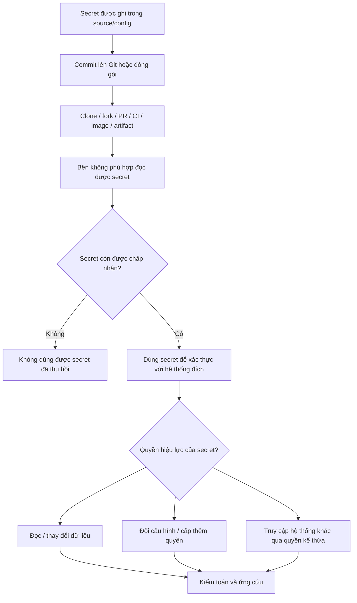
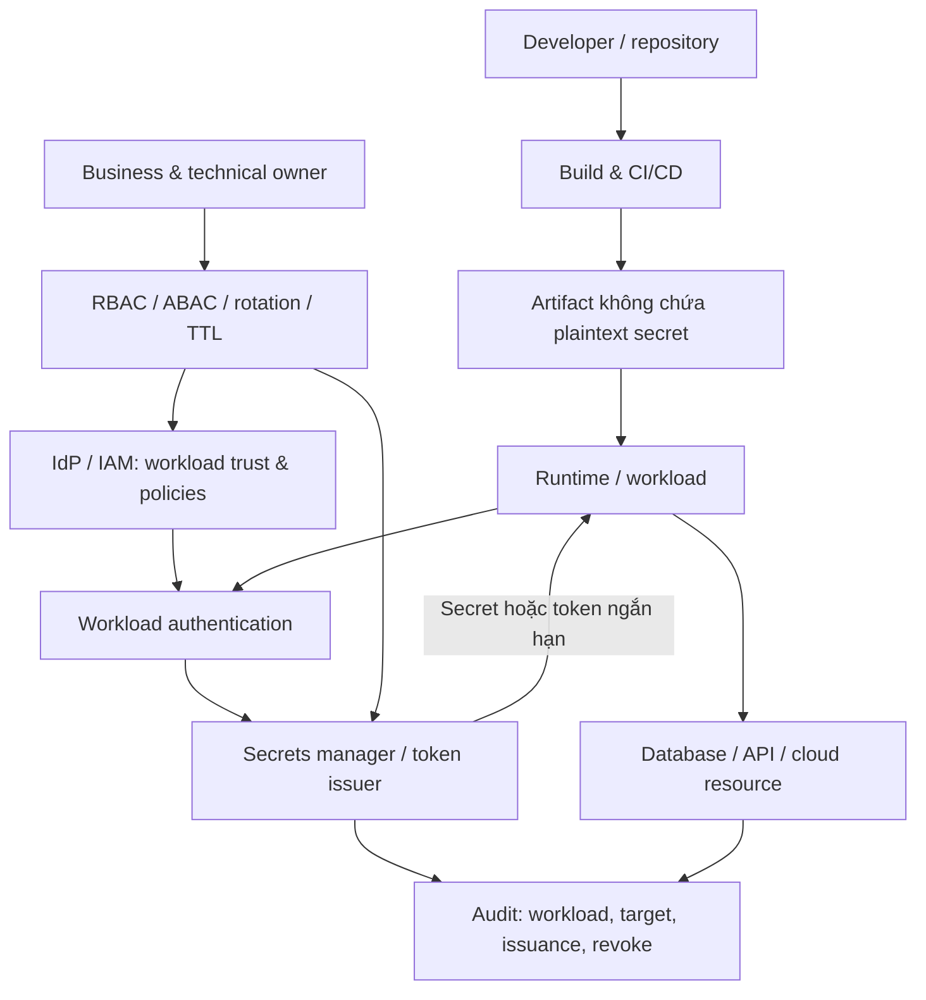
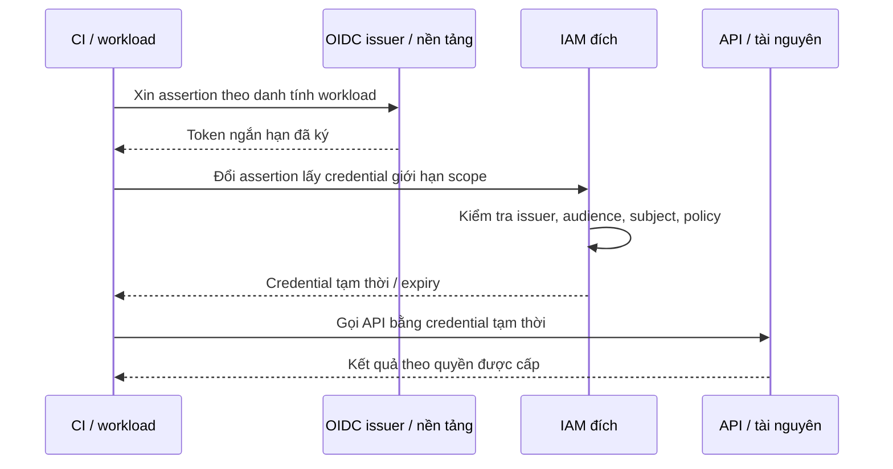
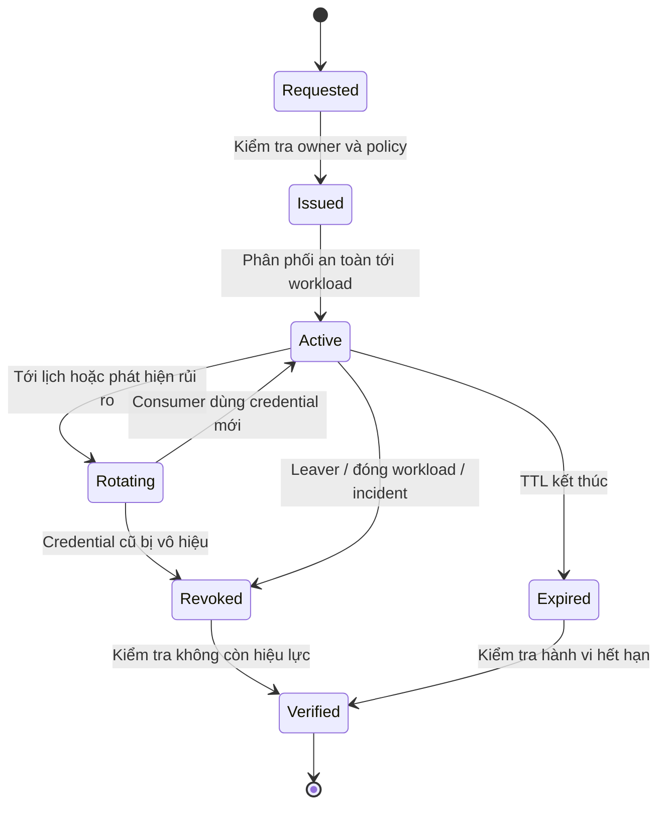
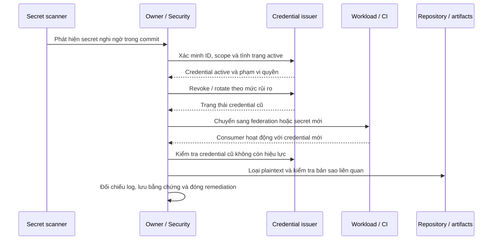

# Credential lưu trong mã nguồn: anti-pattern trong quản lý vòng đời danh tính IAM

## 1. Credential lưu trong mã nguồn là gì?

Trong **Identity and Access Management (IAM)**, credential là thông tin hoặc vật liệu mật mã dùng để **chứng minh danh tính**, **nhận token** hoặc **truy cập một tài nguyên**. Credential có thể là mật khẩu, API key, personal access token (PAT), OAuth client secret, cloud access key, khóa SSH riêng, private key của chứng chỉ, khóa ký JWT hoặc bí mật kết nối cơ sở dữ liệu.

**“Credential lưu trong mã nguồn”** là anti-pattern khi các giá trị bí mật được ghi trực tiếp vào Java, YAML, JSON, properties, script, notebook, Dockerfile, test fixture hoặc bất kỳ tệp nào được đưa vào hệ thống quản lý phiên bản, đóng gói trong artifact hay chia sẻ cho người không cần biết. Tác hại không phụ thuộc tệp đó được đặt tên là `application.yml`, `secrets.json` hay `config-prod.java`: một khi chứa **giá trị credential thực**, nó có thể bị sao chép, tìm kiếm và sử dụng ngoài phạm vi dự kiến.

Ví dụ phản diện dưới đây chỉ chứa **giá trị minh họa vô hiệu**, không phải credential có thật:

```java
// SAI: giá trị bí mật được nhúng trực tiếp vào mã nguồn.
class PartnerClientConfig {
    static final String API_TOKEN = "<hard-coded-secret>";
}
```

Với module quản lý vòng đời danh tính theo **Joiner–Mover–Leaver (JML)**, anti-pattern đặc biệt nguy hiểm vì credential nằm trong mã nguồn thường sống độc lập với người tạo ra nó. Khi người tạo chuyển vai trò hoặc nghỉ việc, khóa vẫn có thể tiếp tục hoạt động; khi role bị gỡ ở IdP, một ứng dụng hoặc script vẫn có thể dùng secret cũ để truy cập tài nguyên.

Mục tiêu sau bài học:

- Nhận diện các dạng credential bị nhúng và phân biệt bí mật với định danh công khai.
- Hiểu đường rò rỉ qua Git, pull request, CI/CD, log, image và artifact.
- Thiết kế quản lý secret theo vòng đời, owner, phạm vi quyền, thời hạn và kiểm toán.
- Liên hệ IdP, SSO, SCIM, RBAC/ABAC và danh tính workload với việc ngăn quyền tồn dư.
- Xử lý secret đã lộ theo trình tự **thu hồi/xoay vòng → kiểm chứng → loại bỏ nguồn lộ → điều tra và phòng ngừa**, tránh nhầm việc xóa dòng code với hoàn tất khắc phục.

## 2. Nhận diện đúng loại dữ liệu nhạy cảm

Không phải mọi chuỗi giống token đều là secret. Việc phân loại đúng giúp phát hiện hiệu quả và tránh sửa nhầm những cấu hình công khai.

| Loại | Ví dụ về vai trò | Thường phải giữ bí mật? | Ghi chú |
|---|---|---|---|
| Mật khẩu user/database | Đăng nhập hoặc thiết lập kết nối | **Có** | Không dùng chung thông tin của người với ứng dụng |
| API key/PAT | Cho phép gọi API hoặc repository | **Có**, nếu key dùng để xác thực | Chỉ cấp quyền và TTL cần thiết |
| OAuth `client_secret` | Chứng minh danh tính confidential client | **Có** | `client_id` thường chỉ là định danh, không tự là secret |
| Cloud access key + secret key | Ký request tới cloud API | **Có**, đặc biệt private/secret part | Ưu tiên role/identity ngắn hạn, federation khi hỗ trợ |
| SSH private key | Xác thực và ký khi kết nối | **Có** | SSH public key thường được phép chia sẻ |
| TLS private key | Xác nhận quyền sở hữu khóa của chứng chỉ | **Có** | Chứng chỉ công khai không đồng nghĩa private key được công khai |
| JWT signing key/HMAC key | Tạo hoặc kiểm tra chữ ký token | **Có** | Khóa xác minh công khai trong mô hình bất đối xứng có thể phân phối |
| Webhook signing secret | Xác minh thông điệp từ hệ thống khác | **Có** | Không nhầm với URL endpoint công khai |
| ID tài nguyên, tên host, `client_id` | Định tuyến, cấu hình | **Không mặc định** | Có thể vẫn là thông tin nội bộ, cần phân loại riêng |
| Mật khẩu giả trong unit test | Kiểm thử cục bộ, không có khả năng đăng nhập | **Không nếu thực sự vô hiệu** | Tránh dùng lại secret có thật và định dạng gây nhầm lẫn |

Các dạng mã hóa như **Base64, hex, URL encoding, nén, “chia chuỗi rồi nối lại” hoặc mã hóa đối xứng với khóa nằm cùng repository** không biến credential thành an toàn. Chúng chỉ thay hình thức biểu diễn; bên có mã nguồn thường có đủ dữ liệu để khôi phục.

Ngay cả khi tệp nằm trong repository **private**, credential không mặc nhiên an toàn: người có quyền đọc mã, bản sao trên máy nhà phát triển, tài khoản CI, cache, bản sao lưu và lịch sử commit có thể đều chứa nó. Quyền đọc mã nguồn và quyền sử dụng hệ thống production là hai nhu cầu khác nhau, cần được phân tách.

## 3. Secret lọt vào hệ thống phát triển bằng những con đường nào?

| Vị trí | Ví dụ nguyên nhân | Kết quả có thể xảy ra |
|---|---|---|
| File Java/Kotlin/JavaScript | Đặt token thành hằng số để “test nhanh” rồi quên xóa | Secret được commit và đóng gói trong binary |
| `application.yml`, `.properties`, JSON | Ghi mật khẩu DB production trong cấu hình | Dev/CI có mã nguồn có thể nhìn thấy credential |
| `.env` đưa lên Git | Nhầm file môi trường với cấu hình mẫu | Secret bị sao chép sang clone, fork, PR |
| Unit/integration test | Dùng tài khoản thật vì thiếu test double | Secret nằm trong test fixture, log hoặc report |
| Script triển khai, IaC, Dockerfile | `ARG`/`ENV` hoặc lệnh chứa mật khẩu | Có thể lộ trong image metadata/layer, build log và cache |
| CI/CD workflow | Ghi trực tiếp token trong YAML hoặc echo biến ra log | Secret vào lịch sử, artifact và quyền xem CI |
| Notebook, tài liệu và comment | Dán output debug có credential | Người đọc tài liệu hoặc index tìm kiếm thấy secret |
| `git stash`, commit cũ, nhánh phụ | Xóa khỏi HEAD nhưng vẫn còn trong object Git | Người đã clone hoặc còn quyền đọc history vẫn lấy được |
| File backup/export | Copy `config-prod.yml` vào thư mục phát hành | Artifact phát hành chứa bí mật không dành cho người nhận |

Một biến thể phổ biến là **để sẵn “mật khẩu dự phòng” trong cấu hình**:

```java
// SAI: khi biến môi trường bị thiếu, ứng dụng quay về secret cố định.
String dbPassword = System.getenv("DB_PASSWORD");
if (dbPassword == null) {
    dbPassword = "<fallback-production-password>";
}
```

Trạng thái thiếu secret nên khiến tiến trình **không khởi chạy hoặc báo lỗi cấu hình có kiểm soát**, thay vì âm thầm dùng credential cố định. Không in giá trị secret trong thông báo lỗi.

## 4. Tình huống: nhân viên nghỉ việc nhưng token vẫn nằm trong repository

Một công ty có ứng dụng đồng bộ đơn hàng sang hệ thống báo cáo. Lúc **Joiner**, kỹ sư An nhận quyền deploy và được cấp API key để kiểm thử tích hợp. An chèn key vào tệp cấu hình Java rồi push lên repository nội bộ.

Sau đó:

1. **Tháng 1 — Joiner:** key của An có quyền đọc dữ liệu đơn hàng production, không có ngày hết hạn và không ghi rõ owner của integration.
2. **Tháng 3 — Mover:** An chuyển sang đội khác. Nhóm IdP bị gỡ nhưng secret vẫn nằm trong mã và job đồng bộ tiếp tục gọi API.
3. **Tháng 5 — Leaver:** tài khoản SSO của An bị disable. Không ai kiểm kê API key từng tạo; CI/CD tiếp tục triển khai code từ repository.
4. **Tháng 6 — Phát hiện:** secret scanner tìm thấy một chuỗi có dạng credential trong lịch sử commit. Trên hệ thống đích, key vẫn active và có lần sử dụng gần đây.

Điều này cho thấy hai vấn đề liên tiếp: **secret bị phơi lộ qua mã nguồn** và **vòng đời credential tách khỏi vòng đời danh tính/owner**. Một bản ghi `employee=TERMINATED` hoặc `idpUser=DISABLED` không chứng minh key đã bị thu hồi.

Nếu chỉ xóa key khỏi phiên bản mới và tạo commit “fix security”, nguy cơ vẫn còn:

- Lịch sử Git, pull request diff, fork hoặc clone cũ còn bản sao secret.
- Key hiện hành vẫn được phía API chấp nhận.
- Binary/image/container đã phát hành có thể vẫn chứa key.
- Script khác có thể đã lấy secret và tiếp tục sử dụng.

Việc khắc phục đúng phải bắt đầu bằng **xác định scope và thu hồi hoặc xoay vòng key tại issuer/hệ thống đích**, chuyển workload sang credential do hệ thống quản lý, sau đó loại bỏ dấu vết và kiểm tra những bản sao còn tồn tại.

## 5. Vì sao secret trong code làm tăng rủi ro?

### 5.1. Git tạo nhiều bản sao khó thu hồi

Git là hệ thống phân tán: clone, fork, commit, tag và bản sao lưu có thể giữ lại object từng chứa secret. Xóa một dòng khỏi bản HEAD **không xóa các bản sao đã phát tán**. Việc viết lại history cũng cần phối hợp với người đang có clone, CI cache, bản mirror và nhánh; không thể buộc những người đã tải secret “quên” giá trị đó.

### 5.2. Quyền xem code bị nhầm với quyền dùng production

Lập trình viên, reviewer, contractor hoặc hệ thống CI có thể cần đọc mã nguồn nhưng không cần truy cập dữ liệu production. Secret hard-code vô tình trao khả năng đăng nhập hoặc gọi API cho bất kỳ ai xem được giá trị, tạo đường truy cập vượt khỏi IdP/SSO của họ.

### 5.3. Secret tĩnh khó đổi và dễ tồn tại quá lâu

Credential trong code thường gắn chặt với nhiều bản deploy. Mỗi lần đổi secret lại phải cập nhật cấu hình, build, triển khai và phối hợp nhiều môi trường. Khi rotate khó, đội dự án có xu hướng giữ credential nhiều năm, tạo **standing access** không cần thiết.

### 5.4. Quyền của secret thường quá rộng

Một PAT hoặc cloud key của người quản trị có thể được dùng để chạy một tác vụ đọc đơn giản. Kẻ chiếm được credential sẽ có quyền **của credential**, không chỉ quyền tác vụ mà tác giả dự định. Vì thế thiết kế phải dùng RBAC/ABAC hoặc chính sách tài nguyên để giảm quyền từ nguồn cấp.

### 5.5. Dữ liệu có thể rò rỉ qua build và runtime

Secret có thể xuất hiện trong class file, Java archive, client bundle, Docker layer, image history, crash dump, log lỗi, trace, build cache hoặc CI artifact. Đặc biệt, **mọi bí mật được đóng gói vào mã chạy trên trình duyệt/mobile đều phải coi là có thể được người dùng trích xuất**: không thể bảo vệ client secret bằng cách “obfuscate” frontend.

### 5.6. Khó kiểm toán và quy trách nhiệm

Khi nhiều bản deploy cùng dùng một token, log ở API đích thường chỉ ghi **service principal/token ID**. Nó không cho biết ai đã sao chép key, ai thực hiện mỗi lệnh thông qua key hoặc ai còn giữ bản cũ. Việc định danh owner, ghi nhận nơi dùng và hạn quyền là yêu cầu cơ bản để điều tra.

## 6. Luồng tấn công và phạm vi ảnh hưởng



Trong điều tra, cần tách **khả năng đã lộ** khỏi **bằng chứng đã bị lạm dụng**. Một secret active trong kho mã có rủi ro dù chưa thấy hành vi lạ. Ngược lại, không có log bất thường không chứng minh secret an toàn, vì telemetry có thể thiếu hoặc request trông giống tác vụ hợp lệ.

Mức ưu tiên khắc phục thường phụ thuộc vào:

| Yếu tố | Rủi ro tăng khi |
|---|---|
| Khả năng truy cập nguồn | Repository public, nhiều bản fork/clone hoặc artifact phát hành rộng |
| Quyền của credential | Có quyền admin, ghi/xóa, truy cập dữ liệu nhạy cảm, nhiều tenant/môi trường |
| Thời gian hiệu lực | Không có expiry, không rotation, nhiều năm chưa review |
| Khả năng lạm dụng | Có thể gọi API từ Internet, không ràng buộc workload/thiết bị/nguồn |
| Độ khó thu hồi | Không biết nơi dùng, không có owner, nhiều hệ thống phụ thuộc |
| Bằng chứng hoạt động | Log cho thấy sử dụng ngoài lịch/nguồn dự kiến, tạo token mới, thay đổi policy |

Không dùng mỗi điểm entropy của chuỗi để quyết định mức độ nghiêm trọng: **quyền thực tế và tình trạng còn hiệu lực của secret** thường quan trọng hơn định dạng nhìn bề ngoài.

## 7. Kiến trúc thay thế: mã nguồn chỉ chứa tham chiếu bí mật

Nguyên tắc thiết kế là **không đưa plaintext credential vào source, artifact công khai hoặc kênh phân phối mã**. Ứng dụng dùng một **danh tính workload** để lấy secret lúc khởi chạy hoặc nhận credential ngắn hạn từ hạ tầng đã xác thực.



Các thành phần:

1. **Source repository** chứa tên cấu hình, endpoint không nhạy cảm và *tham chiếu* đến secret, chẳng hạn `orders/prod/db/read-only`; không chứa giá trị cần giữ bí mật.
2. **Workload identity** xác nhận ứng dụng đang chạy trong môi trường được tin cậy. Có thể là managed identity, Kubernetes service account gắn định danh hoặc OIDC workload federation tùy nền tảng.
3. **Issuer/secrets manager** kiểm tra quyền của workload rồi cung cấp secret hoặc token có scope/TTL thích hợp.
4. **RBAC/ABAC** giới hạn tài nguyên, thao tác, môi trường, namespace, dự án hoặc các điều kiện được hệ thống đích hỗ trợ.
5. **Runtime** nhận secret qua kênh an toàn, giữ trong bộ nhớ hoặc cơ chế mount có kiểm soát, tránh ghi log và giải phóng/rotate theo vòng đời.
6. **Audit và owner** cho biết ai có thể đổi secret, workload nào được lấy, thời điểm phát hành/sử dụng và khi nào đã thu hồi.

**Secret manager không tự sửa quyền quá rộng.** Nếu mọi workload đều có thể đọc mọi secret production, anti-pattern chỉ chuyển từ repository sang kho bí mật. Cần phân tách role theo ứng dụng, môi trường và nhiệm vụ.

## 8. Ưu tiên không cần secret dài hạn: workload federation

Với hệ thống hỗ trợ, nên tránh tạo key tĩnh rồi cất trong vault nếu có thể dùng **workload identity federation** hoặc managed identity.

Ví dụ quy trình:

1. CI hoặc ứng dụng chạy trong một môi trường đã có identity được quản lý.
2. Nền tảng phát hành một **assertion/token ngắn hạn** thể hiện workload, issuer, audience và thông tin đáng tin cậy.
3. Dịch vụ IAM của đích kiểm tra trust policy: issuer, subject, audience, nhánh/môi trường hoặc điều kiện tương đương.
4. IAM cấp **credential tạm thời** đúng resource/scope.
5. Workload sử dụng credential; sau TTL nó hết hạn và phải xin lại theo chính sách.



Federation **không có nghĩa mọi token đều an toàn**. Trust policy cho phép sai subject/branch/repository, audience quá rộng, runner không tin cậy hoặc role ở đích quá mạnh đều có thể cho phép workload không phù hợp xin credential. Phải bảo vệ pipeline, rà soát trust relation và kiểm tra quyền thực tế ở đích.

Khi federation không khả dụng, secret manager với **credential có hạn, rotation tự động, quyền đọc theo workload và audit** là lựa chọn hợp lý; kế hoạch dài hạn nên giảm phụ thuộc vào khóa tĩnh.

## 9. Cấu hình Java/Spring Boot không nhúng mật khẩu

Một chương trình Java nên nhận cấu hình từ môi trường thực thi hoặc secret provider theo chính sách. Ví dụ tối giản với biến môi trường:

```java
public final class DbCredentialConfig {
    private DbCredentialConfig() {}

    public static String requiredDbPassword() {
        String value = System.getenv("DB_PASSWORD");
        if (value == null || value.isBlank()) {
            throw new IllegalStateException("Missing database credential");
        }
        return value;
    }
}
```

Đoạn code này minh họa **tách nguồn credential khỏi source** và xử lý thiếu cấu hình. Trong ứng dụng thực tế nên dùng cơ chế binding/config của framework hoặc secret provider tích hợp; không lưu biến trả về vào log, exception message, endpoint debug hoặc public field.

Trong Spring Boot, có thể dùng cơ chế binding của framework để cung cấp biến môi trường `SPRING_DATASOURCE_PASSWORD` khi ứng dụng chạy, mà không khai báo giá trị mật khẩu trong YAML. Ví dụ cấu hình kết nối:

```yaml
spring:
  datasource:
    url: "jdbc:postgresql://db.internal:5432/orders"
    username: "orders_runtime"
# Password được cung cấp qua SPRING_DATASOURCE_PASSWORD lúc chạy.
```

**Không coi environment variable là kho bí mật an toàn mặc định.** Giá trị vẫn có thể bị lộ qua quyền đọc môi trường tiến trình, debug endpoint, crash dump, script CI hoặc logs. Phải bảo vệ môi trường chạy, quyền xem biến, secret injection và vòng đời quay vòng. Với yêu cầu bảo mật cao, tích hợp secrets manager hoặc cấp credential ngắn hạn qua workload identity thường tốt hơn.

### 9.1. Ví dụ cấu hình sai và đúng theo mục đích

| Cách làm | Đánh giá | Lý do |
|---|---|---|
| Viết `password: "<actual-password>"` trong YAML commit lên Git | **Sai** | Plaintext secret phát tán qua source/history |
| Đưa mật khẩu vào Base64 rồi hard-code | **Sai** | Decode được, không thay đổi quyền truy cập |
| Đặt secret trong `.env` và commit | **Sai** | Vẫn là plaintext trong repository |
| `.env` local không được commit, quyền file hạn chế | **Chỉ phù hợp một số môi trường dev** | Vẫn phải kiểm soát backup, chia sẻ và việc secret từng bị commit |
| CI inject secret từ vault vào runtime | **Tốt hơn** | Không gắn secret vào mã; cần kiểm soát CI logs/artifact và quyền đọc vault |
| Workload lấy token ngắn hạn qua federation | **Ưu tiên khi hỗ trợ** | Giảm credential tĩnh, kiểm soát trust và quyền của workload |
| Lưu ciphertext mã hóa trong repository theo cơ chế quản lý khóa độc lập | **Có thể phù hợp nếu thiết kế đúng** | Chỉ lưu ciphertext; quyền giải mã, key rotation, audit và pipeline phải được quản trị |

Mã hóa secret để lưu dưới dạng ciphertext trong repo là một phương án có điều kiện. Nếu khóa giải mã cũng nằm trong repo hoặc mọi reviewer đều có quyền giải mã production, lợi ích bảo mật gần như mất đi.

## 10. Git và lịch sử: vì sao xóa khỏi HEAD chưa đủ?

Khi một credential bị commit, có ít nhất bốn nơi phải cân nhắc:

- **Working tree/HEAD**: phiên bản hiện tại của mã.
- **Lịch sử và ref Git**: commit cũ, tag, branch, reflog, fork, mirror.
- **Hệ sinh thái phát triển**: PR diff, review comment, issue, chat, CI log, job cache, artifact, search index.
- **Artifact và runtime**: Java archive, image layer, build cache, container, máy chủ, bản backup.

Thứ tự xử lý ưu tiên khi secret thực sự bị lộ là **revoke/rotate tại issuer**, thay code để lấy secret mới qua kênh quản lý, kiểm tra phụ thuộc và mới thực hiện làm sạch repository/history theo quy trình được phê duyệt. **Rewrite history không thay thế rotation** vì bản sao cũ vẫn có thể tồn tại ngoài tầm kiểm soát.

Khi phải viết lại Git history để giảm khả năng tiếp tục xuất hiện plaintext, cần phối hợp người sở hữu repository, nhánh bảo vệ, commit đã tham chiếu từ hệ thống ngoài, fork/mirror và lịch sử CI. Việc này có thể thay đổi hash commit và ảnh hưởng người đang làm việc. Bảo toàn bằng chứng cần thiết cho điều tra theo quy trình, không tự xóa toàn bộ dấu vết nếu đang có incident.

Để phòng ngừa, cấu hình `.gitignore` giúp tránh thêm **file chưa tracked**, nhưng **không xóa file đã commit và không bảo vệ các secret trong file tracked**. Vì vậy cần kết hợp policy, kiểm tra trước commit, scanner ở pull request và kiểm tra cả lịch sử có liên quan.

## 11. CI/CD: nơi secret có thể phát tán ngoài source

CI thường có quyền tải source, chạy script, tạo artifact và triển khai. Nếu dùng một key production dài hạn cho mọi workflow, rủi ro từ một pull request hoặc runner bị chiếm có thể lan sang hệ thống đích.

Các nguyên tắc chính:

1. **Tách môi trường:** pipeline build/test không mặc nhiên có credential triển khai production; môi trường deploy cần kiểm tra nhánh/tag và phê duyệt tương ứng.
2. **Giới hạn permission của job:** chỉ cấp quyền tối thiểu cho repository và khả năng xin identity token khi thực sự cần.
3. **Ưu tiên OIDC federation:** CI đổi assertion workload thành credential ngắn hạn có scope ở hệ thống đích.
4. **Không truyền secret cho code không tin cậy:** kiểm tra quyền của PR từ fork, build plugin, dependency và step do bên thứ ba cung cấp.
5. **Không in credential ra log:** tránh `echo`, trace verbose, dump toàn bộ env, set-x hoặc command line chứa mật khẩu.
6. **Không nhúng secret vào artifact:** kiểm tra Dockerfile, build ARG/ENV, layer, output test, source map, client bundle và cache.
7. **Hạn chế nơi lưu kết quả:** bảo vệ artifact, log, runner và môi trường deployment theo mức nhạy cảm.
8. **Có owner và bằng chứng:** ghi workload ID, repo/workflow, target, phạm vi quyền, thời điểm cấp/thu hồi và truy vết một deploy.

Một workflow CI minh họa chỉ nêu quyền cơ bản, chưa tích hợp nhà cung cấp nào:

```yaml
name: deploy-with-workload-identity
permissions:
  contents: read
  id-token: write
jobs:
  deploy:
    runs-on: ubuntu-latest
    environment: production
    steps:
      - name: Check out source
        uses: actions/checkout@v4
      - name: Acquire short-lived credentials and deploy
        run: ./scripts/deploy-with-federation.sh
```

Ví dụ này chỉ thể hiện **ý tưởng cấu hình**. Workload federation chỉ hoạt động khi script, IAM đích và trust policy đã được cấu hình đúng, có kiểm tra issuer/subject/audience; nó không tự động hoạt động nhờ `id-token: write`. Quyền `id-token: write` cũng phải được giới hạn vào job/môi trường thật sự cần thiết.

## 12. Quản lý credential theo vòng đời và ownership

Một credential đúng thiết kế phải có **issuer, chủ thể sử dụng, owner, scope, ngày cấp, hạn/rotation, nơi sử dụng và cách thu hồi**.

| Giai đoạn | Việc phải thực hiện | Bằng chứng cần có |
|---|---|---|
| **Yêu cầu** | Xác định workload, tài nguyên, action và người chịu trách nhiệm | Ticket, owner, lý do |
| **Cấp** | Tạo credential bằng issuer hợp lệ với scope và TTL phù hợp | Credential ID, policy, thời điểm cấp |
| **Phân phối** | Cấp cho runtime qua secret manager/federation, không qua source/chat | Audit lần lấy hoặc token exchange |
| **Sử dụng** | Kiểm soát nơi chạy, quyền thực tế, log và bất thường | Workload ID, session/correlation ID |
| **Rotation** | Cấp secret mới, chuyển consumer, xác minh và vô hiệu secret cũ | Thời điểm cutover, kết quả tại đích |
| **Thu hồi** | Revoke khi workload dừng, owner đổi, lộ secret hoặc hết hạn | Trạng thái issuer/target, lần dùng sau revoke |
| **Rà soát** | Kiểm tra owner, quyền, TTL, nơi dùng, đối tượng không hoạt động | Quyết định review và remediation |

Đối với việc rotate secret không hỗ trợ song song hai giá trị, phải có kế hoạch tránh downtime, nhưng **thời gian chờ chuyển đổi không được bị kéo dài vô hạn**. Nếu phát hiện secret lộ đang bị khai thác, ưu tiên cô lập và thu hồi khẩn theo mức rủi ro, đồng thời phối hợp khôi phục dịch vụ.



Trạng thái minh họa nên được hiểu **theo từng credential version**: khi xoay vòng, bản cũ đi đến `Revoked` còn bản mới có chu kỳ `Issued → Active` riêng. Không có nghĩa một credential đã thu hồi trở thành active trở lại.

## 13. Joiner–Mover–Leaver: xử lý secret do con người tạo ra

### 13.1. Joiner — cấp quyền, không cấp “một khóa dùng chung”

Nhân viên mới cần account cá nhân trong IdP, đăng nhập SSO/MFA và nhận role theo công việc. Nếu công việc là phát triển ứng dụng, người đó có thể được quyền **quản trị secret metadata hoặc triển khai trong môi trường dev**, nhưng không mặc định được đọc plaintext secret production.

Khi tạo một integration mới, cần ghi nhận **business owner, technical owner và workload identity**, tránh coi credential của người tạo là tài khoản vận hành lâu dài. Quyền thao tác trên secret manager nên tách với quyền ứng dụng lấy secret lúc runtime.

### 13.2. Mover — chuyển role và rà soát mọi đường truy cập

Khi nhân viên đổi bộ phận/dự án, gỡ role cũ và rà soát quyền đọc/chỉnh secret, quyền deploy, service principal họ quản lý và các token cá nhân đã cấp. Nếu workload còn hoạt động, chuyển owner và giảm quyền về nhu cầu thật; không để API key của đội cũ tiếp tục sống chỉ vì pipeline vẫn chạy.

### 13.3. Leaver — thu hồi cả credential ngoài SSO

Disable IdP và ngăn đăng nhập mới qua SSO là cần thiết, nhưng chưa chắc thu hồi được:

- PAT/API token do người đó tạo ở hệ thống bên ngoài.
- Cloud access key hoặc SSH private key từng dùng để truy cập trực tiếp.
- Tài khoản local, session, refresh token, certificate và khóa đăng nhập phụ.
- Secret chung hoặc mật khẩu của service account người đó từng biết.
- Quyền lấy bí mật trong vault, cấu hình CI/CD hoặc cơ chế impersonation.

Với người rời tổ chức, phải **thu hồi credential cá nhân và quyền lấy/đổi secret**, rà soát rotation với các secret từng được biết, đồng thời **bàn giao owner cho workload**. Một service account thuộc ứng dụng không nên bị xóa máy móc chỉ vì owner nhân sự đã Leaver; cần xác minh phụ thuộc và chuyển đổi an toàn.

### 13.4. Tài khoản bên ngoài và nhà thầu

Nhà thầu có thể không xuất hiện trong HRIS của nhân viên, nhưng vẫn có repo access, secret access hoặc token vendor. Cần sponsor nội bộ, hạn hợp đồng, thời điểm kết thúc và quá trình deprovisioning riêng. Khi sponsor chuyển bộ phận hoặc nghỉ việc, quyền của nhà thầu và trách nhiệm review cũng phải được rà soát.

## 14. IdP, SSO, SCIM, RBAC/ABAC giúp gì và không giúp gì?

| Thành phần | Vai trò | Giới hạn liên quan hard-coded credential |
|---|---|---|
| **IdP** | Quản lý danh tính, trạng thái nhân sự và xác thực | API key độc lập với IdP có thể vẫn active sau khi account bị khóa |
| **SSO/MFA** | Bảo vệ luồng đăng nhập có liên kết IdP | Secret hard-code gọi API trực tiếp có thể không đi qua MFA hay SSO |
| **SCIM/provisioning** | Tạo/cập nhật/vô hiệu user, nhóm và thuộc tính ứng dụng hỗ trợ | Không tự thu hồi mọi secret, PAT, session hay credential tích hợp |
| **RBAC** | Giới hạn quyền lấy secret, quản lý và dùng tài nguyên | Role cấp quá rộng làm secret lộ có phạm vi ảnh hưởng lớn |
| **ABAC** | Ràng buộc thuộc tính workload, môi trường, thời gian và tài nguyên | Thuộc tính sai hoặc policy không thực thi tại đích làm kiểm soát vô hiệu |
| **PAM/PIM** | Kiểm soát đặc quyền, checkout/rotation, JIT | Secret đã từng commit vẫn phải thu hồi dù được đưa vào vault sau đó |
| **IGA/access review** | Xác nhận owner, mục đích, quyền và quá trình thu hồi | Review không sửa được vấn đề nếu quyết định revoke không chạy tại đích |
| **Secrets manager / issuer** | Cấp phát, lưu, rotate và revoke credential có kiểm toán | Cần trust, policy, identity và cấu hình runtime đúng |

Điểm trung tâm: **không thể dùng đăng nhập SSO an toàn để biện hộ cho một API key production nằm trong Git**. Cơ chế xác thực của credential đó là một đường truy cập riêng và phải được quản trị theo vòng đời của nó.

## 15. Phát hiện sớm bằng secret scanning và kiểm tra ngữ cảnh

### 15.1. Các lớp phát hiện

Nên triển khai:

1. **Editor/pre-commit:** cảnh báo trước khi developer commit những chuỗi có mẫu secret hoặc private key.
2. **Pull request/CI:** quét phần thay đổi và các tệp nhạy cảm; có chính sách chặn merge khi xác minh có secret thật.
3. **Repository/history:** kiểm tra nhánh, tag và commit đã có; đối chiếu phát hiện từ Git hosting.
4. **Artifact/container:** kiểm tra image, bundle, layer, build output, cấu hình hoặc file bị đóng gói nhầm.
5. **Runtime/issuer:** kiểm kê credential active, thời gian hiệu lực, lần dùng và credential không có owner.
6. **Event/incident:** theo dõi cảnh báo từ provider khi một secret bị phát hiện hoặc có hành vi sử dụng bất thường.

Các công cụ thường kết hợp **mẫu định dạng, entropy, kiểm tra ngữ cảnh và xác minh trạng thái**. Dữ liệu giả, hash, identifier công khai và chuỗi ngẫu nhiên có thể tạo false positive. Quy trình triage phải phân biệt rõ `SUSPECTED`, `VERIFIED_SECRET`, `REVOKED` và `FALSE_POSITIVE`; không âm thầm bỏ qua kết quả vì pipeline đang bị chặn.

**Không đưa secret thật vào issue, bình luận PR, ticket hoặc log scanner** để giải thích phát hiện. Báo cáo nên dùng fingerprint hoặc identifier an toàn, đường dẫn và vị trí đã được hạn chế truy cập, issuer, mức rủi ro, trạng thái xử lý.

### 15.2. Quy tắc scanner minh họa

```yaml
secretScanningPolicy:
  scan:
    - "pre-commit"
    - "pull-request"
    - "repository-history"
    - "build-artifacts"
  verifiedSecret:
    mergeAllowed: false
    notify: "security-and-resource-owner"
    requiredActions:
      - "REVOKE_OR_ROTATE"
      - "VERIFY_TARGET_CREDENTIAL_INVALID"
      - "REMOVE_SECRET_FROM_DELIVERY_PATH"
      - "REVIEW_EXPOSURE_AND_LOGS"
  falsePositive:
    requireReason: true
    recordReviewer: true
```

Đây là **chính sách ví dụ để diễn đạt ý tưởng**, không phải file cấu hình có thể nạp trực tiếp vào một secret scanner cụ thể. Tên công cụ, định dạng rule và khả năng xác minh cần kiểm tra theo nền tảng triển khai.

## 16. Incident response khi đã commit credential

Khi credential thật đã xuất hiện trong source hoặc artifact, giả định rằng người có quyền truy cập tới bản sao đó **có thể đã thấy giá trị**. Cần hành động theo mức nhạy cảm và mức bằng chứng:

### Bước 1 — Xác định secret, owner và phạm vi

Xác định loại credential, issuer, resource, người/workload đứng tên, quyền hiệu lực, thời điểm phát hành, lần dùng, repository/commit hoặc artifact liên quan, mức public/private và các hệ thống có thể đã sao chép. Không tải/hiển thị toàn bộ secret trong kênh báo cáo.

### Bước 2 — Chặn khả năng sử dụng credential lộ

**Revoke ngay** nếu có dấu hiệu lạm dụng hoặc rủi ro cao; nếu credential thiết yếu đang vận hành, phối hợp cấp bản thay thế và chuyển consumer trong giới hạn ứng cứu cho phép. Một số hệ thống hỗ trợ hai phiên bản để xoay vòng an toàn; số khác cần cắt truy cập, khôi phục dịch vụ sau đó. Bảo vệ hệ thống và dữ liệu phải được ưu tiên theo chính sách ứng cứu sự cố.

### Bước 3 — Cấp credential thay thế an toàn

Chuyển ứng dụng sang workload identity, federation hoặc vault. Credential mới phải khác giá trị cũ, có quyền và TTL phù hợp, chỉ phân phối cho workload hợp lệ. Không commit giá trị mới để “sửa nhanh”, vì như vậy lặp lại sự cố.

### Bước 4 — Xác nhận thu hồi tại đích

Kiểm tra status ở issuer, quyền hiệu lực, phiên/token liên quan và các log sử dụng sau thời điểm thu hồi. Trường hợp không thể kiểm chứng bằng API, ghi rõ giới hạn và dùng kiểm soát bù trừ có owner. **Một lệnh revoke báo thành công chưa luôn chứng minh session hoặc credential khác đã bị vô hiệu.**

### Bước 5 — Làm sạch nơi rò rỉ

Sửa mã để không cần secret, loại bỏ plaintext khỏi cấu hình và pipeline, kiểm tra PR, CI logs, cache, image, artifact, mirror. Nếu cần rewrite history, thực hiện phối hợp theo quy trình quản trị repository và bảo toàn bằng chứng điều tra. Giới hạn quyền đọc vào các nguồn chưa được làm sạch.

### Bước 6 — Điều tra khả năng sử dụng trái phép

Đối chiếu audit log ở issuer/API, nguồn mạng, resource, hành động, thời điểm từ lúc secret có khả năng bị lộ, các token hoặc role được tạo từ credential đó và thay đổi cấu hình/dữ liệu. Mở incident theo mức độ khi có dấu hiệu đáng tin cậy. Không kết luận “không có xâm nhập” chỉ từ việc không thấy log.

### Bước 7 — Ngăn lặp lại

Bổ sung secret scanning, policy branch, giới hạn quyền CI, inventory owner, review credential, chuẩn hóa rotation và hướng dẫn developer. Tránh chỉ đào tạo cá nhân mà giữ nguyên cơ chế buộc họ phải dùng secret tĩnh trong code.



## 17. Kiểm toán và dữ liệu theo dõi

Một bản ghi secret inventory nên có:

| Thuộc tính | Mục đích |
|---|---|
| `credentialId` / fingerprint an toàn | Nhận dạng và đối soát mà không lộ giá trị |
| `issuer` / `targetSystem` | Biết nơi xác thực, thu hồi và truy vấn log |
| `workloadId` / `subjectId` | Danh tính được credential đại diện |
| `businessOwnerId` / `technicalOwnerId` | Người quyết định mục đích và người vận hành |
| `resourceScope` / `permissions` | Đánh giá least privilege và phạm vi ảnh hưởng |
| `createdAt` / `expiresAt` / `lastRotatedAt` | Theo dõi vòng đời và credential quá hạn |
| `lastUsedAt` / `allowedSources` | Đánh giá sử dụng, bất thường và dependency |
| `distributionMethod` | Vault, federation, runtime injection hoặc legacy |
| `exposureStatus` / `incidentId` | Theo dõi secret từng bị lộ và xử lý |
| `revokedAt` / `targetVerifiedAt` | Xác nhận thu hồi đã được thực thi |

Không đặt **plaintext secret** vào registry hoặc log chỉ để tiện đối soát. Bản ghi có thể tham chiếu secret manager path hoặc credential ID; việc xem giá trị thực phải dùng kênh có kiểm soát và phân quyền riêng.

### Truy vấn phát hiện credential đã hết hạn hoặc không có owner

Giả sử có bảng nội bộ `credential_inventory`. SQL sau dùng cú pháp gần PostgreSQL và chỉ mang tính minh họa:

```sql
SELECT credential_id, issuer, workload_id,
       business_owner_id, expires_at, last_rotated_at
FROM credential_inventory
WHERE status = 'ACTIVE'
  AND (
      business_owner_id IS NULL
      OR (expires_at IS NOT NULL AND expires_at < CURRENT_TIMESTAMP)
      OR (secret_type = 'STATIC' AND last_rotated_at IS NULL)
  );
```

Truy vấn tạo **danh sách cần điều tra**, không kết luận toàn bộ credential là rò rỉ. Dữ liệu ở inventory có thể chưa đồng bộ với issuer; cần đọc lại trạng thái thực tế. Một access token hết hạn không cần rotation như mật khẩu tĩnh; quản trị phải phân loại credential trước khi quyết định.

### Truy vấn tìm key còn hoạt động sau khi owner nghỉ

```sql
SELECT c.credential_id, c.issuer, c.workload_id,
       c.created_by_person_id, p.employment_status
FROM credential_inventory c
JOIN people p ON p.person_id = c.created_by_person_id
WHERE c.status = 'ACTIVE'
  AND p.employment_status = 'TERMINATED';
```

Đây là tín hiệu cần **kiểm tra ownership và mức độ phụ thuộc**. Không phải mọi service credential do người đã nghỉ tạo đều phải xóa ngay: workload có thể vẫn hoạt động hợp lệ. Cần bàn giao owner, xác minh nơi sử dụng và rotate nếu người cũ có thể giữ bản sao.

## 18. Kế hoạch loại bỏ secret hard-code khỏi dự án

### Giai đoạn 1 — Kiểm kê và chặn secret mới

Tổng hợp repository, CI, artifact, image, cấu hình và credential issuer. Bật quét trước commit và PR, ban hành quy tắc không đưa plaintext secret vào code. Các phát hiện đã xác minh cần owner và thời hạn khắc phục, phân loại theo rủi ro.

### Giai đoạn 2 — Xác định dependency

Với từng credential, tìm workload và môi trường sử dụng; kiểm tra nơi phân phối, quyền cần thiết, khả năng rotation, phiên/token phụ thuộc và kế hoạch chuyển đổi. Chú ý secret bị nhân bản trong nhiều ứng dụng có thể đòi hỏi chuyển dần từng consumer.

### Giai đoạn 3 — Xây kênh cấp credential an toàn

Ưu tiên managed identity/federation. Nếu phải dùng secret, triển khai secrets manager và policy đọc theo workload. Tránh một “tài khoản vault toàn năng” cho mọi ứng dụng. Cấu hình ứng dụng đọc secret khi chạy và loại bỏ fallback hard-code.

### Giai đoạn 4 — Rotate và thu hồi credential cũ

Cấp credential mới với scope tối thiểu, đổi consumer, kiểm tra hành vi và vô hiệu bản cũ theo mức rủi ro. Không đặt credential mới vào repository. Nếu có nghi ngờ lạm dụng, mở quy trình incident response và ưu tiên thu hồi khẩn.

### Giai đoạn 5 — Dọn bản sao và xác minh

Kiểm tra file HEAD, lịch sử, artifact, CI log và image phát hành. Với history rewrite, phối hợp repo owner và những người đang dùng nhánh. Kiểm tra tại issuer rằng secret cũ không dùng được, theo dõi việc gọi API với credential đã thu hồi và xử lý lỗi còn mở.

### Giai đoạn 6 — Duy trì kiểm soát

Đưa credential vào inventory có owner, định kỳ review scope và vòng đời. Gắn sự kiện JML với quyền cá nhân, token do cá nhân tạo và việc bàn giao workload; cảnh báo secret lâu không rotate, secret không owner và credential còn active dù integration đã đóng.

## 19. Kiểm thử giải pháp sau chuyển đổi

| Kiểm thử | Kết quả mong đợi |
|---|---|
| Clone repository từ đầu | Không có plaintext secret trong các tệp hiện hành |
| Secret scanner chạy trên PR và phần lịch sử phù hợp | Phát hiện hoặc chặn secret thật, có quy trình xử lý false positive |
| Build artifact và container image | Không chứa credential cần giữ bí mật |
| Runtime không được cấp secret | Khởi động hoặc tác vụ nhạy cảm bị từ chối an toàn, không dùng fallback hard-code |
| Runtime có workload identity hợp lệ | Nhận credential đúng scope và kết nối được đích cần thiết |
| Runtime giả mạo sai workload/namespace/repo | Không xin được credential của workload khác |
| Workload chỉ có quyền đọc | Thử thao tác ghi/xóa bị từ chối tại hệ thống đích |
| Secret cũ đã revoke | Bị issuer/đích từ chối; phiên/token phụ thuộc được xử lý theo thiết kế |
| Secret mới rotate | Consumer hợp lệ hoạt động; bản cũ bị vô hiệu và có audit |
| Mover hoặc Leaver của owner | Quyền cá nhân bị thu hồi, workload được bàn giao, credential cũ được rà soát |
| Pipeline chạy từ nguồn không tin cậy | Không được cấp secret production hoặc quyền federation của môi trường deploy |
| Log và crash report | Không chứa plaintext credential hoặc token nguyên vẹn |

Nên thực hiện kiểm thử với **credential thử nghiệm, môi trường kiểm soát và tài nguyên được phép**. Không đăng secret thật vào ticket hoặc nhờ người khác thử bằng khóa bị lộ trên môi trường ngoài quy trình.

## 20. Chỉ số đo lường và mục tiêu cải thiện

Chương trình giảm credential hard-code có thể theo dõi:

- **Số phát hiện secret thật còn active trong repository** và thời gian từ phát hiện đến thu hồi tại issuer.
- **Tỷ lệ workload dùng federation/managed identity** so với credential tĩnh.
- **Tỷ lệ credential có owner, TTL/rotation và scope rõ ràng**.
- **Số secret từng bị lộ mà chưa xác minh thu hồi**, tách rõ đã xóa khỏi code nhưng vẫn active.
- **Số credential có quyền quá rộng**, không sử dụng hoặc không gắn với workload hiện hành.
- **Số key/PAT cá nhân được dùng trong CI/CD**, đặc biệt khi người tạo đã Mover/Leaver.
- **Tỷ lệ PR được quét**, thời gian triage, tỷ lệ false positive và tỷ lệ khắc phục trước merge.
- **Số vụ lộ secret qua image, log, artifact**, để kiểm soát cả đường phân phối ngoài Git.

Không đánh giá hiệu quả chỉ qua số cảnh báo scanner: cảnh báo nhiều hơn có thể do phạm vi quét được mở rộng. Chỉ số quan trọng hơn là **credential thực sự đã mất hiệu lực khi bị lộ**, ít quyền hơn và không còn phụ thuộc vào secret tĩnh không có owner.

## 21. Tình huống tự kiểm tra

**Tình huống A.** Nhóm phát triển xóa mật khẩu production khỏi `application.yml` và commit thay đổi. Mật khẩu cũ vẫn hoạt động. Đã khắc phục xong chưa?

**Chưa.** Phải revoke/rotate tại issuer, đổi consumer, kiểm tra Git history/CI/artifact và xác minh mật khẩu cũ không còn sử dụng được.

**Tình huống B.** Một API key đã được mã hóa Base64 và hard-code vào `Config.java`. Đã an toàn hơn chưa?

**Không về mặt giữ bí mật.** Base64 có thể decode trực tiếp; secret vẫn bị phát tán qua source và artifact.

**Tình huống C.** CI dùng secret từ vault nhưng chạy workflow trên mọi pull request từ fork và cấp quyền đọc secret production. Cách làm có phù hợp không?

**Không.** Phải giới hạn quyền theo nguồn đáng tin, môi trường, subject/audience và quy trình phê duyệt; vault không bù được một trust policy mở quá rộng.

**Tình huống D.** Một token 15 phút lấy qua workload federation nhưng role ở đích có quyền quản trị toàn tenant. Vấn đề còn tồn tại gì?

**Quyền quá rộng.** Token ngắn hạn giảm thời gian rủi ro credential nhưng phải tiếp tục thực thi least privilege trên tài nguyên và thao tác.

**Tình huống E.** Nhân viên nghỉ việc từng tạo API key cho một job backup. IAM định xóa key ngay mà chưa kiểm tra job. Đúng không?

**Cần đánh giá phụ thuộc và mức rủi ro.** Thu hồi quyền cá nhân, bàn giao owner và thay bằng workload identity hợp lệ; nếu key đã lộ hoặc có dấu hiệu lạm dụng thì ưu tiên cô lập/thu hồi theo ứng cứu.

**Tình huống F.** Một mật khẩu được đưa từ mã nguồn sang biến môi trường trong CI; pipeline vẫn `echo` toàn bộ env vào log. Đã giải quyết chưa?

**Chưa.** Bí mật vẫn có đường rò qua log. Cần quản lý quyền xem log, ngăn dump environment, runtime injection an toàn và giảm phụ thuộc secret tĩnh.

**Tình huống G.** Repository đã rewrite history. Vì mọi nhánh chính không còn chứa token nên có thể không đổi token?

**Không.** Clone, fork và bản sao cũ có thể còn token. Chỉ thu hồi/rotation và xác minh ở issuer mới ngăn credential cũ được sử dụng.

**Tình huống H.** Frontend JavaScript tải client secret OAuth từ API rồi dùng trực tiếp để xin access token. Có nên làm vậy?

**Không.** Mã client và dữ liệu gửi xuống trình duyệt có thể bị trích xuất. Ứng dụng công khai nên dùng luồng xác thực phù hợp (ví dụ Authorization Code với PKCE khi áp dụng) và giữ confidential client secret ở thành phần máy chủ có thể bảo vệ nó.

## Kết luận

**Credential lưu trong mã nguồn là anti-pattern IAM vì biến quyền truy cập thành một giá trị có thể bị sao chép cùng code, vượt ra ngoài vòng đời danh tính và cơ chế phê duyệt.** Việc xóa một chuỗi khỏi file không bảo đảm credential đã hết hiệu lực; phải thu hồi hoặc xoay vòng ở hệ thống cấp, kiểm tra các bản sao, artifact và log, đồng thời xác minh quyền thực tế tại đích. Thiết kế bền vững ưu tiên **workload identity/federation, credential ngắn hạn, secrets manager có RBAC/ABAC, owner rõ ràng, kiểm toán và secret scanning xuyên suốt CI/CD**. Gắn những kiểm soát đó với **Joiner–Mover–Leaver, IdP/SSO/SCIM và review quyền** giúp giảm secret mồ côi, đặc quyền tồn dư và khả năng truy cập trái phép sau thay đổi vai trò hoặc nghỉ việc.
