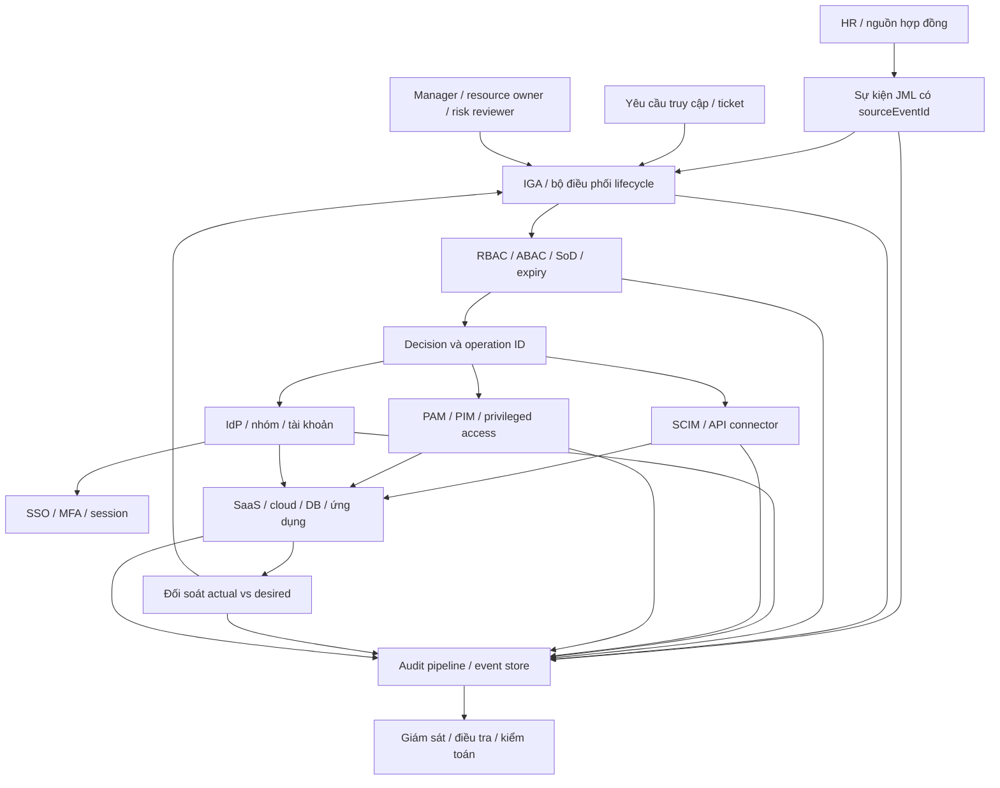

# Provisioning không có audit: anti-pattern trong quản lý vòng đời danh tính IAM

## 1. Vấn đề: quyền đã được cấp, nhưng không ai chứng minh được vì sao

Trong **Identity and Access Management (IAM)**, *provisioning* là quá trình thiết lập danh tính và quyền truy cập ở các hệ thống đích: tạo tài khoản, gán nhóm, cấp role, kích hoạt entitlement, thiết lập danh tính dịch vụ hoặc cập nhật các thuộc tính dùng để ủy quyền. *Deprovisioning* là quá trình ngừng hoặc thu hồi những khả năng truy cập không còn hợp lệ, chẳng hạn vô hiệu tài khoản, gỡ role, thu hồi token, session hoặc khóa truy cập.

**“Provisioning không có audit”** là anti-pattern khi hệ thống thực hiện những thay đổi đó nhưng **không lưu lại bằng chứng đáng tin cậy để truy vết từ lý do nghiệp vụ và quyết định phê duyệt đến kết quả thực tế tại hệ thống đích**. Tổ chức có thể biết một người đang có quyền quản trị, nhưng không biết:

- Quyền được yêu cầu lúc nào, cho mục đích gì và có thời hạn hay không.
- Ai hoặc hệ thống nào tạo yêu cầu, ai phê duyệt, theo phiên bản chính sách nào.
- Connector/SCIM đã gửi lệnh nào tới ứng dụng đích và ứng dụng phản hồi ra sao.
- Quyền thực tế đã được áp dụng, thay đổi, thu hồi hoặc còn tồn dư hay chưa.
- Khi xảy ra lỗi hoặc retry, hành động nào là lần đầu, hành động nào là xử lý trùng.
- Ai chịu trách nhiệm khắc phục nếu dữ liệu **mong muốn** (*desired state*) khác trạng thái **thực tế** (*actual state*).

Ví dụ: hệ thống cấp role `production-admin` cho một kỹ sư và chỉ ghi `provisioning=success`. Khi kiểm toán hỏi người đó đã được phê duyệt hay chưa, role tồn tại từ khi nào và có được thu hồi lúc chuyển đội hay không, tổ chức không có bằng chứng để trả lời. Một dòng “success” không đủ để chứng minh kiểm soát IAM hoạt động đúng.

Bài học thuộc chương **Anti-pattern IAM**, nằm trong phạm vi quản lý vòng đời danh tính **Joiner–Mover–Leaver (JML)**. Nội dung liên kết nguồn nhân sự, **IdP**, **SSO**, **SCIM**, **RBAC/ABAC**, danh tính dịch vụ, kiểm toán và mục tiêu giảm quyền truy cập tồn dư.

Sau bài học, bạn có thể thiết kế một chuỗi audit đầu cuối, nhận diện khoảng trống bằng chứng, phân biệt phản hồi kỹ thuật với quyền hiệu lực, xử lý lỗi/đồng bộ lại, bảo vệ audit log và kiểm thử để chứng minh quy trình cấp–thu hồi quyền có thể kiểm toán.

## 2. Audit provisioning không đơn thuần là bật logging

Một *audit trail* hữu ích phải nối được **yêu cầu → quyết định → thao tác → phản hồi → trạng thái xác minh**. Logging thông thường có thể chỉ ghi lỗi HTTP, thời gian chạy job hoặc tên hàm được gọi; nó chưa chắc chứa danh tính, quyền, tài nguyên, căn cứ và bằng chứng kết quả.

| Khái niệm | Mục đích | Có đủ để audit IAM không? |
|---|---|---|
| **Application log** | Chẩn đoán thực thi, lỗi, thời gian xử lý | Chỉ một phần; có thể không gắn với quyết định nghiệp vụ |
| **Authentication log** | Ghi login, MFA, SSO, token issuance | Không tự giải thích vì sao user được cấp entitlement |
| **Provisioning operation log** | Ghi lời gọi create/modify/delete tới connector | Cần bổ sung yêu cầu, phê duyệt và xác minh tại đích |
| **Access decision log** | Ghi kết quả kiểm tra RBAC/ABAC lúc truy cập | Có giá trị nhưng không thay thế lịch sử thay đổi quyền |
| **Access review record** | Ghi owner chứng nhận giữ/gỡ quyền | Chưa chứng minh quyết định đã được áp dụng nếu thiếu kết quả |
| **Audit trail đầu cuối** | Liên kết ai, cái gì, vì sao, khi nào, ở đâu, kết quả | Đích đến của thiết kế kiểm toán vòng đời IAM |
| **Reconciliation evidence** | So desired state với actual state, xác nhận thu hồi | Cần thiết để phát hiện drift, cache và lỗi connector |

**Auditability** khác **observability**. Metrics cho thấy 99% yêu cầu provisioning đã chạy, trace cho biết một request đi qua dịch vụ nào, log giúp chẩn đoán. Nhưng để kiểm toán IAM, còn phải giải thích **ai có thẩm quyền ra quyết định, quyền hiệu lực là gì và kết quả tại tài nguyên đích có phù hợp chính sách không**.

Không phải mọi hệ thống đều cung cấp một bản ghi hoàn hảo. Thiết kế có thể tổng hợp bằng chứng từ HR, IGA, IdP, connector, ứng dụng và SIEM. Quan trọng là có **quan hệ liên kết ổn định**, tính toàn vẹn phù hợp và khả năng tái hiện một thay đổi.

## 3. Một tình huống: “API trả thành công” nhưng quyền vẫn sai

Giả sử Linh là kỹ sư vận hành:

1. **Joiner:** Linh vào đội nền tảng; HR tạo hồ sơ, IdP cấp danh tính, ứng dụng nhận các nhóm cơ bản qua provisioning.
2. **Yêu cầu tạm:** Linh cần `prod-operator` trong hai giờ để xử lý một incident. Trưởng ca phê duyệt nhưng hệ thống chỉ ghi `ADD_GROUP_SUCCESS`, không giữ ticket, thời hạn hoặc người phê duyệt.
3. **Mover:** Linh chuyển sang đội phân tích. Nhóm cũ không được thu hồi vì connector nhận thay đổi nhưng ứng dụng trả lỗi tạm thời. Workflow vẫn ghi “completed”.
4. **Leaver:** Linh nghỉ việc; IdP bị khóa nhưng local role và một phiên ứng dụng độc lập vẫn dùng được.

Một báo cáo thiếu audit có thể trông như:

```text
2026-08-04  REQUEST  user=linh       role=prod-operator
2026-08-04  SUCCESS  connector=saas-x  operation=add
2026-10-10  SUCCESS  connector=saas-x  operation=remove
2026-11-01  SUCCESS  idp=disable-user
```

Nó **không cho biết** `SUCCESS` có nghĩa là lệnh đã được xếp hàng, HTTP đã trả 2xx, user đã mất quyền hay session cũ không còn sử dụng được.

Một bảng theo dõi đáng tin hơn:

| Thời điểm | Sự kiện | Bằng chứng | Trạng thái |
|---|---|---|---|
| Yêu cầu cấp | `GRANT_REQUESTED` | Subject, role, resource, ticket, requester | Đã tiếp nhận |
| Phê duyệt | `GRANT_APPROVED` | Approver, policy version, giới hạn hai giờ | Được phép thực hiện |
| Gửi connector | `PROVISION_SENT` | Correlation ID, target, operation ID | Đang xử lý |
| Đích phản hồi | `TARGET_ACKNOWLEDGED` | Mã phản hồi hoặc task ID tại đích | **Chưa xác minh** |
| Đối soát | `TARGET_VERIFIED_GRANTED` | Role hiệu lực tại ứng dụng | Cấp xong |
| Mover | `REVOKE_REQUIRED` | Vai trò mới, nguyên nhân, hạn xử lý | Phải thu hồi |
| Thu hồi lỗi | `REVOKE_FAILED` | Lỗi connector, số lần thử, owner | Ngoại lệ mở |
| Thu hồi thật | `TARGET_VERIFIED_REVOKED` | Role, session/token còn hay không | Hoàn tất theo tiêu chí |

Điểm khác biệt: **hệ thống phân biệt “đã yêu cầu” với “đã thực hiện” và “đã xác minh hiệu lực”**. Khi có khoảng trống, audit trail phải thể hiện rõ một ngoại lệ thay vì che bằng trạng thái thành công.

## 4. Những lỗ hổng phổ biến khi provisioning không có audit

| Anti-pattern cụ thể | Biểu hiện | Hệ quả |
|---|---|---|
| Không lưu người yêu cầu/phê duyệt | Chỉ biết actor là service account của connector | Không chứng minh được thẩm quyền quyết định |
| Không có request/correlation ID | Mỗi dịch vụ tạo log riêng không liên kết | Khó tái hiện luồng qua nhiều hệ thống |
| Không ghi lý do và thời hạn | Role tạm không có ticket, expiry | Quyền tạm trở thành quyền thường trực |
| Không ghi before/after | Chỉ có “update user” mà không chỉ ra điều gì đổi | Không xác định quyền nào đã tăng/giảm |
| Chỉ lưu phản hồi API | HTTP 200/202 được coi là quyền đã hiệu lực | Không phát hiện lỗi bất đồng bộ, cache hoặc session |
| Không kiểm tra người dùng ở hệ thống đích | IdP group khác với role thực tế tại SaaS | Tồn dư sau Mover/Leaver |
| Log đặt trong tiến trình không bền vững | Pod restart, job crash làm mất sự kiện | Mất bằng chứng những thay đổi đã xảy ra |
| Không bảo vệ log | Quản trị viên có thể sửa hoặc xóa chứng cứ | Không đáng tin trong điều tra |
| Audit ghi cả mật khẩu/token | “Log đầy đủ” nhưng rò rỉ secret | Audit trở thành nguồn tấn công |
| Không gắn owner cho ngoại lệ | Revoke thất bại nhưng không ai nhận | Quyền tồn dư không được khắc phục |
| Không có giám sát đường vòng | Admin sửa role trực tiếp trong console | Kết quả tại đích lệch khỏi quy trình IGA |

Thiết kế tốt phải tránh cả hai cực đoan: **không có log**, và **ghi mọi payload/secret/PII vào log**. Audit cần đủ thông tin để giải thích và kiểm tra, nhưng phải giảm dữ liệu nhạy cảm không cần thiết.

## 5. Những sự kiện cần audit ở từng pha Joiner–Mover–Leaver

### 5.1. Joiner — từ hồ sơ chuẩn đến quyền đầu tiên

Một danh tính mới thường đi qua nguồn HR hoặc hệ thống đối tác, IdP, SSO và các hệ thống đích. Audit nên ghi:

- Sự kiện tạo hoặc xác minh quan hệ nhân sự: source ID, person ID ổn định, thời điểm hiệu lực.
- Kết quả kiểm tra đối tượng: trùng người, thiếu thuộc tính, trạng thái danh tính.
- Quyết định chọn baseline roles; quyền ngoại lệ nào đã được yêu cầu và ai phê duyệt.
- Tài khoản tạo tại IdP và các ứng dụng, định danh đích và mapping tới person ID.
- Group/role được cấp, nguồn căn cứ (RBAC/ABAC), version chính sách.
- Lệnh provisioning, phản hồi và kết quả đối soát quyền thực tế.

**Chỉ audit user creation nhưng không audit entitlement grant** sẽ bỏ sót phần quan trọng nhất: một user có thể được tạo đúng nhưng sở hữu quyền quá rộng.

### 5.2. Mover — xác nhận cả quyền mới và quyền cũ đã mất

Khi người dùng chuyển bộ phận, vai trò hoặc dự án, phải ghi:

- Sự kiện Mover và các thuộc tính trước/sau dùng cho chính sách.
- Danh sách entitlement cần **cấp mới**, **giữ**, **giảm** và **thu hồi**.
- Kết quả kiểm tra xung đột **Separation of Duties (SoD)**.
- Approval hoặc căn cứ tự động theo role cho từng loại thay đổi.
- Các đường quyền gán trực tiếp và quyền kế thừa từ nhóm/role.
- Bằng chứng gỡ role cũ tại tài nguyên đích, xử lý phiên hoặc token nếu cần.

Nếu chỉ có log `GROUP_ADDED` mà không có `OLD_GROUP_REMOVED` và xác minh ở đích, tổ chức có thể bị **privilege creep** sau nhiều lần Mover.

### 5.3. Leaver — thu hồi phải xác minh được

Audit cần bắt đầu từ **thời điểm quan hệ được phép kết thúc**, không chỉ thời điểm một job chạy. Các mốc quan trọng:

- Event Leaver từ nguồn đáng tin và `effectiveAt` có múi giờ rõ ràng.
- Disable danh tính tại IdP, trạng thái SSO và xử lý session phù hợp.
- Deactivation qua SCIM/provisioning ở các ứng dụng được tích hợp.
- Tài khoản local, principal admin phụ, direct grants, token, API/SSH key, certificate và quyền vault/PAM.
- Quyền ở ứng dụng đích được đối soát; ngoại lệ có owner và thời hạn.
- Bàn giao application/role/workload ownership nếu người nghỉ việc từng là owner.

Một dòng `idpUser.status=DISABLED` **không đủ** khi account SaaS hoặc token độc lập vẫn active. Audit trail phải thể hiện những hệ thống chưa thể xác minh và tình trạng xử lý tiếp theo.

### 5.4. Rà soát định kỳ và sự kiện khác

Ngoài JML, cần audit các quyết định **access certification**, thời gian hết hạn quyền JIT, thay đổi owner, kết thúc hợp đồng, xoay vòng credential và ngoại lệ bảo mật. Những sự kiện này có thể yêu cầu provisioning hoặc deprovisioning dù HR không phát event mới.

## 6. Các lớp kiến trúc tạo audit trail đầu cuối



Các hệ thống có trách nhiệm khác nhau:

| Thành phần | Bằng chứng phù hợp | Không nên mặc định |
|---|---|---|
| **HR/nguồn hợp đồng** | Quan hệ nhân sự, vai trò, thời điểm hiệu lực JML | HR biết mọi account ở từng SaaS |
| **IGA/lifecycle orchestrator** | Yêu cầu, lý do, phê duyệt, workflow state, deadline | Workflow hoàn tất nghĩa là quyền tại đích đúng |
| **IdP/SSO** | Tài khoản, group, xác thực, session IdP, MFA | SSO kiểm soát mọi session/token độc lập |
| **SCIM/API connector** | Lệnh được gửi, mã phản hồi, task ID, retry/failure | API 2xx chứng minh user không còn quyền |
| **RBAC/ABAC policy engine** | Căn cứ entitlement, attributes, version chính sách, decision | Quyết định luôn được đích thực thi đúng và kịp |
| **PAM/PIM** | Activation, approval, phiên đặc quyền, expiry | Eligible role hoặc session cũ đã chắc chắn mất |
| **Ứng dụng/tài nguyên** | Account/role thực tế, direct grants, phiên, token, audit hành động | Đích có schema và semantics giống IdP |
| **Đối soát** | Desired/actual, drift, xác nhận grant/revoke | Snapshot một lần phát hiện mọi thay đổi ngoài luồng |
| **Audit store/SIEM** | Tổng hợp theo correlation, cảnh báo, bảo toàn log | Tự tạo ra bằng chứng nếu upstream không phát sự kiện |

**SIEM không giải quyết được audit gap bằng cách chỉ thu thập thật nhiều log.** Nếu hệ thống nguồn không ghi request ID, approver hoặc trạng thái entitlement thật, cần sửa instrument và contract dữ liệu ở nguồn.

## 7. Thiết kế sự kiện audit: câu hỏi tối thiểu phải trả lời được

Một sự kiện tốt nên trả lời:

1. **Ai?** Danh tính chủ thể được cấp quyền, người yêu cầu, người phê duyệt và service principal thực thi (các vai trò này có thể khác nhau).
2. **Làm gì?** Tạo user, gán role, gỡ nhóm, disable account, revoke token, thay đổi điều kiện ABAC hoặc rotate secret.
3. **Ở đâu?** Tenant, môi trường, ứng dụng, tài nguyên, ID role/entitlement và account tại đích.
4. **Vì sao?** Source event, ticket, business justification, policy version, loại JML hoặc incident.
5. **Khi nào?** Thời điểm sự kiện nghiệp vụ có hiệu lực, thời gian phát lệnh, phản hồi và xác minh ở đích.
6. **Theo chuỗi nào?** Correlation ID xuyên dịch vụ, operation ID, event ID duy nhất, quan hệ nhân–quả hoặc attempt ID khi retry.
7. **Kết quả nào?** Requested, approved, sent, acknowledged, verified, rejected, failed, retrying hoặc exception.
8. **Ai chịu trách nhiệm tiếp?** Owner hệ thống, người xử lý ngoại lệ, SLA và deadline.

### Phân biệt ID để tránh gộp nhầm sự kiện

| ID | Ý nghĩa |
|---|---|
| `sourceEventId` | Định danh sự kiện từ HR/hợp đồng hoặc nguồn gốc |
| `correlationId` | Liên kết tất cả thao tác thuộc một workflow/request |
| `eventId` | Định danh duy nhất của một bản ghi audit |
| `operationId` | Thay đổi logic cần thực hiện, chẳng hạn “gỡ role X khỏi user Y tại đích Z” |
| `attemptId` | Mỗi lần gửi/retry operation đến connector |
| `causationId` | Sự kiện nào trực tiếp kích hoạt sự kiện hiện tại |
| `targetRequestId` | ID do hệ thống đích trả về để dò audit của nó |

Một `operationId` có thể có nhiều `attemptId` do retry, nhưng chỉ đại diện cho **một mục tiêu thay đổi logic**. `eventId` riêng cho từng bản ghi giúp phát hiện trùng khi giao nhận bất đồng bộ.

### Mẫu JSON audit event

Đây là schema **minh họa nội bộ**, không phải cấu trúc bắt buộc của SCIM hoặc nhà cung cấp IAM:

```json
{
  "eventId": "evt-20317",
  "eventType": "ENTITLEMENT_REVOKE_VERIFIED",
  "eventVersion": 1,
  "occurredAt": "2026-11-01T10:02:31Z",
  "recordedAt": "2026-11-01T10:02:33Z",
  "source": "iam-reconciliation",
  "sourceEventId": "hr-mover-881",
  "correlationId": "jml-881-mover",
  "causationId": "evt-20309",
  "operationId": "op-remove-crm-export-881",
  "attemptId": "attempt-03",
  "subject": {
    "personId": "person:881",
    "targetAccountId": "crm-user:584"
  },
  "actor": {
    "type": "WORKLOAD",
    "id": "svc:iam-reconciler"
  },
  "resource": {
    "system": "customer-crm",
    "entitlementId": "customer-export"
  },
  "reason": "ROLE_CHANGED",
  "policyVersion": "access-policy-v12",
  "decisionRef": "approval-448",
  "expectedState": "ABSENT",
  "observedState": "ABSENT",
  "outcome": "VERIFIED",
  "verificationMethod": "TARGET_ROLE_READBACK",
  "targetRequestId": "crm-change-924",
  "ownerId": "team:crm-operations"
}
```

`occurredAt` và `recordedAt` có thể khác nhau do hàng đợi, mạng hoặc đồng hồ. Khi phân tích cần giữ UTC/offset rõ ràng; **không sửa timestamp lịch sử** để che độ trễ. Nếu hệ thống đích không cung cấp readback hoặc session revocation, `outcome` phải phản ánh mức chứng minh có thật, không tự gắn `VERIFIED`.

## 8. “Before/after” nên ghi thế nào để không lộ dữ liệu?

Audit có thể phải cho biết quyền đã thay đổi từ gì sang gì, nhưng không nên ghi toàn bộ object user, mọi thuộc tính HR hoặc token nguyên văn. Ví dụ:

```json
{
  "eventType": "GROUP_MEMBERSHIP_CHANGED",
  "subjectId": "person:881",
  "target": "idp:main",
  "change": {
    "field": "groupMembership",
    "removed": ["group:prod-operator"],
    "added": ["group:analytics-reader"]
  },
  "policyVersion": "rbac-v12",
  "outcome": "APPLIED_PENDING_VERIFICATION"
}
```

Các nguyên tắc:

- Ghi **ID ổn định**, loại hành động và mức thay đổi cần thiết để tái hiện quyết định.
- Không ghi mật khẩu, access/refresh token, private key, cookie, MFA recovery code hoặc nguyên văn secret.
- Giảm dữ liệu cá nhân: tránh số giấy tờ, địa chỉ, thông tin sức khỏe và giá trị thuộc tính không liên quan tới audit.
- Nếu phải so sánh giá trị nhạy cảm, dùng dấu vết thay đổi có kiểm soát như secret version/credential ID hoặc fingerprint an toàn được thiết kế phù hợp, **không mặc định hash không salt là an toàn cho mọi dữ liệu**.
- Tách quyền xem **audit metadata** khỏi quyền xem payload chứa dữ liệu cá nhân; kiểm tra quyền truy cập cả lúc tra cứu và xuất báo cáo.
- Định nghĩa thời hạn lưu giữ và cơ chế xóa theo chính sách bảo mật, quyền riêng tư và yêu cầu pháp lý áp dụng.

Với **ABAC**, có thể lưu version của policy và những thuộc tính quyết định được phép ghi, chẳng hạn `projectMembership=inactive`, thay vì snapshot toàn bộ hồ sơ nhân sự. Việc ghi đủ ngữ cảnh cần cân bằng với tối thiểu hóa dữ liệu.

## 9. Trạng thái workflow: đừng đồng nhất lệnh với kết quả

Một workflow provisioning/deprovisioning có thể dùng trạng thái:

| Trạng thái | Ý nghĩa | Có được coi là hoàn tất ở đích? |
|---|---|---|
| `REQUESTED` | Có yêu cầu cần xử lý | Không |
| `AUTHORIZED` | Đã thỏa chính sách/phê duyệt | Không |
| `QUEUED` | Operation đã vào hàng đợi bền vững | Không |
| `SENT` | Đã gửi lệnh tới connector hoặc API | Không |
| `TARGET_ACKNOWLEDGED` | Đích đã phản hồi nhận/xử lý yêu cầu | **Chưa chắc** |
| `TARGET_APPLIED_UNVERIFIED` | Có phản hồi áp dụng nhưng chưa đối soát | Chưa đủ đối với kiểm soát cần xác minh |
| `VERIFIED_GRANTED` | Đích xác nhận quyền mong muốn đã hiện hữu | Có, trong phạm vi tiêu chí kiểm tra |
| `VERIFIED_REVOKED` | Đích xác nhận quyền phải rút không còn hiệu lực | Có, trong phạm vi tiêu chí kiểm tra |
| `FAILED_RETRYABLE` | Có lỗi tạm thời cần thử lại | Không |
| `EXCEPTION_OPEN` | Không thể xác minh, cần owner/escalation | Không |
| `NOT_APPLICABLE` | Đã xác nhận đích không có account/quyền liên quan | Không phải thực hiện thao tác |

Một câu trả lời HTTP `202 Accepted` thường chỉ nghĩa là request đã được tiếp nhận để xử lý sau; `200 OK` cũng cần đọc semantics của endpoint và tình trạng eventual consistency. Với yêu cầu thu hồi đặc quyền, đối soát thêm phiên, token hoặc permission cache nếu các đường đó có thể tiếp tục hoạt động.

Đừng để trạng thái `EXCEPTION_OPEN` im lặng vô hạn. Nó phải có target, lý do, owner, thời hạn xử lý, bằng chứng lần thử và đường escalations.

## 10. Sự kiện bất đồng bộ, retry và tính nhất quán của audit

Provisioning qua nhiều hệ thống không phải một transaction ACID duy nhất. Có thể xảy ra:

- HR gửi cùng một Leaver event nhiều lần.
- Connector timeout sau khi target **đã thực hiện** thay đổi, rồi hệ thống retry.
- API trả success nhưng đối soát thấy chưa đồng bộ.
- Service vừa gọi API xong thì crash, chưa kịp ghi log thành công.
- Hai sự kiện Mover đến sai thứ tự hoặc đụng một yêu cầu cấp quyền.
- Thao tác manual ở SaaS làm lệch trạng thái mong muốn.

### 10.1. Idempotency và tương quan

Mỗi thao tác logic nên có `operationId` bền vững để khi retry không tạo thêm user hoặc cấp trùng quyền. Đích có thể hỗ trợ idempotency key; nếu không, bộ điều phối phải kiểm tra trạng thái trước/sau và xử lý an toàn cho thao tác cụ thể. **Không mặc định mọi API provisioning có semantics idempotent.**

Tất cả attempts, kể cả retry và lỗi, cần liên kết về cùng một operation. Nếu bỏ log lỗi và chỉ lưu lần cuối thành công, kiểm toán sẽ không thấy khoảng thời gian người dùng có quyền sai hoặc connector không hoạt động.

### 10.2. Transactional outbox cho thay đổi phát sinh từ database

Khi workflow cập nhật trạng thái trong một cơ sở dữ liệu, có thể sử dụng **transactional outbox**: ghi state và sự kiện cần phát vào cùng transaction; một publisher độc lập đọc outbox và gửi tới message broker/audit pipeline. Nó giúp tránh tình trạng lưu state thành công nhưng quên phát event khi tiến trình crash.

```text
BEGIN DATABASE TRANSACTION
  UPDATE access_requests
     SET state = 'AUTHORIZED'
   WHERE request_id = :requestId;

  INSERT INTO audit_outbox (
      event_id, correlation_id, event_type, payload, created_at
  ) VALUES (
      :eventId, :correlationId, 'GRANT_AUTHORIZED', :redactedPayload, :now
  );
COMMIT

Outbox publisher:
  - đọc bản ghi chưa chuyển tiếp
  - gửi đến audit/event pipeline
  - đánh dấu đã chuyển tiếp sau khi nhận xác nhận phù hợp
  - retry khi lỗi, consumer deduplicate theo eventId
```

Đây là **mã giả**, không phải câu lệnh SQL chạy nguyên xi. Outbox chỉ bảo đảm tính nhất quán **trong database cục bộ**; nó không tạo transaction nguyên tử xuyên HR, IdP, SCIM và SaaS. Bên nhận vẫn phải xử lý gửi trùng, mất kết nối và trạng thái không rõ.

### 10.3. Audit trước và sau tác động ở đích

Trước khi gọi API cấp/thu hồi, lưu yêu cầu và event `PROVISION_DISPATCHED` theo cơ chế bền vững phù hợp. Sau phản hồi, lưu status/target ID. Nếu không xác định được đích đã thực hiện hay chưa, trạng thái phải là **uncertain/reconciliation required**, không tự phát sinh “success”. Đối soát ở đích mới là bước xác nhận kết quả.

### 10.4. Không phụ thuộc vào thứ tự toàn cục không tồn tại

Ở hệ phân tán, các event có thể đến không theo thứ tự thời gian tuyệt đối. Dùng `correlationId`, `causationId`, version của đối tượng hoặc sequence theo principal/target khi hệ thống hỗ trợ. Đồng bộ đồng hồ giúp phân tích nhưng không thay thế cơ chế kiểm soát version khi có cập nhật song song.

## 11. SCIM và các connector: audit ở cả hai phía

SCIM hỗ trợ quản lý người dùng và nhóm theo các thao tác mà ứng dụng thực hiện. Ví dụ gửi yêu cầu vô hiệu user:

```http
PATCH /scim/v2/Users/281
Content-Type: application/scim+json
Authorization: Bearer <token-placeholder>

{
  "schemas": ["urn:ietf:params:scim:api:messages:2.0:PatchOp"],
  "Operations": [
    { "op": "replace", "path": "active", "value": false }
  ]
}
```

Payload chỉ để minh họa, token là placeholder. Audit cần ghi **user ID ở đích, thao tác thay đổi `active`, correlation ID và kết quả**, nhưng không ghi bearer token. Tùy ứng dụng, `active=false` có thể chặn login mới mà chưa vô hiệu toàn bộ phiên, API key hoặc permission local. Vì vậy audit từ connector và kiểm chứng tại đích phải bổ sung nhau.

Một số ứng dụng không hỗ trợ SCIM hoặc không expose endpoint kiểm tra mọi entitlement. Khi đó cần:

- Tạo tác vụ manual hoặc custom connector có owner rõ ràng, ghi người thao tác và bằng chứng.
- Xác định hạn xử lý và độ tin cậy của việc xác minh.
- Ghi rủi ro còn lại của session, token hoặc role local chưa kiểm tra được.
- Lập kế hoạch bổ sung API/provisioning hoặc kiểm soát bù trừ cho hệ thống legacy.

**Không được ghi `VERIFIED_REVOKED` nếu hệ thống không có cách thực tế để xác minh quyền đã mất.** Trong trường hợp này, ghi trạng thái chưa kiểm chứng và ngoại lệ có chủ sở hữu.

## 12. RBAC/ABAC, SoD và audit quyết định cấp quyền

Phần lớn quyền không nên được cấp chỉ vì người dùng yêu cầu. Bộ máy quyền cần kiểm tra:

1. Người dùng hoặc workload có danh tính hợp lệ và trạng thái đang hoạt động.
2. Role/entitlement có nằm trong baseline của vai trò hiện tại hoặc yêu cầu ngoại lệ được duyệt.
3. Scope tài nguyên, môi trường và điều kiện ABAC phù hợp.
4. Xung đột SoD và chính sách cấm tự phê duyệt.
5. Owner ứng dụng/dữ liệu đã phê duyệt nếu cần.
6. Đặc quyền cao có giới hạn thời gian hoặc JIT/PAM/PIM khi phù hợp.

Audit nên ghi **quy tắc được đánh giá, version chính sách, dữ liệu đầu vào tối thiểu được phép lưu và kết quả**. Khi role mapping bị thay đổi sau đó, những quyết định cũ vẫn phải tái hiện được theo version tại thời điểm cấp quyền.

Ví dụ một sự kiện kết luận từ chối:

```json
{
  "eventType": "ACCESS_REQUEST_DENIED",
  "subjectId": "person:881",
  "resourceId": "finance:payments",
  "entitlementId": "payment-approver",
  "decision": "DENY",
  "reasonCode": "SOD_CONFLICT",
  "policyVersion": "sod-rules-v6",
  "requestId": "REQ-6221",
  "decisionActor": "svc:policy-engine"
}
```

Đây không phải log đầy đủ của một sản phẩm. Các trường nhạy cảm trong thuộc tính nhân sự/thiết bị chỉ nên lưu khi cần, với phạm vi truy cập kiểm soát.

## 13. Service account và danh tính phi con người: ai đã cấp quyền cho máy?

Trong hệ thống hiện đại, một lượng lớn provisioning dành cho **workload identity**: service account, service principal, managed identity, CI job, Kubernetes service account và token truy cập API. Các đối tượng này không phải nhân viên nhưng vẫn cần audit.

Ví dụ anti-pattern: kỹ sư tạo một service principal cho pipeline, gán quyền `subscription-owner`, lưu secret vào CI và rời đội. Nếu không có owner và audit, rất khó trả lời ai đã tăng quyền, vì sao, nơi nào còn dùng và credential đã được thu hồi chưa.

Với workload, cần ghi:

- `workloadId`, hệ thống chạy, môi trường, repository hoặc deployment được liên kết.
- Business owner, technical owner, người khởi tạo và người phê duyệt quyền.
- Entitlement, scope, role/policy version, thời gian hiệu lực hoặc kỳ review.
- Trust relation khi dùng OIDC federation/managed identity: issuer, subject/audience hoặc các ràng buộc đáng tin cậy.
- Credential issuance/rotation/revocation dưới dạng identifier hoặc version, **không ghi giá trị secret**.
- Những thao tác workload được phép, nguồn phát hành credential và audit hoạt động ở đích.
- Bàn giao owner khi nhân sự Mover/Leaver; thu hồi access cá nhân nhưng không xóa workload đang vận hành một cách máy móc.

**Credential ngắn hạn không tự giải quyết vấn đề audit quyền nền tảng.** Một workload có thể liên tục xin token mới nếu trust và role quá rộng; cần kiểm toán cả **quyền được phép xin credential** và **quyền thực tế của token**.

## 14. Thiết kế kiểm toán bảo mật: bảo toàn, giới hạn và giám sát

### 14.1. Bảo vệ tính toàn vẹn

Những người có quyền cấp role không nên mặc định có quyền sửa hoặc xóa audit trail về chính thao tác của họ. Tùy rủi ro, có thể dùng lưu trữ append-only, immutable/WORM theo cấu hình, write-once policies, phân quyền tách biệt và cơ chế giám sát thay đổi cấu hình logging.

Từ “immutable” cần được hiểu theo **năng lực và cấu hình thật** của nền tảng, không phải đặt tên một bucket là immutable. Cần kiểm tra ai có thể đổi policy, xóa retention lock, tắt collector hoặc xóa nguồn log trước khi được chuyển tiếp.

### 14.2. Độ sẵn sàng và độ tin cậy của pipeline

Audit pipeline có thể gặp backlog, lỗi mạng, đầy disk hoặc bị tấn công. Cần queue bền vững, retry, deduplication, backup, cảnh báo drop, mức chậm tối đa chấp nhận và kiểm thử khôi phục. Với thao tác đặc quyền nhạy cảm, chính sách phải quy định **có cho phép tiếp tục cấp quyền khi không ghi được audit hay không**; trong nhiều tình huống nên từ chối hoặc dùng đường khẩn cấp có kiểm soát để tránh thay đổi không thể truy vết.

**Fail closed** phải được thiết kế phù hợp mục tiêu sẵn sàng và tình huống cứu hộ; không làm mất khả năng khôi phục sự cố vì audit sink bên ngoài đang lỗi. Cơ chế break-glass cần log/bằng chứng thay thế, cảnh báo và hậu kiểm.

### 14.3. Giảm và bảo vệ dữ liệu cá nhân

Audit thường chứa người dùng, vai trò và hoạt động. Cần phân quyền truy vấn, mã hóa khi truyền/lưu, quản lý khóa, chính sách lưu giữ, kiểm soát xuất dữ liệu và kiểm tra các yêu cầu pháp lý áp dụng. Không dùng log audit như nơi lưu lại toàn bộ hồ sơ HR.

### 14.4. Phát hiện bị tắt logging hoặc sửa đường audit

Cần cảnh báo khi không nhận event từ một connector đang hoạt động, khi audit exporter bị tắt, agent mất quyền ghi, log retention bị giảm hoặc luồng từ ứng dụng đích đột ngột biến mất. **Không có event** khác với **không có thay đổi**; phải theo dõi cả độ đầy đủ của nguồn.

## 15. Đối soát desired state và actual state

Audit trail chỉ ghi những thao tác đi qua workflow. Nếu ai đó đổi quyền trực tiếp trong cloud console hoặc ứng dụng SaaS, IAM có thể không có `GRANT_REQUESTED`. Vì vậy cần một cơ chế độc lập:

1. Từ HR/IGA/IdP và policy tính ra **desired entitlements**.
2. Từ ứng dụng/cloud/DB/PAM đọc **actual entitlements** và quyền hiệu lực.
3. So sánh để tìm **missing grant, unexpected grant, lingering access, unmapped account**.
4. Gắn khác biệt với sự kiện lifecycle, request hợp lệ hoặc thao tác ngoài quy trình nếu có.
5. Tạo finding với owner, độ nhạy cảm, hạn xử lý, bằng chứng và hành động sửa.
6. Sau remediation, truy vấn lại đích để xác minh.

Ví dụ:

```text
Person: person:881
Target: customer-crm
Desired entitlement: customer-read
Actual entitlements: customer-read, customer-export
Drift: unexpected customer-export
Owner: crm-data-owner
Action: revoke unexpected grant
Verification: target readback + session/token assessment
```

Một đối tượng có thể có cùng quyền qua nhiều đường: group trực tiếp, nhóm lồng nhau, role kế thừa và direct grant. Đối soát cần xem **effective access**, không chỉ việc một group cụ thể đã bị gỡ.

## 16. Truy vấn SQL phát hiện khoảng trống audit

Giả sử tổ chức có các bảng minh họa `iam_operations`, `audit_events`, `target_grants`, `people` và `approvals`. SQL theo cú pháp gần PostgreSQL; các bảng/cột **không phải schema tiêu chuẩn**.

### 16.1. Operation không có sự kiện quyết định/phê duyệt

```sql
SELECT o.operation_id, o.subject_id, o.entitlement_id,
       o.target_system, o.created_at
FROM iam_operations o
LEFT JOIN audit_events e
  ON e.operation_id = o.operation_id
 AND e.event_type IN ('GRANT_AUTHORIZED', 'REVOKE_AUTHORIZED')
WHERE o.state IN ('SENT', 'TARGET_ACKNOWLEDGED', 'COMPLETED')
  AND e.event_id IS NULL;
```

Đây là **ứng viên audit gap**, nhưng một số quyền baseline có thể được cấp tự động theo policy, không cần người phê duyệt riêng. Vẫn cần decision event hoặc policy basis có thể kiểm chứng thay cho `GRANT_AUTHORIZED` thủ công.

### 16.2. Lệnh đã gửi nhưng chưa có bằng chứng tại đích

```sql
SELECT o.operation_id, o.target_system, o.subject_id,
       o.entitlement_id, o.state, o.last_attempt_at
FROM iam_operations o
WHERE o.state IN ('SENT', 'TARGET_ACKNOWLEDGED',
                  'TARGET_APPLIED_UNVERIFIED')
  AND o.last_attempt_at < CURRENT_TIMESTAMP - INTERVAL '15 minutes';
```

Khoảng 15 phút chỉ là ngưỡng ví dụ để minh họa cảnh báo. Phải xác định theo SLA, tính nhất quán của target và mức rủi ro; không tự coi operation là thất bại nếu ứng dụng xử lý bất đồng bộ hợp lệ.

### 16.3. Tài khoản của Leaver vẫn còn grant active

```sql
SELECT p.person_id, p.terminated_at,
       g.target_system, g.entitlement_id, g.observed_at
FROM people p
JOIN target_grants g ON g.person_id = p.person_id
WHERE p.employment_status = 'TERMINATED'
  AND p.terminated_at <= CURRENT_TIMESTAMP
  AND g.actual_state = 'ACTIVE';
```

Kết quả cần được xử lý theo **Leaver** ngay, không chờ kỳ review. Cần xác minh dữ liệu actual đủ mới, tài khoản liên kết chính xác và có bao phủ token/session hay chưa.

### 16.4. Quyền active không có audit grant tương ứng

```sql
SELECT g.subject_id, g.target_system, g.entitlement_id, g.observed_at
FROM target_grants g
LEFT JOIN iam_operations o
  ON o.subject_id = g.subject_id
 AND o.target_system = g.target_system
 AND o.entitlement_id = g.entitlement_id
 AND o.action = 'GRANT'
WHERE g.actual_state = 'ACTIVE'
  AND o.operation_id IS NULL;
```

Đây có thể là **quyền cấp ngoài luồng**, dữ liệu legacy hoặc thiếu mapping, không nhất thiết là truy cập trái phép. Phải điều tra owner, nguồn cấp, role inheritance và chính sách trước khi quyết định thu hồi.

### 16.5. Quyết định đã revoke nhưng không có xác minh thu hồi

```sql
SELECT o.operation_id, o.subject_id, o.target_system,
       o.entitlement_id, o.state
FROM iam_operations o
WHERE o.action = 'REVOKE'
  AND o.state NOT IN ('VERIFIED_REVOKED', 'NOT_APPLICABLE')
  AND o.created_at < CURRENT_TIMESTAMP - INTERVAL '30 minutes';
```

Ngưỡng thời gian chỉ minh họa. Với đặc quyền cao, cần thời hạn ngắn và escalation; với hệ thống chậm phải có cơ chế ngoại lệ cùng kiểm soát bù trừ.

## 17. Cảnh báo và chỉ số: audit phải phục vụ hành động

Những cảnh báo có giá trị gồm:

- Grant đặc quyền cao không có decision/approval/policy basis có thể truy vết.
- Role ở đích xuất hiện mà không có operation hợp lệ hoặc role bị cấp ngoài luồng.
- Revocation quá hạn hoặc đích vẫn báo quyền active sau Leaver/Mover.
- Workflow ghi `COMPLETED` nhưng thiếu `TARGET_VERIFIED_*` tại hệ thống rủi ro cao.
- Thao tác self-approval hoặc SoD conflict chưa có reviewer độc lập.
- Connector không phát event, audit exporter dừng, retry tăng bất thường.
- Nhiều event bị từ chối, thay đổi policy đột ngột hoặc role được tăng quyền ngoài cửa sổ vận hành.
- Tài khoản dịch vụ có quyền cao nhưng không có owner hoặc người tạo đã nghỉ việc.

Các KPI nên phân biệt **độ bao phủ, chất lượng bằng chứng và hiệu quả thu hồi**:

| KPI | Cách hiểu |
|---|---|
| **Audit coverage** | Tỷ lệ loại thao tác IAM và hệ thống đích phát đủ trường audit bắt buộc |
| **Traceability rate** | Tỷ lệ grant/revoke nối được tới source event, decision, operation và kết quả |
| **Verified completion rate** | Tỷ lệ thao tác cần đối soát đã có trạng thái target verified |
| **Unattributed change count** | Số thay đổi ở đích không nối được với request hoặc nguồn chính sách hợp lệ |
| **Revocation latency** | Thời gian từ mốc phải thu hồi đến khi mất quyền hiệu lực tại đích |
| **Audit pipeline delay/loss** | Độ trễ, backlog, thiếu event hoặc nguồn log im lặng bất thường |
| **Exception age** | Tuổi của ngoại lệ provisioning/reconciliation và mức quá hạn |
| **Sensitive logging findings** | Số trường hợp audit/log vô tình chứa token, secret hoặc dữ liệu cá nhân dư thừa |

Ví dụ một hệ thống tăng “unattributed changes” sau khi bổ sung connector mới có thể do **khả năng nhìn thấy tốt hơn**, không phải ngay lập tức có nhiều hành vi xấu hơn. Cần xem phạm vi kiểm kê và chất lượng dữ liệu khi diễn giải chỉ số.

## 18. Kiểm thử: chứng minh audit hoạt động trong cả đường lỗi

Không đủ kiểm thử một luồng cấp user thành công. Cần tạo các tình huống có kiểm soát:

| Tình huống thử | Điều phải chứng minh |
|---|---|
| Joiner cấp user + baseline role | Source HR → quyết định policy → connector → target có thể truy vết |
| Role nhạy cảm cần approval | Có approver/SoD, lý do, thời hạn và policy version |
| Mover gỡ role cũ | Có revoke operation và actual state xác nhận không còn quyền |
| Leaver có account local/SCIM | Mỗi target có kết quả, ngoại lệ mở nếu chưa xác minh |
| Connector trả `202 Accepted` | Workflow không đánh dấu verified trước khi đích áp dụng |
| API timeout sau khi target đã thay đổi | Retry idempotent, audit cả các attempts, không cấp trùng |
| Service crash sau khi ghi state | Event trong outbox/queue vẫn được chuyển tiếp hoặc được phát hiện để xử lý |
| Event HR đến trùng và sai thứ tự | Có version/correlation và quy tắc xử lý không tái cấp quyền sai |
| Admin sửa role trực tiếp ở SaaS | Reconciliation tạo finding có owner và audit evidence |
| Audit sink tạm không hoạt động | Có cảnh báo, retry hoặc cơ chế xử lý theo policy; không mất dấu âm thầm |
| Chứng minh revoke token/session | Kết quả xác minh phù hợp khả năng nền tảng, không chỉ gỡ group |
| Kiểm tra log chứa secret/PII | Không có plaintext credential hoặc thuộc tính không cần thiết |
| Tài khoản service owner đã Leaver | Owner được bàn giao, quyền cá nhân bị thu hồi, workload không bị phá nhầm |

**Đầu vào kiểm thử** nên dùng danh tính và credential thử nghiệm, không dùng tài khoản của người đã nghỉ để truy cập thật ngoài quy trình. Với ứng dụng không hỗ trợ truy vấn quyền hiệu lực, cần ghi rõ mức tin cậy, kiểm soát bù trừ và tồn đọng nâng cấp.

## 19. Lộ trình triển khai từ hệ thống “không có audit”

### Giai đoạn 1 — Kiểm kê điểm thay đổi quyền

Liệt kê nguồn HR, IdP, SSO, IGA, SCIM, cloud, database, SaaS, PAM và danh tính dịch vụ. Xác định API, job, script, thao tác manual nào có thể tạo, sửa hoặc gỡ quyền. Không chỉ nhìn những đường được vận hành bởi IAM team.

### Giai đoạn 2 — Thống nhất mô hình dữ liệu và correlation

Chọn person/workload ID ổn định, resource/entitlement ID, operation ID, request ID, event ID và phiên bản chính sách. Chuẩn hóa các trạng thái `REQUESTED → AUTHORIZED → SENT → ACKNOWLEDGED → VERIFIED` và các trạng thái lỗi/ngoại lệ; ghi rõ semantics.

### Giai đoạn 3 — Bắt đầu từ quyền rủi ro cao

Ưu tiên admin IAM/cloud, production, truy cập dữ liệu nhạy cảm, quyền tạo secret và cấp quyền của bên thứ ba. Bắt buộc lý do, approval đúng thẩm quyền, TTL/JIT phù hợp và bằng chứng tại đích.

### Giai đoạn 4 — Tăng độ bền và độ tin cậy

Thêm outbox hoặc cơ chế durable event, retry và deduplication; đưa log vào nơi được bảo vệ, phân quyền và giám sát. Kiểm tra độ đầy đủ, mất event, độ trễ và độ tin cậy của clock/identity mapping.

### Giai đoạn 5 — Đối soát thay đổi ở đích

Thiết lập truy vấn trạng thái thực tế, phát hiện drift và cấp quyền ngoài quy trình. Với target chỉ hỗ trợ manual, tạo ticket, xác minh có bằng chứng và kế hoạch tích hợp. Không báo “100% audit” khi vẫn còn các nguồn ngoài phạm vi.

### Giai đoạn 6 — Gắn với JML và access review

Kiểm thử tình huống Joiner, Mover, Leaver, rehire, contractor end và thay đổi owner. Kết nối chiến dịch review quyền với việc gỡ grant và xác minh tại đích; đưa các lỗ hổng phát hiện được thành backlog có owner.

### Giai đoạn 7 — Vận hành liên tục

Theo dõi KPI, các cảnh báo audit pipeline, kiểm tra định kỳ quyền xem/xóa log và chạy diễn tập sự cố provisioning. Định kỳ chọn mẫu một quyền high-risk để tái hiện toàn bộ: **ai yêu cầu, ai duyệt, policy nào, thay đổi gì, đích phản hồi và quyền hiệu lực hiện tại**.

## 20. Checklist nghiệm thu

- [ ] Mỗi yêu cầu cấp/gỡ quyền có ID bền vững, chủ thể và tài nguyên rõ ràng.
- [ ] Có căn cứ nghiệp vụ, quyết định policy, owner/phê duyệt khi cần và thời hạn thích hợp.
- [ ] Có audit đầy đủ cho Joiner, Mover, Leaver và review, không chỉ đăng nhập qua SSO.
- [ ] IdP, SCIM/connector, PAM/PIM và đích liên kết được qua correlation/operation ID hoặc mapping tin cậy.
- [ ] Phân biệt lệnh đã gửi, đích đã nhận, đích đã áp dụng và quyền đã được xác minh.
- [ ] Retry/timeouts không tạo trùng quyền và không xóa dấu vết lỗi.
- [ ] Có đối soát quyền trực tiếp, nhóm lồng nhau, role local, token/session theo phạm vi rủi ro.
- [ ] Các thay đổi ngoài luồng đều có cơ chế phát hiện và điều tra.
- [ ] Workload, service principal, nhà thầu và ngoại lệ có owner và vòng đời.
- [ ] Audit log không chứa plaintext secret/token hoặc dữ liệu cá nhân dư thừa.
- [ ] Audit pipeline được bảo vệ, giám sát tính sẵn sàng, quyền truy cập, integrity và retention.
- [ ] Mọi ngoại lệ chưa xác minh có owner, deadline, escalation và remediation.
- [ ] Có bằng chứng kiểm thử end-to-end cho cấp quyền và thu hồi sau Mover/Leaver.

## 21. Tình huống tự kiểm tra

**Tình huống A.** IdP ghi “user created”, ứng dụng SaaS cũng có user. Công ty cho rằng đã có đầy đủ audit cho Joiner. Còn thiếu gì?

**Trả lời:** Cần nguồn xác minh danh tính, role/entitlement được cấp, căn cứ/approval, operation/correlation ID, quyền hiệu lực ở đích và các ngoại lệ nếu có. Chỉ ghi tạo user chưa đủ.

**Tình huống B.** SCIM PATCH trả HTTP 200 và hệ thống ghi `REVOKE_SUCCESS`. Người dùng vẫn có phiên ứng dụng cũ. Kết luận nào chính xác?

**Trả lời:** Lệnh có thể đã được xử lý theo semantics API, nhưng chưa chứng minh mọi đường truy cập hết hiệu lực. Cần xác minh session/token và quyền ở đích theo chính sách.

**Tình huống C.** Một event Leaver được gửi hai lần, connector tạo hai request giống nhau. Audit có hai sự kiện `SENT`. Đây luôn là lỗi bảo mật?

**Trả lời:** Không nhất thiết: event delivery có thể at-least-once. Cần operation ID ổn định, idempotent handling, ghi attempts riêng và xác minh không tạo trạng thái quyền sai.

**Tình huống D.** Developer thêm `admin` trực tiếp trong cloud console, bỏ qua IGA. Audit pipeline chỉ đọc log IGA. Làm sao phát hiện?

**Trả lời:** Bổ sung audit từ cloud/ứng dụng và reconciliation giữa desired–actual; tạo finding cho thay đổi không có căn cứ phê duyệt hợp lệ.

**Tình huống E.** Đội vận hành muốn lưu toàn bộ HTTP payload provisioning, bao gồm bearer token, để dễ debug. Nên làm không?

**Trả lời:** Không. Phải redaction các credential và tối thiểu hóa dữ liệu cá nhân; lưu metadata, ID, thuộc tính thay đổi cần thiết, status và request ID an toàn.

**Tình huống F.** API revoke timeout, nhưng truy vấn lại thấy role đã biến mất. Có nên xóa dấu vết timeout để dashboard đẹp hơn?

**Trả lời:** Không. Ghi cả timeout, attempt, kết quả đối soát và thời điểm verified; audit phải tái hiện đúng quá trình thực tế.

**Tình huống G.** Một service account còn quyền cao sau khi người tạo nghỉ việc. IAM định xóa ngay account để đóng finding. Có đủ an toàn không?

**Trả lời:** Cần đánh giá owner, workload và dependency; thu hồi quyền cá nhân, bàn giao workload và giảm/rotate credential phù hợp. Nếu đang lạm dụng hoặc có rủi ro khẩn, dùng quy trình ứng cứu.

**Tình huống H.** Tổ chức có 100% request được log, nhưng 25% kết quả tại SaaS không thể xác minh. Có thể tuyên bố provisioning audit hoàn chỉnh?

**Trả lời:** Không. Độ bao phủ của request không đồng nghĩa tính kiểm toán đầu cuối. Cần hiển thị vùng chưa chứng minh, owner, rủi ro còn lại và kế hoạch cải thiện connector/reconciliation.

## Kết luận

**Provisioning không có audit là anti-pattern IAM vì tổ chức không thể chứng minh một quyền được cấp hay thu hồi đúng người, đúng lý do, đúng chính sách và đúng thời điểm.** Một hệ thống quản trị danh tính đáng tin cậy phải nối **nguồn JML → yêu cầu và quyết định → IdP/SSO/SCIM/PAM → trạng thái thực tế tại ứng dụng → bằng chứng kiểm toán** bằng định danh và correlation ổn định. RBAC/ABAC, access review, account dịch vụ và quy trình Leaver chỉ thực sự giảm quyền truy cập tồn dư khi các quyết định được **thực thi, đối soát và lưu dấu có thể kiểm tra**. Audit cần đầy đủ nhưng có kiểm soát quyền riêng tư, bảo vệ tính toàn vẹn và phát hiện lỗi; mục tiêu cuối cùng là có thể giải thích và chứng minh mỗi thay đổi truy cập, kể cả khi nó thất bại.
