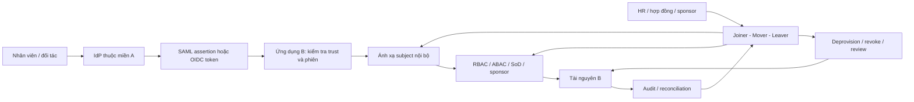
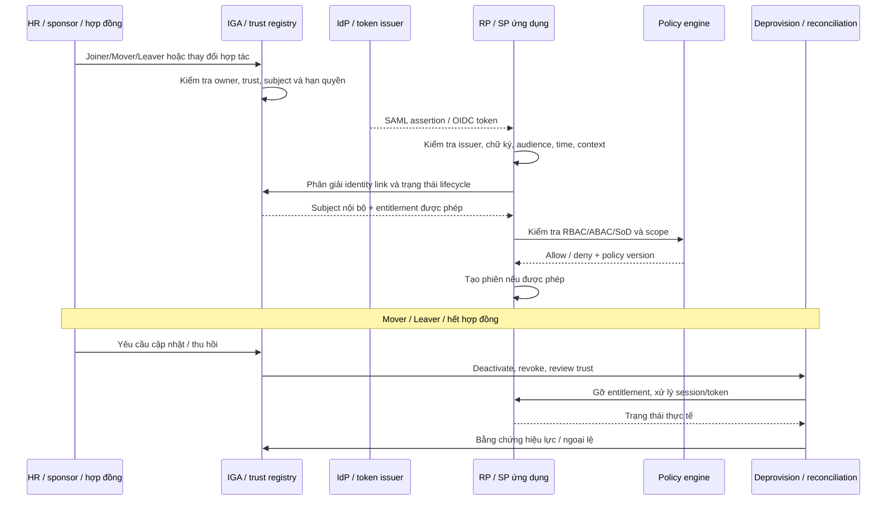
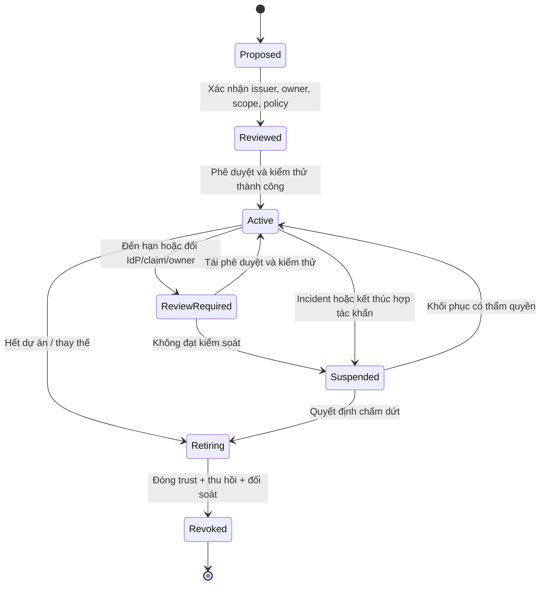

# Federation không kiểm soát: anti-pattern trong quản lý vòng đời danh tính IAM

## 1. Federation là gì và tại sao phải kiểm soát ranh giới tin cậy?

Trong **Identity and Access Management (IAM)**, *identity federation* là mô hình một hệ thống sử dụng thông tin xác thực hoặc xác nhận danh tính từ một miền tin cậy khác. Ví dụ, doanh nghiệp A dùng **Identity Provider (IdP)** của mình để đăng nhập vào ứng dụng B thông qua **SAML 2.0** hoặc **OpenID Connect (OIDC)**. Ứng dụng B không cần quản lý mật khẩu riêng cho người đó; thay vào đó B đánh giá thông điệp/token từ IdP đã được cấu hình là bên phát hành đáng tin cậy.

**Federation không kiểm soát** là anti-pattern khi một quan hệ tin cậy được tạo quá rộng hoặc được duy trì mà thiếu xác minh **ai được tin, thông điệp nào được chấp nhận, danh tính nào được liên kết, quyền nào được cấp, trong bao lâu và khi nào phải chấm dứt**. Tổ chức có thể bảo vệ tốt mật khẩu và MFA tại IdP, nhưng một cấu hình trust sai vẫn có khả năng biến người không đúng phạm vi thành người dùng hợp lệ hoặc thậm chí thành người có quyền cao.

Các thuật ngữ cần phân biệt:

| Thành phần | Chức năng | Không tự bảo đảm |
|---|---|---|
| **IdP** | Xác thực chủ thể và phát hành assertion/token | Chủ thể có quyền truy cập mọi tài nguyên phía nhận |
| **Service Provider (SP) / Relying Party (RP)** | Ứng dụng tiếp nhận assertion/token và thiết lập phiên phù hợp | Claim được tin cậy đồng nghĩa có đủ thẩm quyền nghiệp vụ |
| **Trust configuration** | Xác định issuer, khóa/chứng chỉ, đối tượng nhận, endpoint và quy tắc | Quan hệ tin cậy còn phù hợp suốt vòng đời hợp tác |
| **Federated identity** | Danh tính được liên kết qua miền tin cậy | Tài khoản đã được quản trị theo JML của tổ chức nhận |
| **SSO** | Người dùng truy cập ứng dụng bằng quy trình đăng nhập tập trung | Mọi session và token tại ứng dụng bị thu hồi ngay khi IdP đổi trạng thái |
| **SCIM / provisioning** | Đồng bộ tài khoản, nhóm và thuộc tính mà đích hỗ trợ | Xác minh danh tính khi đăng nhập hoặc hủy mọi session |
| **RBAC/ABAC** | Quyết định hành động được phép trên tài nguyên | Claim đầu vào tự động chính xác, mới và có thẩm quyền |

Federation có thể phục vụ **nhân viên nội bộ**, **nhà thầu/đối tác bên ngoài (B2B)**, **ứng dụng SaaS** và **workload** như pipeline CI/CD đổi OIDC assertion lấy credential tạm thời. Các trường hợp này dùng kỹ thuật liên quan nhưng có rủi ro vòng đời khác nhau; không nên đánh đồng mọi federation với SSO cho con người.

Bài học thuộc chương **Anti-pattern IAM**, tập trung quản lý vòng đời **Joiner–Mover–Leaver (JML)**, kiểm soát IdP/SSO/SCIM, RBAC/ABAC, tài khoản dịch vụ, kiểm toán và quyền truy cập tồn dư. Mục tiêu là thiết kế một liên kết federation **có owner, phạm vi, điều kiện tin cậy, thời hạn, bằng chứng và điểm thu hồi**.

## 2. Dấu hiệu federation không được kiểm soát

Một trust chưa an toàn có thể hoạt động bình thường trong nhiều tháng trước khi xảy ra sự cố. Các biểu hiện phổ biến:

| Dấu hiệu | Ví dụ | Rủi ro |
|---|---|---|
| **Tin issuer quá rộng** | Chấp nhận assertion/token từ bất kỳ tenant hoặc IdP có định dạng đúng | Bên phát hành ngoài phạm vi có thể đăng nhập |
| **Không kiểm tra audience/recipient** | Token dành cho ứng dụng X được tiếp nhận ở Y | Dùng nhầm hoặc chuyển tiếp token qua ranh giới tài nguyên |
| **Liên kết danh tính bằng email đơn thuần** | Ghép user theo email hiển thị chưa xác minh | Chiếm nhầm account khi trùng hoặc đổi địa chỉ |
| **Claim mapping đặc quyền quá rộng** | Ai có nhóm `admins` ở đối tác cũng thành admin nội bộ | Trao quyền nội bộ dựa vào nhóm không có thẩm quyền tương ứng |
| **Tự tạo và cấp quyền khi đăng nhập đầu tiên** | Just-in-Time account creation cấp mặc định quyền nhạy cảm | Người chưa được sponsor/phê duyệt vẫn truy cập |
| **Không review trust metadata/khóa** | Chứng chỉ cũ, khóa không rõ owner, trust tồn tại sau khi đối tác kết thúc | Khó kiểm soát phát hành và thu hồi |
| **Không gắn sự kiện JML** | Người nhà thầu đã nghỉ phía đối tác vẫn có account local và session | Quyền tồn dư ở hệ thống nhận |
| **Không kiểm tra redirect/response** | Callback hoặc SAML endpoint không có ràng buộc phù hợp | Assertion/code có nguy cơ được gửi tới đích sai |
| **Không kiểm kê workload federation** | CI từ nhiều repository có thể lấy role production | Bất kỳ workflow được tin quá rộng đều có thể xin credential |
| **Thiếu log và owner** | Chỉ thấy “SSO login success”, không rõ trust nào cấp quyền | Khó truy vết hoặc tắt trust khi có sự cố |

**MFA ở IdP là một kiểm soát quan trọng, nhưng không sửa một trust policy quá rộng.** Người dùng có thể xác thực rất mạnh ở một IdP không được phép, hoặc được xác thực hợp lệ nhưng nhận quyền cao hơn nhu cầu nghiệp vụ.

## 3. Tình huống minh họa: đối tác đăng nhập được sau khi hợp đồng kết thúc

Một nền tảng học tập thuê công ty ngoài quản trị nội dung. Đội kỹ thuật cấu hình SAML federation để các nhân viên đối tác dùng tài khoản của họ truy cập cổng vận hành. Để triển khai nhanh, ứng dụng tự tạo user trong lần đăng nhập đầu và ánh xạ mọi người có `role=manager` từ đối tác thành `content-admin`.

Diễn biến:

1. **Joiner:** Người dùng Minh gia nhập phía đối tác, được IdP đối tác xác thực, ứng dụng tự tạo tài khoản local và cấp role admin dựa trên claim.
2. **Mover:** Minh chuyển sang dự án khác. Đội đối tác thay đổi nhóm nội bộ nhưng role tại cổng vẫn được giữ dưới dạng quyền local.
3. **Leaver:** Hợp đồng giữa hai công ty kết thúc. Không có người nội bộ chịu trách nhiệm tắt liên kết federation, không có danh sách tài khoản cần thu hồi và session tại cổng vẫn còn hiệu lực.
4. **Phát hiện:** Một tài khoản từng thuộc đối tác vẫn có quyền sửa dữ liệu; hệ thống chỉ ghi `login via SAML` và không có chuỗi bằng chứng từ sponsor, hợp đồng tới quyết định role.

Các vấn đề độc lập tồn tại cùng lúc: **trust không được đóng khi kết thúc hợp tác; claim mapping không có sự phân quyền rõ; JIT user tạo quyền vượt nhu cầu; quyền local không được đối soát; session và audit thiếu kiểm soát**.

Thay đổi đúng không chỉ là chặn miền email của đối tác. Cần xác định **đúng IdP/tenant/issuer và subject được phép**, kiểm kê các account đã tạo, thu hồi entitlement, xử lý phiên/token có liên quan, đóng trust theo quy trình và ghi nhận kết quả ở ứng dụng đích.

Trường hợp một đối tác còn hợp đồng khác và một số tài khoản vẫn cần quyền, phải quyết định theo **phạm vi hợp tác, sponsor, tài nguyên và chính sách hiện hành**; không giả định mọi user đến từ cùng một miền email đều có nhu cầu giống nhau.

## 4. Các ranh giới tin cậy phải được thiết kế rõ

Một luồng federation đi qua ít nhất ba ranh giới:

1. **Ranh giới phát hành danh tính:** hệ thống nào được phép tuyên bố “đây là chủ thể X”? Cần issuer được cấu hình tin cậy, khóa/chứng chỉ phù hợp và cơ chế kiểm tra chữ ký.
2. **Ranh giới tiếp nhận thông điệp:** assertion/token được phát hành **cho ứng dụng nào, phiên nào, thời điểm nào**? Kiểm tra audience, recipient, endpoint và các biện pháp chống phát lại/nhầm phiên phù hợp giao thức.
3. **Ranh giới cấp quyền:** người đã xác thực được phép làm gì ở tài nguyên nội bộ? Cần subject mapping, RBAC/ABAC, owner, SoD và kiểm tra vòng đời.



**Xác thực liên miền không đồng nghĩa ủy quyền liên miền.** Đối tác có thể chứng minh một người là thành viên công ty họ, nhưng chưa chắc có quyền quyết định người đó được xuất dữ liệu, quản trị IAM hoặc vào production của tổ chức nhận.

## 5. SAML 2.0: kiểm tra assertion thay vì chỉ tin “đã ký”

SAML thường dùng trong enterprise SSO. SP tiếp nhận assertion/response từ IdP theo quan hệ trust đã cấu hình. Khi triển khai cần đánh giá **đúng context, đúng recipient và đúng chủ thể**, không chỉ chữ ký.

| Kiểm tra | Mục đích | Sai lầm thường gặp |
|---|---|---|
| **Issuer / IdP metadata** | Chỉ tin IdP được cấu hình cho ứng dụng/tenant cụ thể | Chấp nhận issuer lạ hoặc metadata không được quản trị |
| **Chữ ký và chuỗi tin cậy** | Xác nhận assertion/response đúng thành phần đã ký và không bị sửa | Kiểm tra chữ ký một phần không bao phủ dữ liệu thực sự sử dụng |
| **AudienceRestriction** | Assertion dành cho đúng SP | Dùng một assertion ở SP khác |
| **Recipient / Destination** | Assertion/response gửi đến đúng endpoint | Nhận tại endpoint không phù hợp hoặc kiểm tra lỏng |
| **InResponseTo** | Liên kết response với yêu cầu đăng nhập khi flow yêu cầu | Không gắn response với phiên hoặc yêu cầu tương ứng |
| **NotBefore / NotOnOrAfter** | Giới hạn thời gian chấp nhận assertion | Chấp nhận assertion quá hạn hoặc clock skew quá lớn |
| **NameID / subject mapping** | Liên kết đúng tài khoản, định danh có tính ổn định | Ghép tài khoản chỉ bằng email có thể tái sử dụng |
| **Replay protection** | Ngăn sử dụng lại assertion theo policy | Một assertion được chấp nhận nhiều lần ngoài ý định |
| **AuthnContext / các claim** | Diễn giải mức xác thực khi ứng dụng yêu cầu | Tưởng rằng claim nào cũng được bảo đảm MFA |

Các thuộc tính kiểm tra phụ thuộc profile/binding và luồng SP-initiated hay IdP-initiated; **không áp dụng máy móc rằng mọi response đều phải có `InResponseTo`**. Với đăng nhập không khởi phát từ SP, cần đánh giá rõ khả năng chấp nhận unsolicited response và các biện pháp ràng buộc/giảm rủi ro theo nền tảng; không mặc định bật nếu không có nhu cầu.

Một nguy cơ thực tế là **XML signature wrapping** hoặc xác minh sai node: thư viện kiểm tra chữ ký trên một phần XML nhưng ứng dụng lại đọc subject/attribute khác. Cách phòng tránh là dùng thư viện SAML đáng tin cậy, được cập nhật, có cấu hình chặt; chỉ lấy dữ liệu từ phần assertion/response đã được xác minh đúng ngữ nghĩa.

### 5.1. Quản trị metadata và chứng chỉ ký

Chứng chỉ ký assertion/metadata là phần của quan hệ trust. Cần có owner, nguồn metadata đáng tin, kênh cập nhật an toàn, kế hoạch chuyển khóa có giai đoạn chồng lấn hợp lý, cảnh báo sắp hết hạn và thủ tục khẩn khi khóa bị lộ. Không vô hiệu kiểm tra chữ ký chỉ để “sửa nhanh” lỗi chứng chỉ hết hạn.

Khi chấm dứt đối tác, việc xóa một chứng chỉ khỏi giao diện quản trị có thể chưa xử lý được **session đã tạo** hoặc account local. Phải đi cùng deprovisioning và xác minh trạng thái truy cập.

## 6. OIDC/OAuth 2.0: token hợp lệ phải hợp lệ cho đúng đối tượng

**OpenID Connect (OIDC)** bổ sung lớp danh tính trên OAuth 2.0; OIDC ID token hướng đến việc chứng minh kết quả xác thực cho đúng RP/client. **OAuth access token** thường dùng để gọi API theo phạm vi được cấp. Không được dùng ID token như access token cho API, hoặc mặc nhiên coi access token dành cho API A là bằng chứng đăng nhập hợp lệ vào ứng dụng B.

Các kiểm tra trọng yếu tùy token và luồng:

- **`iss` (issuer):** issuer phải khớp giá trị cấu hình tin cậy; không suy ra trust chỉ từ domain email của user.
- **`aud` (audience):** token phải được phát hành cho client hoặc API nhận nó; `azp` có thể cần kiểm tra tùy cấu trúc ID token có nhiều audience và yêu cầu của giao thức.
- **Chữ ký/khóa/thuật toán:** chỉ cho phép thuật toán và nguồn khóa đã tin cậy; không để header không đáng tin tự quyết định nơi lấy khóa; xử lý JWKS/key rotation an toàn.
- **`exp`, `nbf`, `iat`:** kiểm tra thời gian theo loại token và quy tắc của issuer; cho phép clock skew nhỏ có kiểm soát, không vô hiệu expiry.
- **`nonce` và `state`:** dùng khi luồng yêu cầu để ràng buộc đăng nhập/đáp ứng và chống nhầm phiên hoặc CSRF; **PKCE** bảo vệ trao đổi authorization code, nhất là public clients.
- **Authorization code / redirect URI:** dùng luồng phù hợp và callback đăng ký chính xác; không đưa credential hoặc token nhạy cảm vào URL/log không được bảo vệ.
- **`sub`:** là định danh subject trong phạm vi issuer; nên liên kết user theo cặp `(iss, sub)` thay vì chỉ email.
- **Scope/claims:** chỉ dùng claim có nghĩa rõ, có thể xác minh nguồn và đúng thẩm quyền để ra quyết định phân quyền.

Đối với API nhận access token, cách xác minh phụ thuộc loại token: JWT có thể được kiểm tra chữ ký/issuer/audience/thời gian theo cấu hình, còn token mờ (*opaque token*) có thể yêu cầu introspection. Không tự cho phép một API chấp nhận bất kỳ JWT có chữ ký hợp lệ từ một IdP bất kỳ.

Ví dụ payload JWT **minh họa**, chỉ thể hiện các trường cần được kiểm tra; đây không phải token thực, và không có giá trị xác thực:

```json
{
  "iss": "https://idp.partner.example/tenant-a",
  "sub": "partner-user-841",
  "aud": "customer-portal-client",
  "exp": 1795184400,
  "iat": 1795180800,
  "nonce": "example-bound-to-login-request",
  "email": "person@partner.example",
  "groups": ["external-content-reviewers"]
}
```

Payload có `groups` không tự cấp quyền vào tài nguyên. RP phải xác định issuer này có được tin cho ứng dụng, cặp `iss/sub` có ánh xạ hợp lệ, nhóm nào được phép ảnh hưởng đến quyền nào và user còn sponsor/hợp đồng phù hợp hay không. **Ký đúng một token không có nghĩa mọi nội dung trong token có thẩm quyền đối với dữ liệu của bên nhận.**

## 7. Ánh xạ danh tính: vì sao chỉ ghép bằng email là nguy hiểm?

Liên kết user từ IdP bên ngoài với account nội bộ là điểm nhạy cảm nhất của federation. Email có thể đổi, được tái sử dụng, là alias hoặc chưa được bên nhận kiểm chứng độc lập. Hai tenant khác nhau có thể phát hành claim email giống nhau.

Nguyên tắc:

1. Dùng khóa liên kết nhất quán, ví dụ **`issuer + subject`** đối với OIDC, hoặc định danh được cấu hình ổn định và scope đúng IdP trong SAML; không dùng mỗi tên hiển thị.
2. Không tự hợp nhất federated identity với account admin nội bộ chỉ vì email trùng.
3. Khi cần liên kết tài khoản có sẵn, dùng quy trình *account linking* được phê duyệt, xác minh cả quan hệ với account đích và danh tính từ IdP.
4. Lưu lịch sử đổi IdP, tenant, subject hoặc email; xem thay đổi định danh là sự kiện cần thẩm định, không tự gộp thành cùng một người.
5. Quản lý uniqueness theo ranh giới tenant và ứng dụng; không suy diễn subject ID có ý nghĩa toàn cầu giữa mọi issuer.
6. Bảo vệ chống tái sử dụng định danh sau Leaver: một subject hoặc email mới không được tự thừa hưởng role cũ chưa được cấp lại.

Ví dụ dữ liệu identity link:

```yaml
federatedIdentityLink:
  localSubjectId: "guest:crm-2491"
  externalIssuer: "https://idp.partner.example/tenant-a"
  externalSubject: "partner-user-841"
  trustId: "trust:partner-a-crm"
  sponsorId: "person:internal-owner-12"
  linkedAt: "2026-10-01T08:00:00Z"
  linkEvidence: "TICKET-5921"
  lifecycleStatus: "ACTIVE"
  reviewDueAt: "2026-12-01T08:00:00Z"
```

Đây là **schema minh họa nội bộ**, không phải schema SCIM hay cấu trúc chuẩn của OIDC. Một cặp `externalIssuer/externalSubject` đúng là điều kiện kỹ thuật, nhưng account vẫn cần sponsor, quyền hạn và thời hạn được quản trị.

## 8. Kiểm soát claim-to-role mapping và quyền hiệu lực

Một IdP bên ngoài có thể xác thực rất tốt người dùng của họ, nhưng **không mặc nhiên có quyền đặt vai trò của người đó trong hệ thống nội bộ của bạn**. Khi ứng dụng ánh xạ claim thành role, cần phân biệt:

- **Identity claim:** subject, issuer và thông tin đã xác minh để liên kết danh tính.
- **Organizational attribute:** nhóm, phòng ban hoặc chức danh trong miền của IdP phát hành; có thể hữu ích nhưng chưa chắc phù hợp chính sách nội bộ.
- **Authorization decision:** quyền được cấp trên một tài nguyên cụ thể theo owner, RBAC/ABAC, SoD và trạng thái vòng đời.

| Quy tắc ánh xạ | Rủi ro | Thay thế |
|---|---|---|
| `groups=admin` bên đối tác → `global-admin` nội bộ | Nhóm có ý nghĩa khác nhau giữa hai tổ chức | Cấm mapping trực tiếp role nhạy cảm; phê duyệt độc lập với scope |
| Email có miền `partner.example` → đọc mọi dự án | Miền email không chứng minh quyền tham gia từng dự án | Liên kết tài khoản và sponsor, cho phép theo resource/project |
| User đăng nhập lần đầu → tự có quyền xuất dữ liệu | JIT provisioning trở thành JIT authorization không kiểm soát | Tạo account quyền tối thiểu, yêu cầu entitlement approval riêng |
| Claim thiếu nhóm → coi là `admin` để không lỗi | Fail-open | Từ chối quyền nhạy cảm, log và chuyển xử lý có owner |
| Role nội bộ chỉ dựa token cũ | Role sau Mover/Leaver không được cập nhật | Re-evaluate policy/TTL và revoke session theo khả năng đích |
| Không kiểm tra group nesting/role inheritance | Quyền gián tiếp không được thấy khi review | Đối soát **effective permissions** tại ứng dụng |

Ở các tài nguyên quan trọng, nên ưu tiên **default deny**, role baseline nhỏ, entitlement cấp riêng có owner và thời hạn; với đặc quyền cao cần JIT/PAM/PIM và kiểm tra SoD phù hợp. Đừng biến dữ liệu *self-asserted* hoặc dữ liệu từ nguồn không có thẩm quyền thành điều kiện quyết định cho quyền production.

## 9. Federation không đồng nghĩa provisioning; SCIM không đồng nghĩa revocation phiên

Một người đăng nhập qua SSO lần đầu có thể được ứng dụng tạo **local account JIT**, nhưng việc tạo tài khoản này **không phải** bằng chứng quyền được duyệt, và nó không bảo đảm tài khoản sẽ tự biến mất khi người đó nghỉ việc.

Các cơ chế cần hiểu riêng:

| Cơ chế | Phạm vi | Điểm cần kiểm tra |
|---|---|---|
| **SAML/OIDC SSO** | Xác nhận đăng nhập qua IdP đáng tin | Session ở ứng dụng, khả năng chặn đăng nhập mới, trust state |
| **JIT user provisioning** | Tạo account khi đăng nhập hợp lệ | Account owner, baseline role, quyền local, cleanup |
| **SCIM** | Tạo/cập nhật/vô hiệu user và group theo khả năng đích | `active`, group mapping, lỗi connector, quyền trực tiếp |
| **RBAC/ABAC** | Xác định thao tác và tài nguyên được phép | Nguồn claim, mức mới của thuộc tính, effective permissions |
| **Session/token management** | Chấm dứt khả năng sử dụng token hoặc phiên đã phát | TTL, refresh token, logout/session revocation tùy nền tảng |
| **IGA/access review** | Quyết định còn cần quyền không, ai phê duyệt | Reviewer, lý do, đối soát kết quả gỡ quyền |

Với SCIM 2.0, thuộc tính `active=false` thường được sử dụng để deactivation user ở đích hỗ trợ. Tuy nhiên, **một số ứng dụng vẫn giữ local session, API token hoặc quyền riêng** cho đến khi xử lý bằng API/connector khác. Audit phải phân biệt lệnh đã gửi, API đã phản hồi và quyền thực tế đã bị thu hồi.

Khi đối tác ngừng hợp tác, cách xử lý có thể bao gồm **vô hiệu local accounts, thu hồi entitlement, chặn hoặc đóng trust, xử lý phiên/token và xác minh tại đích**. Thao tác đóng trust có thể chặn **SSO mới** nhưng không bảo đảm mọi phiên đã tạo đều chết ngay.

## 10. Federation với đối tác B2B: sponsor và hạn hợp đồng

Đối với guest, contractor và partner user, IdP của đối tác biết họ đang hoạt động ở tổ chức bên ngoài, nhưng **không nhất thiết biết** khi nào quyền truy cập hệ thống của bạn phải kết thúc. Do đó cần một nguồn quản trị phía nhận như sponsor, hợp đồng, dự án và owner dữ liệu.

Một hồ sơ B2B được quản trị nên xác định:

- Đối tác/tenant/issuer nào được tin cho ứng dụng cụ thể.
- Sponsor nội bộ đang hoạt động, business owner và người dự phòng.
- Danh sách user hoặc nhóm được chấp thuận, không chỉ tên miền email.
- Tài nguyên và entitlement được phép, giới hạn theo dự án/đơn vị.
- Ngày bắt đầu, ngày kết thúc, điều kiện gia hạn và chu kỳ review.
- Cơ chế báo thay đổi nhân sự đối tác, offboarding và thu hồi.
- Phương án cắt trust/thu hồi khi đối tác bị xâm nhập, hết hợp đồng hoặc thay IdP.
- Điều kiện MFA và thuộc tính xác thực được thỏa thuận; cách kiểm chứng thay vì chỉ tin lời khai.

Mô hình “tin toàn bộ công ty đối tác” chỉ phù hợp khi rủi ro, mục đích và giới hạn quyền thực sự cho phép; **không mặc định** rằng bất kỳ người nào có thể đăng nhập tại IdP đối tác đều là người dùng được chấp thuận ở hệ thống nhận.

### 10.1. Sponsor nghỉ việc hoặc thay đổi vai trò

Nếu sponsor nội bộ **Mover/Leaver**, cần rà soát tất cả guest accounts do họ phụ trách, chỉ định sponsor mới có thẩm quyền hoặc thu hồi quyền theo chính sách. Việc khóa chính sponsor ở IdP nội bộ không tác động trực tiếp đến user bên đối tác; đó là lý do ownership và lifecycle phải được kết nối bằng workflow.

## 11. Workload identity federation: trust có thể sai dù không có mật khẩu

Không chỉ con người dùng federation. Một CI workflow có thể lấy OIDC token từ nền tảng build rồi đổi sang **credential cloud ngắn hạn**, thay vì lưu cloud access key trong repository. Đây là thiết kế ưu tiên khi được hỗ trợ, nhưng **trust policy mở rộng** có thể khiến workload không được phép nhận quyền production.

Ví dụ anti-pattern:

- Trust bất kỳ repository/project thuộc một tổ chức mà không phân biệt nhánh/môi trường.
- Chỉ kiểm tra issuer, bỏ qua audience hoặc subject được phép.
- Cho phép workflow từ pull request không tin cậy kích hoạt role deploy production.
- Role nhận được là `owner` trên toàn bộ cloud thay vì quyền deploy một dịch vụ.
- Không có owner cho trust và không thu hồi khi repository, branch, project hoặc môi trường bị ngừng.
- Token ngắn hạn nhưng quyền **đủ điều kiện xin token** được duy trì vô hạn, không review.

Policy minh họa bên dưới diễn đạt **mục đích kiểm soát**, không phải cấu hình copy/paste cho AWS, Azure, GCP hoặc nhà cung cấp CI:

```yaml
workloadFederationTrust:
  trustId: "trust:payments-deploy-prod"
  trustedIssuer: "https://ci.example/oidc"
  requiredAudience: "cloud-token-exchange"
  allowedSubject:
    repository: "team/payments-api"
    environment: "production"
    ref: "refs/heads/main"
    workflow: "deploy.yml"
  targetRole: "role:payments-deployer"
  allowedResources:
    - "production/payments-api"
  credentialMaxDurationMinutes: 30
  businessOwnerId: "team:payments"
  technicalOwnerId: "team:platform"
  reviewDueAt: "2027-01-01T00:00:00Z"
```

Trên hệ thống thật, phải kiểm tra **cách issuer biểu diễn claim `sub` và các thuộc tính khác**. Có nền tảng không đưa đầy đủ repository, branch và environment vào cùng một claim; không được giả định policy minh họa áp dụng trực tiếp. Nếu subject pattern hỗ trợ wildcard, không dùng wildcard vô hạn ở vị trí quyết định quyền production.

### 11.1. Hạn chế cả trust lẫn role sau trao đổi token

Hai lớp kiểm soát độc lập:

1. **Ai được phép đổi token?** Issuer, audience, subject, workload environment, policy về repository/ref và nguồn chạy.
2. **Đổi xong được phép làm gì?** Role hành động tối thiểu trên tài nguyên cụ thể, giới hạn môi trường và TTL.

Một token có hạn 15 phút **không giảm đủ rủi ro** nếu attacker có thể liên tục xin token mới từ một workflow không được kiểm soát, hoặc nếu role cho phép quản trị toàn bộ tenant. Cần kiểm soát nguồn phát hành và hiệu lực quyền song song.

### 11.2. Tài khoản dịch vụ phải có vòng đời riêng

Workload không có quản lý HR trực tiếp. Trust phải gắn với workload, owner nghiệp vụ/kỹ thuật và tài nguyên; khi người tạo nghỉ việc, phải **bàn giao ownership** và thu hồi quyền cá nhân, không xóa mù quáng danh tính đang chạy production. Khi pipeline đóng hoặc repository ngừng, thu hồi trust, role, credential và kiểm chứng không còn consumer hợp lệ.

## 12. Mô hình trust registry: ghi rõ ai tin ai, vì sao và đến khi nào

Thay vì để cấu hình federation phân tán trên console, nên duy trì danh mục quan hệ tin cậy với thông tin đủ quản trị:

| Trường | Ý nghĩa và kiểm tra |
|---|---|
| `trustId` / `trustType` | SAML SP, OIDC RP, B2B, workload federation |
| `issuer` / `tenantId` | Đúng nhà phát hành, đúng ranh giới tổ chức |
| `audience` / `relyingPartyId` | Ứng dụng/resource nhận thông điệp |
| `metadataSource` / `jwksUri` | Nguồn metadata/khóa đã phê duyệt, kiểm tra kênh an toàn |
| `allowedSubjectRules` | Định danh, nhóm hoặc workload được phép trong phạm vi xác định |
| `claimMappingPolicyVersion` | Phiên bản ánh xạ claim và role |
| `businessOwnerId` / `technicalOwnerId` | Ai chịu trách nhiệm nhu cầu và triển khai |
| `sponsorId` / `contractId` | Quan hệ B2B và căn cứ nghiệp vụ (nếu có) |
| `validFrom` / `reviewDueAt` / `validUntil` | Hiệu lực, lịch xem xét, hạn hợp tác |
| `status` | ACTIVE, SUSPENDED, RETIRING, REVOKED... |
| `approvalId` / `lastVerifiedAt` | Phê duyệt và bằng chứng kiểm tra trust |
| `revocationRunbookId` | Cách đóng trust, xử lý local account/session/token |

**Không lưu private key, access token hoặc client secret nguyên văn trong registry.** Nếu quan hệ sử dụng secret, chỉ lưu ID phiên bản hoặc tham chiếu tới secrets manager và kiểm toán quyền truy cập đến kho bí mật.

Trường `validUntil` là một điều kiện kiểm soát tốt cho quan hệ B2B theo dự án, nhưng cấu hình kỹ thuật phải thật sự cưỡng chế việc hết hạn; chỉ đặt ngày trong database mà không có job thu hồi không chặn được SSO.

## 13. Joiner–Mover–Leaver phải chạy qua cả hai miền danh tính

### 13.1. Joiner: liên kết đúng người và cấp quyền tối thiểu

Khi một người từ bên ngoài bắt đầu cộng tác, hệ thống nhận cần ghi:

1. Nguồn xác thực và **issuer/tenant đã phê duyệt**.
2. Định danh subject ổn định được liên kết với local account/guest identity.
3. Sponsor nội bộ và resource owner xác nhận nhu cầu.
4. Entitlement, phạm vi tài nguyên, nhóm/role và hạn sử dụng.
5. Quy tắc xác thực như MFA, điều kiện thiết bị hoặc mức đảm bảo cần thiết.
6. Cơ chế audit và deprovisioning khi quyền hết hiệu lực.

Nếu có JIT account creation, chỉ tạo **tài khoản tối thiểu**. Không tự cấp role đặc quyền, quyền export dữ liệu hoặc role admin toàn cục vì một claim do đối tác kiểm soát. Việc xác thực lần đầu là điều kiện tạo danh tính được liên kết, **không thay cho quyết định cấp quyền**.

### 13.2. Mover: đổi trách nhiệm ở bất kỳ bên nào đều cần review

Một người có thể chuyển dự án tại đối tác hoặc chuyển vai trò ở doanh nghiệp nhận. Mỗi sự kiện liên quan phải được truyền vào lifecycle:

- Đánh giá lại role/entitlement theo mục đích mới.
- Thu hồi quyền của dự án/nhóm cũ, kể cả direct grants trên SaaS.
- Rà soát claim mapping khi IdP đối tác đổi cấu trúc group.
- Xác minh trạng thái JIT/SCIM và quyền kế thừa qua nhóm lồng nhau.
- Kiểm tra xung đột SoD phát sinh do quyền cũ cộng với quyền mới.
- Chuyển sponsor/owner khi người có trách nhiệm không còn phù hợp.

**Bên phát hành thay group không đồng nghĩa bên nhận tự gỡ đúng toàn bộ quyền.** Nếu role phía nhận được cấp trực tiếp hoặc được cache trong token/session, cần điều phối thu hồi và đối soát hiệu lực.

### 13.3. Leaver: người rời đối tác và hợp đồng hết hạn đều là sự kiện thu hồi

Có hai loại thay đổi thường bị bỏ sót:

- **Một cá nhân rời đối tác:** IdP của họ có thể disable account, nhưng bên nhận phải thu hồi local entitlement và session/token độc lập theo chính sách, kể cả khi chưa nhận được sự kiện HR của đối tác.
- **Toàn bộ quan hệ hợp tác kết thúc:** dù account đối tác vẫn active ở IdP của họ, quyền vào hệ thống bên nhận phải chấm dứt. Cần đóng trust hoặc giới hạn lại ứng dụng, thu hồi guest accounts/roles và kiểm chứng tất cả đường truy cập.

**Đóng trust ≠ deprovision mọi quyền.** Một user có thể có account local, personal token, quyền API, phiên đang hoạt động hoặc credential của workload không đi qua luồng SSO mới. Quy trình cần đối soát ở hệ thống đích, không chỉ xóa liên kết issuer trên console.

### 13.4. Rehire, đổi nhà cung cấp hoặc chuyển tenant

Một người quay lại có thể được cấp subject mới. Không tự động liên kết theo email cũ rồi khôi phục entitlement quá khứ. Khi đối tác chuyển IdP/tenant, cần migration có kiểm soát, xác minh mapping cũ–mới và quyền hiện tại; đây là một **thay đổi trust** cần phê duyệt, không phải sửa URL issuer cho chạy được.

## 14. Luồng kiểm soát vòng đời và kiểm toán federation



Trong triển khai thực tế, không phải ứng dụng nào cũng gọi IGA ở **mỗi lần đăng nhập**. Luồng trên biểu diễn **những kiểm soát phải được nối bằng dữ liệu hoặc policy**, không áp đặt một kiến trúc đồng bộ cụ thể. Ứng dụng có thể dùng cache phù hợp, nhưng chính sách phải quy định độ mới của dữ liệu, TTL, cách invalidation và rủi ro còn lại.

### Trạng thái quan hệ trust



State machine chỉ minh họa. **Retiring** phải quản lý cả local accounts, entitlement và session; **Revoked** chỉ nên được xác nhận khi đã kiểm chứng trong phạm vi thiết kế. Khi còn đích chưa kiểm tra được, lưu ngoại lệ với owner và hạn xử lý, không tự động tuyên bố hoàn tất.

## 15. Token, session và thời gian sống: không có “logout toàn cầu” mặc định

Sau khi SAML/OIDC đăng nhập thành công, **RP/SP thường có session riêng**. Disable người dùng tại IdP hoặc ngừng chấp nhận token mới không nhất thiết hủy session cũ. Trong một số kiến trúc, access token dạng JWT tự chứa vẫn được API chấp nhận đến khi hết hạn nếu API không có kiểm tra thu hồi bổ sung.

Với federation, cần thiết kế riêng:

| Đối tượng | Điều phải kiểm soát |
|---|---|
| SAML assertion / OIDC ID token | Issuer, signature, audience, time, nonce/request binding và chống replay phù hợp |
| RP/SP local session | TTL, idle timeout, logout/session revocation được hỗ trợ, điều kiện tái xác thực |
| OAuth access token | Audience API, scope, expiry, signature/introspection/thu hồi theo loại token |
| Refresh token | Quy tắc phát hành, rotation/revocation, ràng buộc client, thời hạn |
| Local API key / PAT | Được tạo ngoài SSO hay không; owner, scope, TTL, cách revoke |
| Privileged/JIT session | Activation TTL, PAM/PIM, SoD, audit lệnh và đóng quyền tại đích |
| Trust credential/metadata | Cập nhật/thu hồi chứng chỉ, key rollover và chặn issuer không còn tin cậy |

Không nên khẳng định mọi hệ thống hỗ trợ SAML Single Logout hoặc OpenID logout với cùng mức bảo đảm. Phải kiểm thử **khả năng thực tế của IdP, ứng dụng và API**, đặc biệt khi thu hồi quyền rủi ro cao. Có thể cần giảm session TTL, kiểm tra authorization tại tài nguyên hoặc cung cấp cơ chế invalidation riêng.

### 15.1. Token replay và nhầm audience

Token có chữ ký tốt nhưng được chấp nhận ở **sai ứng dụng hoặc sai bối cảnh** vẫn là lỗi nghiêm trọng. Một API phải kiểm tra token được cấp **cho chính API đó**, đúng issuer và policy; không chỉ thử decode thành công hoặc xác minh signature bằng khóa bất kỳ xuất hiện trong token header.

Đối với luồng đăng nhập, cần chống tình trạng callback của phiên A nhận response thuộc phiên B, dùng `state`/`nonce`/`InResponseTo` theo giao thức và triển khai. Việc bảo vệ cookie, CSRF và redirect URI cũng là một phần kiểm soát phía RP/SP.

## 16. Audit federation: cần truy được trust, subject và quyết định quyền

Audit nên nối được **external issuer/subject → local identity → resource/entitlement → authorization policy → session → outcome**. Một sự kiện `LOGIN_SUCCESS` thiếu `trustId` hoặc `issuer` khó chứng minh người dùng đã qua liên kết được cho phép nào.

Ví dụ sự kiện **minh họa nội bộ**, không phải schema chuẩn của SAML/OIDC:

```json
{
  "eventType": "FEDERATED_ACCESS_DECISION",
  "eventId": "fed-evt-1208",
  "occurredAt": "2026-11-10T09:15:00Z",
  "correlationId": "login-flow-5302",
  "trustId": "trust:partner-a-crm",
  "protocol": "OIDC",
  "externalIssuer": "https://idp.partner.example/tenant-a",
  "externalSubject": "partner-user-841",
  "localSubjectId": "guest:crm-2491",
  "relyingPartyId": "customer-portal-client",
  "resourceId": "customer-crm",
  "requestedEntitlement": "customer-read",
  "decision": "ALLOW",
  "policyVersion": "partner-access-v7",
  "sponsorId": "person:internal-owner-12",
  "decisionReason": "SPONSOR_AND_PROJECT_ACTIVE",
  "sessionId": "session-ref-902",
  "source": "customer-portal"
}
```

**Không đưa SAML assertion, JWT, bearer token, cookie hoặc secret nguyên văn vào audit**. Nếu cần đối soát token, chỉ lưu identifier hoặc fingerprint an toàn và metadata được phân quyền. Cần giới hạn PII, bảo vệ log khỏi chỉnh sửa trái phép, quản trị retention và phát hiện khi audit pipeline bị tắt.

Các loại sự kiện nên được ghi nhận:

- Tạo, phê duyệt, chỉnh sửa hoặc chấm dứt trust/metadata/claim mapping.
- Thay đổi issuer, endpoint, audience, redirect URI, JWKS/cert hoặc policy version.
- Liên kết/tách liên kết federated identity với local subject.
- Login thành công/thất bại và nguyên nhân validation từ chối ở mức an toàn.
- Quyết định role/entitlement; tạo local account JIT hoặc SCIM.
- Mover/Leaver, hợp đồng hết hạn, sponsor thay đổi, deprovision và đối soát.
- Workload token exchange, role activation và expiry, không lưu token thật.
- Phát hiện drift hoặc quyền còn hoạt động sau đóng trust.

**Bằng chứng audit phải trả lời được**: ai được tin, họ nhận quyền vì sao, lúc nào, trên tài nguyên nào, và quyền đó đã mất hiệu lực chưa khi quan hệ không còn hợp lệ.

## 17. Reconciliation: trust đúng vẫn có thể còn quyền tồn dư

Đối soát định kỳ hoặc theo sự kiện cần kết hợp nhiều nguồn:

1. **Desired:** trust registry, hợp đồng/sponsor, JML, entitlement/role đã phê duyệt, policy version.
2. **Actual:** local accounts và quyền tại SaaS, IdP group mapping, direct grants, PIM eligible role, token/session inventory khi đích hỗ trợ.
3. **Difference:** người dùng không sponsor, account inactive nhưng còn quyền, trust hết hạn vẫn ACTIVE, direct grant không còn căn cứ, workload trust cho repository đã xóa.
4. **Remediation:** tạo tác vụ thu hồi đúng nơi cấp, phân công owner, ghi attempt và xử lý retry.
5. **Verify:** đọc lại quyền hiệu lực tại đích; đóng finding khi có bằng chứng phù hợp.

Ví dụ:

```text
Trust: trust:partner-a-crm
Contract: EXPIRED
Federated user: guest:crm-2491
Desired entitlements: NONE
Actual CRM entitlements: customer-export
Local session: ACTIVE
Finding: RESIDUAL_ACCESS_AFTER_TRUST_EXPIRY
Owner: crm-data-owner
Required actions: revoke entitlement, invalidate session, close trust
Verification: actual entitlement absent; session no longer usable
```

Nếu source bên đối tác không cho phép nhận sự kiện Leaver kịp thời, **không thể tuyên bố quyền truy cập đã được thu hồi tức thời chỉ dựa trên IdP của họ**. Cần thêm giới hạn TTL, xác nhận sponsor định kỳ, expiry theo hợp đồng và các kiểm soát phía ứng dụng nhận để giảm khoảng trống.

## 18. SQL minh họa để phát hiện trust và quyền có rủi ro

Giả sử tổ chức có các bảng nội bộ `federation_trusts`, `federated_links`, `external_sponsorships`, `target_entitlements` và `workload_trust_rules`. Các truy vấn dùng cú pháp gần PostgreSQL, **không phải schema chuẩn** của IdP/SCIM.

### 18.1. Trust còn active nhưng quá hạn review hoặc hết hợp tác

```sql
SELECT trust_id, issuer, relying_party_id,
       business_owner_id, review_due_at, valid_until
FROM federation_trusts
WHERE status = 'ACTIVE'
  AND (
    business_owner_id IS NULL
    OR review_due_at < CURRENT_TIMESTAMP
    OR (valid_until IS NOT NULL AND valid_until < CURRENT_TIMESTAMP)
  );
```

Một trust quá hạn review chưa tự chứng minh đã bị khai thác, nhưng đó là dấu hiệu cần **kiểm tra ownership và chặn kéo dài quan hệ không có căn cứ**. Phải phân giải owner active, không chỉ kiểm tra field khác null.

### 18.2. Guest còn quyền dù sponsor hoặc hợp đồng không hợp lệ

```sql
SELECT l.local_subject_id, l.trust_id, s.sponsor_id,
       s.contract_status, e.resource_id, e.entitlement_id
FROM federated_links l
JOIN external_sponsorships s
  ON s.local_subject_id = l.local_subject_id
JOIN target_entitlements e
  ON e.subject_id = l.local_subject_id
WHERE e.actual_state = 'ACTIVE'
  AND (
    s.contract_status <> 'ACTIVE'
    OR s.sponsor_status <> 'ACTIVE'
  );
```

Đây là **danh sách điều tra**. Một đối tác có thể có nhiều hợp đồng và sponsor; truy vấn thực tế phải gắn **đúng entitlement với đúng dự án/hợp đồng**, tránh thu hồi nhầm quyền còn hợp lệ theo quan hệ khác.

### 18.3. Claim mapping đặc quyền cao chưa có phê duyệt riêng

```sql
SELECT trust_id, source_claim, source_value,
       target_role, approval_id
FROM federation_role_mappings
WHERE target_role_risk = 'HIGH'
  AND status = 'ACTIVE'
  AND approval_id IS NULL;
```

Không có approval ID có thể do dữ liệu được lưu ở hệ thống khác; cần đối soát policy basis và người có thẩm quyền trước khi kết luận. Với quyền admin, nên kiểm tra thêm self-approval, SoD và thời hạn JIT.

### 18.4. Workload trust có phạm vi subject quá rộng

```sql
SELECT trust_id, issuer, subject_pattern, audience,
       target_role, last_reviewed_at
FROM workload_trust_rules
WHERE status = 'ACTIVE'
  AND (
    subject_pattern IN ('*', 'repo:*', 'project:*')
    OR audience IS NULL
    OR target_role_risk = 'HIGH'
  );
```

Truy vấn phụ thuộc cách tổ chức biểu diễn policy. Wildcard có thể là ký tự hợp lệ trong chuỗi claim hoặc được kết hợp với điều kiện khác, vì vậy không tự coi mọi match là lỗ hổng. Phải đánh giá **toàn bộ trust expression và quyền của role ở đích**, không chỉ một trường.

### 18.5. Trust đã revoke nhưng local account vẫn có quyền

```sql
SELECT t.trust_id, l.local_subject_id,
       e.resource_id, e.entitlement_id, e.actual_state
FROM federation_trusts t
JOIN federated_links l ON l.trust_id = t.trust_id
JOIN target_entitlements e
  ON e.subject_id = l.local_subject_id
WHERE t.status = 'REVOKED'
  AND e.actual_state = 'ACTIVE';
```

Đây là một tín hiệu quan trọng để tìm **quyền tồn dư sau khi quan hệ tin cậy kết thúc**. Cần kiểm tra quyền có được tái phê duyệt qua trust khác hay không, và session/token độc lập có còn được chấp nhận không.

## 19. Ứng cứu khi nghi federation bị cấu hình sai hoặc bị lợi dụng

Khi phát hiện issuer không rõ, token được chấp nhận sai audience, account mapping bất thường hoặc workload nhận role trái phép, cần:

1. **Khoanh vùng trust:** xác định ID, issuer, RP/SP, tenant, metadata/khóa, chính sách claim-to-role, danh tính và tài nguyên chịu ảnh hưởng.
2. **Đánh giá tính xác thực bằng chứng:** kiểm tra log từ RP/SP, IdP, API và kết quả truy vấn quyền, phân biệt login thất bại với phiên đã được cho phép.
3. **Giảm khả năng cấp quyền mới:** tạm dừng trust/role mapping bị ảnh hưởng hoặc chặn đường token exchange theo quyền được ủy quyền; phối hợp owner để bảo vệ dịch vụ thiết yếu.
4. **Vô hiệu đường truy cập tồn dư:** thu hồi entitlement local, session, token, credential và quyền JIT/PAM phù hợp khả năng từng nền tảng.
5. **Điều tra dấu hiệu lạm dụng:** truy vết subject, thời gian, IP/thiết bị nếu có, role, hành động trên dữ liệu, các token/role mới được tạo và thay đổi cấu hình.
6. **Khôi phục trust an toàn:** sửa issuer/audience/subject mapping, chính sách quyền và key/metadata; kiểm thử âm tính trước khi mở lại.
7. **Bàn giao và phòng ngừa:** bổ sung owner, hạn review, cảnh báo drift, bằng chứng phê duyệt, quy trình JML và diễn tập thu hồi.

Không nên **tắt toàn bộ federation của tổ chức** chỉ vì một trust hẹp có vấn đề nếu điều đó có thể gây mất khả năng khôi phục hoặc ngừng dịch vụ trọng yếu. Hành động cô lập cần theo mức rủi ro và kiến trúc. Ngược lại, không giữ trust đang bị lạm dụng chỉ vì lo phải cập nhật cấu hình: phải dùng quy trình ứng cứu và kiểm soát bù trừ phù hợp.

### 19.1. Lưu ý khi khóa ký/metadata bị lộ

Khóa ký của IdP/issuer bị lộ có thể ảnh hưởng nhiều RP hoặc API. Cần liên hệ owner issuer, đánh giá phạm vi những token/assertion đã phát hành, thực hiện key rollover/revocation theo quy trình, giới hạn các đường nhận token bị ảnh hưởng và kiểm chứng hệ thống đích đã cập nhật trust. **Đổi certificate trên IdP không đảm bảo mọi RP lập tức từ chối token/assertion cũ** nếu chúng còn cấu hình trust hoặc chấp nhận phiên trước đó.

## 20. Quy trình xây dựng federation có kiểm soát

### Giai đoạn 1 — Inventory và phân loại trust

Liệt kê ứng dụng SAML/OIDC, tenant, issuer, đối tác B2B, trust workload/CI, owner, metadata source, role mappings, expiration và phạm vi hệ thống đích. Phân biệt **trust human SSO** với **trust workload token exchange**.

### Giai đoạn 2 — Chuẩn hóa chính sách phê duyệt

Quy định ai có thể tạo/sửa trust, ai là business/risk owner, điều kiện cấp entitlement, kiểm soát SoD và đường xử lý ngoại lệ. Những thay đổi issuer, audience, redirect URI, claim mapping và key source cần được quản trị như thay đổi bảo mật, có đánh giá tác động.

### Giai đoạn 3 — Siết xác minh giao thức và identity mapping

Sử dụng thư viện và cấu hình SAML/OIDC có kiểm chứng: issuer, signature, audience, thời gian, response binding, state/nonce/PKCE theo luồng, redirect URI chính xác. Ánh xạ subject ổn định theo miền tin cậy; cấm tự hợp nhất tài khoản nội bộ dựa vào email đơn thuần.

### Giai đoạn 4 — Tách authentication khỏi authorization

Thiết kế role baseline tối thiểu, claim mapping có owner, RBAC/ABAC dựa dữ liệu đủ thẩm quyền và quyền đặc biệt có approval/JIT. Kiểm tra quyền hiệu lực ở đích, kể cả direct grants và nhóm lồng nhau. Với workload, giới hạn cả trust expression **và** target role.

### Giai đoạn 5 — Kết nối lifecycle và deprovision

Gắn JML của HR, sponsor, hợp đồng, project end và workload lifecycle với local account, SCIM, session/token và trust status. Không chờ kỳ review mới thu hồi Leaver hoặc quan hệ đã hết căn cứ.

### Giai đoạn 6 — Audit, đối soát và cảnh báo

Ghi event của trust/subject/policy/login/grant/revoke, bảo vệ log, đối soát expected vs actual và xử lý thay đổi ngoài quy trình. Theo dõi trust quá hạn, owner inactive, account đối tác không sponsor, workload wildcard trust và các phiên còn sau Leaver.

### Giai đoạn 7 — Diễn tập tắt và khôi phục trust

Thử kết thúc hợp đồng, khóa issuer, đổi certificate, đổi tenant, Mover/Leaver và CI repository bị đóng. Xác định thứ tự thao tác, hệ thống phụ thuộc, cách kiểm tra quyền thực tế, rollback có phê duyệt và bằng chứng hoàn tất.

## 21. Kiểm thử nghiệm thu và negative tests

Kiểm thử federation phải gồm **trường hợp hợp lệ và trường hợp phải bị từ chối**, không chỉ “SSO login success”:

| Tình huống | Kết quả mong đợi |
|---|---|
| Assertion/token từ issuer được phê duyệt, đúng client và user hợp lệ | Xác thực thành công nếu thỏa các điều kiện khác |
| Token từ issuer/tenant chưa được tin | Bị từ chối, không tự tạo local account |
| Token có audience không khớp RP/API | Bị từ chối dù chữ ký hợp lệ |
| Assertion/token đã hết hạn hoặc chưa hợp lệ theo thời gian | Bị từ chối theo chính sách skew phù hợp |
| OIDC callback sai state/nonce hoặc code exchange sai PKCE | Bị từ chối theo luồng áp dụng |
| SAML response sai recipient/request binding hoặc signature | Bị từ chối, không dùng attribute chưa được xác minh |
| Claim email trùng account admin nhưng external subject khác | Không tự gộp hoặc thừa kế quyền admin |
| Nhóm `admins` của đối tác xuất hiện trong token | Không được tự động thành global admin nội bộ |
| User SSO hợp lệ nhưng không có sponsor/entitlement | Không được truy cập dữ liệu nhạy cảm |
| SCIM deactivation khi Leaver | Local account/quyền được cập nhật và có đối soát |
| Đóng trust trong lúc local session còn hoạt động | Session/token xử lý theo chính sách, không giả định tự biến mất |
| Owner đối tác hoặc nội bộ Mover/Leaver | Quyền và sponsor được đánh giá, bàn giao/thu hồi |
| CI token từ branch hoặc repo không được phép | Không nhận được target role production |
| CI token hợp lệ nhưng gọi tài nguyên ngoài scope | Bị RBAC/ABAC của đích từ chối |
| Rotation certificate/JWKS hợp lệ | Cutover không làm tắt kiểm tra chữ ký; token không hợp lệ vẫn bị từ chối |
| Trust hết hạn hoặc contract đóng | Trust và quyền còn liên quan bị xử lý, có bằng chứng kết quả |
| Connector lỗi hoặc đích không hỗ trợ revoke session | Hiển thị ngoại lệ có owner, không báo hoàn tất giả |
| Người dùng đã được cấp quyền qua hai trust khác nhau | Thu hồi đúng nguồn và kiểm tra effective access còn hợp lệ hay không |

Kiểm thử dùng **danh tính, assertion và credential thử nghiệm trong môi trường được phép**. Không đưa token thực vào issue/log hoặc sử dụng tài khoản người khác để xác minh. Với hệ thống legacy thiếu API, phải lưu giới hạn kiểm chứng và biện pháp bù trừ.

## 22. Checklist thiết kế và vận hành

- [ ] Mỗi trust có business/technical owner, ứng dụng đích, mục đích và căn cứ phê duyệt.
- [ ] Issuer/tenant chính xác; metadata, chứng chỉ/JWKS và cách rotation được quản lý.
- [ ] SAML kiểm tra signature, issuer, audience, recipient/response binding và thời gian theo profile.
- [ ] OIDC/OAuth kiểm tra issuer, audience, signature, thời gian, state/nonce/PKCE theo luồng; phân biệt ID token và access token.
- [ ] Identity mapping không dựa email đơn thuần; có lịch sử đổi subject/issuer và quy trình linking.
- [ ] Claim-to-role mapping được phê duyệt, default deny cho quyền nhạy cảm, kiểm tra SoD và scope.
- [ ] JIT account creation không tự động cấp đặc quyền cao.
- [ ] User đối tác có sponsor nội bộ, hạn hợp đồng/dự án và review.
- [ ] Mover/Leaver có tác vụ thu hồi entitlement, account, phiên/token và kiểm chứng.
- [ ] Workload trust giới hạn issuer/audience/subject, repository/environment và target role; có owner.
- [ ] API/connector/SCIM phản hồi được ghi nhận nhưng không tự đồng nhất với revoke đã xác minh.
- [ ] Audit gắn trust, subject, policy, resource, approval, correlation ID và outcome.
- [ ] Có đối soát quyền thực tế, phát hiện drift và local account ngoài SSO.
- [ ] Có kiểm soát sự cố, tạm dừng/đóng trust, key rollover và kiểm thử khôi phục.
- [ ] Không ghi assertion, bearer token, private key hay dữ liệu cá nhân không cần thiết trong log.

## 23. KPI giúp nhận diện federation còn quá rộng

| Chỉ số | Ý nghĩa |
|---|---|
| **Trust inventory coverage** | Tỷ lệ ứng dụng/workload có federation được đăng ký với owner và policy |
| **Overbroad trust count** | Số trust có issuer/subject/audience quá rộng hoặc ánh xạ role high-risk thiếu căn cứ |
| **Expired trust still active** | Quan hệ hết hạn hợp tác/review nhưng vẫn chấp nhận đăng nhập hoặc token exchange |
| **External identity without sponsor** | Guest/contractor còn quyền nhưng sponsor inactive hoặc không xác định |
| **Residual access after trust termination** | Local entitlement, session hoặc token còn sử dụng được sau kết thúc trust |
| **Federation revocation latency** | Từ sự kiện Leaver/contract-end đến khi quyền hiệu lực ở đích mất |
| **Federation audit completeness** | Tỷ lệ quyết định đăng nhập/quyền có trust, subject, policy, target và kết quả |
| **High-risk claim mapping** | Ánh xạ claim bên ngoài sang quyền nhạy cảm phải phê duyệt và review |
| **Workload federation least-privilege coverage** | Tỷ lệ workload có ràng buộc subject và target role đúng scope |
| **Failed validation anomaly** | Biến động issuer/audience/signature/nonce/replay failures có dấu hiệu bất thường |

Giải thích chỉ số theo phạm vi inventory và mức độ hỗ trợ log của các nền tảng. Khi mở rộng phát hiện, số trust sai cấu hình được ghi nhận có thể tăng dù tình hình thực tế chưa xấu thêm. Quan trọng là **giảm quyền thực sự có thể được cấp và dùng bởi chủ thể ngoài phạm vi**.

## 24. Tình huống tự đánh giá

**Tình huống A.** Ứng dụng nhận JWT có chữ ký hợp lệ từ một IdP đối tác, nhưng `aud` của token là một ứng dụng khác. Có nên cho đăng nhập vì signature đúng?

**Không.** Phải xác minh issuer và audience đúng RP/API nhận, cùng ngữ cảnh giao thức, thời hạn và subject. Chữ ký đúng chỉ là một điều kiện.

**Tình huống B.** Một SAML IdP phát `groups=admins` cho người của họ. Ứng dụng phía nhận ánh xạ thành `GlobalAdmin`. Lỗ hổng tư duy là gì?

**Nhầm xác thực/thuộc tính phía đối tác với thẩm quyền cấp quyền nội bộ.** Role nhạy cảm cần policy và approval của bên nhận, scope nhỏ, SoD và kiểm soát đặc quyền phù hợp.

**Tình huống C.** Sau khi xóa cấu hình federation của đối tác, ứng dụng vẫn còn local session và PAT của user cũ. Có thể đóng ticket deprovision thành công không?

**Không.** Đóng trust thường chỉ xử lý đường đăng nhập/token exchange mới; phải kiểm tra entitlement, session, PAT và quyền hiệu lực ở đích.

**Tình huống D.** Công ty dùng email để liên kết guest account, đối tác chuyển tenant và tái sử dụng email. Có thể tự gắn tài khoản mới vào account cũ không?

**Không mặc định.** Phải xác minh chủ thể, issuer mới, quan hệ account linking, sponsor và quyền đã được phê duyệt; không thừa kế quyền do trùng email.

**Tình huống E.** CI triển khai production dùng OIDC token 10 phút nhưng role đích có quyền owner toàn bộ tenant và trust nhận bất kỳ branch. Thiết kế đã an toàn nhờ token ngắn hạn?

**Chưa.** Cần giới hạn cả **ai được xin token** (issuer/audience/subject, repo/branch/environment) và **token được làm gì** (least privilege trên target role).

**Tình huống F.** Sponsor nội bộ nghỉ việc, IdP của đối tác vẫn xác thực khách hợp lệ. IAM cần làm gì?

**Rà soát/bàn giao sponsorship và entitlement.** Nếu không có sponsor hoặc căn cứ còn hợp lệ, áp dụng thu hồi/ngoại lệ theo chính sách; không lấy trạng thái đăng nhập bên đối tác làm bằng chứng được tiếp tục truy cập.

**Tình huống G.** Ứng dụng bật SCIM, nhận `active=false` và trả HTTP 200; một phiên trong trình duyệt vẫn truy cập được CRM. Cần kết luận gì?

**Chưa chứng minh quyền đã hết hiệu lực.** Phải kiểm tra semantics của SCIM target, session/token revocation và kiểm tra quyền thực tế.

**Tình huống H.** Đội vận hành sửa lỗi SAML signing bằng cách bỏ kiểm tra signature cho đến khi nhập chứng chỉ mới. Có chấp nhận được không?

**Không.** Việc tắt kiểm tra chữ ký có thể làm mất căn cứ tin cậy của assertion. Cần quản lý certificate rollover và phương án khôi phục an toàn; nếu cấp cứu phải theo cơ chế ngoại lệ có kiểm soát mà không chấp nhận assertion không xác minh.

**Tình huống I.** Một user có quyền qua trust A và trust B. Bên A hết hợp đồng, thao tác gỡ role từ A hoàn tất nhưng user vẫn có quyền do B. Đây luôn là lỗi?

**Không tự động.** Phải kiểm tra trust B có nhu cầu và phê duyệt hợp lệ hay không. Quy trình phải giải thích **con đường quyền hiệu lực** và không kết luận đã thu hồi toàn bộ chỉ từ một group.

## Kết luận

**Federation không kiểm soát là anti-pattern IAM vì ranh giới tin cậy giữa các hệ thống có thể bị mở rộng thành quyền truy cập không đúng chủ thể, không đúng tài nguyên hoặc tồn tại quá thời hạn.** Thiết kế tốt không dừng ở “SSO hoạt động”: phải xác minh **issuer, chữ ký, audience, subject, bối cảnh phiên**, liên kết đúng danh tính, quản trị **claim-to-role mapping**, áp dụng **RBAC/ABAC và đặc quyền tối thiểu**, đồng thời kiểm soát vòng đời owner, sponsor, trust, local account, session và workload. Khi nối các kiểm soát ấy với **Joiner–Mover–Leaver, IdP, SSO, SCIM, audit và đối soát quyền hiệu lực**, tổ chức có thể thu hồi quyền tồn dư sau khi con người đổi vai trò, nghỉ việc hoặc quan hệ đối tác kết thúc — mà không phải đánh đổi khả năng kiểm soát để lấy sự tiện lợi khi liên kết danh tính.

