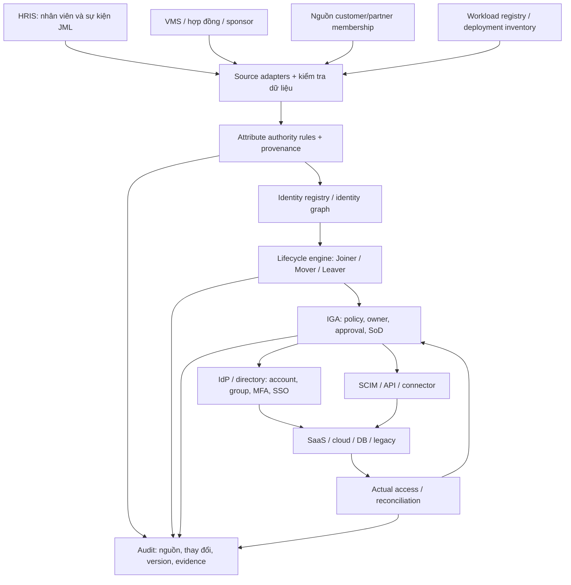
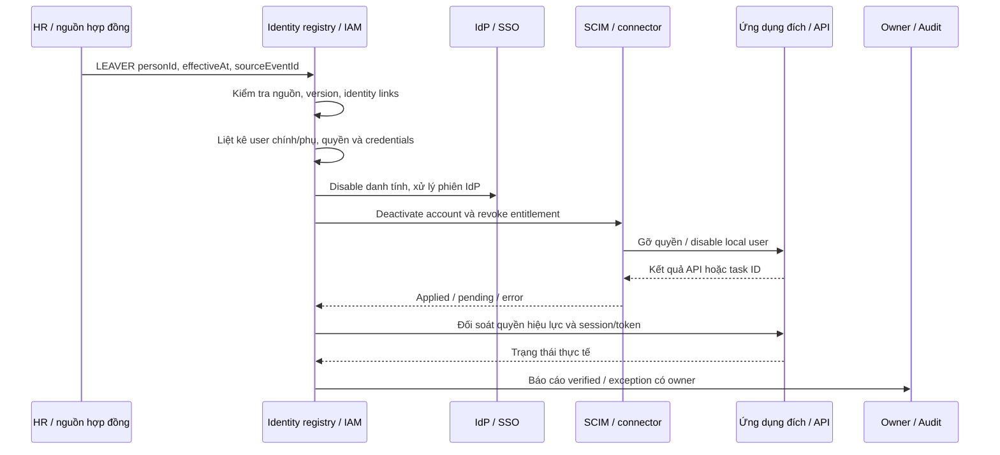

# Không có nguồn identity chuẩn: anti-pattern trong quản lý vòng đời danh tính IAM

## 1. Tại sao IAM cần nguồn danh tính có thẩm quyền?

Trong **Identity and Access Management (IAM)**, trước khi quyết định cấp, giữ hay thu hồi quyền, tổ chức phải biết một chủ thể **là ai**, **thuộc loại quan hệ nào**, **đang ở trạng thái nào**, **có vai trò nào**, và **ai chịu trách nhiệm xác nhận thông tin đó**. Những thông tin này phải được lấy từ các nguồn có thẩm quyền và được kiểm chứng, không thể mặc định tài khoản nào xuất hiện trong một ứng dụng cũng đại diện cho danh tính hợp lệ.

**“Không có nguồn identity chuẩn”** là anti-pattern khi tổ chức không xác định được nguồn đáng tin cậy (*authoritative source*) cho dữ liệu danh tính hoặc không có quy tắc thống nhất để đối chiếu nhiều nguồn. Hệ quả là hệ thống IAM có thể:

- Tạo nhiều account cho cùng một người hoặc nhầm hai người khác nhau là một.
- Cấp quyền cho nhân sự, nhà thầu hay đối tác chưa được xác minh đầy đủ.
- Không biết khi nào một người đã chuyển vai trò hoặc kết thúc hợp đồng.
- Tin dữ liệu cũ ở IdP, bảng tính hoặc ứng dụng thay vì sự kiện vòng đời mới.
- Giữ tài khoản local, nhóm, phiên và token sau khi căn cứ truy cập đã chấm dứt.
- Áp dụng **RBAC/ABAC** bằng thuộc tính thiếu chủ sở hữu, sai hoặc không còn hiệu lực.
- Không thể kiểm toán **vì sao** danh tính được tạo và **ai** xác nhận trạng thái hiện tại.

Trong module quản lý vòng đời **Joiner–Mover–Leaver (JML)**, nguồn identity chuẩn là nền tảng cho xác minh danh tính, tạo tài khoản qua **IdP**, đăng nhập qua **SSO**, đồng bộ qua **SCIM**, cấp quyền theo chính sách, rà soát và thu hồi quyền truy cập tồn dư. Một chuỗi tự động hóa rất nhanh vẫn nguy hiểm nếu **dữ liệu đầu vào không có thẩm quyền**.

**Mục tiêu học tập:** nhận diện nguồn danh tính theo từng loại chủ thể, thiết kế quy tắc ưu tiên dữ liệu, liên kết định danh ổn định, xử lý dữ liệu mâu thuẫn, xây dựng luồng JML có kiểm toán và kiểm thử để chứng minh trạng thái ở hệ thống đích phù hợp nguồn chuẩn.

## 2. “Nguồn chuẩn” không nhất thiết là một database duy nhất

*Source of truth (SoT)* là thuật ngữ rộng chỉ nguồn được xem là căn cứ cho một loại dữ liệu. Trong IAM, cách diễn đạt chính xác hơn thường là **nguồn có thẩm quyền cho từng thuộc tính và sự kiện** (*authoritative source of identity data*). Không nên mặc định có một hệ thống luôn đúng cho mọi trường.

Ví dụ:

| Dữ liệu hoặc quyết định | Nguồn có thẩm quyền thường gặp | Điều không nên suy diễn |
|---|---|---|
| Quan hệ lao động và ngày kết thúc của nhân viên | HRIS/HR được ủy quyền | IdP có account `ACTIVE` nghĩa là còn làm việc |
| Mã nhân sự, loại hợp đồng, đơn vị quản lý | HRIS theo quy trình tuyển dụng | Email là khóa định danh vĩnh viễn |
| Nhà thầu và thời hạn hợp tác | Vendor/contractor management, procurement, sponsor nội bộ | Nhà thầu nhất thiết xuất hiện trong HRIS nhân viên |
| Đối tác/guest và mục đích truy cập | Hồ sơ hợp đồng, dự án, sponsor nội bộ | IdP của đối tác có người dùng active nghĩa là được vào hệ thống của ta |
| Ứng dụng, tài nguyên, chủ sở hữu nghiệp vụ | Application/resource registry có quy trình phê duyệt | Người tạo tài khoản là owner lâu dài |
| Danh tính dịch vụ/workload | Nền tảng triển khai, CMDB/registry, owner workload | Workload có “nhân viên HR” giống human identity |
| Username, MFA, trạng thái login tại IdP | IdP/directory vận hành | IdP là nguồn thẩm quyền duy nhất cho trạng thái nhân sự |
| Role/entitlement được phê duyệt | IGA, policy/RBAC/ABAC, resource owner | Group tại đích luôn là quyền nên có |
| Quyền thực tế, phiên/token tại ứng dụng | Ứng dụng/tài nguyên đích | Grant đã được yêu cầu nghĩa là đã thực thi thành công |

Đôi khi IdP/directory là nguồn chính thức cho **một thuộc tính vận hành** như định danh đăng nhập hoặc nhóm kỹ thuật. Điều đó hoàn toàn có thể hợp lệ nếu có trách nhiệm quản trị và quy tắc đồng bộ rõ. Anti-pattern nằm ở việc **không biết hệ thống nào có thẩm quyền đối với trường nào**, hoặc để một bản sao tự nhận là nguồn chuẩn sau khi đã lệch dữ liệu gốc.

### 2.1. Authoritative source, system of record và downstream copy

- **Authoritative source:** nơi có thẩm quyền xác nhận sự thật nghiệp vụ thuộc một phạm vi cụ thể, ví dụ HR xác nhận nhân viên đã Leaver.
- **System of record:** hệ thống ghi nhận có kiểm soát các bản ghi của miền nghiệp vụ. Nó có thể là authoritative source cho một số thuộc tính, nhưng không mặc định cho tất cả.
- **Identity registry/identity graph:** lớp hợp nhất, liên kết nguồn và phân giải một người/workload qua nhiều tài khoản; đây có thể là nơi **tổng hợp**, không phải nơi tự tạo ra sự thật về quan hệ lao động.
- **IdP/directory:** phục vụ xác thực và account lifecycle; có thể nhận trạng thái từ HR rồi thực thi disable.
- **Downstream application:** nhận user, group và entitlement; là nơi cần đọc lại trạng thái quyền hiệu lực, không phải nơi tự quyết định nhân viên còn làm việc.

Một kiến trúc đúng có thể có **nhiều nguồn authoritative** với phạm vi phân quyền rõ. Không phải ép mọi thuộc tính vào một “master database” mà là bảo đảm **mỗi dữ liệu quan trọng có owner, nguồn, cách cập nhật và cách giải quyết xung đột**.

## 3. Những dạng “không có nguồn identity chuẩn” thường gặp

| Biểu hiện | Ví dụ | Rủi ro thực tế |
|---|---|---|
| Tạo account thủ công ở từng ứng dụng | Quản trị viên tạo user theo email yêu cầu qua chat | Account mồ côi, không nhận sự kiện Leaver |
| Lấy bảng Excel làm nguồn nhưng thiếu quản trị | Nhiều bản CSV nhân viên gửi qua email | Không biết bản nào mới, ai phê duyệt sửa dữ liệu |
| IdP tự là nguồn của mọi sự thật | Trạng thái user `enabled` được coi như còn hợp đồng | Người nghỉ việc nhưng chưa disable tiếp tục có quyền |
| Nhiều HR feed không có ưu tiên | Hai nguồn gửi hai department trái ngược | ABAC cấp nhầm quyền theo department cũ |
| Liên kết tài khoản bằng email | Người đổi tên hoặc email được tái sử dụng | Nhập nhằng lịch sử, có nguy cơ thừa kế quyền |
| Không có nguồn cho nhà thầu | Vendor user chỉ tồn tại trong SaaS | Quyền có thể tồn tại sau ngày kết thúc dự án |
| Người tạo trở thành owner service account | Kỹ sư nghỉ việc, pipeline vẫn hoạt động | Credential và quyền không còn người chịu trách nhiệm |
| Sự kiện cập nhật không có thời điểm hiệu lực | HR sửa bản ghi sau thời điểm hợp đồng kết thúc | IAM không biết khi nào phải revoke |
| Mapping nguồn không được version hóa | Đổi quy tắc `department→role` nhưng không kiểm toán | Không giải thích được vì sao user có role |
| Không đối soát với hệ thống đích | IAM ghi đã disable nhưng ứng dụng có local user active | Tồn dư sau Leaver dù dashboard báo thành công |

Mỗi trường hợp có thể **trông vẫn hoạt động** ở thời điểm Joiner: người dùng đăng nhập và làm được việc. Vấn đề bộc lộ khi **Mover, Leaver, đổi hợp đồng, đổi owner, rehire hoặc có incident**.

## 4. Tình huống thực tế: “HR nói nghỉ rồi, hệ thống vẫn cho đăng nhập”

Giả sử tổ chức vận hành ứng dụng báo cáo tài chính có ba nguồn:

1. HRIS ghi nhân viên **Hà** đã chuyển từ bộ phận kế toán sang hỗ trợ vào ngày 01/10.
2. IdP vẫn chứa thuộc tính `department=finance` vì job đồng bộ bị lỗi mà không có cảnh báo.
3. Ứng dụng SaaS lấy nhóm `finance-export` từ directory cũ và tiếp tục cấp quyền xuất báo cáo.

Ngày 15/10, Hà nghỉ việc; HRIS chuyển trạng thái sang `TERMINATED` nhưng đội vận hành chỉ khóa account chính tại IdP. SaaS còn **tài khoản local và phiên độc lập**.

Một bản đồ trạng thái minh họa:

```text
Person (HRIS):           person-0042
HR employmentStatus:     TERMINATED (effective 2026-10-15)
HR department:           customer-support (effective 2026-10-01)
IdP username:           ha.nguyen
IdP department:         finance   [STALE]
IdP account:            DISABLED
Legacy directory group: finance-export [STALE]
SaaS local account:     ACTIVE   [RESIDUAL]
SaaS entitlement:       export-financial-report [RESIDUAL]
SaaS session:           ACTIVE   [UNVERIFIED]
```

Nếu hệ thống cho phép `department` của IdP tự “ghi đè ngược” về HRIS, dữ liệu chuẩn có thể bị sai thêm. Nếu tiếp tục dùng thuộc tính stale từ directory để quyết định RBAC/ABAC, người dùng có thể vẫn được cấp quyền ở vai trò cũ. Và nếu chỉ nhìn vào trạng thái IdP `DISABLED`, báo cáo IAM có thể bỏ qua account local.

**Cách xử lý đúng:** xác định HRIS có thẩm quyền về quan hệ và phòng ban, thiết lập luồng event JML, phát hiện dữ liệu stale ở IdP, đối soát quyền thực tế trên SaaS, thu hồi tài khoản/phiên/token theo phạm vi nền tảng, và giữ bằng chứng về từng lần sửa/thu hồi. Không tự kết luận “Leaver hoàn tất” khi mới khóa một account.

## 5. Nguồn chuẩn theo loại danh tính

### 5.1. Nhân viên (*workforce employee*)

HRIS hoặc quy trình nhân sự được ủy quyền thường là nguồn cho **quan hệ làm việc, mã người, ngày bắt đầu/kết thúc, loại nhân sự và cơ cấu quản lý**. Tuy nhiên, một hệ thống HRIS vẫn có lỗi nhập liệu hoặc sự kiện bị trễ; vì vậy cần xác minh dữ liệu, ràng buộc tính hợp lệ, thời điểm hiệu lực và kiểm soát ai được sửa.

**Identity proofing** (xác minh người thực sự là ai theo mức tin cậy áp dụng) cần được phân biệt với thao tác tạo account ở IdP. Việc nhận một dòng HR mới chưa luôn chứng minh các bước xác minh danh tính hoặc tuyển dụng đã hoàn tất; hệ thống phải biết trạng thái `PENDING_VERIFICATION` trước khi tự động cấp quyền nhạy cảm.

### 5.2. Nhà thầu, vendor và người dùng bên ngoài

Nhà thầu có thể không thuộc HRIS nhân viên. Một nguồn quản trị khác như vendor management, hợp đồng, hồ sơ dự án và **sponsor nội bộ** có thể chịu trách nhiệm xác nhận quan hệ và thời hạn. Cần phân biệt:

- Danh tính của một người bên đối tác do IdP của họ xác thực.
- Quyền của người đó **tại ứng dụng của tổ chức nhận**, do sponsor/resource owner và chính sách nội bộ quyết định.
- Ngày kết thúc hợp đồng, dự án hoặc quyền của một cá nhân.

Nếu partner IdP còn user `ACTIVE` nhưng hợp đồng của tổ chức nhận đã hết, ứng dụng nhận vẫn phải **chặn quyền theo căn cứ nội bộ**. Federation SSO không thay thế nguồn hợp đồng/sponsor.

### 5.3. Khách hàng và external identities theo sản phẩm

Một sản phẩm có thể dùng **hệ thống đăng ký khách hàng, KYC/identity proofing phù hợp phạm vi, subscription/billing hoặc nguồn hợp đồng** cho các trạng thái khác nhau. Không nên mặc định email đã xác nhận là đủ để chứng minh một người thuộc tài khoản doanh nghiệp hoặc được quyền quản trị tổ chức khách hàng.

Đối với customer identities, cần mô hình link user–tenant–membership–role riêng, đồng thời tuân thủ mục đích và chính sách quyền riêng tư. **Nguồn thẩm quyền của người dùng B2C/B2B khác nguồn thẩm quyền của nhân viên HR**.

### 5.4. Service account và workload identity

Tài khoản dịch vụ, service principal, bot, CI runner và Kubernetes workload không có quan hệ lao động cá nhân. Nguồn thẩm quyền thường là **registry ứng dụng/workload, môi trường triển khai được quản trị, CMDB và cơ chế IAM của nền tảng**, kết hợp business owner và technical owner đang hoạt động.

Mỗi workload cần được liên kết với mục đích, tài nguyên, quyền, vùng chạy, credential hoặc trust federation và vòng đời của ứng dụng. Việc một kỹ sư **tạo** service account không có nghĩa kỹ sư đó là nguồn chuẩn dài hạn cho workload. Khi người tạo Mover/Leaver, phải bàn giao owner và thu hồi quyền cá nhân, không tự xóa workload production đang cần.

## 6. Một mô hình phân quyền nguồn dữ liệu theo thuộc tính

Trước khi viết quy tắc đồng bộ, lập **authority matrix**:

| Thuộc tính/sự kiện | Nguồn ưu tiên có thẩm quyền | Owner xác minh | Cách xử lý khi thiếu hoặc xung đột |
|---|---|---|---|
| `personId` | Identity registry/HR stable ID theo quy tắc liên kết | HR/IAM | Dừng tự động ghép nếu trùng hoặc không chắc chắn |
| `employmentStatus` | HRIS cho nhân viên | HR | Không tự ghi từ trạng thái `enabled` ở IdP |
| `effectiveEndAt` | HRIS/hợp đồng được ủy quyền | HR/procurement | Có owner xử lý nếu thiếu thời điểm bắt buộc |
| `department`, `managerId` | HRIS/nguồn cơ cấu được duyệt | HR/line manager | Sử dụng phiên bản và thời điểm hiệu lực |
| `contractStatus` | Hợp đồng/vendor management | Procurement/sponsor | Nếu hết hạn, kích hoạt đánh giá/thu hồi theo policy |
| `sponsorId` | Sponsor workflow nội bộ | Resource/business owner | Không cấp quyền guest nhạy cảm khi không có sponsor hợp lệ |
| `loginName`, `mfaState` | IdP/directory vận hành | IAM | Không biến thông tin login thành employment authority |
| `roleEligibility` | Policy/IGA kết hợp role owner | Role/resource owner | Phê duyệt độc lập khi vượt baseline |
| `actualEntitlements` | Ứng dụng/cloud/DB đích | Technical custodian | Đối soát với desired state, mở finding khi lệch |
| `workloadStatus` | Deployment/workload registry | Workload owner | Xử lý dịch vụ ngừng/di trú, không suy từ HR |

**Một trường có thể có nhiều nguồn bổ trợ nhưng phải có quy tắc giải quyết rõ.** Ví dụ email hiển thị có thể lấy từ HR hoặc được người dùng cập nhật trong IdP; trong khi mã định danh liên kết account phải ổn định và không bị sửa tùy ý khi đổi email.

### 6.1. Đừng dùng quy tắc “bản nào cập nhật sau thì thắng” cho mọi trường

*Last-write-wins* không phù hợp với dữ liệu an ninh quan trọng nếu không xét nguồn. Một bản cập nhật từ ứng dụng ít tin cậy lúc 10:05 không nên ghi đè trạng thái `TERMINATED` đã được HR xác nhận lúc 10:00.

Thay vào đó, ưu tiên theo **quyền thẩm định nguồn + phiên bản sự kiện + effective time**. Nếu hai nguồn cùng có thẩm quyền nhưng gửi dữ liệu mâu thuẫn, chuyển sang quy trình xử lý xung đột có owner thay vì tự chọn tùy tiện.

### 6.2. Không mặc định fail-open khi nguồn vắng mặt

Khi HR feed ngừng hoạt động, hệ thống có thể tiếp tục xác thực những account đã được kiểm tra trước đó theo chính sách tạm thời, nhưng **không nên tự tạo mới hoặc tăng đặc quyền nhạy cảm dựa trên dữ liệu thiếu và stale**. Cần chỉ rõ:

- Dữ liệu nào có thể được cache và trong bao lâu.
- Hành động nào cần dừng cấp mới khi không có nguồn đáng tin.
- Quyền hiện hữu nào phải được kiểm tra theo mốc Leaver/expiry riêng.
- Cách vận hành break-glass khi nguồn lỗi nhưng cần khôi phục dịch vụ.

**Fail-safe** phải cân bằng bảo mật với sẵn sàng; không tắt toàn bộ dịch vụ sản xuất vô điều kiện chỉ vì một feed nhân sự bị chậm, và cũng không mở mọi quyền khi không xác thực được nguồn.

## 7. Định danh ổn định: tách người, tài khoản và email

Một người có thể có nhiều tài khoản: user chính tại IdP, account quản trị phụ, account SaaS, account local legacy, thậm chí danh tính đối tác theo dự án. **Email không phải khóa chính đáng tin cậy** vì email có thể thay đổi, là alias, bị tái sử dụng hoặc trùng giữa các miền.

Nên thiết kế **ID danh tính nội bộ ổn định** và các liên kết theo từng hệ thống:

```text
person:0042
  ├── workforce-record: hr-7042
  ├── idp-account: oidc-sub:8f3c... (issuer: corp-idp)
  ├── privileged-account: ha.nguyen-admin
  ├── saas-account: crm-user:889
  └── legacy-account: finance-142

workload:orders-export
  ├── application:orders
  ├── deployment:prod/orders-exporter
  ├── iam-principal:svc-orders-export
  └── owner:team:data-platform
```

Người và workload là hai loại thực thể khác nhau. Liên kết user với account phải lưu **nguồn của mối liên kết, thời điểm, bằng chứng và trạng thái**, không dựa trên phép so chuỗi email một lần rồi bỏ.

### 7.1. Quy tắc chống ghép nhầm

- Phân giải theo **mã người ổn định + nguồn phát hành có thẩm quyền**, không chỉ tên/email.
- Với OIDC federation, thường cần cặp `(issuer, subject)` thay vì `email`; với SAML dùng định danh subject được quản trị đúng phạm vi IdP và thuộc tính ổn định phù hợp.
- Không tự liên kết tài khoản ngoài vào privileged account nội bộ chỉ vì email hoặc username trùng.
- Nếu bản ghi có dấu hiệu trùng/không chắc, **đưa vào trạng thái điều tra**, không tự cấp thừa quyền.
- Khi thay mã nhân sự, đổi IdP hoặc merge/split account, lưu lịch sử mapping và quyết định phê duyệt; kiểm tra quyền tại từng đích.
- Với nhân sự quay lại (*rehire*), không tự khôi phục mọi entitlement cũ chỉ vì nhận ra email.

### 7.2. Identity resolution không phải authorization

Gắn hai tài khoản với cùng một người giúp phát hiện account còn tồn dư, nhưng **không có nghĩa người đó được phép sử dụng cả hai**. Authorization vẫn cần quyết định theo vai trò, resource owner, SoD, loại môi trường và vòng đời.

## 8. Kiến trúc nguồn danh tính chuẩn cho Joiner–Mover–Leaver



Thiết kế chia thành bốn tầng:

1. **Nguồn nghiệp vụ:** từng nguồn giữ thẩm quyền đối với loại danh tính hoặc thuộc tính được giao.
2. **Chuẩn hóa, xác minh và liên kết:** kiểm tra schema, provenance, ID, trạng thái, timestamp; hợp nhất theo quy tắc và phát hiện xung đột.
3. **Quyết định quyền và thực thi:** JML/IGA tính desired accounts/entitlements; IdP/SSO xác thực, SCIM/connector truyền cập nhật, RBAC/ABAC thực thi chính sách.
4. **Đối soát và chứng minh:** đọc actual state ở đích, phát hiện quyền không có nguồn, chứng nhận/thu hồi và lưu bằng chứng.

**SSO không biến IdP thành nguồn chuẩn của quan hệ nhân sự; SCIM không tự xác minh dữ liệu đầu vào; RBAC/ABAC không sửa thuộc tính sai.** Các thành phần chỉ đáng tin bằng chất lượng nguồn, chính sách và phép đối soát gắn với chúng.

## 9. Quy trình kiểm soát dữ liệu đầu vào và provenance

*Provenance* là thông tin cho biết **thuộc tính xuất phát từ đâu, được cập nhật khi nào, ai/hệ thống nào xác nhận và theo quy tắc nào nó được chấp nhận**. Đây là nền tảng của audit khi có nguồn trái ngược nhau.

Một bản ghi attribute nên có:

| Trường | Mục đích |
|---|---|
| `identityId` / `attributeName` | Khóa chủ thể và tên thuộc tính |
| `attributeValue` | Giá trị được kiểm soát theo phân loại dữ liệu |
| `authoritySourceId` | Nguồn được ủy quyền cho thuộc tính này |
| `sourceRecordId` | Mã record ở hệ thống nguồn |
| `sourceEventId` | ID sự kiện cập nhật để chống xử lý trùng |
| `sourceVersion` | Version/sequence nếu nguồn cung cấp |
| `effectiveAt` | Khi giá trị có hiệu lực nghiệp vụ |
| `observedAt` / `processedAt` | Khi adapter thấy và xử lý dữ liệu |
| `verifiedBy` / `verificationLevel` | Bằng chứng xác minh hoặc quy trình tin cậy |
| `policyVersion` | Quy tắc ưu tiên và hợp nhất tại thời điểm xử lý |
| `status` | ACCEPTED, CONFLICT, REJECTED, PENDING... |

Ví dụ YAML **minh họa nội bộ**, không phải schema SCIM:

```yaml
identityAttribute:
  identityId: "person:0042"
  attributeName: "employmentStatus"
  attributeValue: "TERMINATED"
  authoritySourceId: "hris:main"
  sourceRecordId: "hr-7042"
  sourceEventId: "hr-event-1198"
  sourceVersion: 34
  effectiveAt: "2026-10-15T17:00:00+07:00"
  observedAt: "2026-10-15T09:59:50Z"
  processedAt: "2026-10-15T10:00:01Z"
  verificationLevel: "SOURCE_ATTESTED"
  policyVersion: "identity-authority-v5"
  status: "ACCEPTED"
```

Chú ý thời gian hiệu lực có múi giờ: `17:00+07:00` tương đương `10:00Z`. Trong minh họa này sự kiện được tiếp nhận trước thời điểm hiệu lực một ít rồi áp dụng khi tới mốc. Không lấy `processedAt` thay cho `effectiveAt` khi quyết định thời điểm Leaver.

### 9.1. Kiểm tra chất lượng dữ liệu ngay khi ingest

- Kiểm tra chữ ký/API identity và quyền gửi sự kiện của **nguồn**; không nhận payload JML tùy ý từ một webhook chưa xác thực.
- Kiểm tra ID không rỗng, loại identity, thời điểm, status hợp lệ và trường bắt buộc theo loại nguồn.
- Giới hạn sửa đổi các thuộc tính nhạy cảm: account thường không được tự đổi `employmentStatus`, `managerId` hay `roleEligibility`.
- Phát hiện bản ghi trùng, ID tái sử dụng, dữ liệu ngoài miền và sự kiện sai thứ tự.
- Ghi dữ liệu lỗi vào **quarantine có owner**, hạn xử lý và bằng chứng; không im lặng bỏ qua hoặc tự điền giá trị nâng quyền.
- Bảo vệ dữ liệu cá nhân, không in toàn bộ hồ sơ HR vào log hoặc gửi ngược qua kênh không cần thiết.

## 10. Trạng thái identity lifecycle phải tách khỏi trạng thái account

Một nguồn nhân sự có thể dùng các trạng thái như `PRE_HIRE`, `ACTIVE`, `LEAVE_OF_ABSENCE`, `TERMINATED`. IdP có thể dùng `ENABLED/DISABLED`; SaaS có `active=true/false`; IAM workflow có `REQUESTED/PROVISIONED/VERIFIED`. **Không được dùng thay thế lẫn nhau**.

| Phạm vi | Câu hỏi trạng thái trả lời | Ví dụ |
|---|---|---|
| **Business identity lifecycle** | Quan hệ làm việc/hợp tác có còn hiệu lực? | `ACTIVE`, `TERMINATED` |
| **Identity verification** | Danh tính đã được kiểm tra theo mức yêu cầu? | `PENDING`, `VERIFIED` |
| **IdP account lifecycle** | Principal có thể đăng nhập qua IdP này không? | `ENABLED`, `DISABLED` |
| **Target account lifecycle** | User local tại ứng dụng đang active hay không? | `ACTIVE`, `INACTIVE` |
| **Entitlement lifecycle** | Role/permission nào có thể được sử dụng? | `GRANTED`, `REVOKED` |
| **Workflow state** | Tác vụ đồng bộ/thu hồi được xác minh chưa? | `QUEUED`, `VERIFIED_REVOKED` |

**Một người TERMINATED có thể vẫn có account ENABLED do lỗi**, và **một người ACTIVE có thể tạm DISABLED do chính sách bảo mật**. Việc phát hiện sai lệch là lý do phải giữ tách biệt trạng thái nguồn và trạng thái kỹ thuật ở đích.

### 10.1. Trường hợp nghỉ phép, đình chỉ và nhân sự quay lại

Nghỉ phép dài hạn, đình chỉ tạm thời, kết thúc hợp đồng và nghỉ việc hoàn toàn có thể yêu cầu kiểm soát khác nhau. Quy tắc nên dựa trên **mã loại sự kiện, hiệu lực và chính sách được phê duyệt**, tránh chuyển mọi trạng thái không `ACTIVE` thành `TERMINATED`. Khi rehire, phải xét cấp lại quyền theo vai trò hiện tại, không tự phục hồi quyền production từ nhiều năm trước.

## 11. Joiner: từ sự kiện có thẩm quyền đến account hợp lệ

Một luồng Joiner an toàn:

1. **Nguồn phát sự kiện:** HR hoặc nguồn hợp đồng xác nhận một danh tính được tạo/chuẩn bị có thời điểm hiệu lực.
2. **Xác minh:** kiểm tra record ID, loại quan hệ, bằng chứng proofing theo yêu cầu, không trùng danh tính.
3. **Identity correlation:** tạo identity ID nội bộ hoặc liên kết với record đã có qua quy tắc tin cậy.
4. **Chính sách quyền:** tính baseline theo role và điều kiện ABAC; xác định quyền ngoại lệ cần phê duyệt.
5. **Provisioning:** tạo tài khoản ở IdP/directory, cấu hình xác thực, gán nhóm, dùng SCIM/API tạo user ở đích phù hợp.
6. **Readback:** xác minh account/entitlement thực tế đã được cấp, kiểm tra mapping đúng người.
7. **Audit:** lưu source event, decision, policy version, operation/correlation ID, target result và owner.

**Không nên tự cấp quyền admin cho một danh tính chỉ vì có dòng nhân viên mới.** Nguồn HR xác nhận quan hệ lao động, không thay thế resource owner trong việc quyết định đặc quyền production.

## 12. Mover: chống role creep từ thuộc tính cũ

Mover không phải chỉ đổi `department` trên thẻ nhân viên. Nó là sự kiện có thể làm thay đổi tập quyền hợp lệ:

```text
Nguồn HR (đã thẩm định):
  trước: department=finance, role=payment-analyst
  sau:   department=customer-success, role=trainer

Desired entitlements:
  remove: finance-report-export, payment-analyst
  add:    training-portal-read, knowledge-base-editor
  keep:   employee-baseline

Actual entitlements:
  finance-report-export [STILL ACTIVE]
  training-portal-read  [ACTIVE]

Finding: RESIDUAL_ACCESS_AFTER_MOVER
```

Luồng đúng phải:

- Ghi thuộc tính **trước/sau** và version/effective time từ nguồn đúng.
- Đánh giá role và permission theo policy hiện tại, kiểm tra xung đột SoD.
- Phát lệnh gỡ quyền cũ cũng như thêm quyền mới; không chỉ cộng dồn group.
- Đối soát direct grants, local accounts, nested groups và claim mapping ở hệ thống đích.
- Giải quyết dữ liệu HR–IdP–SaaS lệch nhau theo authority matrix, không chọn giá trị nào “gần nhất” tùy ý.

Khi sự kiện Mover đến sau một sự kiện Leaver đã có hiệu lực do hệ thống mạng chậm, bộ xử lý phải tránh **tái cấp quyền** cho người đã nghỉ. Cần chính sách thứ tự sự kiện, version và trạng thái cuối cùng phù hợp từng nguồn.

## 13. Leaver: nguồn chuẩn là điều kiện cần, thu hồi tại đích là điều kiện đủ để kiểm chứng

Khi hợp đồng hoặc quan hệ lao động kết thúc, nguồn có thẩm quyền phải cung cấp **mã chủ thể** và **thời điểm hiệu lực**. IAM cần xử lý các trường hợp chấm dứt có kế hoạch, chấm dứt khẩn cấp, thay đổi ngày nghỉ và sự kiện bị hủy theo chính sách. Không mặc định mọi Leaver là kết quả của một job chạy cuối ngày.



Một lộ trình Leaver bao gồm:

1. Tin cậy **nguồn nhân sự/hợp đồng** đã được xác minh, có hiệu lực đúng thời điểm.
2. Liên kết tất cả account của người đó bằng identity ID ổn định, không chỉ email.
3. Disable principal chính tại IdP, chặn đăng nhập mới qua SSO; xử lý session theo khả năng nền tảng.
4. Gỡ user/nhóm/role ở các ứng dụng qua SCIM/API hoặc tác vụ manual có owner.
5. Thu hồi account local, admin phụ, PAT/API key, SSH key, certificate, phiên ứng dụng độc lập và quyền vault/PAM liên quan.
6. Bàn giao ownership của role, app, service account hoặc sponsor của bên ngoài nếu người nghỉ việc đang đảm nhiệm.
7. Đọc lại **actual state**, ghi bằng chứng và mở ngoại lệ có deadline nếu bất kỳ đường truy cập nào chưa được xác minh.

**Không nhầm việc xóa một dòng HR hoặc disable IdP với thu hồi quyền thực sự.** Ở chiều ngược lại, đôi khi cần giữ một record nhân sự inactive để phục vụ kiểm toán và giữ khả năng truy xuất lịch sử theo chính sách; xóa dữ liệu không phải điều kiện để vô hiệu truy cập.

### 13.1. Khi nguồn HR bị trễ hoặc không có sự kiện Leaver

Một nguồn chuẩn vẫn có thể lỗi vận hành. Cần đánh giá độ trễ feed, đối soát định kỳ theo trạng thái hiệu lực, cảnh báo source im lặng bất thường và kênh chấm dứt khẩn có thẩm quyền. Không dùng việc “chưa có webhook” làm lý do cho phép account có rủi ro cao tồn tại vô thời hạn khi tổ chức đã có xác nhận nghỉ việc bằng quy trình chính thức khác.

### 13.2. Hạn chế tái cấp quyền do sự kiện đến sai thứ tự

Nếu đã nhận Leaver có hiệu lực, một sự kiện Joiner/Mover cũ đến muộn không được vô tình chuyển trạng thái thành ACTIVE. Trường hợp rehire hợp lệ phải có **sự kiện mới đủ thẩm quyền** và đánh giá cấp quyền lại. Đừng hồi sinh các role nhạy cảm hoặc credentials cũ chỉ vì account được mở lại.

## 14. IdP, SSO, SCIM và chính sách quyền: đúng vai trò từng lớp

**IdP** thường là điểm xác thực, quản lý phương thức MFA, account và nhóm/thuộc tính dùng cho SSO. Nhưng trạng thái account ở IdP có thể là **bản sao vận hành** của một sự thật HR hoặc hợp đồng. Không dùng dòng `user.enabled=true` để phủ định `employmentStatus=TERMINATED` từ nguồn authoritative.

**SSO** cung cấp đăng nhập tập trung, không tự kiểm tra nhân sự còn hợp đồng, cũng không luôn thu hồi local session hoặc token ứng dụng sau một thay đổi ở IdP.

**SCIM** là phương thức provisioning/deprovisioning giúp trao đổi user, nhóm và thuộc tính giữa các hệ thống hỗ trợ. Với SCIM 2.0, thuộc tính `active` có thể được dùng để deactivate user; semantics của từng ứng dụng vẫn phải được kiểm thử. **SCIM không phải nguồn chứng thực rằng thuộc tính nhân sự là đúng**, và phản hồi HTTP thành công chưa luôn chứng minh mọi quyền/phiên đã vô hiệu.

**RBAC** dùng role; **ABAC** dùng thuộc tính như department, project, loại hợp đồng, trạng thái thiết bị hoặc phân loại dữ liệu. Cả hai phụ thuộc chất lượng nguồn:

| Vấn đề nguồn | Ảnh hưởng lên RBAC/ABAC | Kiểm soát |
|---|---|---|
| Department của người Mover bị stale | Vẫn có role cũ hoặc thỏa điều kiện ABAC cũ | Event update, version, TTL dữ liệu, đối soát actual |
| Manager không đúng | Approval được gửi đến người thiếu thẩm quyền | Authority matrix, owner validation và escalation |
| Không có contract end | Quyền vendor không bao giờ hết hạn | Sponsor, contract source, expiry và review |
| ID người bị ghép nhầm | Một người nhận quyền của người khác | Stable ID + verified links + quy trình điều tra |
| Role mapping bị tự sửa tại app | Desired role khác quyền thực tế | Reconciliation, audit, kiểm soát drift |
| Thuộc tính nguồn thiếu/không tin cậy | Policy có nguy cơ fail-open | Default deny đối với đặc quyền và đường ngoại lệ có kiểm soát |

Một quyền có thể đến từ nhiều nguồn cùng lúc: nhóm IdP, nhóm lồng nhau, direct grant ở SaaS hoặc policy cloud. Vì vậy cần đánh giá **effective permissions**, không chỉ danh sách quyền dự kiến theo HR/IdP.

## 15. Service account, workload identity và ranh giới với human identity

Không nên lấy một mã nhân viên làm **nguồn chuẩn cho sự tồn tại** của workload chỉ vì nhân viên ấy từng tạo service account. Một ứng dụng sản xuất có thể cần danh tính riêng ngay cả khi người tạo đã nghỉ việc.

Một bản ghi workload tối thiểu:

```yaml
workloadIdentity:
  workloadId: "workload:orders-export"
  lifecycleStatus: "ACTIVE"
  applicationId: "app:orders"
  environment: "production"
  businessOwnerId: "team:order-operations"
  technicalOwnerId: "team:data-platform"
  iamPrincipalId: "principal:svc-orders-export"
  purpose: "Đồng bộ đơn hàng cho báo cáo"
  allowedResources:
    - "orders-reporting-read"
  credentialMode: "WORKLOAD_FEDERATION"
  lastReviewedAt: "2026-10-01T00:00:00Z"
  reviewDueAt: "2027-01-01T00:00:00Z"
```

Đây là schema minh họa, không phải định dạng bắt buộc của một cloud hoặc SCIM. Nguồn thẩm quyền có thể là deployment registry/CMDB cùng phê duyệt owner. Khi workload bị ngừng, hệ thống nên thu hồi role, trust policy, credential và principal không còn cần thiết; khi workload được chuyển môi trường, cần rà soát quyền mới/cũ.

### 15.1. Không dùng token cá nhân cho workload

Pipeline dùng PAT do nhân viên tạo sẽ dễ rơi vào tình trạng **không có owner sau Mover/Leaver**. Thiết kế tốt ưu tiên managed identity/workload identity federation và credential ngắn hạn khi nền tảng hỗ trợ. Nếu dùng secret tĩnh, quản lý bằng secrets manager, rotation, least privilege và inventory có owner.

### 15.2. Nguồn chuẩn của trust không phải chỉ là tên repository

Một workload federation trust cần định nghĩa issuer, audience, subject, môi trường/repository được phép và target role. Không chỉ nhìn `repoName` từ payload do ứng dụng tự khai để quyết định có được trao role production hay không; phải xác minh nguồn phát hành và điều kiện trust thực sự được thực thi.

## 16. Thiết kế xử lý nguồn bất đồng bộ, lỗi feed và xung đột

Các nguồn HR, hợp đồng và ứng dụng có thể gửi event không theo thứ tự, bị lặp hoặc đến trễ. Thiết kế ingestion cần:

- **Event ID và deduplication:** cùng một `sourceEventId` có thể được gửi lại; xử lý idempotent để tránh tạo account/quyền trùng.
- **Version/sequence theo đối tượng:** tránh một sự kiện cũ ghi đè trạng thái mới của cùng người.
- **Effective time:** thời điểm nghiệp vụ có hiệu lực khác thời gian hệ thống nhận; xử lý lịch Joiner/Leaver đúng mốc.
- **Authority precedence:** nguồn ít thẩm quyền không được ghi đè trạng thái nhân sự hoặc điều kiện cấp quyền nhạy cảm.
- **Validation và quarantine:** bản ghi thiếu ID, có xung đột hoặc không chứng minh được mối liên kết phải được điều tra.
- **Replay và recovery:** có thể xử lý lại sự kiện hoặc rebuild trạng thái từ nguồn đáng tin mà không tái cấp quyền sai.
- **Audit trail:** lưu source version, quyết định mapping, actor, operation ID, kết quả ở đích và mọi exception.

### 16.1. Mã giả đồng bộ một thuộc tính

```text
function applyIdentityAttribute(event):
    verifyTrustedProducer(event.sourceId, event.signatureOrAuth)
    validateSchemaAndIdentityType(event)

    authority = authorityPolicy.forAttribute(
        event.identityType, event.attributeName
    )
    if not authority.allows(event.sourceId):
        audit("REJECTED_UNAUTHORIZED_SOURCE", event.metadata)
        return REJECTED

    identity = resolveStableIdentity(event.sourceRecordId)
    if identity.isAmbiguous():
        quarantineForHumanReview(event, reason="AMBIGUOUS_IDENTITY_LINK")
        return BLOCKED

    current = identity.getAttributeVersion(event.attributeName)
    if isDuplicateOrOlder(event, current):
        audit("IGNORED_DUPLICATE_OR_STALE", event.metadata)
        return UNCHANGED

    if conflictsWithAnotherAuthoritativeEvent(event, current):
        quarantineForOwnerResolution(event, current.metadata)
        return CONFLICT

    persistVersionAndProvenance(event)
    scheduleLifecycleRecalculation(identity.id, event.effectiveAt)
    return ACCEPTED
```

Đây là **mã giả mô tả nguyên tắc**, không phải thư viện hoặc API cụ thể. Tính “cũ hơn” phải xét semantics của nguồn: có hệ thống phát nhiều loại sự kiện song song, không thể so timestamp một cách máy móc để xác định sự kiện có thẩm quyền.

### 16.2. Đừng đồng nhất “event đã nhận” với “quyền đã cập nhật”

```text
SOURCE_EVENT_RECEIVED
  -> SOURCE_VALIDATED
  -> IDENTITY_LINK_RESOLVED
  -> LIFECYCLE_DECISION_COMPUTED
  -> PROVISIONING_REQUESTED
  -> TARGET_ACKNOWLEDGED
  -> TARGET_STATE_VERIFIED
```

Một webhook HR `200 OK` chỉ có thể chứng minh rằng event đã được nhận. Sau đó còn khâu chọn danh tính, quyết định quyền, connector và kiểm chứng. Với tác vụ revoke, nếu target chưa verified thì cần **exception có owner, retry, hạn xử lý và cảnh báo**.

### 16.3. Khi sự kiện bị hủy hoặc sửa hồi tố

Quyết định nghỉ việc có thể bị hủy hoặc điều chỉnh ngày, HR có thể sửa một trường với hiệu lực quá khứ. Cần đối chiếu trạng thái hiện tại, phiên bản hợp lệ, quyền thực tế và bằng chứng của mọi lần thay đổi. Hủy Leaver **không được mặc định** cấp lại mọi đặc quyền đã thu hồi; quyền mới phải tuân thủ policy hiện hành.

## 17. Reconciliation: xác minh nguồn chuẩn khớp với quyền thực tế

Ngay cả khi source feed tốt, hệ thống vẫn có thể bị **drift**: thao tác admin ngoài luồng, connector lỗi, session cache hoặc sự khác biệt semantics giữa các ứng dụng.

Quy trình đối soát:

1. Lấy **business identity state** từ nguồn authoritative còn hiệu lực.
2. Tính **desired identity/account state** và entitlement theo policy, owner, role và thời điểm.
3. Đọc **actual state** của IdP, SaaS, cloud, database, local account và credentials.
4. Liên kết bằng mã danh tính ổn định, phát hiện **missing account, orphan account, unexpected grant, stale attribute và failed deprovisioning**.
5. Xếp hạng rủi ro dựa vào tài nguyên, đặc quyền, độ nhạy cảm và sự kiện JML.
6. Thực thi sửa đổi theo quy trình, ghi owner và bằng chứng.
7. Đọc lại target để xác nhận đã sửa; không đóng finding khi chỉ gửi lệnh.

Ví dụ:

| Nguồn chuẩn | Desired state | Actual state | Finding |
|---|---|---|---|
| HR: nhân viên đã Leaver | Không còn truy cập | SaaS account active | `ORPHAN_ACCESS` |
| HR: chuyển sang đội hỗ trợ | Không còn finance export | Role tài chính còn active | `ROLE_CREEP` |
| Contract: hết hợp đồng | Guest entitlement bị gỡ | Account vẫn có direct grant | `RESIDUAL_EXTERNAL_ACCESS` |
| Workload registry: job đã retired | Thu hồi service principal | Cloud role còn active | `STALE_WORKLOAD_IDENTITY` |
| HR: nhân viên active có baseline | Có account theo chính sách | Chưa provisioning tại app | `MISSING_EXPECTED_ACCOUNT` |

**Không tự sửa mọi sai khác theo một chiều.** Nếu quyền xuất hiện ở target nhưng không có nguồn hợp lệ, có thể cần thu hồi; nếu HR feed bị lỗi hàng loạt, một “reconcile delete everything” nguy hiểm có thể gây gián đoạn. Chính sách phải kiểm tra độ tin cậy nguồn, phạm vi tác động, rủi ro và kế hoạch rollback trước các thay đổi diện rộng.

## 18. Truy vấn SQL phát hiện thiếu nguồn danh tính chuẩn

Giả sử tổ chức có bảng minh họa `identities`, `identity_sources`, `identity_links`, `account_inventory`, `actual_entitlements`, `source_events` và `identity_attributes`. Các truy vấn dùng cú pháp gần **PostgreSQL** để học cách kiểm tra, không phải schema chuẩn của một sản phẩm.

### 18.1. Human identity active nhưng thiếu nguồn thẩm quyền

```sql
SELECT i.identity_id, i.identity_type,
       i.lifecycle_status, i.authority_source_id
FROM identities i
LEFT JOIN identity_sources s
  ON s.source_id = i.authority_source_id
WHERE i.identity_type IN ('EMPLOYEE', 'CONTRACTOR', 'PARTNER')
  AND i.lifecycle_status = 'ACTIVE'
  AND (
    i.authority_source_id IS NULL
    OR s.source_id IS NULL
    OR s.status <> 'ACTIVE'
  );
```

Kết quả chưa chắc là truy cập trái phép: có thể thiếu inventory hoặc dữ liệu migration. Nhưng trước khi tiếp tục cấp quyền nhạy cảm, cần xác định **nguồn quan hệ và người chịu trách nhiệm xác minh**.

### 18.2. Một account liên kết tới nhiều danh tính

```sql
SELECT target_system, target_account_id,
       COUNT(DISTINCT identity_id) AS linked_identities
FROM identity_links
WHERE link_status = 'ACTIVE'
GROUP BY target_system, target_account_id
HAVING COUNT(DISTINCT identity_id) > 1;
```

Không tự merge hoặc xóa account khi gặp kết quả này. Có thể là tài khoản dùng chung, lỗi correlation hoặc mô hình đại diện được thiết kế đặc biệt; cần kiểm tra bằng chứng identity link và quy tắc không chia sẻ account cá nhân.

### 18.3. Nguồn HR đã Leaver nhưng account tại đích còn active

```sql
SELECT i.identity_id, a.target_system,
       a.target_account_id, a.account_status
FROM identities i
JOIN identity_links l ON l.identity_id = i.identity_id
JOIN account_inventory a
  ON a.target_system = l.target_system
 AND a.target_account_id = l.target_account_id
WHERE i.identity_type = 'EMPLOYEE'
  AND i.lifecycle_status = 'TERMINATED'
  AND i.effective_end_at <= CURRENT_TIMESTAMP
  AND a.account_status = 'ACTIVE';
```

Cần kiểm tra thời điểm `account_inventory` được thu thập, độ trễ nguồn và session/token ngoài phạm vi inventory. Khi đã xác nhận, xử lý theo Leaver thay vì chờ kỳ access review định kỳ.

### 18.4. Thuộc tính có nguồn không đúng authority policy

```sql
SELECT ia.identity_id, ia.attribute_name,
       ia.source_id, p.authoritative_source_id
FROM identity_attributes ia
JOIN attribute_authority_policies p
  ON p.identity_type = ia.identity_type
 AND p.attribute_name = ia.attribute_name
WHERE ia.is_current = TRUE
  AND ia.source_id <> p.authoritative_source_id;
```

Truy vấn minh họa trường hợp mỗi thuộc tính có **một source ưu tiên**. Thiết kế thật có thể có nhiều source hợp lệ và trường hợp override được phê duyệt; khi đó policy phải biểu diễn các điều kiện thay vì dùng phép so đơn giản.

### 18.5. Nhân sự còn hoạt động nhưng dữ liệu nguồn quá cũ

```sql
SELECT i.identity_id, i.authority_source_id,
       i.last_source_verified_at
FROM identities i
WHERE i.lifecycle_status = 'ACTIVE'
  AND (
    i.last_source_verified_at IS NULL
    OR i.last_source_verified_at
        < CURRENT_TIMESTAMP - INTERVAL '2 days'
  );
```

Ngưỡng hai ngày chỉ là **ví dụ cảnh báo**, phải quy định theo rủi ro, tần suất feed và khả năng nguồn. Một nhân viên không thay đổi dữ liệu hai ngày không tự biến thành không hợp lệ; cột này phải phản ánh **lần xác minh nguồn thành công** chứ không phải lần HR cập nhật hồ sơ.

### 18.6. Quyền hiệu lực không có identity link hợp lệ

```sql
SELECT a.target_system, a.target_account_id,
       e.entitlement_id, e.risk_level
FROM actual_entitlements e
JOIN account_inventory a
  ON a.target_system = e.target_system
 AND a.target_account_id = e.target_account_id
LEFT JOIN identity_links l
  ON l.target_system = a.target_system
 AND l.target_account_id = a.target_account_id
 AND l.link_status = 'ACTIVE'
WHERE e.grant_status = 'ACTIVE'
  AND l.identity_id IS NULL;
```

Danh sách này có thể chứa **local admin, workload identity chưa onboard hoặc tài khoản mồ côi**. Không xóa ồ ạt; ưu tiên quyền cao và những tài khoản đang truy cập dữ liệu nhạy cảm, tìm owner rồi quyết định thu hồi/đăng ký hợp lệ.

## 19. Audit và quyền riêng tư: giải thích được tại sao identity hiện tồn tại

Nguồn chuẩn không chỉ là nơi lấy dữ liệu; nó phải cho phép **truy xuất căn cứ**:

```text
HR / Contract / Workload source
  -> sourceEventId + person/workload ID + effectiveAt
  -> attribute authority decision + identity correlation
  -> lifecycle event (Joiner / Mover / Leaver)
  -> access policy version + approval/owner
  -> IdP / SCIM / connector operation
  -> target response + actual state readback
  -> verified result hoặc exception
```

Mỗi bước cần ID liên kết, thời điểm, kết quả và actor/workload thực thi. Một workflow có thể dùng `correlationId`, `operationId` và `attemptId` để phân biệt một quyết định cấp quyền với nhiều lần retry kỹ thuật.

Vì nguồn identity thường chứa dữ liệu cá nhân, cần **tối thiểu hóa dữ liệu và mục đích xử lý**. Audit nên lưu metadata đủ để chứng minh provenance và kết quả, không sao chép mọi thông tin HR, giấy tờ nhận dạng, token, mật khẩu hoặc thuộc tính nhạy cảm không cần thiết. Bảo vệ log bằng phân quyền, kiểm soát toàn vẹn, chính sách lưu giữ và quyền truy xuất phù hợp.

Nếu IdP hoặc connector không phát đủ event, SIEM chỉ tập hợp log còn thiếu và **không thể suy ra người phê duyệt hoặc nguồn authority bằng cách đoán**. Cần cải thiện chính hệ thống nguồn và hợp đồng dữ liệu.

## 20. Lộ trình khắc phục khi tổ chức chưa có nguồn identity chuẩn

### Giai đoạn 1 — Kiểm kê nguồn và xác định phạm vi rủi ro

Liệt kê nơi đang tạo account, cấp quyền và ghi nhận trạng thái nhân sự: HRIS, directory, IdP, ứng dụng SaaS, hợp đồng, procurement, hệ thống khách hàng, cloud, database và workload registry. Xác định tài khoản nào có đặc quyền quản trị, quyền dữ liệu nhạy cảm hoặc không có liên kết về người/workload.

Đừng bắt đầu bằng việc ép toàn bộ user ở mọi ứng dụng về một bảng CSV mới. Cần **phân loại nguồn đáng tin cho từng thực thể** trước khi hợp nhất và tránh ghi đè dữ liệu gốc.

### Giai đoạn 2 — Thiết lập authority matrix và owner

Với mỗi loại danh tính/thuộc tính, xác định nguồn chịu trách nhiệm, người phê duyệt ngoại lệ, mức tin cậy và thời điểm hiệu lực. Đưa các hệ thống legacy vào danh sách nguồn cần xác minh, không tự phong một directory cũ thành nguồn chuẩn chỉ vì nó chứa nhiều account nhất.

Thiết lập **quyền cập nhật theo nguồn**: HR có thể xác nhận quan hệ lao động, resource owner phê duyệt entitlement, đội kỹ thuật quản lý account/connector. Giảm khả năng một ứng dụng đích tự ghi đè trạng thái nguồn cao hơn.

### Giai đoạn 3 — Làm sạch và liên kết danh tính

Chọn identity ID ổn định, xây dựng mapping với tài khoản từng hệ thống. Kiểm tra duplicate, account không xác định owner, username/email bị tái sử dụng và danh tính phụ không liên kết. Với trường hợp mơ hồ, chuyển xác minh thủ công có bằng chứng; **không tự gộp hai người** để đạt tỷ lệ mapping đẹp.

### Giai đoạn 4 — Tạo contract dữ liệu và luồng lifecycle

Chuẩn hóa schema event Joiner/Mover/Leaver, effective time, ID nguồn, version, API authentication và chính sách retry. Thiết lập trạng thái source error/quarantine, SLA cập nhật và alert khi feed ngừng. Đảm bảo hành động chấm dứt khẩn được kích hoạt qua nguồn/đường thay thế được ủy quyền.

### Giai đoạn 5 — Tách identity state, desired access và actual access

Không ghi `SUCCESS` cho toàn bộ Leaver khi mới disable tại IdP. Kết nối SCIM/API/connector với ứng dụng, đối soát entitlement, local accounts và tokens/sessions theo khả năng hỗ trợ. Có owner cho ngoại lệ, thời hạn và bằng chứng readback tại đích.

### Giai đoạn 6 — Triển khai dần theo mức rủi ro

Bắt đầu từ ứng dụng chứa dữ liệu nhạy cảm, role admin và nguồn nhân sự chính. Đo độ chính xác mapping và tác động trước khi mở rộng. Thiết kế rollback có kiểm soát cho sai sót nguồn hàng loạt, nhưng **không cho rollback âm thầm khôi phục quyền đã thu hồi có căn cứ**.

### Giai đoạn 7 — Vận hành và quản trị thay đổi nguồn

Định kỳ review authority matrix, owner, mapping và trust, đặc biệt sau sáp nhập tổ chức, chuyển HRIS, đổi IdP, thêm nhà thầu lớn hoặc di trú SaaS. Mọi thay đổi nguồn authoritative phải có thử nghiệm, theo dõi drift và kế hoạch xử lý dữ liệu lịch sử.

## 21. Các giải pháp sai thường khiến vấn đề nghiêm trọng hơn

| Giải pháp tưởng là nhanh | Vì sao sai | Điều cần làm |
|---|---|---|
| “IdP đã có hết user, lấy IdP làm HR luôn” | Trạng thái xác thực khác quan hệ làm việc | Xác định nguồn thẩm quyền theo thuộc tính |
| “Dùng email làm mã duy nhất” | Email có thể đổi, bị tái sử dụng và có alias | Identity ID ổn định, liên kết có kiểm chứng |
| “Bản ghi nào mới hơn thì đúng” | Timestamp mới không tạo thẩm quyền dữ liệu | Source precedence, version và quy trình giải quyết xung đột |
| “Nguồn HR lỗi thì cho mọi người quyền baseline” | Thiếu dữ liệu không chứng minh đủ điều kiện cấp | Chặn cấp quyền nhạy cảm, exception có owner |
| “Tạo account thành công là Joiner hoàn tất” | Role có thể sai; đích chưa xác nhận | Đối soát account và entitlement sau provisioning |
| “SSO khóa rồi, Leaver xong” | App local, session, API token có thể còn active | Deprovision mọi đường truy cập và xác minh |
| “Service account phải có HR record của người tạo” | Workload có vòng đời riêng, người tạo có thể nghỉ | Registry workload, business/technical owner |
| “Xóa hết tài khoản không map được” | Có thể xóa job production hoặc account điều tra | Phân loại rủi ro, dependency, owner và thu hồi có kiểm soát |
| “Mọi dữ liệu HR đổ thẳng vào audit log” | Tăng nguy cơ lộ thông tin cá nhân | Lưu provenance và metadata tối thiểu cần thiết |
| “Chuyển HRIS mới là đủ” | Identity link và quyền tồn dư ở đích không tự đổi | Di trú mapping, JML, reconciliation và verification |

## 22. Kiểm thử end-to-end cho nguồn identity chuẩn

Chọn tập danh tính **thử nghiệm** gồm nhân viên, nhà thầu, user ngoài, admin phụ và workload. Bài kiểm thử phải kiểm tra cả **quyết định đúng** lẫn **đường phải bị từ chối**:

| Tình huống | Kết quả phải chứng minh |
|---|---|
| Nhân viên Joiner từ HRIS hợp lệ | Có identity ID duy nhất, source event, baseline quyền đúng và target readback |
| Bản ghi Joiner thiếu bằng chứng xác minh | Không tự cấp quyền nhạy cảm; chờ xác minh có owner |
| Hai người có cùng tên/email alias | Không bị gộp sai identity ID hoặc thừa kế quyền |
| Event HR gửi lặp | Không tạo tài khoản/role trùng; có audit deduplication |
| Mover đổi department | Quyền cũ được gỡ, quyền mới đúng, SoD được kiểm tra |
| Mover đến sau Leaver do queue trễ | Không tái cấp quyền trái chính sách |
| Leaver đúng `effectiveAt` | IdP, SaaS, local account và các credential liên quan được xử lý và đối soát |
| HR feed mất kết nối | Có cảnh báo; cấp đặc quyền mới không fail-open |
| IdP có department khác HRIS | Authority rules không lấy bản stale ghi đè HR |
| App SaaS tạo role ngoài IGA | Drift được phát hiện và gắn finding có owner |
| Contractor hết hợp đồng nhưng IdP đối tác vẫn active | Quyền ở tổ chức nhận được thu hồi theo source hợp đồng |
| Sponsor Leaver | Guest access được chuyển owner hoặc xử lý theo chính sách |
| Service account owner nghỉ việc | Workload tiếp tục đúng nếu hợp lệ; quyền cá nhân/secret được rà soát, owner bàn giao |
| Rehire cùng email, role cũ từng là admin | Không tự phục hồi đặc quyền; cần quyết định mới |
| HRIS thay hệ thống, ID đổi | Identity mapping được migration có bằng chứng, không gán nhầm người |
| SCIM trả HTTP 200 nhưng local role chưa bị gỡ | Tác vụ không báo verified, có exception và remediation |
| Account không có identity link | Inventory phát hiện orphan, ưu tiên xử lý theo rủi ro |
| Audit log chứa token hoặc hồ sơ HR nhạy cảm | Kiểm thử phải phát hiện và yêu cầu che/redact dữ liệu |

Nên đánh dấu mức **đã xác minh tại đích** thay vì chỉ đếm request gửi thành công. Với một đích không hỗ trợ kiểm tra session/token, cần báo cáo rõ giới hạn, rủi ro còn lại và kiểm soát bù trừ; không tự tạo bằng chứng `VERIFIED_REVOKED`.

## 23. Tiêu chí nghiệm thu và các chỉ số hữu ích

| Tiêu chí nghiệm thu | Bằng chứng |
|---|---|
| Mỗi nhóm identity có nguồn authoritative và owner | Authority matrix được phê duyệt, phạm vi rõ |
| Có ID ổn định, không phụ thuộc email | Identity graph/link registry và quy tắc correlation |
| Dữ liệu quan trọng có provenance và version | Source/event ID, effectiveAt, policy/version |
| Joiner không tự cấp quyền khi nguồn mơ hồ | Quy tắc xác minh, quarantine và audit |
| Mover gỡ quyền cũ, không chỉ thêm quyền mới | Desired/actual entitlements, kết quả SoD |
| Leaver theo đúng nguồn và thời gian hiệu lực | HR/contract event, disable/deprovision và target verification |
| External identities có sponsor còn hợp lệ | Hồ sơ hợp đồng/dự án, hạn truy cập, review |
| Workload identities có nguồn riêng và owner | Workload registry, scope, credential/trust và vòng đời |
| Dữ liệu nguồn sai hoặc feed lỗi có cảnh báo | Dashboard freshness, backlog, conflict và escalation |
| Hệ thống đích có reconciliation | Drift findings, owner, remediation và readback |
| Audit bảo vệ quyền riêng tư và tính toàn vẹn | Phân quyền, retention, redaction và log thay đổi |

Chỉ số nên phân biệt **chất lượng nguồn**, **khả năng xử lý lifecycle** và **quyền thực tế**:

- **Authoritative source coverage:** tỷ lệ identity theo loại có nguồn và owner xác định.
- **Identity correlation confidence:** tỷ lệ account liên kết chắc chắn với đúng person/workload ID; số account mồ côi hoặc bản ghi mơ hồ.
- **Source freshness:** độ trễ từ sự kiện có thẩm quyền đến lúc IAM nhận và áp dụng, theo lớp dữ liệu.
- **Conflict/quarantine rate:** số bản ghi có nguồn mâu thuẫn, thiếu dữ liệu hoặc cần xác minh thủ công.
- **Mover residual access:** số quyền vai trò cũ vẫn active sau mốc đổi vai trò.
- **Leaver effective revocation latency:** thời gian từ mốc phải thu hồi đến khi quyền mất hiệu lực ở đích.
- **Unmapped active privileged accounts:** account đặc quyền active không liên kết danh tính/owner đáng tin.
- **External identity without valid sponsor:** guest/contractor còn entitlement nhưng thiếu căn cứ hợp tác.
- **Workload ownership coverage:** tỷ lệ service principal có business/technical owner và vòng đời rõ.
- **Reconciliation closure rate:** tỷ lệ finding đã được sửa và xác minh ở ứng dụng, không chỉ có ticket đóng.

Khi bắt đầu rà quét thêm ứng dụng, số identity mồ côi có thể tăng vì **phạm vi phát hiện rộng hơn**, không nhất thiết dữ liệu nguồn kém đi. Chỉ số cần kèm denominator, phạm vi target, độ mới của snapshot và mức rủi ro.

## 24. Tình huống tự đánh giá

**Tình huống A.** HRIS ghi nhân viên đã `TERMINATED`, IdP vẫn `ENABLED`. Hệ thống nào phải được coi là nguồn chuẩn cho quan hệ lao động?

**Trả lời:** Nguồn HR được ủy quyền. IdP đang chứa trạng thái xác thực cần được xử lý/đối soát, không được dùng `ENABLED` để phủ định sự kiện HR.

**Tình huống B.** Công ty có HRIS cho nhân viên và hệ thống vendor management cho contractor. Như vậy có phải sai vì “nguồn chuẩn phải là một”?

**Không.** Có thể có nhiều nguồn có thẩm quyền theo loại danh tính hoặc thuộc tính. Quan trọng là phạm vi trách nhiệm, quy tắc ưu tiên, ID liên kết và xử lý xung đột.

**Tình huống C.** Hai tài khoản có cùng email; một tài khoản là admin từ dự án cũ. IAM định merge tự động để đơn giản hóa. Rủi ro?

**Trả lời:** Có thể gán quyền admin cho sai người hoặc phục hồi quyền đã hết căn cứ. Cần stable identity linkage và bằng chứng trước khi merge.

**Tình huống D.** Một nhà thầu vẫn active ở IdP đối tác, nhưng hợp đồng truy cập CRM của công ty bạn đã hết. Có nên giữ quyền đến lúc IdP đối tác disable?

**Không.** Căn cứ truy cập của bên nhận đến từ hợp đồng/sponsor và resource policy nội bộ. Phải thu hồi quyền CRM đúng mốc kết thúc, kể cả khi IdP đối tác vẫn xác thực họ cho mục đích khác.

**Tình huống E.** Sau Mover, nguồn HR cập nhật department mới nhưng role cũ vẫn còn trong SaaS. Lỗi nằm ở HR hay ở IAM?

**Chưa thể kết luận chỉ từ một biểu hiện.** Cần kiểm tra source event, mapping, connector, direct grant và actual state. Điều quan trọng là hệ thống phát hiện drift và xử lý thu hồi thay vì đổ lỗi cho một lớp chưa có bằng chứng.

**Tình huống F.** Một service principal production do kỹ sư đã nghỉ tạo ra, nhưng pipeline vẫn chạy hợp lệ. Có cần tạo hồ sơ HR cho service principal hoặc xóa ngay?

**Không.** Workload có nguồn và owner riêng. Cần bàn giao trách nhiệm, rà soát quyền và credential; thu hồi truy cập của nhân viên cũ mà không phá luồng production hợp lệ.

**Tình huống G.** HR feed bị lỗi ba ngày. Ứng dụng muốn chấp nhận mọi yêu cầu admin mới vì “không có dữ liệu chứng minh không hợp lệ”. Có đúng?

**Không.** Thiếu dữ liệu không phải căn cứ cho cấp đặc quyền. Áp dụng fail-safe theo rủi ro, yêu cầu nguồn/phê duyệt đáng tin hoặc ngoại lệ được giám sát; đồng thời khắc phục và theo dõi feed.

**Tình huống H.** SCIM báo `active=false` cho user, nhưng ứng dụng vẫn chấp nhận API token cá nhân. Có thể coi Leaver hoàn tất?

**Không.** Cần kiểm tra token/phiên và quyền thực tế ở đích. Trạng thái SCIM của user không mặc nhiên thu hồi mọi credential độc lập.

**Tình huống I.** Một sự kiện `TERMINATED` đến trước sự kiện `DEPARTMENT_CHANGED` cũ do queue bị chậm. Hệ thống nên xử lý thế nào?

**Trả lời:** Dùng version/effective time và quy tắc lifecycle để không tái cấp quyền từ sự kiện cũ. Nếu có rehire hợp lệ, phải nhận sự kiện mới đủ thẩm quyền và quyết định quyền lại.

**Tình huống J.** Doanh nghiệp chuyển sang HRIS mới. Có thể giữ nguyên account mapping theo email rồi bỏ hệ thống cũ ngay?

**Không nên.** Cần migration có kiểm chứng, liên kết ID cũ–mới, đối soát người/account/role, kiểm tra sự kiện JML trong giai đoạn cutover và lưu bằng chứng; email là tín hiệu bổ trợ chứ không phải khóa ổn định duy nhất.

## Kết luận

**“Không có nguồn identity chuẩn” là anti-pattern gốc trong IAM vì mọi bước xác minh, provisioning, phân quyền và thu hồi đều dựa trên thông tin về chủ thể và quan hệ mà tổ chức chưa xác định được ai có thẩm quyền xác nhận.** Giải pháp không phải chỉ lập một database “master” hay bật SSO, mà là phân định **nguồn authoritative theo loại danh tính và thuộc tính**, xác minh sự kiện, dùng ID ổn định, lưu provenance, quản trị xung đột và nối dữ liệu đó với **Joiner–Mover–Leaver, IdP, SCIM, RBAC/ABAC, account dịch vụ và kiểm toán**. Khi còn đối soát desired–actual state tại ứng dụng, IAM mới có thể chứng minh những quyền cấp sai hoặc không còn cần đã thực sự bị thu hồi, qua đó giảm tài khoản mồ côi và quyền truy cập tồn dư.
