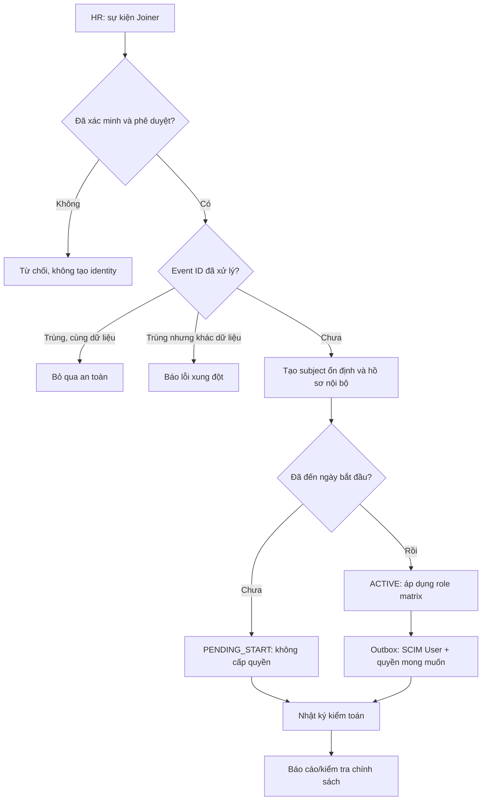

# Dự án thực hành: Khởi tạo identity trong vòng đời IAM

> **Chủ đề:** Khởi tạo identity (Joiner) trong hệ thống **SECURITY_IDENTITY_ACCESS_MANAGEMENT_IDENTITY_LIFECYCLE**.  
> **Bối cảnh:** Quản lý vòng đời danh tính theo Joiner–Mover–Leaver, từ xác minh, tạo tài khoản, cấp quyền, rà soát đến thu hồi quyền khi thay đổi vai trò; kết nối IdP, SSO, SCIM, RBAC/ABAC, tài khoản dịch vụ và kiểm toán.  
> **Mức độ:** Trung cấp | **Thời lượng gợi ý:** 90–150 phút | **Hình thức:** Lab chạy cục bộ, không cần dịch vụ đám mây.

## 1. Bài toán và kết quả cần đạt

Một công ty có nhiều ứng dụng nội bộ. Trước đây, khi nhân viên mới gia nhập, quản trị viên tự tạo tài khoản ở từng ứng dụng, gán nhóm dựa trên email và đôi khi mở quyền trước ngày bắt đầu làm việc. Cách làm này dễ tạo tài khoản trùng, cấp quyền quá mức và để lại quyền truy cập không được kiểm soát.

Bạn được giao xây dựng một **luồng khởi tạo danh tính cho nhân viên mới (Joiner)**. Hệ thống nhận một sự kiện đã được xác nhận từ HR, kiểm tra phê duyệt, tạo định danh nội bộ ổn định, xác định quyền từ chính sách, chuẩn bị yêu cầu cấp phát cho nhà cung cấp danh tính (Identity Provider – IdP) và lưu bằng chứng kiểm toán. Nếu ngày bắt đầu làm việc chưa đến, tài khoản ở trạng thái chờ và chưa có quyền ứng dụng.

Sau dự án, bạn có thể:

1. Phân biệt **identity**, **account**, **authentication** và **authorization**, đặc biệt là vì sao email không phải khóa định danh bền vững.
2. Xử lý sự kiện Joiner theo nguyên tắc **nguồn dữ liệu đáng tin cậy**, **phê duyệt**, **idempotency** và **fail closed**.
3. Áp dụng **RBAC** để gán quyền cơ sở và **ABAC** để kiểm tra trạng thái, tenant, MFA trong một quyết định truy cập.
4. Chuẩn bị payload kiểu **SCIM 2.0** để cấp phát tài khoản đến IdP; hiểu vai trò khác nhau của SCIM, SSO và giao thức OIDC/SAML.
5. Tạo dấu vết kiểm toán và chứng minh các trường hợp từ chối an toàn, đồng thời xác định những bước cần bổ sung để triển khai thực tế.

**Phạm vi:** Lab triển khai *mô hình IAM và bản xem trước yêu cầu SCIM* trên máy cá nhân. Không kết nối IdP thật, không xác minh giấy tờ định danh thật, không phát hành token OIDC và không tự động tạo tài khoản dịch vụ. Các thao tác đó sẽ được biểu diễn bằng ranh giới tích hợp rõ ràng.

## 2. Thiết kế hệ thống

### 2.1. Luồng Joiner



Trong môi trường triển khai thật, một bộ xử lý outbox gửi lệnh cấp phát qua SCIM hoặc API được IdP/ứng dụng hỗ trợ, ghi lại kết quả và retry an toàn. IdP quản lý phiên đăng nhập bằng SSO (ví dụ OIDC hoặc SAML), trong khi ứng dụng kiểm tra quyền truy cập theo role và thuộc tính phiên. **SCIM cấp phát/synchronization, không thay thế chức năng đăng nhập SSO.**

### 2.2. Hợp đồng dữ liệu

| Trường | Ý nghĩa | Quy tắc |
|---|---|---|
| `event_id` | Khóa chống xử lý sự kiện lặp | Cùng ID và cùng dữ liệu: bỏ qua; cùng ID và dữ liệu khác: lỗi |
| `employee_id` | Mã nhân sự từ nguồn HR | Duy nhất; dùng làm `externalId` khi đồng bộ SCIM |
| `subject` | ID nội bộ cho identity | UUID được tạo một lần; không dùng email làm khóa |
| `work_email` | Tên đăng nhập/thuộc tính liên hệ | Chuẩn hóa chữ thường; phải duy nhất, có thể thay đổi trong Mover |
| `tenant_id` | Ranh giới tổ chức | Thuộc tập tenant được phép |
| `department`, `job_title` | Thuộc tính HR đã kiểm chứng | Tra ma trận RBAC; không nhận danh sách quyền tùy ý từ sự kiện |
| `start_date` | Ngày hiệu lực | Chưa đến ngày: `PENDING_START`, không có quyền |
| `hr_verified`, `manager_approved`, `approval_ticket` | Bằng chứng điều kiện đầu vào | Lab dùng cờ mô phỏng; sản phẩm thật phải xác minh chứng cứ/nguồn phát |
| `status` | Trạng thái vòng đời | `PENDING_START` → `ACTIVE`; các bước Mover/Leaver mở rộng sau |

Ma trận quyền tối thiểu dùng trong bài:

| Phòng ban | Chức danh | Quyền khi ACTIVE |
|---|---|---|
| Engineering | Developer | `base:employee`, `repo:read` |
| Support | Agent | `base:employee`, `ticket:read` |
| Finance | Analyst | `base:employee`, `ledger:read` |

Không có dòng khớp ma trận → **từ chối tự động cấp phát**, chuyển sang rà soát chính sách. Không có quyền quản trị trong luồng Joiner mặc định.

## 3. Chuẩn bị

Cài **Python 3.10 trở lên**. Chỉ dùng thư viện chuẩn `argparse`, `datetime`, `sqlite3`, `json`, `hashlib` và `uuid`. Tạo một thư mục làm việc riêng, ví dụ `iam-identity-lab`. Mọi file `.py`, `.json` và cơ sở dữ liệu dưới đây đều được tạo **trong thư mục lab của người học**, không phải các tệp cấu hình trong repository.

Cấu trúc khi hoàn thành:

```text
iam-identity-lab/
├── identity_lab.py
├── joiner-001.json
└── identity-lab.sqlite       # tự xuất hiện sau khi chạy
```

## 4. Xây dựng chương trình khởi tạo identity

Tạo file `identity_lab.py` với toàn bộ nội dung sau. SQLite mô phỏng identity registry, bảng thành viên nhóm quyền, outbox và audit log. Giao dịch `BEGIN IMMEDIATE` giúp kiểm tra trùng và tạo identity nhất quán trong phạm vi lab một tiến trình/cơ sở dữ liệu.

```python
import argparse
import datetime as dt
import hashlib
import json
import re
import sqlite3
import sys
import uuid
from pathlib import Path

DB_PATH = Path("identity-lab.sqlite")
CORE_SCIM = "urn:ietf:params:scim:schemas:core:2.0:User"
ENTERPRISE_SCIM = "urn:ietf:params:scim:schemas:extension:enterprise:2.0:User"

ROLE_MATRIX = {
    ("Engineering", "Developer"): ("base:employee", "repo:read"),
    ("Support", "Agent"): ("base:employee", "ticket:read"),
    ("Finance", "Analyst"): ("base:employee", "ledger:read"),
}

REQUIRED_FIELDS = {
    "event_id", "event_type", "employee_id", "full_name",
    "work_email", "tenant_id", "department", "job_title",
    "manager_id", "start_date", "hr_verified", "manager_approved",
    "approval_ticket",
}

SCHEMA = """
CREATE TABLE IF NOT EXISTS identities (
    subject TEXT PRIMARY KEY,
    employee_id TEXT NOT NULL UNIQUE,
    full_name TEXT NOT NULL,
    work_email TEXT NOT NULL UNIQUE COLLATE NOCASE,
    tenant_id TEXT NOT NULL,
    department TEXT NOT NULL,
    job_title TEXT NOT NULL,
    manager_id TEXT NOT NULL,
    start_date TEXT NOT NULL,
    status TEXT NOT NULL CHECK(status IN ('PENDING_START','ACTIVE')),
    approval_ticket TEXT NOT NULL
);
CREATE TABLE IF NOT EXISTS roles (
    subject TEXT NOT NULL REFERENCES identities(subject),
    role TEXT NOT NULL,
    PRIMARY KEY (subject, role)
);
CREATE TABLE IF NOT EXISTS processed_events (
    event_id TEXT PRIMARY KEY,
    payload_sha256 TEXT NOT NULL
);
CREATE TABLE IF NOT EXISTS outbox (
    id INTEGER PRIMARY KEY AUTOINCREMENT,
    subject TEXT NOT NULL UNIQUE REFERENCES identities(subject),
    payload TEXT NOT NULL,
    delivery_state TEXT NOT NULL DEFAULT 'PENDING'
);
CREATE TABLE IF NOT EXISTS audit_log (
    id INTEGER PRIMARY KEY AUTOINCREMENT,
    at_utc TEXT NOT NULL,
    action TEXT NOT NULL,
    subject TEXT NOT NULL,
    detail TEXT NOT NULL
);
"""


def utc_today():
    return dt.datetime.now(dt.timezone.utc).date()


def audit(conn, action, subject, detail):
    timestamp = dt.datetime.now(dt.timezone.utc).isoformat()
    conn.execute(
        "INSERT INTO audit_log(at_utc, action, subject, detail) VALUES (?,?,?,?)",
        (timestamp, action, subject, detail),
    )


def validate(raw):
    if not isinstance(raw, dict) or set(raw) != REQUIRED_FIELDS:
        raise ValueError("Schema sự kiện sai: thiếu hoặc thừa trường")
    e = raw.copy()
    for field in REQUIRED_FIELDS - {"hr_verified", "manager_approved"}:
        if not isinstance(e[field], str) or not e[field].strip():
            raise ValueError(f"Trường không hợp lệ: {field}")
        e[field] = e[field].strip()

    e["work_email"] = e["work_email"].lower()
    if e["event_type"] != "JOINER":
        raise ValueError("Lab này chỉ xử lý sự kiện JOINER")
    if not re.fullmatch(r"evt-[A-Za-z0-9-]{6,36}", e["event_id"]):
        raise ValueError("event_id không hợp lệ")
    if not re.fullmatch(r"EMP-[0-9]{6}", e["employee_id"]):
        raise ValueError("employee_id không hợp lệ")
    if not re.fullmatch(r"EMP-[0-9]{6}", e["manager_id"]):
        raise ValueError("manager_id không hợp lệ")
    if e["employee_id"] == e["manager_id"]:
        raise ValueError("Nhân viên không thể tự làm quản lý")
    if not re.fullmatch(r"[a-z0-9._%+-]+@example\.test", e["work_email"]):
        raise ValueError("Email lab phải thuộc example.test")
    if e["tenant_id"] not in {"tenant-a", "tenant-b"}:
        raise ValueError("Tenant không được hỗ trợ")
    if (e["department"], e["job_title"]) not in ROLE_MATRIX:
        raise ValueError("Chưa có chính sách RBAC cho vị trí này")
    if e["hr_verified"] is not True or e["manager_approved"] is not True:
        raise ValueError("Chưa đủ xác minh HR hoặc phê duyệt của quản lý")
    if not re.fullmatch(r"IAM-[0-9]{4}-[0-9]{4,6}", e["approval_ticket"]):
        raise ValueError("approval_ticket không hợp lệ")
    dt.date.fromisoformat(e["start_date"])
    if len(e["full_name"]) > 120:
        raise ValueError("Họ tên quá dài")
    return e


def scim_preview(row):
    """Chỉ sinh payload; không gửi mạng hoặc tạo tài khoản thật."""
    return {
        "operation": "UPSERT_USER_PREVIEW",
        "scim_user": {
            "schemas": [CORE_SCIM, ENTERPRISE_SCIM],
            "externalId": row["employee_id"],
            "userName": row["work_email"],
            "displayName": row["full_name"],
            "active": True,
            ENTERPRISE_SCIM: {
                "employeeNumber": row["employee_id"],
                "department": row["department"],
            },
        },
        "desired_app_roles": list(ROLE_MATRIX[
            (row["department"], row["job_title"])
        ]),
    }


def provision_intent(conn, row):
    for role in ROLE_MATRIX[(row["department"], row["job_title"])]:
        conn.execute(
            "INSERT OR IGNORE INTO roles(subject, role) VALUES (?,?)",
            (row["subject"], role),
        )
    conn.execute(
        "INSERT OR IGNORE INTO outbox(subject, payload) VALUES (?,?)",
        (row["subject"], json.dumps(scim_preview(row), ensure_ascii=False)),
    )


def joiner(conn, filename):
    e = validate(json.loads(Path(filename).read_text(encoding="utf-8")))
    canonical = json.dumps(e, sort_keys=True, ensure_ascii=False, separators=(",", ":"))
    digest = hashlib.sha256(canonical.encode("utf-8")).hexdigest()
    with conn:
        conn.execute("BEGIN IMMEDIATE")
        old = conn.execute(
            "SELECT payload_sha256 FROM processed_events WHERE event_id=?",
            (e["event_id"],),
        ).fetchone()
        if old:
            if old["payload_sha256"] != digest:
                raise ValueError("CONFLICT: event_id đã tồn tại với nội dung khác")
            print("REPLAY_IGNORED: sự kiện đã được xử lý")
            return

        existing = conn.execute(
            "SELECT subject FROM identities WHERE employee_id=?",
            (e["employee_id"],),
        ).fetchone()
        if existing:
            raise ValueError("DUPLICATE: employee_id đã tồn tại; cần luồng Mover")

        subject = "id-" + uuid.uuid4().hex
        status = "ACTIVE" if dt.date.fromisoformat(e["start_date"]) <= utc_today() else "PENDING_START"
        conn.execute(
            """INSERT INTO identities
            (subject,employee_id,full_name,work_email,tenant_id,department,
             job_title,manager_id,start_date,status,approval_ticket)
            VALUES (?,?,?,?,?,?,?,?,?,?,?)""",
            (subject, e["employee_id"], e["full_name"], e["work_email"],
             e["tenant_id"], e["department"], e["job_title"], e["manager_id"],
             e["start_date"], status, e["approval_ticket"]),
        )
        conn.execute(
            "INSERT INTO processed_events VALUES (?,?)",
            (e["event_id"], digest),
        )
        if status == "ACTIVE":
            row = conn.execute(
                "SELECT * FROM identities WHERE subject=?", (subject,)
            ).fetchone()
            provision_intent(conn, row)
        audit(conn, "JOINER_CREATED", subject, f"ticket={e['approval_ticket']};status={status}")
    print(f"CREATED: {e['employee_id']} subject={subject} status={status}")


def activate(conn, employee_id):
    with conn:
        conn.execute("BEGIN IMMEDIATE")
        row = conn.execute(
            "SELECT * FROM identities WHERE employee_id=?", (employee_id,)
        ).fetchone()
        if row is None:
            raise ValueError("Không tìm thấy employee_id")
        if row["status"] == "ACTIVE":
            print("ALREADY_ACTIVE")
            return
        if dt.date.fromisoformat(row["start_date"]) > utc_today():
            raise ValueError("Chưa đến start_date; không được kích hoạt sớm")
        conn.execute(
            "UPDATE identities SET status='ACTIVE' WHERE subject=?",
            (row["subject"],),
        )
        updated = conn.execute(
            "SELECT * FROM identities WHERE subject=?", (row["subject"],)
        ).fetchone()
        provision_intent(conn, updated)
        audit(conn, "JOINER_ACTIVATED", row["subject"], "start_date_reached")
    print(f"ACTIVATED: {employee_id}")


def inspect(conn, employee_id):
    row = conn.execute(
        "SELECT * FROM identities WHERE employee_id=?", (employee_id,)
    ).fetchone()
    if row is None:
        raise ValueError("Không tìm thấy employee_id")
    roles = conn.execute(
        "SELECT role FROM roles WHERE subject=? ORDER BY role", (row["subject"],)
    ).fetchall()
    outbox = conn.execute(
        "SELECT delivery_state FROM outbox WHERE subject=?", (row["subject"],)
    ).fetchone()
    summary = {
        "subject": row["subject"],
        "employee_id": row["employee_id"],
        "status": row["status"],
        "tenant_id": row["tenant_id"],
        "roles": [item["role"] for item in roles],
        "outbox": outbox["delivery_state"] if outbox else "NONE",
    }
    print(json.dumps(summary, indent=2, ensure_ascii=False))


def authorize(conn, employee_id, tenant, role, mfa):
    """Mô phỏng kiểm tra chính sách; không xác thực MFA/token thật."""
    row = conn.execute(
        "SELECT subject, tenant_id, status FROM identities WHERE employee_id=?",
        (employee_id,),
    ).fetchone()
    has_role = bool(row and conn.execute(
        "SELECT 1 FROM roles WHERE subject=? AND role=?",
        (row["subject"], role),
    ).fetchone())
    allowed = bool(row and row["status"] == "ACTIVE"
                   and row["tenant_id"] == tenant and has_role and mfa)
    print("POLICY_ALLOW" if allowed else "POLICY_DENY")


def dispatch_preview(conn):
    with conn:
        pending = conn.execute(
            "SELECT id, payload FROM outbox WHERE delivery_state='PENDING' ORDER BY id"
        ).fetchall()
        for item in pending:
            print(json.dumps(json.loads(item["payload"]), indent=2, ensure_ascii=False))
            conn.execute(
                "UPDATE outbox SET delivery_state='SIMULATED' WHERE id=?",
                (item["id"],),
            )
    print(f"SIMULATED_COUNT={len(pending)}")


def main():
    parser = argparse.ArgumentParser(description="IAM Joiner local lab")
    sub = parser.add_subparsers(dest="command", required=True)
    sub.add_parser("init")
    p = sub.add_parser("joiner")
    p.add_argument("file")
    p = sub.add_parser("activate")
    p.add_argument("employee_id")
    p = sub.add_parser("inspect")
    p.add_argument("employee_id")
    p = sub.add_parser("authorize")
    p.add_argument("employee_id")
    p.add_argument("--tenant", required=True)
    p.add_argument("--role", required=True)
    p.add_argument("--mfa", action="store_true")
    sub.add_parser("dispatch")
    sub.add_parser("audit")
    args = parser.parse_args()

    conn = sqlite3.connect(DB_PATH)
    conn.row_factory = sqlite3.Row
    conn.execute("PRAGMA foreign_keys=ON")
    try:
        conn.executescript(SCHEMA)
        if args.command == "init":
            print(f"INITIALIZED: {DB_PATH}")
        elif args.command == "joiner":
            joiner(conn, args.file)
        elif args.command == "activate":
            activate(conn, args.employee_id)
        elif args.command == "inspect":
            inspect(conn, args.employee_id)
        elif args.command == "authorize":
            authorize(conn, args.employee_id, args.tenant, args.role, args.mfa)
        elif args.command == "dispatch":
            dispatch_preview(conn)
        elif args.command == "audit":
            rows = conn.execute(
                "SELECT at_utc,action,subject,detail FROM audit_log ORDER BY id"
            ).fetchall()
            for row in rows:
                print(dict(row))
    finally:
        conn.close()


if __name__ == "__main__":
    try:
        main()
    except (ValueError, OSError, sqlite3.Error, json.JSONDecodeError) as exc:
        print(f"ERROR: {exc}", file=sys.stderr)
        sys.exit(2)
```

### Vì sao code có những điểm kiểm soát này?

- **Nguồn tin cậy:** chỉ cho phép những trường thuộc hợp đồng HR; từ chối sự kiện có thêm trường như `requested_roles` để người gọi không thể tự gán `admin`. Trong môi trường thật, cờ `hr_verified` và `manager_approved` phải được xác thực qua kênh HR/quy trình phê duyệt, không tin vào JSON do người dùng gửi.
- **Idempotency:** bảng `processed_events` lưu hash dữ liệu chuẩn hóa; gửi lại cùng sự kiện không sinh thêm account/outbox. Event ID tái sử dụng với dữ liệu thay đổi sẽ bị từ chối.
- **Định danh ổn định:** `subject` được tạo một lần, độc lập với tên, email và chức danh; `employee_id` liên kết danh tính với HR.
- **Cấp quyền tối thiểu:** role chỉ sinh từ ma trận `(department, job_title)`; tài khoản `PENDING_START` chưa có vai trò nào.
- **Mô hình outbox:** việc lưu ý định cấp phát và hồ sơ trong cùng giao dịch ngăn tình trạng lưu identity thành công nhưng quên yêu cầu đồng bộ. Bộ phân phối thật còn cần timeout, retry, đối soát và xử lý ACK.
- **Kiểm toán:** sự kiện tạo/kích hoạt có thời điểm UTC và tham chiếu ticket. Lab không tuyên bố log SQLite chống sửa đổi; hệ thống thật cần lưu vào nơi chống can thiệp, kiểm soát truy cập và có chính sách lưu giữ.

## 5. Tạo sự kiện Joiner mẫu

Tạo file `joiner-001.json`:

```json
{
  "event_id": "evt-JOIN-000421",
  "event_type": "JOINER",
  "employee_id": "EMP-000421",
  "full_name": "Nguyen Minh An",
  "work_email": "an.nguyen@example.test",
  "tenant_id": "tenant-a",
  "department": "Engineering",
  "job_title": "Developer",
  "manager_id": "EMP-000100",
  "start_date": "2020-01-01",
  "hr_verified": true,
  "manager_approved": true,
  "approval_ticket": "IAM-2026-0421"
}
```

Giá trị năm 2020 bảo đảm ngày bắt đầu đã qua khi bạn chạy lab. `example.test` là tên miền ví dụ, không phải hòm thư thật. Các cờ phê duyệt ở đây chỉ mô phỏng đầu vào HR hợp lệ.

Chạy tại thư mục lab:

```bash
python identity_lab.py init
python identity_lab.py joiner joiner-001.json
python identity_lab.py inspect EMP-000421
```

Kết quả quan trọng phải quan sát được:

- `CREATED: EMP-000421 ... status=ACTIVE`.
- `subject` có dạng `id-...` và không bằng email.
- `roles` chứa đúng `base:employee` và `repo:read`.
- `outbox` là `PENDING` trước khi mô phỏng phân phối.

Tiếp theo, chạy:

```bash
python identity_lab.py dispatch
python identity_lab.py inspect EMP-000421
python identity_lab.py audit
```

Lệnh `dispatch` in yêu cầu mô phỏng gồm `scim_user.schemas`, `externalId`, `userName`, `active` và `desired_app_roles`. Trạng thái outbox chuyển thành `SIMULATED`, có nghĩa là **đã in bản xem trước**, không có xác nhận từ IdP thật.

**Lưu ý về SCIM:** `scim_user` là phần biểu diễn đối tượng SCIM User; `desired_app_roles` là thông tin chính sách cấp quyền riêng của adapter. Khi tích hợp thật, cần ánh xạ role sang Group SCIM, API phân quyền chuyên biệt hoặc cơ chế riêng của IdP; không giả định Group/role được ghi trực tiếp vào thuộc tính User của mọi nhà cung cấp. Cần dùng `externalId` làm khóa đối soát, đồng thời lưu ID tài nguyên do IdP trả về.

## 6. Kiểm thử điều kiện truy cập

Dùng lệnh `authorize` để kiểm tra quy tắc ABAC bổ sung lên RBAC. Trong lab, cờ `--mfa` đại diện cho **một phiên đã xác minh MFA**; nó không tự thực hiện MFA.

```bash
# Có vai trò, đúng tenant, trạng thái ACTIVE và cờ MFA: cho phép
python identity_lab.py authorize EMP-000421 --tenant tenant-a --role repo:read --mfa

# Sai tenant: từ chối
python identity_lab.py authorize EMP-000421 --tenant tenant-b --role repo:read --mfa

# Thiếu cờ MFA: từ chối
python identity_lab.py authorize EMP-000421 --tenant tenant-a --role repo:read

# Không có quyền yêu cầu: từ chối
python identity_lab.py authorize EMP-000421 --tenant tenant-a --role ledger:read --mfa
```

Kết quả mong đợi lần lượt là:

```text
POLICY_ALLOW
POLICY_DENY
POLICY_DENY
POLICY_DENY
```

Trong hệ thống sản xuất, tenant và trạng thái phiên phải đến từ các nguồn được xác thực (token đã kiểm tra chữ ký/issuer/audience, session hoặc policy decision point), không nhận trực tiếp từ tham số CLI của người gọi.

## 7. Các tình huống lỗi bắt buộc

Hãy sao chép `joiner-001.json` thành các file thử nghiệm riêng trong thư mục lab, sửa theo từng trường hợp và đối chiếu kết quả. Dùng **event_id** và **employee_id** mới cho mỗi danh tính mới; dùng lại event ID khi chủ ý kiểm tra replay/xung đột.

| Tình huống | Thao tác | Kết quả bắt buộc |
|---|---|---|
| Replay hợp lệ | Chạy lại `joiner joiner-001.json`, không sửa file | `REPLAY_IGNORED`, không thêm identity hoặc outbox |
| Event ID xung đột | Giữ `event_id` cũ, đổi `full_name` | Lỗi `CONFLICT`, không cập nhật dữ liệu đã xử lý |
| Cùng nhân sự, event mới | Đổi `event_id` nhưng giữ `employee_id` | Lỗi `DUPLICATE`; cập nhật nhân sự thuộc luồng Mover |
| Chưa xác minh | Dùng ID mới, đặt `hr_verified: false` | Lỗi, không tạo identity |
| Chưa phê duyệt | Dùng ID mới, đặt `manager_approved: false` | Lỗi, không tạo identity |
| Yêu cầu quyền lạ | Thêm `"requested_roles": ["admin"]` | Lỗi schema, không cấp quyền |
| Role không trong ma trận | Dùng ID mới, đổi `job_title` thành `Administrator` | Lỗi policy, không tự cấp quyền |
| Tương lai | Dùng ID mới, đặt `start_date: "2099-01-01"` | `PENDING_START`, roles rỗng, không có outbox |
| Kích hoạt sớm | Gọi `activate` cho nhân viên đang `PENDING_START` | Lỗi "Chưa đến start_date", không thay đổi trạng thái |
| Email trùng | Dùng nhân sự mới nhưng giữ email cũ | SQLite từ chối uniqueness; giao dịch được rollback |

Để kiểm chứng trạng thái chờ, ví dụ tạo `joiner-future.json` bằng cách sao chép file mẫu rồi đổi đồng thời `event_id`, `employee_id`, `work_email`, `approval_ticket` và `start_date` như sau:

```text
event_id        = evt-JOIN-000422
employee_id     = EMP-000422
work_email      = future.nguyen@example.test
approval_ticket = IAM-2026-0422
start_date      = 2099-01-01
```

Sau đó chạy:

```bash
python identity_lab.py joiner joiner-future.json
python identity_lab.py inspect EMP-000422
python identity_lab.py activate EMP-000422
python identity_lab.py authorize EMP-000422 --tenant tenant-a --role repo:read --mfa
```

Quan sát `PENDING_START`, `roles: []`, `outbox: NONE`, lỗi kích hoạt sớm và `POLICY_DENY`. Có thể thực hành luồng kích hoạt hợp lệ với **một sự kiện tương lai giả lập có ngày đã đến** trong môi trường kiểm thử cô lập hoặc bổ sung đồng hồ giả lập được kiểm soát; không sửa trực tiếp cơ sở dữ liệu để lách chính sách.

## 8. Kiến trúc mở rộng cho hệ thống thật

Lab tập trung vào Joiner, nhưng dữ liệu được thiết kế theo tinh thần **quản lý vòng đời danh tính**. Khi đưa vào hệ thống thực tế, cần xử lý các luồng liền kề:

| Thành phần/luồng | Việc cần triển khai |
|---|---|
| **HR và xác minh** | Dùng webhook có xác thực, chữ ký số/mTLS, chống replay ở transport; xác nhận nhân sự, quản lý và ticket từ nguồn có thẩm quyền |
| **IdP và SSO** | Đối soát `externalId` với subject ổn định; cấu hình MFA, OIDC/SAML, chính sách phiên và lifecycle của token |
| **SCIM/provisioning** | Upsert an toàn, lưu `id` của SCIM resource, xử lý lỗi 409/429/5xx, retry có backoff, dead-letter queue và reconciliation |
| **RBAC/ABAC** | Chính sách phân tách nhiệm vụ, phê duyệt quyền nhạy cảm, kiểm tra tenant/thiết bị/MFA, đánh giá quyền định kỳ |
| **Mover** | Cập nhật thuộc tính HR; tính lại role; **thu hồi quyền cũ** trước hoặc đồng thời cấp quyền mới; kiểm soát quyền truy cập tồn dư |
| **Leaver** | Vô hiệu hóa tài khoản và phiên, thu hồi refresh token/key, xóa membership, gỡ truy cập ứng dụng, giữ audit theo chính sách |
| **Tài khoản dịch vụ** | Có owner, mục đích, ngày hết hạn, scope riêng, luân phiên bí mật và quy trình thu hồi; không tạo tài khoản dịch vụ như nhân viên |
| **Kiểm toán/bảo mật** | Chuyển log sang SIEM bất biến hoặc hệ thống hạn chế sửa đổi; hạn chế PII, kiểm soát quyền đọc, giám sát bất thường |

Một quyết định truy cập thực tế nên có dạng:

```text
ALLOW khi và chỉ khi:
  identity.status == ACTIVE
  AND session.authenticated == true
  AND session.mfa_satisfied == true
  AND identity.tenant_id == resource.tenant_id
  AND requested_permission thuộc quyền hiệu lực
  AND không vi phạm chính sách rủi ro / phân tách nhiệm vụ
Ngược lại: DENY
```

Hệ thống quản lý identity nội bộ và IdP có thể có **độ trễ đồng bộ**. Do đó, trạng thái nội bộ `ACTIVE` và outbox `SIMULATED` không được xem là chứng cứ tài khoản đã tồn tại, người dùng đăng nhập được hay quyền đã có hiệu lực tại ứng dụng đích. Một hệ thống production cần lưu trạng thái provisioning riêng như `PENDING`, `ACKNOWLEDGED`, `FAILED` và chạy đối soát định kỳ.

## 9. Bài nộp và tiêu chí hoàn thành

Nộp trong thư mục bài thực hành hoặc báo cáo ngắn:

1. File `identity_lab.py`, một JSON Joiner hợp lệ và các JSON kiểm thử tiêu cực (dùng dữ liệu giả).
2. Ảnh chụp hoặc bản ghi lệnh của `joiner`, `inspect`, `dispatch` và `audit`; ẩn dữ liệu cá nhân nếu thay dữ liệu mẫu.
3. Bảng kết quả các tình huống ở mục 7, ghi **PASS/FAIL**, kết quả thực tế và nguyên nhân.
4. Một sơ đồ hoặc đoạn mô tả 150–300 chữ giải thích trách nhiệm của HR, IAM service, IdP, SCIM, SSO và ứng dụng khi nhân viên bắt đầu làm việc.
5. Trả lời hai câu hỏi thiết kế: **(a)** Vì sao đổi email không được đổi `subject`? **(b)** Vì sao một event Joiner đã thành công không nên được dùng để cập nhật bộ quyền khi người đó chuyển phòng ban?

Thang tự đánh giá:

| Tiêu chí | Điểm |
|---|---:|
| Dữ liệu hợp lệ, định danh duy nhất, tạo đúng trạng thái | 25 |
| Idempotency, chống xung đột và rollback | 20 |
| Quyền tối thiểu RBAC + ràng buộc ABAC | 20 |
| Hiểu payload SCIM, outbox và ranh giới IdP/SSO | 20 |
| Audit, kiểm thử lỗi và giải thích Mover/Leaver | 15 |
| **Tổng** | **100** |

**Đạt yêu cầu:** Các luồng hợp lệ tạo một identity duy nhất; mọi tình huống lỗi không cấp thêm quyền; danh tính tương lai chưa hoạt động; quyền kiểm tra đúng role/tenant/MFA; người học giải thích được vì sao phải có bước thu hồi quyền khi Mover và Leaver.

### Câu hỏi mở rộng

- Nếu hai sự kiện Joiner cho cùng một nhân sự đến đồng thời nhưng khác `event_id`, uniqueness và transaction xử lý được điều gì? Ở quy mô nhiều dịch vụ, bạn cần cơ chế khóa/unique constraint nào?
- Nếu IdP đã nhận lệnh tạo tài khoản nhưng hệ thống mất kết nối trước khi ghi ACK, làm thế nào để retry mà không tạo hai tài khoản?
- Nếu HR sửa ngày bắt đầu hoặc quản lý phê duyệt bị thu hồi khi identity đang chờ, quy trình nào đảm bảo trạng thái và quyền được tính lại?
- Khi một nhân viên chuyển từ Finance sang Engineering, làm sao phát hiện và loại bỏ `ledger:read` đã cấp trước đó ở cả IdP và ứng dụng đích?

Bài thực hành hoàn thành khi bạn chứng minh được cả **khởi tạo đúng** lẫn **từ chối an toàn**; từ đó có nền tảng để mở rộng sang Mover, Leaver và rà soát quyền truy cập tồn dư.
