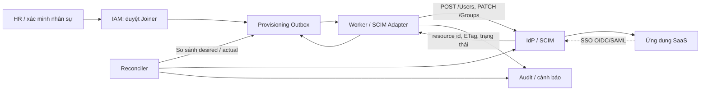
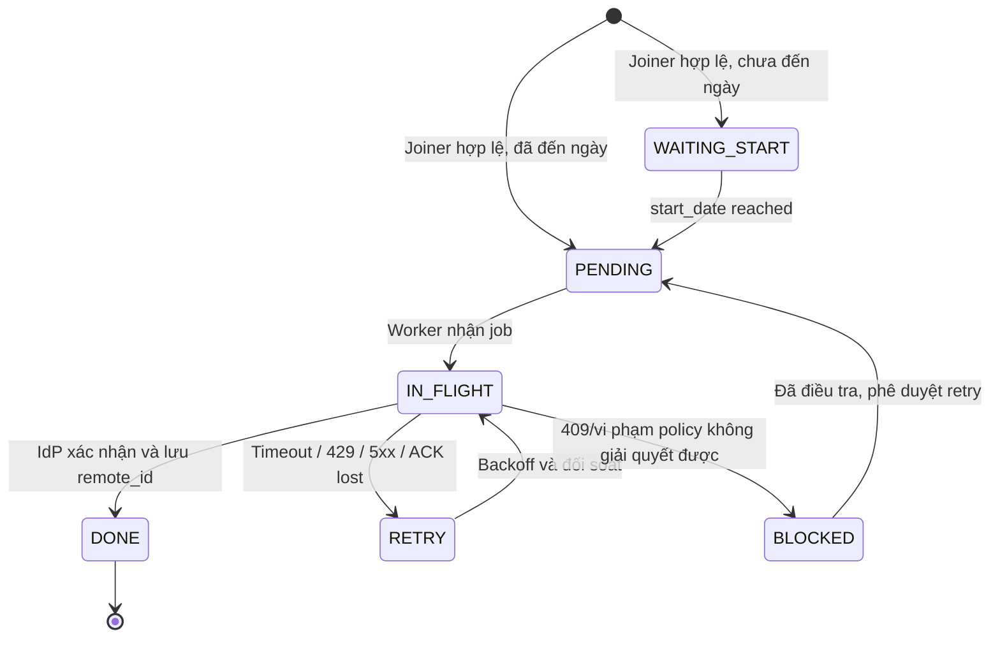

# Dự án thực hành: Provision identity qua SCIM và đối soát quyền

> **Chương:** Dự án thực hành  
> **Đề bài:** Provision identity  
> **Phạm vi module:** `SECURITY_IDENTITY_ACCESS_MANAGEMENT_IDENTITY_LIFECYCLE` — quản lý vòng đời danh tính trong IAM theo Joiner–Mover–Leaver, từ xác minh, tạo tài khoản và cấp quyền đến rà soát, thu hồi khi thay đổi vai trò; liên kết IdP, SSO, SCIM, RBAC/ABAC, tài khoản dịch vụ, kiểm toán và giảm quyền truy cập tồn dư.  
> **Hình thức:** Lab cục bộ với Python 3.10+ và SQLite; không cần tài khoản IdP thật.  
> **Thời lượng gợi ý:** 120–180 phút.

## 1. Bối cảnh

Công ty có hệ thống HR làm nguồn dữ liệu nhân sự, một dịch vụ Identity Lifecycle nhận sự kiện **Joiner**, một Identity Provider (**IdP**) và nhiều ứng dụng SaaS được tích hợp Single Sign-On (**SSO**). Khi HR xác minh và quản lý phê duyệt một nhân viên mới, dịch vụ IAM phải:

1. Lưu yêu cầu cấp phát có thể truy vết đến phiếu phê duyệt.
2. Chỉ cấp phát khi đến ngày bắt đầu làm việc.
3. Tạo đúng **một tài khoản** trên IdP; trả về mã tài nguyên của IdP.
4. Gán đúng các **nhóm quyền tối thiểu** theo vai trò được HR xác thực.
5. Xử lý sự cố mạng, gửi yêu cầu lặp, mất phản hồi xác nhận và kiểm tra lệch quyền.
6. Giữ bằng chứng để sau này thực hiện **Mover** hoặc **Leaver**, đặc biệt là xóa nhóm/quyền cũ.

Bài này tập trung vào **provisioning** (cấp phát và đồng bộ tài khoản/quyền) sau bước khởi tạo identity. Phân biệt ba khái niệm:

| Khái niệm | Trách nhiệm |
|---|---|
| **Identity registry / IAM** | Quyết định *ai* được tham gia hệ thống, *khi nào*, *quyền mong muốn* là gì và lưu trạng thái yêu cầu. |
| **SCIM / provisioning adapter** | Chuyển trạng thái mong muốn thành thao tác tạo/cập nhật User, Group tại IdP hoặc ứng dụng, xử lý retry và đối soát. |
| **IdP / SSO / OIDC hoặc SAML** | Xác thực người dùng, hỗ trợ MFA, phát hành assertion/token hoặc phiên SSO; không tự bảo đảm ứng dụng đã nhận đủ quyền SCIM. |

Một identity có thể ánh xạ đến nhiều account ở các ứng dụng. Không được đồng nhất “identity đã tồn tại” với “tài khoản đích đã được cấp phát thành công” hoặc “người dùng đăng nhập được”.

### Mục tiêu đầu ra

Hoàn thành bài, bạn phải giải thích và trình diễn được:

- Khác biệt giữa `employee_id`/`externalId` từ HR, `userName` có thể đổi và `id` do IdP cấp.
- Vì sao lệnh cấp phát cần **idempotency**, định danh đối soát bền vững, giới hạn tenant và **outbox**.
- Vì sao retry sau lỗi 503 khác retry khi IdP đã tạo User nhưng ACK bị mất.
- Cách ánh xạ **RBAC → nhóm quản lý**, và vì sao **ABAC** như tenant, ngày hiệu lực, MFA vẫn phải được kiểm tra.
- Cách phát hiện drift: quyền thiếu, quyền thừa, trạng thái `active` không khớp.
- Những giới hạn của một mock so với SCIM 2.0 và yêu cầu triển khai production.

## 2. Sơ đồ luồng



**Nguyên tắc quan trọng:** lưu “ý định cấp phát” là một hành động giao dịch nội bộ, còn gọi IdP là thao tác có thể thất bại ở mạng ngoài. Khi không thể dùng một transaction chung, dùng **transactional outbox + retry idempotent + đối soát** thay vì giả định một lệnh HTTP thành công trọn vẹn.

### 2.1. Hợp đồng và ranh giới tin cậy

Sự kiện Joiner mẫu chứa:

| Trường | Ý nghĩa | Kiểm soát |
|---|---|---|
| `request_id` | Mã yêu cầu nghiệp vụ, dùng để chống replay | Cùng ID/cùng payload → bỏ qua; cùng ID/khác payload → xung đột |
| `employee_id` | Khóa từ hệ thống HR | Dùng làm `externalId` khi cấp phát; không thay bằng email |
| `tenant_id` | Phạm vi tổ chức | Mọi thao tác truy vấn/cấp phát đều phải giới hạn tenant |
| `work_email` | Tên đăng nhập tại ứng dụng | Kiểm tra duy nhất trong tenant; có thể đổi ở luồng Mover |
| `department`, `job_title` | Thuộc tính đã duyệt | Tính nhóm được phép từ ma trận RBAC |
| `start_date` | Ngày bắt đầu làm việc | Chưa đến ngày → `WAITING_START`, không cấp phát |
| `hr_verified`, `manager_approved` | Tín hiệu đã xác minh/phê duyệt | Lab mô phỏng bằng boolean; hệ thống thật xác thực từ HR/workflow |
| `approval_ticket` | Tham chiếu phê duyệt | Dùng để tra cứu, audit; không thay thế xác thực |
| `remote_id` | ID tài nguyên do IdP trả về | Không tự suy từ email; lưu bền vững để PATCH/DELETE tiếp theo |

Mã nguồn **không nhận quyền tùy ý từ JSON sự kiện**. Chỉ cho phép những vai trò được đưa vào ma trận:

| Phòng ban / Chức danh | Nhóm provisioning mong muốn |
|---|---|
| Engineering / Developer | `group:all-employees`, `group:engineering-read` |
| Support / Agent | `group:all-employees`, `group:support-read` |
| Finance / Analyst | `group:all-employees`, `group:finance-read` |

Các nhóm trên là **nhóm mock**; khi tích hợp thực tế, chúng phải ánh xạ đến **Group ID** của IdP và quyền tương ứng tại ứng dụng đích. Một nhóm có tên giống nhau ở hai tenant không nhất thiết là cùng một tài nguyên.

## 3. Môi trường thực hành

Yêu cầu: Python 3.10 trở lên, chỉ dùng thư viện chuẩn (`argparse`, `sqlite3`, `json`, `uuid`, `hashlib`, `datetime`, `re`). Tạo một thư mục thực hành bất kỳ:

```text
identity-provisioning-lab/
├── provision_identity.py
├── joiner-2001.json
└── provision-lab.sqlite       # Tự tạo khi chạy chương trình
```

Lab chủ ý lưu cả **outbox nội bộ** và **trạng thái IdP giả lập** trong một SQLite để dễ quan sát. Chương trình vẫn tách riêng giao dịch “provider nhận thay đổi” và giao dịch “IAM ghi ACK”, từ đó mô phỏng mất ACK. Trong hệ thống thực tế hai bên nằm ở hai dịch vụ/cơ sở dữ liệu khác nhau và giao tiếp qua HTTPS.

Không dùng thông tin nhân sự thật, token hay mật khẩu thật. Email mẫu thuộc miền `example.test`.

## 4. Viết bộ cấp phát và IdP giả lập

Tạo file `provision_identity.py` với nội dung sau.

```python
import argparse
import datetime as dt
import hashlib
import json
import re
import sqlite3
import sys
import uuid
from pathlib import Path

DB = Path("provision-lab.sqlite")

ROLE_GROUPS = {
    ("Engineering", "Developer"): ("group:all-employees", "group:engineering-read"),
    ("Support", "Agent"): ("group:all-employees", "group:support-read"),
    ("Finance", "Analyst"): ("group:all-employees", "group:finance-read"),
}

FIELDS = {
    "request_id", "employee_id", "tenant_id", "work_email", "full_name",
    "department", "job_title", "start_date", "hr_verified",
    "manager_approved", "approval_ticket",
}

SCHEMA = """
CREATE TABLE IF NOT EXISTS requests (
    request_id TEXT PRIMARY KEY,
    tenant_id TEXT NOT NULL,
    employee_id TEXT NOT NULL,
    payload_sha256 TEXT NOT NULL,
    payload TEXT NOT NULL,
    state TEXT NOT NULL,
    attempts INTEGER NOT NULL DEFAULT 0,
    remote_id TEXT,
    last_error TEXT,
    UNIQUE(tenant_id, employee_id)
);

CREATE TABLE IF NOT EXISTS provider_users (
    id TEXT PRIMARY KEY,
    tenant_id TEXT NOT NULL,
    external_id TEXT NOT NULL,
    username TEXT NOT NULL,
    display_name TEXT NOT NULL,
    department TEXT NOT NULL,
    active INTEGER NOT NULL CHECK (active IN (0, 1)),
    origin_request_id TEXT NOT NULL,
    UNIQUE(tenant_id, external_id),
    UNIQUE(tenant_id, username)
);

CREATE TABLE IF NOT EXISTS provider_groups (
    user_id TEXT NOT NULL REFERENCES provider_users(id) ON DELETE CASCADE,
    group_name TEXT NOT NULL,
    PRIMARY KEY (user_id, group_name)
);

CREATE TABLE IF NOT EXISTS audit (
    id INTEGER PRIMARY KEY AUTOINCREMENT,
    at_utc TEXT NOT NULL,
    action TEXT NOT NULL,
    reference TEXT NOT NULL,
    detail TEXT NOT NULL
);
"""


def today_utc():
    return dt.datetime.now(dt.timezone.utc).date()


def log(conn, action, reference, detail):
    conn.execute(
        "INSERT INTO audit(at_utc, action, reference, detail) VALUES (?,?,?,?)",
        (dt.datetime.now(dt.timezone.utc).isoformat(),
         action, reference, detail),
    )


def validate(raw):
    if not isinstance(raw, dict) or set(raw) != FIELDS:
        raise ValueError("BAD_SCHEMA: thiếu trường hoặc có trường lạ")

    e = raw.copy()
    for key in FIELDS - {"hr_verified", "manager_approved"}:
        if not isinstance(e[key], str) or not e[key].strip():
            raise ValueError(f"INVALID_FIELD: {key}")
        e[key] = e[key].strip()

    if e["hr_verified"] is not True or e["manager_approved"] is not True:
        raise ValueError("NOT_APPROVED: thiếu xác minh HR/phê duyệt")
    if not re.fullmatch(r"REQ-[0-9]{4,8}", e["request_id"]):
        raise ValueError("INVALID_REQUEST_ID")
    if not re.fullmatch(r"EMP-[0-9]{6}", e["employee_id"]):
        raise ValueError("INVALID_EMPLOYEE_ID")
    if not re.fullmatch(r"IAM-[0-9]{4}-[0-9]{4,6}", e["approval_ticket"]):
        raise ValueError("INVALID_APPROVAL_TICKET")
    if e["tenant_id"] not in {"tenant-a", "tenant-b"}:
        raise ValueError("TENANT_NOT_ALLOWED")

    e["work_email"] = e["work_email"].lower()
    if not re.fullmatch(r"[a-z0-9._%+-]+@example\.test", e["work_email"]):
        raise ValueError("EMAIL_NOT_ALLOWED")
    if (e["department"], e["job_title"]) not in ROLE_GROUPS:
        raise ValueError("ROLE_MAPPING_NOT_APPROVED")
    if len(e["full_name"]) > 120:
        raise ValueError("INVALID_FULL_NAME")

    # fromisoformat từ chối ngày không hợp lệ như 2026-02-30.
    date = dt.date.fromisoformat(e["start_date"])
    if date.isoformat() != e["start_date"]:
        raise ValueError("INVALID_START_DATE")
    return e


def expected_groups(e):
    return set(ROLE_GROUPS[(e["department"], e["job_title"])])


def submit(conn, file_path):
    raw = json.loads(Path(file_path).read_text(encoding="utf-8"))
    e = validate(raw)
    payload = json.dumps(e, ensure_ascii=False, sort_keys=True,
                         separators=(",", ":"))
    sha = hashlib.sha256(payload.encode("utf-8")).hexdigest()
    state = "WAITING_START" if dt.date.fromisoformat(
        e["start_date"]) > today_utc() else "PENDING"

    with conn:
        old = conn.execute(
            "SELECT payload_sha256 FROM requests WHERE request_id=?",
            (e["request_id"],),
        ).fetchone()
        if old:
            if old["payload_sha256"] != sha:
                raise ValueError("REQUEST_CONFLICT: request_id dùng lại với dữ liệu khác")
            print("REPLAY_IGNORED: request đã tồn tại")
            return

        other = conn.execute(
            "SELECT request_id FROM requests WHERE tenant_id=? AND employee_id=?",
            (e["tenant_id"], e["employee_id"]),
        ).fetchone()
        if other:
            raise ValueError("JOINER_ALREADY_SUBMITTED: cần quy trình Mover/Leaver")

        conn.execute(
            """INSERT INTO requests(request_id, tenant_id, employee_id,
                payload_sha256, payload, state)
               VALUES (?,?,?,?,?,?)""",
            (e["request_id"], e["tenant_id"], e["employee_id"],
             sha, payload, state),
        )
        log(conn, "REQUEST_ACCEPTED", e["request_id"],
            f"ticket={e['approval_ticket']};state={state}")
    print(f"ENQUEUED: {e['request_id']} state={state}")


def provider_upsert(conn, e):
    """
    Giả lập adapter gửi SCIM và kiểm tra trạng thái tại IdP.
    origin_request_id là marker RIÊNG của mock để kiểm tra nguồn gốc;
    SCIM User chuẩn không có thuộc tính này.
    """
    old = conn.execute(
        "SELECT * FROM provider_users WHERE tenant_id=? AND external_id=?",
        (e["tenant_id"], e["employee_id"]),
    ).fetchone()

    if old:
        # Chỉ cho phép retry của đúng Joiner cũ; Mover/Rejoiner cần duyệt riêng.
        same_request = old["origin_request_id"] == e["request_id"]
        same_profile = (
            old["username"] == e["work_email"]
            and old["display_name"] == e["full_name"]
            and old["department"] == e["department"]
            and old["active"] == 1
        )
        if not same_request or not same_profile:
            raise ValueError("REMOTE_CONFLICT: không ghi đè account hiện hữu")
        remote_id, mode = old["id"], "REUSED"
    else:
        remote_id = "scim-" + uuid.uuid4().hex
        conn.execute(
            """INSERT INTO provider_users(
                id, tenant_id, external_id, username, display_name,
                department, active, origin_request_id
            ) VALUES (?,?,?,?,?,?,?,?)""",
            (remote_id, e["tenant_id"], e["employee_id"],
             e["work_email"], e["full_name"], e["department"], 1,
             e["request_id"]),
        )
        mode = "CREATED"

    for group in sorted(expected_groups(e)):
        conn.execute(
            "INSERT OR IGNORE INTO provider_groups(user_id, group_name) VALUES (?,?)",
            (remote_id, group),
        )
    return remote_id, mode


def process(conn, fail_once=False, lose_ack=False):
    jobs = conn.execute(
        """SELECT * FROM requests
           WHERE state IN ('PENDING', 'RETRY', 'WAITING_START')
           ORDER BY request_id"""
    ).fetchall()
    failure_injected = False
    ack_lost = False

    for job in jobs:
        e = json.loads(job["payload"])
        if dt.date.fromisoformat(e["start_date"]) > today_utc():
            with conn:
                conn.execute(
                    "UPDATE requests SET state='WAITING_START' WHERE request_id=?",
                    (job["request_id"],),
                )
            print(f"WAITING_START: {job['request_id']}")
            continue

        # 503 xảy ra trước khi IdP xử lý request.
        if fail_once and not failure_injected:
            failure_injected = True
            with conn:
                conn.execute(
                    """UPDATE requests SET state='RETRY',
                       attempts=attempts+1, last_error='SIMULATED_HTTP_503'
                       WHERE request_id=?""",
                    (job["request_id"],),
                )
                log(conn, "PROVIDER_RETRY", job["request_id"], "HTTP_503")
            print(f"RETRY_503: {job['request_id']}")
            continue

        # Giao dịch 1: IdP giả lập đã commit tài khoản và nhóm.
        try:
            with conn:
                remote_id, mode = provider_upsert(conn, e)
                log(conn, "PROVIDER_" + mode, job["request_id"], remote_id)
        except (ValueError, sqlite3.IntegrityError) as exc:
            with conn:
                conn.execute(
                    """UPDATE requests SET state='BLOCKED',
                       attempts=attempts+1, last_error=?
                       WHERE request_id=?""",
                    (str(exc), job["request_id"]),
                )
                log(conn, "PROVISION_BLOCKED", job["request_id"], type(exc).__name__)
            print(f"BLOCKED: {job['request_id']} {exc}")
            continue

        # Giả lập IdP đã thành công nhưng IAM không nhận được ACK.
        if lose_ack and not ack_lost:
            ack_lost = True
            with conn:
                conn.execute(
                    """UPDATE requests SET state='RETRY',
                       attempts=attempts+1, last_error='SIMULATED_ACK_LOST'
                       WHERE request_id=?""",
                    (job["request_id"],),
                )
                log(conn, "ACK_LOST", job["request_id"], remote_id)
            print(f"ACK_LOST: {job['request_id']} remote_id={remote_id}")
            continue

        # Giao dịch 2: IAM lưu ACK sau khi biết ID tài nguyên đích.
        with conn:
            conn.execute(
                """UPDATE requests SET state='DONE',
                   attempts=attempts+1, last_error=NULL, remote_id=?
                   WHERE request_id=?""",
                (remote_id, job["request_id"]),
            )
            log(conn, "PROVISION_ACK", job["request_id"], remote_id)
        print(f"PROVISIONED_{mode}: {job['request_id']} remote_id={remote_id}")


def request_status(conn, request_id):
    row = conn.execute(
        """SELECT request_id, tenant_id, employee_id, state,
           attempts, remote_id, last_error FROM requests WHERE request_id=?""",
        (request_id,),
    ).fetchone()
    if not row:
        print("REQUEST_NOT_FOUND")
    else:
        print(json.dumps(dict(row), indent=2, ensure_ascii=False))


def inspect(conn, tenant, employee):
    row = conn.execute(
        "SELECT * FROM provider_users WHERE tenant_id=? AND external_id=?",
        (tenant, employee),
    ).fetchone()
    if not row:
        print("NOT_PROVISIONED")
        return
    groups = sorted(r["group_name"] for r in conn.execute(
        "SELECT group_name FROM provider_groups WHERE user_id=?",
        (row["id"],),
    ).fetchall())
    print(json.dumps({
        "id": row["id"], "tenant_id": row["tenant_id"],
        "externalId": row["external_id"], "userName": row["username"],
        "active": bool(row["active"]), "groups": groups
    }, indent=2, ensure_ascii=False))


def reconcile(conn):
    jobs = conn.execute(
        "SELECT * FROM requests WHERE state='DONE' ORDER BY request_id"
    ).fetchall()
    for job in jobs:
        e = json.loads(job["payload"])
        row = conn.execute(
            "SELECT * FROM provider_users WHERE tenant_id=? AND external_id=?",
            (e["tenant_id"], e["employee_id"]),
        ).fetchone()
        problems = []
        if not row:
            problems.append("MISSING_USER")
        else:
            if row["id"] != job["remote_id"]:
                problems.append("REMOTE_ID_MISMATCH")
            if row["username"] != e["work_email"]:
                problems.append("USERNAME_DRIFT")
            if row["department"] != e["department"]:
                problems.append("DEPARTMENT_DRIFT")
            if row["active"] != 1:
                problems.append("DISABLED_UNEXPECTEDLY")
            actual = {r["group_name"] for r in conn.execute(
                "SELECT group_name FROM provider_groups WHERE user_id=?",
                (row["id"],),
            ).fetchall()}
            if actual != expected_groups(e):
                problems.append("GROUPS_DRIFT")
        result = ",".join(problems) if problems else "OK"
        print(f"{job['request_id']}: {result}")
    if not jobs:
        print("NO_ACKNOWLEDGED_REQUESTS")


def simulate_drift(conn, tenant, employee, add_group, remove_group):
    if bool(add_group) == bool(remove_group):
        raise ValueError("Chỉ chọn một trong --add-group / --remove-group")
    row = conn.execute(
        "SELECT id FROM provider_users WHERE tenant_id=? AND external_id=?",
        (tenant, employee),
    ).fetchone()
    if not row:
        raise ValueError("Không tìm thấy tài khoản trong mock IdP")
    with conn:
        if add_group:
            conn.execute(
                "INSERT OR IGNORE INTO provider_groups VALUES (?,?)",
                (row["id"], add_group),
            )
        else:
            conn.execute(
                "DELETE FROM provider_groups WHERE user_id=? AND group_name=?",
                (row["id"], remove_group),
            )
        log(conn, "LAB_SIMULATED_DRIFT", row["id"],
            "add" if add_group else "remove")
    print("LAB_DRIFT_APPLIED")


def main():
    parser = argparse.ArgumentParser(description="Identity provisioning / SCIM local lab")
    sub = parser.add_subparsers(dest="command", required=True)
    sub.add_parser("init")
    p = sub.add_parser("submit")
    p.add_argument("file")
    p = sub.add_parser("process")
    p.add_argument("--fail-once", action="store_true")
    p.add_argument("--lose-ack", action="store_true")
    p = sub.add_parser("status")
    p.add_argument("request_id")
    p = sub.add_parser("inspect")
    p.add_argument("employee_id")
    p.add_argument("--tenant", required=True)
    sub.add_parser("reconcile")
    p = sub.add_parser("simulate-drift")
    p.add_argument("employee_id")
    p.add_argument("--tenant", required=True)
    p.add_argument("--add-group", default="")
    p.add_argument("--remove-group", default="")
    sub.add_parser("audit")
    args = parser.parse_args()

    conn = sqlite3.connect(DB)
    conn.row_factory = sqlite3.Row
    conn.execute("PRAGMA foreign_keys=ON")
    try:
        conn.executescript(SCHEMA)
        if args.command == "init":
            print("INITIALIZED: provision-lab.sqlite")
        elif args.command == "submit":
            submit(conn, args.file)
        elif args.command == "process":
            process(conn, args.fail_once, args.lose_ack)
        elif args.command == "status":
            request_status(conn, args.request_id)
        elif args.command == "inspect":
            inspect(conn, args.tenant, args.employee_id)
        elif args.command == "reconcile":
            reconcile(conn)
        elif args.command == "simulate-drift":
            simulate_drift(conn, args.tenant, args.employee_id,
                           args.add_group, args.remove_group)
        elif args.command == "audit":
            for row in conn.execute(
                "SELECT at_utc, action, reference, detail FROM audit ORDER BY id"
            ):
                print(json.dumps(dict(row), ensure_ascii=False))
    finally:
        conn.close()


if __name__ == "__main__":
    try:
        main()
    except (ValueError, OSError, sqlite3.Error, json.JSONDecodeError) as exc:
        print(f"ERROR: {exc}", file=sys.stderr)
        sys.exit(2)
```

### 4.1. Vì sao mô hình này an toàn hơn lệnh tạo User đơn lẻ?

- **Chỉ nhận yêu cầu hợp lệ:** hợp đồng JSON không có trường `roles` hay `groups`. Quyền tính từ ma trận được IAM phê duyệt; không thể thêm `group:super-admin` qua payload HR.
- **Ngăn tạo lặp từ nguồn:** `request_id` duy nhất, hash phát hiện cùng ID nhưng nội dung khác; `(tenant_id, employee_id)` duy nhất để một Joiner thứ hai không âm thầm thay vai trò.
- **Ngăn chiếm dụng tài khoản đích:** mock chỉ coi account hiện hữu là retry nếu `origin_request_id` khớp và thuộc tính trọng yếu không thay đổi. Trong SCIM thật, `origin_request_id` không phải thuộc tính chuẩn; connector phải có bảng tương quan đáng tin cậy, kiểm tra `externalId` và `id` đã lưu.
- **Hạn chế blast radius:** role mapping mặc định là quyền đọc; không cấp quyền quản trị. Identity chưa đến ngày bắt đầu chỉ có outbox `WAITING_START`, chưa có account tại đích.
- **Tách hai lần commit:** provider có thể ghi thành công trước khi IAM lưu ACK. Worker truy vấn/cấp phát idempotent giúp retry không tạo tài khoản thứ hai.
- **Đối soát hai chiều:** dữ liệu “mong muốn” đến từ request đã duyệt; nhóm và account “thực tế” ở provider phải được kiểm tra định kỳ. Chênh lệch phải được điều tra/thu hồi theo đúng ownership.

## 5. Tạo yêu cầu đầu vào

Tạo file `joiner-2001.json`:

```json
{
  "request_id": "REQ-2001",
  "employee_id": "EMP-002001",
  "tenant_id": "tenant-a",
  "work_email": "linh.nguyen@example.test",
  "full_name": "Nguyen Thi Linh",
  "department": "Engineering",
  "job_title": "Developer",
  "start_date": "2020-01-01",
  "hr_verified": true,
  "manager_approved": true,
  "approval_ticket": "IAM-2026-2001"
}
```

Ngày bắt đầu trong quá khứ giúp thực hành ngay, không phụ thuộc ngày chạy. Cờ xác minh chỉ là mô phỏng: **trong production, worker không được tin boolean do một client tùy ý gửi**; kết quả phê duyệt phải do dịch vụ HR/workflow có xác thực cung cấp.

Chạy từ thư mục chứa hai file:

```bash
python provision_identity.py init
python provision_identity.py submit joiner-2001.json
python provision_identity.py status REQ-2001
```

Kết quả dự kiến:

```text
INITIALIZED: provision-lab.sqlite
ENQUEUED: REQ-2001 state=PENDING
```

Lệnh `status` phải hiển thị `state = PENDING`, `attempts = 0` và `remote_id = null`. Lúc này **chưa có tài khoản trên IdP**.

## 6. Thử ba trường hợp phân phối

### 6.1. Provider trả lỗi tạm thời

```bash
python provision_identity.py process --fail-once
python provision_identity.py status REQ-2001
python provision_identity.py inspect EMP-002001 --tenant tenant-a
```

Mong đợi: `RETRY_503`, `state = RETRY`, `last_error = SIMULATED_HTTP_503`, `attempts = 1`; chưa có user đích (`NOT_PROVISIONED`). Trong production đây là ví dụ của **retryable failure**. Cần exponential backoff, jitter, giới hạn số lần retry, dead-letter queue, circuit breaker và giám sát; mã lab chưa tự lập lịch.

### 6.2. Provider commit thành công nhưng ACK bị mất

```bash
python provision_identity.py process --lose-ack
python provision_identity.py status REQ-2001
python provision_identity.py inspect EMP-002001 --tenant tenant-a
```

Mong đợi: `ACK_LOST`, request vẫn `RETRY` nhưng provider đã có User với:

- `externalId = EMP-002001`.
- `userName = linh.nguyen@example.test`.
- `active = true`.
- Hai nhóm `group:all-employees` và `group:engineering-read`.

Đây là tình huống thường gây tạo tài khoản lặp nếu worker cứ `POST /Users` vô điều kiện. Cần kiểm tra tài nguyên đích theo `externalId`/mapping trước khi quyết định POST hay cập nhật.

### 6.3. Retry và lưu ACK

```bash
python provision_identity.py process
python provision_identity.py status REQ-2001
python provision_identity.py inspect EMP-002001 --tenant tenant-a
python provision_identity.py process
python provision_identity.py reconcile
python provision_identity.py audit
```

Mong đợi:

| Quan sát | Giá trị đúng |
|---|---|
| Lệnh retry | `PROVISIONED_REUSED` |
| Trạng thái outbox | `DONE`, `attempts = 3`, `remote_id` đã lưu |
| Account đích | Vẫn **một** account với cùng `id` như sau bước 6.2 |
| Nhóm quyền | Hai nhóm dự kiến, không thêm quyền |
| Lệnh process sau DONE | Không xử lý lại job `DONE` |
| Reconcile | `REQ-2001: OK` |
| Audit | Có dấu vết accepted, 503/retry, provider created, lost ACK, provider reused, ACK |

**Ghi chú:** `attempts = 3` là tổng lần worker cố xử lý trong lab: 503, mất ACK, ACK thành công. Không phải số lần HTTP request thực tế đến mọi endpoint, vì mock giản lược mạng.

Gửi lại chính yêu cầu ban đầu:

```bash
python provision_identity.py submit joiner-2001.json
```

Kết quả phải là `REPLAY_IGNORED`; số lượng tài khoản và số nhóm không đổi.

## 7. Mô phỏng quyền truy cập lệch khỏi chính sách

Trong môi trường nhiều ứng dụng, nhân viên có thể được gán thêm quyền trực tiếp trên ứng dụng hoặc một nhóm bị xóa nhầm. Dùng lệnh **chỉ dành cho lab** để tạo drift:

```bash
python provision_identity.py simulate-drift EMP-002001 --tenant tenant-a --add-group group:root-admin
python provision_identity.py inspect EMP-002001 --tenant tenant-a
python provision_identity.py reconcile
```

`reconcile` phải báo `REQ-2001: GROUPS_DRIFT`. Đây là ví dụ **quyền truy cập tồn dư hoặc quyền ngoài phê duyệt** cần điều tra. Không tự xóa một quyền thuộc hệ thống khác khi chưa xác định ownership; với những nhóm do provisioning adapter quản lý độc quyền, quyền thừa phải được thu hồi theo chính sách và lưu audit.

Để hoàn nguyên **trong mock**, chạy:

```bash
python provision_identity.py simulate-drift EMP-002001 --tenant tenant-a --remove-group group:root-admin
python provision_identity.py reconcile
```

Kết quả trở lại `REQ-2001: OK`. Hãy thử xóa `group:engineering-read`, đối soát phát hiện thiếu quyền; sau đó bổ sung lại nhóm mock và đối soát một lần nữa. Các lệnh `simulate-drift` **không tương ứng với một API quản trị production**: chúng chỉ sửa database giả lập để phục vụ kiểm thử.

### Lưu ý về reconcile

Mã minh họa so sánh **toàn bộ** nhóm của user vì IdP giả lập chỉ có nhóm do bài lab tạo. Một tổ chức thực tế có thể có các nhóm thuộc nhiều owner. Reconciler production phải phân biệt nhóm **IAM quản lý** với nhóm ngoài phạm vi, kiểm tra quyền nhạy cảm và tránh thu hồi không có phê duyệt. Drift được phát hiện không đồng nghĩa có thể tự động sửa mọi thay đổi.

## 8. Mapping sang SCIM 2.0

Lab dùng bảng SQLite để mô phỏng provider. Khi làm với IdP thật, adapter cần tuân theo API SCIM 2.0 do **nhà cung cấp thực sự hỗ trợ**, bao gồm `ServiceProviderConfig`, `ResourceTypes`, `Schemas`, filter, pagination, ETag và mã lỗi. Không giả định hai nhà cung cấp hỗ trợ giống nhau.

### 8.1. Phân biệt các trường định danh

| Trường | Ai cấp? | Có thể thay đổi? | Công dụng |
|---|---|---|---|
| `employee_id` | HR | Thường giữ ổn định trong phạm vi HR | Khóa nguồn để nhận diện nhân sự |
| `externalId` của SCIM User | Client provisioning | Duy trì ổn định theo hợp đồng tích hợp | Tìm lại tài nguyên do client quản lý |
| `id` của SCIM User | SCIM service provider | Phải được coi là định danh opaque của provider | GET/PATCH tới đúng tài nguyên |
| `userName` | Chính sách đăng nhập/IdP | Có thể thay đổi | Tên người dùng; không làm khóa nội bộ duy nhất xuyên suốt vòng đời |
| `Group.id` | SCIM service provider | Định danh provider | Cập nhật membership mà không phụ thuộc tên nhóm hiển thị |

`externalId` là thuộc tính do client cấp, và khả năng dùng filter/uniqueness cần được kiểm tra theo provider cụ thể. `id` là thuộc tính do server cấp; adapter phải lưu cả phạm vi tenant/connector vì cùng một ID có thể không mang ý nghĩa toàn cục giữa các hệ thống.

### 8.2. Mẫu tạo User

Ví dụ yêu cầu biểu diễn logic khi đã được phép provisioning; URI và token chỉ là placeholder:

```http
POST /scim/v2/Users HTTP/1.1
Host: idp.example.test
Authorization: Bearer <access-token>
Content-Type: application/scim+json
Accept: application/scim+json

{
  "schemas": [
    "urn:ietf:params:scim:schemas:core:2.0:User",
    "urn:ietf:params:scim:schemas:extension:enterprise:2.0:User"
  ],
  "externalId": "EMP-002001",
  "userName": "linh.nguyen@example.test",
  "name": { "formatted": "Nguyen Thi Linh" },
  "displayName": "Nguyen Thi Linh",
  "active": true,
  "urn:ietf:params:scim:schemas:extension:enterprise:2.0:User": {
    "employeeNumber": "EMP-002001",
    "department": "Engineering"
  }
}
```

Một response thành công thường có HTTP `201 Created` và đối tượng SCIM User chứa `id`; có thể có `Location` và `meta.version`/ETag tùy khả năng provider. Lưu đúng `id` trả về.

**Tenant không phải trường chuẩn trong SCIM User core:** phạm vi tenant trong ví dụ lab được ràng buộc tại **connector, endpoint hoặc tổ chức đích**, không tự thêm `tenant_id` vào core schema rồi giả định mọi IdP hiểu.

### 8.3. Tìm trước khi tạo hoặc sau mất ACK

```http
GET /scim/v2/Users?filter=externalId%20eq%20%22EMP-002001%22 HTTP/1.1
Host: idp.example.test
Authorization: Bearer <access-token>
Accept: application/scim+json
```

Phản hồi dạng `ListResponse` chứa `Resources` và `totalResults`. Sau `409 Conflict`, timeout hoặc ACK bị mất, **không lập tức POST lại vô hạn**. Kiểm tra tương quan giữa `externalId`, tài khoản đã lưu, tenant và dữ liệu HR đã duyệt; nếu phát hiện nhiều kết quả hoặc một tài khoản không khớp, đưa vào luồng điều tra.

### 8.4. Gán membership qua Group

Sau khi tìm được `Group.id` và `User.id` thật:

```http
PATCH /scim/v2/Groups/<group-id> HTTP/1.1
Host: idp.example.test
Authorization: Bearer <access-token>
Content-Type: application/scim+json

{
  "schemas": [
    "urn:ietf:params:scim:api:messages:2.0:PatchOp"
  ],
  "Operations": [
    {
      "op": "add",
      "path": "members",
      "value": [{ "value": "<user-id>" }]
    }
  ]
}
```

Không gửi literal `<group-id>`/`<user-id>`; đây là placeholder. Kiểm tra membership trước khi phát lại PATCH, đồng thời xử lý trường hợp group bị xóa, người dùng chuyển tenant hoặc app không hỗ trợ Group. Một số ứng dụng đồng bộ user bằng SCIM nhưng phân quyền bằng API ứng dụng riêng.

### 8.5. Thay đổi trạng thái, không xóa dấu vết

Leaver thường cần chặn truy cập ngay lập tức và làm sạch quyền ứng dụng. Ví dụ thao tác SCIM một phần:

```http
PATCH /scim/v2/Users/<user-id> HTTP/1.1
Host: idp.example.test
Authorization: Bearer <access-token>
Content-Type: application/scim+json

{
  "schemas": [
    "urn:ietf:params:scim:api:messages:2.0:PatchOp"
  ],
  "Operations": [
    { "op": "replace", "path": "active", "value": false }
  ]
}
```

Không coi việc đặt `active: false` là đã vô hiệu hóa mọi phiên, API key, refresh token, quyền được cấp trực tiếp hay tài khoản downstream. Quy trình Leaver production phải bao gồm thu hồi phiên/token, gỡ membership/quyền, đối soát SaaS và lưu bằng chứng kiểm toán. Khi sửa đổi tài nguyên có phiên bản, dùng `If-Match`/ETag nếu nhà cung cấp hỗ trợ để tránh ghi đè thay đổi đồng thời.

## 9. Bài kiểm thử âm và điều kiện biên

Thao tác trên **bản sao** `joiner-2001.json`, lưu file khác tên. Tránh dùng lại cùng `request_id`/`employee_id` ngoài bài kiểm thử xung đột. Kiểm thử lần lượt và ghi output:

| Trường hợp | Thao tác | Kết quả mong đợi |
|---|---|---|
| Không có phê duyệt | Đổi `manager_approved` thành `false`, dùng ID mới | `NOT_APPROVED`; không thêm request |
| Không xác minh HR | Đổi `hr_verified` thành `false`, dùng ID mới | `NOT_APPROVED` |
| Tự xin quyền admin | Thêm trường `"groups": ["group:root-admin"]` | `BAD_SCHEMA`; không được cấp quyền |
| Vai trò không hợp lệ | Đổi `job_title` thành `Owner`, dùng ID mới | `ROLE_MAPPING_NOT_APPROVED` |
| Tenant lạ | Đổi `tenant_id` thành `tenant-x`, dùng ID mới | `TENANT_NOT_ALLOWED` |
| Replay | Gửi lại file gốc sau khi DONE | `REPLAY_IGNORED`; không tạo User thứ hai |
| Cùng request ID, dữ liệu thay đổi | Giữ `REQ-2001`, sửa `full_name` | `REQUEST_CONFLICT` |
| Joiner mới cho cùng nhân sự | Dùng `request_id` khác, giữ `tenant_id` + `employee_id` | `JOINER_ALREADY_SUBMITTED` |
| Cùng email, nhân sự khác | Dùng request/employee khác nhưng cùng email trong `tenant-a` | Sau process: `BLOCKED` do uniqueness ở provider |
| Cùng email ở tenant khác | Dùng request/employee khác và `tenant-b` | Được phép trong mock vì uniqueness giới hạn tenant; production phải theo chính sách IdP cụ thể |
| Ngày bắt đầu trong tương lai | Dùng ID mới và `start_date = 2099-01-01` | `WAITING_START`; sau `process` vẫn `NOT_PROVISIONED` |
| ACK bị mất | Chạy `process --lose-ack` với request đang xử lý | Provider đã có user, request còn RETRY; chạy lại phải reuse |
| Gán nhóm ngoài chính sách | Dùng `simulate-drift --add-group` | `GROUPS_DRIFT` khi đối soát |
| Thiếu nhóm hợp lệ | Dùng `simulate-drift --remove-group` | `GROUPS_DRIFT` khi đối soát |

**Gợi ý test ngày tương lai:** sao chép mẫu, đổi `request_id` thành `REQ-2002`, `employee_id` thành `EMP-002002`, `work_email` thành `new.person@example.test`, `approval_ticket` thành `IAM-2026-2002` và `start_date` thành `2099-01-01`. Chạy:

```bash
python provision_identity.py submit joiner-2002.json
python provision_identity.py process
python provision_identity.py status REQ-2002
python provision_identity.py inspect EMP-002002 --tenant tenant-a
```

Kết quả: request chờ, attempts bằng 0 và account đích chưa tồn tại. Tại ngày bắt đầu thực tế, một scheduler của production sẽ chạy lại worker; lab không thay đồng hồ hệ thống và không chủ động kích hoạt sớm.

## 10. Từ lab tới hệ thống IAM production

Lab mô phỏng các cơ chế chính nhưng không bao gồm stack mạng, MFA, token thật hoặc bảo đảm an toàn vận hành của IdP. Khi triển khai:

### 10.1. Quy trình trạng thái provisioning



Sơ đồ là **quy trình sản phẩm đề xuất**; code lab đơn giản hóa `IN_FLIGHT`. Khi tổ chức sử dụng nhiều worker, cần claim job có lease/lock, idempotency key, timeout và recovery, tránh hai worker cùng cấp phát. Không tái thử vô hạn các lỗi vĩnh viễn.

### 10.2. Ranh giới và các điều kiện kiểm soát

| Chủ đề | Yêu cầu |
|---|---|
| **Nguồn HR** | Xác thực webhook/queue, kiểm tra chữ ký hoặc mTLS, kiểm chứng quyền phê duyệt và version của bản ghi nhân sự |
| **Secrets / SCIM token** | Lấy từ secret manager, scope tối thiểu, rotation và không in token vào log; gửi qua TLS |
| **SCIM API** | Dùng phân trang khi tìm kiếm, xử lý `409`, `412`, `429`, `5xx`, retry với backoff, tôn trọng rate limit và ETag |
| **Identity mapping** | Lưu `source employee_id ↔ connector/tenant ↔ remote id`, không suy ID bằng email; xử lý account đã tồn tại bằng kiểm tra sở hữu |
| **Phê duyệt quyền** | Quyền chuẩn lấy từ RBAC, quyền nhạy cảm cần phê duyệt và SoD; ABAC kiểm tra tenant, trạng thái, phiên, MFA và ngữ cảnh |
| **SSO** | OIDC/SAML cần cấu hình issuer, audience, signature, expiry; SCIM thành công không bảo đảm phiên đăng nhập đã an toàn |
| **Mover** | Tính chênh lệch nhóm cũ/mới; thu hồi nhóm không còn hợp lệ trước hoặc đồng thời cấp nhóm mới theo policy; đối soát quyền dư |
| **Leaver** | Disable, revoke token/session/key, thu hồi membership và quyền trực tiếp, kiểm tra mọi ứng dụng đích |
| **Tài khoản dịch vụ** | Vòng đời riêng, owner, mục đích, scope, credential rotation và ngày hết hạn; không tạo service account từ Joiner nhân sự |
| **Audit** | Lưu event, người/nguồn phê duyệt, trạng thái, lỗi, ID đích và dấu vết thu hồi; bảo vệ tính toàn vẹn và hạn chế lưu PII |
| **Đối soát** | Lịch định kỳ, so khớp dữ liệu HR và IdP/app, phát hiện tài khoản mồ côi, disabled user vẫn còn session hoặc quyền dư |

**Phân biệt RBAC với ABAC:** nhóm `group:engineering-read` được cấp phát bằng RBAC không đủ để cho phép truy cập mọi yêu cầu. Ứng dụng vẫn cần kiểm tra token/phiên đã xác thực, MFA nếu chính sách yêu cầu, đúng tenant, trạng thái identity và thuộc tính tài nguyên. Đối với quyền nhạy cảm, cần điều kiện ngữ cảnh bổ sung và phân tách nhiệm vụ.

### 10.3. Checklist trước khi đưa lên production

- Có mapping bền vững và chính sách khi `externalId` bị trùng/không tìm thấy.
- Có cơ chế ghi trạng thái ACK riêng; phân biệt “đã gửi”, “provider đã nhận”, “đã đồng bộ” và “người dùng truy cập được”.
- Có retry backoff, cảnh báo độ tuổi job, hàng đợi lỗi, dashboard provisioning success rate.
- Có bài kiểm thử mất ACK, sự cố 429, cập nhật đồng thời và group drift.
- Có chính sách quyền sở hữu nhóm và rollback khi cấp sai quyền.
- Có quy trình kiểm tra trạng thái cho Joiner–Mover–Leaver và rà soát quyền truy cập tồn dư.

## 11. Bài nộp và tiêu chí đánh giá

Nộp một thư mục lab có `provision_identity.py`, `joiner-2001.json` và các file JSON kiểm thử. Kèm báo cáo ngắn gồm:

1. **Bảng kiểm thử** cho các ca ở mục 9, ghi lệnh, trạng thái thực tế và PASS/FAIL.
2. **Bằng chứng trước/sau cấp phát**: output `status`, `inspect`, `reconcile`, `audit`; nêu rõ ID remote giữ nguyên khi retry sau mất ACK.
3. **Ảnh hoặc sơ đồ kiến trúc** giải thích luồng HR → IAM outbox → SCIM adapter → IdP → SaaS/SSO.
4. **Bảng mapping** ba vai trò sang nhóm, cơ sở phê duyệt và quy tắc tenant.
5. **Một đoạn 200–300 chữ** phân tích cách bổ sung Mover/Leaver, quản lý tài khoản dịch vụ và khắc phục quyền truy cập tồn dư.

| Tiêu chí | Điểm |
|---|---:|
| Hợp đồng đầu vào, xác minh/phê duyệt, chặn provisioning sớm | 20 |
| Outbox, xử lý lỗi tạm thời, mất ACK và idempotency | 25 |
| Cấp phát đúng tài khoản/nhóm, giới hạn tenant, chống ghi đè | 20 |
| Đối soát drift và hiểu quy trình thu hồi quyền | 15 |
| Giải thích SCIM, IdP/SSO, RBAC/ABAC và audit | 15 |
| Bằng chứng thực hành và trình bày kết quả | 5 |
| **Tổng** | **100** |

**Điều kiện đạt:** Một yêu cầu Joiner hợp lệ tạo đúng một tài khoản đích, quyền nhóm đúng ma trận, replay không tạo tài khoản lặp, lỗi/ACK mất có thể phục hồi an toàn, quyền thừa được phát hiện và request chưa đến ngày bắt đầu không được cấp phát.

### Câu hỏi thảo luận nâng cao

1. Một user được tạo ở IdP nhưng request chưa kịp ghi `remote_id` do mạng đứt. Bạn dùng những dữ liệu nào để phân biệt retry hợp lệ với chiếm dụng account có sẵn?
2. Tài khoản chuyển từ Engineering sang Finance và nhóm cũ chưa được thu hồi. Những thành phần nào cần cập nhật để loại bỏ `group:engineering-read` ở IdP **và** ứng dụng downstream?
3. Nếu provider không hỗ trợ filter theo `externalId` hoặc SCIM Group API, adapter có thể dùng cơ chế tương quan nào mà vẫn an toàn?
4. Một tài khoản dịch vụ thuộc team đã giải thể nhưng token vẫn hoạt động. Quy trình kiểm toán và owner/expiry/revocation nào cần bổ sung?
5. Vì sao “SCIM trả 200/201” vẫn chưa đủ để khẳng định quyền ở mọi SaaS đã đồng bộ và an toàn?

Từ kết quả dự án, bạn có thể tiếp tục thiết kế luồng **Mover** để thay đổi membership theo vai trò, **Leaver** để thu hồi truy cập và một tác vụ **reconciliation** định kỳ để giảm quyền tồn dư trên toàn hệ thống.
