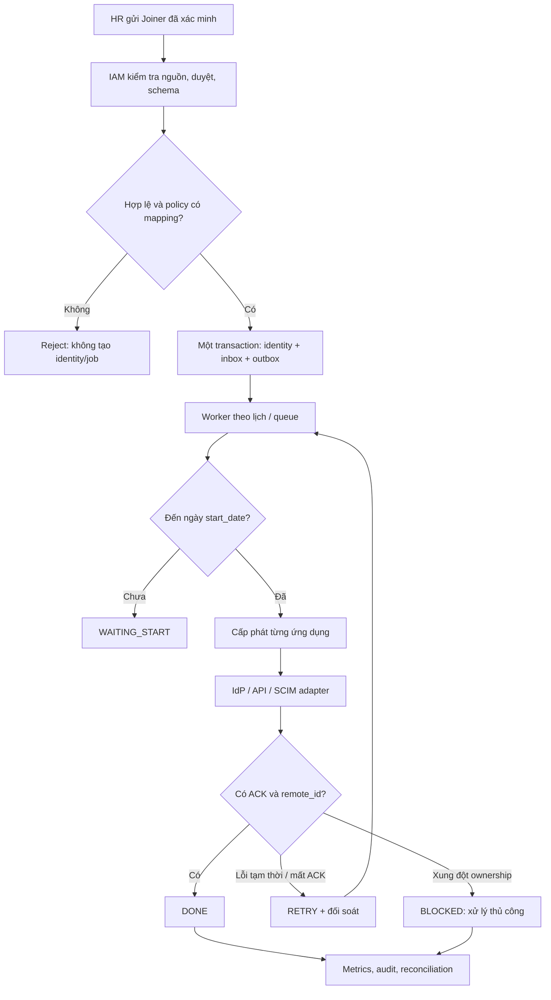
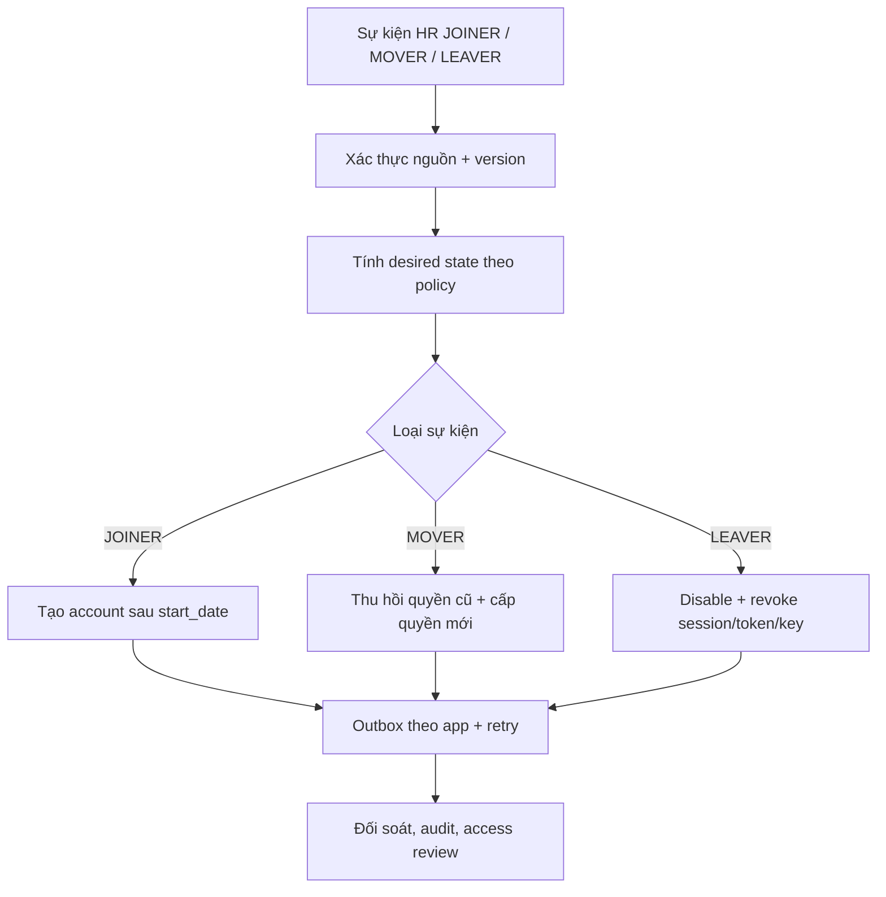

# Dự án thực hành: Tự động provision account theo sự kiện HR

> **Chương:** Dự án thực hành  
> **Chủ đề:** Tự động provision account  
> **Module:** `SECURITY_IDENTITY_ACCESS_MANAGEMENT_IDENTITY_LIFECYCLE` — quản lý vòng đời danh tính IAM theo Joiner–Mover–Leaver, từ xác minh, tạo tài khoản, cấp quyền tới rà soát, điều chỉnh và thu hồi khi thay đổi vai trò; liên kết IdP, SSO, SCIM, RBAC/ABAC, tài khoản dịch vụ và kiểm toán.  
> **Độ khó:** Trung cấp | **Thời lượng:** 120–180 phút | **Yêu cầu:** Python 3.10+, SQLite (thư viện chuẩn).

## 1. Bối cảnh và yêu cầu đầu ra

Công ty có hệ thống HR làm nguồn dữ liệu nhân sự, một dịch vụ IAM và nhiều ứng dụng nội bộ. Khi nhân viên mới gia nhập, tổ chức muốn **tự động tạo tài khoản ở đúng các ứng dụng, vào đúng ngày bắt đầu làm việc, với quyền tối thiểu đã được phê duyệt**. Nếu thao tác thủ công từng ứng dụng, quy trình dễ chậm, bỏ sót người, tạo trùng tài khoản hoặc cấp thừa quyền.

Dự án này xây một **pipeline provisioning theo sự kiện**: sự kiện Joiner đã xác minh từ HR được nhận vào IAM; IAM tạo identity ổn định và các job theo chính sách; worker tự xử lý từng ứng dụng, chịu lỗi độc lập, lưu ACK và đối soát kết quả. Các ca lỗi mạng, mất ACK, sự kiện gửi lặp và ngày bắt đầu trong tương lai phải được xử lý an toàn.

Bài tập tập trung vào **tự động hóa cấp phát account trên nhiều hệ thống**, là bước vận hành tiếp theo sau thiết kế identity và cấu hình provisioning. Không có kết nối IdP thật, HTTP thật, token thật hay tài khoản thật; toàn bộ provider và dữ liệu HR được giả lập trong một lab cục bộ.

Sau khi làm xong, bạn cần có khả năng:

1. Chuyển một Joiner đã được phê duyệt thành identity + nhiều job cấp phát trong một giao dịch.
2. Tính danh sách ứng dụng và quyền theo ma trận **RBAC**; dùng trạng thái hiệu lực và tenant như ràng buộc **ABAC**.
3. Giải thích luồng tự động `WAITING_START → QUEUED → DONE/RETRY/BLOCKED`, và ý nghĩa từng trạng thái.
4. Chứng minh retry sau lỗi 503 hoặc mất ACK **không tạo account trùng**.
5. Theo dõi account theo từng ứng dụng, so sánh dữ liệu mong muốn với kết quả thực tế, nhận diện quyền dư.
6. Nêu bước tích hợp SCIM, IdP/SSO và kế hoạch mở rộng Mover–Leaver, bao gồm tài khoản dịch vụ.

## 2. Thiết kế tự động hóa



Tạo account là một thao tác phân tán. Giao dịch lưu identity/outbox trên IAM **không thể bao trùm** commit ở IdP hoặc SaaS. Bởi vậy hệ thống dùng **transactional outbox**, retry có kiểm soát, khóa tương quan và reconciliation. Yêu cầu có thể được gửi ít nhất một lần nhưng phải giảm tối đa khả năng nhân đôi tác dụng cấp phát (*effectively-once provisioning*).

### 2.1. Ma trận ứng dụng và quyền

| Phòng ban | Chức danh | Ứng dụng và quyền |
|---|---|---|
| Engineering | Developer | `work-portal: portal:read`; `source-control: repo:read` |
| Support | Agent | `work-portal: portal:read`; `ticket-system: ticket:read` |
| Finance | Analyst | `work-portal: portal:read`; `finance-ledger: ledger:read` |

Các quyền chỉ để mô phỏng và đều ở mức đọc. Không nhận danh sách `requested_groups` hay `admin` từ sự kiện HR. Quyền nhạy cảm, đặc quyền và tài khoản dịch vụ cần workflow riêng có owner/phê duyệt.

### 2.2. Từ định danh đến account

| Khóa | Nguồn | Vai trò |
|---|---|---|
| `event_id` | HR/event bus | Chống lặp thông điệp; phát hiện cùng ID nhưng thay nội dung |
| `employee_id` | HR | Khóa nhân sự, làm `externalId` cho provider |
| `identity_id` | IAM | UUID nội bộ ổn định dù email, vai trò thay đổi |
| `work_email` | HR/IdP | Thuộc tính đăng nhập, có thể thay đổi; không làm khóa định danh bền vững |
| `remote_id` | Ứng dụng đích | ID account do mỗi provider cấp, cần giữ cùng `app_id` và `tenant_id` |
| `tenant_id` | Tổ chức | Ranh giới để không truy vấn và tạo nhầm account khác tenant |

Một người có một identity trong IAM nhưng có nhiều account đích. Một account đã tạo tại provider không có nghĩa IAM đã nhận ACK; một identity đã có không có nghĩa tài khoản đích đã tồn tại hoặc có thể đăng nhập SSO.

## 3. Chuẩn bị và sự kiện đầu vào

Tạo thư mục riêng cho lab:

```text
auto-account-provision/
├── auto_provision.py
├── joiner-3001.json
└── auto-provision.sqlite     # tự tạo khi chạy
```

Lưu file `joiner-3001.json`:

```json
{
  "event_id": "evt-300101",
  "event_type": "JOINER",
  "tenant_id": "tenant-a",
  "employee_id": "EMP-003001",
  "full_name": "Tran Minh Duc",
  "work_email": "duc.tran@example.test",
  "department": "Engineering",
  "job_title": "Developer",
  "start_date": "2020-01-01",
  "hr_verified": true,
  "manager_approved": true,
  "approval_ticket": "IAM-2026-3001"
}
```

Ngày trong quá khứ giúp chạy lab ở thời điểm nào cũng được. Miền `example.test` và mã nhân viên là dữ liệu giả. Các cờ xác minh/phê duyệt trong JSON **chỉ mang ý nghĩa mô phỏng**; production phải xác thực kênh HR, phê duyệt và quyền nguồn, không tin boolean từ client.

## 4. Mã nguồn pipeline provisioning

Tạo file `auto_provision.py` như dưới đây. Chương trình dùng SQLite để mô phỏng cùng lúc identity registry, outbox, audit và các ứng dụng đích. Mỗi job được xử lý độc lập và có trạng thái riêng, còn cặp giao dịch provider/ACK được tách ra để mô phỏng mất xác nhận.

```python
import argparse
import datetime as dt
import hashlib
import json
import re
import sqlite3
import sys
import uuid
from pathlib import Path

DB = Path("auto-provision.sqlite")
FIELDS = {
    "event_id", "event_type", "tenant_id", "employee_id",
    "full_name", "work_email", "department", "job_title",
    "start_date", "hr_verified", "manager_approved", "approval_ticket",
}
POLICY = {
    ("Engineering", "Developer"): {
        "work-portal": ["portal:read"],
        "source-control": ["repo:read"],
    },
    ("Support", "Agent"): {
        "work-portal": ["portal:read"],
        "ticket-system": ["ticket:read"],
    },
    ("Finance", "Analyst"): {
        "work-portal": ["portal:read"],
        "finance-ledger": ["ledger:read"],
    },
}
SCHEMA = """
CREATE TABLE IF NOT EXISTS inbox (
    event_id TEXT PRIMARY KEY,
    payload_sha256 TEXT NOT NULL
);
CREATE TABLE IF NOT EXISTS identities (
    tenant_id TEXT NOT NULL,
    employee_id TEXT NOT NULL,
    identity_id TEXT NOT NULL UNIQUE,
    full_name TEXT NOT NULL,
    work_email TEXT NOT NULL,
    department TEXT NOT NULL,
    job_title TEXT NOT NULL,
    start_date TEXT NOT NULL,
    state TEXT NOT NULL CHECK(state IN ('WAITING_START','ELIGIBLE')),
    approval_ticket TEXT NOT NULL,
    PRIMARY KEY (tenant_id, employee_id),
    UNIQUE (tenant_id, work_email)
);
CREATE TABLE IF NOT EXISTS jobs (
    id INTEGER PRIMARY KEY AUTOINCREMENT,
    event_id TEXT NOT NULL,
    tenant_id TEXT NOT NULL,
    employee_id TEXT NOT NULL,
    app_id TEXT NOT NULL,
    scopes_json TEXT NOT NULL,
    state TEXT NOT NULL
      CHECK(state IN ('WAITING_START','QUEUED','RETRY','DONE','BLOCKED')),
    attempts INTEGER NOT NULL DEFAULT 0,
    remote_id TEXT,
    last_error TEXT,
    UNIQUE (tenant_id, employee_id, app_id),
    FOREIGN KEY (tenant_id,employee_id)
      REFERENCES identities(tenant_id,employee_id)
);
CREATE TABLE IF NOT EXISTS remote_accounts (
    remote_id TEXT PRIMARY KEY,
    app_id TEXT NOT NULL,
    tenant_id TEXT NOT NULL,
    external_id TEXT NOT NULL,
    username TEXT NOT NULL,
    scopes_json TEXT NOT NULL,
    origin_event_id TEXT NOT NULL,
    UNIQUE (app_id,tenant_id,external_id),
    UNIQUE (app_id,tenant_id,username)
);
CREATE TABLE IF NOT EXISTS audit_log (
    id INTEGER PRIMARY KEY AUTOINCREMENT,
    at_utc TEXT NOT NULL,
    action TEXT NOT NULL,
    reference TEXT NOT NULL,
    detail TEXT NOT NULL
);
"""


def today_utc():
    return dt.datetime.now(dt.timezone.utc).date()


def audit(conn, action, reference, detail):
    conn.execute(
        "INSERT INTO audit_log(at_utc,action,reference,detail) VALUES (?,?,?,?)",
        (dt.datetime.now(dt.timezone.utc).isoformat(),
         action, reference, detail),
    )


def validate(raw):
    if not isinstance(raw, dict) or set(raw) != FIELDS:
        raise ValueError("INVALID_SCHEMA: thiếu hoặc thừa trường")
    e = raw.copy()
    for field in FIELDS - {"hr_verified", "manager_approved"}:
        if not isinstance(e[field], str) or not e[field].strip():
            raise ValueError(f"INVALID_FIELD: {field}")
        e[field] = e[field].strip()
    if e["event_type"] != "JOINER":
        raise ValueError("ONLY_JOINER_SUPPORTED")
    if not re.fullmatch(r"evt-[A-Za-z0-9-]{4,40}", e["event_id"]):
        raise ValueError("INVALID_EVENT_ID")
    if not re.fullmatch(r"EMP-[0-9]{6}", e["employee_id"]):
        raise ValueError("INVALID_EMPLOYEE_ID")
    if e["tenant_id"] not in {"tenant-a", "tenant-b"}:
        raise ValueError("INVALID_TENANT")
    if not re.fullmatch(r"IAM-[0-9]{4}-[0-9]{4,6}", e["approval_ticket"]):
        raise ValueError("INVALID_TICKET")
    if e["hr_verified"] is not True or e["manager_approved"] is not True:
        raise ValueError("NOT_VERIFIED_OR_APPROVED")
    e["work_email"] = e["work_email"].lower()
    if not re.fullmatch(r"[a-z0-9._%+-]+@example\.test", e["work_email"]):
        raise ValueError("INVALID_LAB_EMAIL")
    if len(e["full_name"]) > 120:
        raise ValueError("INVALID_FULL_NAME")
    if (e["department"], e["job_title"]) not in POLICY:
        raise ValueError("NO_APPROVED_ROLE_MAPPING")
    parsed = dt.date.fromisoformat(e["start_date"])
    if parsed.isoformat() != e["start_date"]:
        raise ValueError("INVALID_START_DATE")
    return e


def ingest(conn, path):
    e = validate(json.loads(Path(path).read_text(encoding="utf-8")))
    canonical = json.dumps(e, sort_keys=True, ensure_ascii=False,
                           separators=(",", ":"))
    digest = hashlib.sha256(canonical.encode("utf-8")).hexdigest()
    waiting = dt.date.fromisoformat(e["start_date"]) > today_utc()
    state = "WAITING_START" if waiting else "QUEUED"

    # Ingest một sự kiện và tạo toàn bộ job trong một transaction.
    with conn:
        old = conn.execute(
            "SELECT payload_sha256 FROM inbox WHERE event_id=?",
            (e["event_id"],),
        ).fetchone()
        if old:
            if old["payload_sha256"] != digest:
                raise ValueError("EVENT_CONFLICT")
            print("EVENT_REPLAY_IGNORED")
            return

        same_person = conn.execute(
            "SELECT 1 FROM identities WHERE tenant_id=? AND employee_id=?",
            (e["tenant_id"], e["employee_id"]),
        ).fetchone()
        if same_person:
            raise ValueError("IDENTITY_EXISTS: cần Mover/Leaver")

        identity_id = "sub-" + uuid.uuid4().hex
        conn.execute(
            """INSERT INTO identities(
               tenant_id,employee_id,identity_id,full_name,work_email,
               department,job_title,start_date,state,approval_ticket)
               VALUES (?,?,?,?,?,?,?,?,?,?)""",
            (e["tenant_id"], e["employee_id"], identity_id,
             e["full_name"], e["work_email"], e["department"],
             e["job_title"], e["start_date"],
             "WAITING_START" if waiting else "ELIGIBLE",
             e["approval_ticket"]),
        )
        apps = POLICY[(e["department"], e["job_title"])]
        for app_id in sorted(apps):
            scopes = json.dumps(sorted(apps[app_id]))
            conn.execute(
                """INSERT INTO jobs(
                   event_id,tenant_id,employee_id,app_id,scopes_json,state)
                   VALUES (?,?,?,?,?,?)""",
                (e["event_id"], e["tenant_id"], e["employee_id"],
                 app_id, scopes, state),
            )
        conn.execute(
            "INSERT INTO inbox VALUES (?,?)", (e["event_id"], digest),
        )
        audit(conn, "JOINER_ENQUEUED", e["event_id"],
              f"identity={identity_id};jobs={len(apps)}")
    print(f"INGESTED: {e['event_id']} jobs={len(apps)} state={state}")


def provider_upsert(conn, job):
    """Mock provider; origin_event_id là metadata riêng, không phải SCIM core."""
    existing = conn.execute(
        """SELECT * FROM remote_accounts
           WHERE app_id=? AND tenant_id=? AND external_id=?""",
        (job["app_id"], job["tenant_id"], job["employee_id"]),
    ).fetchone()
    if existing:
        matches = (
            existing["origin_event_id"] == job["event_id"]
            and existing["username"] == job["work_email"]
            and json.loads(existing["scopes_json"]) ==
                json.loads(job["scopes_json"])
        )
        if not matches:
            raise ValueError("REMOTE_CONFLICT: tài khoản khác ownership/policy")
        return existing["remote_id"], "REUSED"

    remote_id = "remote-" + uuid.uuid4().hex
    conn.execute(
        """INSERT INTO remote_accounts(
           remote_id,app_id,tenant_id,external_id,username,
           scopes_json,origin_event_id) VALUES (?,?,?,?,?,?,?)""",
        (remote_id, job["app_id"], job["tenant_id"], job["employee_id"],
         job["work_email"], job["scopes_json"], job["event_id"]),
    )
    return remote_id, "CREATED"


def run_worker(conn, as_of, fail_app, lose_ack_app):
    jobs = conn.execute(
        """SELECT j.*,i.work_email,i.start_date FROM jobs j
           JOIN identities i ON i.tenant_id=j.tenant_id
                            AND i.employee_id=j.employee_id
           WHERE j.state IN ('WAITING_START','QUEUED','RETRY')
           ORDER BY j.id"""
    ).fetchall()
    failed_once = False
    ack_lost_once = False
    for job in jobs:
        if dt.date.fromisoformat(job["start_date"]) > as_of:
            print(f"WAITING_START: job={job['id']} app={job['app_id']}")
            continue

        with conn:
            conn.execute(
                """UPDATE identities SET state='ELIGIBLE'
                   WHERE tenant_id=? AND employee_id=? AND state='WAITING_START'""",
                (job["tenant_id"], job["employee_id"]),
            )
            conn.execute(
                "UPDATE jobs SET state='QUEUED' WHERE id=? AND state='WAITING_START'",
                (job["id"],),
            )

        # Lỗi tạm thời: app chưa thực hiện yêu cầu.
        if fail_app == job["app_id"] and not failed_once:
            failed_once = True
            with conn:
                conn.execute(
                    """UPDATE jobs SET state='RETRY', attempts=attempts+1,
                       last_error='MOCK_HTTP_503' WHERE id=?""",
                    (job["id"],),
                )
                audit(conn, "RETRY", str(job["id"]), "MOCK_HTTP_503")
            print(f"RETRY_503: job={job['id']} app={job['app_id']}")
            continue

        # Commit ở provider (giả lập) độc lập với ACK của IAM.
        try:
            with conn:
                remote_id, mode = provider_upsert(conn, job)
                audit(conn, "REMOTE_" + mode, str(job["id"]), remote_id)
        except (ValueError, sqlite3.IntegrityError) as exc:
            with conn:
                conn.execute(
                    """UPDATE jobs SET state='BLOCKED', attempts=attempts+1,
                       last_error=? WHERE id=?""",
                    (str(exc), job["id"]),
                )
                audit(conn, "BLOCKED", str(job["id"]), type(exc).__name__)
            print(f"BLOCKED: job={job['id']} reason={exc}")
            continue

        if lose_ack_app == job["app_id"] and not ack_lost_once:
            ack_lost_once = True
            with conn:
                conn.execute(
                    """UPDATE jobs SET state='RETRY', attempts=attempts+1,
                       last_error='MOCK_ACK_LOST' WHERE id=?""",
                    (job["id"],),
                )
                audit(conn, "ACK_LOST", str(job["id"]), remote_id)
            print(f"ACK_LOST: job={job['id']} remote_id={remote_id}")
            continue

        # ACK được IAM ghi sau khi provider đã hoàn tất.
        with conn:
            conn.execute(
                """UPDATE jobs SET state='DONE', attempts=attempts+1,
                   remote_id=?, last_error=NULL WHERE id=?""",
                (remote_id, job["id"]),
            )
            audit(conn, "PROVISION_ACK", str(job["id"]), remote_id)
        print(f"PROVISIONED_{mode}: job={job['id']} app={job['app_id']}")


def status(conn, tenant, employee):
    person = conn.execute(
        """SELECT identity_id,tenant_id,employee_id,start_date,state
           FROM identities WHERE tenant_id=? AND employee_id=?""",
        (tenant, employee),
    ).fetchone()
    if not person:
        print("IDENTITY_NOT_FOUND")
        return
    jobs = conn.execute(
        """SELECT app_id,state,attempts,remote_id,last_error
           FROM jobs WHERE tenant_id=? AND employee_id=? ORDER BY app_id""",
        (tenant, employee),
    ).fetchall()
    print(json.dumps({
        "identity": dict(person),
        "jobs": [dict(job) for job in jobs]
    }, indent=2, ensure_ascii=False))


def remote(conn, app, tenant, employee):
    account = conn.execute(
        """SELECT remote_id,app_id,tenant_id,external_id,username,scopes_json
           FROM remote_accounts
           WHERE app_id=? AND tenant_id=? AND external_id=?""",
        (app, tenant, employee),
    ).fetchone()
    if not account:
        print("REMOTE_ACCOUNT_NOT_FOUND")
        return
    data = dict(account)
    data["scopes"] = json.loads(data.pop("scopes_json"))
    print(json.dumps(data, indent=2, ensure_ascii=False))


def reconcile(conn):
    jobs = conn.execute(
        "SELECT * FROM jobs WHERE state='DONE' ORDER BY id"
    ).fetchall()
    for job in jobs:
        person = conn.execute(
            """SELECT work_email FROM identities
               WHERE tenant_id=? AND employee_id=?""",
            (job["tenant_id"], job["employee_id"]),
        ).fetchone()
        account = conn.execute(
            """SELECT * FROM remote_accounts
               WHERE app_id=? AND tenant_id=? AND external_id=?""",
            (job["app_id"], job["tenant_id"], job["employee_id"]),
        ).fetchone()
        issues = []
        if not account:
            issues.append("MISSING_REMOTE_ACCOUNT")
        else:
            if account["remote_id"] != job["remote_id"]:
                issues.append("REMOTE_ID_DRIFT")
            if account["username"] != person["work_email"]:
                issues.append("USERNAME_DRIFT")
            if json.loads(account["scopes_json"]) != json.loads(job["scopes_json"]):
                issues.append("PERMISSION_DRIFT")
        print(f"JOB_{job['id']} {job['app_id']}: {','.join(issues) if issues else 'OK'}")
    if not jobs:
        print("NO_COMPLETED_JOBS")


def report(conn):
    rows = conn.execute(
        "SELECT state,COUNT(*) AS total FROM jobs GROUP BY state ORDER BY state"
    ).fetchall()
    total_accounts = conn.execute(
        "SELECT COUNT(*) FROM remote_accounts"
    ).fetchone()[0]
    print(json.dumps({
        "jobs_by_state": {r["state"]: r["total"] for r in rows},
        "remote_accounts": total_accounts,
    }, indent=2))


def main():
    parser = argparse.ArgumentParser(description="IAM auto provisioning lab")
    sub = parser.add_subparsers(dest="command", required=True)
    sub.add_parser("init")
    p = sub.add_parser("ingest")
    p.add_argument("file")
    p = sub.add_parser("run")
    p.add_argument("--as-of", help="YYYY-MM-DD; chỉ để test lab")
    p.add_argument("--fail-app", default="")
    p.add_argument("--lose-ack-app", default="")
    p = sub.add_parser("status")
    p.add_argument("employee_id")
    p.add_argument("--tenant", required=True)
    p = sub.add_parser("remote")
    p.add_argument("employee_id")
    p.add_argument("--tenant", required=True)
    p.add_argument("--app", required=True)
    sub.add_parser("reconcile")
    sub.add_parser("report")
    sub.add_parser("audit")
    args = parser.parse_args()

    conn = sqlite3.connect(DB)
    conn.row_factory = sqlite3.Row
    conn.execute("PRAGMA foreign_keys=ON")
    try:
        conn.executescript(SCHEMA)
        if args.command == "init":
            print("INITIALIZED: auto-provision.sqlite")
        elif args.command == "ingest":
            ingest(conn, args.file)
        elif args.command == "run":
            as_of = dt.date.fromisoformat(args.as_of) if args.as_of else today_utc()
            run_worker(conn, as_of, args.fail_app, args.lose_ack_app)
        elif args.command == "status":
            status(conn, args.tenant, args.employee_id)
        elif args.command == "remote":
            remote(conn, args.app, args.tenant, args.employee_id)
        elif args.command == "reconcile":
            reconcile(conn)
        elif args.command == "report":
            report(conn)
        elif args.command == "audit":
            for row in conn.execute(
                "SELECT at_utc,action,reference,detail FROM audit_log ORDER BY id"
            ):
                print(json.dumps(dict(row), ensure_ascii=False))
    finally:
        conn.close()


if __name__ == "__main__":
    try:
        main()
    except (ValueError, OSError, sqlite3.Error, json.JSONDecodeError) as exc:
        print(f"ERROR: {exc}", file=sys.stderr)
        sys.exit(2)
```


## 5. Thực hành luồng provisioning bình thường

Chạy từ thư mục lab nơi chứa các file vừa tạo:

```bash
python auto_provision.py init
python auto_provision.py ingest joiner-3001.json
python auto_provision.py status EMP-003001 --tenant tenant-a
python auto_provision.py report
```

**Kết quả mong đợi sau khi ingest:**

- Lệnh `ingest` báo `INGESTED: evt-300101 jobs=2 state=QUEUED`.
- Một `identity_id` duy nhất có dạng `sub-...`.
- Hai job ứng dụng ở trạng thái `QUEUED`: `source-control` và `work-portal`.
- Mỗi job có `attempts=0`, `remote_id=null`; chưa có account đích.

Chạy worker và kiểm tra kết quả:

```bash
python auto_provision.py run
python auto_provision.py status EMP-003001 --tenant tenant-a
python auto_provision.py remote EMP-003001 --tenant tenant-a --app work-portal
python auto_provision.py remote EMP-003001 --tenant tenant-a --app source-control
python auto_provision.py reconcile
python auto_provision.py report
```

| Quan sát | Kết quả đúng |
|---|---|
| Job `source-control` | `DONE`, `attempts=1`, có `remote_id` |
| Job `work-portal` | `DONE`, `attempts=1`, có `remote_id` khác |
| Account `source-control` | `external_id=EMP-003001`, `scopes=["repo:read"]` |
| Account `work-portal` | `external_id=EMP-003001`, `scopes=["portal:read"]` |
| Tổng remote account | **2** |
| Reconciliation | Cả hai job đều `OK` |

Chạy lại `python auto_provision.py run`: không có job chờ, không tạo thêm account. Gửi lại sự kiện:

```bash
python auto_provision.py ingest joiner-3001.json
```

Phải nhận `EVENT_REPLAY_IGNORED`. Nếu giữ `event_id` nhưng sửa `full_name`, chương trình báo `EVENT_CONFLICT` và không sửa identity hay account.

Trong lab, người học gọi `run` để quan sát. Production dùng scheduler, message consumer hoặc queue worker **tự xử lý** khi có job mới hay đến hạn retry.

## 6. Thử lỗi riêng từng ứng dụng và mất ACK

Để chạy thí nghiệm từ đầu, có thể tạo thư mục lab mới chứa hai file mã/JSON. Hoặc xóa duy nhất file `auto-provision.sqlite` trong thư mục lab cá nhân sau khi đã đóng chương trình, rồi chạy `init` và `ingest` lại. Không dùng thao tác xóa trên dữ liệu công ty.

### 6.1. Một provider báo lỗi tạm thời

Với database lab mới:

```bash
python auto_provision.py init
python auto_provision.py ingest joiner-3001.json
python auto_provision.py run --fail-app source-control
python auto_provision.py status EMP-003001 --tenant tenant-a
python auto_provision.py report
```

| Ứng dụng | Kết quả |
|---|---|
| `source-control` | `RETRY`, `last_error=MOCK_HTTP_503`, `attempts=1`, chưa có account |
| `work-portal` | `DONE`, `attempts=1`, account đã được tạo |

Ứng dụng thứ nhất lỗi không làm rollback công việc đã hoàn tất ở ứng dụng thứ hai. Production cần phân loại lỗi: `429` và `5xx` thường được retry theo backoff; schema sai, thiếu phê duyệt hoặc xung đột ownership phải chuyển điều tra.

### 6.2. Provider đã tạo account nhưng IAM mất phản hồi

Tiếp tục từ trạng thái mục 6.1:

```bash
python auto_provision.py run --lose-ack-app source-control
python auto_provision.py status EMP-003001 --tenant tenant-a
python auto_provision.py remote EMP-003001 --tenant tenant-a --app source-control
```

Kết quả cần quan sát:

- Job `source-control` còn `RETRY`, `attempts=2`, `last_error=MOCK_ACK_LOST`, trường `remote_id` **trên job** vẫn `null`.
- App đã có account `source-control` với một `remote_id` và scope `repo:read`.
- Job `work-portal` vẫn `DONE`, không bị chạy lại.

Ghi lại `remote_id` của account. Sau đó:

```bash
python auto_provision.py run
python auto_provision.py status EMP-003001 --tenant tenant-a
python auto_provision.py remote EMP-003001 --tenant tenant-a --app source-control
python auto_provision.py reconcile
python auto_provision.py report
python auto_provision.py audit
```

Worker phải in `PROVISIONED_REUSED` cho `source-control`. Job chuyển `DONE`, `attempts=3` và nhận **đúng remote_id đã có**. Tổng account vẫn bằng hai.

**Điểm thiết kế:** Sau timeout, client không biết provider đã commit hay chưa. Gọi lại tạo User vô điều kiện có thể gây duplicate. Worker phải tìm/tương quan account theo khóa nhân sự bền vững, tenant, ứng dụng và ownership trước khi tạo.

`origin_event_id` trong mock được dùng để chứng minh nguồn tạo; đó **không phải thuộc tính chuẩn** của SCIM User. Hệ thống thật cần bảng ánh xạ đáng tin cậy từ HR identity đến connector/tenant/remote ID.

## 7. Chờ đúng ngày bắt đầu

Tạo `joiner-future.json` bằng cách sao chép `joiner-3001.json`, rồi thay đồng thời:

```text
event_id        = evt-300102
employee_id     = EMP-003002
work_email      = future.person@example.test
approval_ticket = IAM-2026-3002
start_date      = 2035-01-01
```

Thực hiện:

```bash
python auto_provision.py ingest joiner-future.json
python auto_provision.py status EMP-003002 --tenant tenant-a
python auto_provision.py run
python auto_provision.py remote EMP-003002 --tenant tenant-a --app source-control
```

Khi ngày hiện tại chưa tới 01/01/2035, cả hai job ở `WAITING_START`, `attempts=0` và app trả `REMOTE_ACCOUNT_NOT_FOUND`. Đã được duyệt không có nghĩa được cấp phát sớm.

Có thể **giả lập ngày hiệu lực trong lab** mà không chỉnh đồng hồ hệ thống:

```bash
python auto_provision.py run --as-of 2035-01-01
python auto_provision.py status EMP-003002 --tenant tenant-a
python auto_provision.py remote EMP-003002 --tenant tenant-a --app source-control
```

Khi worker xử lý vào ngày giả lập, job hoàn tất. `--as-of` là cờ thử nghiệm, không được mở cho client không tin cậy trên production. Cần đồng hồ tin cậy, scheduler và chính sách múi giờ. Nếu HR đổi ngày hoặc thu hồi phê duyệt trước khi nhân viên vào làm, một luồng cập nhật có kiểm soát phải hủy/dời job chờ.


## 8. Đối soát giữa dữ liệu mong muốn và dữ liệu thực tế

Sau khi các job hoàn thành, dùng:

```bash
python auto_provision.py reconcile
python auto_provision.py report
python auto_provision.py audit
```

`reconcile` so sánh với mọi job `DONE`: account có còn tồn tại, `remote_id` có đúng, tên đăng nhập có khớp registry và quyền thực tế có bằng quyền đã duyệt.

| Dấu hiệu | Nguyên nhân có thể | Cách xử lý phù hợp |
|---|---|---|
| `MISSING_REMOTE_ACCOUNT` | Admin xóa account trong khi IAM vẫn ghi DONE | Xác định nguyên nhân, phê duyệt khôi phục nếu identity còn hợp lệ |
| `REMOTE_ID_DRIFT` | Account bị tái tạo hoặc mapping sai | Kiểm tra ownership và nguồn trước khi cập nhật mapping |
| `USERNAME_DRIFT` | Email đổi ngoài luồng Mover hoặc HR chưa đồng bộ | Đối chiếu bản HR mới nhất, không ghi lùi phiên bản |
| `PERMISSION_DRIFT` | App bị thêm quyền trực tiếp hoặc mất quyền | So sánh policy, xử lý quyền thừa/thiếu theo ownership |
| Account mồ côi | Có account ở app nhưng không có identity/job tương ứng | Xác minh chủ sở hữu và quy trình cô lập/thu hồi |

Lab hiện chỉ đối soát các job đã `DONE` và không tự sửa database đích. Một reconciler thực tế cần quét thêm account mồ côi, job `RETRY/BLOCKED` quá hạn, session còn hoạt động sau Leaver và trạng thái actual ở từng SaaS. Khi phát hiện drift, không được tự xóa mọi quyền lạ một cách mù quáng: có thể có nhóm được hệ thống khác quản lý hoặc quyền tạm thời đã phê duyệt. Cần chính sách ownership và audit.

### Chỉ số vận hành nên theo dõi

- Tổng job theo trạng thái: `QUEUED`, `WAITING_START`, `RETRY`, `BLOCKED`, `DONE`.
- Độ trễ từ thời điểm HR phê duyệt hoặc ngày hiệu lực tới khi từng ứng dụng nhận ACK.
- Số job thất bại/quá hạn, số lần retry, lỗi theo connector.
- Tỷ lệ provisioning thành công, số account lệch quyền, orphan account, account không có owner.
- Thời gian thu hồi quyền/phiên sau Mover–Leaver và tỷ lệ đối soát thành công.

Báo cáo nội bộ của lab chỉ đếm trạng thái; dashboard production cần có ngưỡng cảnh báo, đo theo tenant/app và lưu vết sự cố.

## 9. Chuyển adapter giả lập sang SCIM và IdP thật

### 9.1. Tạo User vào ứng dụng đích

Khi job đã đến hạn, connector SCIM 2.0 có thể gửi yêu cầu mẫu:

```http
POST /scim/v2/Users HTTP/1.1
Host: idp.example.test
Authorization: Bearer <access-token>
Content-Type: application/scim+json
Accept: application/scim+json

{
  "schemas": [
    "urn:ietf:params:scim:schemas:core:2.0:User"
  ],
  "externalId": "EMP-003001",
  "userName": "duc.tran@example.test",
  "displayName": "Tran Minh Duc",
  "active": true
}
```

`<access-token>` là placeholder. `externalId` do phía IAM cấp để tương quan với HR; `id` trong phản hồi do service provider cấp và phải lưu bền vững. Tenant được giới hạn bằng connector/endpoint và authorization context, không tự giả định `tenant_id` là trường core chuẩn của SCIM User. Mỗi ứng dụng có thể dùng API riêng nếu không hỗ trợ SCIM.

### 9.2. Tìm User đã có sau timeout hoặc ACK lost

```http
GET /scim/v2/Users?filter=externalId%20eq%20%22EMP-003001%22 HTTP/1.1
Host: idp.example.test
Authorization: Bearer <access-token>
Accept: application/scim+json
```

Với provider hỗ trợ filter, kiểm tra `ListResponse` gồm `Resources` và `totalResults`. Trước khi nhận một account đã có làm kết quả retry, phải đối chiếu tenant, account ownership, bản HR đã duyệt và remote ID đã lưu. Nếu không tìm thấy, mới cân nhắc POST. Nếu nhiều kết quả hoặc account không khớp, chặn và điều tra. Provider có thể có quy tắc filter và uniqueness khác nhau; phải kiểm tra tài liệu/khả năng tích hợp.

### 9.3. Gán quyền qua Group hoặc API chuyên biệt

Sau khi xác định `Group.id` và `User.id`, có thể dùng SCIM Group Patch:

```http
PATCH /scim/v2/Groups/<group-id> HTTP/1.1
Host: idp.example.test
Authorization: Bearer <access-token>
Content-Type: application/scim+json

{
  "schemas": [
    "urn:ietf:params:scim:api:messages:2.0:PatchOp"
  ],
  "Operations": [
    {
      "op": "add",
      "path": "members",
      "value": [{ "value": "<user-id>" }]
    }
  ]
}
```

Các giá trị trong dấu ngoặc nhọn góc là placeholder ID tài nguyên thực tế, không gửi nguyên văn. `repo:read` hay `portal:read` trong lab là **quyền mong muốn theo RBAC**; phải ánh xạ vào nhóm hoặc API phân quyền cụ thể. Không phải mọi provider hỗ trợ SCIM Groups, ETag, cùng filter hoặc cùng phương thức PATCH.

### 9.4. Ranh giới với SSO và ABAC

Provisioning/SCIM quản lý account và nhóm quyền. SSO dùng OIDC/SAML để xác thực và cấp phiên đăng nhập. **SCIM báo thành công không bảo đảm SSO đã an toàn hoặc ứng dụng đã áp dụng hết quyền.** API ứng dụng vẫn cần kiểm tra token/phiên hợp lệ, issuer, audience, chữ ký, hạn sử dụng, tenant, MFA và quyền được phép trên tài nguyên.

```text
ALLOW khi và chỉ khi:
  identity đang ở trạng thái cho phép và đã đến ngày hiệu lực
  AND session/token đã xác minh, còn hạn và thỏa điều kiện MFA
  AND tenant của phiên khớp tenant tài nguyên
  AND quyền RBAC/ABAC tại ứng dụng cho phép thao tác
  AND không vi phạm chính sách phân tách nhiệm vụ (SoD)
Ngược lại: DENY
```

Bên cạnh đó, `ELIGIBLE` trên IAM chỉ là trạng thái nhân sự đã đến ngày hiệu lực; trạng thái `DONE` của từng job chứng minh worker đã ghi ACK, nhưng chưa chắc mọi ứng dụng downstream đồng bộ ngay.

## 10. Mở rộng sang Mover, Leaver và tài khoản dịch vụ

Pipeline hiện chỉ nhận Joiner. Để vận hành toàn bộ vòng đời, cần xử lý sự kiện có version từ HR và ngăn sự kiện cũ ghi đè trạng thái mới:



| Luồng | Điều kiện bắt buộc |
|---|---|
| **Joiner** | HR đã xác minh, duyệt hợp lệ, cấp đúng ngày, quyền tối thiểu, tránh duplicate |
| **Mover** | Tính chênh lệch quyền cũ/mới, thu hồi role cũ trước hoặc đồng thời cấp role mới, giữ phiên bản HR |
| **Leaver** | Chặn SSO, revoke session/refresh token/key, disable account, gỡ nhóm ở mọi app và kiểm tra kết quả |
| **Service account** | Có owner, mục đích, scope và expiry riêng; luân phiên credential, không tạo qua Joiner nhân sự |
| **Access review** | Đối chiếu quyền thực tế với role, owner, thời hạn và phê duyệt, loại bỏ quyền tồn dư |

Một tình huống quan trọng: Leaver đến khi job Joiner còn `RETRY`. Worker bắt buộc kiểm tra trạng thái lifecycle **mới nhất** trước mỗi lần cấp phát; job cũ phải bị hủy hoặc đánh dấu superseded. Nếu không, nhân viên đã nghỉ có thể được kích hoạt lại tài khoản khi worker retry. Hệ thống nên ưu tiên deny tại điểm thực thi truy cập, đồng thời thu hồi downstream bất đồng bộ và đối soát sau đó.


## 11. Bộ kiểm thử âm và điều kiện biên

Tạo bản sao JSON mẫu cho từng tình huống. Khi muốn tạo một identity **mới**, đổi đồng thời `event_id`, `employee_id`, `work_email` và `approval_ticket`. Khi cố ý kiểm tra replay/xung đột, giữ ID sự kiện ban đầu.

| Ca kiểm thử | Thao tác | Kết quả bắt buộc |
|---|---|---|
| Joiner hợp lệ | `ingest` rồi `run` | Hai job DONE, hai account đúng scope |
| Replay nguyên vẹn | `ingest` lại JSON cũ | `EVENT_REPLAY_IGNORED`, không có job mới |
| Event ID xung đột | Giữ `event_id`, đổi `full_name` | `EVENT_CONFLICT` |
| HR chưa xác minh | `hr_verified=false`, ID mới | `NOT_VERIFIED_OR_APPROVED` |
| Quản lý chưa duyệt | `manager_approved=false`, ID mới | `NOT_VERIFIED_OR_APPROVED` |
| Tự xin quyền admin | Thêm `"requested_groups": ["admin"]` | `INVALID_SCHEMA`, không tạo account |
| Role ngoài chính sách | `job_title="Administrator"`, ID mới | `NO_APPROVED_ROLE_MAPPING` |
| Tenant không được hỗ trợ | `tenant_id="tenant-x"` | `INVALID_TENANT` |
| Cùng nhân sự, event mới | Đổi `event_id`, giữ `employee_id` cùng tenant | `IDENTITY_EXISTS` |
| Email trùng trong tenant | Employee mới, giữ email cũ | Unique constraint từ chối, giao dịch rollback |
| Ngày bắt đầu tương lai | `start_date="2035-01-01"`, ID mới | `WAITING_START`, chưa có remote account |
| Một app lỗi trước commit | `run --fail-app source-control` | Một job RETRY, job app khác DONE |
| ACK mất sau commit | `run --lose-ack-app source-control` | Account đích đã có, job RETRY |
| Retry mất ACK | `run` lần tiếp theo | `PROVISIONED_REUSED`, remote ID không đổi |
| Chạy lại sau DONE | `run` khi không có job chờ | Không tăng số account |
| Đối soát thường | `reconcile` sau DONE | Hai job OK |

Một test chỉ được chấm **PASS** nếu kết quả nghiệp vụ và tác dụng phụ đều đúng. Chẳng hạn, với payload xin admin, phải kiểm tra không xuất hiện account hoặc job mới; với timeout, cần đối chiếu `remote_id` trước và sau retry. Cần giữ lại output `audit` để chứng minh trình tự: nhận yêu cầu, lỗi, provider tạo/reuse, ACK.

### Những trường hợp cần thiết kế bổ sung

Mã lab triển khai một worker chạy tuần tự. Hệ thống thật còn phải kiểm thử hai worker cùng claim job, sự kiện Mover/Leaver đến sai thứ tự, IdP trả `409`, `412`, `429`, batch có 10.000 người, điều kiện retry đến hạn và account đã được tạo ngoài IAM. Những điều này đòi hỏi cơ chế đồng bộ, lịch chạy, phân quyền connector và xử lý xung đột rõ ràng; không suy ra rằng mock đã chứng minh đầy đủ tính an toàn production.

## 12. Chuyển từ bản lab sang hệ thống vận hành

| Vấn đề | Thiết kế cần bổ sung |
|---|---|
| **Nguồn HR** | Webhook/queue có chữ ký hoặc mTLS, kiểm tra nguồn, phê duyệt và replay ở tầng giao vận |
| **Thứ tự sự kiện** | Version/sequence HR; ngăn Joiner cũ tái kích hoạt sau Leaver hoặc ghi đè Mover |
| **Nhiều worker** | Claim job bằng lease/lock, timeout, concurrency limit, transaction và khóa duy nhất ở provider |
| **Retry** | Backoff tăng dần, jitter, giới hạn số lần, hàng đợi lỗi, tuân thủ `Retry-After` |
| **SCIM và API** | Kiểm tra `ServiceProviderConfig`, filter, pagination, ETag/`If-Match`, lỗi `409/412/429/5xx` |
| **Quyền truy cập** | Ma trận RBAC tối thiểu, ABAC theo trạng thái/tenant/MFA, SoD, phê duyệt quyền cao |
| **Secrets** | TLS, secret manager, scope token tối thiểu, credential rotation, không ghi secret vào log |
| **Metrics** | Tỷ lệ cấp phát thành công, tuổi job, số job RETRY/BLOCKED, độ trễ theo app và tenant |
| **Reconciliation** | So HR–IAM–IdP–SaaS, nhận diện account mồ côi và quyền tồn dư |
| **Thu hồi** | Disable user, revoke session/token/key, gỡ membership, xác nhận downstream đã áp dụng |
| **Kiểm toán và riêng tư** | Actor, nguồn, ticket, event ID, remote ID, thời điểm UTC; bảo vệ tính toàn vẹn và hạn chế lưu PII |

Không nên retry vô hạn lỗi vĩnh viễn. Một account đích có cùng email nhưng không cùng `externalId`, hoặc một role không có mapping được duyệt, phải được đưa sang trạng thái xử lý ngoại lệ. Tự động hóa có nghĩa là hệ thống **thi hành chính sách và phê duyệt đã xác thực** nhất quán, chứ không bỏ qua các bước kiểm soát.

## 13. Bài nộp và thang đánh giá

Nộp trong một thư mục lab hoặc báo cáo kỹ thuật:

1. File `auto_provision.py`, `joiner-3001.json` và các file JSON kiểm thử chỉ chứa dữ liệu giả.
2. Kết quả lệnh `ingest`, `run`, `status`, `remote`, `report`, `reconcile` và `audit` cho luồng hợp lệ.
3. Bảng kết quả mục 11 với **đầu vào, thao tác, kết quả thực tế, PASS/FAIL và lý do**.
4. Bằng chứng mất ACK: ghi lại remote ID trước và sau khi retry, chứng minh tổng account không đổi.
5. Một sơ đồ mô tả luồng HR → IAM/outbox → scheduler/worker → SCIM/API → IdP/app → access review.
6. Đoạn giải thích 200–300 từ: khi người dùng chuyển Finance sang Engineering, làm sao thu hồi `ledger:read` và cấp `repo:read` mà không để lại quyền truy cập tồn dư?

| Tiêu chí | Điểm |
|---|---:|
| Hợp đồng đầu vào, phê duyệt và identity duy nhất | 20 |
| Tạo identity + outbox trong một giao dịch; phân phối đa ứng dụng | 20 |
| Lịch bắt đầu, tenant và quyền tối thiểu | 15 |
| Retry độc lập, mất ACK, không tạo duplicate | 20 |
| Đối soát, audit, hiểu SCIM/SSO và Mover–Leaver | 20 |
| Minh chứng tái hiện được | 5 |
| **Tổng** | **100** |

**Điều kiện đạt:** Một Joiner hợp lệ tạo đúng một identity và đúng các account theo ma trận; nhân viên chưa đến ngày bắt đầu chưa có account; gửi lặp/retry không nhân đôi; sự cố một provider không ngăn provider khác; mọi công việc có trạng thái và dấu vết kiểm toán kiểm chứng được.

### Câu hỏi thảo luận mở rộng

1. Nếu worker dừng ngay sau khi provider commit nhưng trước khi ghi ACK, nên truy vấn những khóa nào để khôi phục an toàn?
2. Hai worker cùng xử lý một job: dùng lease, transaction và unique constraint thế nào để chống race condition?
3. Nếu `employee_id` của HR có thể tái sử dụng, bạn cần bổ sung loại ID bền vững nào?
4. Khi phê duyệt Joiner bị thu hồi trước ngày bắt đầu, hệ thống nào chịu trách nhiệm hủy job?
5. Nếu ứng dụng hỗ trợ SSO nhưng không hỗ trợ SCIM, làm sao tự động cấp phát/đối soát account?
6. Nếu Leaver đến trong lúc job Joiner đang RETRY, điều kiện nào ngăn worker cấp phát lại quyền đã thu hồi?

Bài thực hành hoàn thành khi pipeline thể hiện **cấp phát tự động đúng chính sách, đúng thời điểm, đúng ứng dụng** và người học chứng minh được **khôi phục sự cố, không nhân đôi account, theo dõi quyền dư**.
