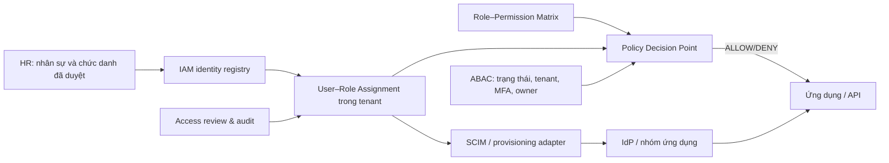
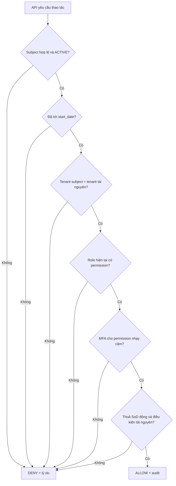
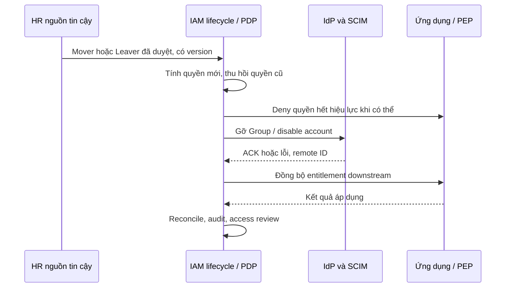

# Dự án thực hành: Thiết kế RBAC cho quản lý vòng đời danh tính IAM

> **Chương:** Dự án thực hành  
> **Chủ đề:** Thiết kế RBAC  
> **Module:** `SECURITY_IDENTITY_ACCESS_MANAGEMENT_IDENTITY_LIFECYCLE` — quản lý vòng đời danh tính theo **Joiner–Mover–Leaver**, từ xác minh, tạo tài khoản và cấp quyền tới rà soát, thu hồi khi thay đổi vai trò; liên kết IdP, SSO, SCIM, RBAC/ABAC, danh tính dịch vụ, kiểm toán và giảm quyền truy cập tồn dư.  
> **Độ khó:** Trung cấp | **Thời lượng gợi ý:** 120–180 phút | **Môi trường:** Python 3.10+ (chỉ dùng thư viện chuẩn).

## 1. Bài toán và mục tiêu

Một tổ chức dùng chung hệ thống IAM cho nhiều ứng dụng: cổng nhân viên, kho mã nguồn, hệ thống chăm sóc khách hàng, hóa đơn và công cụ quản trị danh tính. Khi nhân viên mới được duyệt, người quản trị thường gán nhóm theo kinh nghiệm. Sau vài lần chuyển bộ phận, cùng một người có thể giữ cả quyền Finance lẫn Engineering. Một số người được phép tạo và tự phê duyệt cùng hóa đơn; tài khoản đã rời công ty vẫn còn nhóm ứng dụng.

Bạn được giao **thiết kế chính sách Role-Based Access Control (RBAC)** để thay thế việc gán quyền trực tiếp cho từng người. Thiết kế cần trả lời năm câu hỏi:

1. Có những **tài nguyên và hành động** nào cần bảo vệ?
2. Vai trò nghiệp vụ nào được cấp chính xác những **permission tối thiểu** nào?
3. Ai được nhận vai trò nào, theo **nguồn HR đã xác thực** và trạng thái vòng đời nào?
4. Những tổ hợp vai trò hoặc thao tác nào phải bị từ chối bởi **Separation of Duties (SoD)**, tenant, MFA hoặc quan hệ sở hữu dữ liệu?
5. Khi **Mover/Leaver**, quyền nào phải bị gỡ, kiểm tra và ghi lại?

Bài này thiết kế và kiểm tra chính sách; việc gán group thực tế tới IdP/ứng dụng qua **SCIM** hoặc API là bước thực thi sau đó. RBAC cho biết *ai có loại quyền gì*; SSO/OIDC/SAML xác thực phiên; ABAC bổ sung điều kiện theo danh tính, tài nguyên và ngữ cảnh. Một identity có vai trò trong IAM không đồng nghĩa tài khoản downstream đã được cấp phát hay một phiên đăng nhập đã an toàn.

### Sản phẩm cần hoàn thành

- **Permission catalog** có tên, tài nguyên, hành động và rủi ro.
- **Role–permission matrix** hạn chế đặc quyền và có thể rà soát.
- **Quy tắc gán vai trò** theo phòng ban/chức danh, trạng thái vòng đời, tenant.
- **Ma trận SoD** ngăn các tổ hợp vai trò xung đột; điều kiện ABAC cho thao tác nhạy cảm.
- **Bộ kiểm tra policy** chạy cục bộ để quyết định ALLOW/DENY và phát hiện gán vai trò sai.
- **Kịch bản thay đổi vai trò và nghỉ việc**, bảng kiểm thử, nhật ký bằng chứng và đề xuất tích hợp production.

## 2. Xác định mô hình RBAC

Mô hình RBAC cơ bản gồm **User/Subject (U)**, **Role (R)**, **Permission (P)** và hai quan hệ:

- **User–Role Assignment (UA):** ai có vai trò nào, trong phạm vi tenant nào.
- **Permission–Role Assignment (PA):** một vai trò cho phép những hành động nào.

Khi có phiên đăng nhập, chỉ những vai trò được phép và đã kích hoạt mới được tính là quyền hiệu lực. Với dự án này, không cần role hierarchy phức tạp: mỗi vai trò có tập permission rõ ràng, người dùng có thể được gán nhiều vai trò không xung đột. Tránh tạo một “super-role” bao trùm vô tình kế thừa quá nhiều quyền.



### 2.1. Permission catalog

Permission đặt tên theo dạng `resource:action`, biểu diễn hành động ở API/backend; tên phải nhất quán, không dựa vào tên màn hình.

| Permission | Tài nguyên / thao tác | Rủi ro | Điều kiện bổ sung |
|---|---|---|---|
| `portal:view` | Xem cổng nhân viên | Thấp | Identity ACTIVE, đúng tenant |
| `repo:read` | Đọc kho mã của team được phép | Trung bình | Tenant và phạm vi repository được kiểm tra tại app |
| `ticket:read` | Xem ticket được phép | Trung bình | Phạm vi queue/khách hàng tại app |
| `ticket:reply` | Trả lời ticket | Trung bình | Kiểm tra quyền trên ticket cụ thể |
| `invoice:read` | Xem hóa đơn | Trung bình | Đúng tenant và phạm vi dữ liệu |
| `invoice:create` | Tạo yêu cầu/hóa đơn | Cao | Chính sách hạn mức và thuộc tính giao dịch tại app |
| `invoice:approve` | Phê duyệt hóa đơn | Cao | MFA, khác người tạo, đúng tenant và hạn mức |
| `identity:assign` | Cấp hoặc thu hồi role của người khác | Rất cao | MFA, không tự cấp quyền, workflow phê duyệt |
| `identity:review` | Đọc quyền hiệu lực để rà soát | Cao | MFA, giới hạn phạm vi và dữ liệu kiểm toán |

**Lưu ý về giới hạn lab:** Bộ kiểm tra dưới đây triển khai các điều kiện tenant, trạng thái, ngày hiệu lực, MFA, không phê duyệt giao dịch của chính mình và không tự gán role. Điều kiện phạm vi repo, queue, hóa đơn và hạn mức cần thêm ở policy decision point của ứng dụng production, vì lab không có dữ liệu tài nguyên chi tiết.

### 2.2. Ma trận Role–Permission

| Vai trò | Permission được gán | Ai thường có? |
|---|---|---|
| `employee` | `portal:view` | Nhân viên ACTIVE |
| `engineering_reader` | `repo:read` | Engineering / Developer |
| `support_agent` | `ticket:read`, `ticket:reply` | Support / Agent |
| `finance_requester` | `invoice:read`, `invoice:create` | Finance / Clerk |
| `finance_approver` | `invoice:read`, `invoice:approve` | Finance / Manager |
| `iam_operator` | `identity:assign` | Security / IAM Operator |
| `iam_reviewer` | `identity:review` | Security / IAM Reviewer |

Chức danh **không phải role**. Chức danh từ HR được ánh xạ qua *job-role mapping*, ví dụ `Engineering|Developer → employee + engineering_reader`. Không gán quyền trực tiếp bằng email, cũng không tin trường `requested_role` do client gửi.

### 2.3. Quy tắc gán vai trò theo HR

| Department | Job title | Roles theo chính sách |
|---|---|---|
| Engineering | Developer | `employee`, `engineering_reader` |
| Support | Agent | `employee`, `support_agent` |
| Finance | Clerk | `employee`, `finance_requester` |
| Finance | Manager | `employee`, `finance_approver` |
| Security | IAM Operator | `employee`, `iam_operator` |
| Security | IAM Reviewer | `employee`, `iam_reviewer` |

Chỉ gán role sau khi nguồn HR/approval được xác thực và đã tới thời điểm bắt đầu. Tài khoản `PENDING_START` hoặc `DISABLED` không có role hiệu lực. Mọi ngoại lệ (ví dụ được thêm quyền tạm thời) cần yêu cầu riêng có owner, phê duyệt, thời hạn và lịch thu hồi; bài lab chủ động **không** hỗ trợ ngoại lệ tự phát.

### 2.4. Separation of Duties (SoD)

| Cặp role xung đột | Vì sao cần chặn? |
|---|---|
| `finance_requester` + `finance_approver` | Một người không được vừa tạo vừa phê duyệt yêu cầu theo cùng mô hình nghiệp vụ |
| `iam_operator` + `iam_reviewer` | Người gán quyền không tự đóng vai kiểm soát/đánh giá độc lập |

Đây là **Static SoD (SSD)**: từ chối ngay khi cấu hình assignment chứa hai role xung đột. Ở mức thao tác còn có **Dynamic SoD (DSD)**: dù người dùng có role phê duyệt hợp lệ, vẫn không được phê duyệt **hóa đơn do chính mình tạo**. Tương tự, IAM operator không được tự gán role cho bản thân. Đây là điều kiện trên một hành động cụ thể, vượt ra ngoài ma trận RBAC thuần túy.

## 3. Kiến trúc và quy trình ra quyết định



**Deny by default:** bất kỳ subject, role, permission, tenant hoặc thuộc tính bắt buộc nào không xác định đều bị từ chối. Không suy rằng có role `employee` thì được truy cập mọi tài nguyên cùng tenant; ứng dụng còn phải kiểm tra phạm vi đối tượng (repository, queue, hóa đơn, mức tiền, v.v.).

### Ranh giới tin cậy

- **Nguồn của role assignment:** dữ liệu HR được xác thực, phê duyệt và quy tắc IAM; không lấy role từ request HTTP của người dùng.
- **Nguồn của tenant tài nguyên và owner:** tài nguyên đã truy vấn bởi backend tin cậy, không lấy chuỗi người gọi tự khai ở production.
- **Nguồn của MFA:** assertion/claims từ session hoặc IdP đã xác minh, không tin nút checkbox hay cờ do client truyền.
- **Nguồn của trạng thái:** identity registry cập nhật từ Joiner–Mover–Leaver, có kiểm soát version và kiểm toán.
- **Điểm thực thi:** ứng dụng/API (PEP) thực thi kết quả của PDP. Token/nhóm SSO có thể trễ khi role thay đổi; quyền nhạy cảm cần kiểm tra trạng thái hiện hành hoặc session có thời hạn phù hợp.

## 4. Tạo bộ dữ liệu chính sách

Bài này dùng một file JSON tự chứa, thay vì triển khai IdP thật. Tạo thư mục lab riêng:

```text
iam-rbac-lab/
├── rbac-policy.json
└── rbac_lab.py
```

Lưu nội dung sau vào `rbac-policy.json`. Tên, email và subject đều là **dữ liệu giả**; `example.test` không phải tên miền email sử dụng thật.

```json
{
  "version": "rbac-lab-v1",
  "permission_catalog": [
    "portal:view", "repo:read", "ticket:read", "ticket:reply",
    "invoice:read", "invoice:create", "invoice:approve",
    "identity:assign", "identity:review"
  ],
  "role_permissions": {
    "employee": ["portal:view"],
    "engineering_reader": ["repo:read"],
    "support_agent": ["ticket:read", "ticket:reply"],
    "finance_requester": ["invoice:read", "invoice:create"],
    "finance_approver": ["invoice:read", "invoice:approve"],
    "iam_operator": ["identity:assign"],
    "iam_reviewer": ["identity:review"]
  },
  "job_roles": {
    "Engineering|Developer": ["employee", "engineering_reader"],
    "Support|Agent": ["employee", "support_agent"],
    "Finance|Clerk": ["employee", "finance_requester"],
    "Finance|Manager": ["employee", "finance_approver"],
    "Security|IAM Operator": ["employee", "iam_operator"],
    "Security|IAM Reviewer": ["employee", "iam_reviewer"]
  },
  "sod": [
    ["finance_requester", "finance_approver"],
    ["iam_operator", "iam_reviewer"]
  ],
  "sensitive_permissions": [
    "invoice:approve", "identity:assign", "identity:review"
  ],
  "identities": [
    {
      "identity_id": "sub-100001",
      "employee_id": "EMP-100001",
      "tenant_id": "tenant-a",
      "work_email": "dev@example.test",
      "department": "Engineering",
      "job_title": "Developer",
      "start_date": "2020-01-01",
      "state": "ACTIVE",
      "roles": ["employee", "engineering_reader"]
    },
    {
      "identity_id": "sub-100002",
      "employee_id": "EMP-100002",
      "tenant_id": "tenant-a",
      "work_email": "support@example.test",
      "department": "Support",
      "job_title": "Agent",
      "start_date": "2020-01-01",
      "state": "ACTIVE",
      "roles": ["employee", "support_agent"]
    },
    {
      "identity_id": "sub-100003",
      "employee_id": "EMP-100003",
      "tenant_id": "tenant-a",
      "work_email": "clerk@example.test",
      "department": "Finance",
      "job_title": "Clerk",
      "start_date": "2020-01-01",
      "state": "ACTIVE",
      "roles": ["employee", "finance_requester"]
    },
    {
      "identity_id": "sub-100004",
      "employee_id": "EMP-100004",
      "tenant_id": "tenant-a",
      "work_email": "manager@example.test",
      "department": "Finance",
      "job_title": "Manager",
      "start_date": "2020-01-01",
      "state": "ACTIVE",
      "roles": ["employee", "finance_approver"]
    },
    {
      "identity_id": "sub-100005",
      "employee_id": "EMP-100005",
      "tenant_id": "tenant-a",
      "work_email": "operator@example.test",
      "department": "Security",
      "job_title": "IAM Operator",
      "start_date": "2020-01-01",
      "state": "ACTIVE",
      "roles": ["employee", "iam_operator"]
    },
    {
      "identity_id": "sub-100006",
      "employee_id": "EMP-100006",
      "tenant_id": "tenant-a",
      "work_email": "reviewer@example.test",
      "department": "Security",
      "job_title": "IAM Reviewer",
      "start_date": "2020-01-01",
      "state": "ACTIVE",
      "roles": ["employee", "iam_reviewer"]
    },
    {
      "identity_id": "sub-100007",
      "employee_id": "EMP-100007",
      "tenant_id": "tenant-a",
      "work_email": "future@example.test",
      "department": "Support",
      "job_title": "Agent",
      "start_date": "2099-01-01",
      "state": "PENDING_START",
      "roles": []
    },
    {
      "identity_id": "sub-100008",
      "employee_id": "EMP-100008",
      "tenant_id": "tenant-a",
      "work_email": "leaver@example.test",
      "department": "Finance",
      "job_title": "Clerk",
      "start_date": "2020-01-01",
      "state": "DISABLED",
      "roles": []
    },
    {
      "identity_id": "sub-200001",
      "employee_id": "EMP-200001",
      "tenant_id": "tenant-b",
      "work_email": "dev-other-tenant@example.test",
      "department": "Engineering",
      "job_title": "Developer",
      "start_date": "2020-01-01",
      "state": "ACTIVE",
      "roles": ["employee", "engineering_reader"]
    }
  ]
}
```

**Đọc dữ liệu trước khi code:** `sub-100001` là lập trình viên thuộc `tenant-a`, trong khi `sub-200001` có cùng job role nhưng thuộc `tenant-b`. Role giống nhau **không** cho phép truy cập chéo tenant. `sub-100007` chưa bắt đầu làm việc và `sub-100008` đã bị vô hiệu hóa nên không có role hiệu lực.

## 5. Viết công cụ kiểm tra RBAC/ABAC

Tạo file `rbac_lab.py`. Công cụ hỗ trợ ba thao tác:

- `validate`: kiểm tra cấu trúc policy, permission hợp lệ, assignment theo HR, uniqueness và Static SoD.
- `matrix`: in permission hiệu lực dự kiến của từng role (để review).
- `check`: quyết định ALLOW/DENY cho một subject, permission, tenant và điều kiện thao tác; in kèm lý do và timestamp UTC.
- `review`: in các assignment để chuẩn bị access certification.

```python
import argparse
import datetime as dt
import json
import re
import sys
from pathlib import Path

KEYS = {
    "version", "permission_catalog", "role_permissions",
    "job_roles", "sod", "sensitive_permissions", "identities",
}
IDENTITY_KEYS = {
    "identity_id", "employee_id", "tenant_id", "work_email",
    "department", "job_title", "start_date", "state", "roles",
}
STATES = {"ACTIVE", "PENDING_START", "DISABLED"}
TENANTS = {"tenant-a", "tenant-b"}


def fail(message):
    raise ValueError(message)


def require(condition, message):
    if not condition:
        fail(message)


def unique_object(pairs):
    """Từ chối key JSON trùng; không âm thầm lấy giá trị cuối."""
    result = {}
    for key, value in pairs:
        if key in result:
            fail(f"DUPLICATE_JSON_KEY: {key}")
        result[key] = value
    return result


def now_utc():
    return dt.datetime.now(dt.timezone.utc)


def ensure_list_of_str(value, label, nonempty=False):
    require(isinstance(value, list), f"{label}: NOT_LIST")
    require(not nonempty or bool(value), f"{label}: EMPTY")
    require(all(isinstance(x, str) and x for x in value),
            f"{label}: INVALID_ITEM")
    require(len(value) == len(set(value)), f"{label}: DUPLICATE_ITEM")


def validate_policy(policy):
    require(isinstance(policy, dict) and set(policy) == KEYS,
            "INVALID_TOP_LEVEL_SCHEMA")
    require(isinstance(policy["version"], str) and policy["version"],
            "INVALID_VERSION")

    permissions = policy["permission_catalog"]
    ensure_list_of_str(permissions, "permission_catalog", nonempty=True)
    require(all(re.fullmatch(r"[a-z][a-z0-9_-]*:[a-z][a-z0-9_-]*", p)
                for p in permissions), "INVALID_PERMISSION_NAME")
    catalog = set(permissions)

    role_permissions = policy["role_permissions"]
    require(isinstance(role_permissions, dict) and bool(role_permissions),
            "INVALID_ROLE_PERMISSIONS")
    roles = set(role_permissions)
    require(all(re.fullmatch(r"[a-z][a-z0-9_]*", r) for r in roles),
            "INVALID_ROLE_NAME")
    for role, assigned in role_permissions.items():
        ensure_list_of_str(assigned, f"role {role}", nonempty=True)
        require(set(assigned) <= catalog,
                f"UNKNOWN_PERMISSION_IN_ROLE: {role}")

    mappings = policy["job_roles"]
    require(isinstance(mappings, dict) and bool(mappings),
            "INVALID_JOB_ROLES")
    for job, job_role_list in mappings.items():
        require(isinstance(job, str) and len(job.split("|")) == 2,
                f"INVALID_JOB_MAPPING: {job}")
        ensure_list_of_str(job_role_list, f"job {job}", nonempty=True)
        require(set(job_role_list) <= roles,
                f"UNKNOWN_ROLE_IN_MAPPING: {job}")

    pairs = policy["sod"]
    require(isinstance(pairs, list), "INVALID_SOD_SCHEMA")
    seen_pairs = set()
    for pair in pairs:
        require(isinstance(pair, list) and len(pair) == 2,
                "INVALID_SOD_PAIR")
        ensure_list_of_str(pair, "sod_pair", nonempty=True)
        require(set(pair) <= roles, "UNKNOWN_ROLE_IN_SOD")
        normalized = tuple(sorted(pair))
        require(normalized not in seen_pairs, "DUPLICATE_SOD_PAIR")
        seen_pairs.add(normalized)

    sensitive = policy["sensitive_permissions"]
    ensure_list_of_str(sensitive, "sensitive_permissions")
    require(set(sensitive) <= catalog, "UNKNOWN_SENSITIVE_PERMISSION")

    identities = policy["identities"]
    require(isinstance(identities, list), "INVALID_IDENTITIES")
    seen_subjects, seen_employees, seen_emails = set(), set(), set()
    for item in identities:
        require(isinstance(item, dict) and set(item) == IDENTITY_KEYS,
                "INVALID_IDENTITY_SCHEMA")
        for field in IDENTITY_KEYS - {"roles"}:
            require(isinstance(item[field], str) and item[field],
                    f"INVALID_IDENTITY_FIELD: {field}")
        require(re.fullmatch(r"sub-[0-9]{6}", item["identity_id"]) is not None,
                "INVALID_SUBJECT_ID")
        require(re.fullmatch(r"EMP-[0-9]{6}", item["employee_id"]) is not None,
                "INVALID_EMPLOYEE_ID")
        require(item["tenant_id"] in TENANTS, "INVALID_TENANT")
        require(re.fullmatch(r"[a-z0-9._%+-]+@example\.test",
                             item["work_email"]) is not None,
                "INVALID_LAB_EMAIL")
        require(item["state"] in STATES, "INVALID_LIFECYCLE_STATE")
        start = dt.date.fromisoformat(item["start_date"])
        require(start.isoformat() == item["start_date"],
                "INVALID_START_DATE")

        ensure_list_of_str(item["roles"], "assigned_roles")
        assigned = set(item["roles"])
        require(assigned <= roles, "UNKNOWN_ASSIGNED_ROLE")
        for pair in pairs:
            require(not set(pair) <= assigned,
                    f"SOD_CONFLICT: {item['identity_id']} {pair}")

        subject = item["identity_id"]
        person_key = (item["tenant_id"], item["employee_id"])
        email_key = (item["tenant_id"], item["work_email"])
        require(subject not in seen_subjects, "DUPLICATE_SUBJECT")
        require(person_key not in seen_employees, "DUPLICATE_EMPLOYEE_IN_TENANT")
        require(email_key not in seen_emails, "DUPLICATE_EMAIL_IN_TENANT")
        seen_subjects.add(subject)
        seen_employees.add(person_key)
        seen_emails.add(email_key)

        job_key = item["department"] + "|" + item["job_title"]
        require(job_key in mappings, f"NO_JOB_MAPPING: {job_key}")
        if item["state"] == "ACTIVE":
            require(start <= now_utc().date(),
                    f"ACTIVE_BEFORE_START: {subject}")
            require(assigned == set(mappings[job_key]),
                    f"ROLE_DRIFT_FROM_HR: {subject}")
        else:
            require(not assigned, f"INACTIVE_WITH_ROLES: {subject}")

    return policy


def load(path):
    text = Path(path).read_text(encoding="utf-8")
    return validate_policy(json.loads(text, object_pairs_hook=unique_object))


def effective(policy, subject):
    answer = set()
    for role in subject["roles"]:
        answer.update(policy["role_permissions"][role])
    return sorted(answer)


def find_subject(policy, identity_id):
    return next((x for x in policy["identities"]
                 if x["identity_id"] == identity_id), None)


def decide(policy, args):
    subject = find_subject(policy, args.subject)
    if subject is None:
        return "DENY", "UNKNOWN_SUBJECT"
    if subject["state"] != "ACTIVE":
        return "DENY", "LIFECYCLE_NOT_ACTIVE"
    if dt.date.fromisoformat(subject["start_date"]) > now_utc().date():
        return "DENY", "BEFORE_START_DATE"
    if subject["tenant_id"] != args.resource_tenant:
        return "DENY", "TENANT_MISMATCH"
    if args.permission not in policy["permission_catalog"]:
        return "DENY", "UNKNOWN_PERMISSION"
    if args.permission not in effective(policy, subject):
        return "DENY", "ROLE_DOES_NOT_GRANT_PERMISSION"
    if args.permission in policy["sensitive_permissions"] and not args.mfa:
        return "DENY", "MFA_REQUIRED"

    # Dynamic SoD: thuộc tính resource cần đến từ backend tin cậy.
    if args.permission == "invoice:approve":
        if not args.owner:
            return "DENY", "MISSING_INVOICE_OWNER"
        if args.owner == subject["identity_id"]:
            return "DENY", "SELF_APPROVAL_FORBIDDEN"
        owner = find_subject(policy, args.owner)
        if owner is None or owner["tenant_id"] != subject["tenant_id"]:
            return "DENY", "UNKNOWN_OR_CROSS_TENANT_OWNER"
    if args.permission == "identity:assign":
        if not args.target:
            return "DENY", "MISSING_ASSIGNMENT_TARGET"
        if args.target == subject["identity_id"]:
            return "DENY", "SELF_ROLE_GRANT_FORBIDDEN"
        target = find_subject(policy, args.target)
        if target is None or target["tenant_id"] != subject["tenant_id"]:
            return "DENY", "UNKNOWN_OR_CROSS_TENANT_TARGET"
        if target["state"] != "ACTIVE":
            return "DENY", "TARGET_NOT_ACTIVE"

    return "ALLOW", "POLICY_SATISFIED"


def show_matrix(policy):
    for role, permissions in sorted(policy["role_permissions"].items()):
        print(f"{role}: {', '.join(sorted(permissions))}")


def show_review(policy):
    for subject in sorted(policy["identities"],
                          key=lambda x: x["identity_id"]):
        p = effective(policy, subject)
        if subject["state"] != "ACTIVE":
            p = []
        sensitive = sorted(set(p) & set(policy["sensitive_permissions"]))
        record = {
            "subject": subject["identity_id"],
            "tenant": subject["tenant_id"],
            "state": subject["state"],
            "roles": subject["roles"],
            "effective_permissions": p,
            "sensitive_permissions": sensitive,
        }
        print(json.dumps(record, ensure_ascii=False))


def main():
    parser = argparse.ArgumentParser(description="IAM RBAC design lab")
    parser.add_argument("--policy", default="rbac-policy.json")
    sub = parser.add_subparsers(dest="command", required=True)
    sub.add_parser("validate")
    sub.add_parser("matrix")
    sub.add_parser("review")
    check = sub.add_parser("check")
    check.add_argument("--subject", required=True)
    check.add_argument("--permission", required=True)
    check.add_argument("--resource-tenant", required=True)
    check.add_argument("--mfa", action="store_true")
    check.add_argument("--owner", help="Người tạo hóa đơn: identity_id")
    check.add_argument("--target", help="Đối tượng được gán role: identity_id")
    args = parser.parse_args()

    policy = load(args.policy)
    if args.command == "validate":
        print(f"POLICY_VALID: {policy['version']}; "
              f"identities={len(policy['identities'])}; "
              f"roles={len(policy['role_permissions'])}")
    elif args.command == "matrix":
        show_matrix(policy)
    elif args.command == "review":
        show_review(policy)
    else:
        result, reason = decide(policy, args)
        print(json.dumps({
            "at_utc": now_utc().isoformat(),
            "policy_version": policy["version"],
            "subject": args.subject,
            "permission": args.permission,
            "resource_tenant": args.resource_tenant,
            "decision": result,
            "reason": reason,
        }, ensure_ascii=False))


if __name__ == "__main__":
    try:
        main()
    except (ValueError, OSError, json.JSONDecodeError) as exc:
        print(f"POLICY_ERROR: {exc}", file=sys.stderr)
        sys.exit(2)
```

**Ranh giới triển khai:** Đây là bộ đánh giá chính sách phục vụ giáo dục, không phải authorization server production. Nó đọc file policy tin cậy trên đĩa, chưa xác minh token/claim, không cấp phát account SCIM, không giao tiếp IdP, không lưu audit bất biến và không truy vấn thuộc tính tài nguyên từ backend. Vì vậy các cờ `--mfa`, `--owner`, `--resource-tenant`, `--target` chỉ dành cho mô phỏng: trong ứng dụng thật, các thuộc tính đó phải được lấy từ dữ liệu đã kiểm chứng. Riêng `identity:assign` ở đây mới kiểm tra **quyền truy cập chức năng quản trị**; để thực sự gán một role còn phải xác minh role được phép gán, tình trạng phê duyệt, SoD của người nhận và ghi audit bằng quy trình quản trị riêng.


## 6. Chạy thử và giải thích quyết định

Chạy lệnh từ thư mục lab chứa `rbac-policy.json` và `rbac_lab.py`:

```bash
python rbac_lab.py validate
python rbac_lab.py matrix
python rbac_lab.py review
```

Kết quả `validate` với chính sách mẫu:

```text
POLICY_VALID: rbac-lab-v1; identities=9; roles=7
```

`matrix` phải liệt kê chính xác bảy role và các permission đã khai báo. `review` in chín bản ghi JSON: người ACTIVE có role/permission tương ứng; người `PENDING_START` hoặc `DISABLED` có danh sách permission hiệu lực rỗng. Các bản ghi thuộc tenant-a và tenant-b phải phân biệt.

### 6.1. Role phù hợp: cho phép

Lập trình viên đọc repository trong tenant của mình:

```bash
python rbac_lab.py check --subject sub-100001 --permission repo:read --resource-tenant tenant-a
```

Kiểm tra đầu ra JSON có `decision: "ALLOW"` và `reason: "POLICY_SATISFIED"`. Không cần MFA ở lệnh này vì `repo:read` không nằm trong `sensitive_permissions` của chính sách lab; ứng dụng thật vẫn phải kiểm tra phạm vi repository cụ thể và có thể áp dụng điều kiện cao hơn.

Nhân viên hỗ trợ trả lời ticket:

```bash
python rbac_lab.py check --subject sub-100002 --permission ticket:reply --resource-tenant tenant-a
```

Mong đợi `ALLOW`. Người lập trình viên thử quyền này sẽ bị từ chối:

```bash
python rbac_lab.py check --subject sub-100001 --permission ticket:reply --resource-tenant tenant-a
```

Mong đợi `DENY` với lý do `ROLE_DOES_NOT_GRANT_PERMISSION`.

### 6.2. Người có role không đồng nghĩa được truy cập mọi tenant

Cùng một role `engineering_reader` xuất hiện ở cả hai tenant. Hãy chạy:

```bash
python rbac_lab.py check --subject sub-100001 --permission repo:read --resource-tenant tenant-b
python rbac_lab.py check --subject sub-200001 --permission repo:read --resource-tenant tenant-b
```

Kết quả lần lượt là:

| Subject | Resource tenant | Quyết định |
|---|---|---|
| `sub-100001` (tenant-a) | `tenant-b` | `DENY: TENANT_MISMATCH` |
| `sub-200001` (tenant-b) | `tenant-b` | `ALLOW: POLICY_SATISFIED` |

**Điểm cần nhớ:** Role quyết định loại thao tác được phép. Tenant và quyền trên tài nguyên cụ thể vẫn phải được kiểm tra ở nơi thực thi.

### 6.3. Trạng thái Joiner và Leaver

```bash
python rbac_lab.py check --subject sub-100007 --permission ticket:read --resource-tenant tenant-a
python rbac_lab.py check --subject sub-100008 --permission invoice:create --resource-tenant tenant-a
```

Cả hai trả `DENY: LIFECYCLE_NOT_ACTIVE`. `sub-100007` chưa tới ngày bắt đầu, còn `sub-100008` đã bị disable. Việc xóa role hiệu lực ở policy chưa tự động thu hồi token hay quyền downstream; quy trình Leaver phải gửi yêu cầu thu hồi tới IdP và các ứng dụng, rồi đối soát.

### 6.4. MFA và Dynamic SoD khi phê duyệt hóa đơn

Người có role `finance_approver` là `sub-100004`. Giả sử hóa đơn do `sub-100003` tạo trong tenant-a:

```bash
# Thiếu MFA => DENY.
python rbac_lab.py check --subject sub-100004 --permission invoice:approve --resource-tenant tenant-a --owner sub-100003

# Có MFA, người tạo khác người duyệt => ALLOW.
python rbac_lab.py check --subject sub-100004 --permission invoice:approve --resource-tenant tenant-a --owner sub-100003 --mfa

# Có MFA nhưng người tạo cũng là người duyệt => DENY.
python rbac_lab.py check --subject sub-100004 --permission invoice:approve --resource-tenant tenant-a --owner sub-100004 --mfa
```

Thứ tự kết quả: `MFA_REQUIRED`, `POLICY_SATISFIED`, `SELF_APPROVAL_FORBIDDEN`. Trường `--owner` trong lab biểu diễn ID người tạo hóa đơn đã lấy từ dữ liệu tài nguyên tin cậy. Trong hệ thống thật, không cho người dùng tự khai một owner khác để vượt SoD.

Lưu ý: Lab mới kiểm tra *ai được phê duyệt về mặt quyền*. Backend vẫn phải xác minh trạng thái hóa đơn, hạn mức, phiên bản giao dịch, tình trạng phê duyệt trước đó và không cho replay gây phê duyệt trùng.

### 6.5. Quyền quản trị IAM và tự gán role

```bash
# Operator chưa chứng minh MFA => DENY.
python rbac_lab.py check --subject sub-100005 --permission identity:assign --resource-tenant tenant-a --target sub-100004

# Có MFA nhưng cố gán role cho chính mình => DENY.
python rbac_lab.py check --subject sub-100005 --permission identity:assign --resource-tenant tenant-a --target sub-100005 --mfa

# Có MFA, target thuộc tenant khác => DENY.
python rbac_lab.py check --subject sub-100005 --permission identity:assign --resource-tenant tenant-a --target sub-200001 --mfa

# Truy cập chức năng quản trị cho một target ACTIVE cùng tenant => ALLOW.
python rbac_lab.py check --subject sub-100005 --permission identity:assign --resource-tenant tenant-a --target sub-100004 --mfa
```

Các lý do theo thứ tự: `MFA_REQUIRED`, `SELF_ROLE_GRANT_FORBIDDEN`, `UNKNOWN_OR_CROSS_TENANT_TARGET`, `POLICY_SATISFIED`. Quyết định cuối cùng **chỉ cho phép đi vào workflow gán role**, chưa phải một lệnh gán role được thực thi. Service quản trị phải tiếp tục kiểm tra role muốn gán, tính phù hợp với job mapping, xung đột SoD, ticket phê duyệt và log trước khi thay đổi.

### 6.6. Đối chiếu expected và actual

| Ca | Quyết định đúng | Lý do |
|---|---|---|
| Developer đọc repository tenant của mình | ALLOW | Role engineering_reader có repo:read |
| Developer trả lời ticket | DENY | Không có ticket:reply |
| Developer tenant-a đọc tài nguyên tenant-b | DENY | TENANT_MISMATCH |
| Finance Manager duyệt hóa đơn, không MFA | DENY | MFA_REQUIRED |
| Finance Manager duyệt hóa đơn người khác, có MFA | ALLOW | Thỏa RBAC và điều kiện owner |
| Finance Manager duyệt hóa đơn của mình | DENY | SELF_APPROVAL_FORBIDDEN |
| IAM Operator tự gán quyền | DENY | SELF_ROLE_GRANT_FORBIDDEN |
| IAM Operator thao tác cho target ở tenant khác | DENY | UNKNOWN_OR_CROSS_TENANT_TARGET |
| Nhân viên chưa bắt đầu làm việc | DENY | LIFECYCLE_NOT_ACTIVE |
| Nhân viên đã nghỉ việc | DENY | LIFECYCLE_NOT_ACTIVE |

## 7. Bài tập Mover: đổi vai trò và thu hồi quyền cũ

Giả sử `sub-100001` chuyển từ **Engineering / Developer** sang **Support / Agent**. Kết quả phải được tính từ nguồn HR mới đã được phê duyệt:

| Trạng thái | Department / Job title | Role hiệu lực | Permission hiệu lực |
|---|---|---|---|
| Trước Mover | Engineering / Developer | `employee`, `engineering_reader` | `portal:view`, `repo:read` |
| Sau Mover | Support / Agent | `employee`, `support_agent` | `portal:view`, `ticket:read`, `ticket:reply` |
| Quyền phải thu hồi | — | `engineering_reader` | `repo:read` |

Sao chép `rbac-policy.json` sang `rbac-policy-mover.json` trong thư mục lab bằng trình soạn thảo hoặc chức năng sao chép tệp của hệ điều hành. Với **đúng bản ghi có `identity_id="sub-100001"`**, thay:

```json
{
  "department": "Support",
  "job_title": "Agent",
  "roles": ["employee", "support_agent"]
}
```

Đây là **các trường cần thay**, không phải toàn bộ object: giữ nguyên `identity_id`, `employee_id`, `tenant_id`, `work_email`, `start_date` và `state`. Cập nhật `version` của bản sao thành `rbac-lab-v2-mover`.

Sau đó chạy:

```bash
python rbac_lab.py --policy rbac-policy-mover.json validate
python rbac_lab.py --policy rbac-policy-mover.json check --subject sub-100001 --permission repo:read --resource-tenant tenant-a
python rbac_lab.py --policy rbac-policy-mover.json check --subject sub-100001 --permission ticket:reply --resource-tenant tenant-a
```

Mong đợi: policy hợp lệ; `repo:read` trả `DENY: ROLE_DOES_NOT_GRANT_PERMISSION`; `ticket:reply` trả `ALLOW`. Nếu chỉ thêm `support_agent` mà quên xóa `engineering_reader`, trình kiểm tra sẽ báo `ROLE_DRIFT_FROM_HR`. Đó là dấu hiệu **quyền tồn dư**.

Trong production, sau khi cập nhật desired-state:

1. Gỡ nhóm IdP/SCIM hoặc vai trò ứng dụng đại diện `engineering_reader`; chặn request không còn đủ quyền ngay ở điểm thực thi.
2. Cấp `support_agent` và chỉ những quyền mới đã được duyệt.
3. Đối soát thực tế ở repository, hệ thống ticket, SSO session và các quyền cấp trực tiếp.
4. Ghi bằng chứng actor, phiếu HR, quyền cũ/mới, thời điểm và ACK từ từng ứng dụng.

Nếu ứng dụng cho phép cập nhật membership qua SCIM Group, việc thu hồi có thể là PATCH với `op: remove` cho thành viên chính xác. Phải dùng **ID Group và User thật** của provider; đừng suy từ tên nhóm hoặc email. Việc gỡ nhóm IdP có thể chưa chấm dứt mọi phiên đang hoạt động nên vẫn cần chính sách re-evaluation/revocation.

## 8. Bài tập Leaver và Joiner

### 8.1. Leaver: deny và thu hồi

Tạo bản sao `rbac-policy-leaver.json` từ policy ban đầu, đặt `sub-100003` (Finance Clerk) thành:

```json
{
  "state": "DISABLED",
  "roles": []
}
```

Giữ nguyên các trường khác, đổi `version` để ghi dấu policy revision. Sau đó:

```bash
python rbac_lab.py --policy rbac-policy-leaver.json validate
python rbac_lab.py --policy rbac-policy-leaver.json check --subject sub-100003 --permission invoice:create --resource-tenant tenant-a
```

Bộ kiểm tra phải báo policy hợp lệ rồi trả `DENY: LIFECYCLE_NOT_ACTIVE`. Trong doanh nghiệp, **Leaver chưa hoàn tất chỉ nhờ sửa tệp policy**. Cần disable tài khoản tại IdP, chặn SSO, thu hồi refresh/access token và phiên khi có thể, gỡ group/entitlement tại ứng dụng, hủy key/credential, kiểm tra account dịch vụ có liên quan và đối soát sau thu hồi.

### 8.2. Joiner: quyền có điều kiện theo ngày bắt đầu

`sub-100007` đang `PENDING_START` với ngày `2099-01-01`, role rỗng. Đây là trạng thái đúng cho Joiner đã duyệt nhưng chưa tới ngày hiệu lực. Khi thời điểm đến và HR vẫn xác nhận hợp lệ, quy trình mới chuyển sang:

```json
{
  "state": "ACTIVE",
  "roles": ["employee", "support_agent"]
}
```

Bộ kiểm tra không có cờ giả lập đồng hồ; nó dùng ngày UTC thật, nên **không đổi trạng thái của subject tương lai trong file chính sách để ép test PASS**. Để kiểm tra tình huống Joiner đã đến hạn, tạo thêm subject mới có `start_date` trong quá khứ, `state=ACTIVE` và role đúng mapping, rồi chạy `validate`/`check`. Việc kích hoạt phải đến từ nguồn HR và scheduler đáng tin cậy ở production.

## 9. Kiểm tra SoD và sai lệch chính sách

Tạo bản sao file chính sách cho từng kiểm thử. Chỉ sửa bản sao, chạy lệnh `validate`, ghi kết quả, sau đó phục hồi bản sao hoặc tạo bản mới cho ca tiếp theo.

| Thử nghiệm | Cách sửa / yêu cầu | Kết quả mong đợi |
|---|---|---|
| Gán role xung đột | Thêm `finance_approver` vào role của `sub-100003` đang có `finance_requester` | `SOD_CONFLICT` |
| Vừa gán role vừa review | Thêm `iam_reviewer` vào `sub-100005` đang là `iam_operator` | `SOD_CONFLICT` |
| Role sai chức danh HR | Đổi role của Developer thành `support_agent` và giữ Department/Job title | `ROLE_DRIFT_FROM_HR` |
| Người DISABLED vẫn có role | Thêm `finance_requester` cho `sub-100008` | `INACTIVE_WITH_ROLES` |
| Job role trỏ role không tồn tại | Trong `job_roles` thêm `fake_admin` | `UNKNOWN_ROLE_IN_MAPPING` |
| Role chứa permission không trong catalog | Trong `engineering_reader` thêm `system:root` | `UNKNOWN_PERMISSION_IN_ROLE` |
| Permission gán trùng trong một role | Lặp lại `repo:read` trong mảng của `engineering_reader` | `DUPLICATE_ITEM` |
| Tenant ngoài phạm vi lab | Đổi `tenant_id` thành `tenant-x` | `INVALID_TENANT` |
| ID nhân sự trùng trong tenant | Nhân bản `employee_id` của người khác cùng tenant, giữ subject khác | `DUPLICATE_EMPLOYEE_IN_TENANT` |
| Key JSON trùng | Đặt hai key `"state"` trong cùng object | `DUPLICATE_JSON_KEY` |
| Subject không tồn tại | Dùng `--subject sub-999999` | `DENY: UNKNOWN_SUBJECT` |
| Permission không được khai báo | Dùng `--permission database:drop` | `DENY: UNKNOWN_PERMISSION` |
| Thiếu owner khi duyệt | Finance Manager có MFA nhưng thiếu `--owner` | `DENY: MISSING_INVOICE_OWNER` |
| Owner thuộc tenant khác | Finance Manager tenant-a duyệt hóa đơn có owner `sub-200001` | `DENY: UNKNOWN_OR_CROSS_TENANT_OWNER` |

**Giải thích lỗi:** Công cụ tải và kiểm tra *toàn bộ policy* trước khi trả quyết định. Nếu file chứa assignment sai hoặc SoD xung đột, công cụ kết thúc với `POLICY_ERROR` và mã thoát 2, thay vì cho phép một phần chính sách không hợp lệ. Khi dữ liệu hợp lệ nhưng yêu cầu không đủ điều kiện, nó in `DENY`. Phân biệt hai trường hợp khi ghi báo cáo.

### Điểm yếu cố ý để thảo luận

Có thể sửa cả `permission_catalog` và `role_permissions` để thêm quyền mới, khiến `validate` vẫn PASS nếu cấu trúc nhất quán. Điều đó **không chứng minh** quyền mới được doanh nghiệp phê duyệt. Production cần source-of-truth được kiểm soát, change approval, code review cho policy-as-code, signed/versioned policy, quyền ghi hạn chế và nhật ký thay đổi. Bộ kiểm tra schema chỉ phát hiện cấu hình sai về mặt máy móc, không thể thay thế phê duyệt nghiệp vụ.

## 10. Access review và bằng chứng kiểm toán

Chạy:

```bash
python rbac_lab.py review
```

Mỗi bản ghi chứa subject, tenant, trạng thái, role hiệu lực, permission và danh sách permission nhạy cảm. Người thực hiện rà soát cần so sánh với HR và quyền **thực tế** đã cấp tại IdP/ứng dụng. Với các bản ghi không còn hợp lệ, phải có hành động thu hồi và xác nhận đã hoàn tất.

Mẫu biểu rà soát:

| Trường | Ví dụ / ý nghĩa |
|---|---|
| `review_cycle` | Kỳ rà soát theo chính sách, ví dụ theo quý |
| `subject_id` / `tenant_id` | Identity được rà soát, tránh khóa theo email |
| `hr_role` | Department và Job title từ HR đã xác thực |
| `assigned_roles` | Role hiện tại tại IAM |
| `effective_permissions` | Quyền tính từ role tại thời điểm rà soát |
| `actual_entitlements` | Quyền/nhóm trong IdP và từng SaaS |
| `approval_reference` | Ticket, người phê duyệt, thời hạn nếu có |
| `review_decision` | Giữ lại / thu hồi / điều tra và lý do |
| `evidence` | Thời điểm, actor, ACK, kết quả đối soát |

Không đưa mật khẩu, token hay dữ liệu cá nhân không cần thiết vào log. Output JSON của `check` có thời gian UTC và lý do để người học lưu bằng chứng, nhưng **không phải audit log bất biến**. Production nên gửi audit tới hệ thống quản lý log tập trung có giới hạn sửa/xóa, quyền truy cập theo vai trò và chính sách lưu giữ.

### Checklist xem xét role

- Vai trò có **owner nghiệp vụ** và mô tả mục đích rõ ràng?
- Mỗi permission có đúng với chức năng công việc và theo nguyên tắc **least privilege**?
- Có role nào chứa cả quyền tạo và phê duyệt cùng một giao dịch?
- Role có scope tenant, ứng dụng và tài nguyên? Có quyền quản trị toàn cục không được phê duyệt?
- Có quyền tạm thời hoặc ngoại lệ đã hết hạn? Có chứng cứ thu hồi?
- Mover có giữ role cũ? Leaver có còn group, API key hay session?
- Danh sách tại IAM có khớp thực tế trong IdP/SaaS? Có tài khoản mồ côi?
- Tài khoản dịch vụ có owner, scope, expiry và lịch rotation riêng?

## 11. Tích hợp với IAM, IdP, SCIM, SSO và ABAC

### 11.1. Role–Group mapping

Khi triển khai, role nội bộ được ánh xạ theo connector:

| IAM role | Ví dụ nhóm tại IdP/ứng dụng | Yêu cầu triển khai |
|---|---|---|
| `employee` | `iam-employee` | Tài khoản ACTIVE mới được nhận nhóm |
| `engineering_reader` | `source-repo-readers` | Thu hồi khi chuyển khỏi Engineering |
| `support_agent` | `support-ticket-agents` | Kiểm soát phạm vi queue tại app |
| `finance_requester` | `finance-submitters` | Không đi kèm role phê duyệt |
| `finance_approver` | `finance-approvers` | MFA và chống tự phê duyệt tại API |
| `iam_operator` | `iam-operators` | Quyền quản trị giới hạn + workflow duyệt |
| `iam_reviewer` | `iam-access-reviewers` | Chỉ xem dữ liệu kiểm toán cần thiết |

**Group displayName không phải Group ID.** Adapter phải tìm đúng nhóm của tenant/connector, lưu ID tài nguyên do provider cấp và thay đổi membership idempotent. Trong SCIM 2.0, User, Group và việc đăng nhập SSO là những lớp khác nhau; `SCIM PATCH /Groups` chỉ điều chỉnh membership, không tự đảm bảo ứng dụng đã cập nhật mọi quyền hoặc phiên cũ hết hiệu lực.

### 11.2. Thứ tự thực thi quyền khi Mover và Leaver



Các thay đổi qua nhiều hệ thống có thể hoàn thành không đồng thời. Cần cơ chế **fail closed** cho quyền nhạy cảm, retry có khóa tương quan, hàng đợi lỗi và đối soát đến khi trạng thái thực tế khớp chính sách. Không cho một sự kiện Joiner cũ đến sau Leaver mở lại account: phải kiểm tra version của trạng thái HR và thứ tự sự kiện.

### 11.3. Tài khoản dịch vụ là đối tượng khác nhân viên

Service account cần vai trò/hạn quyền riêng theo ứng dụng, không xuất phát từ job title của HR. Ví dụ một worker chỉ có `invoice:read` cho một tenant và một API; owner là team hoặc người chịu trách nhiệm, có hạn hết hiệu lực, cơ chế luân phiên secret và thu hồi khi hệ thống ngừng hoạt động. Không cấp vai trò `iam_operator` cho service account chỉ vì cần gọi một API đọc thông tin IAM; hãy thiết kế permission hẹp riêng.

## 12. Bài nộp và tiêu chí nghiệm thu

Bộ bài nộp gồm:

1. **Tài liệu thiết kế:** permission catalog, role–permission matrix, job-role mapping, ma trận SoD, quy tắc tenant/MFA/ownership, chủ sở hữu từng role.
2. **File lab:** `rbac-policy.json`, `rbac_lab.py` và các bản sao policy cho thử nghiệm Mover/Leaver/SoD (dùng dữ liệu giả).
3. **Bằng chứng chạy lệnh:** `validate`, `matrix`, `check` và `review`; lưu quyết định ALLOW/DENY cùng lý do.
4. **Bảng kết quả mục 9:** ghi dữ liệu sửa, lệnh, kết quả dự kiến, thực tế và PASS/FAIL; giải thích ít nhất hai lỗi do cấu hình và hai lần DENY đúng chính sách.
5. **Một sơ đồ tích hợp:** HR → IAM role assignment → SCIM/IdP → ứng dụng/PEP → access review; trình bày nơi thực thi SoD và ABAC.
6. **Đoạn phân tích 200–300 từ:** vì sao role mapping cần thu hồi quyền cũ khi Mover và vì sao disable một tài khoản Leaver chưa đủ để bảo đảm không còn quyền truy cập tồn dư.

| Tiêu chí | Điểm |
|---|---:|
| Permission catalog rõ tài nguyên, hành động, rủi ro | 15 |
| Ma trận RBAC tối thiểu, ánh xạ HR, tenant đúng | 20 |
| Static/Dynamic SoD và điều kiện MFA/owner | 20 |
| Mover/Leaver không còn role cũ, quyền hiệu lực đúng | 20 |
| Kiểm thử âm, fail closed, audit và access review | 15 |
| Tài liệu tích hợp IdP/SSO/SCIM và trình bày | 10 |
| **Tổng** | **100** |

**Điều kiện đạt:** Chính sách gốc có thể validate; người ACTIVE chỉ được quyền nằm trong role của HR; không có cross-tenant access; role xung đột bị từ chối; duyệt hóa đơn của chính mình bị chặn; người `PENDING_START` và `DISABLED` không có quyền hiệu lực; khi Mover, quyền cũ biến mất và có kế hoạch thu hồi tương ứng tại IdP/SaaS.

### Câu hỏi thảo luận nâng cao

1. Trong một doanh nghiệp có 50 phòng ban và hàng nghìn permission, làm sao tránh **role explosion**? Khi nào nên kết hợp role thô với ABAC thay vì tạo role cho mọi tổ hợp?
2. Một nhân viên có hai nhiệm vụ hợp lệ cần vai trò `finance_requester` và `finance_approver` ở các đơn vị khác nhau. Bạn thiết kế SoD theo **scope** và phiên thế nào để vẫn ngăn tự phê duyệt?
3. Nếu role trong token SSO còn hạn nhưng HR vừa chuyển người dùng khỏi nhóm đặc quyền, API nên xử lý ra sao để không đợi token hết hạn?
4. Nếu một app hỗ trợ SSO nhưng không hỗ trợ SCIM Group, làm sao bảo đảm role–permission matrix được áp dụng và có thể đối soát?
5. Khi role `iam_operator` được phép mở workflow gán quyền, ai phê duyệt việc gán role nhạy cảm và làm thế nào chặn việc tự mở rộng đặc quyền?
6. Tài khoản dịch vụ không có job title thì owner, hạn sử dụng, phạm vi permission và access review của nó được xác lập như thế nào?

Dự án hoàn thành khi bạn chứng minh được rằng thiết kế RBAC **cấp quyền vừa đủ cho công việc**, **chặn xung đột và truy cập sai ngữ cảnh**, và **cho phép thu hồi quyền có kiểm chứng** trong các giai đoạn Joiner–Mover–Leaver.
