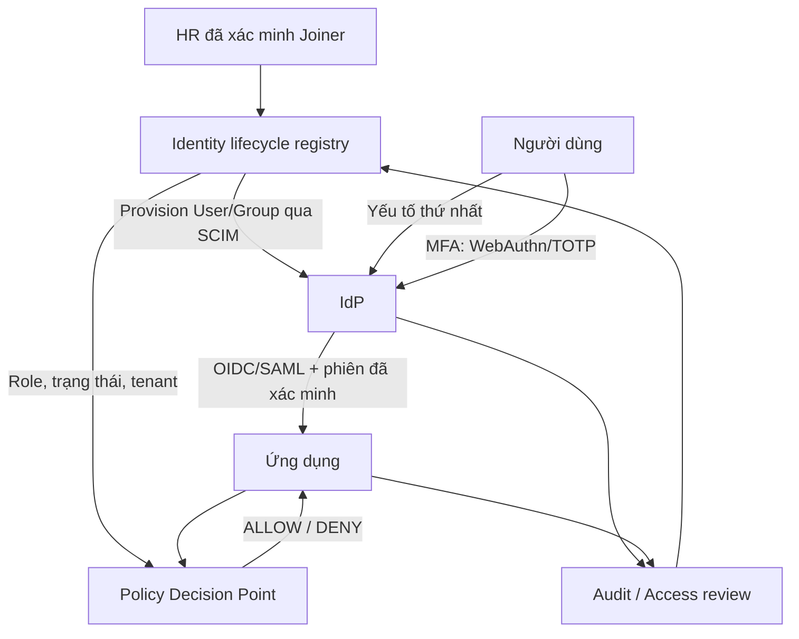
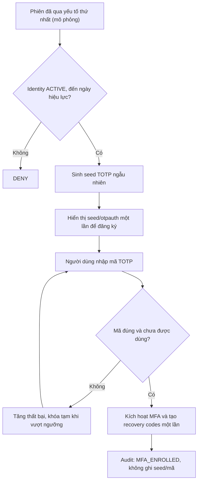
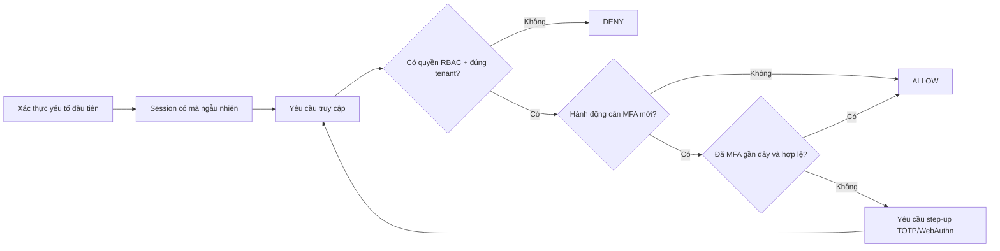
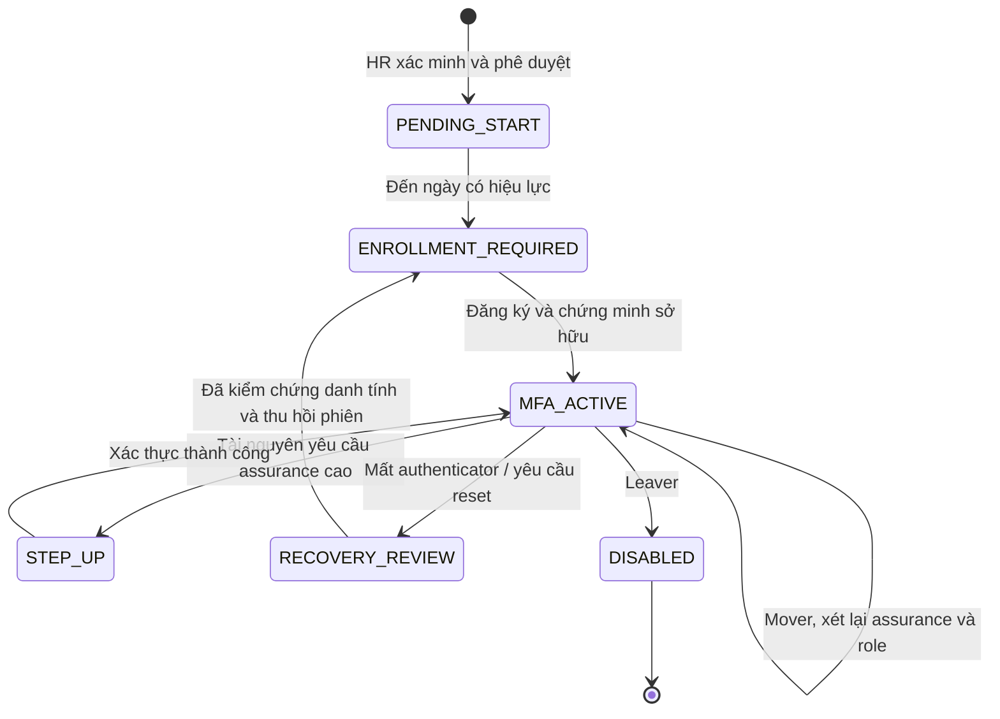

# Dự án thực hành: Thêm MFA vào vòng đời danh tính IAM

> **Chương:** Dự án thực hành  
> **Đề bài:** Thêm MFA (Multi-Factor Authentication)  
> **Module:** `SECURITY_IDENTITY_ACCESS_MANAGEMENT_IDENTITY_LIFECYCLE`  
> **Bối cảnh:** Quản lý vòng đời danh tính theo Joiner–Mover–Leaver, từ xác minh nhân sự, tạo tài khoản và cấp quyền đến rà soát, thay đổi vai trò và thu hồi truy cập; tích hợp IdP, SSO, SCIM, RBAC/ABAC, tài khoản dịch vụ và kiểm toán để giảm quyền truy cập tồn dư.  
> **Hình thức:** Lab cục bộ với Python 3.10+ và SQLite; không cần hệ thống IdP thật.  
> **Thời lượng gợi ý:** 120–180 phút.

## 1. Bài toán và mục tiêu

Một công ty đã có Identity Provider (IdP) cho đăng nhập Single Sign-On (SSO), đồng bộ danh tính qua SCIM và phân quyền dựa trên vai trò (RBAC). Nhưng người dùng quản trị IAM và người phê duyệt hóa đơn vẫn chỉ dựa vào một yếu tố đăng nhập. Nếu mật khẩu bị lộ, một kẻ xấu có thể cố gắng sử dụng tài khoản có quyền nhạy cảm.

Nhiệm vụ của bạn là thiết kế và thực hành **bổ sung MFA** vào luồng xác thực và ủy quyền, gắn với trạng thái vòng đời Joiner–Mover–Leaver. Không chỉ yêu cầu nhập một mã OTP: hệ thống còn phải quản lý quá trình đăng ký yếu tố thứ hai (*enrollment*), xác minh quyền sở hữu, thời hạn xác thực, chống phát lại mã, giới hạn thử sai, xử lý khôi phục và chấm dứt phiên khi quyền hoặc trạng thái danh tính thay đổi.

Trong bài này, một dịch vụ xác thực **giả lập** sử dụng mã TOTP sáu chữ số. Người học chạy chương trình cục bộ để quan sát chính sách. Điều kiện xác thực yếu tố thứ nhất được giả lập bằng cờ `--primary-ok` do người học điều khiển; **không có mật khẩu thật, IdP thật hay mức bảo đảm MFA thật**. Tùy chọn xuất mã TOTP từ chính cơ sở dữ liệu cũng chỉ phục vụ minh họa và phải loại bỏ hoàn toàn khi triển khai thực tế.

### Kết quả cần đạt

Sau dự án, bạn có thể:

1. Phân biệt **xác thực** (authentication), **ủy quyền** (authorization), **cấp phát account** (SCIM provisioning), **SSO** và trạng thái lifecycle của identity.
2. Giải thích tại sao MFA là **nhiều yếu tố độc lập** (ví dụ mật khẩu + khóa bảo mật) và tại sao hai mật khẩu hoặc mật khẩu + câu hỏi bí mật thường không đáp ứng ý nghĩa hai yếu tố mạnh.
3. Triển khai mô phỏng **đăng ký và xác minh TOTP**; hiểu `otpauth` URI, bí mật dùng chung, bước 30 giây và sai lệch thời gian.
4. Chặn **replay TOTP**, giới hạn lần thử, khóa tạm thời và không cho tái sử dụng mã khôi phục.
5. Áp dụng **step-up MFA** cho các quyền RBAC nhạy cảm kết hợp điều kiện ABAC (tenant, trạng thái identity, thời điểm hiệu lực và người sở hữu tài nguyên).
6. Mô tả cách đặt chính sách trong IdP/SSO thật, ưu tiên **WebAuthn/FIDO2 hoặc passkey chống phishing** cho quản trị viên và thao tác rủi ro cao.
7. Xử lý việc đăng ký, khôi phục, thay đổi yếu tố và vô hiệu hóa phiên khi Mover/Leaver, đồng thời duy trì audit và access review.

## 2. Mô hình đe dọa và lựa chọn yếu tố

MFA làm giảm nguy cơ khi một yếu tố bị lộ, nhưng mức bảo vệ phụ thuộc vào loại yếu tố, cách phục hồi và nơi xác minh.

| Phương thức | Loại yếu tố | Ưu điểm | Rủi ro / hạn chế |
|---|---|---|---|
| Mật khẩu | Điều biết (*knowledge*) | Phổ biến | Dễ bị phishing, reuse, credential stuffing |
| TOTP trong ứng dụng xác thực | Thiết bị/bí mật sở hữu (*possession*) | Chạy ngoại tuyến, tích hợp đơn giản | Có thể bị phishing hoặc mã bị chuyển tiếp, lộ seed, sai lệch đồng hồ |
| WebAuthn/FIDO2 / passkey | Khóa mật mã, kiểm chứng tên miền (*possession*, có thể có user verification) | Chống phishing tốt hơn, không chia sẻ seed TOTP | Cần hỗ trợ của IdP, ứng dụng và quy trình đăng ký/khôi phục |
| SMS OTP | Quyền kiểm soát số điện thoại | Dễ triển khai với một số đối tượng | SIM swap, số bị chiếm, chuyển tiếp, phụ thuộc nhà mạng |
| Recovery code | Mã dự phòng một lần | Giúp khôi phục khi mất authenticator | Mã bị lộ có thể tạo đường vòng yếu hơn MFA thông thường |

**Lựa chọn cho dự án:** TOTP giúp học rõ nguyên lý tạo/xác minh mã và các kiểm soát vận hành. Với ứng dụng production, đặc biệt là quyền admin, nên đánh giá dùng **MFA chống phishing (WebAuthn/FIDO2)** và thiết lập chính sách không hạ mức bảo đảm bằng phương án khôi phục dễ bị tấn công.

### Phân tách MFA với các thành phần IAM



- **SCIM** đồng bộ tài khoản và nhóm; không tự xác minh người dùng đang cầm thiết bị MFA.
- **SSO** giúp tái sử dụng kết quả đăng nhập đã được IdP xác thực; ứng dụng phải kiểm tra token/assertion đúng issuer, audience, chữ ký, hạn sử dụng và mức xác thực.
- **RBAC** quyết định vai trò có loại quyền nào; **ABAC** áp thêm trạng thái identity, tenant, mức bảo đảm đăng nhập, tuổi MFA và thuộc tính tài nguyên.
- **Joiner** phải đăng ký MFA qua bootstrap an toàn; **Mover** có thể cần step-up khi nhận quyền mới; **Leaver** phải khóa đăng nhập, phiên và yếu tố xác thực thích hợp.
- **Tài khoản dịch vụ** không dùng TOTP của nhân viên để xác thực tự động; dùng workload identity, khóa/credential có owner, scope, hạn sử dụng và rotation.

## 3. Luồng nghiệp vụ cần thực hiện

### 3.1. Đăng ký và kích hoạt MFA



Không nên coi “đã sinh seed” là “đã đăng ký MFA thành công”. Chỉ kích hoạt sau khi người dùng chứng minh đang kiểm soát authenticator bằng một mã hợp lệ. Trong production, đăng ký và thay thế yếu tố phải đi qua một phiên đáng tin cậy, bước xác thực mạnh phù hợp và thông báo bảo mật.

### 3.2. Step-up MFA khi thao tác nhạy cảm



Ví dụ: xem cổng nhân viên cần phiên đã đăng nhập, nhưng thực hiện `iam:grant` hoặc `invoice:approve` phải có dấu thời gian MFA còn trong cửa sổ 5 phút. Một cờ `mfa=true` do frontend tự gửi không đủ. Trong production, ứng dụng phải dựa vào phiên server-side hoặc claim `amr`/`acr` và `auth_time` đã kiểm tra từ IdP, đồng thời ràng buộc các claim với session và chính sách hiện hành.

### 3.3. Các quy tắc bảo mật cho lab

| Hạng mục | Chính sách trong bài |
|---|---|
| Kết quả yếu tố thứ nhất | Giả lập bằng `--primary-ok`, chỉ dùng cục bộ |
| TOTP | 6 chữ số, chu kỳ 30 giây, HMAC-SHA1 theo cơ chế RFC 6238 |
| Sai lệch thời gian | Chấp nhận bước hiện tại và ±1 bước, có kiểm soát |
| Chống dùng lại | Lưu `last_step`, từ chối mọi mã ở bước đã dùng hoặc cũ hơn |
| Thử sai | Tối đa 5 lần liên tiếp; khóa tạm thời 5 phút |
| Phiên | Token ngẫu nhiên, lưu hash; hiệu lực tối đa 30 phút |
| Step-up | MFA được xác minh trong 5 phút gần nhất |
| Recovery | Mã dự phòng ngẫu nhiên 128 bit, lưu hash, dùng một lần |
| Quyền | `employee` xem portal; `iam_operator` được yêu cầu cấp role; `finance_approver` được yêu cầu phê duyệt hóa đơn |
| Tenant / lifecycle | Chỉ ACTIVE, đã đến ngày bắt đầu, đúng tenant |
| Leaver/Mover | Thu hồi phiên và tăng version xác thực khi trạng thái/quyền thay đổi |

**Giới hạn quan trọng:** TOTP HMAC-SHA1 vẫn được dùng trong nhiều triển khai tương thích với chuẩn TOTP; không nên hiểu điều đó là TOTP chống phishing. Lab lưu seed ở SQLite dạng rõ để dễ quan sát; production phải bảo vệ seed bằng mã hóa/quản lý khóa và giới hạn truy cập, không xuất seed cho máy khách sau đăng ký. Lệnh `demo-code` là lối tắt dành riêng cho giáo dục, không có trong hệ thống xác thực thật.

## 4. Chuẩn bị

Cài Python 3.10 hoặc mới hơn. Dự án dùng duy nhất thư viện chuẩn, không gửi HTTP, email hoặc SMS. Tạo thư mục làm việc:

```text
iam-mfa-lab/
├── mfa_lab.py
└── mfa-lab.sqlite        # tự tạo sau lệnh init
```

Hồ sơ mẫu do lệnh `init` tạo ra:

| Subject | Tenant | Role | Trạng thái | Trường hợp |
|---|---|---|---|---|
| `sub-000101` | tenant-a | employee | ACTIVE | Xem cổng nhân viên |
| `sub-000102` | tenant-a | iam_operator | ACTIVE | Cấp quyền IAM, cần MFA |
| `sub-000103` | tenant-b | finance_approver | ACTIVE | Phê duyệt hóa đơn, cần MFA |
| `sub-000104` | tenant-a | employee | PENDING_START | Nhân sự chưa đến ngày làm việc |
| `sub-000105` | tenant-a | employee | DISABLED | Nhân sự Leaver |
| `sub-000106` | tenant-b | employee | ACTIVE | Người tạo hóa đơn trong tenant-b |

## 5. Cài đặt hệ thống MFA mô phỏng

Tạo file `mfa_lab.py` với mã bên dưới. Các chức năng `lab-move`, `lab-disable`, `demo-code` chỉ dùng để thao tác môi trường mô phỏng, không phải endpoint production.

```python
import argparse
import base64
import datetime as dt
import hashlib
import hmac
import json
import re
import secrets
import sqlite3
import struct
import sys
import time
from pathlib import Path
from urllib.parse import urlencode, quote

DB = Path("mfa-lab.sqlite")
TOTP_STEP = 30
TOTP_DIGITS = 6
MAX_FAILURES = 5
LOCK_SECONDS = 300
SESSION_SECONDS = 1800
STEPUP_SECONDS = 300
BACKUP_COUNT = 5

PERMISSIONS = {
    "employee": {"portal:view"},
    "iam_operator": {"portal:view", "iam:grant"},
    "finance_approver": {"portal:view", "invoice:approve"},
}
SENSITIVE = {"iam:grant", "invoice:approve"}
SEED_USERS = [
    ("sub-000101", "tenant-a", "employee", "ACTIVE", "2020-01-01"),
    ("sub-000102", "tenant-a", "iam_operator", "ACTIVE", "2020-01-01"),
    ("sub-000103", "tenant-b", "finance_approver", "ACTIVE", "2020-01-01"),
    ("sub-000104", "tenant-a", "employee", "PENDING_START", "2099-01-01"),
    ("sub-000105", "tenant-a", "employee", "DISABLED", "2020-01-01"),
    ("sub-000106", "tenant-b", "employee", "ACTIVE", "2020-01-01"),
]

SCHEMA = """
CREATE TABLE IF NOT EXISTS users (
    subject TEXT PRIMARY KEY,
    tenant_id TEXT NOT NULL,
    role TEXT NOT NULL,
    state TEXT NOT NULL CHECK (state IN ('ACTIVE','PENDING_START','DISABLED')),
    start_date TEXT NOT NULL,
    mfa_secret TEXT,
    mfa_enabled INTEGER NOT NULL DEFAULT 0,
    last_step INTEGER NOT NULL DEFAULT -1,
    failures INTEGER NOT NULL DEFAULT 0,
    lock_until INTEGER NOT NULL DEFAULT 0,
    auth_version INTEGER NOT NULL DEFAULT 0
);
CREATE TABLE IF NOT EXISTS sessions (
    token_hash TEXT PRIMARY KEY,
    subject TEXT NOT NULL REFERENCES users(subject),
    created_at INTEGER NOT NULL,
    expires_at INTEGER NOT NULL,
    mfa_at INTEGER,
    auth_version INTEGER NOT NULL
);
CREATE TABLE IF NOT EXISTS recovery_codes (
    subject TEXT NOT NULL REFERENCES users(subject),
    code_digest TEXT NOT NULL,
    PRIMARY KEY (subject, code_digest)
);
CREATE TABLE IF NOT EXISTS audit (
    id INTEGER PRIMARY KEY AUTOINCREMENT,
    at_utc TEXT NOT NULL,
    action TEXT NOT NULL,
    subject TEXT NOT NULL,
    detail TEXT NOT NULL
);
"""


def clock():
    return int(time.time())


def audit(conn, action, subject, detail):
    when = dt.datetime.now(dt.timezone.utc).isoformat()
    conn.execute(
        "INSERT INTO audit(at_utc,action,subject,detail) VALUES (?,?,?,?)",
        (when, action, subject, detail),
    )


def user_by_id(conn, subject):
    row = conn.execute(
        "SELECT * FROM users WHERE subject=?", (subject,)
    ).fetchone()
    if not row:
        raise ValueError("UNKNOWN_SUBJECT")
    return row


def is_active(user, now):
    today = dt.datetime.fromtimestamp(
        now, tz=dt.timezone.utc
    ).date()
    return (user["state"] == "ACTIVE"
            and dt.date.fromisoformat(user["start_date"]) <= today)


def token_digest(token):
    return hashlib.sha256(token.encode("utf-8")).hexdigest()


def recovery_digest(subject, code):
    # 128-bit code có entropy cao; digest không chứa plaintext.
    raw = (subject + ":" + code.strip().lower()).encode("utf-8")
    return hashlib.sha256(raw).hexdigest()


def live_session(conn, token, now):
    row = conn.execute(
        "SELECT * FROM sessions WHERE token_hash=?",
        (token_digest(token),),
    ).fetchone()
    if not row:
        raise ValueError("INVALID_SESSION")
    person = user_by_id(conn, row["subject"])
    if (now >= row["expires_at"]
            or row["auth_version"] != person["auth_version"]
            or not is_active(person, now)):
        raise ValueError("SESSION_EXPIRED_OR_REVOKED")
    return row, person


def generate_secret():
    return base64.b32encode(secrets.token_bytes(20)).decode("ascii").rstrip("=")


def totp_for_step(secret_b32, step):
    padded = secret_b32 + "=" * ((-len(secret_b32)) % 8)
    key = base64.b32decode(padded, casefold=True)
    digest = hmac.new(
        key, struct.pack(">Q", step), hashlib.sha1
    ).digest()
    offset = digest[-1] & 0x0F
    code = int.from_bytes(digest[offset:offset + 4], "big") & 0x7FFFFFFF
    return f"{code % (10 ** TOTP_DIGITS):0{TOTP_DIGITS}d}"


def register_failure(conn, user, now):
    # Sau khi thời hạn khóa đã qua, bắt đầu lại bộ đếm.
    previous = 0 if now >= user["lock_until"] and user["lock_until"] else user["failures"]
    failures = previous + 1
    lock_until = now + LOCK_SECONDS if failures >= MAX_FAILURES else 0
    conn.execute(
        "UPDATE users SET failures=?, lock_until=? WHERE subject=?",
        (failures, lock_until, user["subject"]),
    )
    return "TEMPORARILY_LOCKED" if lock_until else "INVALID_FACTOR"


def verify_totp(conn, user, code, now):
    """Trả (bool, reason). Lưu chống replay và rate limit trong DB."""
    if now < user["lock_until"]:
        return False, "TEMPORARILY_LOCKED"
    if not user["mfa_secret"] or not re.fullmatch(r"[0-9]{6}", code):
        return False, register_failure(conn, user, now)

    current = now // TOTP_STEP
    for step in (current, current - 1, current + 1):
        if step < 0:
            continue
        if hmac.compare_digest(totp_for_step(user["mfa_secret"], step), code):
            if step <= user["last_step"]:
                reason = register_failure(conn, user, now)
                return False, "OTP_REPLAY" if reason != "TEMPORARILY_LOCKED" else reason
            conn.execute(
                """UPDATE users
                   SET last_step=?, failures=0, lock_until=0
                   WHERE subject=?""",
                (step, user["subject"]),
            )
            return True, "TOTP_OK"

    return False, register_failure(conn, user, now)


def init(conn):
    with conn:
        for subject, tenant, role, state, start_date in SEED_USERS:
            conn.execute(
                """INSERT OR IGNORE INTO users(
                    subject,tenant_id,role,state,start_date
                   ) VALUES (?,?,?,?,?)""",
                (subject, tenant, role, state, start_date),
            )
    print("INITIALIZED: mfa-lab.sqlite")


def login(conn, subject, primary_ok):
    # Chỉ mô phỏng kết quả xác thực yếu tố thứ nhất của IdP.
    if not primary_ok:
        raise ValueError("PRIMARY_AUTH_REQUIRED")
    now = clock()
    person = user_by_id(conn, subject)
    if not is_active(person, now):
        raise ValueError("IDENTITY_NOT_ELIGIBLE")
    token = secrets.token_urlsafe(32)
    with conn:
        conn.execute(
            """INSERT INTO sessions
               (token_hash,subject,created_at,expires_at,auth_version)
               VALUES (?,?,?,?,?)""",
            (token_digest(token), subject, now, now + SESSION_SECONDS,
             person["auth_version"]),
        )
        audit(conn, "PRIMARY_LOGIN_MOCK", subject, "session_created")
    print("SESSION_TOKEN: " + token)
    print("PRIMARY_ONLY: MFA step-up chưa được xác minh")


def enroll(conn, token):
    now = clock()
    _, person = live_session(conn, token, now)
    if person["mfa_secret"] or person["mfa_enabled"]:
        raise ValueError("MFA_ALREADY_ENROLLED_OR_PENDING")
    secret = generate_secret()
    with conn:
        conn.execute(
            """UPDATE users SET mfa_secret=?, mfa_enabled=0,
               last_step=-1, failures=0, lock_until=0 WHERE subject=?""",
            (secret, person["subject"]),
        )
        audit(conn, "MFA_ENROLL_STARTED", person["subject"], "TOTP")
    label = quote("IAM-Lab:" + person["subject"])
    query = urlencode({
        "secret": secret, "issuer": "IAM-Lab",
        "algorithm": "SHA1", "digits": "6", "period": "30",
    })
    print("DEMO_SECRET_ONCE: " + secret)
    print("OTPAUTH_URI: otpauth://totp/" + label + "?" + query)
    print("PENDING_CONFIRMATION: cần mã hợp lệ để kích hoạt MFA")


def demo_code(conn, subject):
    # TUYỆT ĐỐI KHÔNG triển khai lệnh này ở production.
    person = user_by_id(conn, subject)
    if not person["mfa_secret"]:
        raise ValueError("TOTP_NOT_ENROLLED")
    print("DEMO_ONLY_TOTP: " + totp_for_step(
        person["mfa_secret"], clock() // TOTP_STEP
    ))


def confirm(conn, token, code):
    now = clock()
    session, person = live_session(conn, token, now)
    if person["mfa_enabled"] or not person["mfa_secret"]:
        raise ValueError("NO_PENDING_MFA_ENROLLMENT")
    with conn:
        valid, reason = verify_totp(conn, person, code, now)
        if not valid:
            audit(conn, "MFA_CONFIRM_DENIED", person["subject"], reason)
        else:
            codes = [secrets.token_hex(16) for _ in range(BACKUP_COUNT)]
            conn.execute(
                "UPDATE users SET mfa_enabled=1 WHERE subject=?",
                (person["subject"],),
            )
            for backup in codes:
                conn.execute(
                    "INSERT INTO recovery_codes VALUES (?,?)",
                    (person["subject"], recovery_digest(person["subject"], backup)),
                )
            conn.execute(
                "UPDATE sessions SET mfa_at=? WHERE token_hash=?",
                (now, session["token_hash"]),
            )
            audit(conn, "MFA_ENROLLED", person["subject"],
                  "TOTP_and_recovery_codes_created")
    if not valid:
        print("MFA_CONFIRM_DENIED: " + reason)
        return
    print("MFA_CONFIRMED: TOTP đã kích hoạt")
    print("BACKUP_CODES_DISPLAY_ONCE:")
    for backup in codes:
        print(backup)
    print("Cất mã dự phòng ở nơi bảo mật, không đưa vào audit hoặc git")


def stepup(conn, token, code):
    now = clock()
    session, person = live_session(conn, token, now)
    if not person["mfa_enabled"]:
        raise ValueError("MFA_NOT_ACTIVE")
    with conn:
        valid, reason = verify_totp(conn, person, code, now)
        if valid:
            conn.execute(
                "UPDATE sessions SET mfa_at=? WHERE token_hash=?",
                (now, session["token_hash"]),
            )
            audit(conn, "MFA_STEPUP_OK", person["subject"], "TOTP")
        else:
            audit(conn, "MFA_STEPUP_DENIED", person["subject"], reason)
    print("MFA_STEPUP_OK" if valid else "MFA_STEPUP_DENIED: " + reason)


def recover(conn, token, code):
    """Sử dụng mã khôi phục + phiên primary, sau đó thu hồi MFA và session."""
    now = clock()
    _, person = live_session(conn, token, now)
    if not person["mfa_enabled"]:
        raise ValueError("MFA_NOT_ACTIVE")
    if now < person["lock_until"]:
        print("RECOVERY_DENIED: TEMPORARILY_LOCKED")
        return

    normalized = code.strip().lower()
    digest = recovery_digest(person["subject"], normalized)
    with conn:
        found = (re.fullmatch(r"[0-9a-f]{32}", normalized) is not None
                 and conn.execute(
                     """SELECT 1 FROM recovery_codes
                        WHERE subject=? AND code_digest=?""",
                     (person["subject"], digest),
                 ).fetchone() is not None)
        if not found:
            reason = register_failure(conn, person, now)
            audit(conn, "RECOVERY_DENIED", person["subject"], reason)
        else:
            # Không hạ quyền bằng recovery: thu hồi mọi phiên, xóa yếu tố
            # và bắt buộc đăng ký yếu tố mới với primary mới.
            conn.execute(
                """UPDATE users SET mfa_secret=NULL, mfa_enabled=0,
                   last_step=-1, failures=0, lock_until=0,
                   auth_version=auth_version+1 WHERE subject=?""",
                (person["subject"],),
            )
            conn.execute(
                "DELETE FROM recovery_codes WHERE subject=?",
                (person["subject"],),
            )
            conn.execute(
                "DELETE FROM sessions WHERE subject=?",
                (person["subject"],),
            )
            audit(conn, "MFA_RECOVERY_RESET", person["subject"],
                  "all_sessions_and_backup_codes_revoked")
    if not found:
        print("RECOVERY_DENIED: " + reason)
    else:
        print("RECOVERY_RESET_OK: đăng nhập lại và đăng ký MFA mới")


def authorize(conn, token, permission, resource_tenant, owner, target):
    now = clock()
    try:
        session, person = live_session(conn, token, now)
    except ValueError:
        print("POLICY_DENY: SESSION_INVALID_OR_EXPIRED")
        return

    granted = PERMISSIONS.get(person["role"], set())
    reason = "POLICY_SATISFIED"
    if person["tenant_id"] != resource_tenant:
        reason = "TENANT_MISMATCH"
    elif permission not in granted:
        reason = "RBAC_DENIED"
    elif permission in SENSITIVE and (
        not person["mfa_enabled"]
        or session["mfa_at"] is None
        or not (0 <= now - session["mfa_at"] <= STEPUP_SECONDS)
    ):
        reason = "FRESH_MFA_REQUIRED"
    elif permission == "invoice:approve":
        if not owner:
            reason = "MISSING_INVOICE_OWNER"
        elif owner == person["subject"]:
            reason = "SELF_APPROVAL_FORBIDDEN"
        else:
            creator = conn.execute(
                "SELECT tenant_id FROM users WHERE subject=?", (owner,)
            ).fetchone()
            if not creator or creator["tenant_id"] != resource_tenant:
                reason = "UNKNOWN_OR_CROSS_TENANT_OWNER"
    elif permission == "iam:grant":
        if not target:
            reason = "MISSING_TARGET"
        elif target == person["subject"]:
            reason = "SELF_GRANT_FORBIDDEN"
        else:
            recipient = conn.execute(
                "SELECT tenant_id,state FROM users WHERE subject=?", (target,)
            ).fetchone()
            if (not recipient or recipient["tenant_id"] != resource_tenant
                    or recipient["state"] != "ACTIVE"):
                reason = "INVALID_TARGET"

    decision = "POLICY_ALLOW" if reason == "POLICY_SATISFIED" else "POLICY_DENY"
    with conn:
        audit(conn, decision, person["subject"],
              f"permission={permission};reason={reason}")
    print(f"{decision}: {reason}")


def inspect(conn, subject):
    person = user_by_id(conn, subject)
    backup_count = conn.execute(
        "SELECT COUNT(*) FROM recovery_codes WHERE subject=?", (subject,)
    ).fetchone()[0]
    active_sessions = conn.execute(
        """SELECT COUNT(*) FROM sessions
           WHERE subject=? AND expires_at>?""",
        (subject, clock()),
    ).fetchone()[0]
    print(json.dumps({
        "subject": person["subject"],
        "tenant_id": person["tenant_id"],
        "role": person["role"],
        "state": person["state"],
        "mfa_enabled": bool(person["mfa_enabled"]),
        "failed_attempts": person["failures"],
        "lock_until_unix": person["lock_until"],
        "auth_version": person["auth_version"],
        "remaining_recovery_codes": backup_count,
        "stored_sessions": active_sessions,
    }, indent=2, ensure_ascii=False))


def lab_move(conn, subject, new_role):
    # Giả lập Mover đã được HR phê duyệt; KHÔNG có authorization thực.
    user = user_by_id(conn, subject)
    if not is_active(user, clock()):
        raise ValueError("ONLY_ACTIVE_USERS_CAN_MOVE")
    if new_role not in PERMISSIONS:
        raise ValueError("UNKNOWN_ROLE")
    with conn:
        conn.execute(
            """UPDATE users SET role=?, auth_version=auth_version+1
               WHERE subject=?""",
            (new_role, subject),
        )
        conn.execute("DELETE FROM sessions WHERE subject=?", (subject,))
        audit(conn, "LAB_MOVER", subject, "role_changed_sessions_revoked")
    print("LAB_MOVED: old sessions revoked; login again")


def lab_disable(conn, subject):
    # Giả lập Leaver từ nguồn HR: hủy phiên, MFA seed và backup codes.
    user = user_by_id(conn, subject)
    if user["state"] == "DISABLED":
        print("ALREADY_DISABLED")
        return
    with conn:
        conn.execute(
            """UPDATE users SET state='DISABLED',mfa_secret=NULL,
               mfa_enabled=0,last_step=-1,failures=0,lock_until=0,
               auth_version=auth_version+1 WHERE subject=?""",
            (subject,),
        )
        conn.execute("DELETE FROM sessions WHERE subject=?", (subject,))
        conn.execute("DELETE FROM recovery_codes WHERE subject=?", (subject,))
        audit(conn, "LAB_LEAVER", subject,
              "identity_disabled_factor_and_sessions_revoked")
    print("LAB_DISABLED: factor, recovery codes, sessions revoked")


def show_audit(conn):
    rows = conn.execute(
        """SELECT at_utc,action,subject,detail
           FROM audit ORDER BY id"""
    ).fetchall()
    for row in rows:
        print(json.dumps(dict(row), ensure_ascii=False))


def main():
    parser = argparse.ArgumentParser(description="IAM MFA local lab")
    sub = parser.add_subparsers(dest="command", required=True)

    sub.add_parser("init")
    p = sub.add_parser("login")
    p.add_argument("subject")
    p.add_argument("--primary-ok", action="store_true",
                   help="Giả lập kết quả primary authentication của IdP")
    p = sub.add_parser("enroll")
    p.add_argument("--session", required=True)
    p = sub.add_parser("demo-code")
    p.add_argument("subject")
    p = sub.add_parser("confirm")
    p.add_argument("--session", required=True)
    p.add_argument("--code", required=True)
    p = sub.add_parser("stepup")
    p.add_argument("--session", required=True)
    p.add_argument("--code", required=True)
    p = sub.add_parser("recover")
    p.add_argument("--session", required=True)
    p.add_argument("--code", required=True)
    p = sub.add_parser("check")
    p.add_argument("--session", required=True)
    p.add_argument("--permission", required=True)
    p.add_argument("--tenant", required=True)
    p.add_argument("--owner", default="")
    p.add_argument("--target", default="")
    p = sub.add_parser("inspect")
    p.add_argument("subject")
    p = sub.add_parser("lab-move")
    p.add_argument("subject")
    p.add_argument("--role", choices=sorted(PERMISSIONS), required=True)
    p = sub.add_parser("lab-disable")
    p.add_argument("subject")
    sub.add_parser("audit")
    args = parser.parse_args()

    conn = sqlite3.connect(DB)
    conn.row_factory = sqlite3.Row
    conn.execute("PRAGMA foreign_keys=ON")
    try:
        conn.executescript(SCHEMA)
        if args.command == "init":
            init(conn)
        elif args.command == "login":
            login(conn, args.subject, args.primary_ok)
        elif args.command == "enroll":
            enroll(conn, args.session)
        elif args.command == "demo-code":
            demo_code(conn, args.subject)
        elif args.command == "confirm":
            confirm(conn, args.session, args.code)
        elif args.command == "stepup":
            stepup(conn, args.session, args.code)
        elif args.command == "recover":
            recover(conn, args.session, args.code)
        elif args.command == "check":
            authorize(conn, args.session, args.permission,
                      args.tenant, args.owner, args.target)
        elif args.command == "inspect":
            inspect(conn, args.subject)
        elif args.command == "lab-move":
            lab_move(conn, args.subject, args.role)
        elif args.command == "lab-disable":
            lab_disable(conn, args.subject)
        elif args.command == "audit":
            show_audit(conn)
    finally:
        conn.close()


if __name__ == "__main__":
    try:
        main()
    except (ValueError, OSError, sqlite3.Error, OverflowError) as exc:
        print(f"LAB_ERROR: {exc}", file=sys.stderr)
        sys.exit(2)
```

### Những điều cần hiểu từ mã nguồn

- TOTP sinh từ bí mật chung và bộ đếm thời gian: `HMAC(secret, counter)` → dynamic truncation → 6 chữ số. Các bước thời gian gần nhau được xem xét vì đồng hồ có thể lệch, nhưng `last_step` ngăn dùng lại mã đã chấp nhận.
- `token_urlsafe(32)` tạo token phiên ngẫu nhiên, database chỉ lưu SHA-256 của token; không dùng email hoặc subject làm token.
- Phiên chứa `mfa_at` do **server** ghi sau xác minh, cho phép phân biệt primary login với step-up MFA mới. Quyền nhạy cảm cần `mfa_at` còn trong 5 phút.
- Thay role hoặc vô hiệu hóa identity tăng `auth_version` và xóa session. Các phiên được phát trước thay đổi không còn được sử dụng dù còn thời hạn.
- `recovery_codes` chỉ lưu hash của các mã dự phòng ngẫu nhiên dài. Dùng mã khôi phục trong lab để **reset MFA và thu hồi toàn bộ phiên**, bắt buộc đăng ký lại yếu tố mới; mã cũ không dùng lại được.
- Không có endpoint cho người dùng tự gán role, tự đổi tenant hoặc tự đánh dấu trạng thái ACTIVE. Hai lệnh `lab-move` và `lab-disable` là đường thao tác trực tiếp để **kiểm thử riêng trên máy cá nhân**.


## 6. Chạy lab: đăng ký và kích hoạt MFA

Các lệnh dưới đây chạy trong thư mục `iam-mfa-lab`, trên dữ liệu giả. Mã session và TOTP thay đổi giữa các lần chạy, vì vậy hãy sao chép giá trị thực tế thay cho các placeholder.

### 6.1. Khởi tạo và tạo phiên yếu tố thứ nhất

```bash
python mfa_lab.py init
python mfa_lab.py inspect sub-000102
python mfa_lab.py login sub-000102 --primary-ok
```

Lệnh `init` tạo sáu subject mẫu. Lệnh `inspect` hiển thị `mfa_enabled: false` và không hiển thị seed hay recovery code. Lệnh `login` in:

```text
SESSION_TOKEN: <một-chuỗi-ngẫu-nhiên>
PRIMARY_ONLY: MFA step-up chưa được xác minh
```

Hãy lưu token vào clipboard an toàn chỉ trong bài lab. Sau đây gọi token đó là `TOKEN_A`; trong dòng lệnh, thay `TOKEN_A` bằng chuỗi thực tế, **không gõ nguyên chữ TOKEN_A**. Token này đại diện cho một phiên đã qua yếu tố thứ nhất **trong mô phỏng**. Trên hệ thống thật, phía server/IdP phải xác minh mật khẩu, passkey hoặc phương thức primary auth; không dùng một cờ tự khai như `--primary-ok`.

Ngay lúc này, operator đã có role `iam_operator` nhưng **chưa được phép thực hiện thao tác nhạy cảm**:

```bash
python mfa_lab.py check --session TOKEN_A --permission iam:grant --tenant tenant-a --target sub-000101
```

Kết quả bắt buộc:

```text
POLICY_DENY: FRESH_MFA_REQUIRED
```

Điều này chứng minh RBAC cho phép loại quyền nhưng ABAC/MFA chặn thao tác khi chưa đủ assurance.

### 6.2. Đăng ký TOTP

```bash
python mfa_lab.py enroll --session TOKEN_A
```

Chương trình in `DEMO_SECRET_ONCE` và một `otpauth://` URI. Với một ứng dụng authenticator hỗ trợ nhập secret thủ công, bạn có thể thêm account lab bằng seed đó. Không chụp seed vào báo cáo, không commit vào Git và không chia sẻ với người khác. Nếu không dùng điện thoại, lab có công cụ tạo mã chỉ dành cho thử nghiệm:

```bash
python mfa_lab.py demo-code sub-000102
```

Lệnh in:

```text
DEMO_ONLY_TOTP: 123456
```

`123456` chỉ là ví dụ; mã thật sẽ khác và đổi sau mỗi khoảng 30 giây. **Lệnh `demo-code` trực tiếp đọc secret TOTP từ database, vì vậy không tạo bằng chứng về sở hữu yếu tố độc lập.** Nó chỉ giúp kiểm tra thuật toán trong lab. Một IdP thật không được có API cho người dùng truy xuất seed hoặc lấy mã TOTP sau khi enrollment.

Dùng đúng sáu chữ số đang có:

```bash
python mfa_lab.py confirm --session TOKEN_A --code 123456
python mfa_lab.py inspect sub-000102
```

Thay `123456` bằng mã vừa tạo. Nếu mã hết hạn đúng lúc nhập, hãy lấy mã mới và thử lại trong giới hạn rate limit. Khi hợp lệ, output báo `MFA_CONFIRMED`, in **5 mã dự phòng** một lần và `inspect` cho thấy `mfa_enabled: true`, `remaining_recovery_codes: 5`. Lưu mã dự phòng ở nơi riêng, bảo mật, không kèm bản chụp màn hình nộp bài.

Sau khi `confirm` thành công, chính phiên `TOKEN_A` được server đánh dấu đã qua MFA tại thời điểm đó. Bạn có thể truy cập chức năng nhạy cảm **trong cửa sổ 5 phút**:

```bash
python mfa_lab.py check --session TOKEN_A --permission iam:grant --tenant tenant-a --target sub-000101
```

Mong đợi:

```text
POLICY_ALLOW: POLICY_SATISFIED
```

Kết quả này chỉ cho phép vào **workflow cấp quyền**. Nó chưa thực sự gán role cho ai; workflow thực tế vẫn phải xác thực loại role, phiếu phê duyệt, quyền hạn của operator, SoD và tác động trên ứng dụng.

## 7. Kiểm thử step-up, chống replay và khóa tạm

### 7.1. Một phiên primary mới không tự có MFA

Sau khi đăng ký MFA, chạy:

```bash
python mfa_lab.py login sub-000102 --primary-ok
```

Lưu token mới là `TOKEN_B`. Đây là phiên mới chỉ qua primary auth, nên:

```bash
python mfa_lab.py check --session TOKEN_B --permission portal:view --tenant tenant-a
python mfa_lab.py check --session TOKEN_B --permission iam:grant --tenant tenant-a --target sub-000101
```

Kết quả lần lượt: `POLICY_ALLOW` đối với `portal:view` và `POLICY_DENY: FRESH_MFA_REQUIRED` đối với `iam:grant`. Trong production, doanh nghiệp có thể yêu cầu MFA ngay từ lúc đăng nhập cho toàn bộ nhân viên; lab này nhấn mạnh cơ chế **step-up** nên cho phép primary session truy cập tài nguyên ít nhạy cảm.

Lấy mã mới rồi step-up:

```bash
python mfa_lab.py demo-code sub-000102
python mfa_lab.py stepup --session TOKEN_B --code 654321
python mfa_lab.py check --session TOKEN_B --permission iam:grant --tenant tenant-a --target sub-000101
```

Thay `654321` bằng mã thực tế. Nếu mã vẫn thuộc khoảng thời gian đã dùng tại `confirm`, hệ thống trả `OTP_REPLAY`; hãy đợi tới khoảng thời gian TOTP tiếp theo và lấy mã mới, vì **mỗi time step chỉ được chấp nhận một lần cho account này**. Khi step-up hợp lệ, thao tác nhạy cảm được cho phép trong thời hạn chính sách.

### 7.2. Dùng lại TOTP đã xác minh

Ngay sau một lần `stepup` thành công, gửi lại **chính mã đó** với cùng token:

```bash
python mfa_lab.py stepup --session TOKEN_B --code 654321
```

Mong đợi: `MFA_STEPUP_DENIED: OTP_REPLAY` (hoặc `TEMPORARILY_LOCKED` nếu trước đó đã có nhiều lần thử sai). Không được ghi lại `mfa_at` thành một thời điểm mới. Đồng thời, phiên có thể vẫn giữ dấu thời gian MFA thành công trước đó cho tới lúc hết cửa sổ 5 phút; từ chối replay không nhất thiết phải thu hồi ngay một phiên đã xác thực.

TOTP được kiểm tra ở bước hiện tại và hai bước kề; cửa sổ này giúp chịu sai lệch đồng hồ nhưng cũng tăng số mã có thể chấp nhận. Vì vậy phải kết hợp **chống replay**, giới hạn thử sai, giám sát và đồng bộ thời gian. Trong hệ thống phân tán, trạng thái chống replay phải nhất quán giữa các node.

### 7.3. Rate limit và khóa tạm thời

Thực hiện năm lần với mã không đúng định dạng, ví dụ `ABCDEF`, trên một phiên hợp lệ đang có MFA:

```bash
python mfa_lab.py stepup --session TOKEN_B --code ABCDEF
```

Lặp lệnh **năm lần** trong lab. Các lần đầu bị từ chối vì mã không hợp lệ; khi đạt ngưỡng, hệ thống báo `TEMPORARILY_LOCKED`. Lệnh `inspect` cho thấy số lần thử sai và `lock_until_unix`.

```bash
python mfa_lab.py inspect sub-000102
python mfa_lab.py demo-code sub-000102
```

Ngay cả mã TOTP đúng cũng bị từ chối cho tới khi thời gian khóa trôi qua. **Không cần chờ khóa hết để hoàn thành bài**: ghi nhận trạng thái và dùng một thư mục lab mới cho các bài tập tiếp theo. Trong production cần rate limit theo danh tính, thiết bị, IP và rủi ro; tránh dùng khóa dài vô hạn có thể bị lợi dụng để từ chối dịch vụ.

### 7.4. Hạn hiệu lực step-up

`SESSION_SECONDS=1800` nghĩa là phiên có thể còn sống 30 phút, còn `STEPUP_SECONDS=300` nghĩa là dấu xác thực MFA nhạy cảm chỉ được chấp nhận tối đa 5 phút. Khi dấu `mfa_at` quá cũ, `check` phải trả `FRESH_MFA_REQUIRED` cho thao tác nhạy cảm dù phiên chưa hết hạn. Sau một bước `stepup` mới với TOTP hợp lệ, cửa sổ 5 phút được thiết lập lại.

Đây là chính sách **fresh authentication**. Với hành động rủi ro rất cao, sản phẩm thật có thể yêu cầu xác thực lại ngay tại thời điểm thao tác, transaction binding hoặc xác nhận hành động có nội dung cụ thể; chỉ kiểm tra MFA đã xảy ra vài phút trước có thể chưa đủ.

## 8. Kiểm tra tenant, RBAC và SoD động

### 8.1. Không cho truy cập chéo tenant

Với phiên hợp lệ của `sub-000102` thuộc `tenant-a`, gọi:

```bash
python mfa_lab.py check --session TOKEN_B --permission iam:grant --tenant tenant-b --target sub-000106
```

Mong đợi `POLICY_DENY: TENANT_MISMATCH`, kể cả khi vừa MFA hợp lệ. Điều này cho thấy MFA không thay thế **authorization**. Tenant trong lab là tham số CLI; production phải lấy tenant của tài nguyên từ dữ liệu đã kiểm chứng tại backend.

### 8.2. Ngăn tự cấp quyền

```bash
python mfa_lab.py check --session TOKEN_B --permission iam:grant --tenant tenant-a --target sub-000102
```

Khi MFA của phiên còn mới, kết quả `POLICY_DENY: SELF_GRANT_FORBIDDEN`. Nếu MFA đã hết hạn, bạn sẽ thấy `FRESH_MFA_REQUIRED` trước; hãy step-up lại rồi mới kiểm tra điều kiện tự cấp quyền. Hệ thống thật còn cần kiểm tra **vai trò đang được yêu cầu gán**, chính sách phê duyệt và Separation of Duties.

### 8.3. Phê duyệt hóa đơn cần MFA và khác người tạo

Tạo primary session riêng cho `sub-000103` (Finance Approver ở tenant-b), đăng ký TOTP và xác nhận với mã mới như mục 6. Gọi token phiên này là `TOKEN_FIN`. Sau đó:

```bash
python mfa_lab.py check --session TOKEN_FIN --permission invoice:approve --tenant tenant-b --owner sub-000106
python mfa_lab.py check --session TOKEN_FIN --permission invoice:approve --tenant tenant-b --owner sub-000103
python mfa_lab.py check --session TOKEN_FIN --permission invoice:approve --tenant tenant-a --owner sub-000101
```

Khi dấu MFA mới, kết quả lần lượt:

| Yêu cầu | Kết quả |
|---|---|
| Manager tenant-b duyệt hóa đơn do người khác cùng tenant tạo | `POLICY_ALLOW: POLICY_SATISFIED` |
| Manager tự duyệt hóa đơn của mình | `POLICY_DENY: SELF_APPROVAL_FORBIDDEN` |
| Manager tenant-b duyệt tài nguyên tenant-a | `POLICY_DENY: TENANT_MISMATCH` |

`--owner` chỉ là mô phỏng thuộc tính người tạo hóa đơn; ứng dụng production phải tự tải owner từ bản ghi hóa đơn và kiểm tra trạng thái, số tiền, hạn mức, lịch sử phê duyệt. Không được tin vào một trường owner do client tự điền.

## 9. Khôi phục MFA, Mover và Leaver

### 9.1. Khôi phục bằng mã dự phòng dùng một lần

Dùng một mã thuộc phần `BACKUP_CODES_DISPLAY_ONCE` ở mục 6 cho subject `sub-000102`. Cần một primary session hợp lệ của chính subject này, không dùng token đã hết hạn hoặc bị thu hồi.

```bash
python mfa_lab.py recover --session TOKEN_B --code MA_DU_PHONG_DA_LUU
python mfa_lab.py inspect sub-000102
python mfa_lab.py check --session TOKEN_B --permission portal:view --tenant tenant-a
```

Thay `MA_DU_PHONG_DA_LUU` bằng mã hex thật. Kết quả hợp lệ:

- `RECOVERY_RESET_OK`: secret TOTP bị xóa, `mfa_enabled=false`.
- Mọi recovery code bị hủy, không thể dùng lại mã cũ.
- Các phiên hiện hành bị xóa, `auth_version` tăng.
- Token cũ `TOKEN_B` trả `POLICY_DENY: SESSION_INVALID_OR_EXPIRED` kể cả với `portal:view`.
- Người dùng phải đăng nhập qua yếu tố thứ nhất rồi đăng ký lại authenticator mới; quyền nhạy cảm vẫn yêu cầu fresh MFA.

**Quan trọng:** Đây là **mock recovery** minh họa việc không dùng recovery code như một cách âm thầm bỏ MFA. Quy trình khôi phục production cần kiểm chứng danh tính theo mức rủi ro, thông báo đến kênh liên hệ cũ, chờ hoặc phê duyệt bổ sung cho quản trị viên, audit và chặn hỗ trợ viên tự reset cho mình. Một mã recovery bị lộ vẫn là rủi ro; phải kiểm soát kho lưu trữ, phương thức xác minh và tần suất thử.

### 9.2. Mover: quyền mới phải đánh giá lại phiên

Dùng một thư mục lab khác hoặc thực hiện sau khi đã hoàn thành các bài kiểm tra cần role admin:

```bash
python mfa_lab.py lab-move sub-000102 --role employee
python mfa_lab.py inspect sub-000102
python mfa_lab.py check --session TOKEN_A --permission iam:grant --tenant tenant-a --target sub-000101
```

Kết quả: role chuyển thành `employee`, `auth_version` tăng, phiên cũ bị thu hồi nên trả `SESSION_INVALID_OR_EXPIRED`. Đăng nhập mô phỏng lại và thử:

```bash
python mfa_lab.py login sub-000102 --primary-ok
```

Với token mới, `portal:view` có thể ALLOW theo role mới, còn `iam:grant` phải bị `RBAC_DENIED` **dù có xác thực MFA mới**, bởi quyền đã được thu hồi.

Lệnh `lab-move` bỏ qua quy trình phê duyệt chỉ để thử biến động lifecycle. Trong production, Mover phải đến từ HR có xác thực/version, tính lại role RBAC, rà soát SoD, thu hồi nhóm/quyền cũ qua SCIM và cập nhật IdP/app. Nếu Mover làm tăng đặc quyền, cần enrollment/step-up assurance phù hợp, không chỉ đổi role trên cơ sở dữ liệu.

### 9.3. Leaver: khóa account và thu hồi phiên

```bash
python mfa_lab.py lab-disable sub-000102
python mfa_lab.py inspect sub-000102
python mfa_lab.py login sub-000102 --primary-ok
python mfa_lab.py audit
```

Lệnh `lab-disable` đặt `state=DISABLED`, hủy seed TOTP, recovery codes và toàn bộ phiên, tăng `auth_version`. Lần đăng nhập sau phải bị từ chối `IDENTITY_NOT_ELIGIBLE`. Lịch sử audit vẫn giữ hành động `LAB_LEAVER` mà không giữ plaintext OTP/token.

Trong hệ thống thật, Leaver còn cần disable tại IdP, chấm dứt SSO/session/refresh token, gỡ SCIM groups, vô hiệu hóa quyền trực tiếp trong SaaS, thu hồi API key và credential, xử lý tài khoản dịch vụ thuộc owner nghỉ việc, rồi **đối soát quyền truy cập tồn dư**. Hủy TOTP không tự làm các phiên và account downstream mất hiệu lực.

### 9.4. Nhân viên chưa bắt đầu hoặc đã rời công ty

Ngay từ database gốc, thử:

```bash
python mfa_lab.py login sub-000104 --primary-ok
python mfa_lab.py login sub-000105 --primary-ok
```

Cả hai phải trả `LAB_ERROR: IDENTITY_NOT_ELIGIBLE`. Không được enrollment MFA hoặc tạo phiên cho người chưa đến ngày bắt đầu, trừ khi tổ chức có **quy trình pre-boarding đặc biệt** tách khỏi quyền sử dụng ứng dụng, được phê duyệt và kiểm soát rõ.

## 10. Bộ kiểm thử bắt buộc

Dùng database hoặc thư mục lab độc lập khi test làm thay đổi trạng thái không thể đảo ngược như Leaver, reset, khóa tạm thời. Ghi output và kết luận PASS/FAIL, đồng thời ghi rõ token/OTP được **che** trong ảnh chụp hoặc báo cáo.

| Ca | Đầu vào/thao tác | Kết quả bắt buộc |
|---|---|---|
| Primary chưa xác minh | `login` không có `--primary-ok` | `PRIMARY_AUTH_REQUIRED` |
| Subject không ACTIVE | `login sub-000104` hoặc `sub-000105` | `IDENTITY_NOT_ELIGIBLE` |
| Role nhạy cảm chưa MFA | `check iam:grant` trong primary session mới | `FRESH_MFA_REQUIRED` |
| Enrollment mới | `enroll` với primary session hợp lệ | Sinh seed, chưa kích hoạt |
| Enrollment lặp | `enroll` lần hai khi pending/active | `MFA_ALREADY_ENROLLED_OR_PENDING` |
| Confirmation mã sai | `confirm` với OTP sai | `MFA_CONFIRM_DENIED`, chưa kích hoạt |
| Confirmation hợp lệ | `confirm` với OTP đúng | MFA bật, tạo 5 recovery codes |
| Step-up đúng | `stepup` bằng mã TOTP chưa dùng | `MFA_STEPUP_OK` |
| TOTP phát lại | Gửi lại mã TOTP đã được chấp nhận | `OTP_REPLAY` hoặc khóa nếu đã thử quá nhiều |
| Sai mã liên tục | Thử sai đủ 5 lần | `TEMPORARILY_LOCKED` |
| Access đúng role/tenant/MFA | IAM operator với MFA mới, target khác mình | `POLICY_ALLOW` |
| Access sai role | Employee yêu cầu `iam:grant` | `RBAC_DENIED` |
| Access khác tenant | Operator tenant-a yêu cầu tenant-b | `TENANT_MISMATCH` |
| Operator tự cấp quyền | `target` bằng chính subject | `SELF_GRANT_FORBIDDEN` |
| Finance tự duyệt | `owner` bằng chính subject | `SELF_APPROVAL_FORBIDDEN` |
| Finance duyệt đúng | Owner khác subject, cùng tenant, MFA mới | `POLICY_ALLOW` |
| Recovery hợp lệ | Dùng code dự phòng trong primary session | Reset factor, thu hồi mọi phiên |
| Recovery code dùng lại | Dùng mã sau reset/re-enroll | Không được chấp nhận |
| Mover | Chuyển operator thành employee | Thu hồi token, role mới không có `iam:grant` |
| Leaver | `lab-disable` | Không còn session/seed/recovery, chặn đăng nhập |
| Audit | `audit` | Có loại sự kiện, subject và kết quả; không có OTP/token plaintext |

**Cách chấm test:** Không chỉ kiểm tra output ALLOW/DENY. Hãy kiểm tra trạng thái dữ liệu không tạo ra đặc quyền ngoài dự kiến. Ví dụ OTP sai không được cập nhật `mfa_at`; recovery thành công phải hủy các session cũ; Leaver không được tiếp tục đăng nhập ngay cả khi còn biết mã TOTP trước đây.


## 11. Thiết kế triển khai MFA thật với IdP và SSO

Lab minh họa thuật toán và kiểm soát trạng thái. Khi đưa vào hệ thống doanh nghiệp, nên sử dụng cơ chế MFA của **IdP được quản trị tập trung** để tránh mỗi ứng dụng tự lưu seed và thiết kế lại quy trình khôi phục. Những điểm cần quyết định:

### 11.1. Chính sách theo vai trò và rủi ro

| Nhóm người dùng | Chính sách gợi ý | Lý do |
|---|---|---|
| Nhân viên thông thường | MFA khi đăng nhập SSO, ưu tiên phương thức chống phishing nếu khả thi | Giảm rủi ro lộ mật khẩu và tấn công phishing |
| IAM/Security admin | WebAuthn/FIDO2 hoặc passkey có user verification, step-up trước thay đổi đặc quyền | Thao tác tác động tới nhiều identity |
| Người phê duyệt tài chính | MFA mới trước phê duyệt, kiểm tra người tạo, hạn mức và tenant | Ngăn dùng tài khoản bị chiếm để tự duyệt |
| Tài khoản khẩn cấp (*break-glass*) | Thiết kế riêng, chứng thực mạnh, người giám sát và cảnh báo tức thời | Cần truy cập khi IdP gặp sự cố mà không tạo lối đi mặc định |
| Tài khoản dịch vụ / workload | Credential hoặc federation cho máy, owner/scope/rotation | Không đăng ký MFA tương tác bằng TOTP của một nhân viên |

Với **SSO OIDC**, có thể sử dụng các tín hiệu `amr`, `acr`, `auth_time`, yêu cầu lại xác thực qua `max_age` hoặc `acr_values` tùy khả năng IdP. Với **SAML**, kiểm tra `AuthnContext` và thời điểm xác thực nếu provider cung cấp và chính sách cần. Các tín hiệu chỉ đáng tin khi token/assertion đã được xác thực đầy đủ, ràng buộc đúng client/audience, phiên và bối cảnh. Không tự giả định chuỗi `amr=mfa` đồng nghĩa đáp ứng yêu cầu chống phishing; chính sách phải biết phương thức cụ thể và mức assurance của nó.

Khi cần step-up ở một thao tác nhạy cảm, ứng dụng chuyển người dùng tới luồng xác thực của IdP, nhận kết quả đáng tin cậy, gắn với phiên tương ứng, rồi **đánh giá lại quyền và trạng thái hiện hành** trước khi thực thi hành động. Không nên dùng một checkbox “Đã MFA” trong giao diện làm nguồn sự thật.

### 11.2. Chu trình Joiner–Mover–Leaver và quản lý yếu tố



- **Joiner:** HR tạo identity đã xác minh; IdP provisioning qua SCIM; hướng dẫn đăng ký MFA qua bootstrap chống chiếm đoạt, xác nhận yếu tố bằng challenge; chỉ mở quyền khi chính sách yêu cầu đã được đáp ứng.
- **Mover:** nếu vai trò mới nhạy cảm hơn, bắt buộc nâng mức bảo đảm MFA trước khi cấp role; nếu vai trò bị giảm quyền, cập nhật group, policy và thu hồi/đánh giá lại phiên để ngăn quyền cũ tồn dư.
- **Leaver:** vô hiệu hóa SSO, session, refresh token, khóa/credential liên quan và quyền trong từng ứng dụng; xóa hoặc bảo quản metadata yếu tố theo chính sách retention. Đối soát trạng thái đã áp dụng.
- **Lost factor / recovery:** xác minh lại người yêu cầu bằng quy trình phù hợp rủi ro; với tài khoản đặc quyền cần phê duyệt độc lập, thông báo bảo mật và có thể cần thời gian chờ trước khi dùng quyền nhạy cảm.
- **Service identity:** dùng workload identity, mTLS hoặc federation token ngắn hạn; đặt owner rõ ràng, chính sách luân phiên và thời hạn; tránh dùng mã TOTP do một con người giữ cho pipeline tự động.

### 11.3. Threat model khi rà soát giải pháp

| Nguy cơ | Kiểm soát thiết kế |
|---|---|
| Lộ mật khẩu | MFA độc lập; ưu tiên chống phishing cho quyền cao |
| Phishing / real-time proxy TOTP | WebAuthn/FIDO2 gắn với origin, xác minh session và chính sách step-up |
| Dùng lại một mã OTP | `last_step` dùng chung, transaction nguyên tử, rate limit |
| Dò mã OTP liên tục | Giới hạn theo account/IP/thiết bị, tạm khóa và cảnh báo |
| Mất thiết bị hoặc reset giả mạo | Recovery bảo đảm định danh, xác minh mạnh, phê duyệt và notification |
| Lộ TOTP seed | Bảo vệ seed bằng encryption at rest và quản lý khóa; không log/hiển thị lại |
| Đánh cắp cookie hoặc session | Cookie bảo mật, thiết lập session rotation, giới hạn TTL và thu hồi khi Mover/Leaver |
| Đổi role nhưng token còn quyền cũ | Token ngắn hạn, kiểm tra trạng thái/quyền hiện hành, revoke hoặc introspection phù hợp |
| Bỏ qua MFA tại một API route | Policy tập trung, kiểm tra ở backend/PEP cho từng thao tác nhạy cảm |
| Clock skew giữa node | NTP, tolerance hợp lý, audit lệch giờ và cơ chế chống replay toàn cụm |
| Downgrade sang SMS/recovery yếu | Giới hạn phương thức fallback, quy trình ngoại lệ được phê duyệt và giám sát |
| MFA fatigue / push bombing | Number matching/challenge có ngữ cảnh, rate limit và phương thức chống phishing |

**Lưu ý riêng về khả năng chịu lỗi:** Nếu IdP không sẵn sàng, không mặc định bỏ qua MFA cho thao tác nhạy cảm. Cần kế hoạch khẩn cấp đã duyệt, tài khoản break-glass được kiểm soát và theo dõi độc lập. Tránh thiết kế một nút “tắt MFA cho tất cả người dùng” như phương án khôi phục mặc định.

## 12. Giới hạn của lab và hướng phát triển

Chương trình cố tình giản lược nhiều phần để học viên có thể đọc trọn vẹn:

- `--primary-ok` là dữ liệu **người học tự điều khiển**, không có xác thực yếu tố thứ nhất; hệ thống thật cần IdP/credential verification và bảo vệ chống giả mạo.
- `demo-code` đọc seed từ DB để tự tạo TOTP; nó **phá vỡ tính độc lập yếu tố** và chỉ phục vụ xác minh thuật toán. Không dùng cơ chế này làm ứng dụng mẫu có thể triển khai production.
- SQLite lưu TOTP seed dạng rõ; cần mã hóa seed tại nơi lưu, tách khóa khỏi DB, hạn chế truy cập và không xuất seed sau enrollment.
- Tham số CLI `--code`/`--session` có thể xuất hiện trong lịch sử shell hoặc thông tin tiến trình; giao diện thật phải dùng kênh bảo mật, không ghi bí mật vào log.
- Giới hạn thử sai dùng trạng thái trong một DB. Phân tán nhiều instance cần giao dịch nguyên tử, chống race condition và đồng bộ replay counter/rate limit.
- Không có xác minh OTP bằng WebAuthn, chống phishing dựa trên origin, token OIDC, thiết bị tin cậy hay attestation. Những nội dung này cần thư viện/protocol và IdP đạt chuẩn.
- Mã recovery tự reset yếu tố sau khi có primary session và backup code. Sản phẩm thật cần đánh giá identity proofing và chính sách hỗ trợ trước khi cho đăng ký lại, nhất là account quản trị.
- `lab-move` và `lab-disable` không chứng thực nguồn HR. Trong production, chỉ dịch vụ lifecycle đã xác thực, có version sự kiện, audit và phê duyệt mới được đổi role/trạng thái.
- Audit lưu trong SQLite có thể bị sửa nếu người dùng có quyền quản trị máy. Triển khai thật cần log trung tâm có kiểm soát truy cập, bảo vệ tính toàn vẹn và chính sách lưu giữ.
- `invoice:approve` và `iam:grant` chỉ thực hiện **kiểm tra quyền**, không xử lý giao dịch nghiệp vụ. Backend vẫn cần kiểm tra hạn mức, SoD, idempotency, policy tài nguyên và ghi kết quả.

Để mở rộng bài thực hành, hãy thiết kế phiên bản dùng IdP thử nghiệm và WebAuthn ở môi trường cô lập, thay mô phỏng primary login bằng một authorization flow được xác minh, kiểm tra claim assurance và xây tác vụ đối soát giữa HR–IAM–IdP–ứng dụng.

## 13. Bài nộp và tiêu chí nghiệm thu

Bộ bài nộp cần có:

1. File `mfa_lab.py` và mô tả sơ đồ enrollment, primary login, step-up, recovery cùng các ranh giới tin cậy.
2. Output lệnh `init`, `login`, `enroll`, `confirm`, `stepup`, `check`, `inspect` và `audit` với token, seed, OTP và recovery codes **được che**.
3. Bảng kết quả kiểm thử mục 10, gồm **trạng thái ban đầu, lệnh, kết quả mong đợi, kết quả thực tế, PASS/FAIL**.
4. Bằng chứng TOTP không được chấp nhận lần hai, khóa tạm sau nhiều thử sai và fresh MFA bắt buộc cho `iam:grant` / `invoice:approve`.
5. Bằng chứng khi recovery/Mover/Leaver, token cũ không còn được dùng; các quyền bị thu hồi đúng.
6. Đề xuất chính sách MFA production, chỉ rõ ứng dụng ưu tiên passkey/FIDO2, cơ chế khôi phục, quyền admin, thời hạn session/step-up và xử lý tài khoản dịch vụ.
7. Một đoạn phân tích 200–300 chữ: vì sao MFA thành công **không** chứng minh mọi quyền RBAC/ABAC đều hợp lệ và vì sao Leaver cần thu hồi cả session/token lẫn quyền tại ứng dụng.

| Tiêu chí | Điểm |
|---|---:|
| Thiết kế đúng ranh giới primary auth, MFA, IdP/SSO và RBAC/ABAC | 15 |
| Enrollment, TOTP, xác minh sở hữu và recovery an toàn | 20 |
| Chống replay, rate limit, session và step-up freshness | 20 |
| Quyết định ALLOW/DENY theo quyền, tenant, trạng thái và SoD | 20 |
| Mover/Leaver, thu hồi phiên, audit và quyền truy cập tồn dư | 15 |
| Bằng chứng, báo cáo và đề xuất triển khai thực tế | 10 |
| **Tổng** | **100** |

**Điều kiện đạt:** Identity đủ điều kiện mới đăng nhập và đăng ký; TOTP hợp lệ được xác minh và không tái sử dụng; thao tác nhạy cảm cần fresh MFA; tenant và role không bị MFA vượt qua; recovery và Leaver thu hồi phiên cũ; người học giải thích được cách dùng IdP/SSO và WebAuthn/FIDO2 để triển khai bảo đảm mạnh hơn.

### Câu hỏi thảo luận

1. Vì sao một mã TOTP hợp lệ vẫn có thể bị kẻ tấn công phishing ngay trong 30 giây? WebAuthn thay đổi thuộc tính bảo mật nào?
2. Nếu hai instance của verifier cùng nhận một OTP tại cùng thời điểm, cách nào bảo đảm bộ đếm chống replay chỉ được commit một lần?
3. Nếu một nhà quản trị mất cả authenticator lẫn recovery codes, nên thiết kế recovery thế nào để không tạo “cửa sau” vượt chính sách?
4. Người dùng đã MFA tại IdP, nhưng quyền admin của họ vừa bị gỡ do Mover. Ứng dụng phải kiểm tra gì trước khi thực hiện lệnh?
5. Tại sao tài khoản dịch vụ chạy tự động không nên sử dụng TOTP và điện thoại cá nhân của người vận hành?
6. Khi Leaver được xử lý, làm sao đối soát để xác nhận không còn tài khoản SaaS, nhóm quyền, refresh token hoặc session hoạt động ngoài IAM?

Bài thực hành hoàn thành khi bạn có thể **thêm và kiểm soát MFA như một phần của vòng đời danh tính**, thay vì chỉ gắn một màn hình nhập OTP vào luồng đăng nhập.
