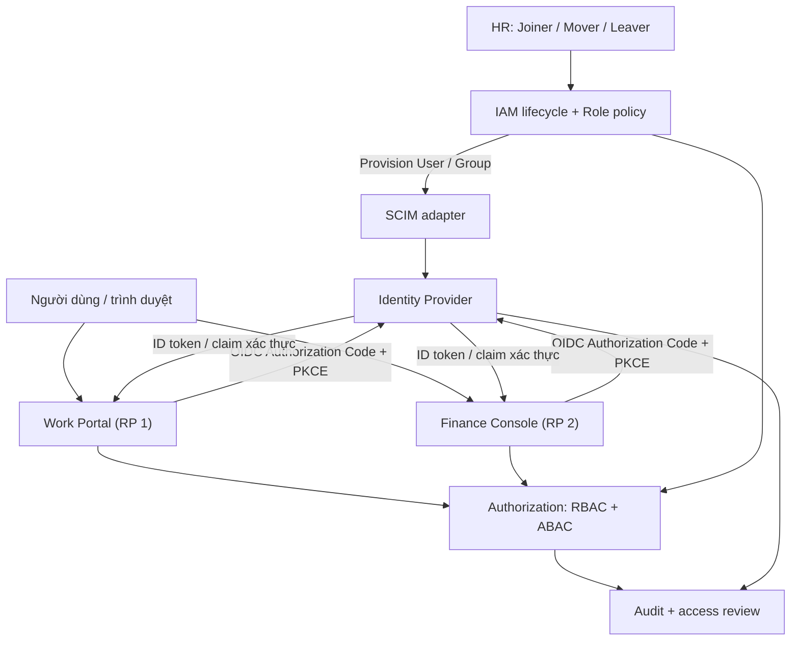
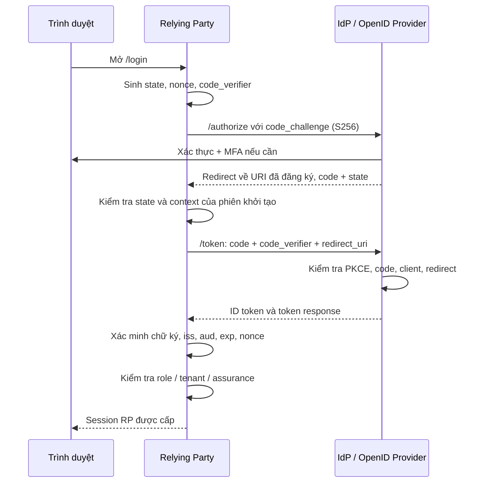
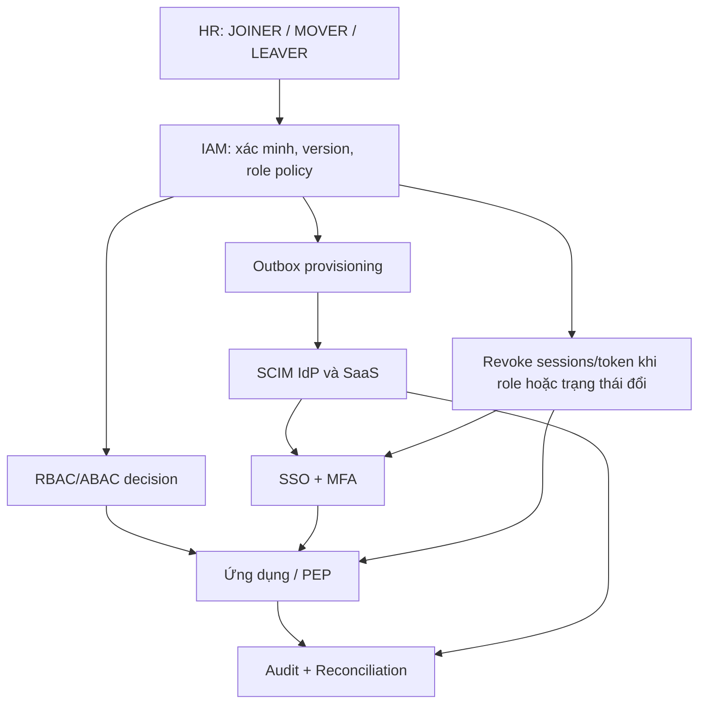

# Dự án thực hành: Thiết lập SSO bằng OpenID Connect

> **Chương:** Dự án thực hành  
> **Đề bài:** Thiết lập SSO  
> **Module:** `SECURITY_IDENTITY_ACCESS_MANAGEMENT_IDENTITY_LIFECYCLE`  
> **Bối cảnh học tập:** Quản lý vòng đời danh tính trong IAM theo Joiner–Mover–Leaver, từ xác minh và tạo danh tính đến cấp quyền, rà soát và thu hồi khi thay đổi vai trò. Bài liên hệ HR, IdP, SSO, SCIM, RBAC/ABAC, tài khoản dịch vụ, kiểm toán và quyền truy cập tồn dư.  
> **Thời lượng gợi ý:** 120–180 phút | **Mức độ:** Trung cấp | **Môi trường:** Python 3.10+ và SQLite, chạy cục bộ.

## 1. Bài toán thực tế

Một tổ chức có hai ứng dụng: **Work Portal** cho nhân viên và **Finance Console** dành cho người được phân quyền tài chính. Hiện tại mỗi ứng dụng có hệ thống đăng nhập riêng. Khi nhân viên mới gia nhập (Joiner), quản trị viên phải tạo và thu hồi mật khẩu ở nhiều nơi. Khi một nhân viên chuyển bộ phận (Mover) hoặc nghỉ việc (Leaver), các phiên đăng nhập cũ có thể tiếp tục tồn tại. Do đó công ty muốn triển khai **Single Sign-On (SSO)** qua một Identity Provider (IdP).

Bạn được giao xây mô hình **OpenID Connect (OIDC) Authorization Code Flow có PKCE S256**, với hai ứng dụng đóng vai **Relying Party (RP)** và một IdP giả lập. Người dùng đăng nhập ở IdP một lần, sau đó truy cập ứng dụng khác bằng phiên IdP còn hợp lệ. Mỗi ứng dụng tự kiểm tra thông tin đăng nhập và quyền trước khi tạo phiên riêng.

Bài tập còn phải chứng minh một số điều thường bị bỏ qua khi cấu hình SSO:

- **SSO không thay thế authorization.** Xác thực hợp lệ ở IdP không có nghĩa người đó được sử dụng Finance Console.
- **SCIM không thay thế OIDC.** SCIM đồng bộ tài khoản, nhóm và trạng thái; OIDC xử lý đăng nhập và danh tính phiên.
- **MFA là một điều kiện bảo đảm xác thực.** Ứng dụng nhạy cảm cần chính sách MFA phù hợp; kết quả MFA phải đến từ IdP đã được kiểm chứng.
- **Phiên phải theo vòng đời identity.** Chuyển vai trò hoặc rời tổ chức phải làm mất hiệu lực các phiên và quyền cũ, kể cả khi token ban đầu chưa hết hạn.

### Mục tiêu đầu ra

Sau bài này, bạn có thể:

1. Xác định **issuer**, **client ID**, **redirect URI**, **scope**, endpoint authorization/token, **ID token**, **nonce**, **state** và **PKCE**.
2. Giải thích tại sao mỗi RP phải được đăng ký với **redirect URI chính xác** và kiểm tra chặt chẽ `iss`, `aud`, chữ ký, thời hạn và `nonce` của ID token.
3. Thiết lập mô phỏng hai ứng dụng sử dụng cùng IdP nhưng có **phiên ứng dụng tách biệt** và điều kiện truy cập khác nhau.
4. Chứng minh người dùng có thể **SSO từ Portal sang Finance**, đồng thời quyền Finance vẫn bị chặn khi role hoặc MFA không đáp ứng.
5. Mô phỏng các lỗi: `state` không khớp, authorization code bị dùng lại, PKCE sai, ID token có issuer/audience/nonce/chữ ký/thời hạn không hợp lệ.
6. Giải thích việc thu hồi phiên khi **Mover/Leaver**, tác động của token còn hạn, SCIM provisioning và access review.
7. Lập kế hoạch chuyển từ mock sang IdP thật với **OIDC Discovery, JWKS, MFA chống phishing và kiểm toán**.

**Phạm vi:** Đây là một mô hình **SSO cục bộ**, không chạy máy chủ HTTP, không mở trình duyệt, không phát hành token của IdP thật và không kết nối mạng. Để người học theo dõi các bước, chương trình mô phỏng một ID token được ký bằng **HS256 với khóa chia sẻ chỉ dành cho lab**. Một triển khai OIDC thật phải sử dụng thư viện đã kiểm thử, phương thức ký được IdP công bố (thường là chữ ký bất đối xứng), JWKS phù hợp, HTTPS và các kiểm tra an toàn đã cấu hình; **không dùng đoạn mã JWT của lab làm bộ xác thực production**.

## 2. Kiến trúc và cách phối hợp IAM–IdP–SSO



| Thành phần | Trách nhiệm trong bài |
|---|---|
| **HR / identity lifecycle** | Định danh nhân viên, ngày hiệu lực, trạng thái ACTIVE/DISABLED và role được phê duyệt |
| **IAM** | Xác định quyền cần cấp/thu hồi, nhóm IdP và chính sách RBAC/ABAC |
| **SCIM / provisioning** | Tạo, sửa, vô hiệu hóa account và membership trong IdP/ứng dụng đích |
| **IdP** | Xác thực người dùng, quản lý phiên SSO và MFA, trả authorization code và token |
| **RP / ứng dụng** | Khởi tạo login, sinh `state`, `nonce`, PKCE; đổi code lấy token; xác thực ID token và lập phiên riêng |
| **PEP/PDP** | Kiểm tra vai trò, tenant, trạng thái lifecycle, MFA và quyền với từng tài nguyên |
| **Audit / access review** | Lưu actor, phiên, kết quả xác thực/ủy quyền và bằng chứng thu hồi |

Điểm đáng chú ý: **một IdP session không phải một ứng dụng session**. Người dùng có thể đã SSO ở IdP nhưng RP vẫn phải đổi code, kiểm tra token và tạo phiên của chính mình. Khi người dùng bị Leaver, phải xử lý cả session IdP, session RP, token và quyền tồn dư ở ứng dụng downstream.

### 2.1. Mô hình Authorization Code + PKCE



**Các kiểm soát phải phân biệt:**

- `state` gắn response với một yêu cầu login RP đã khởi tạo, chống CSRF/login injection; cần ngẫu nhiên và ràng buộc với session trình duyệt khởi tạo. IdP thường chỉ phản hồi nguyên giá trị này, không cần hiểu nội dung.
- `nonce` gắn **ID token** với yêu cầu xác thực hiện tại; RP phải đối chiếu sau khi xác thực token.
- `code_verifier` là bí mật ngẫu nhiên do RP giữ, **không gửi qua front channel**; `code_challenge=BASE64URL(SHA256(code_verifier))` được gửi tới IdP. Token endpoint kiểm tra verifier.
- `redirect_uri` là URI callback đã đăng ký; RP/IdP phải so khớp **chính xác** với giá trị của flow, tránh open redirect và đánh cắp code.
- `ID token` thông báo kết quả xác thực; không mặc định coi ID token là **access token** để gọi resource API.
- `iss`, `aud`, `exp`, `iat`, `sub` và `nonce` phải được xác minh với thuật toán/khóa được tin cậy. Trong SSO production, **issuer và thuật toán ký** phải được cấu hình/pin qua OIDC Discovery và chính sách client.

## 3. Cấu hình hai ứng dụng minh họa

| Ứng dụng | Client ID | Redirect URI được cho phép | Điều kiện truy cập |
|---|---|---|---|
| Work Portal | `work-portal-client` | `https://portal.example.test/oidc/callback` | Nhân viên ACTIVE, tenant đúng, permission `portal:view` |
| Finance Console | `finance-console-client` | `https://finance.example.test/oidc/callback` | Role `finance_approver`, MFA đã được IdP xác thực, tenant đúng |

IdP giả lập có issuer `https://idp.example.test`. Domain `example.test` là tên miền ví dụ, không phát sinh request thật. Ứng dụng Finance cần cả role tài chính và tín hiệu MFA mới trong chính sách; một người có SSO thành công vào Portal không tự được vào Finance.

### 3.1. Danh tính giả lập

| Subject | Tenant | Vai trò | Trạng thái |
|---|---|---|---|
| `sub-100001` | tenant-a | employee | ACTIVE |
| `sub-100002` | tenant-a | finance_approver | ACTIVE |
| `sub-200001` | tenant-b | finance_approver | ACTIVE |
| `sub-100003` | tenant-a | employee | DISABLED |
| `sub-100004` | tenant-a | employee | PENDING_START |

Trạng thái ACTIVE và ngày bắt đầu có hiệu lực là điều kiện cơ bản. Chuyển tenant, vai trò hoặc trạng thái phải phát sinh từ quy trình HR/IAM đã được xác minh; các lệnh thay đổi trong lab chỉ để mô phỏng kết quả của Mover/Leaver.

## 4. Chuẩn bị

Tạo thư mục làm việc riêng và cài Python 3.10 hoặc mới hơn. Chương trình sử dụng duy nhất thư viện chuẩn: `argparse`, `sqlite3`, `secrets`, `hashlib`, `hmac`, `base64`, `json`, `datetime` và `urllib.parse`.

```text
oidc-sso-lab/
├── sso_lab.py
└── sso-lab.sqlite        # tự tạo sau khi chạy init
```

Mô hình lưu dữ liệu mock IdP và RP trong **cùng một SQLite** để tiện học, nhưng chia bảng theo ranh giới nghiệp vụ. Hệ thống production cần tách vùng tin cậy, lưu state/verifier an toàn phía RP, truyền code qua HTTPS và dùng token endpoint của IdP được đăng ký.

## 5. Triển khai mock OIDC SSO

Tạo file `sso_lab.py`. Các lệnh của chương trình:

| Lệnh | Mục đích |
|---|---|
| `init` | Tạo danh tính giả và khóa ký JWT chỉ dùng trong lab |
| `start --app ...` | RP tạo yêu cầu login, lưu `state`/`nonce`/PKCE |
| `provider-login --state ... --subject ... [--mfa]` | Giả lập IdP xác thực lần đầu; phát hành code và phiên IdP |
| `provider-sso --state ... --idp-session ...` | Dùng lại phiên IdP để xác thực ứng dụng thứ hai |
| `callback --app ... --state ... --code ...` | RP đổi code, kiểm tra PKCE/ID token, cấp phiên RP |
| `access --rp-session ... --permission ... --tenant ...` | Kiểm tra authorization ở ứng dụng |
| `inspect --subject ...` | Xem trạng thái identity và số phiên còn trong DB |
| `lab-move` / `lab-leaver` | Mô phỏng Mover/Leaver và thu hồi phiên |
| `audit` | Xem dấu vết sự kiện và kết quả (không in token) |

**Đặt biến test:** Các giá trị in ra như `STATE`, `CODE`, `IDP_SESSION`, `RP_SESSION` là chuỗi ngẫu nhiên. Trong hướng dẫn sau, tên in hoa chỉ là placeholder. Phải sao chép giá trị thực tế của lần chạy vào lệnh tương ứng, không nhập nguyên chữ placeholder.

### 5.1. Khai báo cấu hình, dữ liệu và tiện ích

```python
import argparse
import base64
import datetime as dt
import hashlib
import hmac
import json
import secrets
import sqlite3
import sys
import time
from pathlib import Path
from urllib.parse import urlencode

DB = Path("sso-lab.sqlite")
ISSUER = "https://idp.example.test"
AUTH_TTL = 300
CODE_TTL = 120
SSO_TTL = 1800
RP_TTL = 900
FRESH_MFA_TTL = 300

CLIENTS = {
    "portal": {
        "client_id": "work-portal-client",
        "redirect_uri": "https://portal.example.test/oidc/callback",
        "required_role": None,
        "permissions": {"portal:view"},
        "require_mfa": False,
    },
    "finance": {
        "client_id": "finance-console-client",
        "redirect_uri": "https://finance.example.test/oidc/callback",
        "required_role": "finance_approver",
        "permissions": {"invoice:read", "invoice:approve"},
        "require_mfa": True,
    },
}

SEED_USERS = [
    ("sub-100001", "tenant-a", "employee", "ACTIVE", "2020-01-01"),
    ("sub-100002", "tenant-a", "finance_approver", "ACTIVE", "2020-01-01"),
    ("sub-200001", "tenant-b", "finance_approver", "ACTIVE", "2020-01-01"),
    ("sub-100003", "tenant-a", "employee", "DISABLED", "2020-01-01"),
    ("sub-100004", "tenant-a", "employee", "PENDING_START", "2099-01-01"),
]

SCHEMA = """
CREATE TABLE IF NOT EXISTS settings (
    name TEXT PRIMARY KEY,
    value TEXT NOT NULL
);
CREATE TABLE IF NOT EXISTS identities (
    subject TEXT PRIMARY KEY,
    tenant_id TEXT NOT NULL,
    role TEXT NOT NULL,
    state TEXT NOT NULL CHECK(state IN ('ACTIVE','PENDING_START','DISABLED')),
    start_date TEXT NOT NULL,
    auth_version INTEGER NOT NULL DEFAULT 0
);
CREATE TABLE IF NOT EXISTS auth_flows (
    state_hash TEXT PRIMARY KEY,
    app TEXT NOT NULL,
    redirect_uri TEXT NOT NULL,
    nonce TEXT NOT NULL,
    verifier TEXT NOT NULL,
    challenge TEXT NOT NULL,
    expires_at INTEGER NOT NULL,
    status TEXT NOT NULL CHECK(status IN ('STARTED','AUTHORIZED','CONSUMED'))
);
CREATE TABLE IF NOT EXISTS idp_sessions (
    token_hash TEXT PRIMARY KEY,
    subject TEXT NOT NULL REFERENCES identities(subject),
    amr_json TEXT NOT NULL,
    auth_time INTEGER NOT NULL,
    expires_at INTEGER NOT NULL,
    auth_version INTEGER NOT NULL
);
CREATE TABLE IF NOT EXISTS auth_codes (
    code_hash TEXT PRIMARY KEY,
    state_hash TEXT NOT NULL REFERENCES auth_flows(state_hash),
    app TEXT NOT NULL,
    redirect_uri TEXT NOT NULL,
    challenge TEXT NOT NULL,
    subject TEXT NOT NULL REFERENCES identities(subject),
    amr_json TEXT NOT NULL,
    auth_time INTEGER NOT NULL,
    expires_at INTEGER NOT NULL,
    consumed INTEGER NOT NULL DEFAULT 0
);
CREATE TABLE IF NOT EXISTS rp_sessions (
    token_hash TEXT PRIMARY KEY,
    app TEXT NOT NULL,
    subject TEXT NOT NULL REFERENCES identities(subject),
    tenant_id TEXT NOT NULL,
    amr_json TEXT NOT NULL,
    auth_time INTEGER NOT NULL,
    expires_at INTEGER NOT NULL,
    auth_version INTEGER NOT NULL
);
CREATE TABLE IF NOT EXISTS audit_log (
    id INTEGER PRIMARY KEY AUTOINCREMENT,
    at_utc TEXT NOT NULL,
    action TEXT NOT NULL,
    subject TEXT NOT NULL,
    detail TEXT NOT NULL
);
"""


def epoch():
    return int(time.time())


def sha(value):
    return hashlib.sha256(value.encode("utf-8")).hexdigest()


def b64url(raw):
    return base64.urlsafe_b64encode(raw).decode("ascii").rstrip("=")


def b64decode(value):
    return base64.urlsafe_b64decode(value + "=" * (-len(value) % 4))


def pkce_challenge(verifier):
    return b64url(hashlib.sha256(verifier.encode("ascii")).digest())


def audit(conn, action, subject, detail):
    conn.execute(
        "INSERT INTO audit_log(at_utc,action,subject,detail) VALUES (?,?,?,?)",
        (dt.datetime.now(dt.timezone.utc).isoformat(),
         action, subject, detail),
    )


def fail(reason):
    raise ValueError(reason)


def identity(conn, subject):
    row = conn.execute(
        "SELECT * FROM identities WHERE subject=?", (subject,)
    ).fetchone()
    if row is None:
        fail("UNKNOWN_SUBJECT")
    return row


def eligible(row, now):
    start = dt.date.fromisoformat(row["start_date"])
    today = dt.datetime.fromtimestamp(now, tz=dt.timezone.utc).date()
    return row["state"] == "ACTIVE" and start <= today


def flow_by_state(conn, state):
    return conn.execute(
        "SELECT * FROM auth_flows WHERE state_hash=?", (sha(state),)
    ).fetchone()


def signing_key(conn):
    row = conn.execute(
        "SELECT value FROM settings WHERE name='mock_jwt_key'"
    ).fetchone()
    if not row:
        fail("INIT_REQUIRED")
    return bytes.fromhex(row["value"])


def jwt_sign_mock(claims, key):
    """Chỉ là mô phỏng HS256 cục bộ; không phải thư viện JWT production."""
    header = {"typ": "JWT", "alg": "HS256"}
    h = b64url(json.dumps(header, separators=(",", ":")).encode("utf-8"))
    p = b64url(json.dumps(claims, separators=(",", ":")).encode("utf-8"))
    signing_input = h + "." + p
    mac = hmac.new(key, signing_input.encode("ascii"), hashlib.sha256).digest()
    return signing_input + "." + b64url(mac)


def jwt_validate_mock(token, key, expected_client, expected_nonce, now):
    """Kiểm tra cú pháp, MAC và các claims OIDC cơ bản trong mock."""
    parts = token.split(".")
    if len(parts) != 3:
        fail("BAD_TOKEN_FORMAT")
    h, p, signature = parts
    expected = b64url(hmac.new(
        key, (h + "." + p).encode("ascii"), hashlib.sha256
    ).digest())
    if not hmac.compare_digest(signature, expected):
        fail("INVALID_ID_TOKEN_SIGNATURE")
    header = json.loads(b64decode(h))
    if header != {"typ": "JWT", "alg": "HS256"}:
        fail("UNEXPECTED_JWT_ALGORITHM")
    claims = json.loads(b64decode(p))
    if not isinstance(claims, dict):
        fail("BAD_ID_TOKEN_PAYLOAD")
    if claims.get("iss") != ISSUER:
        fail("ISSUER_MISMATCH")
    if claims.get("aud") != expected_client:
        fail("AUDIENCE_MISMATCH")
    if claims.get("nonce") != expected_nonce:
        fail("NONCE_MISMATCH")
    if not isinstance(claims.get("exp"), int) or claims["exp"] <= now:
        fail("ID_TOKEN_EXPIRED")
    if (not isinstance(claims.get("iat"), int)
            or claims["iat"] > now + 30):
        fail("INVALID_ISSUED_AT")
    if (not isinstance(claims.get("auth_time"), int)
            or claims["auth_time"] > now + 30):
        fail("INVALID_AUTH_TIME")
    if not isinstance(claims.get("sub"), str) or not claims["sub"]:
        fail("INVALID_SUBJECT_CLAIM")
    if (not isinstance(claims.get("amr"), list)
            or not all(isinstance(v, str) for v in claims["amr"])):
        fail("INVALID_AMR")
    return claims


def init(conn):
    with conn:
        conn.execute(
            "INSERT OR IGNORE INTO settings(name,value) VALUES (?,?)",
            ("mock_jwt_key", secrets.token_hex(32)),
        )
        for subject, tenant, role, state, start in SEED_USERS:
            conn.execute(
                """INSERT OR IGNORE INTO identities(
                   subject,tenant_id,role,state,start_date)
                   VALUES (?,?,?,?,?)""",
                (subject, tenant, role, state, start),
            )
    print("INITIALIZED: sso-lab.sqlite")


def start_flow(conn, app):
    if app not in CLIENTS:
        fail("UNKNOWN_APP")
    cfg = CLIENTS[app]
    state = secrets.token_urlsafe(24)
    nonce = secrets.token_urlsafe(24)
    verifier = secrets.token_urlsafe(32)
    challenge = pkce_challenge(verifier)
    with conn:
        conn.execute(
            """INSERT INTO auth_flows
               (state_hash,app,redirect_uri,nonce,verifier,challenge,
                expires_at,status)
               VALUES (?,?,?,?,?,?,?,'STARTED')""",
            (sha(state), app, cfg["redirect_uri"], nonce, verifier,
             challenge, epoch() + AUTH_TTL),
        )
        audit(conn, "OIDC_START", app, "state_and_pkce_created")
    params = {
        "response_type": "code",
        "client_id": cfg["client_id"],
        "redirect_uri": cfg["redirect_uri"],
        "scope": "openid profile",
        "state": state,
        "nonce": nonce,
        "code_challenge": challenge,
        "code_challenge_method": "S256",
    }
    print("AUTHORIZE_URL: " + ISSUER + "/authorize?" + urlencode(params))
    print("STATE: " + state)
    print("Bảo vệ state/verifier trong session RP; không đưa vào audit")


def issue_authorization_code(conn, flow, person, amr, auth_time):
    """Provider giả lập phát một code ràng buộc flow, app và PKCE."""
    if flow["status"] != "STARTED" or epoch() >= flow["expires_at"]:
        fail("FLOW_NOT_STARTABLE")
    code = secrets.token_urlsafe(32)
    conn.execute(
        """INSERT INTO auth_codes(
           code_hash,state_hash,app,redirect_uri,challenge,subject,
           amr_json,auth_time,expires_at)
           VALUES (?,?,?,?,?,?,?,?,?)""",
        (sha(code), flow["state_hash"], flow["app"], flow["redirect_uri"],
         flow["challenge"], person["subject"], json.dumps(amr),
         auth_time, epoch() + CODE_TTL),
    )
    conn.execute(
        "UPDATE auth_flows SET status='AUTHORIZED' WHERE state_hash=?",
        (flow["state_hash"],),
    )
    audit(conn, "OIDC_CODE_ISSUED", person["subject"],
          "app=" + flow["app"])
    return code


def provider_login(conn, state, subject, mfa):
    """IdP login đầu tiên: primary/MFA được GIẢ LẬP bằng CLI."""
    flow = flow_by_state(conn, state)
    if not flow or epoch() >= flow["expires_at"]:
        fail("INVALID_OR_EXPIRED_STATE")
    person = identity(conn, subject)
    now = epoch()
    if not eligible(person, now):
        fail("IDENTITY_NOT_ELIGIBLE")
    # Trong hệ thống thật, IdP phải tự xác minh các yếu tố và ghi amr.
    amr = ["pwd", "otp"] if mfa else ["pwd"]
    idp_token = secrets.token_urlsafe(32)
    with conn:
        code = issue_authorization_code(conn, flow, person, amr, now)
        conn.execute(
            """INSERT INTO idp_sessions(
               token_hash,subject,amr_json,auth_time,expires_at,auth_version)
               VALUES (?,?,?,?,?,?)""",
            (sha(idp_token), subject, json.dumps(amr), now,
             now + SSO_TTL, person["auth_version"]),
        )
        audit(conn, "IDP_LOGIN_MOCK", subject, "mfa=" + str(mfa))
    print("IDP_SESSION: " + idp_token)
    print("CODE: " + code)
    print("CALLBACK_URI: " + flow["redirect_uri"]
          + "?" + urlencode({"code": code, "state": state}))


def provider_sso(conn, state, idp_token):
    """Tái sử dụng phiên IdP cho RP thứ hai, không đăng nhập primary lại."""
    flow = flow_by_state(conn, state)
    now = epoch()
    if not flow or now >= flow["expires_at"]:
        fail("INVALID_OR_EXPIRED_STATE")
    session = conn.execute(
        "SELECT * FROM idp_sessions WHERE token_hash=?",
        (sha(idp_token),),
    ).fetchone()
    if not session:
        fail("IDP_SESSION_UNKNOWN")
    person = identity(conn, session["subject"])
    if (now >= session["expires_at"]
            or session["auth_version"] != person["auth_version"]
            or not eligible(person, now)):
        fail("IDP_SESSION_EXPIRED_OR_REVOKED")
    with conn:
        code = issue_authorization_code(
            conn, flow, person, json.loads(session["amr_json"]),
            session["auth_time"],
        )
        audit(conn, "IDP_SSO_REUSED", person["subject"],
              "app=" + flow["app"])
    print("SSO_REUSED: no_new_primary_login")
    print("CODE: " + code)
    print("CALLBACK_URI: " + flow["redirect_uri"]
          + "?" + urlencode({"code": code, "state": state}))


def callback(conn, app, state, code, fault):
    """RP kiểm tra code binding/PKCE/token rồi mới lập app session."""
    if app not in CLIENTS:
        fail("UNKNOWN_APP")
    cfg = CLIENTS[app]
    flow = flow_by_state(conn, state)
    now = epoch()
    if not flow or now >= flow["expires_at"]:
        fail("INVALID_OR_EXPIRED_STATE")
    if flow["app"] != app:
        fail("APP_MISMATCH")
    authorization = conn.execute(
        "SELECT * FROM auth_codes WHERE code_hash=?", (sha(code),)
    ).fetchone()
    if authorization is None:
        fail("UNKNOWN_CODE")
    if authorization["consumed"]:
        fail("CODE_REPLAY")
    if flow["status"] != "AUTHORIZED":
        fail("FLOW_NOT_AUTHORIZED")
    if authorization["expires_at"] <= now:
        fail("AUTHORIZATION_CODE_EXPIRED")
    if (authorization["state_hash"] != flow["state_hash"]
            or authorization["app"] != app
            or authorization["redirect_uri"] != cfg["redirect_uri"]
            or flow["redirect_uri"] != cfg["redirect_uri"]):
        fail("CODE_OR_REDIRECT_BINDING_MISMATCH")

    with conn:
        # Mô phỏng IdP đã nhận code: dùng một lần, ngay cả khi token không đạt.
        conn.execute(
            "UPDATE auth_codes SET consumed=1 WHERE code_hash=?",
            (authorization["code_hash"],),
        )
        conn.execute(
            "UPDATE auth_flows SET status='CONSUMED' WHERE state_hash=?",
            (flow["state_hash"],),
        )
        verifier = flow["verifier"] + "tamper" if fault == "pkce" else flow["verifier"]
        if (pkce_challenge(verifier) != authorization["challenge"]
                or flow["challenge"] != authorization["challenge"]):
            audit(conn, "OIDC_DENIED", app, "PKCE_MISMATCH")
            print("OIDC_DENIED: PKCE_MISMATCH")
            return

        claims = {
            "iss": ISSUER,
            "aud": cfg["client_id"],
            "sub": authorization["subject"],
            "iat": now,
            "exp": now + AUTH_TTL,
            "auth_time": authorization["auth_time"],
            "nonce": flow["nonce"],
            "amr": json.loads(authorization["amr_json"]),
        }
        if fault == "issuer":
            claims["iss"] = "https://other-idp.example.test"
        elif fault == "audience":
            claims["aud"] = "unknown-client"
        elif fault == "nonce":
            claims["nonce"] = "wrong-nonce"
        elif fault == "expired":
            claims["exp"] = now - 1

        id_token = jwt_sign_mock(claims, signing_key(conn))
        if fault == "signature":
            header, payload, _ = id_token.split(".")
            id_token = header + "." + payload + "." + b64url(b"tampered")
        try:
            verified = jwt_validate_mock(
                id_token, signing_key(conn), cfg["client_id"],
                flow["nonce"], now,
            )
            if verified["sub"] != authorization["subject"]:
                fail("SUBJECT_MISMATCH")
            person = identity(conn, verified["sub"])
            if not eligible(person, now):
                fail("LIFECYCLE_NOT_ACTIVE")
            if cfg["required_role"] and person["role"] != cfg["required_role"]:
                fail("APP_ROLE_REQUIRED")
            if cfg["require_mfa"]:
                if "otp" not in verified["amr"]:
                    fail("MFA_REQUIRED")
                if now - verified["auth_time"] > FRESH_MFA_TTL:
                    fail("MFA_NOT_FRESH")

            rp_token = secrets.token_urlsafe(32)
            conn.execute(
                """INSERT INTO rp_sessions(
                   token_hash,app,subject,tenant_id,amr_json,
                   auth_time,expires_at,auth_version)
                   VALUES (?,?,?,?,?,?,?,?)""",
                (sha(rp_token), app, person["subject"],
                 person["tenant_id"], json.dumps(verified["amr"]),
                 verified["auth_time"], now + RP_TTL,
                 person["auth_version"]),
            )
            audit(conn, "RP_SESSION_CREATED", person["subject"],
                  "app=" + app + ";id_token_verified")
        except ValueError as exc:
            audit(conn, "OIDC_DENIED", app, str(exc))
            print("OIDC_DENIED: " + str(exc))
            return

    print("OIDC_ID_TOKEN_VALIDATED_BY_RP")
    print("RP_SESSION: " + rp_token)
    print("RP_APP: " + app)


def access(conn, rp_token, permission, resource_tenant):
    now = epoch()
    row = conn.execute(
        "SELECT * FROM rp_sessions WHERE token_hash=?",
        (sha(rp_token),),
    ).fetchone()
    if row is None:
        print("POLICY_DENY: INVALID_RP_SESSION")
        return
    person = identity(conn, row["subject"])
    cfg = CLIENTS[row["app"]]
    reason = "POLICY_SATISFIED"
    if (row["expires_at"] <= now
            or row["auth_version"] != person["auth_version"]
            or not eligible(person, now)):
        reason = "SESSION_EXPIRED_OR_REVOKED"
    elif row["tenant_id"] != resource_tenant:
        reason = "TENANT_MISMATCH"
    elif cfg["required_role"] and person["role"] != cfg["required_role"]:
        reason = "ROLE_NO_LONGER_VALID"
    elif permission not in cfg["permissions"]:
        reason = "PERMISSION_NOT_ALLOWED"
    elif cfg["require_mfa"] and "otp" not in json.loads(row["amr_json"]):
        reason = "MFA_REQUIRED"
    elif cfg["require_mfa"] and now - row["auth_time"] > FRESH_MFA_TTL:
        reason = "MFA_NOT_FRESH"

    with conn:
        audit(conn, "ACCESS_CHECK", person["subject"],
              "app=" + row["app"] + ";permission=" + permission
              + ";result=" + reason)
    verdict = "POLICY_ALLOW" if reason == "POLICY_SATISFIED" else "POLICY_DENY"
    print(verdict + ": " + reason)


def inspect(conn, subject):
    person = identity(conn, subject)
    idp_count = conn.execute(
        "SELECT COUNT(*) FROM idp_sessions WHERE subject=?",
        (subject,),
    ).fetchone()[0]
    rp_count = conn.execute(
        "SELECT COUNT(*) FROM rp_sessions WHERE subject=?",
        (subject,),
    ).fetchone()[0]
    print(json.dumps({
        "subject": subject,
        "tenant_id": person["tenant_id"],
        "role": person["role"],
        "state": person["state"],
        "start_date": person["start_date"],
        "auth_version": person["auth_version"],
        "stored_idp_sessions": idp_count,
        "stored_rp_sessions": rp_count,
    }, indent=2, ensure_ascii=False))


def lab_move(conn, subject, role):
    """Chỉ mô phỏng Mover đã được HR phê duyệt."""
    person = identity(conn, subject)
    if not eligible(person, epoch()):
        fail("IDENTITY_NOT_ELIGIBLE")
    if role not in {"employee", "finance_approver"}:
        fail("ROLE_NOT_ALLOWED")
    with conn:
        conn.execute(
            """UPDATE identities SET role=?,auth_version=auth_version+1
               WHERE subject=?""",
            (role, subject),
        )
        conn.execute("DELETE FROM idp_sessions WHERE subject=?", (subject,))
        conn.execute("DELETE FROM rp_sessions WHERE subject=?", (subject,))
        audit(conn, "LAB_MOVER", subject, "role_changed_sessions_revoked")
    print("LAB_MOVED: IDP_AND_RP_SESSIONS_REVOKED")


def lab_leaver(conn, subject):
    """Chỉ mô phỏng Leaver từ nguồn HR hợp lệ."""
    person = identity(conn, subject)
    if person["state"] == "DISABLED":
        print("ALREADY_DISABLED")
        return
    with conn:
        conn.execute(
            """UPDATE identities SET state='DISABLED',
               auth_version=auth_version+1 WHERE subject=?""",
            (subject,),
        )
        conn.execute("DELETE FROM idp_sessions WHERE subject=?", (subject,))
        conn.execute("DELETE FROM rp_sessions WHERE subject=?", (subject,))
        audit(conn, "LAB_LEAVER", subject, "identity_disabled_sessions_revoked")
    print("LAB_DISABLED: IDP_AND_RP_SESSIONS_REVOKED")


def show_audit(conn):
    for row in conn.execute(
        "SELECT at_utc,action,subject,detail FROM audit_log ORDER BY id"
    ):
        print(json.dumps(dict(row), ensure_ascii=False))


def main():
    parser = argparse.ArgumentParser(description="OIDC SSO local lab")
    sub = parser.add_subparsers(dest="command", required=True)
    sub.add_parser("init")

    p = sub.add_parser("start")
    p.add_argument("--app", choices=sorted(CLIENTS), required=True)

    p = sub.add_parser("provider-login")
    p.add_argument("--state", required=True)
    p.add_argument("--subject", required=True)
    p.add_argument("--mfa", action="store_true",
                   help="Chỉ giả lập IdP đã xác minh yếu tố thứ hai")

    p = sub.add_parser("provider-sso")
    p.add_argument("--state", required=True)
    p.add_argument("--idp-session", required=True)

    p = sub.add_parser("callback")
    p.add_argument("--app", choices=sorted(CLIENTS), required=True)
    p.add_argument("--state", required=True)
    p.add_argument("--code", required=True)
    p.add_argument("--fault", choices=[
        "none", "pkce", "issuer", "audience", "nonce", "signature", "expired"
    ], default="none", help="Chỉ để kiểm thử xác minh callback")

    p = sub.add_parser("access")
    p.add_argument("--rp-session", required=True)
    p.add_argument("--permission", required=True)
    p.add_argument("--tenant", required=True)

    p = sub.add_parser("inspect")
    p.add_argument("--subject", required=True)

    p = sub.add_parser("lab-move")
    p.add_argument("--subject", required=True)
    p.add_argument("--role", choices=["employee", "finance_approver"],
                   required=True)

    p = sub.add_parser("lab-leaver")
    p.add_argument("--subject", required=True)
    sub.add_parser("audit")
    args = parser.parse_args()

    conn = sqlite3.connect(DB)
    conn.row_factory = sqlite3.Row
    conn.execute("PRAGMA foreign_keys=ON")
    try:
        conn.executescript(SCHEMA)
        if args.command == "init":
            init(conn)
        else:
            signing_key(conn)  # Mọi lệnh khác yêu cầu init đã chạy.
            if args.command == "start":
                start_flow(conn, args.app)
            elif args.command == "provider-login":
                provider_login(conn, args.state, args.subject, args.mfa)
            elif args.command == "provider-sso":
                provider_sso(conn, args.state, args.idp_session)
            elif args.command == "callback":
                callback(conn, args.app, args.state, args.code, args.fault)
            elif args.command == "access":
                access(conn, args.rp_session, args.permission, args.tenant)
            elif args.command == "inspect":
                inspect(conn, args.subject)
            elif args.command == "lab-move":
                lab_move(conn, args.subject, args.role)
            elif args.command == "lab-leaver":
                lab_leaver(conn, args.subject)
            elif args.command == "audit":
                show_audit(conn)
    finally:
        conn.close()


if __name__ == "__main__":
    try:
        main()
    except (ValueError, OSError, sqlite3.Error, UnicodeDecodeError) as exc:
        print("LAB_ERROR: " + str(exc), file=sys.stderr)
        sys.exit(2)
```

### 5.2. Đọc hiểu ba lớp session

- **Flow RP:** `auth_flows` giữ state đã hash, nonce và PKCE verifier để ghép callback với yêu cầu login ban đầu. Trong mock, một flow được tiêu thụ đúng một lần. Khi thử callback khác app hoặc state khác, không được cấp phiên.
- **IdP session:** `idp_sessions` ghi danh tính đã xác thực, `amr`, `auth_time`, phiên bản identity và hạn dùng. Phiên này giúp người dùng thực hiện SSO tới RP thứ hai mà không cần nhập lại primary credential.
- **RP session:** `rp_sessions` chỉ được tạo sau khi xác thực ID token và áp dụng chính sách của ứng dụng. RP lưu bản sao phiên bản identity và mức bảo đảm xác thực. Khi Mover/Leaver, một phiên RP cũ phải hết hiệu lực.
- **Authorization code:** `auth_codes` chứa khóa nối với flow, app, redirect URI và PKCE. Code dùng một lần và có TTL 120 giây. Đây là mã chuyển giao ngắn hạn, không phải access token để truy cập API.
- **Audit:** Chương trình lưu ID, loại thao tác và lý do, không lưu code, state, session token hoặc khóa ký trong audit. Database cục bộ không có bảo đảm chống sửa log; production cần hạ tầng audit riêng.

**Các giá trị dùng trong CLI là mô phỏng:** `--subject` và `--mfa` ở lệnh `provider-login` là cách người học điều khiển phản hồi IdP. Production không được để trình duyệt tự chọn subject đã xác thực hoặc tự báo “đã MFA”. OIDC real flow sử dụng credential, session và challenge xác thực do IdP kiểm soát; token chỉ được tin sau khi RP xác minh toàn bộ.


## 6. Thực hành thiết lập SSO cho Work Portal

Tất cả lệnh bên dưới chạy từ thư mục `oidc-sso-lab`, nơi có file `sso_lab.py`. Mỗi bước phải thay `STATE_PORTAL`, `CODE_PORTAL` và các tên token bằng **chuỗi do lệnh trước đó in ra**. Không sử dụng giá trị cố định trong tài liệu.

### 6.1. Khởi tạo và đăng ký client

```bash
python sso_lab.py init
python sso_lab.py inspect --subject sub-100002
python sso_lab.py start --app portal
```

Kết quả `init`: `INITIALIZED: sso-lab.sqlite`. `inspect` cho thấy người dùng Finance `sub-100002` thuộc tenant-a, ACTIVE và chưa có phiên trong database.

Lệnh `start` in **AUTHORIZE_URL** có các tham số OIDC:

```text
response_type=code
client_id=work-portal-client
redirect_uri=https://portal.example.test/oidc/callback
scope=openid profile
state=<chuỗi ngẫu nhiên>
nonce=<chuỗi ngẫu nhiên>
code_challenge=<SHA256 của verifier, mã hóa Base64URL>
code_challenge_method=S256
```

Địa chỉ đầy đủ được URL encode. Lệnh cũng in `STATE` để người học chuyển sang bước tiếp theo; giá trị này không được ghi vào log hoặc chia sẻ qua kênh công khai. **code_verifier không xuất hiện trong authorize URL**; nó được lưu trong state của RP (ở đây là bảng `auth_flows`).

Trong sản phẩm thật, các client cần được đăng ký tại IdP với đúng client ID, loại client, redirect URI và phạm vi OIDC. Không chấp nhận redirect động từ tham số tự do; không dùng wildcard nếu không có cơ chế bảo đảm riêng của provider.

### 6.2. Người dùng xác thực với IdP

Sử dụng `STATE` do lệnh `start --app portal` tạo, nhập lệnh:

```bash
python sso_lab.py provider-login --state STATE_PORTAL --subject sub-100002 --mfa
```

Chương trình mô phỏng người dùng `sub-100002` đã qua primary auth và TOTP tại IdP. Nó in:

```text
IDP_SESSION: <token-IdP-ngẫu-nhiên>
CODE: <authorization-code-ngẫu-nhiên>
CALLBACK_URI: https://portal.example.test/oidc/callback?code=...&state=...
```

Lưu tạm `IDP_SESSION` và `CODE` của kết quả thực tế. `IDP_SESSION` đại diện cho trạng thái đăng nhập tại IdP; `CODE` là authorization code ngắn hạn, gắn với Portal client, redirect URI, PKCE challenge và subject. Chúng **không cùng loại token** và không được thay thế cho nhau.

Khi dùng IdP thật, thao tác xác thực diễn ra trong trình duyệt trên website IdP có HTTPS. Người dùng không được tự xác nhận `--mfa` hoặc chỉ định mình là `sub-100002` từ một CLI.

### 6.3. RP nhận callback và tạo phiên ứng dụng

```bash
python sso_lab.py callback --app portal --state STATE_PORTAL --code CODE_PORTAL
```

Kết quả:

```text
OIDC_ID_TOKEN_VALIDATED_BY_RP
RP_SESSION: <token-Portal-ngẫu-nhiên>
RP_APP: portal
```

Tại bước này, mô hình đã kiểm tra code dùng một lần, binding với flow/app/redirect, PKCE, ID token mock và trạng thái identity trước khi cấp phiên Portal. **RP_SESSION** là phiên riêng của Work Portal.

Thử API ứng dụng:

```bash
python sso_lab.py access --rp-session RP_PORTAL --permission portal:view --tenant tenant-a
python sso_lab.py access --rp-session RP_PORTAL --permission invoice:approve --tenant tenant-a
python sso_lab.py access --rp-session RP_PORTAL --permission portal:view --tenant tenant-b
```

Kết quả theo thứ tự:

| Yêu cầu | Quyết định | Lý do |
|---|---|---|
| Xem Portal trong tenant-a | `POLICY_ALLOW` | `POLICY_SATISFIED` |
| Dùng phiên Portal gọi quyền Finance | `POLICY_DENY` | `PERMISSION_NOT_ALLOWED` |
| Dùng phiên Portal để xem tài nguyên tenant-b | `POLICY_DENY` | `TENANT_MISMATCH` |

Một phiên đăng nhập hợp lệ không cấp quyền truy cập chéo tenant hoặc vượt quá permission của ứng dụng.

## 7. SSO sang Finance Console không cần đăng nhập lại

Đây là bước phân biệt **SSO** với hai luồng login độc lập. Bạn đang có một phiên IdP còn hạn sau khi đăng nhập Portal bằng `sub-100002`. Mở một flow mới cho ứng dụng Finance:

```bash
python sso_lab.py start --app finance
```

Lưu `STATE` mới thành `STATE_FINANCE`. Giữ nguyên token `IDP_SESSION` đã nhận ở mục 6, chạy:

```bash
python sso_lab.py provider-sso --state STATE_FINANCE --idp-session IDP_SESSION
```

Kết quả:

```text
SSO_REUSED: no_new_primary_login
CODE: <authorization-code-mới>
CALLBACK_URI: https://finance.example.test/oidc/callback?code=...&state=...
```

Lưu mã mới thành `CODE_FINANCE`. **Không nhập lại yếu tố thứ nhất hoặc MFA** ở bước này vì phiên IdP đang còn hợp lệ và mới đủ mức bảo đảm theo chính sách mock.

```bash
python sso_lab.py callback --app finance --state STATE_FINANCE --code CODE_FINANCE
```

Khi role Finance vẫn đúng và MFA còn trong 5 phút, kết quả:

```text
OIDC_ID_TOKEN_VALIDATED_BY_RP
RP_SESSION: <token-Finance-ngẫu-nhiên>
RP_APP: finance
```

Lưu token RP này thành `RP_FINANCE` rồi thử:

```bash
python sso_lab.py access --rp-session RP_FINANCE --permission invoice:read --tenant tenant-a
python sso_lab.py access --rp-session RP_FINANCE --permission invoice:approve --tenant tenant-a
python sso_lab.py access --rp-session RP_FINANCE --permission invoice:approve --tenant tenant-b
```

| Trường hợp | Kết quả mong đợi |
|---|---|
| Người có Finance role, phiên MFA mới, cùng tenant, xem hóa đơn | `POLICY_ALLOW: POLICY_SATISFIED` |
| Người có Finance role, phiên MFA mới, cùng tenant, phê duyệt về mặt permission | `POLICY_ALLOW: POLICY_SATISFIED` |
| Người tenant-a yêu cầu thao tác trên tài nguyên tenant-b | `POLICY_DENY: TENANT_MISMATCH` |

**Quan trọng:** Lệnh `access` kiểm tra permission ở tầng ứng dụng mô phỏng, **không thực sự phê duyệt hóa đơn**. Production còn phải kiểm tra trạng thái hóa đơn, người tạo, hạn mức, phân tách nhiệm vụ (SoD), quyền trên từng bản ghi và phê duyệt giao dịch; MFA hay Finance role đơn lẻ không thay thế những điều kiện đó.

### 7.1. Những bằng chứng phải quan sát được

- `IDP_SESSION` được cấp **một lần** khi người dùng đăng nhập Portal, rồi được sử dụng lại khi chuyển sang Finance.
- Mỗi ứng dụng nhận **một authorization code riêng** và tạo **một RP_SESSION riêng**.
- Portal và Finance có `client_id`, `redirect_uri` và scope permission khác nhau.
- RP Finance không chấp nhận một nhân viên ACTIVE chưa có Finance role hoặc không thỏa chính sách MFA.
- Mover/Leaver phải thu hồi các phiên ở cả IdP và RP, không chỉ sửa nhóm trong UI.

Một phiên SSO có thể hết hạn trước khi người dùng truy cập RP tiếp theo. Khi phiên không còn hợp lệ, IdP phải yêu cầu xác thực mới thay vì bỏ qua các bước bảo vệ.

## 8. Kiểm thử quyền và MFA ở từng ứng dụng

### 8.1. Người không có Finance role

Dùng `sub-100001` (employee tenant-a), tạo flow Finance hoàn toàn mới:

```bash
python sso_lab.py start --app finance
python sso_lab.py provider-login --state STATE_NEW --subject sub-100001 --mfa
python sso_lab.py callback --app finance --state STATE_NEW --code CODE_NEW
```

`STATE_NEW` và `CODE_NEW` phải được thay bằng giá trị mới vừa được sinh. Dù IdP giả lập đã báo có MFA, RP Finance phải trả:

```text
OIDC_DENIED: APP_ROLE_REQUIRED
```

Không có `RP_SESSION` Finance. Đây là **ủy quyền ứng dụng từ chối**, không phải lỗi đăng nhập IdP.

### 8.2. Người có Finance role nhưng thiếu MFA

Tạo flow mới lần nữa, đăng nhập với `sub-100002` **không có** `--mfa`:

```bash
python sso_lab.py start --app finance
python sso_lab.py provider-login --state STATE_NO_MFA --subject sub-100002
python sso_lab.py callback --app finance --state STATE_NO_MFA --code CODE_NO_MFA
```

Kết quả phải là:

```text
OIDC_DENIED: MFA_REQUIRED
```

Điều này cho thấy đã có role đúng không đủ khi yêu cầu xác thực mạnh chưa đạt. Trong hệ thống thật, RP có thể yêu cầu IdP **step-up** bằng chính sách OIDC phù hợp và chỉ tiếp tục khi nhận lại kết quả đã xác minh. Mức assurance của `amr`/`acr` phải được hiểu theo hợp đồng IdP; một giá trị chuỗi tùy ý không chứng minh MFA chống phishing.

### 8.3. MFA đã quá cũ

Trong lab, `FRESH_MFA_TTL = 300` giây. Nếu phiên IdP cũ hơn 5 phút và bạn cố sử dụng lại nó để vào Finance, callback trả `OIDC_DENIED: MFA_NOT_FRESH`. Sau khi phiên RP Finance đã được tạo, `access` cũng kiểm tra lại tuổi `auth_time` đối với các quyền Finance. Một ứng dụng production có thể đưa người dùng qua luồng xác thực lại với `max_age`/`acr_values` hoặc cách thức mà IdP hỗ trợ.

**Không cần ngồi chờ 5 phút để hoàn tất bài:** kiểm thử timeout có thể được mô tả bằng sơ đồ/trình tự; phần bắt buộc là chứng minh được lựa chọn cho phép/từ chối theo role và kết quả MFA của phiên mới. Không sửa đồng hồ hệ thống hoặc database để tạo kết quả giả cho bài nộp.

## 9. Kiểm thử bảo vệ OIDC: state, PKCE và ID token

Mỗi bài test callback dưới đây cần một **flow mới** và một **authorization code mới**, vì code chỉ dùng một lần. Nếu lấy code đã dùng để test lỗi token, kết quả sẽ là `CODE_REPLAY` trước khi kiểm tra token.

### 9.1. State không khớp

Tạo một flow Portal và một code mới như mục 6, nhưng khi gọi callback thay `state` bằng chuỗi khác:

```bash
python sso_lab.py callback --app portal --state WRONG_STATE --code CODE_VALID
```

Mong đợi:

```text
LAB_ERROR: INVALID_OR_EXPIRED_STATE
```

RP không tìm thấy một flow đã khởi tạo tương ứng với state, nên không được cấp session. Trong trình duyệt thật, `state` còn phải được gắn với **session của chính người đã bắt đầu login**, không thể chỉ dựa vào một record toàn cục tìm theo giá trị state.

### 9.2. Authorization code dùng lại

Sau một callback thành công, gửi lại đúng `CODE` và `STATE` đó:

```bash
python sso_lab.py callback --app portal --state STATE_USED --code CODE_USED
```

Kết quả:

```text
LAB_ERROR: CODE_REPLAY
```

Authorization code phải là mã ngắn hạn và **được IdP chấp nhận tối đa một lần**. Session RP được cấp trước đó không biến một code cũ thành hợp lệ cho lần đăng nhập thứ hai.

### 9.3. PKCE verifier bị thay đổi

Tạo flow Portal + code mới, dùng tùy chọn kiểm thử:

```bash
python sso_lab.py callback --app portal --state STATE_NEW --code CODE_NEW --fault pkce
```

Mong đợi:

```text
OIDC_DENIED: PKCE_MISMATCH
```

Đoạn mã `callback` tạo một verifier sai, vì vậy `SHA256(code_verifier)` không khớp challenge đã lưu. Cách kiểm tra này ở production phải nằm tại **token endpoint của IdP**, có kiểm tra client ID, redirect URI và code một lần.

### 9.4. Token issuer, audience, nonce, chữ ký và hạn dùng sai

Với mỗi giá trị `--fault` trong bảng, tạo flow + code mới rồi gọi callback:

```bash
python sso_lab.py callback --app portal --state STATE_NEW --code CODE_NEW --fault issuer
```

Thay `issuer` lần lượt bằng `audience`, `nonce`, `signature` và `expired` (mỗi lần dùng state/code của một flow khác).

| Fault mô phỏng | Kết quả bắt buộc |
|---|---|
| `issuer` | `OIDC_DENIED: ISSUER_MISMATCH` |
| `audience` | `OIDC_DENIED: AUDIENCE_MISMATCH` |
| `nonce` | `OIDC_DENIED: NONCE_MISMATCH` |
| `signature` | `OIDC_DENIED: INVALID_ID_TOKEN_SIGNATURE` |
| `expired` | `OIDC_DENIED: ID_TOKEN_EXPIRED` |

Các lỗi này không được tạo RP_SESSION. Mã fault trong lab **chủ động sửa ID token giả** trước khi verifier đọc. Đó không phải giao diện IdP production. Với token thật, kiểm tra phải dùng thư viện OIDC/JWT đã được kiểm toán, khóa JWKS đúng issuer và thuật toán cho phép; tuyệt đối không chấp nhận `alg=none`, nhầm thuật toán hoặc bỏ qua chữ ký.

### 9.5. App và redirect URI không khớp

Tạo flow cho Portal nhưng thử:

```bash
python sso_lab.py callback --app finance --state STATE_PORTAL_NEW --code CODE_PORTAL_NEW
```

Mong đợi `LAB_ERROR: APP_MISMATCH`. Mock còn so sánh redirect URI đã lưu trong flow với cấu hình cho từng ứng dụng và với code. Trên IdP thật, **redirect URI trong authorization request, token request và đăng ký client** phải được đối chiếu nhất quán; không suy client từ một email hay host do người dùng tự khai.

## 10. Mover, Leaver và thu hồi phiên SSO

### 10.1. Mover: thay vai trò ngay sau khi có phiên Finance

Khi `sub-100002` còn có một phiên IdP và Finance RP hợp lệ, giả lập HR đã xác minh chuyển người này khỏi vai trò `finance_approver`:

```bash
python sso_lab.py lab-move --subject sub-100002 --role employee
python sso_lab.py inspect --subject sub-100002
python sso_lab.py access --rp-session RP_FINANCE --permission invoice:approve --tenant tenant-a
python sso_lab.py provider-sso --state STATE_OTHER --idp-session IDP_SESSION
```

`STATE_OTHER` có thể là state của một flow mới đang chờ. Nếu chưa tạo, kết quả đầu vào không hợp lệ vẫn là từ chối; để kiểm tra cụ thể **IDP_SESSION_UNKNOWN**, hãy tạo `start --app portal` mới rồi dùng state đó.

Kết quả chính:

- Role của `sub-100002` chuyển thành `employee`, `auth_version` tăng.
- Các phiên IdP và RP hiện có bị xóa; token RP cũ trả `POLICY_DENY: INVALID_RP_SESSION`.
- Token IdP cũ không còn dùng cho SSO mới (`LAB_ERROR: IDP_SESSION_UNKNOWN` với state mới hợp lệ).
- Sau khi đăng nhập lại, người này vào Portal được nhưng **không còn Finance role**; callback Finance từ chối `APP_ROLE_REQUIRED` dù có MFA.

Việc xóa phiên ở mock là tức thời. Production phải phối hợp nguồn HR, version sự kiện, IdP revocation, RP session invalidation, token TTL và đồng bộ nhóm ứng dụng qua SCIM. Không để **quyền Finance tồn dư** do token hoặc cache cũ.

### 10.2. Leaver: không tạo phiên mới cho người đã nghỉ

Giả lập người này nghỉ việc:

```bash
python sso_lab.py lab-leaver --subject sub-100002
python sso_lab.py inspect --subject sub-100002
python sso_lab.py start --app portal
python sso_lab.py provider-login --state STATE_AFTER_LEAVER --subject sub-100002 --mfa
```

Chương trình phải từ chối `LAB_ERROR: IDENTITY_NOT_ELIGIBLE`. Đồng thời các phiên cũ không còn tồn tại.

Trên hệ thống thực tế, Leaver yêu cầu nhiều bước: disable người dùng trong IdP, thu hồi phiên SSO/refresh token, session ứng dụng, nhóm và quyền cấp trực tiếp, API token/credential, đồng bộ SCIM tới downstream, đối soát tài khoản mồ côi và log để kiểm toán. **SSO logout không đồng nghĩa toàn bộ phiên ở mọi SaaS đã bị thu hồi.**

### 10.3. Joiner: đăng nhập chỉ sau ngày hiệu lực

Với `sub-100004` ở `PENDING_START` và ngày trong tương lai:

```bash
python sso_lab.py start --app portal
python sso_lab.py provider-login --state STATE_FUTURE --subject sub-100004
```

Mong đợi `LAB_ERROR: IDENTITY_NOT_ELIGIBLE`. Trong production, một số tổ chức có quy trình preboarding để đăng ký yếu tố bảo mật trước ngày vào làm, nhưng **quyền truy cập ứng dụng** phải được tách khỏi bước bootstrap và có chính sách riêng. Không cho rằng account đã provision qua SCIM là nhân viên có thể SSO ngay.

## 11. Bộ kiểm thử nghiệm thu

Ghi các lệnh vào báo cáo cùng dữ liệu đầu vào, kết quả dự kiến và thực tế. Che `STATE`, `CODE`, `IDP_SESSION`, `RP_SESSION` nếu chụp màn hình hoặc chia sẻ báo cáo. Tạo flow mới cho mỗi test liên quan đến code/ID token.

| Test | Cách thử | Tiêu chí PASS |
|---|---|---|
| Portal login bình thường | `start portal → provider-login → callback` | RP Portal có session, `portal:view` được phép đúng tenant |
| SSO hai ứng dụng | Dùng lại phiên IdP với `provider-sso` cho Finance | Không cần primary login mới; tạo RP Finance session riêng |
| Portal không có quyền Finance | Gọi `invoice:approve` bằng Portal session | `PERMISSION_NOT_ALLOWED` |
| Sai tenant | RP tenant-a truy cập tài nguyên tenant-b | `TENANT_MISMATCH` |
| Không có Finance role | Employee + MFA đăng nhập Finance | `APP_ROLE_REQUIRED` |
| Thiếu MFA | Finance role nhưng không có `--mfa` | `MFA_REQUIRED` |
| Người chưa bắt đầu làm | Subject `PENDING_START` đăng nhập | `IDENTITY_NOT_ELIGIBLE` |
| Người đã nghỉ | Subject `DISABLED` đăng nhập | `IDENTITY_NOT_ELIGIBLE` |
| State sai | Callback với state khác | `INVALID_OR_EXPIRED_STATE` |
| Dùng lại code | Callback lần thứ hai bằng code cũ | `CODE_REPLAY` |
| Callback sang app khác | Flow Portal, callback Finance | `APP_MISMATCH` |
| PKCE sai | `--fault pkce` | `PKCE_MISMATCH` |
| Issuer giả | `--fault issuer` | `ISSUER_MISMATCH` |
| Audience giả | `--fault audience` | `AUDIENCE_MISMATCH` |
| Nonce sai | `--fault nonce` | `NONCE_MISMATCH` |
| Chữ ký sai | `--fault signature` | `INVALID_ID_TOKEN_SIGNATURE` |
| Token hết hạn | `--fault expired` | `ID_TOKEN_EXPIRED` |
| Mover | `lab-move`, thử token trước thay đổi | Cả phiên IdP/RP cũ bị thu hồi, Finance không còn quyền |
| Leaver | `lab-leaver`, login và access lại | Không tạo phiên mới, token cũ bị từ chối |
| Audit | `audit` | Có dấu vết, lý do; không log raw token/code |

Một test chỉ PASS khi **không tạo phiên hoặc cấp quyền trái chính sách**. Ví dụ ở test `--fault signature`, việc in dòng DENIED là chưa đủ: phải xác minh không xuất hiện `RP_SESSION` và không có access được chấp nhận từ phiên thất bại đó.

## 12. Từ mô phỏng đến triển khai OIDC thực tế

### 12.1. Đăng ký IdP và ứng dụng

Ở một IdP hỗ trợ OIDC, hãy thiết lập cho từng ứng dụng:

| Hạng mục | Thiết kế production |
|---|---|
| **Issuer** | URL chính xác từ OIDC Discovery, HTTPS; ràng buộc vào ứng dụng tin cậy |
| **Discovery** | `/.well-known/openid-configuration` để lấy authorization/token/JWKS endpoints theo issuer |
| **Client ID** | Client ID riêng cho Portal và Finance; phân biệt public/confidential client |
| **Client authentication** | Confidential client xác thực theo phương thức IdP hỗ trợ; lưu credential trong secret manager |
| **Response type** | Authorization Code; bật PKCE S256, tránh implicit flow mới |
| **Redirect URI** | HTTPS chính xác, URI đã đăng ký; không wildcard hoặc user-controlled redirect |
| **Scopes** | `openid` bắt buộc cho OIDC; thêm profile/email khi thực sự cần |
| **State và nonce** | Ngẫu nhiên, gắn với phiên RP; kiểm tra một lần và hạn dùng |
| **PKCE** | Verifier 43–128 ký tự từ nguồn ngẫu nhiên an toàn, challenge S256, kiểm tra ở token endpoint |
| **ID token** | Kiểm tra chữ ký bằng JWKS đúng issuer, `iss/aud/exp/iat/nonce`, `azp` khi cần và chính sách thuật toán |
| **MFA** | Dựa trên `amr/acr/auth_time` đáng tin; dùng WebAuthn/FIDO2 hoặc passkey cho quyền nhạy cảm |
| **Session** | Cookie `Secure`, `HttpOnly`, `SameSite` phù hợp, TTL, CSRF protection và session rotation |
| **Logout** | RP logout; OIDC RP-Initiated Logout / Front/Back-channel Logout nếu IdP và client hỗ trợ |
| **Provisioning** | SCIM User/Group lifecycle, RBAC mapping, tenant isolation, reconciliation và revoke |
| **Audit** | Login, callback denial, session issuance, role/MFA decisions, logout và revocation |

Để dựng môi trường thật, bạn cần một tenant thử nghiệm ở IdP, hai ứng dụng được đăng ký, redirect URI dành cho môi trường phát triển, TLS, cơ chế lưu secret đúng chuẩn và bộ SDK OIDC uy tín. Bài thực hành này dùng host `example.test` chỉ như ví dụ kiến trúc; không có bước đăng nhập thực vào các URL đó.

### 12.2. Những giới hạn cần xử lý khi triển khai

**ID token mock dùng HS256 chung một database.** Trong OIDC thực, RP không được tự giả lập nhà phát hành hay tin một khóa chia sẻ tùy ý do ứng dụng điều khiển. Phải dùng metadata và JWKS được tải an toàn, cache/rotation khóa có kiểm soát, kiểm tra thuật toán cho phép và dùng SDK để xử lý các trường hợp phức tạp. Không tự viết parser JWT hoặc handler callback cho production.

**State ở lab chỉ được tra theo hash trong SQLite.** Cách này minh họa xác thực giá trị ngẫu nhiên nhưng chưa đầy đủ ràng buộc với browser session/cookie của người khởi tạo. Production cần liên kết flow với cùng user-agent, xử lý nhiều tab, state expiry, callback replay và CSRF đúng chuẩn.

**Provider và RP chạy chung một chương trình.** Mô hình này kiểm tra thứ tự logic nhưng không mô phỏng đầy đủ các ranh giới mạng: CSRF ở trình duyệt, cookie, TLS, reverse proxy, code interception, token substitution, IdP mix-up, back-channel, rate limit và key rotation. Phải kiểm thử các trường hợp đó trong môi trường tích hợp.

**MFA được mô phỏng qua flag `--mfa`.** Flag này không hề xác minh thiết bị hoặc người dùng. Production dùng phương pháp IdP được hỗ trợ, ưu tiên chống phishing cho admin và kiểm tra assurance phù hợp trước quyền cao. Không chấp nhận tham số client tự khai `mfa=true`.

**Role được tra từ DB IAM mock.** Các RP production phải xác định vai trò/quyền từ nguồn đáng tin, không dựa vào email hoặc một nhóm trong token đã cũ. Kết hợp RBAC/ABAC để kiểm tra tenant, trạng thái Joiner–Mover–Leaver, quyền trên tài nguyên, separation of duties và phiên.

**Logout/revocation chỉ là thao tác xóa dòng DB.** Hệ thống thật cần tính tới phiên IdP và RP độc lập, thời hạn access/refresh token, phiên ở SaaS, back-channel logout nếu được hỗ trợ và đối soát sau Leaver. Khi IdP không khả dụng, hệ thống không nên tự bỏ qua xác thực hoặc MFA để tiếp tục truy cập đặc quyền.

### 12.3. Tích hợp vòng đời danh tính và tài khoản dịch vụ



- **Joiner:** Chỉ mở đăng nhập ứng dụng khi identity đã xác minh, được phê duyệt, đến ngày hiệu lực, được provision và đã đáp ứng assurance cần thiết.
- **Mover:** Tính lại quyền, thu hồi membership/role cũ và phiên không còn hợp lệ; cập nhật app và kiểm tra quyền truy cập tồn dư.
- **Leaver:** Disable tại IdP, thu hồi phiên/token ở RP và downstream, gỡ quyền trực tiếp, bảo vệ dữ liệu audit, kiểm tra account mồ côi.
- **Service account:** Không dùng màn hình SSO tương tác của nhân viên để xác thực automation; ưu tiên workload federation, OAuth 2.0 client credentials hoặc cơ chế cấp token phù hợp, owner, scope, rotation và expiry.
- **Rà soát:** Đối chiếu HR–IAM–IdP–ứng dụng; tìm account chưa thu hồi, group thừa và phiên còn sống sau thay đổi quyền.

## 13. Bài nộp và tiêu chí đánh giá

Bộ bài nộp gồm:

1. File `sso_lab.py`, mô tả cấu hình OIDC client của Portal/Finance và sơ đồ authorization code + PKCE.
2. Output luồng Portal bình thường và **SSO từ Portal sang Finance** bằng cùng một phiên IdP, đồng thời ghi nhận mỗi RP có phiên riêng.
3. Bảng kiểm thử mục 11 với **lệnh, đầu vào, kết quả mong đợi, kết quả thực tế, PASS/FAIL**; che toàn bộ state/code/session token trong bản chia sẻ.
4. Bằng chứng callback từ chối state sai, code replay, PKCE sai, issuer/audience/nonce/signature/expiry sai và không sinh session trái phép.
5. Bằng chứng ứng dụng Finance chặn người thiếu role/MFA, tenant khác, và Mover/Leaver thu hồi phiên cũ.
6. Đề xuất triển khai thật: client registration, OIDC Discovery/JWKS, secret management, MFA, logout/revocation, SCIM, access review và việc tách tài khoản dịch vụ.

| Tiêu chí | Điểm |
|---|---:|
| Hiểu issuer, client, redirect, flow và các ranh giới SSO | 20 |
| Authorization Code + PKCE, state/nonce, token validation | 25 |
| SSO đa ứng dụng, session riêng, role/tenant/MFA enforcement | 20 |
| Kiểm thử callback và lỗi bảo mật có chứng cứ | 15 |
| Joiner–Mover–Leaver, thu hồi phiên, SCIM và audit | 15 |
| Tài liệu, sơ đồ và tính tái hiện | 5 |
| **Tổng** | **100** |

**Điều kiện đạt:** Một người dùng ACTIVE có thể SSO từ Portal sang Finance qua IdP session còn hợp lệ; mỗi RP chỉ cấp phiên sau khi xác thực flow và token đúng; người thiếu Finance role/MFA bị từ chối; callback sai không cấp phiên; Mover/Leaver làm phiên cũ mất hiệu lực và có kế hoạch thu hồi downstream.

### Câu hỏi thảo luận nâng cao

1. Vì sao việc chỉ dùng PKCE mà bỏ kiểm tra `state` hoặc ràng buộc browser session vẫn chưa đủ để chống login CSRF?
2. Nếu ID token có `aud` là một client ID khác nhưng chữ ký đúng, RP có được chấp nhận không? Vì sao?
3. Nếu email người dùng đổi khi Mover, trường `sub`, `externalId` và `id` của SCIM nên được quản lý ra sao để không tạo account trùng?
4. Nếu nhân viên đã SSO tại IdP nhưng quyền Finance vừa bị thu hồi, ứng dụng xử lý session cũ thế nào để giảm độ trễ thu hồi?
5. Khi IdP hỗ trợ `amr` và `acr`, ứng dụng cần quy ước gì để hiểu một phiên đáp ứng chính sách MFA chống phishing?
6. Nếu ứng dụng chỉ hỗ trợ SAML thay vì OIDC, những kiểm soát tương đương nào cần áp dụng cho assertion, audience, recipient, destination, InResponseTo và thời hạn?
7. Khi tài khoản dịch vụ cần truy cập API tự động, vì sao không nên sử dụng SSO browser session và mã OTP của một nhân viên làm credential?

Bài thực hành hoàn thành khi bạn giải thích và mô phỏng được **SSO an toàn với Authorization Code + PKCE, phiên IdP/RP tách biệt, xác thực token đúng và kiểm tra quyền theo vòng đời danh tính**.
