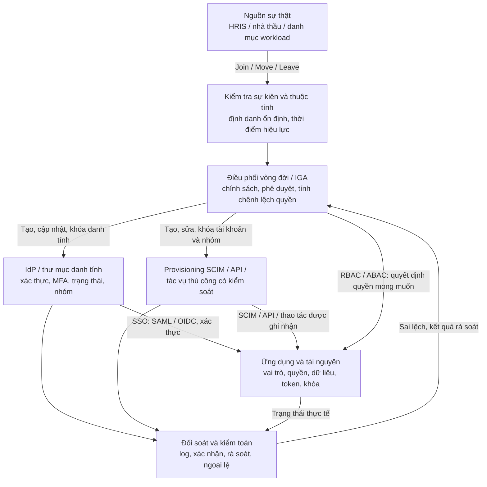
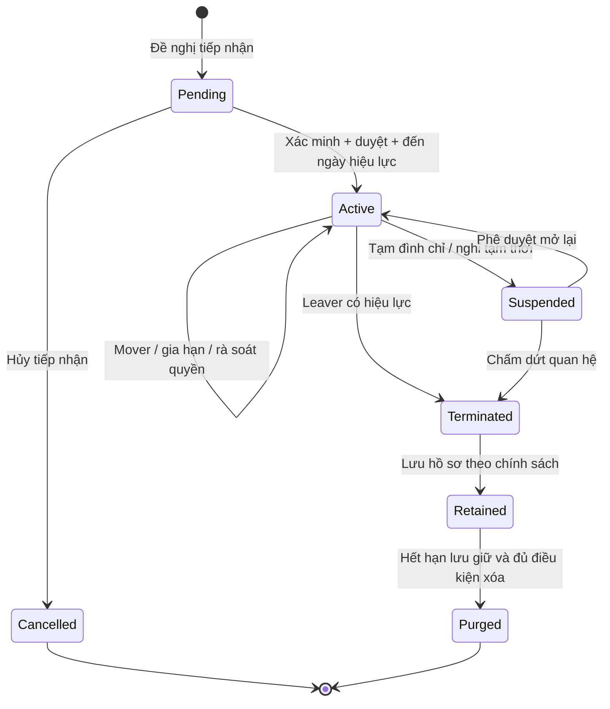
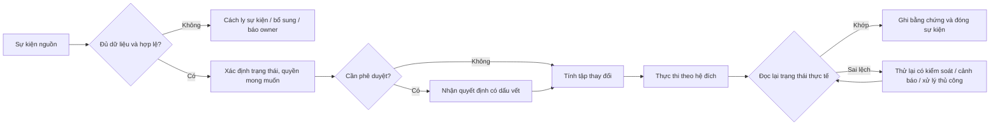

# Bản đồ identity lifecycle

> **Chương: Tổng kết IAM lifecycle**  
> **Phạm vi:** Quản lý vòng đời danh tính trong Identity and Access Management (IAM), từ xác minh và tiếp nhận, tạo tài khoản, cấp quyền, thay đổi vai trò, rà soát định kỳ đến vô hiệu hóa và thu hồi quyền. Bài học liên kết mô hình **Joiner–Mover–Leaver (JML)** với **Identity Provider (IdP), Single Sign-On (SSO), SCIM, RBAC/ABAC, danh tính máy (service account/workload identity), kiểm toán** và xử lý **quyền truy cập tồn dư**.

## 1. Mục tiêu và cách đọc bản đồ

Sau bài này, người học có thể:

1. Vẽ được luồng dữ liệu từ nguồn danh tính đáng tin cậy đến IdP, ứng dụng và kho bằng chứng kiểm toán.
2. Phân biệt **danh tính**, **tài khoản**, **phiên đăng nhập**, **thông tin xác thực**, **vai trò** và **quyền cụ thể**; nhận ra vì sao tắt SSO chưa đủ để thu hồi mọi quyền.
3. Mô tả điểm kích hoạt, điều kiện, thao tác và kết quả bắt buộc của ba nhánh **Joiner**, **Mover**, **Leaver**.
4. Xác định ai chịu trách nhiệm phê duyệt, thực thi, đối soát và xử lý ngoại lệ trên mỗi đoạn của vòng đời.
5. Tìm và khắc phục các khoảng trống gây ra tài khoản mồ côi, quyền cũ chưa thu hồi, token còn hiệu lực và danh tính dịch vụ không có chủ sở hữu.

**Câu hỏi xuyên suốt:** *Ai đang là ai, vì lý do gì được truy cập tài nguyên nào, kể từ khi nào, đến bao giờ và có bằng chứng gì chứng minh quyền đó đã được cấp hoặc thu hồi đúng lúc?*

IAM lifecycle là chuỗi quyết định và bằng chứng nối liền nhau, không chỉ là quy trình tạo hoặc xóa người dùng. Một danh tính có thể tồn tại lâu hơn một tài khoản; một tài khoản có thể có nhiều phiên; và quyền truy cập có thể còn hiệu lực thông qua khóa API hoặc tài khoản cục bộ dù người dùng không thể đăng nhập IdP.

## 2. Bản đồ tổng thể: năm lớp cần nhìn cùng lúc



Sơ đồ là **mô hình logic**, không bắt buộc mỗi tổ chức phải mua đủ một sản phẩm cho từng ô. Ở hệ thống nhỏ, IdP có thể trực tiếp điều phối provisioning; ở hệ thống lớn, một nền tảng Identity Governance and Administration (IGA) quản lý yêu cầu, phê duyệt, chứng nhận quyền và đối soát nhiều IdP/ứng dụng. Dù triển khai bằng công cụ nào, các trách nhiệm trong sơ đồ vẫn cần có người và cơ chế phụ trách.

| Lớp | Câu hỏi cần trả lời | Dữ liệu/đầu ra cốt lõi |
| --- | --- | --- |
| **Nguồn sự thật** | Ai chính thức gia nhập, đổi vai trò, ngừng hợp tác? | Mã nhân sự hoặc mã chủ thể ổn định; loại quan hệ; bộ phận; người quản lý; ngày hiệu lực |
| **Quản trị vòng đời** | Quyền nào *nên* tồn tại và ai duyệt ngoại lệ? | Chính sách, vai trò, phiếu phê duyệt, quyền mong muốn, ngày hết hạn |
| **IdP & xác thực** | Chủ thể có được xác thực và mở phiên mới không? | Trạng thái định danh, MFA, nhóm, phiên SSO, nhật ký đăng nhập |
| **Provisioning & thực thi quyền** | Tài khoản/quyền thực tế ở mỗi ứng dụng là gì? | SCIM/API, tài khoản ứng dụng, nhóm, role, ACL, token, khóa và secret |
| **Đối soát & bằng chứng** | Thực tế có khớp chính sách, đã thu hồi hết chưa? | Kết quả truy vấn trạng thái, log, dấu thời gian, xác nhận từ hệ đích, ngoại lệ còn mở |

Điểm mấu chốt là phải có **hai chiều**: lệnh thay đổi quyền đi *xuống* các hệ thống, còn trạng thái thực tế và bằng chứng đi *ngược lên* để xác nhận. Gửi một lệnh `deactivate` thành công về mặt truyền thông chưa đồng nghĩa mọi đường truy cập đã bị cắt.

### 2.1. Thuật ngữ nằm ở các lớp khác nhau

| Khái niệm | Ý nghĩa | Ví dụ |
| --- | --- | --- |
| **Identity (danh tính)** | Hồ sơ biểu diễn một chủ thể trong phạm vi tổ chức | Nhân viên mã `EMP-1042`, đối tác mã `EXT-030` |
| **Account (tài khoản)** | Đối tượng đăng nhập/thực thi ở một hệ thống cụ thể | `linh@congty.example` ở IdP; user ID 734 ở CRM |
| **Credential** | Bằng chứng dùng để xác thực | Passkey, khóa bảo mật, mật khẩu, certificate, secret |
| **Session/token** | Quyền truy cập đã được cấp trong một khoảng thời gian | Phiên trình duyệt, refresh token, access token |
| **Role / group** | Cách gom người và năng lực theo chính sách | `Support-Agent`, nhóm `CRM-ReadOnly` |
| **Entitlement (quyền cụ thể)** | Khả năng thao tác lên tài nguyên | `tickets:read`, `customers:export`, quyền quản trị billing |
| **Resource** | Đích cần được bảo vệ | Dữ liệu khách hàng, repo, bucket, SaaS, API |
| **Owner** | Người hoặc nhóm chịu trách nhiệm chấp nhận rủi ro và xét quyền | Quản lý trực tiếp, chủ dữ liệu, chủ ứng dụng |

Không nên dùng email làm khóa định danh duy nhất: email có thể đổi khi đổi tên hoặc miền, và đôi khi được tái sử dụng. Cần một **ID bất biến** từ nguồn có thẩm quyền cùng bảng đối chiếu ID của IdP và từng ứng dụng. Tên đăng nhập chỉ là thuộc tính có thể thay đổi.

## 3. Bản đồ trạng thái: danh tính đi qua những cột mốc nào?



`Pending`, `Active`, `Suspended`, `Terminated`, `Retained`, `Purged` là **trạng thái logic minh họa**, không phải bộ trạng thái bắt buộc của mọi IdP. Tùy hệ thống, còn có `pre-hire`, `on leave`, `expired`, `locked` hoặc các trạng thái cấp ứng dụng. Khi thiết kế phải nêu rõ mỗi trạng thái tác động ra sao đến **khả năng đăng nhập, phiên đang mở, quyền trên ứng dụng và thời hạn giữ dữ liệu**.

Điểm khác biệt quan trọng:

- **Đình chỉ (suspend)** thường có thể đảo ngược và cần đường tái kích hoạt được phê duyệt.
- **Chấm dứt (terminate/deprovision)** đặt mục tiêu cắt đường truy cập theo mức khẩn cấp của sự kiện; tài khoản có thể còn tồn tại ở trạng thái vô hiệu để phục vụ bàn giao, pháp lý hoặc kiểm toán.
- **Xóa dữ liệu (purge)** là quyết định về lưu giữ và bảo vệ dữ liệu, không nên đồng nhất với lúc khóa truy cập.
- **Mover** là lần tính lại quyền của chính một danh tính khi thuộc tính hoặc trách nhiệm thay đổi, không phải tạo thêm một danh tính mới.

## 4. Bản đồ JML: điểm kích hoạt → quyết định → thực thi → xác nhận

| Nhánh | Tác nhân và thời điểm kích hoạt | Quyết định/chính sách | Kết quả cần xác minh |
| --- | --- | --- | --- |
| **Joiner** | HR/chủ hợp đồng xác nhận người mới, ngày bắt đầu, bộ phận, quản lý | Xác minh chủ thể; tạo ID; quyền cơ bản phù hợp công việc; quyền nhạy cảm cần duyệt | Tài khoản đúng chủ thể; MFA; chỉ có quyền đã duyệt; quyền chỉ hiệu lực từ lúc cho phép |
| **Mover** | Thay đổi vị trí, nhóm, dự án, cấp bậc, địa điểm, trách nhiệm | Tính **chênh lệch** giữa tập quyền mới và tập quyền hiện tại; xét xung đột nhiệm vụ | Quyền cũ không còn lý do đã bị thu hồi, quyền mới có phê duyệt, không duy trì đặc quyền kép vô thời hạn |
| **Leaver** | Đến hạn kết thúc hợp đồng hoặc quyết định nghỉ/chấm dứt hợp tác | Khóa đúng thời điểm; thu hồi phiên, token, account, nhóm và bí mật; chuyển giao sở hữu | Không còn đường truy cập hợp lệ; hệ đích xác nhận; bằng chứng và ngoại lệ được lưu |

Luồng chuẩn cho cả ba nhánh:



Luồng trên thể hiện bước **đối soát**. Trong triển khai thật, cần giới hạn số lần thử, có lịch xử lý lỗi và đường chuyển cho người chịu trách nhiệm; tránh vòng thử lại vô hạn.

### 4.1. Joiner — tạo đúng chủ thể, đúng thời điểm, đúng mức quyền

1. **Xác minh nguồn:** HR hoặc người phụ trách nhà thầu cung cấp danh tính đã được kiểm chứng, loại nhân sự, manager/sponsor, ngày bắt đầu/kết thúc. Không tạo danh tính nhân sự chỉ từ email hoặc một yêu cầu chat không được xác nhận.
2. **Gắn mã ổn định và chống trùng:** so khớp theo định danh nguồn; phân biệt người quay lại làm việc với người trùng tên. Xác định quy tắc tái sử dụng danh tính cũ nếu phù hợp chính sách.
3. **Tính quyền cơ sở:** từ vị trí, phòng ban và thuộc tính liên quan, gán các nhóm/role tối thiểu. Quyền nhạy cảm phải có chủ dữ liệu phê duyệt và, nếu cần, thời hạn.
4. **Cấp phát:** tạo/đồng bộ đối tượng ở IdP, provision tới ứng dụng bằng SCIM hoặc API; với ứng dụng thủ công, giao phiếu cho owner và ghi lại việc hoàn tất.
5. **Thiết lập xác thực:** đăng ký MFA, ưu tiên phương án chống phishing khi có thể, kiểm tra chính sách thiết bị/vị trí phù hợp. Người mới không nhận mật khẩu chung hoặc dùng account của người khác.
6. **Xác minh:** đọc lại các role/nhóm trên ứng dụng, thử đường truy cập được phép theo quy trình, lưu thời gian thực thi và phê duyệt. Với `pre-hire`, kiểm soát rõ tài khoản nào được cấp sớm và phạm vi quyền trước ngày bắt đầu.

**Ví dụ:** Nhân viên hỗ trợ mới được quyền đọc/xử lý ticket nhưng không mặc nhiên có quyền xuất toàn bộ khách hàng hoặc quản trị billing. Tạo tài khoản CRM sớm để chuẩn bị máy tính không có nghĩa bật quyền truy cập dữ liệu thật ngay khi tài khoản xuất hiện.

### 4.2. Mover — quyền mới phải thay thế những quyền đã lỗi thời

Mover là điểm dễ phát sinh *privilege accumulation* (quyền cộng dồn). Ví dụ, một nhân viên từ Hỗ trợ sang Tài chính có thể nhận role mới mà vẫn giữ role xuất dữ liệu hỗ trợ nếu quy trình chỉ **cộng** thêm nhóm.

Gọi `E_now` là tập quyền thực tế, `E_target` là tập quyền hợp lệ sau đổi vai trò, khi đó:

```text
revoke = E_now - E_target
grant  = E_target - E_now
keep   = E_now ∩ E_target
```

Đây là phép tính **đích của quyền**, chưa phải toàn bộ logic nghiệp vụ: quyền đang được cấp tạm thời, ngoại lệ có hạn, xung đột phân nhiệm (Segregation of Duties – SoD) và resource ownership còn phải xét riêng. Nếu ứng dụng hỗ trợ nhiều role, cần tính quyền hiệu lực sau khi hợp nhất role, vì xóa một nhóm chưa chắc đã xóa được quyền do nhóm khác hoặc grant trực tiếp cấp lại.

Trình tự xử lý:

1. Nhận sự kiện vai trò mới với **ngày hiệu lực**, người quản lý mới và chủ dữ liệu liên quan.
2. Tính quyền hợp lệ; phát hiện SoD, ví dụ cùng người vừa tạo vừa duyệt thanh toán.
3. Lập kế hoạch **thu hồi quyền cũ** và cấp quyền mới có phê duyệt. Hạn chế giai đoạn hai bộ quyền cùng tồn tại; nếu cần bàn giao, cấp ngoại lệ ngắn hạn có owner, mục đích và hạn hết hiệu lực.
4. Cập nhật nhóm IdP, role ở từng app, grant trực tiếp, khóa/API token gắn với vai trò; đánh giá phiên còn mở cần refresh/revoke hay không.
5. Đọc lại entitlement thực tế, kiểm tra quyền nhạy cảm và lưu bằng chứng; quản lý mới xác nhận các quyền ngoại lệ còn hợp lý.

**Cảnh báo:** Đổi chức danh chỉ trong HRIS không tự động sửa ACL nằm trực tiếp ở database, quyền chia sẻ tài liệu, role cloud hoặc tài khoản local nếu không có kết nối provisioning/đối soát tới các nơi đó.

### 4.3. Leaver — cắt mọi đường truy cập, vẫn giữ dữ liệu đúng chính sách

Trước tiên phải xác định **thời điểm vô hiệu hóa**. Trường hợp nghỉ theo kế hoạch thường có mốc tương lai, còn chấm dứt khẩn cấp có thể cần khóa ngay theo quy trình được duyệt. Khi hệ thống nguồn và hệ đích khác múi giờ, sử dụng thời gian có timezone để tránh sai lệch.

Một danh mục thu hồi đầy đủ cần xem xét:

| Đối tượng | Thao tác ví dụ | Bằng chứng kiểm tra |
| --- | --- | --- |
| **IdP/SSO** | Disable danh tính; chặn đăng nhập mới; thu hồi phiên và refresh token khi hỗ trợ | Trạng thái bị khóa, phiên bị chấm dứt, log xác thực bị từ chối |
| **SaaS/ứng dụng** | Disable/deprovision qua SCIM/API hoặc tác vụ có xác nhận | Hệ đích báo inactive/removed; quyền và role thực tế không còn |
| **Quyền trực tiếp** | Xóa membership, ACL, cloud role, repo access, quyền trên công cụ nội bộ | Truy vấn lại entitlement, không có grant tồn dư |
| **Credential/token ngoài SSO** | Thu hồi PAT, API key, SSH key, certificate, token ứng dụng; đổi secret đã dùng chung | Token/key bị revoke; rotation có dấu vết khi cần |
| **Thiết bị và truy cập từ xa** | Thu hồi quyền VPN, quản lý thiết bị, chứng chỉ thiết bị theo chính sách | Device/session đã mất khả năng kết nối liên quan |
| **Tài nguyên sở hữu** | Chuyển owner workflow, dashboard, pipeline, repository, dữ liệu/automation | Owner mới nhận trách nhiệm, tác vụ kinh doanh tiếp tục hoạt động |
| **Dữ liệu và lưu giữ** | Bảo quản hồ sơ theo chính sách và nghĩa vụ áp dụng; lên lịch xóa an toàn | Retention marker, phiếu duyệt, log xóa khi đến hạn |

**Thứ tự thực hiện phụ thuộc rủi ro**, nhưng ưu tiên thường là chặn đăng nhập và cắt các đường truy cập độc lập còn hiệu lực, sau đó đối soát và hoàn tất bàn giao/retention. Trong trường hợp cần bảo toàn dữ liệu điều tra hoặc pháp lý, quản lý bằng chính sách lưu giữ và quyền truy cập hạn chế; không giữ account hoạt động chỉ để người khác lấy dữ liệu.

Không thể kết luận Leaver hoàn tất chỉ bằng thông báo `HTTP 200` từ API. Phải xác nhận trạng thái thật tại các hệ đích, bao gồm những nơi **không có SCIM** và những quyền **không phụ thuộc SSO**.

## 5. Bản đồ giao thức và cơ chế: mỗi công cụ giải một phần bài toán

| Thành phần | Nó giải quyết việc gì? | Nó **không tự bảo đảm** điều gì? |
| --- | --- | --- |
| **IdP** | Duy trì hồ sơ xác thực, trạng thái user, nhóm, MFA và chính sách đăng nhập | Không mặc nhiên kiểm soát token/API key riêng của mọi ứng dụng |
| **SSO (SAML/OIDC)** | Cho phép xác thực tập trung và truyền assertion/token tới ứng dụng | Không đồng nghĩa tài khoản ứng dụng đã được tạo/xóa; một số phiên app có thể còn tồn tại sau khi IdP khóa user |
| **SCIM** | Chuẩn HTTP/JSON để provision, cập nhật, kích hoạt/vô hiệu user và membership khi hai bên hỗ trợ | Không tự xác định *ai xứng đáng có quyền gì*; mức hỗ trợ, đồng bộ và semantics `active=false` tùy ứng dụng |
| **RBAC** | Gán quyền thông qua vai trò có định nghĩa | Role rộng hoặc role cũ vẫn có thể dẫn đến thừa quyền |
| **ABAC** | Đánh giá quyền dựa trên thuộc tính chủ thể, tài nguyên, hành động và bối cảnh | Quyết định sai nếu thuộc tính cũ/sai hoặc policy không được thực thi tại điểm truy cập |
| **IGA/Access Review** | Điều phối yêu cầu, phê duyệt, chứng nhận và rà soát quyền | Không thay thế connector hoặc cơ chế thực thi tại app đích |
| **Audit & reconciliation** | Phát hiện khác biệt và lưu dấu vết quyết định/thực thi | Log tập trung không tự thu hồi quyền nếu không có đường khắc phục |

### 5.1. SSO và SCIM là hai trục khác nhau

Ví dụ một SaaS hỗ trợ đăng nhập OIDC bằng IdP nhưng **không hỗ trợ SCIM**. Khi nhân viên nghỉ việc và IdP bị khóa, người đó khó tạo phiên SSO mới; tuy nhiên ứng dụng có thể vẫn lưu user, role và access token độc lập, hoặc phiên đã cấp trước đó còn thời hạn. Vì thế bản đồ triển khai phải ghi cả **cách đăng nhập** lẫn **cách thu hồi account, quyền và phiên** của từng ứng dụng.

Trong SCIM, resource `User` và `Group` thường được dùng để quản lý user/membership. Một cập nhật như `active: false` là tín hiệu vòng đời cho hệ đích có hỗ trợ semantics tương ứng; cần kiểm chứng cách hệ đích xử lý quyền, phiên và dữ liệu thực tế. Không mặc định `DELETE` là thao tác thích hợp cho mọi trường hợp, vì có chính sách lưu giữ và phụ thuộc nghiệp vụ.

### 5.2. RBAC, ABAC và quyền cấp trực tiếp

Chính sách quyền minh họa:

```text
role = Support-Agent
  -> tickets:read, tickets:update

attribute condition:
  department == "Support"
  AND employmentStatus == "active"
  AND deviceTrusted == true

temporary exception:
  customers:export
  owner = "Data Owner"
  expiresAt = "2026-12-01T17:00:00+07:00"
```

Đây là **mô tả chính sách giả lập**, không phải cú pháp của một IdP hay authorization engine cụ thể. Quyền hiệu lực phụ thuộc cả cách ứng dụng thực thi role/policy. `employmentStatus == active` trong ABAC chỉ phát huy tác dụng nếu attribute được cập nhật kịp thời và hệ đích thực sự dùng nó khi xử lý yêu cầu. Grant trực tiếp, group lồng nhau và quyền có từ tài khoản thứ hai cần được đưa vào kiểm kê; nếu bỏ sót, phép tính chênh lệch quyền ở bước Mover sẽ thiếu.

## 6. Bản đồ chủ sở hữu và ranh giới trách nhiệm

| Hoạt động | Chịu trách nhiệm nghiệp vụ | Đầu mối triển khai/kiểm soát |
| --- | --- | --- |
| Khẳng định Joiner/Mover/Leaver và ngày hiệu lực | HR hoặc chủ hợp đồng đã được chỉ định | Tích hợp nguồn dữ liệu, validation |
| Xác định quyền cần cho công việc | Quản lý trực tiếp và chủ dữ liệu/ứng dụng | IGA/policy, role catalog |
| Phê duyệt quyền đặc biệt và ngoại lệ | Chủ dữ liệu, chủ rủi ro theo quy định tổ chức | Workflow approval, SoD, expiry |
| Cấp phát, thu hồi và khóa truy cập | Đội IAM/platform cùng chủ ứng dụng đích | IdP, provisioning, connector, runbook |
| Xác nhận quyền thực tế và rà soát | Chủ ứng dụng/manager, với kiểm tra độc lập phù hợp | Entitlement inventory, certification, audit |
| Chuyển giao dữ liệu, automation và tài sản | Chủ quy trình/owner mới | IT, chủ hệ thống, chính sách retention |

Nên định nghĩa rõ người **chịu trách nhiệm cuối cùng**, người **thực thi** và người **xác nhận kết quả** cho mỗi hệ thống. Một ứng dụng không có owner hoặc không ai nhận ticket deprovision là lỗ hổng quy trình dù IdP đã cấu hình tốt.

## 7. Bản đồ danh tính không phải con người

Danh tính máy như **service account, service principal, workload identity, bot, CI/CD identity** cũng có vòng đời nhưng nguồn kích hoạt thường là **khởi tạo, thay đổi, chuyển owner hoặc ngừng vận hành workload**, thay vì ngày vào/ra công ty của một cá nhân.

| Giai đoạn | Câu hỏi kiểm soát |
| --- | --- |
| **Đề nghị** | Workload nào cần identity? Ai là owner? Môi trường, phạm vi và thời hạn sử dụng? |
| **Tạo** | Có thể dùng danh tính workload ngắn hạn/federation thay khóa tĩnh dài hạn không? Có đúng quyền tối thiểu không? |
| **Vận hành** | Secret nằm trong hệ quản lý bí mật? Có rotation, cảnh báo sử dụng lạ, phân tách dev/test/prod? |
| **Thay đổi** | Khi workload đổi nhiệm vụ, owner chuyển nhóm hoặc người phụ trách nghỉ, quyền và credential có được kiểm tra lại? |
| **Ngừng sử dụng** | Đã thu hồi credential, role, trust relationship, access token, webhook và xóa phụ thuộc không cần thiết? |

**Ví dụ:** Pipeline CI được cấp cloud role để triển khai dịch vụ A. Khi pipeline chuyển sang dự án B, không nên giữ cả quyền deploy A lẫn B vô thời hạn. Nếu quản trị viên của pipeline nghỉ việc, automation không nhất thiết phải dừng; thay vào đó cần **chuyển owner, loại bỏ token cá nhân khỏi pipeline, xoay secret dùng chung nếu có rủi ro** và xem lại quyền của service principal.

Với tài khoản **break-glass** để khôi phục khi IdP hoặc SSO gặp sự cố, phải có danh mục, owner, cơ chế lưu giữ và giám sát riêng, hạn chế tối đa việc sử dụng thường ngày, kiểm thử khả năng truy cập hợp lệ theo quy trình và rà soát sau mỗi lần dùng. Tài khoản ngoại lệ không được trở thành lối thoát khỏi chính sách Leaver.

## 8. Bản đồ quyền truy cập tồn dư: vì sao đã nghỉ vẫn còn quyền?

**Residual access (quyền truy cập tồn dư)** là khả năng truy cập còn tồn tại sau khi lý do cấp quyền đã mất. Nó có thể phát sinh từ tài khoản địa phương, quyền cấp trực tiếp, phiên/token chưa bị thu hồi, chia sẻ tài nguyên, nhóm lồng nhau, tài khoản phụ hoặc secret dùng chung.

| Dấu hiệu | Nguyên nhân thường gặp | Cách phát hiện/giảm thiểu |
| --- | --- | --- |
| IdP disabled nhưng SaaS vẫn active | Chỉ tích hợp SSO; connector deprovision thiếu/lỗi | Liệt kê app theo danh tính, so trạng thái IdP–SaaS, xác nhận khóa ở đích |
| Nhân viên đổi bộ phận nhưng giữ quyền cũ | Workflow chỉ thêm role, không tính `revoke` | So `E_now` với `E_target`, yêu cầu manager xác nhận ngoại lệ |
| Tài khoản không có chủ thể hợp lệ | User local, nhập tay, nguồn HRIS mất liên kết, ID map lỗi | Đối soát owner/subject ID; phân loại orphan account và xử lý |
| Access token còn dùng được | Chưa revoke token, TTL dài, app không tra trạng thái IdP mỗi request | Thiết kế TTL phù hợp, revoke/rotate token, kiểm thử logout/offboarding |
| Quyền tồn tại qua group khác | Nhóm lồng nhau hoặc nhiều đường grant | Tính **effective permissions**, không chỉ membership cấp trên |
| Khóa API thuộc nhân viên đã nghỉ | Dùng token cá nhân trong automation | Tìm token owner, chuyển sang identity dịch vụ, revoke token cũ |
| Quyền nhà thầu quá hạn | Không có `endDate`/sponsor hoặc tái chứng nhận | Bắt buộc expiry, nhắc/gia hạn có duyệt, tự khóa khi hết hạn |
| Quy trình dừng ở lỗi connector | Sự kiện gửi nhưng thiếu xác nhận hoặc không retry | Queue bền vững, idempotency, retry có giới hạn, cảnh báo và đối soát |

**Đối soát phải đi từ nguồn chính thức tới trạng thái thực tế** và ngược lại. Chiều nguồn → đích trả lời “người hợp lệ có đúng quyền không”; chiều đích → nguồn tìm “tài khoản/quyền đang tồn tại có chủ thể và lý do hợp lệ không”. Chiều ngược đặc biệt hữu ích để tìm tài khoản local và grant không qua IGA.

## 9. Tình huống xuyên suốt: một nhân viên qua cả ba nhánh

Giả sử công ty có HRIS, một IdP dùng SSO OIDC cho CRM, SCIM provision user vào CRM, một hệ thống billing dùng API riêng và kho mã nguồn quản lý membership độc lập. **Linh** có mã danh tính nội bộ `EMP-1042`.

### Ngày 1 — Joiner

HR xác minh Linh bắt đầu ở bộ phận Hỗ trợ. IAM tạo identity `EMP-1042`, cấp nhóm `Support-Agent`, provision CRM và đăng ký MFA. CRM cho phép `tickets:read` và `tickets:update`; billing chưa có account. Bằng chứng gồm event HR, policy version, phê duyệt role nhạy cảm (nếu có), user ID CRM và kết quả đọc lại quyền.

### Tháng 6 — Mover

Linh chuyển sang Tài chính. Quyền mong muốn sau chuyển là `Finance-Analyst`, không còn `Support-Agent`. Workflow xác định cần thu hồi quyền sửa ticket, cấp quyền đọc báo cáo billing và xin duyệt riêng nếu cần `payments:approve`. Một ticket cũ cấp `customers:export` đến cuối tháng phải được chủ dữ liệu xem xét lại hoặc thu hồi ngay theo chính sách mới. IAM đọc lại group trên CRM và role trong billing; nếu CRM vẫn còn grant trực tiếp `customers:export`, Mover chưa được coi là hoàn tất.

### Tháng 12 — Leaver

HR ghi nhận ngày kết thúc. Đến thời điểm có hiệu lực, IAM disable IdP, xử lý phiên/token, deprovision CRM qua SCIM, vô hiệu account billing qua API và gỡ membership kho mã. Dashboard tài chính do Linh sở hữu được chuyển cho owner mới; dữ liệu cần lưu vẫn được giữ theo chính sách. Audit chỉ đánh dấu hoàn tất khi có **acknowledgement và trạng thái đọc lại** từ CRM, billing và kho mã, hoặc đã mở ngoại lệ có owner, hạn xử lý và biện pháp chặn tạm thời.

Bảng chứng cứ tối thiểu cho một event có thể trông như sau:

| Trường | Ví dụ | Vì sao cần |
| --- | --- | --- |
| `subjectId` | `EMP-1042` | Liên kết ổn định qua nhiều hệ thống |
| `eventId` | `HR-2026-18472` | Chống xử lý trùng và truy vết nguồn |
| `eventType` | `MOVER` | Biết chính sách nào được áp dụng |
| `effectiveAt` | `2026-11-30T17:00:00+07:00` | Đánh giá đúng thời điểm |
| `policyVersion` | `iam-roles-v12` | Giải thích vì sao quyền được tính như vậy |
| `approvedBy` | Mã người/nhóm phê duyệt | Truy trách nhiệm; không cần lưu bí mật nhạy cảm |
| `targetSystems` | CRM, billing, code hosting | Biết cần hoàn thành ở những đích nào |
| `actualResult` | Entitlement sau cập nhật của từng đích | Chứng minh hệ thống đã thực thi |
| `completedAt` | Thời điểm hoàn tất | Đo độ trễ và phục vụ điều tra |

Các giá trị trong ví dụ là **giả định để học**, không phải dữ liệu nhân sự thật hay SLA mặc định cho mọi tổ chức.

## 10. Bản đồ độ tin cậy: sự kiện có thể đến trễ, sai thứ tự hoặc thất bại

Một luồng JML tự động vẫn phải chịu lỗi mạng, hệ đích ngừng hoạt động, webhook đến trùng, xung đột dữ liệu hoặc sự kiện `MOVER` đến sau `LEAVER`. Để tránh quyền bị cấp lại ngoài ý muốn:

1. **Dùng sự kiện có định danh và phiên bản/thời điểm hiệu lực:** lưu `eventId`, `subjectId`, `effectiveAt`, sequence/version nếu nguồn cung cấp. Với sự kiện đến sai thứ tự, đối chiếu trạng thái mới nhất của nguồn trước khi ghi đè trạng thái đích.
2. **Thực thi idempotent:** chạy lại cùng một event không tạo thêm account hay nhân đôi quyền; thao tác luôn hướng đến **trạng thái mong muốn**, thay vì chỉ diễn giải lệnh cộng/trừ một cách mù quáng.
3. **Quản lý lỗi từng đích:** ghi outcome của từng ứng dụng, retry có giới hạn và backoff, gửi cảnh báo cho owner nếu quá hạn, thiết lập phương án vô hiệu thủ công cho sự cố cấp bách.
4. **Không coi “đã gửi” là “đã xong”:** dùng acknowledgement và truy vấn đối soát; chú ý tính nhất quán cuối cùng nếu app cập nhật bất đồng bộ.
5. **Bảo vệ dữ liệu và quyền điều phối:** workflow cần least privilege, secret được quản lý, log không phơi thông tin xác thực/PII quá mức, và hành động nhạy cảm cần phân tách nhiệm vụ.
6. **Thực hiện reconciliation định kỳ:** kể cả khi webhook/event vận hành tốt, vẫn quét lệch trạng thái để phát hiện thay đổi thủ công và connector bị hỏng.

Mỗi hệ đích nên có **contract vận hành**: cách định danh account, cách provision/disable, cách truy vấn trạng thái, có revoke phiên/token được không, người chịu trách nhiệm, độ trễ kỳ vọng và đường xử lý khi thất bại. Nếu ứng dụng không hỗ trợ tự động, đưa bước thủ công có bằng chứng vào workflow thay vì giả định đã được bao phủ.

## 11. Bản đồ kiểm toán và chỉ số vận hành

Đánh giá hệ thống bằng cả **độ bao phủ**, **độ đúng**, **thời gian** và **bằng chứng**.

| Chỉ số gợi ý | Cách hiểu và cách đo |
| --- | --- |
| **Coverage ứng dụng** | Tỷ lệ ứng dụng quan trọng có danh mục owner, phương án provision/deprovision và đối soát được xác định |
| **Tỷ lệ Joiner đúng quyền** | Số Joiner không có grant vượt chính sách tại thời điểm kiểm tra / tổng Joiner trong kỳ |
| **Độ trễ Leaver** | Khoảng từ `effectiveAt`/thời điểm cần khóa đến lúc **hệ đích cuối cùng** xác nhận mất quyền; báo cáo cả các phân vị, không chỉ trung bình |
| **Mover stale-entitlement rate** | Tỷ lệ Mover còn quyền không hợp lệ sau thời hạn xử lý đã quy định |
| **Orphan account rate** | Account không ánh xạ được về danh tính/workload hợp lệ hoặc owner được chỉ định / tổng account trong phạm vi kiểm tra |
| **Exception overdue** | Số ngoại lệ quá hạn xử lý, bao gồm quyền tạm thời quá hạn |
| **Review completion & remediation** | Số quyền đã được chứng nhận và số quyền bị từ chối **đã thực sự thu hồi**, không chỉ có kết quả click duyệt |
| **Provisioning failure/retry** | Số event không đồng bộ, retry, mất liên kết ID hoặc sai lệch khi đối soát theo từng ứng dụng |

Đặt ngưỡng/SLA theo **phân loại rủi ro, quy trình nhân sự, khả năng kỹ thuật và yêu cầu pháp lý** của tổ chức. Không có một thời gian chuẩn duy nhất áp dụng cho mọi hệ thống. Việc đo lường cần định nghĩa rõ mốc bắt đầu và kết thúc để tránh báo cáo “Leaver hoàn tất” khi chỉ khóa IdP mà các ứng dụng phụ chưa xử lý.

**Một audit trail hữu ích** trả lời được: sự kiện bắt nguồn từ đâu; ai/phần mềm nào xác minh; chính sách phiên bản nào đã tính quyền; ai phê duyệt ngoại lệ; hệ nào được gọi; hệ nào đã xác nhận; quyền thực tế còn gì; ai nhận trách nhiệm khi có lỗi; lúc nào hoàn tất. Bảo vệ quyền truy cập log và thời hạn lưu giữ log tương ứng với độ nhạy của thông tin.

## 12. Bài tập tự kiểm tra: tự vẽ bản đồ cho một ứng dụng

Chọn một ứng dụng có người dùng là nhân viên hoặc nhà thầu và hoàn thành khung sau:

| Ô cần điền | Câu hỏi |
| --- | --- |
| **Nguồn** | Sự kiện Joiner/Mover/Leaver lấy từ đâu; ID ổn định là gì; ai sửa được dữ liệu nguồn? |
| **Chính sách** | Quyền được quyết định từ role/attribute nào; ai duyệt quyền nhạy cảm và ngoại lệ? |
| **Cấp phát** | Tạo/cập nhật user qua SCIM, API hay thủ công; ai nhận lỗi connector? |
| **Xác thực** | SSO qua SAML/OIDC hay account local; chính sách MFA/phiên/token ra sao? |
| **Mover** | Khi đổi nhóm, hệ thống có thu hồi grant trực tiếp và quyền cũ không? |
| **Leaver** | Ai khóa account, revoke token/session/keys và xử lý owner của tài nguyên? |
| **Đối soát** | Có thể truy vấn danh sách user, role, key và quyền hiệu lực từ hệ đích không? |
| **Bằng chứng** | Log, event ID, phê duyệt, kết quả thực thi và xác nhận lưu ở đâu? |
| **Ngoại lệ** | Nếu không có SCIM hoặc hệ đích ngừng hoạt động thì xử lý thế nào? |
| **Danh tính máy** | App có service account nào, owner là ai và khi nào phải ngừng/rotate? |

Một bản đồ chỉ được xem là **có khả năng vận hành** khi trả lời cụ thể ba câu hỏi cho mỗi hệ đích: **(1) Có cách biết quyền nào đáng ra phải tồn tại không? (2) Có cách đổi/thu hồi quyền đó không? (3) Có cách xác minh trạng thái thực tế sau khi đổi không?** Nếu một ô chưa có câu trả lời, hãy ghi đó là lỗ hổng cùng owner và hành động cần khắc phục.

## 13. Tổng hợp kiến thức

**Identity lifecycle** nối sự thật về chủ thể với chính sách quyền, cơ chế truy cập thực tế và bằng chứng kiểm soát. **Joiner** cần xác minh và cấp tối thiểu; **Mover** cần tính lại quyền và thu hồi phần không còn hợp lệ; **Leaver** cần khóa đầy đủ mọi đường truy cập, xử lý phiên/credential và bàn giao tài nguyên. IdP và SSO giúp quản lý xác thực, SCIM/API giúp đồng bộ tài khoản, RBAC/ABAC quyết định phạm vi quyền, còn IGA/kiểm toán giúp quản trị và kiểm chứng quá trình.

Hãy nhớ chuỗi vận hành: **Nguồn đáng tin → Quyết định có chủ sở hữu → Thực thi từng đích → Đọc lại trạng thái → Lưu bằng chứng → Đối soát định kỳ**. Điểm kết thúc của một thay đổi vòng đời là **quyền thực tế đã đúng và kiểm chứng được**, không đơn thuần là một sự kiện đã được gửi đi.
