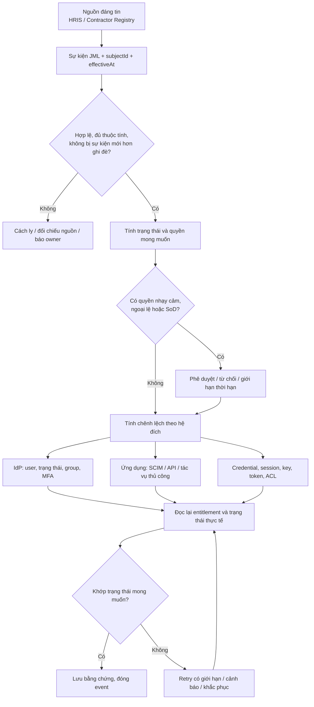
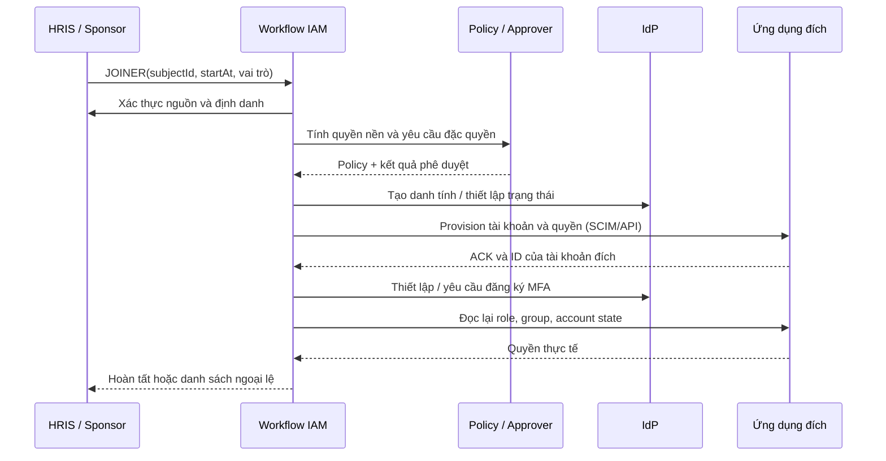
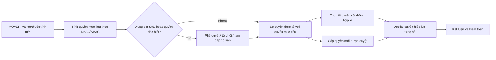
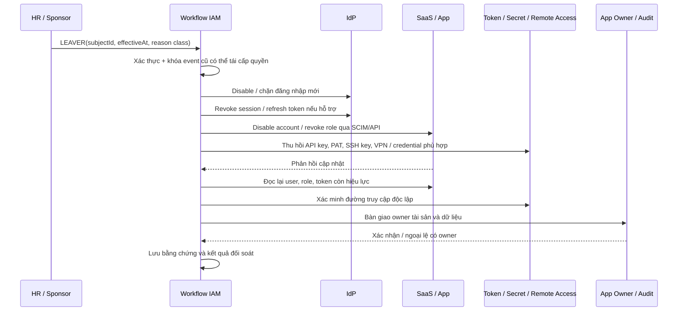

# Luồng Joiner–Mover–Leaver trong IAM

> **Chương:** Tổng kết IAM lifecycle  
> **Phạm vi:** Quy trình vận hành danh tính theo các sự kiện **Joiner** (gia nhập), **Mover** (chuyển đổi vai trò) và **Leaver** (rời tổ chức). Bài học nối xác minh chủ thể, tạo và cập nhật tài khoản, cấp và thu hồi quyền với IdP, SSO, SCIM, RBAC/ABAC, danh tính dịch vụ, đối soát và kiểm toán.

## 1. Kết quả cần đạt

Sau bài học, người học có thể:

1. Trình bày **đầu vào → kiểm tra → quyết định quyền → thực thi → xác minh → lưu bằng chứng** cho cả ba sự kiện JML.
2. Xác định thời điểm và hệ thống có thẩm quyền phát sự kiện nhân sự; phân biệt **trạng thái danh tính** với **trạng thái tài khoản ở từng ứng dụng**.
3. Viết điều kiện hoàn tất cho Joiner, Mover và Leaver, bao gồm cả các trường hợp một ứng dụng không hỗ trợ SCIM hoặc có token tồn dư.
4. Thiết kế luồng Mover thu hồi quyền cũ trước hoặc cùng lúc cấp quyền mới theo chính sách, tránh tích lũy đặc quyền và xung đột phân nhiệm.
5. Xử lý sự kiện trùng, đến muộn, sai thứ tự, thất bại một phần và rà soát chênh lệch giữa trạng thái mong muốn với trạng thái thực tế.
6. Áp dụng các nguyên tắc tương tự cho service account/workload identity mà không nhầm vòng đời máy với hồ sơ nhân sự.

**Nguyên tắc cốt lõi:** Workflow JML chỉ kết thúc khi trạng thái và quyền **thực tế** ở các hệ thống thuộc phạm vi đã đạt mục tiêu hoặc được ghi nhận là ngoại lệ có kiểm soát. Một sự kiện đã gửi đi, một ticket đã đóng hoặc một lệnh API trả thành công chưa đủ chứng minh người dùng đã có đúng quyền.

## 2. Xác định đầu vào trước khi chạy JML

Một luồng JML đáng tin cậy bắt đầu từ dữ liệu danh tính có nguồn gốc rõ ràng. HRIS thường là nguồn xác nhận nhân viên; hệ thống quản lý nhà thầu hoặc chủ hợp đồng có thể là nguồn cho đối tác. Với danh tính máy, nguồn sự thật có thể là hệ thống quản lý workload hoặc nền tảng cloud. **IdP** có thể lưu hồ sơ đăng nhập, nhưng thông tin nhân sự/quan hệ hợp đồng thường cần được xác thực từ hệ thống có thẩm quyền riêng.

| Trường đầu vào | Vai trò trong workflow | Kiểm tra quan trọng |
| --- | --- | --- |
| `subjectId` | Định danh ổn định cho cùng một chủ thể | Không dựa vào tên hiển thị/email làm khóa bất biến |
| `eventId` | Truy vết và xử lý lại một sự kiện an toàn | Chống xử lý trùng, gắn với bản ghi nguồn |
| `eventType` | `JOINER`, `MOVER`, `LEAVER` | Thuộc tập sự kiện được hỗ trợ |
| `effectiveAt` | Thời điểm nghiệp vụ thay đổi có hiệu lực | Có múi giờ; tách thời gian phát hiện và thời gian hiệu lực |
| `sourceVersion` | Phiên bản/sequence của trạng thái nguồn | Nhận diện cập nhật cũ, trùng hoặc sai thứ tự |
| `employmentStatus` | Trạng thái quan hệ với tổ chức | Phải tương thích loại sự kiện |
| `department`, `position`, `managerId` | Tính nhóm/role và người phê duyệt | Không để dữ liệu trống vô tình dẫn tới quyền rộng |
| `startAt`, `endAt` | Giới hạn quyền theo thời hạn | Bắt buộc kiểm soát hết hạn cho nhà thầu nếu chính sách yêu cầu |
| `sponsorId` | Chủ sở hữu nghiệp vụ của nhà thầu/đối tác | Có người chịu trách nhiệm và còn hiệu lực |

**Ví dụ envelope sự kiện (minh họa):**

```json
{
  "eventId": "HR-2026-00987",
  "subjectId": "EMP-0421",
  "eventType": "MOVER",
  "effectiveAt": "2026-11-23T09:00:00+07:00",
  "sourceVersion": 31,
  "employmentStatus": "active",
  "attributes": {
    "department": "Finance",
    "position": "Analyst",
    "managerId": "EMP-0120"
  }
}
```

Đây là cấu trúc minh họa cho học tập, không phải schema chuẩn của SCIM hoặc một sản phẩm cụ thể. Trong triển khai thật còn cần thông tin về tính toàn vẹn nguồn, phạm vi dữ liệu được phép truyền, khả năng xử lý lại sự kiện và chính sách bảo vệ thông tin cá nhân. Một hệ thống không nên tin sự kiện đến từ bên ngoài chỉ vì payload chứa `eventType: "LEAVER"`.

### 2.1. Phân biệt ba thời điểm

- **`occurredAt`**: lúc nguồn ghi nhận việc thay đổi.
- **`effectiveAt`**: lúc thay đổi có hiệu lực theo nghiệp vụ.
- **`completedAt`**: lúc workflow hoàn tất các điều kiện xác minh.

Ví dụ HR nhập trước sự kiện nghỉ việc dự kiến vào cuối tháng: hệ thống có thể chuẩn bị bàn giao ngay, nhưng lịch khóa tài khoản phải tuân theo `effectiveAt`. Với chấm dứt khẩn cấp, thời điểm cần khóa có thể được quyết định theo quy trình phản ứng được ủy quyền. Tránh dùng thời điểm webhook đến làm thời điểm khóa nếu nguồn đã cung cấp thời điểm hiệu lực đáng tin.

## 3. Khung xử lý dùng chung cho cả ba luồng



Khung này có sáu công đoạn với trách nhiệm riêng:

1. **Phát hiện:** hệ thống nguồn công bố sự thay đổi có danh tính và mốc thời gian rõ ràng.
2. **Kiểm tra:** IAM xác thực nguồn, xác minh liên kết subject/account, kiểm tra phiên bản sự kiện và dữ liệu cần thiết.
3. **Quyết định:** engine chính sách hoặc IGA tính trạng thái, quyền cần có; chủ quyền/phê duyệt xử lý đặc quyền và ngoại lệ.
4. **Thực thi:** IdP, bộ đồng bộ SCIM, API từng ứng dụng hoặc vận hành thủ công thay đổi account, nhóm, credential, token và quyền.
5. **Xác minh:** đọc lại **effective access** từ hệ đích; đối chiếu với quyền mục tiêu, không chỉ dựa vào phản hồi của yêu cầu cập nhật.
6. **Ghi nhận:** lưu bằng chứng ai yêu cầu, ai duyệt, thay đổi gì, ở đâu, khi nào; xử lý sai lệch còn mở.

### 3.1. Phân công trách nhiệm

| Trách nhiệm | Đầu mối thường gặp | Đầu ra kiểm chứng |
| --- | --- | --- |
| Xác nhận gia nhập, đổi vai trò, rời tổ chức | HR / chủ hợp đồng | Hồ sơ nguồn và thời điểm hiệu lực |
| Xác nhận nhu cầu công việc | Quản lý trực tiếp | Role/nhóm phù hợp công việc |
| Chấp thuận đặc quyền, quyền nhạy cảm và SoD | Chủ dữ liệu, chủ hệ thống, bộ phận kiểm soát | Phê duyệt có dấu vết và thời hạn |
| Vận hành định danh và luồng provisioning | IAM / Platform | Job, connector, trạng thái IdP/app |
| Thực thi và xác nhận tại ứng dụng đích | Chủ ứng dụng / admin app | Danh sách quyền thực tế và trạng thái account |
| Kiểm toán, xác nhận rà soát định kỳ | IAM governance / kiểm soát nội bộ | Biên bản review, ngoại lệ, báo cáo khắc phục |

Vai trò thực tế có thể kiêm nhiệm tùy tổ chức, nhưng phải biết ai quyết định và ai xác minh mỗi quyền. Không có app owner nhận việc khi SCIM thất bại sẽ tạo lỗ hổng dù luồng tự động chạy đúng.

## 4. Joiner — luồng tiếp nhận và cấp quyền

**Mục đích:** Tạo danh tính chính xác cho người mới, bảo đảm họ có công cụ làm việc đúng lúc với quyền tối thiểu được phê duyệt.



### 4.1. Trình tự vận hành

**Bước 1 — Tiếp nhận và xác minh.** Nhận sự kiện từ nguồn có thẩm quyền. Xác nhận người thật/hợp đồng, mã chủ thể ổn định, thời điểm bắt đầu, manager/sponsor. Chống tạo danh tính trùng khi người quay lại làm việc hoặc khi HR sửa thông tin.

**Bước 2 — Xác định chính sách.** Từ bộ phận, chức danh, loại hợp tác, địa điểm hoặc yếu tố hợp lệ khác, tính `desiredEntitlements`. Quyền cơ bản có thể tự động; quyền quản trị, dữ liệu nhạy cảm, thao tác thanh toán cần phê duyệt riêng. Role catalog phải ghi rõ mỗi role thực sự cấp quyền gì.

**Bước 3 — Tạo danh tính và account.** Đăng ký subject ở IdP; nối subjectId với user ID ở SaaS/CRM, repository, cloud và các hệ thống có account riêng. Tạo ứng dụng qua SCIM/API nếu được hỗ trợ, hoặc tạo ticket có owner và bằng chứng cho thao tác thủ công. Việc **tạo trước ngày vào làm** phải có trạng thái phù hợp, không vô tình mở quyền dữ liệu trước khi được phép.

**Bước 4 — Kích hoạt xác thực.** Áp dụng chính sách MFA, phương thức xác thực phù hợp và hướng dẫn người dùng tự đăng ký theo luồng an toàn. Không gửi mật khẩu chung hay nhờ đồng nghiệp sử dụng tài khoản của nhau.

**Bước 5 — Xác nhận.** Truy vấn lại account, quyền và các nhóm tại hệ đích; đối chiếu quyền được duyệt. Thông báo hoàn tất hoặc nêu rõ hệ chưa sẵn sàng, người xử lý, mức độ ưu tiên và phương án khắc phục.

### 4.2. Ví dụ Joiner

An bắt đầu làm chuyên viên hỗ trợ khách hàng ngày 01/12. HR xác nhận `EMP-0421`, thuộc bộ phận Support, manager là `EMP-0150`. IAM gán role `Support-Agent` để đọc và cập nhật ticket, tạo tài khoản CRM và yêu cầu MFA. Yêu cầu xuất hàng loạt dữ liệu khách hàng bị giữ lại để chủ dữ liệu phê duyệt. **Kết quả đúng** là CRM thể hiện đúng hai quyền làm việc cơ bản, không có quyền export ngoài phê duyệt, và quyền chỉ có hiệu lực từ thời điểm quy định.

### 4.3. Điều kiện hoàn tất Joiner

- Có một danh tính gắn đúng `subjectId`, không có account trùng vô chủ.
- Chỉ các quyền có căn cứ và phê duyệt đang hiệu lực được tạo; quyền nhạy cảm được xử lý theo chính sách.
- IdP và ứng dụng quan trọng phản ánh trạng thái phù hợp với ngày bắt đầu; xác thực/MFA sẵn sàng theo yêu cầu.
- Có xác nhận từ hệ đích, định danh tài khoản và dấu thời gian thực thi; lỗi provisioning được quản lý đến khi đóng.

## 5. Mover — luồng cập nhật quyền khi vai trò thay đổi

**Mục đích:** Đảm bảo quyền mới phù hợp vị trí mới, đồng thời **rút quyền không còn lý do nghiệp vụ**. Đây là nơi dễ phát sinh quyền tích lũy khi workflow chỉ cấp thêm role.

### 5.1. Tính chênh lệch quyền

Cho `A` là tập quyền **thực tế** ở các hệ đích và `D` là tập quyền **mong muốn** theo trạng thái mới:

```text
revoke = A - D       # quyền cũ không còn hợp lệ
grant  = D - A       # quyền mới còn thiếu
keep   = A ∩ D       # quyền vẫn có căn cứ
```

Trong thực tế, quyền hiệu lực có thể đến từ **nhiều đường**: nhóm IdP, vai trò trong ứng dụng, nhóm lồng nhau, grant trực tiếp, quyền cloud, chia sẻ tài liệu và token riêng. Do đó `A` phải được xây dựng từ trạng thái thực tế. Chỉ trừ tên nhóm IdP có thể bỏ sót quyền cấp trực tiếp trong SaaS.



### 5.2. Trình tự vận hành Mover

1. **Nhận sự kiện thay đổi:** HR/sponsor công bố vai trò, bộ phận, manager, thời điểm áp dụng. Xác minh không phải sự kiện cũ đến muộn sau một Leaver.
2. **Tính lại toàn bộ quyền:** Role mới, thuộc tính ABAC, vị trí/phạm vi dữ liệu, quyền được cấp trực tiếp, quyền ngoại lệ có thời hạn.
3. **Kiểm tra SoD:** ví dụ một người vừa có thể tạo lệnh thanh toán vừa tự phê duyệt. Nếu vi phạm, yêu cầu thay đổi quyền hoặc phê duyệt biện pháp bù trừ theo chính sách, không âm thầm tạo đặc quyền kép.
4. **Lập kế hoạch chuyển đổi:** ghi tập quyền cần thu hồi, tập quyền cần cấp và thứ tự thực thi. Với quyền nhạy cảm, thường ưu tiên thu hồi quyền cũ trước khi bật quyền mới; nếu cần giai đoạn bàn giao, quản lý ngoại lệ có owner và `expiresAt`.
5. **Áp dụng thay đổi:** cập nhật nhóm IdP, role SaaS, ACL, cloud grant, repo membership và token/certificate có gắn quyền cũ. Tính đến phiên đang mở hoặc quyền cache cần làm mới.
6. **Đối soát:** truy vấn effective entitlements; lưu bằng chứng quyền bị thu hồi, quyền mới được cấp, ngoại lệ còn tồn tại. Khi manager mới không chấp nhận quyền cũ, phải có hành động thu hồi thực tế.

**Ví dụ Mover:** An chuyển từ Support sang Finance. Role mục tiêu `Finance-Analyst` cho phép đọc báo cáo billing nhưng không cho phép duyệt thanh toán. Nếu hệ thống chỉ thêm `Finance-Analyst` mà giữ `Support-Agent` và một grant `customers:export` từ dự án trước, Mover **chưa hoàn tất**, dù tài khoản Finance đã đăng nhập được. Cần gỡ quyền ticket và export, kiểm tra phiên/token, sau đó đối chiếu cả CRM và billing.

### 5.3. Những biến thể cần xử lý

| Biến thể | Điểm cần kiểm soát |
| --- | --- |
| Đổi vị trí trong cùng bộ phận | Role cũ có thể bị thay, không suy ra quyền giữ nguyên |
| Chuyển bộ phận hoặc pháp nhân | Xem cả ranh giới dữ liệu và chính sách truy cập theo đơn vị mới |
| Thăng chức nhận quyền nhạy cảm | Phê duyệt độc lập, MFA mạnh và kiểm tra SoD |
| Chuyển sang nhà thầu hoặc ngược lại | Thay loại quan hệ, sponsor, thời hạn và quyền theo chính sách; tránh tạo identity thứ hai vô chủ |
| Nghỉ phép/tạm ngừng | Có thể cần trạng thái `Suspended` và chính sách riêng, không áp dụng máy móc như Leaver vĩnh viễn |
| Bàn giao tạm thời hai vai trò | Có yêu cầu kinh doanh, owner, thời hạn và cảnh báo tự thu hồi ngoại lệ |

### 5.4. Điều kiện hoàn tất Mover

**Quyền cũ không hợp lệ đã được thu hồi**, quyền mới có căn cứ đã được cấp, không còn xung đột SoD chưa được xử lý, các phiên và token liên quan được kiểm tra, mọi ngoại lệ có owner và thời hạn. Trạng thái này phải được đọc lại từ ứng dụng và ghi bằng chứng.

## 6. Leaver — luồng chấm dứt truy cập và bàn giao

**Mục đích:** Chặn truy cập ngay tại thời điểm có hiệu lực phù hợp rủi ro; thu hồi account, quyền và thông tin xác thực còn hiệu lực; đồng thời giữ tài sản/dữ liệu cần thiết theo chính sách.

### 6.1. Hai chế độ kích hoạt

| Chế độ | Đặc trưng | Cách xử lý |
| --- | --- | --- |
| **Theo kế hoạch** | Có ngày kết thúc hợp đồng hoặc ngày nghỉ đã được xác nhận | Lên lịch đúng `effectiveAt`, chuẩn bị bàn giao, bảo đảm không khóa sớm ngoài quy định |
| **Khẩn cấp** | Quyết định được ủy quyền yêu cầu chặn truy cập ngay | Ưu tiên vô hiệu hóa đăng nhập và đường truy cập độc lập; quản lý lỗi và phối hợp chủ hệ thống, lưu bằng chứng thời điểm |

Phải xác định **mốc hiệu lực có múi giờ** cho cả hai chế độ. Nếu chấm dứt khẩn cấp xảy ra khi một SaaS không kết nối được, workflow cần cảnh báo và đường can thiệp phù hợp mức độ rủi ro. Không nên tuyên bố thành công khi vẫn chưa rõ account SaaS hay token độc lập đã bị chặn.



### 6.2. Những mục phải xem xét trong Leaver

| Nhóm truy cập | Hành động cần đánh giá/thực thi | Cách kiểm tra |
| --- | --- | --- |
| **IdP/SSO** | Disable danh tính, chặn phiên mới, thu hồi phiên/refresh token trong khả năng nền tảng | User inactive; đăng nhập mới bị từ chối; trạng thái session phù hợp |
| **SaaS có SCIM** | Cập nhật trạng thái tài khoản và group theo hợp đồng connector | Truy vấn `active`/role thực tế tại hệ đích; hiểu rõ semantics của từng app |
| **SaaS không SCIM** | API riêng hoặc bước thủ công có người nhận trách nhiệm | Account inactive và quyền thực tế đã rút |
| **Quyền ngoài nhóm SSO** | Xóa ACL, repository grant, cloud role, chia sẻ nội bộ | Effective access không còn quyền không hợp lệ |
| **Thông tin xác thực độc lập** | Revoke PAT, API key, SSH key, certificate, credential thiết bị; rotate secret dùng chung nếu cần | Kiểm tra key/token đã vô hiệu, rotation và kết quả kiểm thử phù hợp |
| **Thiết bị/kênh truy cập** | Thu hồi VPN, truy cập từ xa và trust của thiết bị theo chính sách | Phiên và chứng chỉ/đối tượng truy cập tương ứng đã mất hiệu lực |
| **Tài sản số và dữ liệu** | Chuyển chủ sở hữu dashboard, workflow, repo, dữ liệu cần tiếp tục sử dụng | Owner mới xác nhận và không phụ thuộc token cá nhân của Leaver |
| **Lưu giữ/xóa dữ liệu** | Giữ hồ sơ theo chính sách, luật áp dụng và lịch xóa | Có trạng thái retention, phê duyệt và bằng chứng xử lý khi đến hạn |

**Vì sao khóa IdP chưa đủ?** SSO như SAML/OIDC chủ yếu phục vụ xác thực tập trung. Một ứng dụng có thể đã tạo **phiên riêng**, giữ **access token/API key**, cho phép **đăng nhập cục bộ**, hoặc duy trì account/role dù nguồn IdP vô hiệu. Luồng Leaver phải liệt kê đường truy cập của từng hệ thống và xác minh trạng thái ở đích.

**SCIM cũng không tự bảo đảm thu hồi hoàn toàn.** SCIM hỗ trợ quản lý resource như User/Group; một số ứng dụng hiểu `active: false` là vô hiệu account, nhưng xử lý phiên, token, dữ liệu và nhóm có thể khác nhau. Cần kiểm chứng hành vi thực tế của connector. Xóa vĩnh viễn tài khoản không nên là mặc định nếu còn nhu cầu bàn giao và nghĩa vụ lưu giữ.

### 6.3. Leaver và quyền tồn dư

Một số tình huống hay bị bỏ sót:

1. Nhân viên có account local trước khi SSO được triển khai.
2. Truy cập qua token cá nhân mà automation còn dùng dù account IdP bị khóa.
3. Quyền cloud được cấp trực tiếp qua một identity khác hoặc group lồng nhau.
4. Phiên hoặc credential tồn tại ngoài cơ chế logout tập trung.
5. Tài khoản ứng dụng bị ngắt đồng bộ, không nhận lệnh deprovision.
6. Quyền chia sẻ trực tiếp file, dashboard, repository hoặc dữ liệu chưa được kiểm kê.
7. Nhân viên từng sở hữu service account, nhưng không ai thay thế owner khi họ nghỉ.

Vì vậy, Leaver cần cả **lệnh thu hồi** lẫn **truy vấn đối soát ngược**: những account, group, key và entitlement còn tồn tại có thực sự gắn với chủ thể hợp lệ và nhu cầu hợp lệ hay không.

### 6.4. Điều kiện hoàn tất Leaver

Theo chính sách của tổ chức, cần chứng minh các hệ thống thuộc phạm vi đã chặn truy cập không còn hợp lệ; account/role/session/token/credential cần xử lý đã được thu hồi hoặc vô hiệu; owner tài nguyên đã bàn giao; dữ liệu được giữ/xóa theo quy định; mọi thất bại được ghi nhận, có owner và biện pháp xử lý. **Một ngoại lệ chưa khắc phục không được báo cáo nhầm là đã hoàn tất hoàn toàn.**

## 7. IdP, SSO, SCIM, RBAC và ABAC nằm ở đâu trong từng luồng?

Các cơ chế này xử lý **những câu hỏi khác nhau** trong cùng workflow:

| Cơ chế | Joiner | Mover | Leaver |
| --- | --- | --- | --- |
| **IdP** | Tạo/chuẩn bị danh tính, nhóm, MFA | Đồng bộ thuộc tính, nhóm và trạng thái | Vô hiệu đăng nhập, thu hồi phiên do IdP kiểm soát |
| **SSO (OIDC/SAML)** | Cho phép xác thực theo chính sách tại ứng dụng | Phiên mới phản ánh thay đổi, nếu app áp dụng policy/claim mới | Chặn phiên SSO mới; xem xét phiên app và token đã có |
| **SCIM / connector API** | Provision user, group/account app | Sửa membership, quyền, thuộc tính | Disable/deprovision user và xác nhận kết quả tại app |
| **RBAC** | Tính quyền cơ sở theo vai trò | Gỡ role cũ, gán role mới | Gỡ vai trò/nhóm hoặc tắt account |
| **ABAC** | Đánh giá thuộc tính chủ thể, tài nguyên, bối cảnh | Cập nhật thuộc tính và tính lại quyền | Điều kiện `active`/trạng thái phải được cập nhật và thực thi |
| **IGA / review** | Phê duyệt quyền đặc biệt | Kiểm tra xung đột, chứng nhận quyền thay đổi | Đối soát đầy đủ, rà soát ngoại lệ và bằng chứng |

### 7.1. Sự khác nhau giữa xác thực và cấp phát

Một ứng dụng có thể hỗ trợ SSO OIDC nhưng không hỗ trợ SCIM: IdP quản lý quá trình đăng nhập, còn tài khoản và role có thể do admin ứng dụng tạo thủ công. Ngược lại, có ứng dụng nhận SCIM để tạo user nhưng vẫn dùng cách xác thực khác. Vì vậy, đối với **mỗi ứng dụng**, workflow phải trả lời độc lập:

- Đăng nhập/xác thực bằng phương thức nào?
- Tài khoản được tạo và vô hiệu bằng kênh nào?
- Role/entitlement được thay đổi ở đâu?
- Phiên, refresh token, API key và quyền local được thu hồi bằng cách nào?
- Xác nhận trạng thái thực tế tại hệ đích bằng API, báo cáo hay thao tác nào?

### 7.2. Ví dụ SCIM minh họa

Một connector có thể cập nhật trạng thái User bằng thao tác PATCH tương đương như sau (cú pháp JSON Patch theo hình thức minh họa về SCIM PatchOp):

```http
PATCH /scim/v2/Users/8e41bc HTTP/1.1
Content-Type: application/scim+json

{
  "schemas": ["urn:ietf:params:scim:api:messages:2.0:PatchOp"],
  "Operations": [
    { "op": "replace", "path": "active", "value": false }
  ]
}
```

Trong thực tế, endpoint và cách xác thực kết nối phụ thuộc ứng dụng, cùng với mã định danh account thực tế ở đích. Lệnh PATCH có thể trả thành công trong khi app xử lý bất đồng bộ. IAM cần **GET/readback và kiểm chứng quyền**, không suy ra mọi phiên/token đều hết hiệu lực từ cập nhật trường `active`.

### 7.3. RBAC/ABAC và ngoại lệ có thời hạn

Ví dụ role `Support-Agent` cho `tickets:read` và `tickets:update`. Một chính sách ABAC có thể yêu cầu `department=Support` và `employmentStatus=active`. Khi Mover đổi sang Finance, IAM cần bảo đảm thuộc tính đã đồng bộ, role `Support-Agent` đã gỡ và hệ đích thật sự đánh giá điều kiện ABAC. Một grant trực tiếp `customers:export` có thể vẫn còn nếu chỉ nhìn role.

Ngoại lệ tạm thời nên có tối thiểu **chủ quyền**, **lý do**, **người phê duyệt**, **phạm vi**, **thời điểm hết hạn** và cơ chế tự thu hồi/rà soát khi hết hạn. Không biến quyền tạm thời thành quyền thường trực qua các lần Mover.

## 8. Luồng JML đối với danh tính dịch vụ

**Service account, service principal, workload identity, bot và danh tính CI/CD** không có quy trình HRIS Joiner–Mover–Leaver như người lao động, nhưng vẫn cần kiểm soát tương đương:

| Giai đoạn tương ứng | Ví dụ workload | Việc phải kiểm soát |
| --- | --- | --- |
| **Joiner** | Tạo pipeline triển khai dịch vụ | Khai báo workload, owner, môi trường, scope, thời hạn; cấp least privilege |
| **Mover** | Pipeline đổi từ dự án A sang B | Tính lại quyền cần dùng, gỡ cloud role A, cập nhật trust/credential |
| **Leaver** | Dừng pipeline hoặc xóa dịch vụ | Thu hồi role, khóa/secret, federation trust và credential không còn cần |

Đặc biệt khi **người sở hữu workload nghỉ việc**, không được tùy tiện xóa service principal đang phục vụ sản xuất làm gián đoạn nghiệp vụ. Workflow cần chuyển owner, đổi token cá nhân đang dùng, review role, xoay secret dùng chung có nguy cơ và ghi bằng chứng bàn giao. Nếu có thể, ưu tiên danh tính workload ngắn hạn hoặc federation thay cho secret tĩnh dài hạn.

Tài khoản khẩn cấp (**break-glass**) phải có quy trình riêng về owner, truy cập, giám sát và rà soát sử dụng. Nó không thể trở thành đường truy cập tồn dư cho tài khoản nhân sự đã rời tổ chức.

## 9. Tình huống xuyên suốt qua ba sự kiện

Giả sử An làm việc tại một tổ chức có HRIS, IdP, CRM đăng nhập qua OIDC và nhận SCIM, billing có API riêng, cùng kho mã nguồn được quản lý bằng nhóm.

| Thời điểm | Sự kiện nguồn | Tập quyền mong muốn | Thực thi và kiểm chứng |
| --- | --- | --- | --- |
| **01/12 — Joiner** | HR xác nhận An ở Support | `Support-Agent`, MFA; chưa có quyền billing | Tạo IdP/CRM, SCIM provision, đọc lại quyền ticket |
| **01/06 năm sau — Mover** | An chuyển sang Finance | `Finance-Analyst`; bỏ `Support-Agent`, `customers:export` cũ | Gỡ group/ACL CRM, cấp role billing được duyệt, kiểm tra SoD, đọc lại cả hai ứng dụng |
| **30/11 năm sau — Leaver** | HR xác nhận kết thúc quan hệ | Không còn truy cập hợp lệ; tài nguyên có owner mới | Disable IdP, revoke phiên/khóa phù hợp, deprovision CRM, disable billing, gỡ repo, xác minh và bàn giao |

Điểm cần quan sát: cùng một `subjectId` đi qua nhiều lần thay đổi; không tạo user thứ hai khi An đổi bộ phận. Sự kiện Mover phải làm rõ **cả quyền cấp mới lẫn quyền cần thu hồi**. Khi Leaver có hiệu lực, các lệnh Joiner hoặc Mover đến muộn **không được vô tình bật lại** account.

### 9.1. Ví dụ trạng thái một workflow Mover

```json
{
  "eventId": "HR-2027-02291",
  "subjectId": "EMP-0421",
  "type": "MOVER",
  "desired": {
    "crm": [],
    "billing": ["reports:read"]
  },
  "actualBefore": {
    "crm": ["tickets:update", "customers:export"],
    "billing": []
  },
  "actions": [
    "revoke crm:tickets:update",
    "revoke crm:customers:export",
    "grant billing:reports:read"
  ],
  "verification": {
    "crm": "matched",
    "billing": "pending"
  },
  "workflowStatus": "PARTIAL"
}
```

Từ ví dụ này, không thể đánh dấu Mover `COMPLETED` khi billing chưa xác minh quyền thực tế. Phải giữ trạng thái `PARTIAL`, retry hoặc báo owner và theo dõi đến khi xử lý xong. Schema trên là mô hình nghiệp vụ minh họa, không phải định dạng bắt buộc.

## 10. Xử lý lỗi, cập nhật trùng và sai thứ tự

Workflows JML thường là luồng **phân tán** qua nhiều hệ thống, vì vậy sẽ có event trùng, webhook đến muộn, API rate limit, mất mạng, đồng bộ chậm hoặc manual grant ngoài workflow.

### 10.1. Những nguyên tắc kỹ thuật tối thiểu

1. **Idempotency:** cùng một `eventId` được nhận nhiều lần không tạo duplicate account hay cộng thêm role. Thao tác nên hướng đến trạng thái mong muốn, ví dụ “đảm bảo `Finance-Analyst` hiện diện” thay vì “thêm role mỗi lần retry”.
2. **Kiểm tra thứ tự:** so `sourceVersion`, `effectiveAt` và trạng thái mới nhất của nguồn. Nếu một Leaver đã có hiệu lực, event Mover cũ không được kích hoạt lại danh tính.
3. **Không mất sự kiện:** có hàng đợi bền vững hoặc cơ chế chạy lại và đối soát, không chỉ dựa vào webhook bắn một lần.
4. **Retry an toàn:** retry có giới hạn, backoff và phân loại lỗi có thể thử lại (ví dụ timeout/429) với lỗi cần điều tra (ví dụ account map sai, thiếu quyền API).
5. **Kiểm tra kết quả ở từng hệ đích:** phản hồi HTTP thành công không đồng nghĩa entitlement thực tế đã đổi, nhất là với xử lý bất đồng bộ.
6. **Theo dõi trạng thái từng bước:** một app thành công không che khuất app khác thất bại; có trạng thái `PENDING`, `PARTIAL`, `FAILED`, `COMPLETED` và nhật ký phụ thuộc.
7. **Đối soát định kỳ:** so nguồn danh tính và target entitlement với dữ liệu thực tế để tìm grant tay, account mồ côi, quyền hết hạn và drift.
8. **Giảm đặc quyền của automation:** connector chỉ có quyền cần thiết, secret được bảo vệ, log tránh rò rỉ thông tin xác thực/PII.

### 10.2. Tình huống race condition quan trọng

```text
09:00  HR xác nhận MOVER: Support -> Finance, sourceVersion=21
09:02  HR xác nhận LEAVER khẩn cấp, sourceVersion=22
09:03  Workflow LEAVER khóa account và bắt đầu thu hồi quyền
09:04  Một job MOVER v21 chạy lại vì trước đó bị timeout
```

Nếu job Mover chỉ “bật role mới”, nó có thể vô tình cấp lại quyền sau Leaver. Giải pháp là **kiểm tra phiên bản và trạng thái nguồn trước thao tác**, thực hiện chặn cấp quyền khi identity đã chấm dứt và đối soát sau các lệnh song song. Cơ chế khóa theo chủ thể hoặc điều phối tuần tự có thể giúp giảm cạnh tranh, nhưng vẫn cần kiểm tra trạng thái cập nhật để xử lý job chạy lại.

### 10.3. Cần làm gì khi connector bị lỗi?

| Vấn đề | Phản ứng workflow | Bằng chứng cần lưu |
| --- | --- | --- |
| SCIM trả lỗi 429/5xx | Retry giới hạn theo chính sách, không tạo yêu cầu cấp mới vô hạn | Mã lỗi, lần thử, thời điểm, trạng thái cuối |
| User không tìm thấy ở app | Xác minh account mapping và kỳ vọng: có thể chưa provision hoặc đã xóa | SubjectId ↔ appUserId, quyết định xử lý |
| Quyền vẫn tồn tại sau revoke | Điều tra nhiều nguồn grant, phiên/token cache, connector semantics | Danh sách entitlement thực tế trước/sau |
| Leaver khẩn cấp, app offline | Cảnh báo owner/đội phản ứng, thực hiện biện pháp chặn khả dụng, giữ vụ việc mở | Owner, mức độ ưu tiên, biện pháp đã áp dụng |
| Manual task không có người nhận | Chuyển escalation, cập nhật inventory owner ứng dụng | Ticket, deadline, người chịu trách nhiệm |

Quy trình lỗi phải định nghĩa rõ **ngưỡng ưu tiên theo rủi ro**. Không có một SLA số phút duy nhất đúng cho mọi công ty hoặc mọi loại hệ thống.

## 11. Kiểm toán và đo chất lượng luồng

Để chứng minh một workflow đã thực hiện đúng, cần nối bằng chứng theo **chủ thể → sự kiện nguồn → quyết định quyền → lệnh gửi → kết quả hệ đích → đối soát**.

Một bản ghi kiểm toán tối thiểu có thể chứa:

- `subjectId`, `eventId`, `sourceVersion`, `eventType`, `effectiveAt`.
- Nguồn tạo sự kiện, người/phần mềm kiểm tra, phiên bản chính sách, người phê duyệt đặc quyền.
- Danh sách `desiredEntitlements`, quyền thay đổi và lý do nghiệp vụ.
- Danh sách ứng dụng, ID tài khoản ở đích, request/correlation ID và kết quả thao tác.
- Kết quả đọc lại **actualEntitlements**, trạng thái phiên/key nếu liên quan, `completedAt`.
- Danh sách lỗi/ngoại lệ, owner, mức ưu tiên, thời hạn, thời điểm khắc phục.

Không nên đưa mật khẩu, access token, private key hoặc thông tin cá nhân không cần thiết vào log. Giới hạn quyền đọc bản ghi kiểm toán và lưu theo chính sách của tổ chức.

| Chỉ số | Gợi ý đo |
| --- | --- |
| **Joiner readiness** | Tỷ lệ người mới có đủ quyền hợp lệ trước/đúng thời điểm bắt đầu theo mục tiêu |
| **Provisioning correctness** | Tỷ lệ account và entitlement thực tế khớp với chính sách được phê duyệt |
| **Mover stale entitlement** | Số quyền cũ tồn tại sau thời hạn xử lý Mover |
| **Leaver revocation latency** | Khoảng từ thời điểm cần khóa tới khi **tất cả hệ đích quan trọng** xác nhận thu hồi |
| **Residual access** | Số account/key/grant không còn chủ thể hoặc lý do hợp lệ |
| **Failure/partial rate** | Tỷ lệ workflow có hệ đích lỗi, lệch hoặc xử lý thủ công chưa xác nhận |
| **Exception overdue** | Số ngoại lệ quá hạn hoặc quyền tạm thời chưa được thu hồi khi hết hạn |
| **Reconciliation coverage** | Phạm vi app có khả năng đọc lại và đối soát account/quyền thực tế |

Cần định nghĩa mốc đo nhất quán để không báo cáo Leaver “nhanh” chỉ vì IdP bị khóa, trong khi SaaS chưa xác minh. Chỉ số cấp hệ thống và cấp toàn workflow có thể khác nhau.

## 12. Bảng quyết định và bài tập vận hành

### 12.1. Khi nhận sự kiện, hãy trả lời các câu hỏi này

| Câu hỏi | Joiner | Mover | Leaver |
| --- | --- | --- | --- |
| Ai xác nhận sự kiện? | HR/sponsor xác minh người mới | HR/sponsor xác nhận thay đổi | HR/sponsor hoặc quyết định khẩn cấp hợp lệ |
| Thời điểm áp dụng? | Ngày bắt đầu và điều kiện pre-hire | Ngày đổi vai trò, giai đoạn bàn giao | Ngày kết thúc hoặc thời điểm khóa khẩn cấp |
| Quyền nào cần? | Quyền nền và quyền đặc biệt được duyệt | Tập quyền mục tiêu **sau khi bỏ quyền cũ** | Không còn quyền truy cập không hợp lệ |
| Hệ nào phải đổi? | IdP, SaaS, app cần thiết | IdP, role/ACL/token ở app | IdP, app, session, token, key, device, tài nguyên |
| Ai duyệt? | Manager/chủ dữ liệu | Manager mới/chủ dữ liệu/SoD | Người có thẩm quyền, owner bàn giao |
| Thế nào là xong? | Đúng user, đúng quyền, MFA, readback | Quyền cũ đã rút, quyền mới có căn cứ, readback | Đường truy cập bị chặn, tài sản bàn giao, readback |

### 12.2. Bài tập 1 — Joiner không có SCIM

Một phần mềm kế toán chỉ hỗ trợ account local và SSO. Nhân viên mới được HR duyệt nhưng không có API để tạo user.

**Yêu cầu:** thiết kế workflow tạo account với owner, ticket có thời hạn, phê duyệt quyền, MFA/SSO nếu phù hợp và bước kiểm tra account/role. Giải thích vì sao không thể đánh dấu Provisioning xong chỉ từ sự kiện HR hoặc từ việc người dùng đăng nhập SSO thành công.

**Gợi ý đáp án:** tạo manual task cho app owner, ghi mapping `subjectId ↔ localUserId`, yêu cầu bằng chứng role thực tế, thử đăng nhập theo chính sách, lưu thời điểm hoàn tất và escalation nếu quá hạn. Cũng cần quy trình local deprovision khi Leaver.

### 12.3. Bài tập 2 — Mover còn quyền cũ

Người dùng chuyển từ `Sales` sang `Finance`, role Sales đã gỡ ở IdP, nhưng CRM vẫn có grant trực tiếp `leads:export`.

**Yêu cầu:** xác định liệu Mover hoàn thành chưa; nơi cần kiểm tra; bước khắc phục.

**Gợi ý đáp án:** chưa hoàn thành. Kiểm tra entitlement thực tế ở CRM, nguồn cấp grant, nhóm lồng nhau và token/phiên liên quan; thu hồi grant trực tiếp, đọc lại quyền, lưu bằng chứng. Nếu cần quyền bàn giao, tạo ngoại lệ có phê duyệt và hạn hết hiệu lực thay vì giữ vô thời hạn.

### 12.4. Bài tập 3 — Leaver và token của pipeline

Nhân viên nghỉ đã bị disable trên IdP, nhưng một pipeline vẫn chạy bằng PAT cá nhân do người đó tạo.

**Yêu cầu:** nêu rủi ro và cách xử lý không gây gián đoạn dịch vụ.

**Gợi ý đáp án:** PAT là đường truy cập độc lập có thể tồn tại. Chuyển pipeline sang workload identity hoặc service account có owner, cấp đúng scope, thử triển khai an toàn, revoke PAT cá nhân, kiểm tra job và ghi log/owner bàn giao. Trường hợp khẩn cấp, ưu tiên cắt đường truy cập rủi ro và phối hợp kế hoạch khôi phục chức năng theo mức độ quan trọng.

### 12.5. Bài tập 4 — Event đến sai thứ tự

Nguồn gửi Mover phiên bản 16 nhưng mạng giữ lại. Sau đó Leaver phiên bản 17 được xử lý trước, cuối cùng Mover v16 mới tới.

**Yêu cầu:** viết điều kiện để workflow không cấp lại quyền.

**Gợi ý đáp án:** so phiên bản/trạng thái mới nhất của nguồn, từ chối hoặc bỏ qua event cũ, chặn grant mới khi identity đã có trạng thái chấm dứt có hiệu lực, lưu quyết định bỏ qua và chạy đối soát sau các job đang thực thi.

## 13. Checklist áp dụng JML vào ứng dụng thật

Trước khi đưa một ứng dụng vào phạm vi IAM lifecycle, hãy có câu trả lời cho:

1. **Nguồn danh tính:** event đến từ đâu, định danh bất biến là gì, ai chịu trách nhiệm tính đúng?
2. **Ownership:** ai quản lý chính sách, ai duyệt quyền đặc biệt, ai xử lý connector lỗi?
3. **Bảng quyền:** role/ABAC/grant trực tiếp nào tương ứng từng vị trí, dự án, thời hạn?
4. **Đăng nhập:** SSO hay tài khoản local; phiên/token hoạt động và hết hiệu lực thế nào?
5. **Provisioning:** SCIM, API hay manual task; có thể create/update/disable/readback không?
6. **Mover:** có tính tập quyền cần thu hồi và kiểm tra SoD, ngoại lệ quá hạn không?
7. **Leaver:** đã bao phủ app, token, key, VPN, account phụ và tài sản số chưa?
8. **Đối soát:** có truy vấn được account và quyền thực tế để phát hiện drift/orphan không?
9. **Lỗi:** retry, escalation, SLA phù hợp rủi ro và biện pháp chặn khẩn cấp ra sao?
10. **Bằng chứng:** event, phê duyệt, thao tác, xác nhận và kiểm toán được lưu thế nào?

Nếu không thể đọc lại trạng thái từ ứng dụng, cần thiết kế **bằng chứng thay thế có người xác nhận** và ghi rõ hạn chế của khả năng kiểm chứng. Nếu ứng dụng hỗ trợ cả SSO và SCIM, vẫn phải kiểm tra các đường truy cập khác không nằm trong hai cơ chế đó.

## 14. Ghi nhớ

- **Joiner:** xác minh đúng chủ thể, cấp tài khoản và quyền tối thiểu đã duyệt, kích hoạt xác thực đúng lúc, xác minh ở hệ đích.
- **Mover:** lấy trạng thái công việc mới làm căn cứ tính lại quyền, **thu hồi quyền lỗi thời**, cấp quyền mới, xử lý SoD và quyền tạm thời, đối soát.
- **Leaver:** chặn mọi đường truy cập không còn hợp lệ tại thời điểm cần thiết, xử lý phiên/key/token và account địa phương, bàn giao owner, lưu giữ dữ liệu và bằng chứng.

Mọi nhánh JML đều có cùng vòng kiểm soát: **Sự kiện đáng tin → Chính sách và phê duyệt → Thay đổi thực tế → Đọc lại trạng thái → Đối soát và kiểm toán**. Quyền truy cập tồn dư thường xuất hiện ở chính khoảng trống giữa “đã gửi yêu cầu” và “đã xác minh quyền đã biến mất”.
