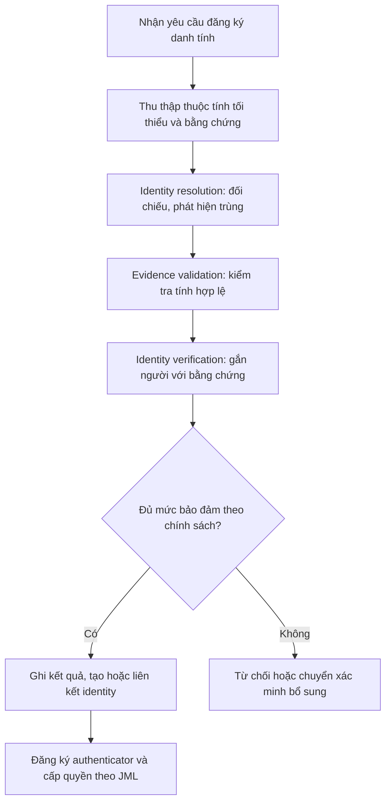

# Identity proofing là gì?

**Identity proofing** (xác minh danh tính ban đầu) là quá trình thu thập và kiểm tra bằng chứng để có cơ sở tin rằng một người đang đăng ký thực sự là người mà họ tuyên bố. Đây là khâu quan trọng trước khi tổ chức liên kết một cá nhân với hồ sơ danh tính, tạo tài khoản và cấp quyền trong **Identity and Access Management (IAM)**. Identity proofing đặc biệt có ý nghĩa khi hệ thống không thể chỉ dựa vào một sự kiện đăng ký đáng tin cậy hoặc khi quyền truy cập có mức rủi ro cao.

Trong mô hình vòng đời **Joiner–Mover–Leaver (JML)**, proofing thường được thực hiện lúc **Joiner** và có thể được yêu cầu thực hiện lại khi có dấu hiệu gian lận, thay đổi thuộc tính nhận diện quan trọng, khôi phục tài khoản nhạy cảm hoặc chuyển sang vị trí có yêu cầu bảo đảm cao hơn. Proofing giúp thiết lập sự tin cậy vào **danh tính**, còn việc xác thực mỗi lần đăng nhập và quyết định cấp quyền là các quá trình liên quan nhưng riêng biệt.

## 1. Tại sao cần identity proofing?

Giả sử có người gửi yêu cầu tạo tài khoản nhân viên dưới tên “Nguyễn An” và khai rằng họ sắp gia nhập phòng tài chính. Nếu IAM chỉ dựa vào tên và một địa chỉ email chưa được kiểm chứng, kẻ mạo danh có thể nhận tài khoản hợp lệ và sau đó được cấp quyền. Identity proofing tạo cơ chế đối chiếu giữa **con người**, **bằng chứng** và **nguồn thông tin có thẩm quyền** trước khi xác nhận danh tính.

Các mục tiêu chính bao gồm:

1. **Giảm giả mạo danh tính:** ngăn người không đúng đối tượng đăng ký hoặc chiếm danh tính người khác.
2. **Giảm trùng hoặc ghép nhầm hồ sơ:** phát hiện tình huống một cá nhân đã có identity hoặc hai cá nhân vô tình bị liên kết với cùng hồ sơ.
3. **Tạo điểm bắt đầu tin cậy cho JML:** các bước tạo tài khoản, gán vai trò và thu hồi sau này dựa trên chủ thể được xác minh phù hợp.
4. **Hỗ trợ truy vết:** ghi nhận phương pháp, nguồn bằng chứng, kết quả và thời điểm kiểm tra để phục vụ rà soát.
5. **Áp dụng biện pháp tương xứng rủi ro:** một tài khoản chỉ đọc thông tin công khai thường không cần quy trình giống tài khoản có quyền quản trị dữ liệu nhạy cảm.

**Proofing không thể bảo đảm tuyệt đối một danh tính không bao giờ bị lạm dụng.** Sau khi proofing hoàn tất, tài khoản vẫn có thể bị chiếm quyền; vì vậy phải kết hợp xác thực mạnh, phân quyền tối thiểu, giám sát và quản lý vòng đời.

## 2. Phân biệt proofing, authentication và authorization

| Hoạt động | Câu hỏi cốt lõi | Khi nào diễn ra? | Ví dụ |
| --- | --- | --- | --- |
| **Identity proofing** | Người đang đăng ký có thực sự là người được khai báo không? | Đăng ký ban đầu hoặc xác minh lại | Đối chiếu bằng chứng và nguồn nhân sự |
| **Enrollment / binding** | Làm sao gắn phương thức xác thực với danh tính đã được xác minh? | Khi thiết lập tài khoản và authenticator | Đăng ký passkey hoặc khóa bảo mật |
| **Authentication** | Chủ thể của phiên đăng nhập có kiểm soát authenticator hợp lệ không? | Mỗi lần đăng nhập hoặc xác thực lại | Xác thực bằng passkey/MFA qua IdP |
| **Authorization** | Chủ thể có được thao tác trên tài nguyên này không? | Tại thời điểm yêu cầu truy cập | Chỉ cho đọc hồ sơ thuộc nhóm được giao |
| **Provisioning** | Tài khoản và quyền được đưa đến hệ thống đích thế nào? | Khi cấp, cập nhật hoặc thu hồi | SCIM tạo/vô hiệu hóa tài khoản ứng dụng |

Ví dụ: bộ phận nhân sự xác minh người mới nhận việc (proofing); IdP đăng ký passkey cho người đó (enrollment); nhân viên dùng passkey đăng nhập qua SSO (authentication); ứng dụng kiểm tra RBAC/ABAC trước khi mở hồ sơ khách hàng (authorization). **Một lần đăng nhập SSO thành công không thay thế proofing hoặc kiểm tra quyền tại ứng dụng.**

## 3. Các bước cơ bản trong quy trình identity proofing

Một mô hình dễ hiểu gồm ba hoạt động: **resolution** (xác định danh tính được khai báo là duy nhất trong phạm vi cần thiết), **validation** (kiểm tra bằng chứng là hợp lệ, chính xác theo các nguồn phù hợp) và **verification** (xác lập người đang tham gia chính là người gắn với bằng chứng đó).

### 3.1 Thu thập và nhận diện hồ sơ

Hệ thống tiếp nhận các thuộc tính cần thiết, ví dụ tên, mã nhân sự, ngày bắt đầu, quan hệ với tổ chức và thông tin liên hệ. Nguồn đáng tin có thể là HRIS/HCM, đơn vị quản lý hợp đồng hoặc cơ chế xác minh cá nhân thích hợp với quy định áp dụng.

**Không nên xem email hoặc số điện thoại là danh tính gốc duy nhất.** Chúng có thể bị thay đổi, tái cấp hoặc bị kiểm soát bởi người khác. Khi đối chiếu với hồ sơ cũ, cần tránh tự động gộp hai người chỉ vì trùng tên.

### 3.2 Xác thực tính hợp lệ của bằng chứng (validation)

Tùy ngữ cảnh, bằng chứng có thể là giấy tờ được cấp bởi cơ quan có thẩm quyền, thông tin từ nguồn điện tử đáng tin hoặc xác nhận thông qua quy trình nội bộ được thiết kế phù hợp. Việc validation nhằm kiểm tra tính toàn vẹn, đặc điểm hợp lệ, tính hiện hành và sự nhất quán giữa các nguồn.

Một hình ảnh giấy tờ rõ nét **chưa đủ** để chứng minh giấy tờ là thật. Những kiểm tra tự động như đọc dữ liệu hoặc phát hiện dấu hiệu chỉnh sửa có thể hỗ trợ, nhưng phải đánh giá sai số, khả năng giả mạo và quy trình xử lý trường hợp không chắc chắn.

### 3.3 Xác minh người đang đăng ký (verification)

Ngay cả khi giấy tờ hợp lệ, vẫn phải có cơ sở liên kết **người đang tham gia** với danh tính trên bằng chứng. Phương pháp có thể là gặp trực tiếp người có thẩm quyền, video có giám sát theo quy trình phù hợp hoặc các biện pháp xác minh từ xa được phê duyệt.

Ở kênh từ xa, các rủi ro gồm ảnh/giấy tờ bị đánh cắp, phát lại video, deepfake, tấn công giả mạo người xác minh và chuyển hướng phiên. Giải pháp phải có biện pháp phát hiện tấn công, kiểm tra bất thường, giới hạn thử lại và cơ chế chuyển sang người xử lý khi không đủ tin cậy. **Không nên mặc định dữ liệu sinh trắc học là không thể giả mạo.**

### 3.4 Quyết định, lưu chứng cứ và đăng ký tài khoản

Kết quả cần chỉ rõ danh tính đã được xác minh theo quy trình nào, khi nào, nguồn hoặc loại bằng chứng nào được kiểm tra, mức bảo đảm nào đạt được và tình huống nào cần xác minh lại. Sau đó tổ chức có thể tạo identity hoặc liên kết với identity có sẵn, đăng ký phương thức xác thực tại **IdP** và cấp tài khoản theo chính sách.

Không ghi giấy tờ, ảnh, mẫu sinh trắc học hoặc dữ liệu bí mật vào log ứng dụng thông thường. Bằng chứng gốc, nếu cần lưu, phải được quản lý riêng với mục đích, thời hạn, quyền truy cập và cơ chế bảo vệ phù hợp. Có thể lưu metadata hoặc kết quả xác minh thay vì giữ bản sao không cần thiết.

## 4. Mức độ bảo đảm của identity proofing

Các hệ thống có thể áp dụng mức độ xác minh khác nhau theo tác động nếu danh tính bị giả mạo. Trong hệ thuật ngữ của **NIST SP 800-63**, *Identity Assurance Level (IAL)* nói về mức tin cậy vào danh tính được chứng minh; cần phân biệt với *Authenticator Assurance Level (AAL)* cho quá trình xác thực và *Federation Assurance Level (FAL)* cho liên kết danh tính.

| Khái niệm | Tập trung vào | Minh họa |
| --- | --- | --- |
| IAL | Mức bảo đảm về danh tính của người đăng ký | Tính đầy đủ của quy trình proofing và bằng chứng |
| AAL | Độ mạnh của việc xác thực chủ thể kiểm soát tài khoản | Passkey/MFA và cơ chế chống giả mạo phiên |
| FAL | Độ bảo đảm khi truyền thông tin danh tính qua federation | Cách IdP và bên tiếp nhận bảo vệ assertion |

**Không suy ra IAL từ việc bật MFA.** Một tài khoản có xác thực mạnh vẫn có thể được đăng ký cho sai người nếu proofing ban đầu yếu. Ngược lại, proofing kỹ lưỡng nhưng dùng authenticator dễ bị đánh cắp vẫn có rủi ro chiếm quyền truy cập.

Việc chọn mức bảo đảm cần dựa vào đánh giá rủi ro, dữ liệu, loại truy cập, yêu cầu pháp lý và đặc tính triển khai. Không tự nhận hệ thống “đạt IAL2/IAL3” chỉ vì có bước chụp giấy tờ hoặc nhận diện khuôn mặt; phải đáp ứng đầy đủ yêu cầu tương ứng của chuẩn áp dụng và phiên bản được tổ chức lựa chọn.

## 5. Identity proofing trong vòng đời Joiner–Mover–Leaver

### Joiner: xác minh trước khi cấp tài khoản

Khi người mới bắt đầu làm việc, IAM có thể nhận sự kiện từ hệ thống nhân sự, kiểm tra mã định danh ổn định, đối chiếu bằng chứng và xác nhận ngày hiệu lực. Sau khi đủ điều kiện, hệ thống mới tạo hoặc kích hoạt tài khoản, đăng ký MFA/passkey và cấp quyền RBAC/ABAC theo vai trò thực tế.

Ví dụ, một nhân viên mới vào phòng tài chính cần được liên kết đúng với hồ sơ tuyển dụng đã duyệt. Nếu người đó có cùng tên với nhân viên cũ, hệ thống phải xác minh bằng định danh phù hợp; không tự gán quyền kế toán của hồ sơ cũ.

### Mover: thay đổi vai trò không mặc nhiên yêu cầu proofing lại

Khi nhân viên chuyển từ chăm sóc khách hàng sang phân tích dữ liệu, cần thay thuộc tính, rà soát role và thu hồi quyền cũ. **Không phải mọi lần đổi chức danh đều phải proofing lại**, bởi người đó có thể vẫn là cùng một chủ thể đã được xác minh.

Tuy vậy, quy trình có thể yêu cầu **step-up authentication** hoặc proofing bổ sung nếu phát sinh rủi ro mới, thông tin định danh bị nghi ngờ, cần thay authenticator nhạy cảm hoặc tiếp cận vị trí đòi hỏi bảo đảm danh tính cao hơn. Cần phân biệt step-up authentication (xác thực mạnh hơn ở phiên hiện tại) với re-proofing (kiểm tra lại căn cứ danh tính).

### Leaver: thu hồi dựa trên quan hệ và quyền thực tế

Khi quan hệ lao động kết thúc, hệ thống thu hồi quyền theo sự kiện HR có thẩm quyền, không yêu cầu proofing lại để mới có thể khóa tài khoản. IAM cần vô hiệu hóa IdP và tài khoản ứng dụng, xử lý phiên/token còn hiệu lực, rà soát tài khoản đặc quyền và đối soát kết quả thu hồi tại đích.

Nếu người đó quay lại tổ chức, IAM phải quyết định khi nào có thể sử dụng lại hồ sơ và khi nào cần xác minh lại theo chính sách. **Không nên khôi phục tự động mọi entitlement cũ** chỉ vì nhận diện được cùng một người.

## 6. Vai trò của IdP, SSO, SCIM và RBAC/ABAC sau proofing

| Thành phần | Vai trò sau khi danh tính được xác minh | Giới hạn |
| --- | --- | --- |
| HRIS/nguồn có thẩm quyền | Cung cấp quan hệ, trạng thái và sự kiện JML | Không nhất thiết thay thế mọi bước proofing |
| IdP | Quản lý danh tính đăng nhập, authenticator và phiên xác thực | Xác thực một tài khoản không chứng minh mọi quyền hợp lệ |
| SSO | Cho phép sử dụng kết quả đăng nhập trên các ứng dụng tin cậy | Không tự động thu hồi mọi phiên ứng dụng khi Mover/Leaver |
| SCIM/connector | Tạo, cập nhật và vô hiệu hóa tài khoản hoặc nhóm | Phụ thuộc việc ứng dụng đích hỗ trợ và thực thi |
| RBAC/ABAC | Kiểm tra vai trò, thuộc tính, hành động, tài nguyên, ngữ cảnh | Không được thay bằng kết quả proofing đơn thuần |
| Audit/IGA | Lưu quyết định, rà soát quyền và xác minh thu hồi | Cần giới hạn dữ liệu nhạy cảm trong dấu vết |

Đối với **service account/workload identity**, khái niệm proofing cần được diễn giải khác: đối tượng không phải con người cần xác minh chủ sở hữu, nguồn triển khai, danh tính workload và chuỗi tin cậy của hệ thống, thay vì yêu cầu giấy tờ tùy thân. Không nên dùng quy trình xác minh người để mặc nhiên cấp quyền cho một dịch vụ.

## 7. Rủi ro và kiểm soát thực tế

| Rủi ro | Biểu hiện | Kiểm soát gợi ý |
| --- | --- | --- |
| Giả mạo danh tính | Dùng giấy tờ của người khác để đăng ký | Validation và verification nhiều lớp phù hợp rủi ro |
| Trùng hoặc gộp nhầm identity | Hai người cùng tên bị liên kết một hồ sơ | Mã định danh ổn định, đối chiếu thận trọng và quy trình xử lý ngoại lệ |
| Bằng chứng bị đánh cắp | Ảnh giấy tờ rò rỉ qua email hoặc log | Hạn chế thu thập/lưu giữ, mã hóa, kiểm soát truy cập |
| Tấn công từ xa | Deepfake hoặc replay video | Kiểm tra phát hiện tấn công, giám sát và xử lý ngoại lệ |
| Người xử lý bị lừa | Giả danh bộ phận HR hoặc nhân viên hỗ trợ | Xác minh nguồn yêu cầu, phân tách trách nhiệm, đào tạo |
| Sai luồng phục hồi tài khoản | Kẻ tấn công chiếm quyền qua reset yếu | Phục hồi theo mức bảo đảm, xác thực bổ sung khi cần |
| Proofing thành công nhưng quyền sai | Tạo đúng danh tính nhưng cấp role quá rộng | Least privilege, RBAC/ABAC, phê duyệt, SoD và rà soát |

Đánh giá hiệu quả không chỉ là đếm số hồ sơ “được duyệt”, mà còn theo dõi tỷ lệ cần xác minh lại, thời gian xử lý, tỷ lệ từ chối nhầm, lỗi liên kết danh tính, khiếu nại, dấu hiệu gian lận và mức độ bảo vệ quyền riêng tư. Quy trình cần có **đường xử lý ngoại lệ có kiểm soát** cho người không thể hoàn tất một phương thức xác minh cụ thể, tránh loại bỏ người dùng hợp lệ không cần thiết.

## 8. Ví dụ quy trình cho nhân viên mới

Giả sử Linh sẽ gia nhập nhóm hỗ trợ khách hàng và cần truy cập CRM:

1. **HR ghi nhận:** `personId`, quan hệ lao động, người quản lý và ngày bắt đầu.
2. **Đối chiếu:** quy trình proofing xác minh Linh phù hợp hồ sơ đã được duyệt, kiểm tra trùng danh tính và ghi kết quả.
3. **Đăng ký:** IdP tạo hoặc liên kết tài khoản với identity của Linh và thiết lập phương thức xác thực đủ mạnh.
4. **Cấp quyền:** IAM gán role hỗ trợ, giới hạn dữ liệu theo nhóm và ngày hiệu lực.
5. **Provision:** hệ thống đồng bộ tài khoản/nhóm đến CRM qua connector hoặc SCIM nếu được hỗ trợ.
6. **Kiểm chứng:** người phụ trách xác nhận Linh truy cập được tài nguyên cần thiết và không có quyền ngoài phạm vi.
7. **Thay đổi sau này:** khi Linh chuyển nhóm hoặc nghỉ việc, IAM cập nhật/thu hồi quyền và xác minh không còn truy cập tồn dư.

Trong luồng này, **proofing giải quyết độ tin cậy của danh tính ở đầu vào**. Các bước quản lý tài khoản, xác thực và phân quyền chịu trách nhiệm duy trì an toàn trong suốt vòng đời.

## 9. Câu hỏi tự kiểm tra

**Tình huống A:** Một người chụp ảnh giấy tờ rõ ràng và tải lên ứng dụng. Có thể coi identity proofing đã hoàn tất không? **Không.** Cần đánh giá tính hợp lệ của bằng chứng và kiểm tra người tham gia có đúng là người gắn với bằng chứng, theo mức bảo đảm cần thiết.

**Tình huống B:** Nhân viên đã proofing kỹ lưỡng nhưng dùng mật khẩu yếu và không có MFA. IAM đã đủ an toàn chưa? **Chưa.** Proofing và authentication giải quyết các rủi ro khác nhau; cần cơ chế xác thực phù hợp.

**Tình huống C:** Một nhân viên chuyển chức danh nhưng vẫn là cùng người, cùng mã định danh. Có bắt buộc proofing lại không? **Không mặc nhiên.** Chủ yếu cần xử lý Mover và đánh giá rủi ro mới; chỉ proofing lại khi chính sách hoặc tình huống yêu cầu.

**Tình huống D:** Người đã nghỉ việc quay lại và yêu cầu kích hoạt nguyên quyền cũ. Có nên chấp nhận vì hồ sơ trước đây đã được xác minh? **Không.** Phải kiểm tra quan hệ mới, chính sách tái xác minh và cấp quyền theo nhiệm vụ hiện tại.

## Ghi nhớ

**Identity proofing** thiết lập cơ sở tin cậy rằng danh tính được khai báo gắn với đúng người trước khi tạo hoặc liên kết tài khoản. Quá trình này gồm **identity resolution, evidence validation và identity verification**, được thiết kế theo mức rủi ro và yêu cầu bảo đảm phù hợp. Trong IAM, proofing phối hợp cùng **IdP, SSO, SCIM, RBAC/ABAC, kiểm toán** và vòng đời **Joiner–Mover–Leaver**; nó không thay thế xác thực mỗi phiên, phân quyền từng yêu cầu hay thu hồi quyền khi ngữ cảnh công việc thay đổi.
