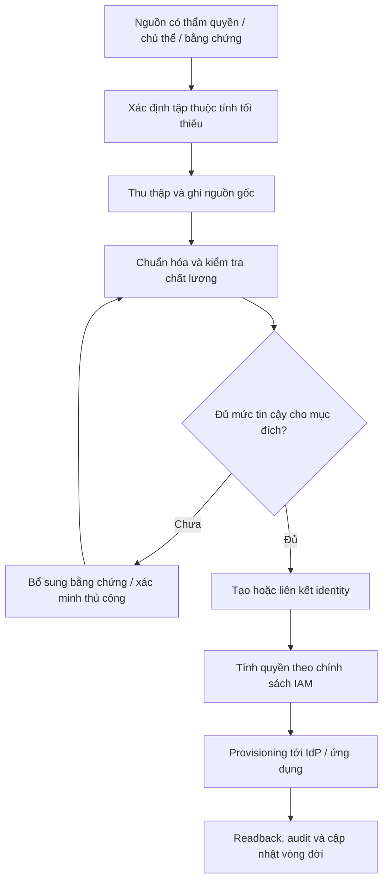
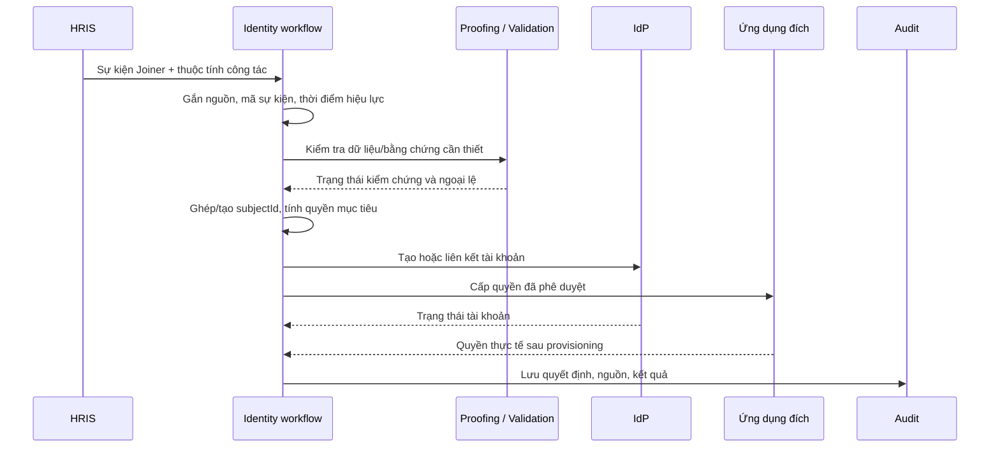
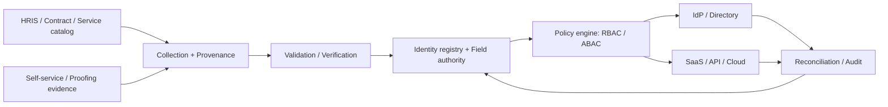

# Thu thập thuộc tính trong Identity Proofing

Một nhân viên mới bắt đầu làm việc. Hệ thống Identity and Access Management (IAM) cần biết người đó là ai, thuộc đơn vị nào, khi nào được kích hoạt tài khoản và ai phê duyệt quyền truy cập. Nếu chỉ yêu cầu nhập họ tên và địa chỉ email, người quản trị khó xác định hồ sơ có đáng tin cậy hay không; nếu thu thập quá nhiều dữ liệu nhạy cảm, tổ chức lại tăng nguy cơ rò rỉ và vi phạm chính sách bảo vệ dữ liệu.

**Thu thập thuộc tính (attribute collection)** là một công đoạn quan trọng trong **identity proofing**: chọn, tiếp nhận và ghi nhận những thông tin cần thiết để thiết lập hoặc xác minh một danh tính, cùng **nguồn gốc và bằng chứng** giúp đánh giá mức độ tin cậy của từng thông tin. Thu thập đúng dữ liệu từ đầu giúp hệ thống giảm hồ sơ trùng, tạo tài khoản chính xác, cấp quyền phù hợp và xử lý thay đổi theo mô hình **Joiner–Mover–Leaver (JML)**.

Bài này tập trung vào việc **thu thập thuộc tính** chứ không đồng nhất nó với xác thực đăng nhập hay cấp quyền. Ta sẽ xem những nhóm thuộc tính thường gặp, cách xác định nguồn có thẩm quyền, kiểm soát chất lượng dữ liệu và các rủi ro khi dùng thuộc tính trong IdP, SSO, SCIM và chính sách RBAC/ABAC.

## 1. Thuộc tính danh tính là gì?

**Thuộc tính danh tính (identity attribute)** là một đặc điểm hoặc thông tin được gắn với một chủ thể, chẳng hạn mã định danh, tên hiển thị, đơn vị công tác, loại quan hệ với tổ chức hoặc ngày kết thúc hợp đồng.

Một thuộc tính có thể là:

- Thông tin do chủ thể **tự khai báo**, ví dụ tên muốn hiển thị.
- Thông tin do **nguồn quản trị có thẩm quyền** cung cấp, ví dụ trạng thái việc làm trong hệ thống nhân sự.
- Thông tin được **xác minh từ bằng chứng**, ví dụ kết quả đối chiếu hồ sơ theo một quy trình được phê duyệt.
- Thông tin **được suy ra hoặc tính toán**, ví dụ nhóm quyền mục tiêu từ vai trò và phòng ban đã được xác minh.
- Thông tin **động theo ngữ cảnh**, ví dụ trạng thái thiết bị hoặc thời điểm truy cập.

Các nhóm đó có mức độ tin cậy và thời hạn sử dụng khác nhau. Việc một thuộc tính đã được ghi trong cơ sở dữ liệu **không tự chứng minh rằng nó đúng, hiện hành hoặc đủ điều kiện dùng để cấp quyền**.

### 1.1. Ví dụ về thuộc tính trong hệ thống IAM

| Thuộc tính | Câu hỏi trả lời | Ví dụ minh họa | Lưu ý |
|---|---|---|---|
| `subjectId` | Bản ghi danh tính nào? | `person-00457` | Nên ổn định, không tái sử dụng tùy tiện. |
| `displayName` | Hiển thị tên gì? | `Nguyễn Minh A` | Có thể đổi; không phù hợp làm khóa định danh duy nhất. |
| `workEmail` | Liên hệ công việc qua đâu? | `user457@example.invalid` | Có thể thay đổi hoặc được cấp lại cho người khác. |
| `employmentStatus` | Tư cách công tác hiện tại? | `ACTIVE` | Nên nhận từ nguồn có thẩm quyền với thời điểm hiệu lực. |
| `department` | Thuộc đơn vị nào? | `support` | Có thể ảnh hưởng trực tiếp đến RBAC/ABAC. |
| `managerId` | Ai phê duyệt theo tuyến quản lý? | `person-00211` | Cần kiểm tra quan hệ và vòng đời của người quản lý. |
| `contractEndAt` | Khi nào quan hệ kết thúc? | `2027-03-31` | Quan trọng với contractor/partner; cần nguồn và múi giờ phù hợp. |
| `proofingResult` | Đã hoàn tất kiểm chứng danh tính chưa? | `VERIFIED` | Trạng thái kết quả, không thay thế bằng chứng hoặc chính sách. |

Dữ liệu trong bảng chỉ là **mẫu thiết kế**, không phải cấu trúc bắt buộc của một sản phẩm IdP hoặc chuẩn dữ liệu.

### 1.2. Thuộc tính không phải là credential

Ba đối tượng dễ bị nhầm:

1. **Attribute**: thông tin về chủ thể, ví dụ mã nhân viên hoặc đơn vị.
2. **Credential**: yếu tố hoặc bí mật dùng chứng minh quyền kiểm soát tài khoản, ví dụ khóa bảo mật, chứng chỉ, mật khẩu.
3. **Entitlement**: quyền truy cập, ví dụ được xem hồ sơ khách hàng thuộc phòng ban A.

Ví dụ, `department=support` là thuộc tính; nó có thể được chính sách dùng để tính quyền. Bản thân thuộc tính này **không phải mật khẩu**, cũng **không tự động là một quyền**. Một kẻ tấn công không được phép tự sửa `department` để nhận quyền quản trị.

## 2. Thu thập thuộc tính nằm ở đâu trong Identity Proofing?

**Identity proofing** là quá trình thiết lập mức tin cậy phù hợp rằng một chủ thể đại diện cho một danh tính được khai báo, theo mục đích và mức rủi ro của dịch vụ. Các bước có thể bao gồm thu thập thông tin, đối chiếu dữ liệu hoặc bằng chứng, kiểm tra tính hợp lệ và xác minh mối liên hệ giữa người thực hiện và danh tính được yêu cầu.

Một cách phân chia hữu ích:

| Công đoạn | Mục tiêu | Ví dụ |
|---|---|---|
| **Collection — thu thập** | Tiếp nhận dữ liệu cần thiết, nguồn, thời điểm và bằng chứng liên quan. | Nhận mã nhân viên, ngày bắt đầu, bộ phận từ HRIS. |
| **Validation — kiểm tra tính hợp lệ** | Kiểm tra dữ liệu/bằng chứng có định dạng, đặc tính và trạng thái phù hợp hay không. | Kiểm tra mã hồ sơ có tồn tại trong nguồn quản trị. |
| **Verification — xác minh liên kết** | Xác định chủ thể đang tham gia có thực sự gắn với danh tính và bằng chứng đó. | Đối chiếu ứng viên với hồ sơ đã xác minh theo quy trình tuyển dụng. |
| **Enrollment / account setup** | Tạo hoặc liên kết bản ghi danh tính và cơ chế truy cập. | Tạo `subjectId`, liên kết tài khoản IdP. |
| **Authentication** | Xác định ai đang đăng nhập trong một phiên cụ thể. | Đăng nhập bằng passkey và MFA. |
| **Authorization** | Quyết định cho phép hành động theo chính sách. | Cấp quyền ứng dụng cho nhóm support đang hoạt động. |

Đây là **mô hình khái niệm để học**, không ngụ ý mọi tổ chức phải dùng đúng sáu bước hoặc cùng tên trạng thái. Điểm cốt lõi là: **thu thập xong không có nghĩa đã xác minh; xác minh xong cũng không có nghĩa được tự động cấp mọi quyền**.

### 2.1. Luồng tổng quan



Đường xử lý ngoại lệ là cần thiết: một hồ sơ thiếu dữ liệu có thể được giữ ở trạng thái chờ xác minh, trong khi yêu cầu đặc quyền nhạy cảm chưa được cấp cho tới khi đáp ứng chính sách.

## 3. Xác định cần thu thập những thuộc tính nào

Không có một danh sách thuộc tính đầy đủ áp dụng cho mọi loại danh tính. Tập cần thu thập phải xuất phát từ **mục đích xử lý, yêu cầu nghiệp vụ, rủi ro, chính sách và loại chủ thể**.

### 3.1. Các nhóm thuộc tính

| Nhóm | Ví dụ | Mục đích thường gặp |
|---|---|---|
| **Định danh và ánh xạ** | `subjectId`, mã hồ sơ nguồn, mã nhân viên nội bộ | Nhận diện bản ghi ổn định, chống liên kết nhầm. |
| **Thông tin mô tả** | Tên, tên hiển thị, ngôn ngữ | Giao diện, liên lạc, hỗ trợ. |
| **Quan hệ tổ chức** | Loại người dùng, phòng ban, vị trí, quản lý, bên bảo trợ | Tạo quyền mục tiêu và người chịu trách nhiệm. |
| **Trạng thái vòng đời** | `PENDING`, `ACTIVE`, `SUSPENDED`, ngày bắt đầu/kết thúc | Kích hoạt hoặc thu hồi đúng thời điểm. |
| **Kênh liên hệ** | Email công việc, điện thoại dùng cho mục đích phù hợp | Gửi thông báo, hoàn tất đăng ký. |
| **Thông tin nguồn/bằng chứng** | Mã sự kiện, bên phát hành, ngày xác minh, mức tin cậy | Truy vết và xác định khả năng sử dụng thuộc tính. |
| **Thông tin kiểm soát truy cập** | Tenant, region, role nghiệp vụ, cấp nhạy cảm | RBAC/ABAC khi được xác minh hợp lệ. |
| **Thuộc tính hệ thống** | Thời điểm tạo/sửa, trạng thái đồng bộ | Đối soát, retry, kiểm toán. |

Có thể cần dữ liệu bổ sung để chứng minh danh tính theo quy trình cụ thể, nhưng chỉ thu thập những gì **thực sự cần** và được phép xử lý. Dữ liệu rất nhạy cảm như số giấy tờ, dữ liệu sinh trắc học hoặc hình ảnh nhận dạng cần mục đích, bảo vệ và thời hạn lưu giữ riêng; không đưa vào IAM chỉ vì có sẵn trong hồ sơ khác.

### 3.2. Một bộ tối thiểu theo tình huống

**Nhân viên chính thức**

- Mã liên kết tới hồ sơ nhân sự đã xác minh.
- Trạng thái công tác, ngày bắt đầu và đơn vị/role hiện hành.
- Người quản lý hoặc chủ sở hữu yêu cầu cấp quyền.
- Thông tin liên hệ công việc nếu cần để kích hoạt và thông báo.

**Nhà thầu hoặc đối tác**

- Mã hợp đồng/hồ sơ có thẩm quyền và loại quan hệ.
- Bên bảo trợ/owner nội bộ chịu trách nhiệm.
- Phạm vi dự án, ngày hiệu lực và ngày kết thúc.
- Danh tính liên hệ đã xác minh theo mức rủi ro của quyền được yêu cầu.

**Danh tính dịch vụ (service account/workload)**

- Mã workload hoặc ứng dụng trong service catalog.
- Đội owner, mục đích kỹ thuật và môi trường hoạt động.
- Bằng chứng nguồn được phép triển khai/phát hành danh tính.
- Tài nguyên và hành động cần thiết, phương thức xác thực, ngày review/expiry.

Với máy hoặc workload, “proofing” thường là **xác thực nguồn gốc, danh tính workload, quyền tạo và người sở hữu**; không thể áp dụng máy móc quy trình kiểm tra giấy tờ của con người cho một container hoặc CI job.

### 3.3. Data minimization và tách mục đích

Giả sử hệ thống chấm công có ngày sinh, địa chỉ nhà, số định danh và dữ liệu lương, trong khi IAM chỉ cần mã nhân viên, trạng thái công tác và phòng ban. Việc sao chép toàn bộ hồ sơ sang IdP sẽ mở rộng bề mặt dữ liệu nhạy cảm mà không cải thiện quyết định cấp quyền tương ứng.

Thiết kế nên xuất phát từ:

1. **Mục đích:** thuộc tính phục vụ chức năng IAM nào?
2. **Tính cần thiết:** có thể dùng dữ liệu ít nhạy cảm hơn không?
3. **Nguồn:** hệ thống nào là nguồn chuẩn cho thuộc tính này?
4. **Độ mới:** quyền còn đúng nếu thuộc tính chậm cập nhật vài giờ/ngày không?
5. **Thời hạn:** cần giữ dữ liệu đến khi nào?
6. **Phạm vi chia sẻ:** ứng dụng đích có thực sự cần nhận thuộc tính gốc hay chỉ cần kết quả quyết định?

Thu thập ít nhưng đúng giúp giảm rủi ro về quyền riêng tư, sai lệch dữ liệu và chi phí vận hành.

## 4. Nguồn thuộc tính: không phải nguồn nào cũng đáng tin như nhau

Trong IAM, **authoritative source** là hệ thống được tổ chức công nhận có thẩm quyền đối với một tập thuộc tính hoặc sự kiện cụ thể. “Có thẩm quyền” phải được xác định **theo trường dữ liệu**, không nhất thiết toàn bộ hồ sơ.

Ví dụ:

| Thuộc tính | Nguồn ưu tiên có thể chọn | Nguồn không nên mặc định quyết định |
|---|---|---|
| Trạng thái việc làm | HRIS/nguồn nhân sự đã phê duyệt | Người dùng tự chọn trên form. |
| Phòng ban hiện hành | HRIS hoặc hệ thống tổ chức được ủy quyền | Trường `department` tự gửi từ trình duyệt. |
| Quyền tham gia dự án | Hệ thống dự án và người có thẩm quyền | Nội dung email không được xác minh. |
| Ngày hết hạn nhà thầu | Hợp đồng/hệ thống quản trị nhà thầu | Ngày cũ được sao chép từ ticket. |
| Tên hiển thị | Nguồn hồ sơ được chấp thuận hoặc người dùng cập nhật theo quy trình | Dữ liệu tự nhận không có kiểm tra nếu cần hồ sơ pháp lý. |
| Xác minh kênh email | Quy trình xác minh quyền kiểm soát địa chỉ | Việc địa chỉ “có hình thức giống email” là đủ. |
| Danh tính workload | Nền tảng triển khai, registry, issuer được tin cậy | Workload tự điền tên `production-admin` rồi xin quyền. |

**Nguồn có thẩm quyền không đồng nghĩa dữ liệu luôn chính xác.** Hệ thống nhân sự vẫn có thể chưa cập nhật chuyển bộ phận; hệ thống nhà thầu có thể quên ghi ngày kết thúc. Vì vậy phải có quy trình phát hiện và sửa sai ở nguồn, tránh “sửa trực tiếp ở IdP cho nhanh” rồi để bản ghi bị đồng bộ ngược trở lại trạng thái sai.

### 4.1. Các phương thức thu thập

- **Đồng bộ trực tiếp từ nguồn:** API, connector hoặc event từ HRIS, hệ thống hợp đồng, service catalog.
- **Biểu mẫu có kiểm soát:** cho phép tự khai những trường phù hợp và thu thập tài liệu/bằng chứng khi cần.
- **Nhân sự hoặc người bảo trợ nhập thay:** áp dụng khi chủ thể không tự thao tác; phải ghi actor và thẩm quyền.
- **Tích hợp liên kết/federation:** nhận claims từ một issuer/IdP đã được cấu hình tin cậy.
- **Đối chiếu dữ liệu quản trị:** xác nhận một mã hoặc trạng thái qua nguồn nội bộ hợp lệ.
- **Xác minh thủ công:** dành cho trường hợp độ tin cậy chưa đủ, bất thường hoặc không thể tự động hóa.

Mỗi kênh cần được đánh giá về **khả năng bị giả mạo**, **độ trễ**, **độ chính xác**, **tính đầy đủ** và **khả năng chứng minh ai đã xác nhận thông tin**.

### 4.2. Claims từ IdP chưa đủ để chứng minh mọi thuộc tính

Một token từ IdP có thể mang claim như `email`, `sub`, `department` hoặc `groups`. Chữ ký hợp lệ chứng minh thông điệp do issuer hợp lệ phát hành và chưa bị sửa đổi theo cơ chế xác minh; nó **không tự đảm bảo mọi giá trị trong token đều được kiểm chứng cùng mức**.

Ví dụ, nếu IdP cho người dùng tự sửa `department`, ứng dụng dùng claim này để mở dữ liệu tài chính có thể tạo lỗ hổng nâng quyền. Cần biết **ai cập nhật claim, nguồn gốc, quy tắc đồng bộ, độ mới và mức tin cậy của issuer**.

SSO giải quyết đăng nhập liên kết; nó không thay thế việc đánh giá dữ liệu đầu vào và yêu cầu proofing phù hợp cho nghiệp vụ.

## 5. Quy trình thu thập thuộc tính từng bước

Một workflow có thể tổ chức thành bảy bước:

1. **Xác định use case**: đăng ký nhân viên, nhà thầu, người dùng ứng dụng, quyền truy cập đặc biệt hoặc service principal.
2. **Chọn schema tối thiểu**: bắt buộc/tùy chọn, kiểu dữ liệu, giới hạn, phân loại nhạy cảm, mục đích.
3. **Xác định nguồn và bên chịu trách nhiệm**: trường nào do HRIS, người quản lý, IdP hay chủ thể tự khai.
4. **Tiếp nhận qua kênh an toàn**: API được xác thực, biểu mẫu được bảo vệ hoặc luồng onboarding nội bộ.
5. **Kiểm tra cấu trúc và chuẩn hóa**: kiểu, định dạng, khoảng giá trị, mã đơn vị, ngày giờ, trùng lặp.
6. **Kiểm tra nguồn gốc và mức tin cậy**: có cần bằng chứng hoặc bước verification bổ sung không?
7. **Lưu thuộc tính đã được chấp nhận cùng metadata**: nguồn, thời gian, trạng thái kiểm chứng và khả năng truy vết.

Nếu yêu cầu bị thiếu dữ liệu quan trọng, hệ thống nên đưa hồ sơ vào trạng thái chờ hoàn thiện, từ chối cấp quyền nhạy cảm hoặc chuyển xử lý thủ công tùy chính sách. **Không nên bù dữ liệu thiếu bằng quyền mặc định quá rộng**.

### 5.1. Ví dụ luồng Joiner



Sơ đồ là một ví dụ thiết kế. Các bước có thể là bất đồng bộ và phải hỗ trợ xử lý lỗi ở từng hệ thống.

## 6. Chuẩn hóa thuộc tính và quản lý schema

Thuộc tính có thể đúng về ý nghĩa nhưng khác biểu diễn:

- `Full Time`, `full-time`, `FT` cùng chỉ một loại hợp đồng trong một hệ thống.
- Ngày `01/03/2027` có thể bị hiểu khác nếu thiếu quy ước ngày/tháng.
- Phòng ban có thể được ghi tên hiển thị tiếng Việt, tiếng Anh hoặc mã tổ chức.
- Email có thể đổi khi nhân viên đổi tên; Unicode trong tên người cần được xử lý đúng thay vì ép sang ASCII thiếu căn cứ.

Nên thiết lập **data dictionary** và quy tắc chuẩn hóa rõ ràng.

| Trường | Kiểu và quy tắc | Kiểm tra |
|---|---|---|
| `subjectId` | Chuỗi định danh ổn định, cấp bởi hệ thống quản trị identity. | Không rỗng, duy nhất trong miền danh tính. |
| `sourceEmployeeId` | Khóa liên kết bản ghi từ nguồn; giữ namespace nguồn. | Không tự tái sử dụng; kiểm tra collision. |
| `departmentCode` | Giá trị từ danh mục đơn vị có kiểm soát. | Mã hợp lệ tại thời điểm hiệu lực. |
| `employmentStatus` | Enum đã thống nhất. | Không chấp nhận giá trị tự đặt từ kênh không đáng tin. |
| `effectiveAt` | Thời điểm có múi giờ hoặc quy ước thời điểm rõ ràng. | Phân biệt thời điểm hiệu lực và thời điểm nhận event. |
| `sourceUpdatedAt` | Thời điểm nguồn ghi nhận sửa đổi. | Phát hiện sự kiện cũ đến sau. |
| `assuranceStatus` | Trạng thái xác minh theo policy nội bộ. | Chỉ quy trình có thẩm quyền được cập nhật. |

### 6.1. Trường nào được phép rỗng?

Không nên biến tất cả trường thành “required”. Ví dụ, một service principal không có họ tên con người hay ngày sinh; một contractor có thể chưa có phòng ban chuẩn như nhân viên.

Thay vào đó:

- Đặt **required field theo loại subject và use case**.
- Phân biệt **chưa thu thập**, **không áp dụng** và **được thu thập nhưng chưa xác minh**.
- Không tự dùng giá trị giả để vượt validation, như `department=ADMIN` hoặc `managerId=system`, nếu những giá trị ấy có thể tham gia authorization.
- Gắn **deadline** và luồng xử lý ngoại lệ cho trường bắt buộc còn thiếu.

### 6.2. Biến đổi dữ liệu phải giữ ý nghĩa gốc

Nếu nguồn gốc dùng `contractType=TEMPORARY`, hệ thống IAM có thể ánh xạ thành `employmentType=CONTRACTOR` theo quy tắc đã duyệt. Nên lưu dấu vết **source value → normalized value → rule version** để giải thích quyết định sau này.

Không nên sửa bản ghi nguồn chỉ vì mô hình quyền trong IdP chưa hỗ trợ một loại dữ liệu. Việc chuẩn hóa là trách nhiệm của lớp ánh xạ, còn độ chính xác của nguồn thuộc phạm vi quản trị dữ liệu.

## 7. Chống trùng danh tính và liên kết tài khoản

Thu thập thuộc tính thường dẫn tới câu hỏi: hồ sơ mới đại diện cho một người hoàn toàn mới, hay là người đã có danh tính trong tổ chức?

### 7.1. Vì sao không nên ghép chỉ bằng tên hoặc email?

Hai người có thể trùng họ tên. Một người có thể đổi email sau khi kết hôn hoặc chuyển miền công ty. Một địa chỉ email có thể được tái sử dụng. Nếu hệ thống tự ghép hồ sơ dựa vào chuỗi giống nhau, nó có thể:

- Liên kết quyền của người cũ cho người mới.
- Ghi đè hồ sơ đang tồn tại.
- Tiếp tục cho phép truy cập sau khi một quan hệ công tác đã kết thúc.
- Đánh mất lịch sử audit của một trong hai danh tính.

Vì vậy, **matching** cần dựa trên khóa nguồn có phạm vi rõ ràng, dữ liệu đã được xác minh và quy trình giải quyết xung đột.

### 7.2. Các mức xử lý kết quả matching

| Kết quả | Ý nghĩa | Hành động phù hợp |
|---|---|---|
| **Không có bản ghi phù hợp** | Có thể là chủ thể mới. | Tạo identity khi đã thỏa proofing. |
| **Một bản ghi khớp đáng tin cậy** | Có liên kết đã xác minh với nguồn chuẩn. | Gắn tài khoản hoặc cập nhật trạng thái theo quy tắc. |
| **Nhiều bản ghi khả dĩ** | Chưa thể khẳng định identity nào đúng. | Tạm dừng auto-merge, chuyển xác minh có kiểm soát. |
| **Thông tin mâu thuẫn** | Khóa/thuộc tính của nguồn không nhất quán. | Điều tra nguồn; không cấp quyền dựa trên suy đoán. |

Nếu có nhu cầu tái tuyển dụng, hệ thống cần chính sách cho việc **phục hồi identity**, **tạo quan hệ công tác mới** và **liên kết lịch sử**. Không được mặc nhiên khôi phục mọi entitlement cũ chỉ vì cùng một người trở lại.

## 8. Lưu nguồn gốc, độ tin cậy và thời điểm hiệu lực

Một giá trị đơn lẻ như `"department": "finance"` không trả lời được:

- Ai khẳng định giá trị này?
- Giá trị đã được đối chiếu hay chỉ tự khai?
- Nó có hiệu lực từ khi nào?
- Hệ thống nhận giá trị khi nào?
- Nếu nguồn sửa lại, bản nào đang là phiên bản mới?
- Giá trị có được phép dùng để cấp quyền nhạy cảm không?

Một thiết kế dữ liệu có thể lưu **metadata theo thuộc tính**, ví dụ (dữ liệu hư cấu và schema minh họa):

```json
{
  "subjectId": "person-0457",
  "attributes": {
    "departmentCode": {
      "value": "FIN-OPS",
      "source": "workforce-records",
      "sourceRecordId": "record-9134",
      "effectiveAt": "2026-12-01T00:00:00+07:00",
      "observedAt": "2026-11-28T08:15:00+07:00",
      "verificationState": "SOURCE_CONFIRMED",
      "mappingVersion": "v3"
    },
    "displayName": {
      "value": "Nguyen A",
      "source": "user-profile",
      "observedAt": "2026-11-28T08:16:00+07:00",
      "verificationState": "SELF_DECLARED"
    }
  }
}
```

Các giá trị `SOURCE_CONFIRMED`, `SELF_DECLARED` và `v3` chỉ để minh họa; một hệ thống thực tế cần định nghĩa trạng thái assurance và policy chính thức, nhất quán.

**Điểm cần nhớ:** “đến sau” không luôn đồng nghĩa “có hiệu lực sau”. Một sự kiện HRIS nhận lúc 10:00 có thể yêu cầu thay đổi quyền từ 08:00. Đồng thời, một sự kiện cũ phát lại lúc 11:00 không được xóa quyết định Leaver có hiệu lực lúc 09:00.

### 8.1. Thuộc tính có thời hạn

Một số thuộc tính thay đổi chậm, như mã danh tính ổn định; một số thay đổi nhanh, như vai trò dự án, hợp đồng hoặc trạng thái thiết bị. Cần thiết kế:

- **Ngày có hiệu lực** của thuộc tính và sự kiện.
- **Ngày hết hiệu lực/review** cho những quyền hoặc quan hệ tạm thời.
- **Độ trễ chấp nhận được** giữa nguồn, IdP và ứng dụng.
- **Quy tắc làm mới** dữ liệu đã cũ trước khi quyết định nhạy cảm.
- **Cách xử lý mất kết nối nguồn**: có nên từ chối cấp mới hoặc giữ trạng thái bị hạn chế không?

Không nên coi mọi thuộc tính trong token đăng nhập là dữ liệu luôn mới; token đã phát hành có thể giữ claim cũ tới khi hết hạn.

## 9. Bảo vệ dữ liệu cá nhân ngay tại bước thu thập

Thu thập thuộc tính có thể liên quan đến thông tin cá nhân. Một hệ thống IAM cần tôn trọng **chính sách bảo vệ dữ liệu và pháp luật áp dụng**, không chỉ tính đúng/sai của kỹ thuật.

Các biện pháp quan trọng:

1. **Giới hạn mục đích**: dùng dữ liệu cho hoạt động proofing/IAM đã được xác định; không mặc nhiên tái sử dụng cho phân tích khác.
2. **Giảm dữ liệu**: thu thập ít nhất đủ cho mục đích; hạn chế sao chép toàn bộ giấy tờ/bằng chứng.
3. **Cơ sở xử lý hợp lệ**: xác định căn cứ pháp lý và thông báo thích hợp theo tình huống; không mặc định lúc nào cũng dùng cơ chế đồng ý.
4. **Phân quyền dữ liệu**: chỉ người và hệ thống cần thiết được xem hoặc sửa từng nhóm thuộc tính.
5. **Bảo vệ dữ liệu khi truyền/lưu**: dùng kênh bảo mật, mã hóa hoặc biện pháp tương đương phù hợp mức độ nhạy cảm và kiến trúc.
6. **Tách dữ liệu và bằng chứng**: khi có thể, IAM chỉ giữ mã tham chiếu/kết quả xác minh thay vì bản sao tài liệu nhận dạng.
7. **Giới hạn retention**: định nghĩa khi nào dữ liệu/bằng chứng cần được xóa, ẩn danh hoặc lưu giữ để đáp ứng nghĩa vụ hợp lệ.
8. **Kiểm toán truy cập dữ liệu**: ghi ai đã truy cập hoặc thay đổi thuộc tính quan trọng, không ghi bí mật hay toàn bộ dữ liệu nhạy cảm vào log.

**Ví dụ:** nếu quá trình proofing dùng một giấy tờ có ảnh, ứng dụng SaaS nhận quyền truy cập thường chỉ cần biết tài khoản đã qua bước proofing bắt buộc. Không có lý do mặc định để gửi bản chụp giấy tờ đến mọi ứng dụng SaaS.

### 9.1. Quy tắc với log và lỗi validation

Một lỗi nhập liệu nên phản hồi đủ để người hợp lệ sửa sai, nhưng không lộ bản ghi của người khác. Ví dụ:

- Phù hợp: “Thông tin chưa đủ để hoàn tất xác minh; vui lòng kiểm tra qua kênh hỗ trợ.”
- Rủi ro: “Mã định danh này thuộc về Nguyễn Văn B, số điện thoại xxx, nhân viên phòng C.”

Log nghiệp vụ nên ưu tiên `subjectId`, mã sự kiện, trường bị lỗi và loại lỗi. Không ghi mật khẩu, token, hình ảnh giấy tờ hoặc toàn bộ hồ sơ như một phần thông báo lỗi mặc định.

## 10. Đe dọa và kiểm soát khi thu thập thuộc tính

| Đe dọa/sai sót | Hậu quả | Biện pháp giảm thiểu |
|---|---|---|
| **Tự khai role/department nhạy cảm** | Kẻ gian xin quyền không hợp lệ qua ABAC/RBAC. | Lấy quyền quyết định từ nguồn có thẩm quyền, giới hạn trường người dùng có thể sửa. |
| **Mạo danh hồ sơ người khác** | Chiếm quyền sở hữu identity hoặc account. | Proofing phù hợp rủi ro, xác minh liên kết với chủ thể, kiểm tra trùng. |
| **Dữ liệu nguồn bị làm giả** | Sự kiện Joiner/Mover/Leaver sai dẫn tới cấp/thu hồi sai. | Xác thực nguồn, phân quyền thay đổi, ghi provenance và audit. |
| **Nhận sự kiện cũ sau sự kiện mới** | Kích hoạt lại quyền đã thu hồi. | Versioning, thời điểm hiệu lực và đối chiếu trạng thái nguồn mới nhất. |
| **Ghép identity sai** | Chuyển quyền từ người này sang người khác. | Matching dựa vào khóa chuẩn, xử lý xung đột thủ công. |
| **Đồng bộ rộng dữ liệu nhạy cảm** | Rò rỉ PII tới nhiều ứng dụng. | Data minimization, whitelist thuộc tính, phân loại và giới hạn chia sẻ. |
| **Thiếu xác nhận nguồn khi dữ liệu mâu thuẫn** | Policy dùng giá trị không đáng tin. | Quy tắc ưu tiên nguồn theo trường và luồng xử lý ngoại lệ. |
| **Thiếu ngày hết hạn contractor** | Tài khoản tồn dư sau hợp đồng. | Bắt buộc expiration/owner và rà soát trước gia hạn. |
| **Không xác định được owner service identity** | Khóa API hoặc tài khoản kỹ thuật bị bỏ quên. | Inventory workload, owner, mục đích và sự kiện offboarding. |

Cần quan tâm cả **tính chính xác (integrity)**, **tính sẵn sàng** và **tính bảo mật**: nếu nguồn danh tính ngừng hoạt động, tổ chức vẫn phải có cách xử lý Leaver khẩn cấp theo quy trình được phê duyệt, đồng thời đối soát sau khi nguồn phục hồi.

## 11. Thu thập thuộc tính phục vụ Joiner–Mover–Leaver

Thuộc tính không chỉ được thu thập một lần ở onboarding. Trong IAM lifecycle, dữ liệu cần được cập nhật theo trạng thái nghiệp vụ hiện hành.

### 11.1. Joiner: thuộc tính để tạo danh tính và quyền ban đầu

Ví dụ khi một nhân viên mới gia nhập:

1. Nguồn nhân sự phát hành sự kiện đã xác minh gồm mã hồ sơ, ngày bắt đầu, phòng ban và quản lý.
2. IAM thu thập và chuẩn hóa những thuộc tính cần thiết.
3. Quy trình proofing kiểm tra xem đã đủ độ tin cậy để thiết lập danh tính hay chưa.
4. Hệ thống kiểm tra trùng và cấp `subjectId` ổn định.
5. Chính sách RBAC/ABAC tính **quyền mục tiêu ban đầu** từ các thuộc tính đáng tin và phê duyệt.
6. IdP và các ứng dụng được provisioning theo thời điểm hiệu lực.
7. Kết quả cấp quyền được đọc lại và lưu dấu vết.

Ví dụ, `department=engineering` không tự động có nghĩa “được quản trị production”. Quyền nhạy cảm cần bằng chứng nhu cầu và quy trình cấp riêng.

### 11.2. Mover: thay đổi một trường có thể thay đổi nhiều quyền

Một nhân viên chuyển từ support sang finance. Các thuộc tính cần chú ý gồm phòng ban mới, chức danh/role, quản lý mới, thời điểm chuyển và các ngoại lệ được phê duyệt.

Một mô hình khái niệm:

```text
Thuộc tính nguồn mới
    ↓
Chuẩn hóa + xác nhận nguồn + thời điểm hiệu lực
    ↓
Tính quyền mục tiêu bằng RBAC/ABAC
    ↓
So sánh với quyền thực tế
    ↓
Cấp quyền cần thiết và thu hồi quyền cũ
    ↓
Đọc lại trạng thái, ghi audit
```

Không nên chỉ cập nhật `department` trong profile rồi giả định ứng dụng đã gỡ quyền cũ. Quyền trực tiếp, nhóm, phiên, quyền PAM và dữ liệu phân quyền nội bộ ứng dụng có thể cần thao tác hoặc xác minh riêng.

### 11.3. Leaver: thuộc tính trạng thái và thời điểm phải đáng tin cậy

Đối với Leaver, trường như `employmentStatus`, `contractEndAt` hoặc `effectiveAt` là đầu vào quyết định thời điểm chặn truy cập. Nếu ngày kết thúc hợp đồng sai, việc thu hồi có thể bị trễ.

Quy trình cần:

- Nhận sự kiện từ nguồn có thẩm quyền.
- Xác định thời điểm hiệu lực chính xác.
- Chặn đăng nhập và truy cập đặc quyền theo mức khẩn cấp.
- Thu hồi quyền, phiên và credential liên quan ở ứng dụng đích.
- Đối soát trạng thái thực tế và ngoại lệ còn tồn.
- Lưu hồ sơ cần thiết theo chính sách lưu giữ, thay vì duy trì truy cập.

**Leaver không có nghĩa xóa ngay toàn bộ dữ liệu danh tính**; việc giữ hồ sơ phục vụ kiểm toán hoặc nghĩa vụ pháp lý cần tách khỏi khả năng đăng nhập.

## 12. Kết nối thuộc tính với IdP, SSO, SCIM và RBAC/ABAC

| Thành phần | Vai trò của thuộc tính | Điểm cần kiểm tra |
|---|---|---|
| **IdP / Directory** | Lưu hoặc tham chiếu thuộc tính, nhóm và trạng thái phục vụ đăng nhập. | Nguồn của từng trường, quyền sửa, tần suất đồng bộ. |
| **SSO / Federation** | Chuyển claims từ hệ thống phát hành tới ứng dụng. | Issuer, audience, thời hạn, trust, nguồn gốc và mức tin cậy claim. |
| **SCIM / Provisioning** | Đồng bộ đối tượng User/Group và các thuộc tính hệ thống đích hỗ trợ. | Mapping, trạng thái áp dụng, lỗi connector, quyền ngoài SCIM. |
| **RBAC** | Dùng thuộc tính đã xác minh để xác định vai trò phù hợp. | Không biến role từ người tự khai thành quyền trực tiếp. |
| **ABAC** | Dùng thuộc tính chủ thể/tài nguyên/ngữ cảnh để quyết định chi tiết. | Độ tin cậy, độ mới, nguồn và hành động khi dữ liệu thiếu. |
| **IGA / Access Review** | Rà soát xem thuộc tính và quyền còn phù hợp không. | Owner, approver, kết quả và thời hạn ngoại lệ. |
| **Audit / SIEM** | Ghi nguồn thay đổi, quyết định và hiệu lực. | Tránh ghi lộ PII/secret; bảo vệ toàn vẹn log. |

**SCIM không thực hiện identity proofing thay cho hệ thống nguồn**. Nó là cơ chế đồng bộ đối tượng theo khả năng các bên triển khai. **SSO không làm dữ liệu tự khai trở thành dữ liệu đã xác minh**. Còn **RBAC/ABAC** chỉ ra quyết định đáng tin nếu đầu vào và policy được quản trị tốt.

### 12.1. Chỉ chuyển những thuộc tính ứng dụng cần

Ví dụ một ứng dụng báo cáo cần:

```json
{
  "subject": "person-0457",
  "department": "FIN-OPS",
  "employmentStatus": "ACTIVE",
  "entitlements": ["report-read"]
}
```

Dữ liệu này cũng chỉ là **mẫu minh họa**; token thực tế cần cấu trúc và kiểm tra riêng theo giao thức. Ứng dụng không tự nhiên cần số giấy tờ, ngày sinh hoặc ảnh bằng chứng của nhân viên.

Nếu ứng dụng chỉ cần quyết định **cho phép/không cho phép**, có thể thiết kế một lớp authorization đưa ra quyết định thay vì phân phối mọi thuộc tính thô.

## 13. Thiết kế workflow an toàn khi có nhiều nguồn

Trong hệ thống lớn, các thuộc tính có thể đến từ nhiều nguồn và đôi khi mâu thuẫn. Một quy trình đáng tin cần có **quy tắc giải quyết theo thuộc tính**, không đơn thuần áp dụng “bản ghi cập nhật cuối cùng luôn thắng”.

### 13.1. Ví dụ xung đột nguồn

Giả sử HRIS đã cập nhật `department=finance`, trong khi profile ở IdP còn `department=support`. Người dùng lại tự nhập `department=admin` ở một form.

Nếu chính sách xác định HRIS là nguồn có thẩm quyền cho phòng ban, giá trị finance phải được xem là nguồn mục tiêu; giá trị cũ ở IdP cần đồng bộ lại; giá trị tự khai không được dùng để nâng quyền.

Trường hợp HRIS đang lỗi hoặc có thông tin khác mâu thuẫn, không nên tự suy luận phòng ban theo email hoặc tên nhóm. Hệ thống cần gắn trạng thái chưa xác minh và chuyển cho owner xử lý, đặc biệt với yêu cầu quyền nhạy cảm.

### 13.2. Đồng bộ phải đối chiếu trạng thái mục tiêu



Các sự kiện nên mang mã duy nhất và thông tin thời điểm/phiên bản. Với thay đổi quyền, hệ thống cần xử lý **idempotent**: nhận cùng một sự kiện hai lần không được tạo hai danh tính hoặc cấp quyền lặp.

### 13.3. Xử lý trường hợp mất dữ liệu đầu vào

Có thể dùng quy tắc phân nhánh:

| Tình huống | Hành vi gợi ý |
|---|---|
| Thiếu thuộc tính tùy chọn như tên hiển thị | Cho phép hoàn tất nếu nghiệp vụ vẫn đủ và có giá trị mặc định an toàn phù hợp. |
| Thiếu khóa định danh nguồn cần chống trùng | Chặn liên kết tự động, yêu cầu xác minh. |
| Thiếu thuộc tính dùng để xác định quyền production | Không cấp quyền production cho tới khi dữ liệu/phê duyệt hợp lệ. |
| Thuộc tính mâu thuẫn giữa hai nguồn | Theo quy tắc source-of-authority; nếu không giải được thì đưa vào hàng đợi xử lý. |
| Trạng thái công tác đã TERMINATED nhưng ứng dụng chưa khóa | Ưu tiên tác vụ chặn truy cập và cảnh báo độ trễ. |
| Sự kiện cũ đến sau Leaver | Không để dữ liệu cũ tái kích hoạt danh tính hoặc entitlement. |

Quy tắc cụ thể phải được xác định theo mức rủi ro và yêu cầu vận hành, nhất là đối với trường hợp khẩn cấp.

## 14. Ví dụ hoàn chỉnh: thu thập thuộc tính của nhà thầu

Một nhà thầu được thuê hỗ trợ triển khai trong 90 ngày. Người bảo trợ nội bộ yêu cầu cấp quyền xem tài liệu dự án. Người đó đã từng làm cộng tác viên hai năm trước.

**Bối cảnh đầu vào**

| Thuộc tính | Giá trị minh họa | Nguồn dự kiến |
|---|---|---|
| `externalPersonId` | `contractor-731` | Hệ thống hợp đồng |
| `sponsorId` | `person-021` | Người bảo trợ được xác minh |
| `projectId` | `project-alpha` | Hệ thống dự án |
| `contractStartAt` | `2026-12-05` | Hợp đồng |
| `contractEndAt` | `2027-03-05` | Hợp đồng |
| `accessPurpose` | Đọc tài liệu triển khai | Yêu cầu đã duyệt |
| `proofingState` | Chờ xác minh | Quy trình identity proofing |

**Bước 1 — Thu thập:** IAM nhận mã hồ sơ, bên bảo trợ, thời hạn, dự án và nhu cầu truy cập từ các nguồn được ủy quyền. Chủ thể cung cấp những thông tin bổ sung cần thiết qua kênh có kiểm soát.

**Bước 2 — Xác minh:** quy trình kiểm tra tính hợp lệ của hồ sơ và liên kết giữa người tham gia với danh tính được yêu cầu. Chỉ đổi trạng thái proofing khi có kết quả phù hợp chính sách.

**Bước 3 — Chống trùng:** do người này từng cộng tác trước đây, IAM tìm liên kết danh tính cũ bằng khóa/bằng chứng đáng tin. Không tự động khôi phục quyền dự án cũ.

**Bước 4 — Cấp quyền:** hệ thống tính quyền đọc tài liệu trong đúng dự án, giới hạn thời gian và có owner bảo trợ. Dù chức danh “contractor” đã xác nhận, nó không đủ căn cứ cấp quyền quản trị.

**Bước 5 — Mover:** nếu nhà thầu được chuyển sang dự án khác, IAM cập nhật nguồn và thu hồi quyền dự án không còn phù hợp.

**Bước 6 — Leaver:** khi hợp đồng hết hạn hoặc kết thúc sớm, IAM chặn đăng nhập, thu hồi nhóm/quyền/phiên liên quan và đối soát kết quả. Thông tin cần thiết được giữ theo chính sách mà không giữ lại truy cập.

Tình huống cho thấy **thu thập thuộc tính tốt giúp quản trị cả ba giai đoạn JML**, chứ không chỉ tạo tài khoản ở Joiner.

## 15. Kiểm toán và đo chất lượng dữ liệu thuộc tính

Khi không biết nguồn và độ mới của dữ liệu, tổ chức khó giải thích vì sao một quyền đã được cấp hoặc vì sao một tài khoản nghỉ việc vẫn còn truy cập.

Bản ghi sự kiện thu thập/cập nhật nên cho biết:

- **Ai hoặc hệ thống nào** tạo ra thay đổi; event/source ID.
- **Thuộc tính nào** được thay đổi và phạm vi chủ thể liên quan.
- **Nguồn có thẩm quyền** và phiên bản mapping/policy.
- **Thời điểm nguồn ghi nhận**, thời điểm IAM tiếp nhận và thời điểm có hiệu lực.
- **Trạng thái xác minh**, phê duyệt hoặc quyết định xử lý ngoại lệ.
- **Quyền nào bị ảnh hưởng** và kết quả cập nhật IdP/ứng dụng.
- **Readback và audit status** của các hệ thống đích.

Với thuộc tính nhạy cảm, audit có thể ghi **loại thay đổi**, mã tham chiếu và hash/thông tin kỹ thuật phù hợp, thay vì chép toàn bộ giá trị vào log. Cần cân bằng khả năng truy vết với quyền riêng tư và chính sách lưu trữ.

### 15.1. Các chỉ số nên theo dõi

| Chỉ số | Câu hỏi cần trả lời |
|---|---|
| **Attribute completeness** | Tỷ lệ hồ sơ có đủ trường bắt buộc theo loại identity. |
| **Verified attribute coverage** | Tỷ lệ thuộc tính quan trọng có nguồn và trạng thái kiểm chứng phù hợp. |
| **Source-to-IAM latency** | Thời gian từ khi nguồn thay đổi tới khi IAM cập nhật. |
| **Duplicate identity cases** | Bao nhiêu trường hợp nghi ngờ trùng/ghép nhầm cần xử lý. |
| **Stale attribute rate** | Bao nhiêu thuộc tính dùng ra quyết định đã quá ngưỡng độ mới. |
| **Provisioning divergence** | Bao nhiêu thuộc tính ở ứng dụng đích khác với trạng thái mục tiêu. |
| **Leaver data delay** | Có bao nhiêu sự kiện kết thúc công tác đến muộn hoặc thiếu thời điểm hiệu lực. |
| **Attribute correction turnaround** | Mất bao lâu để sửa dữ liệu sai tại đúng nguồn. |

Các chỉ số giúp phát hiện không chỉ lỗi thu thập ban đầu mà cả vấn đề vận hành phát sinh khi hệ thống, con người và trách nhiệm thay đổi.

## 16. Những lỗi thiết kế thường gặp

| Lỗi | Hậu quả | Hướng khắc phục |
|---|---|---|
| Thu thập toàn bộ dữ liệu từ HRIS vào IdP | Tăng dữ liệu nhạy cảm và phạm vi rò rỉ. | Chọn whitelist thuộc tính cần thiết theo mục đích. |
| Tin trường `role` người dùng tự nhập để cấp quyền | Có thể tự nâng đặc quyền. | Dùng nguồn đã ủy quyền và kiểm tra chính sách. |
| Đồng nhất collection với verification | Dữ liệu chưa xác minh vẫn được dùng cho quyết định rủi ro cao. | Ghi trạng thái proofing và kiểm tra assurance trước khi cấp. |
| Dùng email/tên làm ID duy nhất | Ghép sai khi đổi tên hoặc email được tái sử dụng. | Dùng khóa ổn định, namespace nguồn và quy trình matching. |
| Đồng bộ theo “last write wins” không xét nguồn | Dữ liệu tự khai có thể ghi đè nguồn chuẩn. | Source-of-authority theo thuộc tính, version/effective time. |
| Không có ngày kết thúc cho danh tính ngoài tổ chức | Nhà thầu hoặc đối tác giữ quyền lâu hơn cần thiết. | Owner, ngày hết hạn và quy trình gia hạn. |
| Chỉ cập nhật profile nhưng không kiểm tra quyền | Mover vẫn giữ entitlement cũ. | Recalculate, provision/deprovision, readback. |
| Ghi giá trị nhạy cảm vào log | Lộ PII/bí mật trên hệ thống quan sát. | Chỉ ghi metadata cần thiết, phân quyền và retention. |
| Để source data lỗi nhưng sửa tay tại IdP | Lần đồng bộ sau ghi đè hoặc tạo lệch dữ liệu. | Sửa tại nguồn chuẩn, có quy trình ngoại lệ được kiểm soát. |
| Không phân biệt identity người và workload | Áp chính sách không phù hợp hoặc bỏ qua service accounts. | Phân loại subject và nguồn proofing tương ứng. |

## 17. Bài tập tình huống

### Tình huống 1 — Một trường tự khai quyết định quyền

Một ứng dụng nội bộ cho nhân viên tự chọn `department` trong hồ sơ cá nhân. Chính sách ABAC của ứng dụng cho phép đọc số liệu tài chính nếu `department=finance`.

**Câu hỏi:** Thu thập thuộc tính đã sai ở đâu? Có thể tiếp tục cho người dùng sửa tên hiển thị mà không cấp quyền sửa phòng ban bằng cách nào?

**Gợi ý:** tách trường tự khai và trường có thẩm quyền. Tên hiển thị có thể được cập nhật qua self-service theo quy tắc; `department` dùng cho quyền phải lấy từ nguồn tổ chức được phê duyệt và được bảo vệ khỏi tự sửa.

### Tình huống 2 — Tái tuyển dụng

Một nhân viên quay lại làm việc sau một năm. Hồ sơ tuyển dụng mới có email khác, trong khi IdP còn lưu identity cũ đã khóa.

**Câu hỏi:** Có nên tạo một identity mới ngay không? Có được tự khôi phục nhóm quản trị cũ không?

**Gợi ý:** dùng khóa/quan hệ nguồn và quy trình matching để xác định cùng người hay không. Quyết định liên kết hoặc tạo mới theo chính sách; tính quyền mục tiêu từ nhiệm vụ mới, không khôi phục entitlement cũ mặc định.

### Tình huống 3 — Contractor thiếu ngày hết hạn

Người quản lý yêu cầu cấp quyền hệ thống production cho nhà thầu nhưng chỉ gửi họ tên, email và mô tả “cần gấp”. Không có mã hợp đồng, owner xác nhận hay ngày kết thúc.

**Câu hỏi:** Những thuộc tính và bằng chứng nào còn thiếu? Hệ thống nên xử lý yêu cầu quyền nhạy cảm thế nào?

**Gợi ý:** xác định quan hệ có thẩm quyền, bên bảo trợ, phạm vi nhiệm vụ, ngày hiệu lực/hết hạn, proofing phù hợp và người phê duyệt. Không suy ra quyền production chỉ từ email và lời mô tả.

### Tình huống 4 — Sự kiện đến sai thứ tự

IAM nhận sự kiện nhân viên rời tổ chức và khóa tài khoản lúc 09:00. Lúc 09:05, một sự kiện Mover đã tạo từ hôm trước mới được chuyển đến và yêu cầu đổi nhóm sang finance.

**Câu hỏi:** Vì sao áp dụng sự kiện Mover ngay có thể nguy hiểm?

**Gợi ý:** event đến sau có thể mô tả trạng thái nghiệp vụ **cũ hơn**. So sánh version/effective time, đối chiếu nguồn hiện hành và bảo đảm không được kích hoạt lại quyền sau Leaver.

## 18. Checklist thiết kế thu thập thuộc tính

Trước khi triển khai một luồng proofing hoặc cập nhật IAM, có thể tự kiểm tra:

1. Đã xác định **loại subject** và **mục đích thu thập** chưa?
2. Bộ thuộc tính bắt buộc có thực sự tối thiểu theo nghiệp vụ không?
3. Mỗi thuộc tính quan trọng đã có **source-of-authority** và owner phụ trách chưa?
4. Có phân biệt giá trị **tự khai**, **xác minh** và **tính toán** không?
5. Schema có kiểm tra kiểu, giá trị hợp lệ, thời điểm và namespace ID không?
6. Có quy trình xử lý hồ sơ thiếu, mâu thuẫn hoặc nghi trùng không?
7. Kết quả proofing đã tách khỏi quyết định **authentication** và **authorization** chưa?
8. Thuộc tính dùng cho RBAC/ABAC có được bảo vệ khỏi người không có thẩm quyền sửa không?
9. Có lưu provenance, trạng thái kiểm chứng, thời điểm hiệu lực và phiên bản mapping không?
10. Khi đổi vai trò, hệ thống có tính lại **quyền mục tiêu** và gỡ quyền cũ không?
11. Khi Leaver, dữ liệu và sự kiện có đủ để chặn truy cập đúng lúc không?
12. IdP/SCIM/ứng dụng có readback và đối soát khác biệt với nguồn không?
13. Đã giới hạn chia sẻ PII, dữ liệu bằng chứng và quyền đọc audit chưa?
14. Có chính sách retention và sửa sai tại nguồn có thẩm quyền không?
15. Có owner, ngày rà soát và vòng đời cho contractor cùng machine identity không?

## Kết luận

**Thu thập thuộc tính** là nền tảng dữ liệu của **identity proofing** và toàn bộ **IAM lifecycle**. Một hồ sơ đáng tin không chỉ có giá trị như tên, email hay phòng ban; nó cần **mục đích thu thập rõ ràng, nguồn có thẩm quyền, bằng chứng/trạng thái xác minh, định danh ổn định, thời điểm hiệu lực và khả năng kiểm toán**.

Trong mô hình **Joiner–Mover–Leaver**, các thuộc tính đúng và cập nhật giúp tạo tài khoản, cấp quyền, điều chỉnh khi đổi nhiệm vụ và thu hồi khi quan hệ kết thúc. **IdP và SSO** có thể xác thực và truyền claims, **SCIM** có thể đồng bộ dữ liệu tới ứng dụng, còn **RBAC/ABAC** sử dụng thuộc tính để đưa ra quyết định quyền. Các cơ chế này chỉ hoạt động an toàn khi dữ liệu được thu thập, xác minh, giới hạn sử dụng và **đối soát theo trạng thái hiện hành**, từ đó giảm **quyền truy cập tồn dư** và tránh lộ dữ liệu không cần thiết.
