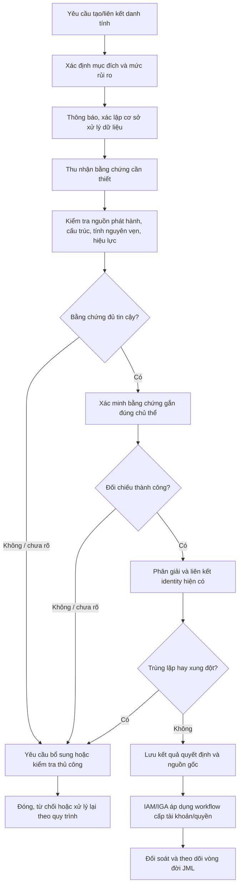
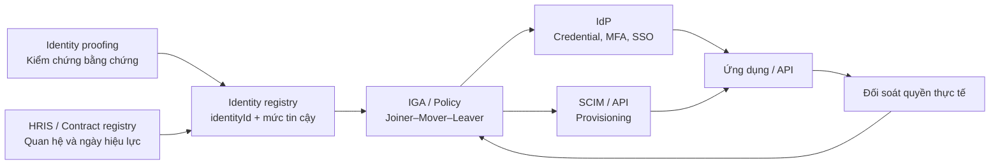

# Tài liệu định danh trong Identity proofing

## 1. Vai trò của tài liệu định danh

**Tài liệu định danh** (*identity evidence* hoặc *identity documents* trong từng ngữ cảnh) là những bằng chứng được dùng để xác lập hoặc củng cố tuyên bố về **danh tính của một chủ thể**. Chúng có thể là giấy tờ vật lý như hộ chiếu, thẻ căn cước, giấy phép cư trú; bằng chứng điện tử do nguồn được tin cậy phát hành; hoặc những hồ sơ, xác nhận phù hợp với quy trình xác minh của tổ chức. Không phải bằng chứng nào cũng có cùng giá trị, và không phải mọi trường hợp xác minh đều cần thu thập một bản sao giấy tờ.

Trong **Identity proofing**, tài liệu định danh giúp trả lời ba câu hỏi liên quan nhưng khác nhau:

1. **Thông tin danh tính được tuyên bố là gì?** Chẳng hạn họ tên, ngày sinh hoặc một định danh do cơ quan phát hành cấp.
2. **Bằng chứng có hợp lệ và đáng tin cậy không?** Cần biết nguồn phát hành, tính nguyên vẹn, tình trạng hiệu lực và dấu hiệu giả mạo.
3. **Bằng chứng ấy có thực sự gắn với người đang đăng ký không?** Một hộ chiếu thật bị đánh cắp vẫn không chứng minh người đang sử dụng nó là chủ sở hữu hợp pháp.

Trong module **SECURITY_IDENTITY_ACCESS_MANAGEMENT_IDENTITY_LIFECYCLE**, việc đánh giá tài liệu định danh là một đầu vào của **quản lý vòng đời danh tính** theo **Joiner–Mover–Leaver (JML)**. Khi kết quả proofing đủ tin cậy, tổ chức có thể liên kết người với một bản ghi danh tính chuẩn, rồi triển khai tài khoản qua IdP, SSO, SCIM hoặc API và cấp quyền theo RBAC/ABAC. Ngược lại, tài liệu mâu thuẫn hoặc chưa được xác minh phải được giải quyết **trước khi dùng danh tính ấy để cấp quyền nhạy cảm**.

> Mục tiêu của tài liệu định danh là cung cấp bằng chứng cho một quyết định danh tính có thể giải trình. Tài liệu **không tự cấp quyền truy cập**, không thay thế chính sách cấp quyền và không đảm bảo rằng mọi thông tin bên trong tài liệu đều còn hiện hành.

Sau bài học, người học có thể phân loại bằng chứng định danh, phân biệt kiểm tra tài liệu với xác minh chủ thể, thiết kế quy trình proofing và lưu dấu vết, nhận diện các tình huống gian lận, đồng thời liên hệ dữ liệu được xác minh với vòng đời IAM.

## 2. Những khái niệm cần phân biệt

Một quy trình IAM thường chứa nhiều bằng chứng và thủ tục có tên gần giống nhau.

| Khái niệm | Câu hỏi mà nó trả lời | Ví dụ |
| --- | --- | --- |
| **Identity evidence** — bằng chứng/tài liệu định danh | Có cơ sở nào để xác lập các thuộc tính danh tính được tuyên bố? | Hộ chiếu, thẻ căn cước, thông điệp eID tin cậy |
| **Evidence validation** — kiểm tra tính hợp lệ của bằng chứng | Tài liệu có xác thực, nguyên vẹn, còn phù hợp và có nguồn phát hành đáng tin cậy không? | Kiểm tra bảo an, hiệu lực, chữ ký số, nguồn phát hành |
| **Identity verification** — đối chiếu với chủ thể | Người đang thực hiện quy trình có gắn với danh tính được tài liệu thể hiện không? | So khớp có kiểm soát hoặc xác minh trực tiếp bởi nhân sự được đào tạo |
| **Identity resolution** — phân giải/đối sánh danh tính | Bản ghi này là chủ thể mới hay đã tồn tại trong hệ thống? | Liên kết với `identityId` qua các tín hiệu được phép sử dụng |
| **Authentication** — xác thực đăng nhập | Người đang truy cập có kiểm soát phương tiện xác thực gắn với tài khoản không? | MFA, passkey, chứng chỉ, token do IdP kiểm tra |
| **Authorization** — ủy quyền truy cập | Chủ thể đã xác thực có quyền thực hiện thao tác này trên tài nguyên này không? | Chính sách RBAC/ABAC, kiểm tra quyền API |
| **Source of truth** — nguồn có thẩm quyền | Hệ thống hoặc quy trình nào quyết định giá trị đúng của một thuộc tính? | HRIS xác nhận trạng thái nhân viên; chủ hợp đồng xác nhận thời hạn nhà thầu |

**Proofing thường diễn ra khi thiết lập hoặc khôi phục liên kết danh tính**, còn **authentication diễn ra khi sử dụng tài khoản**. Đăng nhập MFA thành công chứng minh sự kiểm soát phương tiện xác thực theo mức bảo đảm của hệ thống; nó không tự chứng minh rằng dữ liệu trên hộ chiếu ban đầu đã được kiểm tra đúng. Tương tự, một giấy tờ hợp lệ không chứng minh người dùng được phép đọc cơ sở dữ liệu sản xuất.

### Tài liệu định danh khác với thuộc tính định danh và credential

- **Tài liệu:** một nguồn bằng chứng cụ thể, có thể có nhà phát hành, số hiệu, ngày hết hạn hoặc chữ ký số.
- **Thuộc tính:** thông tin rút ra và được xác minh trong một phạm vi, ví dụ `legalName`, `birthDate`, `nationality`; mức tin cậy phải gắn với nguồn và thời điểm kiểm tra.
- **Định danh kỹ thuật:** `identityId` trong IAM hoặc `sub` do IdP cấp; dùng để liên kết hồ sơ và tài khoản theo quy tắc rõ ràng.
- **Credential đăng nhập:** mật khẩu, passkey, khóa riêng hoặc phương tiện xác thực khác. Credential không nên được suy ra từ số giấy tờ hoặc lưu lẫn với tài liệu định danh.

Đặc biệt, **số giấy tờ không phải khóa liên kết danh tính duy nhất mặc định**: tài liệu có thể được cấp lại, thay số, hết hạn; các hệ thống có thể mã hóa hoặc định dạng khác nhau. Nên sử dụng một khóa danh tính chuẩn ổn định, đồng thời bảo vệ dữ liệu nhạy cảm của tài liệu theo chính sách.

## 3. Những loại bằng chứng thường gặp

Giá trị của một bằng chứng phụ thuộc **nhà phát hành, phương thức kiểm tra, mức bảo đảm cần đạt, quy định địa phương và trường hợp sử dụng**, nên bảng sau chỉ mô tả khả năng sử dụng điển hình, không phải thứ hạng pháp lý áp dụng toàn cầu.

| Bằng chứng | Thuộc tính có thể hỗ trợ | Khả năng/giới hạn cần lưu ý |
| --- | --- | --- |
| **Hộ chiếu** | Họ tên, ngày sinh, quốc tịch, ảnh, số và hạn giấy tờ | Có đặc tính bảo an; phải kiểm tra tính xác thực và người sử dụng, không dựa riêng vào bản chụp |
| **Thẻ căn cước/ID quốc gia** | Danh tính pháp lý và thông tin theo thiết kế của nước phát hành | Hình thức, dữ liệu điện tử và phương thức xác minh khác nhau theo quốc gia |
| **Giấy phép cư trú** | Danh tính và một số thông tin cư trú | Không tự chứng minh mọi tư cách lao động hoặc quyền truy cập doanh nghiệp |
| **Giấy phép lái xe** | Họ tên, ảnh, địa chỉ hoặc ngày sinh tùy nơi phát hành | Mức độ chấp nhận làm bằng chứng định danh tùy chính sách và quy định |
| **Thông tin định danh điện tử/eID** | Thuộc tính được nguồn điện tử phát hành hoặc xác nhận | Cần kiểm tra chứng thư, chữ ký, issuer, đối tượng nhận và tính hiệu lực của dữ liệu được chia sẻ |
| **Giấy khai sinh, hồ sơ hộ tịch** | Một số dữ liệu gốc về cá nhân, quan hệ gia đình | Thường thiếu ảnh hoặc bằng chứng hiện tại để gắn tài liệu với người trình diện |
| **Thẻ nhân viên/thẻ sinh viên** | Quan hệ với một tổ chức, mã nội bộ hoặc ảnh | Có thể hỗ trợ kiểm tra quan hệ nhưng thường không thay thế xác minh pháp lý khi quy trình yêu cầu |
| **Thông tin từ HRIS/hệ thống nhà thầu** | Trạng thái tuyển dụng, bộ phận, loại hợp đồng, sponsor | Là nguồn nghiệp vụ phù hợp, nhưng có thể cần proofing danh tính riêng khi tạo tài khoản lần đầu |
| **Hóa đơn tiện ích/xác nhận địa chỉ** | Địa chỉ hoặc quan hệ với địa điểm tại một thời điểm | Không tự chứng minh người cung cấp là người có danh tính được tuyên bố |
| **Ảnh chụp màn hình, ảnh tài liệu gửi qua chat** | Thông tin tham khảo ban đầu | Dễ bị chỉnh sửa; không mặc nhiên đủ tin cậy cho proofing rủi ro cao |

### Bằng chứng vật lý, bản chụp và bằng chứng số gốc

Cần phân biệt **tài liệu vật lý gốc được kiểm tra trực tiếp**, **ảnh hoặc bản quét của tài liệu**, và **bằng chứng điện tử có khả năng kiểm chứng mật mã**. Một file PDF có hình con dấu hoặc một ảnh chứa mã QR không tự động là chứng thư điện tử đáng tin cậy. Mã QR có thể chỉ chứa URL hoặc văn bản không ký; chỉ khi có cơ chế kiểm chứng tin cậy mới có thể dựa vào nó để xác nhận nguồn và tính toàn vẹn dữ liệu.

Một số tài liệu máy đọc được có vùng MRZ, chip hoặc dữ liệu ký số. **Kiểm tra checksum trong MRZ giúp phát hiện lỗi nhập/định dạng**, nhưng tự nó không chứng minh tài liệu là thật. Nếu quy trình hỗ trợ đọc chip và xác minh chữ ký/chứng thư phù hợp, mức bảo đảm có thể được tăng lên; mọi cơ chế phải được triển khai đúng với tiêu chuẩn và phạm vi nhà phát hành tương ứng.

## 4. Chọn bằng chứng theo mục đích và rủi ro

Yêu cầu tài liệu cần xuất phát từ **mức độ tin cậy cần thiết để thực hiện nghiệp vụ**, không chỉ dựa vào việc “ứng dụng nào cũng yêu cầu tải ảnh căn cước”. Tùy chính sách, người dùng đăng ký một diễn đàn ít rủi ro có thể không cần kiểm tra giấy tờ nhà nước, trong khi mở tài khoản có quyền truy cập dữ liệu nhạy cảm có thể cần bằng chứng mạnh hơn và bước đối chiếu chủ thể rõ ràng.

Các câu hỏi để lựa chọn:

1. **Tuyên bố cần kiểm tra là gì?** Danh tính pháp lý, tuổi tối thiểu, quan hệ với đối tác, quyền đại diện doanh nghiệp hay chỉ địa chỉ email?
2. **Rủi ro nếu tuyên bố sai là gì?** Mạo danh để nhận quyền, gian lận giao dịch, truy cập dữ liệu nhạy cảm hay vi phạm hợp đồng?
3. **Nguồn nào đáng tin cậy cho tuyên bố này?** Cơ quan phát hành giấy tờ, dịch vụ eID, HRIS, hệ thống quản lý đối tác hoặc một quy trình bảo trợ?
4. **Cần thu thập dữ liệu tối thiểu nào?** Có thể nhận xác nhận “đủ tuổi” mà không lưu toàn bộ ngày sinh hay ảnh giấy tờ không?
5. **Ai có quyền xem và quyết định?** Người kiểm tra, người duyệt ngoại lệ, bộ phận xử lý khiếu nại và kiểm toán có phạm vi quyền riêng.
6. **Quy định địa phương và hợp đồng yêu cầu gì?** Một loại tài liệu có thể được chấp nhận ở vùng này nhưng không ở vùng khác.

Những khung thực hành như **NIST SP 800-63** phân biệt mức bảo đảm nhận diện danh tính (*Identity Assurance Level — IAL*) với mức bảo đảm xác thực đăng nhập (*Authenticator Assurance Level — AAL*). Chúng là những khái niệm khác nhau: hệ thống có MFA mạnh chưa chắc có quy trình kiểm tra giấy tờ mạnh. Không nên tự tuyên bố một quy trình đạt IAL cụ thể chỉ dựa trên số loại giấy tờ đã thu thập; việc đánh giá phải dựa vào toàn bộ yêu cầu của phiên bản tiêu chuẩn và cấu hình đang áp dụng.

## 5. Quy trình sử dụng tài liệu trong Identity proofing

Một luồng proofing tốt gồm nhiều kiểm tra có mục đích riêng và khả năng xử lý ngoại lệ.



Trong nhiều hệ thống, kiểm tra trùng lặp được thực hiện song song hoặc sớm hơn để phát hiện đăng ký đáng ngờ; sơ đồ minh họa **các điều kiện logic cần thỏa**, không bắt buộc thứ tự thực thi tuyệt đối.

### Bước 1 — Xác định phạm vi và tạo yêu cầu

Trước khi thu thập giấy tờ, cần xác nhận loại chủ thể (nhân viên, nhà thầu, đối tác, khách hàng), mục đích, quyền dự kiến, nguồn có thẩm quyền và người hoặc bộ phận chịu trách nhiệm. Ví dụ tài khoản nhà thầu cần sponsor, hợp đồng và thời hạn sử dụng; thông tin đó **bổ sung** cho việc xác minh cá nhân, không tự thay thế nó.

### Bước 2 — Thu nhận bằng chứng có kiểm soát

Chỉ yêu cầu loại giấy tờ phù hợp. Nếu dùng thiết bị di động hoặc cổng web, phải bảo vệ quá trình truyền dữ liệu, hạn chế upload không cần thiết, có quy tắc xử lý tệp và không đưa ảnh tài liệu vào log hệ thống. Với quy trình gặp trực tiếp, nhân viên tiếp nhận cần quy trình thống nhất để tránh xử lý tùy cảm tính.

**Tách việc thu thập và việc lưu giữ.** Có thể cần xem tài liệu để xác minh nhưng không nhất thiết phải giữ bản quét dài hạn. Nếu cần lưu bằng chứng, phải có mục đích, thời hạn, nơi lưu an toàn và phân quyền rõ ràng.

### Bước 3 — Kiểm tra tính hợp lệ (*evidence validation*)

Đánh giá tài liệu có thuộc loại được chấp nhận không; nhà phát hành có thể tin cậy không; cấu trúc, ngày hiệu lực, số hiệu và đặc tính bảo an có hợp lý không; có dấu hiệu bị sửa, thay ảnh, dán ảnh hoặc làm giả không. Với bằng chứng điện tử, kiểm tra chữ ký số, chuỗi tin cậy và điều kiện sử dụng phù hợp thay vì chỉ đọc các trường thông tin.

Kết quả có thể là `VALID`, `INVALID` hoặc `INCONCLUSIVE` (*chưa đủ bằng chứng*). Một thuật toán phát hiện giả mạo chỉ trả về điểm số không nên tự động thay thế quyết định theo chính sách khi tín hiệu yếu hoặc trường hợp có hậu quả lớn.

### Bước 4 — Xác minh chủ thể (*identity verification*)

Phải thiết lập liên kết giữa người thực hiện yêu cầu và danh tính trên bằng chứng. Quy trình có thể gồm kiểm tra trực tiếp bởi nhân sự được đào tạo, đối chiếu ảnh theo phương thức được chấp nhận hoặc xác minh qua dịch vụ định danh điện tử được tin cậy. Với xác minh từ xa, tổ chức có thể áp dụng các biện pháp chống dùng lại ảnh/video, phát hiện thao túng luồng camera và xác minh sự hiện diện (*liveness/presentation-attack detection*) nếu phù hợp.

**Kiểm tra khuôn mặt trùng ảnh hoặc liveness đạt không tự chứng minh tài liệu là thật.** Ngược lại, xác minh chữ ký số của tài liệu không tự chứng minh người đang đăng ký là chủ sở hữu tài liệu. Hai nhóm kiểm soát giải quyết hai rủi ro khác nhau.

### Bước 5 — Phân giải danh tính và ra quyết định

Sau khi bằng chứng và liên kết chủ thể đạt điều kiện, IAM kiểm tra chủ thể đã có `identityId` chưa, có thay đổi tên/giấy tờ hay không, có dấu hiệu trùng lặp hoặc gộp nhầm người không. Trường hợp xung đột cần có quy trình kiểm tra; không tự tạo bản ghi mới vô điều kiện, cũng không tự gộp chỉ vì cùng email hoặc họ tên.

Quyết định có thể là:

- `APPROVED`: đạt các điều kiện của chính sách proofing áp dụng cho phạm vi này.
- `PENDING_REVIEW`: chưa đủ thông tin hoặc có bất thường cần nhân sự xử lý.
- `REJECTED`: không đáp ứng điều kiện, có bằng chứng không hợp lệ hoặc vi phạm chính sách; hỗ trợ cơ chế khiếu nại/khắc phục phù hợp.

Khi được chấp thuận, **mới** đưa danh tính vào workflow tạo/liên kết tài khoản và xét cấp quyền. Phê duyệt proofing và phê duyệt quyền truy cập là **hai quyết định độc lập**.

## 6. Kiểm tra giấy tờ mà không nhầm lẫn các lớp tin cậy

### 6.1 Tính xác thực, nguyên vẹn và hiệu lực

**Tính xác thực** đặt câu hỏi “bằng chứng có xuất phát từ nhà phát hành mà nó tuyên bố không?”. **Tính nguyên vẹn** đặt câu hỏi “nội dung có bị thay đổi trái phép không?”. **Hiệu lực** xem xét thời hạn, tình trạng thu hồi nếu có nguồn kiểm chứng, phiên bản tài liệu hoặc điều kiện áp dụng. Một tài liệu có chữ ký mật mã đúng nhưng đã hết giá trị sử dụng theo chính sách vẫn có thể không được chấp nhận.

Với tài liệu giấy, người kiểm tra cần dấu hiệu bảo an hoặc quy trình kiểm chứng phù hợp; **nhìn ảnh chụp mà không thấy dấu hiệu bất thường không chứng minh tài liệu thật**. Với tài liệu điện tử ký số, cần kiểm tra đúng chữ ký, chứng thư/khóa được tin cậy, nội dung ký, phạm vi và thời điểm phù hợp. Nếu nguồn phát hành hỗ trợ kiểm tra trạng thái trực tuyến hợp pháp, kết quả đó có thể là một đầu vào bổ sung.

### 6.2 Tính nhất quán của thuộc tính

Tên, ngày sinh, mã nhân sự hoặc thông tin khác có thể có sai khác hợp lệ do phiên âm, dấu tiếng Việt, đổi tên, tên ghép, hệ chữ viết hoặc dữ liệu cũ. **Sai khác không tự động là gian lận**. Cần định nghĩa quy tắc chuẩn hóa cho đối sánh, lưu giá trị gốc khi có cơ sở và đưa những trường hợp không rõ vào quy trình kiểm tra thay vì tự sửa hồ sơ pháp lý.

Không nên suy ra rằng dữ liệu trên một giấy tờ hết hạn luôn vô giá trị cho mọi mục đích. Ví dụ một số thuộc tính lịch sử có thể còn hữu ích, nhưng việc **chấp nhận làm bằng chứng proofing tại thời điểm hiện tại** phải theo chính sách cụ thể.

### 6.3 Nguồn dữ liệu và sự độc lập của bằng chứng

Nhiều bản sao của cùng một tài liệu không tạo thành nhiều nguồn độc lập. Nếu người dùng gửi hộ chiếu dưới dạng ảnh và PDF, hai tệp này vẫn có thể xuất phát từ một giấy tờ. Khi yêu cầu xác minh chéo bằng nhiều nguồn, cần hiểu **mức độ độc lập thực sự** của các nguồn, tránh cộng điểm tin cậy giả tạo.

Một bản ghi HRIS và thẻ nhân viên có thể cùng được tạo từ dữ liệu ban đầu của người xin việc. Nếu quy trình yêu cầu kiểm tra độc lập một thuộc tính nhạy cảm, phải xác định nguồn thứ hai thực sự xác nhận thuộc tính ấy theo cơ chế riêng.

## 7. Mối liên hệ với nguồn sự thật và liên kết danh tính

Một tài liệu hợp lệ có thể chứng minh một số thông tin **tại thời điểm được phát hành hoặc kiểm tra**; nó không mặc nhiên là nguồn hiện hành về vai trò công việc, bộ phận, quyền truy cập, tình trạng hợp đồng hoặc việc người đó đã nghỉ việc.

| Thông tin | Nguồn thích hợp thường gặp | Vai trò tài liệu định danh |
| --- | --- | --- |
| Họ tên pháp lý, ngày sinh | Nguồn định danh có thẩm quyền hoặc quy trình proofing | Hỗ trợ kiểm chứng thuộc tính danh tính theo chính sách |
| Danh tính chuẩn `identityId` | IAM/identity registry | Bằng chứng để tạo hoặc liên kết đúng chủ thể |
| Trạng thái nhân viên `ACTIVE/TERMINATED` | HRIS | Không tự quyết được tình trạng lao động hiện tại |
| Bộ phận, quản lý, vị trí | HRIS hoặc hệ thống được phân quyền | Không quyết định vai trò và quyền truy cập |
| Nhà thầu còn hợp đồng | Vendor/contract management, sponsor | Có thể xác minh con người nhưng không thay thế quyết định hợp đồng |
| Tài khoản IdP và MFA | IdP | Không tự thay thế credential xác thực |
| Quyền RBAC/ABAC được chấp thuận | IGA, người sở hữu ứng dụng/tài nguyên, chính sách | Không tự cấp quyền |
| Quyền thực tế tại ứng dụng | Ứng dụng đích, hệ thống đối soát | Không xác nhận ứng dụng đã thu hồi quyền hay chưa |

### Ví dụ đổi giấy tờ

Người lao động đã có `identityId=id-1042`, sau đó được cấp lại thẻ định danh với số khác. Hệ thống cần cập nhật tham chiếu bằng chứng và xác minh thay đổi theo quy trình, **giữ liên kết danh tính chuẩn** khi có đủ căn cứ, thay vì tự tạo người mới. Nếu có hai hồ sơ cùng tên, việc gộp tự động theo tên hoặc email có thể ghép sai hai người, dẫn tới lộ dữ liệu và cấp nhầm quyền.

Khi dùng một dịch vụ eID làm nguồn xác nhận, cần biết rõ **issuer**, **định danh chủ thể trong ngữ cảnh issuer**, **thuộc tính nào đã được xác minh**, **khi nào**, và **quy trình tin cậy áp dụng**. Không mặc định một claim tên gọi giống nhau từ hai IdP khác nhau có ý nghĩa hoặc độ tin cậy giống nhau.

## 8. Tài liệu định danh trong Joiner–Mover–Leaver

### Joiner — xác minh trước khi cấp phát

Một nhân viên mới được tuyển dụng có thể cần hoàn tất identity proofing để liên kết người thật với bản ghi nhân sự và tài khoản số. Sau đó IAM dùng dữ liệu HRIS có thẩm quyền để xác định bộ phận, vai trò và ngày hiệu lực. Hệ thống IdP thiết lập phương tiện đăng nhập; công cụ IGA và provisioning qua SCIM/API có thể tạo tài khoản ứng dụng. **Quyền ban đầu** vẫn phải đáp ứng RBAC/ABAC và các bước phê duyệt cần thiết.

Với nhà thầu hoặc guest, tài liệu xác minh người chỉ giải quyết một phần: còn phải xác minh **hợp đồng, sponsor, phạm vi và hạn truy cập**. Một người có giấy tờ thật nhưng không có sponsor hợp lệ chưa đủ điều kiện truy cập hệ thống nội bộ.

### Mover — cập nhật quan hệ và xác minh khi cần

Nhân viên chuyển phòng ban thường **không cần thu thập lại giấy tờ chỉ vì đổi vai trò**, nếu liên kết danh tính vẫn tin cậy và không có dấu hiệu mạo danh. Thay đổi bộ phận và quản lý được HRIS xác nhận, IGA đánh giá lại quyền RBAC/ABAC; quyền cũ không còn phù hợp phải được thu hồi. Nếu chuyển giao liên quan tình huống có rủi ro cao, sửa thuộc tính định danh pháp lý, nghi ngờ chiếm đoạt hoặc yêu cầu pháp lý, chính sách có thể yêu cầu tái xác minh có mục tiêu.

### Leaver — thu hồi quyền không phụ thuộc việc giấy tờ còn hiệu lực

Người nghỉ việc có thể vẫn giữ hộ chiếu/thẻ định danh còn hiệu lực; điều đó **không cho phép họ tiếp tục đăng nhập**. HRIS hoặc nguồn có thẩm quyền kích hoạt offboarding; IdP và ứng dụng thực thi khóa hoặc thu hồi theo quy trình. Cần kiểm tra cả phiên đang hoạt động, token, tài khoản cục bộ, nhóm và quyền chia sẻ nếu có. Tài liệu định danh có thể được lưu/xóa theo thời hạn hồ sơ và pháp luật áp dụng, **không dùng thời hạn giấy tờ làm thời hạn quyền lao động**.

### Khôi phục tài khoản hoặc thay phương tiện MFA

Khi người dùng mất phương tiện MFA hoặc tài khoản bị nghi chiếm đoạt, quá trình **account recovery** có thể cần tái kiểm tra danh tính. Mức kiểm tra phải tương xứng rủi ro, tránh dùng các câu hỏi dễ đoán hoặc tài liệu được gửi qua kênh không tin cậy. Người hỗ trợ không nên bỏ qua proofing chỉ vì người gọi biết số nhân viên hoặc biết thông tin hiển thị trong hệ thống.

## 9. Ngoại lệ: danh tính phi con người và tài liệu tổ chức

**Service account, workload identity và tài khoản máy không có hộ chiếu hay khuôn mặt để đối chiếu**. Đối với chúng, “identity proofing” tập trung vào việc xác minh **ứng dụng/dịch vụ sở hữu workload, nguồn khởi tạo, môi trường, mục đích, owner chịu trách nhiệm và cơ chế tin cậy kỹ thuật**. Không áp dụng máy móc quy trình thu ảnh giấy tờ người dùng cho một service account.

Bằng chứng phù hợp có thể gồm:

- Hồ sơ đăng ký ứng dụng và người chịu trách nhiệm trong service catalog hoặc CMDB.
- Yêu cầu tạo service account đã được người có thẩm quyền chấp thuận.
- Danh tính workload từ nền tảng cloud, orchestration hoặc CI/CD với issuer/audience/subject đã định nghĩa.
- Liên kết với kho mã, deployment, môi trường và phạm vi truy cập được duyệt.
- Chứng chỉ hoặc khẳng định mật mã của workload có thể kiểm chứng theo kiến trúc được chấp thuận.

Ví dụ, `svc-invoice-export` được tạo bởi pipeline triển khai được tin cậy cho dịch vụ lập hóa đơn. Tổ chức cần xác minh workload gắn với service ID nào, ai là owner, có được chạy trong production không và quyền truy cập hàng đợi/bucket nào được duyệt. Sau đó IAM/PAM hoặc nền tảng workload identity cấp phương tiện xác thực, ưu tiên khóa ngắn hạn hoặc workload federation nếu hỗ trợ.

Khi chủ dịch vụ nghỉ việc, cần **chuyển giao owner hoặc đánh giá ngừng dịch vụ**. Việc người tạo ban đầu có hộ chiếu được xác minh không giúp chứng minh rằng tài khoản máy vẫn có mục đích hợp lệ sau nhiều năm.

## 10. Phòng ngừa giả mạo và gian lận trong proofing

| Tình huống | Rủi ro chính | Kiểm soát cần cân nhắc |
| --- | --- | --- |
| Ảnh tài liệu bị sửa | Thuộc tính giả, số giấy tờ giả | Kiểm tra tính nguyên vẹn, dấu hiệu sửa đổi và nguồn phát hành |
| Tài liệu thật bị đánh cắp | Người nộp không phải chủ tài liệu | Kiểm tra liên kết với chủ thể, kênh xác minh bổ sung |
| Video/ảnh phát lại hoặc deepfake | Vượt qua bước gặp mặt từ xa | Chống phát lại, kiểm soát nguồn hình, phân tích presentation attack có đánh giá sai số |
| Danh tính tổng hợp (*synthetic identity*) | Ghép nhiều thông tin có vẻ hợp lệ thành người giả | Đối sánh nguồn độc lập, phát hiện bất thường, review theo rủi ro |
| Dữ liệu từ issuer/IdP không tin cậy | Chấp nhận khẳng định không có thẩm quyền | Kiểm tra issuer, chữ ký, audience và hợp đồng tin cậy |
| Trùng danh tính | Một người có nhiều tài khoản, hoặc gộp sai hai người | Correlation theo khóa đã xác minh, kiểm soát thay email/tên, hàng đợi xử lý xung đột |
| Nhân viên nội bộ tự bỏ qua kiểm tra | Cấp quyền từ danh tính chưa được kiểm chứng | Phân tách nhiệm vụ, ghi dấu vết ngoại lệ, kiểm tra hậu kiểm |
| Bản quét bị lộ | Lộ dữ liệu cá nhân và tăng nguy cơ mạo danh | Mã hóa, phân quyền truy cập, giới hạn lưu giữ, xóa đúng hạn |
| Kết quả sinh trắc học sai | Từ chối nhầm hoặc chấp nhận nhầm | Đo sai số theo nhóm/ngữ cảnh phù hợp, cơ chế thay thế và xét duyệt có kiểm soát |

**Điểm tin cậy không bằng chứng tuyệt đối.** Công cụ OCR trích xuất đúng thông tin không có nghĩa tài liệu thật; một mô hình AI dự đoán ảnh hợp lệ không tự chứng minh chủ thể là người sở hữu; liveness đạt không xác nhận quyền lao động. Tổ chức phải đánh giá độ chính xác, phạm vi áp dụng và cách xử lý ca không rõ theo rủi ro.

### Vì sao không nên tích trữ sinh trắc học tùy tiện?

Ảnh khuôn mặt, mẫu sinh trắc và các thuộc tính nhạy cảm có thể mang rủi ro cao nếu bị lộ hoặc sử dụng sai mục đích. Nếu cần dùng công nghệ đối chiếu sinh trắc, phải xác định cơ sở xử lý, yêu cầu pháp lý, độ chính xác, rủi ro thiên lệch, cách bảo vệ mẫu và thời hạn lưu; cân nhắc phương án thay thế khi cần thiết. Một tổ chức không nên tự động lưu vĩnh viễn bản quét gương mặt chỉ vì đã dùng nó trong một lượt xác minh.

## 11. Hồ sơ kết quả và audit trail

Một hồ sơ proofing nên thể hiện **quyết định có thể kiểm chứng**, thay vì bắt buộc mọi bộ phận IAM đọc trực tiếp ảnh giấy tờ. Ví dụ JSON sau là **mô hình nghiệp vụ minh họa**, không phải schema tiêu chuẩn hay dữ liệu cá nhân thật:

```json
{
  "proofingRequestId": "proof-8472",
  "identityId": "identity-5831",
  "purpose": "WORKFORCE_ONBOARDING",
  "policyId": "employee-proofing-policy-v3",
  "evidence": [
    {
      "evidenceRef": "vault://evidence/ev-1091",
      "evidenceType": "GOVERNMENT_ID",
      "issuerCategory": "GOVERNMENT_AUTHORITY",
      "validationResult": "VALID",
      "validatedAt": "2026-11-20T08:30:00Z"
    }
  ],
  "subjectBinding": {
    "method": "SUPERVISED_REVIEW",
    "result": "MATCHED",
    "checkedAt": "2026-11-20T08:35:00Z"
  },
  "identityResolution": "EXISTING_IDENTITY_LINKED",
  "decision": "APPROVED",
  "decisionAt": "2026-11-20T08:40:00Z",
  "reviewedByRole": "IDENTITY_PROOFING_REVIEWER",
  "retentionPolicyRef": "proofing-retention-v2"
}
```

Các khóa như `evidenceRef` nên trỏ vào kho bằng chứng được bảo vệ và chỉ có tác dụng nếu tổ chức thật sự cần lưu. **Không nên đưa số căn cước, ảnh hộ chiếu, ảnh khuôn mặt hay token eID vào mọi sự kiện IAM, dashboard hoặc log.** Tài liệu gốc có thể được xóa sau khi hoàn thành theo chính sách, trong khi giữ kết quả, dấu vết kiểm tra và tham chiếu cần thiết để giải trình.

Một bản ghi quyết định tốt có thể bao gồm:

- **Nguồn và ngữ cảnh:** loại tài liệu, issuer/nguồn kiểm tra, phương pháp thu thập, mục đích và phiên bản chính sách.
- **Kết quả:** validation, liên kết chủ thể, resolution, quyết định chấp thuận/từ chối/chờ review và lý do theo mức chi tiết được phép.
- **Thời gian:** lúc thu nhận, kiểm tra, đưa ra quyết định, thời điểm chứng cứ có hiệu lực nếu phù hợp.
- **Trách nhiệm:** reviewer/role phê duyệt, quy trình xử lý ngoại lệ và mã tương quan để điều tra.
- **Bảo vệ dữ liệu:** phân loại nhạy cảm, vị trí lưu, quyền đọc, thời hạn xóa và nhật ký truy cập.

Nếu dùng hash hoặc số tham chiếu để nhận dạng một tài liệu, phải xem xét nguy cơ tái nhận dạng và kiểm tra trùng lặp. Việc băm trực tiếp một số giấy tờ có không gian giá trị nhỏ **không tự đảm bảo ẩn danh**; phải thiết kế cơ chế bảo vệ phù hợp.

## 12. Tích hợp với IdP, SSO, SCIM và chính sách cấp quyền

Sau proofing, hệ thống IAM thường tạo hoặc xác nhận một danh tính chuẩn trước khi cấp credential và quyền:



- **IdP/SSO:** sử dụng danh tính đã liên kết để thiết lập phương tiện xác thực và phiên đăng nhập. Proofing không mặc nhiên mang lại MFA hay đảm bảo mọi lần đăng nhập đều hợp lệ.
- **SCIM/API:** tạo, cập nhật, vô hiệu hóa hoặc xóa tài khoản tùy khả năng ứng dụng; cần xử lý lỗi và đối soát. Một lệnh cấp phát thành công chưa chứng minh mọi hệ thống đích đã đạt trạng thái mong muốn.
- **RBAC:** cấp quyền theo vai trò có căn cứ từ nguồn nghiệp vụ phù hợp; tài liệu định danh không chứa “quyền quản trị” chỉ vì có chữ ký hợp lệ.
- **ABAC:** dùng thuộc tính đã xác minh đúng nguồn và còn hiệu lực; ngày sinh có thể là thuộc tính được xác minh, còn `department` hoặc `contractActive` phải đến từ hệ thống được phân quyền.
- **Kiểm toán:** nối quyết định proofing với sự kiện tạo/liên kết identity và quyết định quyền bằng ID tương quan, đồng thời hạn chế việc tiết lộ tài liệu nhạy cảm cho người chỉ cần đọc log cấp quyền.

Đối với một người đã được proofing, quy trình đổi vai trò thường cập nhật thuộc tính nghiệp vụ và quyền mà không cần làm lại toàn bộ proofing. Tuy nhiên, trường hợp nghi mạo danh, cập nhật thuộc tính pháp lý hoặc khôi phục tài khoản rủi ro cao có thể kích hoạt một vòng kiểm chứng mới theo chính sách.

## 13. Tình huống thực tế: nhân viên mới và nhà thầu bên ngoài

### 13.1 Nhân viên mới có giấy tờ hợp lệ nhưng hồ sơ nhân sự chưa khớp

Một ứng viên đã được HR phê duyệt tuyển dụng. Khi làm thủ tục onboarding, người này cung cấp tài liệu định danh còn hiệu lực; nhân viên kiểm tra xác nhận tài liệu đáng tin cậy và người trình diện phù hợp, nhưng tên trong HRIS thiếu một thành phần so với tài liệu. Quy trình đúng là **giữ yêu cầu ở trạng thái cần đối chiếu**, gửi bộ phận có thẩm quyền điều chỉnh hoặc xác nhận sai khác, rồi liên kết đúng `identityId`.

Không nên tự sửa dữ liệu HRIS bằng cách sao chép văn bản OCR chưa kiểm tra, cũng không nên tạo danh tính trùng để tránh xử lý sai khác. Khi dữ liệu được xác minh, IAM hoàn tất liên kết, IdP tạo phương tiện đăng nhập và IGA cấp quyền tối thiểu theo vai trò, ngày bắt đầu và phê duyệt.

### 13.2 Nhà thầu có giấy tờ thật nhưng hợp đồng đã kết thúc

Một kỹ sư của đối tác đến yêu cầu đăng nhập cổng nội bộ và xuất trình giấy tờ hợp lệ. Việc xác minh người thành công **không đủ** để chấp thuận quyền. Registry hợp đồng cho thấy công việc đã kết thúc và sponsor chưa gia hạn. Hệ thống cần từ chối hoặc chờ phê duyệt truy cập mới theo quy trình, dù danh tính pháp lý của người đó không có vấn đề.

Nếu nhà thầu đã có tài khoản từ giai đoạn trước, hệ thống phải rà soát trạng thái guest, nhóm quyền, token hoặc phiên còn hiệu lực và thu hồi theo offboarding. Có thể lưu kết quả proofing theo chính sách nhưng **không giữ quyền tồn dư** dựa trên bằng chứng định danh còn giá trị.

### 13.3 Mất thiết bị xác thực, yêu cầu cấp lại MFA

Nhân viên báo mất khóa bảo mật và muốn khôi phục tài khoản. Người hỗ trợ có thể cần quy trình xác minh lại danh tính ở mức phù hợp, nhưng **không nên chỉ hỏi ngày sinh hoặc số giấy tờ** vì thông tin có thể đã bị lộ. Có thể kết hợp kênh liên hệ được đăng ký tin cậy và thủ tục proofing được phê duyệt, ghi dấu vết quyết định rồi thay credential cũ, hủy các phương tiện/phiên không còn tin cậy theo chính sách.

Ba tình huống cho thấy cần tách **bằng chứng một người là ai**, **trạng thái quan hệ nghiệp vụ** và **khả năng kiểm soát credential hiện tại**. Những câu hỏi này có thể thay đổi ở các thời điểm khác nhau của JML.

## 14. Các sai lầm phổ biến và cách tránh

**Sai lầm 1 — Xem OCR là xác minh danh tính.** OCR chỉ chuyển ảnh sang văn bản. Cần kiểm tra tính hợp lệ của tài liệu và đối chiếu với người trình diện.

**Sai lầm 2 — Lưu bản chụp giấy tờ ở mọi ứng dụng.** Nên dùng kho bằng chứng có bảo vệ hoặc tham chiếu kết quả proofing và áp dụng nguyên tắc tối thiểu hóa dữ liệu, thời hạn lưu rõ ràng.

**Sai lầm 3 — Dùng số giấy tờ làm mật khẩu hoặc identity ID công khai.** Số giấy tờ có thể bị tiết lộ, thay đổi và là dữ liệu cá nhân nhạy cảm. Sử dụng định danh nội bộ bền vững và credential riêng.

**Sai lầm 4 — Coi liveness đạt là nhận diện pháp lý hoàn chỉnh.** Nó chỉ hỗ trợ một nhóm kiểm soát chống trình diễn giả; vẫn cần xác minh bằng chứng và liên kết đúng chủ thể.

**Sai lầm 5 — Bỏ qua trường hợp giấy tờ khác cách viết tên.** Phải có cơ chế chuẩn hóa và review, nhất là thay đổi tên hợp pháp và khác biệt ngôn ngữ.

**Sai lầm 6 — Gán quyền dựa vào tài liệu định danh.** Giấy tờ pháp lý không xác định bộ phận, vai trò, quyền truy cập hay hợp đồng. IAM phải kiểm tra các nguồn nghiệp vụ có thẩm quyền.

**Sai lầm 7 — Không hỗ trợ khiếu nại hoặc xử lý thủ công.** Hệ thống tự động có thể từ chối nhầm, đặc biệt với tài liệu hiếm, ảnh chất lượng thấp hoặc người dùng có nhu cầu hỗ trợ tiếp cận.

**Sai lầm 8 — Không gắn proofing với offboarding.** Người đã được xác minh đúng vẫn phải bị thu hồi quyền khi nghỉ việc, hết hợp đồng hoặc ngừng quan hệ với tổ chức.

## 15. Checklist thiết kế một quy trình tài liệu định danh

Trước khi vận hành proofing cho loại danh tính mới, đội IAM và bộ phận nghiệp vụ nên thống nhất:

1. **Phạm vi:** chủ thể là nhân viên, nhà thầu, khách hay workload? Tuyên bố danh tính nào thật sự cần chứng minh?
2. **Chính sách:** mức rủi ro, yêu cầu proofing, loại bằng chứng được chấp nhận, thẩm quyền phê duyệt và phương án thay thế là gì?
3. **Thu thập:** dữ liệu nào tối thiểu cần nhận, qua kênh nào, với thông báo và cơ sở xử lý dữ liệu phù hợp?
4. **Kiểm tra bằng chứng:** ai xác nhận nhà phát hành, tính nguyên vẹn, trạng thái hiệu lực và các tín hiệu gian lận?
5. **Liên kết chủ thể:** làm cách nào để chứng minh người trình diện gắn đúng với tài liệu và chống phát lại/mạo danh theo rủi ro?
6. **Tương quan identity:** khóa nào liên kết đến bản ghi IAM? Khi đổi số giấy tờ, đổi tên hoặc rehire sẽ tránh trùng và gộp sai ra sao?
7. **Quyết định:** trạng thái `APPROVED`, `PENDING_REVIEW`, `REJECTED` được ghi và kiểm soát thế nào? Có kênh xử lý ngoại lệ không?
8. **Bảo vệ dữ liệu:** cần lưu ảnh gốc hay chỉ cần kết quả? Ai được đọc, trong bao lâu, xóa theo quy trình nào?
9. **Cấp quyền:** kết quả proofing được nối với HRIS, IdP, SSO, SCIM và RBAC/ABAC như thế nào mà không tự cấp quyền vượt nhu cầu?
10. **Vòng đời:** khi mover, leaver hoặc khôi phục tài khoản, tình huống nào cần tái proofing, tình huống nào chỉ cần cập nhật quyền?
11. **Vận hành:** có cảnh báo kiểm tra thất bại, review quá hạn, trùng danh tính, tài khoản mồ côi và bằng chứng audit không?
12. **Kiểm toán:** có truy lại được quy trình đã dùng, nguồn chứng cứ, kết quả kiểm tra, ai duyệt, quyết định lúc nào và liên kết tài khoản nào phát sinh không?

**Tài liệu định danh là bằng chứng để xây dựng niềm tin vào một danh tính, không phải giấy phép truy cập vĩnh viễn.** Thiết kế tốt kết hợp kiểm tra nguồn phát hành, tính xác thực của bằng chứng, việc gắn đúng tài liệu với chủ thể, bảo vệ dữ liệu cá nhân và quy trình xử lý ngoại lệ. Kết quả proofing sau đó được sử dụng có kiểm soát trong mô hình JML cùng các hệ thống IdP, SSO, SCIM, RBAC/ABAC và đối soát kiểm toán, giúp hạn chế tạo nhầm danh tính, mạo danh và quyền truy cập tồn dư.
