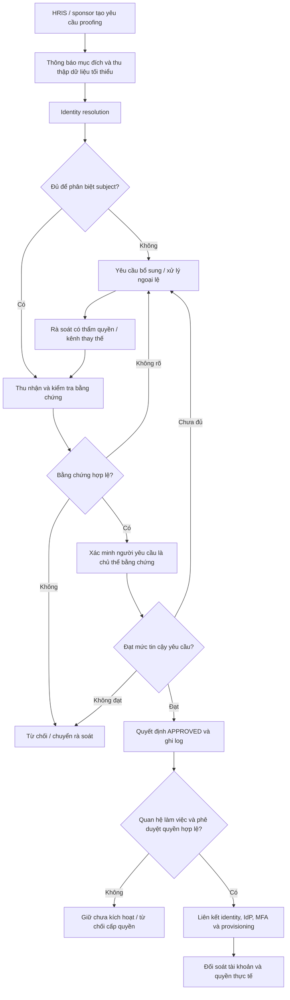
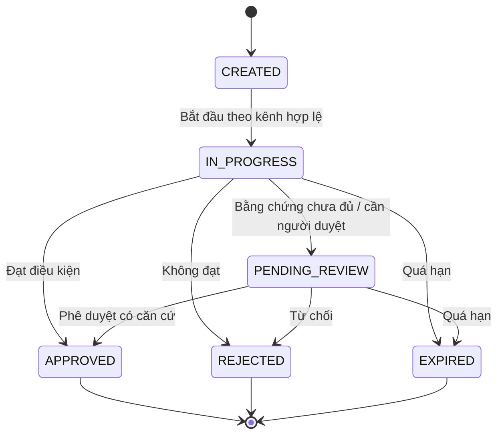

# Xác minh từ xa trong Identity Proofing

## 1. Xác minh từ xa là gì?

**Xác minh từ xa (remote identity proofing)** là quy trình xác lập mức độ tin cậy rằng **người đang yêu cầu tạo hoặc khôi phục danh tính số chính là người mà họ khai báo**, khi người đó không có mặt trực tiếp trước nhân viên xác minh tại một điểm tiếp nhận. Các bước có thể diễn ra hoàn toàn trực tuyến, chẳng hạn tải giấy tờ, quay video ngắn, đối chiếu với nguồn dữ liệu có thẩm quyền và phỏng vấn video, hoặc kết hợp bước xử lý tự động với rà soát thủ công.

Trong quản lý vòng đời danh tính của **Identity and Access Management (IAM)**, xác minh từ xa thường xuất hiện ở giai đoạn **Joiner** để bảo đảm tài khoản được tạo cho đúng nhân viên, cộng tác viên hoặc đối tác. Nó cũng có thể cần thiết khi **khôi phục tài khoản**, liên kết lại thông tin xác thực, hoặc xử lý một thay đổi danh tính có rủi ro cao.

Một quy trình tốt cần trả lời rõ:

1. **Danh tính nào đang được khai báo?** Có đủ thuộc tính để phân biệt người này với người khác không?
2. **Bằng chứng có hợp lệ không?** Giấy tờ, bản ghi hoặc nguồn đối chiếu có đáng tin, còn hiệu lực và nhất quán không?
3. **Người thực hiện có đúng là chủ thể của bằng chứng không?** Hệ thống có căn cứ đủ mạnh để chống mạo danh không?
4. **Mức độ tin cậy có phù hợp với quyền sắp cấp không?** Truy cập một diễn đàn nội bộ và truy cập hệ thống tài chính có thể cần chính sách khác nhau.
5. **Có thể chứng minh quyết định sau này không?** Ai đã quyết định, dựa trên quy trình gì, vào thời điểm nào và ngoại lệ nào đã được chấp thuận?

**Xác minh từ xa không đồng nghĩa đăng nhập từ xa.** Một người đã có tài khoản có thể đăng nhập bằng mật khẩu, passkey và MFA mà không cần thực hiện lại toàn bộ bước identity proofing. Ngược lại, người đăng ký lần đầu có thể vượt qua bước xác minh danh tính nhưng vẫn cần thiết lập thông tin xác thực và được phê duyệt quyền truy cập.

## 2. Phân biệt proofing, authentication và authorization

Các khái niệm thường bị nhầm lẫn:

| Hoạt động | Câu hỏi chính | Đầu ra điển hình |
|---|---|---|
| **Identity resolution** — xác định danh tính khai báo | Đã đủ thông tin để phân biệt người này với những người khác chưa? | Hồ sơ danh tính ứng viên và khóa liên kết |
| **Evidence validation** — kiểm tra bằng chứng | Tài liệu hoặc nguồn được cung cấp có hợp lệ, chân thực và nhất quán không? | Kết quả kiểm tra bằng chứng |
| **Identity verification** — xác minh chủ thể | Người đang đăng ký có đúng là người mà bằng chứng mô tả không? | Kết quả đối chiếu chủ thể với bằng chứng |
| **Enrollment** — ghi danh | Danh tính đã được chấp thuận sẽ liên kết với tài khoản/thông tin xác thực nào? | Identity ID, tài khoản và thông tin xác thực đã liên kết |
| **Authentication (AuthN)** — xác thực đăng nhập | Người đang đăng nhập có kiểm soát được thông tin xác thực đã liên kết không? | Phiên đăng nhập hoặc bằng chứng xác thực |
| **Authorization (AuthZ)** — phân quyền | Danh tính này được làm gì trên tài nguyên nào? | Quyết định cấp, từ chối hoặc giới hạn quyền |

Ví dụ, HR đã tạo hồ sơ “Nhân viên A” là bước cung cấp dữ kiện nghiệp vụ. Người ở xa gửi giấy tờ và hoàn thành quy trình đối chiếu để chứng minh mình là A là **proofing**. Khi A đăng nhập bằng passkey sau đó là **authentication**. Khi hệ thống quyết định A chỉ được đọc báo cáo theo vai trò là **authorization**.

Có thể dùng ba trục khái niệm để phân tích yêu cầu bảo đảm:

- **IAL — Identity Assurance Level:** mức độ bảo đảm về quy trình xác lập danh tính.
- **AAL — Authenticator Assurance Level:** mức độ bảo đảm của cơ chế xác thực đăng nhập.
- **FAL — Federation Assurance Level:** mức độ bảo đảm khi trao đổi bằng chứng xác thực trong mô hình liên kết danh tính.

Các mức và yêu cầu cụ thể phụ thuộc vào tiêu chuẩn hoặc chính sách tổ chức đang áp dụng; **không tự suy rằng MFA mạnh tương đương proofing mạnh**, hoặc một kết nối SSO/federation tự động làm danh tính ban đầu trở nên đáng tin hơn.

## 3. Những mô hình xác minh từ xa thường gặp

Không phải mọi quy trình từ xa đều dùng khuôn mặt hoặc giấy tờ tùy thân. Phương pháp phụ thuộc vào đối tượng, mức rủi ro, nguồn bằng chứng và điều kiện pháp lý.

| Mô hình | Cách thực hiện | Khi phù hợp | Điểm hạn chế |
|---|---|---|---|
| **Tự phục vụ tự động** | Thu nhận giấy tờ hoặc bằng chứng số, kiểm tra tính hợp lệ, đối chiếu người đăng ký khi cần | Quy mô lớn, luồng chuẩn hóa, có công cụ kiểm chứng | Có rủi ro bị ảnh/video giả, lỗi nhận diện hoặc chất lượng dữ liệu |
| **Có người xác minh qua video** | Nhân viên được đào tạo tương tác trực tiếp, kiểm tra bằng chứng và hỏi thông tin phù hợp | Trường hợp phức tạp hoặc cần xác minh bổ sung | Tốn nguồn lực, cần kiểm soát lừa đảo bằng video/deepfake |
| **Đối chiếu nguồn đã được kiểm chứng** | Dùng hồ sơ HR, nguồn đăng ký, thuộc tính do bên có thẩm quyền cung cấp, hoặc credential số đáng tin | Khi có nguồn gốc rõ ràng và cách liên kết với người yêu cầu | Dữ liệu đúng chưa chắc chứng minh người đang thao tác là chủ thể |
| **Kết hợp nhiều phương thức** | Tự động kiểm tra ban đầu, chuyển đến người rà soát khi phát hiện tín hiệu rủi ro | Phần lớn quy trình doanh nghiệp cần vừa mở rộng vừa kiểm soát | Phải định nghĩa ngưỡng chuyển tiếp và trách nhiệm phê duyệt |
| **Kênh thay thế có kiểm soát** | Điểm gặp trực tiếp hoặc phương án truy cập đặc biệt, có người bảo trợ | Người dùng không đủ thiết bị, giấy tờ, hoặc công nghệ không hỗ trợ | Cần chính sách tương đương về kiểm soát và kiểm toán |

**“Từ xa” là đặc điểm của kênh thực hiện**, không phải thước đo cố định về chất lượng xác minh. Một luồng từ xa được thiết kế tốt có thể sử dụng bằng chứng mạnh; một cuộc gọi video thiếu biện pháp chống giả mạo vẫn có thể không đủ tin cậy cho tác vụ nhạy cảm.

## 4. Quy trình xác minh từ xa đầu cuối

Một quy trình tiêu biểu gồm tám giai đoạn. Những công nghệ cụ thể được chọn theo rủi ro và khả năng của hệ thống.

### 4.1. Bước 1 — Khởi tạo yêu cầu và xác định mục đích

Yêu cầu proofing có thể xuất phát từ tuyển dụng, gia nhập dự án, khôi phục danh tính hoặc phát hiện sự kiện rủi ro. Hệ thống phải xác định **mục đích**, danh tính dự kiến, mức assurance yêu cầu và giới hạn thời gian.

Ví dụ: HRIS đã có mã nhân sự nội bộ, ngày bắt đầu và trạng thái hợp đồng được duyệt. IAM tạo một phiên proofing gắn với **ID yêu cầu** và **mã đối tượng ổn định**, thay vì tìm người chỉ bằng họ tên hoặc email.

Trước khi thu thập dữ liệu, cần cung cấp thông báo rõ ràng về phương thức, loại dữ liệu yêu cầu, mục đích xử lý, cơ chế hỗ trợ và lựa chọn thay thế nếu không hoàn thành được kênh tự động.

### 4.2. Bước 2 — Identity resolution: phân biệt đúng chủ thể

**Identity resolution** xác định những thuộc tính đủ để chỉ ra một danh tính cụ thể trong phạm vi cần quản lý. Có thể dùng tổ hợp mã nhân sự, mã hợp đồng, ID bên cấp bằng chứng và thuộc tính đã được kiểm chứng.

Lưu ý:

- Tên người, số điện thoại hoặc email **không phải khóa danh tính bất biến**.
- Không được gộp hai bản ghi chỉ vì tên hoặc email giống nhau.
- Một người có thể có nhiều hợp đồng; một hồ sơ HR đang tồn tại không đồng nghĩa người nộp bằng chứng có quyền sử dụng hồ sơ đó.
- Dữ liệu nguồn có thể thiếu dấu, đổi tên, nhiều định dạng hoặc có lỗi nhập liệu; trường hợp mâu thuẫn cần được chuyển rà soát.

### 4.3. Bước 3 — Thu thập bằng chứng có giới hạn

Tùy chính sách, hệ thống có thể yêu cầu tài liệu định danh, credential số, bằng chứng từ nguồn có thẩm quyền hoặc phương án xác minh thay thế. Tại đây cần kiểm tra **bằng chứng nào thực sự cần cho mục tiêu đã xác định**.

Đối với giấy tờ có ảnh, hệ thống có thể thu nhận hình ảnh mặt trước/mặt sau, thông tin cần thiết và bằng chứng về tính hiện diện của người tham gia nếu đó là phương thức được phê duyệt. Không nên mặc định yêu cầu mọi người dùng cung cấp sinh trắc học hoặc toàn bộ số định danh cá nhân khi những dữ liệu đó không cần thiết.

### 4.4. Bước 4 — Evidence validation: kiểm tra tính chân thực và hiệu lực

Tùy loại bằng chứng và khả năng kỹ thuật, có thể thực hiện:

- Kiểm tra cấu trúc và tính nhất quán: định dạng, thời hạn, trường bắt buộc, vùng máy đọc được hoặc chữ ký số nếu có.
- Kiểm tra dấu hiệu sửa đổi hoặc giả mạo ở dữ liệu hình ảnh, video hoặc bản ghi.
- Đối chiếu với **nguồn phát hành hoặc nguồn dữ liệu tin cậy** thông qua giao diện được cho phép khi có thể.
- Kiểm tra bằng chứng chưa bị thu hồi hoặc hết hiệu lực nếu nguồn hỗ trợ thông tin trạng thái.
- Phát hiện trường hợp một bằng chứng bị dùng bất thường cho nhiều hồ sơ, theo chính sách chống gian lận và bảo vệ dữ liệu.

**OCR chỉ trích xuất chữ từ ảnh.** OCR đọc được họ tên và số giấy tờ không chứng minh giấy tờ thật. Tương tự, ảnh chụp trông rõ nét không chứng minh tài liệu còn hợp lệ hoặc do người khai báo sở hữu.

### 4.5. Bước 5 — Identity verification: liên kết người yêu cầu với bằng chứng

Sau khi đánh giá bằng chứng, hệ thống cần có cơ chế xác minh **người thực sự tham gia là chủ thể gắn với bằng chứng**. Các biện pháp có thể gồm:

- Đối chiếu trực tiếp với người xác minh từ xa theo quy trình được đào tạo.
- Đối chiếu ảnh chụp hiện tại với ảnh trong tài liệu nếu phương pháp này được chấp thuận.
- Kiểm tra tính hiện diện thực (*presentation attack detection — PAD*) nhằm giảm nguy cơ dùng ảnh in, video phát lại, mặt nạ hoặc dữ liệu tổng hợp.
- Dùng credential số đã liên kết với chủ thể qua nguồn đáng tin khi có cơ chế kiểm chứng thích hợp.
- Chuyển sang kênh kiểm tra độc lập khi phát hiện bất thường hoặc độ tin cậy chưa đủ.

**PAD/liveness không đồng nghĩa xác minh danh tính.** Một video có vẻ là người thật không chứng minh người trong video là người trên giấy tờ. Ngược lại, điểm khớp khuôn mặt cao cũng không đủ để kết luận giấy tờ hợp lệ hoặc người đó được phép vào tổ chức.

### 4.6. Bước 6 — Đánh giá rủi ro và quyết định

Kết quả từ các bước trước được tổng hợp theo chính sách. Quyết định có thể là:

| Kết quả | Ý nghĩa | Hành động |
|---|---|---|
| `APPROVED` | Bằng chứng và quá trình xác minh đáp ứng yêu cầu | Cho phép đi tiếp đến ghi danh và phê duyệt quyền |
| `MORE_EVIDENCE_REQUIRED` | Chưa đủ dữ liệu hoặc có mâu thuẫn có thể giải quyết | Đề nghị bổ sung hoặc chuyển phương thức |
| `MANUAL_REVIEW` | Có tín hiệu rủi ro hoặc trường hợp ngoại lệ | Giao người có thẩm quyền rà soát, ghi nhận căn cứ |
| `REJECTED` | Không đáp ứng chính sách hoặc phát hiện bằng chứng không hợp lệ | Từ chối theo quy trình; cung cấp kênh khiếu nại/khắc phục thích hợp |
| `EXPIRED` | Phiên hoặc yêu cầu hết hạn | Bắt đầu yêu cầu mới, không tái dùng dữ liệu/phiên cũ trái chính sách |

Không nên dùng một điểm số của công cụ nhận diện làm **quyết định cuối duy nhất** cho mọi trường hợp. Phải cân nhắc lỗi nhận diện, bằng chứng mâu thuẫn, nguồn dữ liệu, tác động với người thật và cơ chế rà soát khi cần.

### 4.7. Bước 7 — Ghi danh và liên kết với IAM

Chỉ khi proofing **đạt điều kiện** và quan hệ nghiệp vụ **được chấp thuận**, IAM mới liên kết kết quả với danh tính kỹ thuật:

1. Ánh xạ subject đã xác minh với người trong HRIS, hệ thống hợp đồng hoặc nguồn có thẩm quyền.
2. Ghi **ID danh tính nội bộ** và trạng thái proofing đủ dùng, tránh lưu lại toàn bộ dữ liệu nhạy cảm khi không cần.
3. Tạo hoặc kích hoạt tài khoản IdP theo thời gian hợp lệ.
4. Thiết lập thông tin xác thực, MFA/passkey và quy trình khôi phục phù hợp.
5. Cấp quyền nền qua RBAC/ABAC; quyền nhạy cảm cần thêm phê duyệt theo chính sách.
6. Đồng bộ đến ứng dụng qua SCIM/API, rồi xác minh trạng thái tại hệ thống đích.

Kết quả proofing **không tự trao quyền**. Người được chứng minh đúng danh tính vẫn có thể chưa được cấp quyền nếu hợp đồng chưa có hiệu lực hoặc chưa được chủ sở hữu tài nguyên chấp thuận.

### 4.8. Bước 8 — Lưu dấu vết, hết hạn và tái xác minh khi cần

Hệ thống lưu trạng thái xử lý, loại phương pháp đã dùng, mức assurance đạt được, nguồn kiểm tra, thời gian, người phê duyệt và các trường hợp ngoại lệ. Dữ liệu nhạy cảm chỉ lưu trong thời gian và phạm vi đã được cho phép.

Một kết quả proofing có thể cần được đánh giá lại khi **thay đổi danh tính cốt lõi, chuyển sang quyền nhạy cảm hơn, có dấu hiệu mạo danh hoặc khôi phục truy cập sau sự cố**. Không phải mọi lần đăng nhập hoặc mỗi lần đổi phòng ban đều cần thực hiện lại toàn bộ proofing.

### 4.9. Sơ đồ quyết định



## 5. Bằng chứng, độ mạnh và giới hạn kiểm chứng

Chất lượng proofing phụ thuộc vào **độ tin cậy của bằng chứng** và **khả năng kiểm tra bằng chứng**, không phải số lượng ảnh được tải lên.

| Loại bằng chứng | Điểm mạnh | Giới hạn cần quản lý |
|---|---|---|
| Giấy tờ do cơ quan có thẩm quyền phát hành | Có thể mang thông tin định danh và biện pháp chống giả | Ảnh chụp dễ bị chỉnh sửa; cần xác minh phát hành/hiệu lực nếu có điều kiện |
| Credential số có thể kiểm chứng | Có thể xác minh chữ ký và nguồn phát hành | Cần kiểm tra issuer, trạng thái, ràng buộc với chủ thể và chống phát lại |
| Hồ sơ HRIS/hợp đồng | Xác nhận quan hệ công việc, ngày hiệu lực và người quản lý | Không chứng minh người đang gửi yêu cầu thực sự là người trong hồ sơ |
| Cuộc gọi video có người kiểm tra | Cho phép xử lý trường hợp phức tạp và quan sát hành vi | Có thể bị giả mạo video/giọng nói; người kiểm tra có thể sai sót |
| Đối chiếu sinh trắc học khi được cho phép | Hỗ trợ so sánh người đăng ký và ảnh tham chiếu | Có sai số, rủi ro riêng tư, tấn công trình diện và dữ liệu tổng hợp |
| Kiểm tra thiết bị, kênh và hành vi | Phát hiện dấu hiệu bất thường của phiên thực hiện | Là tín hiệu hỗ trợ, không chứng minh độc lập danh tính pháp lý |

**Không có quy tắc “càng nhiều bằng chứng càng tốt”.** Hai ảnh cùng lấy từ một giấy tờ giả không tạo thành hai nguồn xác minh độc lập. Các bằng chứng có chung nguồn hoặc chung điểm yếu phải được đánh giá như một nhóm phụ thuộc, tránh thổi phồng độ tin cậy.

Khi không thể trực tiếp tra cứu nguồn phát hành, kết quả cần phản ánh giới hạn: “đã kiểm tra cấu trúc/hình ảnh” khác với “đã kiểm chứng tại nguồn phát hành”.

## 6. Mối đe dọa với xác minh từ xa

Xác minh từ xa mở thêm các cách tấn công mà quy trình trực tiếp có thể ít gặp hơn. Cần xây dựng threat model theo dữ liệu thu nhận, kênh truyền, bên cung cấp dịch vụ và quyết định cuối.

### 6.1. Giấy tờ và tài liệu giả

Kẻ tấn công có thể chỉnh sửa ảnh, dùng giấy tờ bị đánh cắp, tạo tài liệu tổng hợp hoặc sửa trường hiển thị. Kiểm soát gồm xác thực dữ liệu/bằng chứng từ nguồn cho phép, phát hiện sửa đổi, kiểm tra tính nhất quán và chuyển kiểm duyệt khi không đủ tin cậy.

Không để “ảnh nhìn hợp lý” hoặc OCR thành công trở thành tiêu chí chấp thuận duy nhất.

### 6.2. Presentation attack và deepfake

Người gian lận có thể dùng ảnh tĩnh, video phát lại, màn hình thiết bị khác, mặt nạ hoặc nội dung tạo bằng AI. Công cụ PAD, cơ chế tương tác theo thời điểm, phân tích tính toàn vẹn luồng thu nhận và người rà soát có thể giảm rủi ro, nhưng **không có biện pháp đơn lẻ nào bảo đảm chống mọi kiểu giả mạo**.

**Liveness check** cần được phân biệt với việc chống mọi deepfake: một bài kiểm tra chớp mắt hoặc quay đầu đơn giản có thể bị giả lập. Mức kiểm tra phải gắn với rủi ro và năng lực thực tế của giải pháp được chọn.

### 6.3. Chiếm kênh liên lạc hoặc chuyển hướng quy trình

Đường link giả, email bị xâm nhập, SIM swap hoặc hỗ trợ viên giả mạo có thể đánh lừa người dùng mở quy trình trái phép. Hệ thống nên:

- Gửi người dùng tới miền ứng dụng/IdP đã được kiểm soát.
- Xác thực nguồn yêu cầu và ràng buộc phiên proofing với giao dịch hợp lệ.
- Không dựa vào **mã OTP gửi một kênh đã bị chiếm** làm bằng chứng đầy đủ về danh tính.
- Bảo vệ token phiên, chống phát lại, giới hạn thời gian và số lần thử.
- Có kênh hỗ trợ chính thức để xác minh yêu cầu bất thường.

### 6.4. Tấn công ghép tài khoản (account linking)

Kẻ tấn công có thể khai báo email trùng người thật để nối kết quả proofing vào tài khoản đã có. Do đó, nên liên kết kết quả theo **identity ID/worker ID và nguồn đã được kiểm chứng**, kết hợp bước xác minh chủ sở hữu nếu cần. **Không tự động hợp nhất tài khoản chỉ dựa trên họ tên hay email.**

### 6.5. Tấn công tự động và lạm dụng quy trình

Bot có thể thử nhiều giấy tờ, IP, phiên hoặc hồ sơ để tìm điểm yếu. Cần giới hạn tần suất theo mức rủi ro, phát hiện mẫu hành vi bất thường, chống lạm dụng tài nguyên và cơ chế chuyển kiểm duyệt. Phải cân bằng với khả năng truy cập của người dùng thật, tránh khóa vĩnh viễn chỉ vì họ gặp lỗi thiết bị.

### 6.6. Người trong tổ chức lạm dụng quyền duyệt

Một nhân viên có thể cố ý bỏ qua bước kiểm tra hoặc cấp phê duyệt không đủ căn cứ. Quy trình cần **phân tách nhiệm vụ (Separation of Duties)**, phân quyền người rà soát, nhật ký bất biến theo khả năng và cơ chế giám sát các trường hợp override.

## 7. Quyết định dựa trên rủi ro và kiểm soát ngoại lệ

Chính sách proofing có thể phân tầng theo tác động của truy cập dự kiến, tín hiệu gian lận, mức độ đáng tin của bằng chứng và tình huống nghiệp vụ.

Ví dụ ma trận mang tính **minh họa**, không phải chuẩn IAL chính thức:

| Tình huống | Yêu cầu proofing dự kiến | Sau proofing |
|---|---|---|
| Nhân viên mới vào cổng nội bộ, có HRIS đáng tin và quy trình bàn giao danh tính đã kiểm soát | Quy trình phù hợp chính sách rủi ro thấp hoặc trung bình | Thiết lập MFA, cấp quyền nền |
| Nhà thầu truy cập dữ liệu khách hàng nhạy cảm | Xác nhận sponsor, hợp đồng, bằng chứng và chủ thể ở mức cao hơn theo chính sách | Phê duyệt chủ sở hữu dữ liệu, quyền có thời hạn |
| Khôi phục tài khoản quản trị sau mất authenticator | Xác minh lại với quy trình độc lập và có kiểm soát mạnh | Liên kết authenticator mới, ghi dấu vết, xem xét phiên/credential cũ |
| Hồ sơ HR và giấy tờ mâu thuẫn | Chưa đủ điều kiện duyệt tự động | Chuyển bộ phận có thẩm quyền rà soát |
| Người dùng không thể thực hiện sinh trắc học | Dùng phương án thay thế đã được duyệt | Đảm bảo mức kiểm soát tương xứng, tránh loại trừ không cần thiết |

### 7.1. Rà soát thủ công không phải “nút bỏ qua”

Quy trình manual review cần ghi:

1. Lý do chuyển kiểm duyệt và các bước đã thực hiện.
2. Bằng chứng nào đã được xác minh, bằng chứng nào chưa xác minh được.
3. Quyết định, căn cứ, người duyệt và thời điểm.
4. Bất kỳ điều kiện bổ sung hoặc giới hạn quyền nào.
5. Cách phản hồi và xử lý khiếu nại hoặc yêu cầu làm lại.

Người dùng bị từ chối nên có **quy trình khắc phục hợp lệ**, đồng thời hệ thống vẫn cần bảo vệ dữ liệu và không tiết lộ chi tiết kỹ thuật có thể hỗ trợ gian lận.

## 8. Kết nối xác minh từ xa với Joiner–Mover–Leaver

### 8.1. Joiner: chứng minh đúng người trước khi kích hoạt tài khoản

Giả sử nhân viên mới làm việc từ xa. **HRIS** đã xác nhận hợp đồng, mã nhân sự và ngày bắt đầu. Identity proofing là bước kiểm tra rằng **người đang yêu cầu kích hoạt tài khoản chính là người trong hồ sơ này**.

Luồng đề xuất:

1. HRIS phát sự kiện Joiner có mã nhân sự, ngày hiệu lực và trạng thái hợp lệ.
2. IAM tạo yêu cầu proofing gắn với mã nhân sự và kênh tiếp nhận đã kiểm soát.
3. Người đăng ký hoàn thành thu thập và kiểm tra bằng chứng phù hợp.
4. Kết quả được duyệt, IAM ghi **proofing status + method + time + evidence reference tối thiểu**.
5. IAM liên kết kết quả với danh tính đã có trong HRIS; tạo/kích hoạt tài khoản IdP đúng thời điểm.
6. Người dùng ghi danh authenticator, thực hiện MFA và nhận các quyền đã được duyệt.
7. IAM đối soát trạng thái trên ứng dụng đích, cập nhật audit log.

**Pre-provisioning** có thể tạo tài khoản trước ngày nhận việc, nhưng không nên cho truy cập nghiệp vụ trước khi cả điều kiện quan hệ làm việc và mức proofing yêu cầu được đáp ứng.

### 8.2. Mover: thay đổi quyền có thể yêu cầu step-up

Khi nhân viên đổi bộ phận, IAM thường dựa vào sự kiện HRIS và phê duyệt để **thu hồi quyền cũ, cấp quyền mới**. Không phải mọi lần chuyển vị trí đều cần proofing lại.

Tuy nhiên, nếu người dùng muốn nhận **đặc quyền quản trị**, thay thông tin định danh trọng yếu hoặc chuyển sang tài nguyên rất nhạy cảm, tổ chức có thể yêu cầu kiểm tra bổ sung. Cần phân biệt:

- **Step-up authentication:** yêu cầu đăng nhập với cơ chế mạnh hơn để chứng minh người dùng đang kiểm soát authenticator.
- **Re-proofing:** xác minh lại chính danh tính khi độ tin cậy ban đầu không đủ hoặc có nghi vấn mạo danh.
- **Approval:** xác nhận lý do nghiệp vụ và quyền mới do chủ sở hữu tài nguyên quyết định.

Ba bước có mục đích khác nhau; một bước không mặc nhiên thay thế hai bước còn lại.

### 8.3. Leaver: proofing không thay thế deprovisioning

Khi HRIS xác nhận người dùng nghỉ việc, IAM phải khóa đăng nhập và thu hồi quyền theo chính sách; **không chờ người dùng thực hiện xác minh danh tính** để được phép thu hồi.

Trong hệ thống đã tích hợp IdP, SSO và SCIM, offboarding còn cần kiểm tra:

- Đường đăng nhập tại IdP có bị khóa.
- Phiên ứng dụng và refresh token có bị thu hồi trong phạm vi hỗ trợ.
- Quyền nội bộ và tài khoản local có bị vô hiệu hóa.
- API key, SSH key, quyền quản trị và quyền ngoại lệ còn hiệu lực hay không.
- Hệ thống đích đã xác nhận thay đổi hay vẫn báo lỗi.

Kết quả proofing lưu trước đó có thể giúp phân biệt bản ghi và điều tra gian lận, nhưng **không chứng minh rằng quyền đã được thu hồi**.

### 8.4. Đối tượng không thuộc nhân viên

Nhà thầu hoặc cộng tác viên có thể được quản lý bởi hệ thống hợp đồng hoặc người bảo trợ thay vì HRIS. Khi proofing từ xa, cần xác minh **người tham gia + tổ chức nguồn + sponsor/contract + thời hạn truy cập**. Nếu đối tác cung cấp federated identity, cần hiểu rõ đảm bảo của IdP đối tác; xác thực liên kết không mặc nhiên bảo đảm quy trình proofing ban đầu đạt mức doanh nghiệp nhận truy cập yêu cầu.

## 9. Liên kết với IdP, SSO, SCIM và chính sách phân quyền

Proofing từ xa có thể tạo ra **một kết quả tin cậy có giới hạn**; hệ thống IAM cần sử dụng kết quả này đúng chỗ.

| Thành phần | Dùng kết quả proofing để làm gì? | Điều không nên giả định |
|---|---|---|
| **HRIS / authoritative source** | Gắn kết quả với đúng nhân viên/hợp đồng và ngày hiệu lực | Hồ sơ HR có sẵn đồng nghĩa người thao tác đã được xác minh |
| **Identity registry** | Lưu trạng thái đã xác minh, ID và nguồn căn cứ | Điểm số công cụ hoặc email đủ làm identity ID |
| **IdP** | Cho phép đăng ký authenticator, bật MFA, áp dụng trạng thái tài khoản | Bật MFA có thể thay thế bằng chứng nhân thân |
| **SSO / federation** | Truyền kết quả xác thực đăng nhập qua quan hệ tin cậy | SSO thể hiện đầy đủ nguồn gốc proofing hoặc quyền |
| **SCIM / API provisioning** | Tạo, cập nhật hoặc khóa tài khoản sau khi đủ điều kiện | SCIM tự kiểm tra giấy tờ hoặc chủ thể |
| **RBAC / ABAC / IGA** | Dùng trạng thái xác minh làm một điều kiện cấp quyền theo chính sách | Được proofing duyệt nghĩa là được mọi quyền |
| **Audit / security monitoring** | Truy vết yêu cầu, kết quả, ngoại lệ và thay đổi quyền | Lưu ảnh/sinh trắc học thô là điều bắt buộc để audit |

Ví dụ quyết định quyền bằng mã giả:

```text
allow_create_active_account(subject) when
    hr_record.status == "ACTIVE"
    and proofing.subject_id == hr_record.worker_id
    and proofing.decision == "APPROVED"
    and proofing.assurance_meets(account_policy)
    and not subject.security_hold

allow_grant_sensitive_role(subject, role) when
    subject.account_status == "ACTIVE"
    and subject.proofing_assurance_meets(role.policy)
    and role.business_owner_approved
    and not conflicts_with_separation_of_duties(subject, role)
```

Đây là logic **minh họa**: tổ chức phải định nghĩa nguồn sự thật của từng thuộc tính, điều kiện hết hạn và cách xử lý khi trạng thái proofing bị thu hồi hoặc phát hiện gian lận sau đó.

## 10. Thiết kế dữ liệu và trạng thái xử lý

Một workflow proofing nên có **ID yêu cầu riêng**, hạn sử dụng và trạng thái có thể truy vết. Trạng thái minh họa:



Trong triển khai thật, các yêu cầu tạo lại và trường hợp bị thu hồi/chỉnh sửa sau kiểm toán cần được mô hình hóa riêng, không sửa ngược lịch sử quyết định cũ mà không có dấu vết.

Ví dụ bản ghi **kết quả nghiệp vụ tối thiểu**, dùng mã định danh giả và không chứa ảnh giấy tờ hay dữ liệu sinh trắc học:

```json
{
  "proofing_request_id": "proof-2026-000318",
  "identity_reference": {
    "source": "HRIS",
    "worker_id": "W-08145"
  },
  "purpose": "REMOTE_JOINER_ENROLLMENT",
  "method": "DOCUMENT_AND_SUPERVISED_REVIEW",
  "status": "APPROVED",
  "assurance_policy": "JOINER_REMOTE_POLICY_V2",
  "decision_at": "2026-11-23T08:20:00Z",
  "reviewer_id": "reviewer-42",
  "evidence_references": [
    "evidence-ref-018"
  ],
  "expires_at": "2026-12-23T00:00:00Z"
}
```

Trường `expires_at` ở đây chỉ **minh họa một chính sách thời hạn của kết quả**, không có nghĩa mọi chuẩn proofing yêu cầu đúng khoảng thời gian đó. Dữ liệu kiểm toán cần liên kết được với **policy version** và workflow thực tế để giải thích vì sao quyết định được đưa ra.

### 10.1. Bảo vệ luồng và dữ liệu

- Xác thực và phân quyền đối với tác vụ khởi tạo proofing; ràng buộc request với danh tính nghiệp vụ có thẩm quyền.
- Giới hạn thời gian phiên, dùng nonce/challenge hoặc cơ chế chống phát lại thích hợp.
- Bảo vệ dữ liệu truyền và lưu trữ; mã hóa và quản lý khóa theo mức nhạy cảm.
- Tách dữ liệu thô và kết quả nghiệp vụ, chỉ trao cho IAM những thuộc tính cần thiết.
- Áp dụng quyền truy cập tối thiểu đối với reviewer, quản trị viên và dịch vụ tích hợp.
- Có cơ chế phát hiện bất thường, giới hạn thử lại, khóa chống lạm dụng và hỗ trợ người dùng thật.
- Xác minh webhook/callback từ nhà cung cấp proofing, kiểm tra chữ ký hoặc cơ chế xác thực được cấu hình, ràng buộc request ID và xử lý idempotent.

**Callback “APPROVED” từ một URL không được xác thực không phải bằng chứng proofing hợp lệ.** IAM phải bảo đảm kết quả thuộc đúng giao dịch, đúng nhà cung cấp và chưa bị xử lý nhầm hoặc phát lại.

## 11. Quyền riêng tư, khả năng tiếp cận và xử lý ngoại lệ

Identity proofing có thể xử lý **thông tin định danh nhạy cảm**. Ảnh giấy tờ, dữ liệu khuôn mặt, video và thông tin liên lạc có thể mang rủi ro nếu lộ lọt, bị dùng sai mục đích hoặc lưu trữ quá lâu.

Những nguyên tắc quan trọng:

1. **Giới hạn mục đích:** chỉ thu thập bằng chứng cần thiết cho chính sách proofing đã xác định.
2. **Giảm dữ liệu:** không sao chép toàn bộ giấy tờ, video hoặc template sinh trắc học sang IdP và mọi ứng dụng.
3. **Thông báo rõ ràng:** người dùng cần biết dữ liệu nào được xử lý, bởi bên nào, vì sao và có phương án hỗ trợ nào.
4. **Thời hạn lưu giữ:** đặt chính sách lưu/xóa dữ liệu thô, metadata và audit phù hợp yêu cầu pháp lý, hợp đồng và điều tra sự cố; không mặc định lưu mãi.
5. **Bảo vệ dữ liệu sinh trắc học:** chỉ triển khai khi có cơ sở và cơ chế bảo vệ phù hợp; kiểm soát bên xử lý, quyền truy cập và yêu cầu xóa.
6. **Chống sai lệch và loại trừ:** kiểm tra tỷ lệ lỗi giữa những điều kiện sử dụng khác nhau, chẳng hạn thiết bị, ánh sáng, hình ảnh hoặc nhóm người dùng theo yêu cầu đánh giá được phép.
7. **Hỗ trợ phương án thay thế:** người khuyết tật, người không có camera phù hợp hoặc người không thể hoàn thành thao tác sinh trắc học cần quy trình hỗ trợ có kiểm soát.
8. **Có cơ chế khiếu nại và sửa sai:** khi người thật bị từ chối nhầm hoặc dữ liệu HR sai, người có thẩm quyền phải có quy trình giải quyết.

Không có quy định **chung cho mọi nơi** về loại giấy tờ bắt buộc, lưu trữ trong bao lâu hoặc điều kiện sử dụng sinh trắc học. Triển khai phải tuân thủ quy định và hợp đồng áp dụng ở địa bàn hoạt động cụ thể.

## 12. Tài khoản dịch vụ và giới hạn áp dụng proofing

**Xác minh từ xa người thật** chủ yếu áp dụng cho danh tính con người. Với **service account, bot, CI/CD runner hoặc workload identity**, câu hỏi bảo đảm thay đổi:

- Ai là **chủ sở hữu nghiệp vụ/kỹ thuật** của workload?
- Thành phần phần mềm nào đang xin đăng ký danh tính và chạy ở môi trường nào?
- Bằng chứng khởi tạo có thể được kiểm tra bằng cơ chế nào, chẳng hạn danh tính nền tảng, workload attestation hoặc thông tin đã được phê duyệt?
- Credential được cấp theo nguyên tắc quyền tối thiểu, có thời hạn và được xoay vòng ra sao?
- Khi owner chuyển vai trò, nghỉ việc hoặc workload bị hủy, quyền sẽ được rà soát và thu hồi thế nào?

Không áp dụng máy móc yêu cầu chụp giấy tờ/nhận diện khuôn mặt cho danh tính máy. Với tài khoản dịch vụ, hệ thống cần **xác minh nguồn gốc và quyền tạo workload, liên kết owner, kiểm soát credential và vòng đời quyền**.

HRIS có thể tạo sự kiện Mover/Leaver cho người sở hữu service account, khiến IAM kích hoạt rà soát hoặc chuyển ownership; nó không tự chứng minh dịch vụ đã ngừng sử dụng.

## 13. Tình huống thực tế: onboard từ xa một nhân viên

Giả sử **Lan** ký hợp đồng làm việc từ xa tại bộ phận Phân tích dữ liệu. HRIS đã ghi nhận mã nhân viên `W-08145`, ngày bắt đầu 01/12 và người quản lý hợp lệ.

**Giai đoạn 1 — Chuẩn bị:** IAM tạo yêu cầu proofing cho mã `W-08145`, gửi hướng dẫn qua kênh tuyển dụng đã được kiểm soát. Lan được thông báo về các loại dữ liệu cần cung cấp và kênh hỗ trợ nếu không thực hiện được trên thiết bị cá nhân.

**Giai đoạn 2 — Kiểm tra bằng chứng:** Lan cung cấp bằng chứng theo chính sách. Hệ thống kiểm tra tính hợp lệ của bằng chứng và xác minh người yêu cầu phù hợp bằng chứng. Một trường thông tin không nhất quán với HRIS nên quy trình chuyển sang `MANUAL_REVIEW`, chưa cấp quyền vào dữ liệu nghiệp vụ.

**Giai đoạn 3 — Giải quyết ngoại lệ:** Nhân viên có thẩm quyền xác định HRIS dùng cách viết tên khác nhưng vẫn có đủ căn cứ độc lập chứng minh cùng người. Người rà soát ghi lý do, kết quả và phiên bản chính sách. Nếu căn cứ chưa đủ, Lan cần bổ sung bằng chứng hoặc dùng kênh xác minh thay thế.

**Giai đoạn 4 — Kích hoạt:** Khi proofing được `APPROVED` và đến ngày hợp đồng có hiệu lực, IAM liên kết danh tính với hồ sơ nhân sự, cho thiết lập authenticator và MFA tại IdP. Quyền đọc báo cáo tổng hợp được cấp theo vai trò; quyền xem dữ liệu cá nhân nhạy cảm vẫn cần phê duyệt riêng.

**Giai đoạn 5 — Chuyển vai trò:** Sau vài tháng, Lan chuyển sang Tài chính. HRIS phát Mover; IAM thu hồi quyền nhóm cũ và áp dụng phê duyệt cho quyền mới. Nếu nhiệm vụ mới yêu cầu đảm bảo danh tính cao hơn, tổ chức đánh giá có cần re-proofing hay step-up authentication hay không.

**Giai đoạn 6 — Nghỉ việc:** HRIS phát Leaver. IAM khóa đăng nhập, thu hồi phiên và quyền ở các ứng dụng, xác minh trạng thái thực tế. Việc Lan từng được proofing thành công **không cho phép giữ lại quyền sau ngày hết quan hệ làm việc**.

## 14. Kiểm toán và các chỉ số chất lượng

Proofing cần vừa hỗ trợ **kiểm toán quyết định** vừa không biến kho audit thành kho dữ liệu nhạy cảm không cần thiết.

| Chỉ số/kiểm tra | Ý nghĩa | Điều cần quan sát |
|---|---|---|
| **Completion rate** | Tỷ lệ yêu cầu kết thúc quy trình thành công | Tách lỗi kỹ thuật, người dùng bỏ dở và bị từ chối |
| **Manual review rate** | Tỷ lệ chuyển người kiểm duyệt | Có thể phản ánh dữ liệu nguồn kém hoặc ngưỡng kiểm tra bất hợp lý |
| **False accept / false reject** | Sai sót nhận nhầm hoặc từ chối nhầm | Đánh giá theo phương pháp đo phù hợp và dữ liệu đủ tin cậy |
| **Fraud signal rate** | Tỷ lệ yêu cầu có dấu hiệu gian lận | Không dùng một tín hiệu để kết luận gian lận đã xảy ra |
| **Time to decision** | Thời gian từ tạo yêu cầu đến quyết định | Theo dõi phân phối và trường hợp bị kẹt |
| **Exception closure time** | Thời gian xử lý yêu cầu chưa đủ bằng chứng | Cần người chịu trách nhiệm và thời hạn rõ |
| **Account-linking discrepancy** | Kết quả proofing không khớp subject HRIS/IAM | Chặn kích hoạt và kiểm tra trùng danh tính |
| **Provisioning after approval** | Tài khoản và quyền chỉ tạo sau các điều kiện cần | Phát hiện luồng cấp quyền bỏ qua proofing |
| **Evidence retention compliance** | Dữ liệu thô được xóa đúng chính sách | Tránh lưu quá hạn và nhân bản dữ liệu không kiểm soát |

Audit record nên bao gồm `request_id`, `subject_reference`, `method`, `policy_version`, `decision`, `decision_at`, `reviewer_id` (nếu có), `exception_reason`, `downstream_action_id` và tình trạng đối soát. Có thể lưu **tham chiếu đến bằng chứng** thay vì sao chép tài liệu nhạy cảm vào log.

### 14.1. Các trường hợp cần thử trước triển khai

| Tình huống thử | Kết quả mong đợi |
|---|---|
| Bằng chứng hợp lệ, thông tin khớp hồ sơ và chính sách | Có thể duyệt và liên kết đúng identity ID |
| Ảnh rõ nét nhưng không có cách xác minh nguồn/chủ thể | Không tự kết luận đủ độ tin cậy |
| Giấy tờ hết hạn, thiếu hoặc mâu thuẫn | Từ chối hoặc chuyển quy trình xử lý ngoại lệ thích hợp |
| Ảnh/video trình diện lại hoặc nghi ngờ deepfake | Từ chối/chuyển rà soát theo chính sách và lưu dấu vết |
| Hai hồ sơ HR có cùng email hiển thị | Không tự động gộp danh tính |
| Callback approved bị phát lại | Xử lý idempotent, không tạo tài khoản hoặc grant trùng |
| Callback đến từ nguồn không được xác thực | Từ chối và cảnh báo |
| Kết quả approved nhưng hợp đồng chưa có hiệu lực | Chưa cho truy cập nghiệp vụ |
| Người dùng không hoàn thành bài kiểm tra camera | Cung cấp hỗ trợ hoặc kênh thay thế theo chính sách |
| Review thủ công chưa chốt | Không coi là đã duyệt |
| Leaver đã có hiệu lực | Thu hồi quyền, bất kể lịch sử proofing |
| Phát hiện gian lận sau khi từng approved | Khóa/rà soát danh tính và quyền, bảo tồn bằng chứng phù hợp |

## 15. Những hiểu lầm cần tránh

| Hiểu lầm | Cách hiểu đúng |
|---|---|
| “Có giấy tờ tải lên là đã xác minh danh tính” | Cần kiểm tra bằng chứng và liên kết đúng người yêu cầu với bằng chứng |
| “OCR đọc chính xác nên giấy tờ là thật” | OCR chỉ giúp trích xuất dữ liệu |
| “Liveness pass nên người này chắc chắn đúng danh tính” | PAD chỉ hỗ trợ kiểm tra hành vi trình diện, không giải quyết toàn bộ proofing |
| “MFA hoặc SSO bảo đảm đã xác minh nhân thân” | Authenticator/SSO liên quan đến đăng nhập; nguồn gốc danh tính ban đầu là lớp khác |
| “Proofing approved thì cấp quyền quản trị luôn” | Quyền vẫn cần phê duyệt, RBAC/ABAC và kiểm soát SoD |
| “Càng lưu nhiều video càng dễ kiểm toán” | Cần lưu bằng chứng đủ dùng, giảm dữ liệu thô theo chính sách |
| “Không có camera tốt thì không thể tham gia IAM” | Phải có kênh hỗ trợ và ngoại lệ có kiểm soát phù hợp |
| “Leaver cần làm lại proofing trước khi khóa” | Offboarding dựa vào sự kiện có thẩm quyền và chính sách thu hồi |
| “Một kết quả của nhà cung cấp không thể bị giả mạo” | Callback phải được xác thực, ràng buộc với request và chống phát lại |

## 16. Nguyên tắc triển khai cần ghi nhớ

**Xác minh từ xa là bước hình thành niềm tin về danh tính được khai báo ở thời điểm ghi danh hoặc sự kiện rủi ro**, và là một đầu vào cho IAM lifecycle. Để vận hành hiệu quả:

1. **Đặt chính sách theo rủi ro:** xác định mức proofing cần thiết dựa trên mục đích, đối tượng và quyền dự kiến.
2. **Tách ba giai đoạn cốt lõi:** identity resolution, evidence validation và identity verification; không thay thế lẫn nhau bằng một điểm số công cụ.
3. **Kiểm tra nhiều nguồn có căn cứ:** tài liệu, nguồn phát hành, hồ sơ nhân sự và dấu hiệu người thực hiện phải được đánh giá về độ tin cậy cũng như sự phụ thuộc.
4. **Chống giả mạo và chiếm kênh:** bảo vệ phiên, callback, đường truyền, liên kết tài khoản và khả năng phát hiện presentation attack/deepfake.
5. **Gắn kết quả vào đúng danh tính:** dùng ID ổn định từ nguồn có thẩm quyền và cơ chế linking có kiểm soát.
6. **Điều phối theo JML:** Joiner xác minh trước khi kích hoạt; Mover chỉ bổ sung kiểm tra khi cần; Leaver thu hồi quyền theo sự kiện và kiểm chứng kết quả.
7. **Kiểm soát hậu xác minh:** IdP, MFA, SSO/federation, SCIM, RBAC/ABAC và phê duyệt quyền phải hoạt động phù hợp với chính sách.
8. **Bảo vệ dữ liệu và người dùng:** giới hạn mục đích, tối thiểu dữ liệu, thời hạn lưu, phương thức thay thế và cơ chế xử lý từ chối nhầm.
9. **Ghi quyết định có thể kiểm toán:** truy vết phương pháp, chính sách, người duyệt, ngoại lệ và thao tác cấp quyền sau đó.

Một kết quả proofing đáng tin là tiền đề để tạo **đúng danh tính**; chỉ khi kết hợp với phê duyệt, phân quyền, rà soát và thu hồi trong toàn bộ vòng đời thì tổ chức mới thực sự giảm được tài khoản giả mạo và **quyền truy cập tồn dư**.
