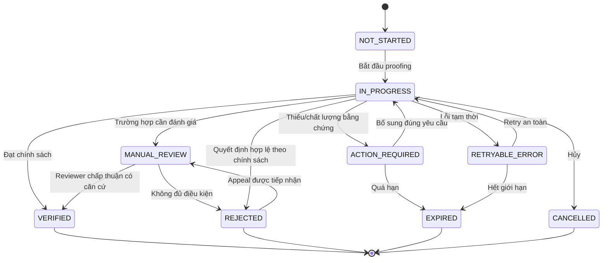
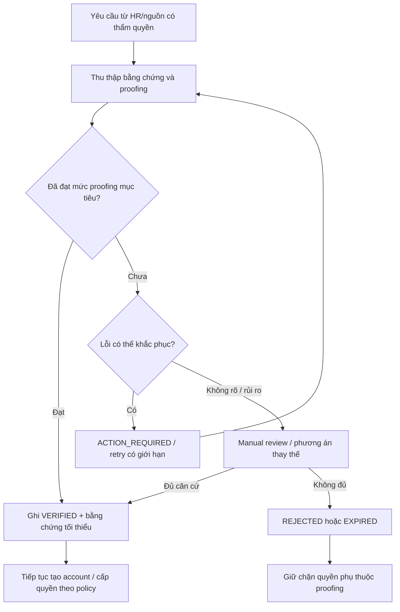
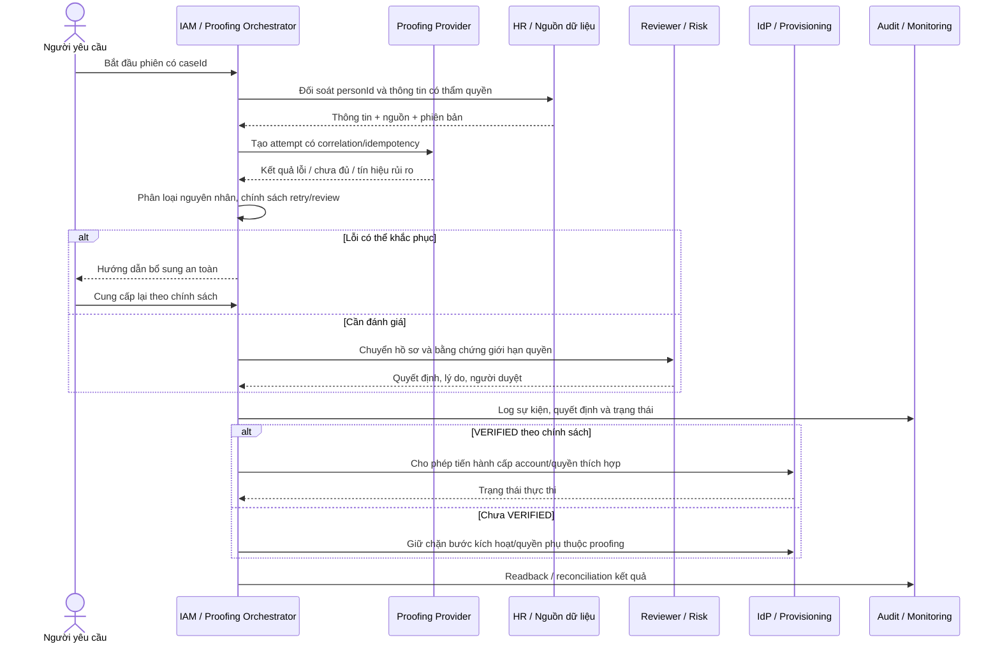

# Xử lý thất bại proofing trong quản lý vòng đời danh tính IAM

## Mục tiêu học tập

Sau bài này, người học có thể:

1. Giải thích vì sao **identity proofing** có thể thất bại và phân biệt kết quả không xác minh được với kết luận có gian lận.
2. Phân loại nguyên nhân theo **dữ liệu, bằng chứng, đối chiếu, rủi ro, kỹ thuật và quy trình** để chọn hướng xử lý phù hợp.
3. Thiết kế trạng thái proofing, chính sách thử lại, xác minh bổ sung, kiểm tra thủ công và cơ chế khiếu nại có kiểm soát.
4. Bảo đảm **không cấp quyền truy cập vượt mức tin cậy đã xác minh** trong luồng Joiner–Mover–Leaver (JML).
5. Kết nối kết quả proofing với hệ thống nguồn, IAM/IGA, IdP, provisioning, SSO, SCIM và RBAC/ABAC.
6. Ghi nhận bằng chứng, giám sát chỉ số chất lượng và xử lý an toàn dữ liệu cá nhân trong quá trình điều tra thất bại.

## 1. Identity proofing là gì và “thất bại” nghĩa là gì?

**Identity proofing** là quá trình thu thập và đánh giá bằng chứng để xác lập mức tin cậy rằng một thực thể đang được đăng ký thực sự có danh tính được khai báo. Trong quản lý vòng đời danh tính của doanh nghiệp, proofing có thể diễn ra khi tiếp nhận nhân viên mới, đăng ký nhà thầu, cấp lại quyền sau thời gian gián đoạn, xử lý hồ sơ trùng hoặc thực hiện một thay đổi nhạy cảm.

Ví dụ: một người được HR ghi nhận là nhân viên mới. IAM cần kiểm tra hồ sơ nhân sự có nguồn gốc hợp lệ, thông tin người nhận tài khoản có khớp với người được tuyển và các điều kiện kiểm chứng theo chính sách đã được đáp ứng hay chưa. Chỉ khi đủ bằng chứng, hệ thống mới được phép tiến hành những bước cấp tài khoản và quyền tương ứng.

**Proofing thất bại không mặc nhiên có nghĩa người yêu cầu là kẻ gian.** Có thể do:

- Ảnh giấy tờ mờ, thiết bị không hoạt động hoặc kết nối bị gián đoạn.
- Hồ sơ nguồn có lỗi chính tả, tên không dấu hoặc chưa cập nhật thay đổi hợp lệ.
- Bằng chứng đã hết hạn, thiếu thuộc tính hoặc không được chấp nhận ở mức bảo đảm yêu cầu.
- Kết quả đối chiếu chưa đủ tin cậy và cần người có thẩm quyền xem xét.
- Hệ thống phát hiện dấu hiệu giả mạo, sử dụng danh tính không đúng chủ thể hoặc hành vi bất thường.
- Người dùng không thể hoàn thành một phương thức kiểm chứng vì trở ngại tiếp cận hoặc tình huống đặc biệt.

Phân biệt nguyên nhân giúp hệ thống **giữ an toàn mà không từ chối nhầm người hợp lệ**.

### 1.1. Phân biệt ba quá trình thường bị gộp làm một

| Quá trình | Câu hỏi cần trả lời | Ví dụ | Hệ quả khi không thành công |
|---|---|---|---|
| **Identity proofing** | Người/thực thể khai báo có đủ bằng chứng gắn với danh tính này không? | Đối chiếu thông tin nhân sự và bằng chứng danh tính khi đăng ký | Chưa đủ căn cứ kích hoạt identity ở mức tin cậy mục tiêu |
| **Authentication** | Bên đang truy cập có kiểm soát credential của tài khoản hay không? | Sử dụng passkey, MFA, chứng chỉ hoặc token | Từ chối lần xác thực, hoặc yêu cầu phương thức khác |
| **Authorization** | Principal đã xác thực được làm hành động nào trên tài nguyên nào? | RBAC/ABAC kiểm tra quyền mở hồ sơ kế toán | Từ chối hành động không được phép |

Một người có thể vượt qua proofing ban đầu nhưng nhập sai mật khẩu khi đăng nhập; đây là **authentication failure**, không phải proofing failure. Ngược lại, một tài khoản đăng nhập được không chứng minh việc **gán account đó với đúng người** đã được kiểm chứng đầy đủ.

Proofing cũng khác **account correlation**: hai hồ sơ có tên giống nhau không đủ chứng minh chúng là cùng một người. Nếu liên kết sai, quyền và dữ liệu của người khác có thể bị tiết lộ.

## 2. Mục tiêu của quy trình xử lý thất bại

Quy trình tốt cần cân bằng bốn mục tiêu đồng thời:

1. **An toàn:** không kích hoạt tài khoản/quyền nhạy cảm khi bằng chứng không đạt yêu cầu; không tạo đường vòng làm giảm mức kiểm chứng.
2. **Khôi phục được:** cho phép người hợp lệ sửa dữ liệu, cung cấp bằng chứng khác hoặc được hỗ trợ kiểm tra thủ công.
3. **Truy vết được:** biết bước nào thất bại, vì sao, ai quyết định, quyền nào đã bị chặn và cách trường hợp được giải quyết.
4. **Tôn trọng quyền riêng tư và khả năng tiếp cận:** chỉ thu dữ liệu cần thiết, hạn chế lưu trữ, tránh tiết lộ lý do phát hiện gian lận và không buộc mọi người phải dùng duy nhất một kênh khó tiếp cận.

Nếu hệ thống chỉ hiển thị “Verification failed” mà không có đường tiếp tục hoặc hỗ trợ, người hợp lệ có thể không bắt đầu công việc đúng hạn. Nếu hệ thống bỏ qua mọi lỗi để hoàn tất onboarding, một account bị gán nhầm danh tính có thể nhận quyền hệ thống.

## 3. Phân loại nguyên nhân proofing thất bại

Nên phân nhóm nguyên nhân từ **tín hiệu quan sát được** và kết quả kiểm tra; không dùng một nhãn “fraud” cho mọi tình huống.

| Nhóm lỗi | Tình huống minh họa | Bản chất | Hướng xử lý phù hợp |
|---|---|---|---|
| **Thiếu bằng chứng** | Chưa cung cấp một loại giấy tờ/phương thức bắt buộc | Chưa hoàn tất | Hướng dẫn bổ sung, hẹn hạn và cho tiếp tục theo phiên |
| **Chất lượng bằng chứng kém** | Ảnh mờ, bị che góc, không đọc được | Có thể khắc phục | Cho chụp/gửi lại với giới hạn hợp lý |
| **Bằng chứng không hợp lệ** | Hết hạn, loại giấy tờ không được chấp nhận | Không đạt quy tắc | Giải thích loại bằng chứng hợp lệ; đề nghị phương án khác |
| **Thông tin không khớp** | Tên, ngày sinh hoặc mã nhân sự khác với nguồn HR | Chưa xác lập tương quan | Xác minh nguồn, sửa theo quyền sở hữu dữ liệu, manual review |
| **Kết quả đối chiếu chưa chắc chắn** | Kiểm tra ảnh/khuôn mặt hoặc đối chiếu thuộc tính không đủ tin cậy | Chưa kết luận được | Kiểm chứng bổ sung hoặc kênh hỗ trợ khác |
| **Rủi ro cao** | Dấu hiệu giả mạo tài liệu, luồng không nhất quán, nghi chiếm đoạt danh tính | Cần điều tra | Giữ trạng thái chờ, chuyển reviewer có thẩm quyền, hạn chế tiết lộ tín hiệu |
| **Lỗi tích hợp** | HR API, nhà cung cấp xác minh hoặc kho chứng cứ không phản hồi | Lỗi kỹ thuật | Retry an toàn, circuit breaker, ghi nhận mã lỗi và đường dự phòng |
| **Lỗi vận hành/quy trình** | Reviewer chưa xử lý, SLA quá hạn, hồ sơ bị mất mapping | Sai lệch tác nghiệp | Escalate, khôi phục hồ sơ và đối soát |
| **Không thể tiếp cận** | Thiết bị không có camera, hạn chế thao tác, không thể đến điểm kiểm chứng | Không phù hợp kênh | Phương thức hỗ trợ tương đương, bảo đảm cùng mức kiểm chứng |
| **Yêu cầu bị hủy/hết hạn** | Người dùng không tiếp tục trước hạn | Kết thúc phiên, không có kết luận xác minh | Cho khởi tạo lại theo chính sách, bảo toàn audit cần thiết |

Hai trường hợp “không thấy dữ liệu” và “dữ liệu khẳng định sai” **khác nhau**. Ví dụ nguồn HR chưa phản hồi thì không thể kết luận người yêu cầu không phải nhân viên. Khi nghi ngờ gian lận, phần giải thích gửi người dùng không nên công khai tín hiệu phòng chống gian lận có thể bị lạm dụng.

### 3.1. Bằng chứng không đạt so với rủi ro thật sự

Một bản chụp giấy tờ có chất lượng kém chỉ chứng minh hệ thống **chưa đọc được**, chưa chứng minh giấy tờ giả. Dữ liệu họ tên khác cách viết có thể do nhập liệu hoặc phiên âm. Một kết quả kiểm tra sinh trắc học không đủ độ tin cậy cũng không tự chứng minh giả mạo; nó có thể bị ảnh hưởng bởi ánh sáng, camera, khả năng tiếp cận và độ chính xác của phương pháp.

Vì vậy, nên ghi **reason code cụ thể** và có cơ chế review/appeal phù hợp. Không được biến một điểm số rủi ro đơn lẻ thành kết luận tuyệt đối về một con người.

## 4. Mô hình trạng thái: phân biệt chờ, lỗi có thể sửa và từ chối

Để workflow dễ giám sát, mô hình trạng thái nên tách **phiên xử lý proofing** khỏi **identity/account**. Một phiên proofing thất bại không tự có nghĩa toàn bộ identity đã bị xóa hoặc người đó mất mọi quyền hợp lệ trước đây.

Ví dụ các trạng thái nội bộ:

| Trạng thái | Ý nghĩa | Kết quả truy cập |
|---|---|---|
| `NOT_STARTED` | Có yêu cầu nhưng chưa bắt đầu xác minh | Chưa dùng yêu cầu này để cấp quyền |
| `IN_PROGRESS` | Đang thu thập hoặc kiểm tra bằng chứng | Chưa xác nhận mức tin cậy mục tiêu |
| `ACTION_REQUIRED` | Người yêu cầu cần bổ sung hoặc chỉnh dữ liệu | Tiếp tục chờ, cung cấp hướng dẫn cụ thể |
| `RETRYABLE_ERROR` | Lỗi kỹ thuật tạm thời hoặc dữ liệu đầu vào có thể khắc phục | Chờ thử lại theo chính sách |
| `MANUAL_REVIEW` | Cần reviewer phân xử bằng chứng hoặc ngoại lệ | Không tự động kết luận thành công |
| `VERIFIED` | Đã đáp ứng tiêu chí proofing hiện hành | Có thể tiếp tục các bước IAM được chính sách cho phép |
| `REJECTED` | Bằng chứng không đáp ứng yêu cầu sau đánh giá hợp lệ | Không cấp quyền dựa trên lần proofing này; hỗ trợ review/appeal theo chính sách |
| `EXPIRED` | Phiên quá hạn, cần khởi tạo lại hoặc rà soát | Không tái sử dụng kết quả chưa hoàn tất |
| `CANCELLED` | Yêu cầu được hủy | Dừng workflow, giữ bằng chứng audit cần thiết |

Các tên trạng thái trên là **thiết kế tham khảo**, không phải tập giá trị bắt buộc trong SCIM, IdP hay chuẩn xác minh danh tính.



Trong mô hình thực tế, nếu một yêu cầu `REJECTED` được kháng nghị, có thể **mở phiên appeal mới** liên kết phiên cũ thay vì sửa trạng thái terminal đã lưu. Điều quan trọng là giữ nguyên lịch sử và người quyết định để có thể giải trình.

### 4.1. Không gom mọi failure thành “deny vĩnh viễn”

Cần phân biệt:

- **Attempt failure:** một lần chụp ảnh hoặc gọi API không thành công.
- **Session failure:** phiên proofing hết hạn, vượt số lần retry hoặc không thể hoàn tất.
- **Decision failure/rejection:** sau khi đánh giá, mức tin cậy yêu cầu vẫn không được đáp ứng.
- **System incident:** nhà cung cấp/connector bị lỗi khiến chưa thể đưa ra quyết định.

Sự phân biệt này quan trọng với vận hành: retry có thể phù hợp cho lỗi mạng, nhưng không nên tự động lặp vô hạn một quyết định đã bị từ chối hoặc rủi ro cao.

## 5. Cổng quyết định: fail closed nhưng vẫn có đường hỗ trợ

**Fail closed** trong bài toán proofing nghĩa là khi chưa đủ bằng chứng, hệ thống **không phát hành kết quả “đã xác minh” hoặc cấp quyền phụ thuộc vào kết quả đó**. Điều này không có nghĩa phải khóa mọi hệ thống hoặc xóa identity hiện có ngay lập tức.

Ví dụ joiner:



Đối với nhân viên đang hoạt động cần **re-proofing** vì thay đổi nhạy cảm, hệ thống phải định nghĩa trước **quyền hiện hữu có tiếp tục được dùng không**. Một lần proofing bổ sung thất bại không nên tự động làm mất mọi quyền đang hợp lệ, trừ khi đánh giá rủi ro hoặc chính sách yêu cầu đình chỉ. Có thể giới hạn riêng thao tác đang chờ xác minh, yêu cầu step-up hoặc tạm giữ thay đổi quyền.

### 5.1. Cách xử lý khi nguồn HR và bằng chứng không khớp

Giả sử HR ghi `personId=P-8401`, họ tên “Nguyễn Văn Bình”, còn giấy tờ cung cấp thể hiện tên đã thay đổi hợp pháp. IAM không nên tự đổi person ID hoặc cho phép người nhận tài khoản tự sửa dữ liệu có thẩm quyền trên IdP để “khớp cho qua”.

Quy trình nên:

1. Dừng cấp quyền phụ thuộc kết quả xác minh.
2. Ghi nhận **loại thuộc tính** không khớp và nguồn dữ liệu, tránh phát tán ảnh/chứng cứ.
3. Gửi yêu cầu đến owner dữ liệu HR hoặc reviewer được ủy quyền.
4. Kiểm tra chứng cứ thay đổi hợp pháp, đối chiếu bản ghi HR và mối liên kết person–identity.
5. Chỉ cập nhật nguồn dữ liệu đúng quyền sở hữu; đồng bộ lại và đánh giá proofing theo chính sách.
6. Xác minh không tạo account thứ hai hoặc gắn nhầm account cũ của người khác.

**Không dùng email, họ tên hoặc số điện thoại trùng nhau làm căn cứ tự gộp identity.**

## 6. Chính sách thử lại (retry) theo loại lỗi

Retry có ích khi lỗi có thể khắc phục, nhưng phải tránh làm yếu kiểm soát chống gian lận hoặc làm lộ thông tin nhạy cảm.

| Trường hợp | Có nên tự retry? | Kiểm soát |
|---|---|---|
| API provider tạm thời timeout | Có thể, theo chính sách | Exponential backoff, giới hạn lượt, idempotency key, circuit breaker |
| Thiết bị gửi ảnh thất bại vì mất mạng | Cho người dùng gửi lại | Kiểm tra phiên và nguồn upload, giới hạn kích thước/thời gian |
| Ảnh bị mờ, bị che | Có thể cho chụp lại | Hướng dẫn chất lượng, giới hạn số lượt, hỗ trợ phương thức khác |
| Giấy tờ đã hết hạn | Không retry cùng bằng chứng | Yêu cầu bằng chứng hợp lệ khác |
| Thông tin HR không khớp | Không tự đổi dữ liệu rồi retry | Xác minh nguồn, reviewer hoặc quy trình sửa hồ sơ |
| Dấu hiệu giả mạo/rủi ro nghiêm trọng | Không thử lại tự động vô hạn | Chuyển kiểm tra rủi ro có quyền, hạn chế thông tin công khai |
| Reviewer yêu cầu bổ sung | Cho bổ sung đúng nội dung | Lưu mã yêu cầu, version bằng chứng, hạn phản hồi |
| Nhà cung cấp chứng minh đã không đạt tiêu chí | Tùy nguyên nhân và chính sách | Xem quyền appeal, phương thức thay thế tương đương |

### 6.1. Retry phải idempotent

Nếu hệ thống timeout ở bước gọi provider, không nên mặc định rằng provider **chưa xử lý**. Tạo yêu cầu mới liên tục có thể sinh nhiều proofing session, tính phí trùng, và cho kết quả mâu thuẫn.

Nên gắn các khóa:

- `proofingCaseId`: hồ sơ logic của yêu cầu.
- `attemptId`: lượt kiểm tra cụ thể.
- `providerRequestId`: ID từ nhà cung cấp nếu có.
- `idempotencyKey`: khóa bảo đảm thao tác lặp không sinh hệ quả không mong muốn khi provider hỗ trợ.
- `sourceEventId`: liên kết sự kiện HR/IAM gốc.

Trước khi retry, có thể truy vấn trạng thái yêu cầu cũ bằng ID tương quan. Quy trình phải chịu được callback đến trễ và không cho một **kết quả cũ** ghi đè kết quả đã được phê duyệt hoặc từ chối ở phiên mới.

### 6.2. Giới hạn thử lại và giảm rủi ro lạm dụng

Cần giới hạn theo phiên, account hoặc tổ hợp tín hiệu hợp pháp; cảnh báo về lưu lượng bất thường; xác thực lại quyền bắt đầu proofing khi cần. Không công khai chi tiết ngưỡng nhận diện gian lận cho người dùng cuối.

Tuy nhiên, giới hạn quá cứng sẽ khóa nhầm người có camera kém hoặc đường truyền yếu. Vì vậy nên cung cấp **kênh xác minh thay thế tương đương về độ tin cậy**, có thể là hỗ trợ từ nhân viên được đào tạo, điểm tiếp nhận hoặc phương thức bằng chứng khác được chính sách chấp nhận.

## 7. Manual review: quy trình xác minh thủ công có kiểm soát

Không phải mọi tình huống đều giải quyết được bằng thuật toán. **Manual review** cho phép reviewer đánh giá bằng chứng bổ sung và hoàn cảnh chính đáng, nhưng không có nghĩa là nút “bỏ qua proofing”.

### 7.1. Điều kiện chuyển review

Có thể chuyển khi:

- Dữ liệu từ nguồn HR mâu thuẫn hoặc cần sửa hồ sơ có thẩm quyền.
- Khác biệt tên, giấy tờ, ngày sinh có thể có lý do hợp pháp.
- Kết quả tự động không kết luận được dù đã thử đúng quy định.
- Cần hỗ trợ người dùng có yêu cầu tiếp cận đặc thù.
- Có dấu hiệu rủi ro cần chuyên viên có quyền xác minh sâu hơn.
- Người dùng kháng nghị quyết định bị từ chối.

### 7.2. Vai trò và phân quyền của reviewer

Một reviewer không nên có quyền tự ý sửa danh tính, tự phê duyệt bằng chứng và tự cấp mọi quyền ứng dụng. Tùy mức rủi ro, có thể yêu cầu **người kiểm tra và người phê duyệt độc lập** hoặc quy trình hai người đối với quyết định nhạy cảm.

| Vai trò | Quyền nên có | Giới hạn |
|---|---|---|
| Nhân viên hỗ trợ | Tiếp nhận yêu cầu, hướng dẫn bổ sung, tạo ticket | Không tự tuyên bố VERIFIED hoặc xem mọi dữ liệu nhạy cảm |
| Proofing reviewer | Xem bằng chứng cần thiết, đánh giá theo checklist | Không tự tạo tài khoản đặc quyền hoặc vượt policy |
| Risk/security specialist | Điều tra rủi ro, xem tín hiệu nâng cao có thẩm quyền | Hạn chế phát tán dữ liệu và cách phát hiện gian lận |
| HR data owner | Sửa bản ghi nhân sự thuộc phạm vi nguồn HR | Không thay kết luận proofing khi chưa có bằng chứng |
| Approver | Chấp thuận quyết định theo hạn mức | Quyết định phải có lý do và dấu vết |
| IAM automation | Thực thi khi có quyết định hợp lệ | Phải kiểm tra trạng thái hiện tại trước khi cấp quyền |

### 7.3. Checklist reviewer

Một quyết định thủ công có chất lượng nên ghi nhận:

1. Hồ sơ này có thực sự được bắt đầu từ yêu cầu/sự kiện có thẩm quyền không?
2. Các bằng chứng đã cung cấp thuộc loại nào; đã hết hạn hoặc bị sửa đổi chưa?
3. Sai lệch nằm ở thuộc tính nào; có lý do hợp pháp được kiểm chứng không?
4. Có nghi ngờ trùng identity/account hoặc chiếm dụng hồ sơ của người khác không?
5. Đã áp dụng phương thức thay thế được policy cho phép chưa?
6. Mức tin cậy sau review có đáp ứng **mức yêu cầu của tác vụ đích** không?
7. Ai ra quyết định, dựa trên bộ quy tắc/policy phiên bản nào?
8. Kết quả là VERIFIED, cần thêm thông tin, bị từ chối hay cần escalation?

**Reviewer không được thay đổi trực tiếp một biến `proofingStatus = VERIFIED` chỉ để ứng dụng “chạy tiếp”** nếu chưa có căn cứ và thao tác phê duyệt thích hợp.

## 8. Cơ chế kháng nghị, hỗ trợ và khả năng tiếp cận

Việc từ chối proofing có thể ảnh hưởng đến khả năng nhận việc, truy cập thông tin hoặc hoàn thành nghĩa vụ. Quy trình cần có cách để người yêu cầu hiểu **bước tiếp theo** mà vẫn bảo vệ cơ chế chống gian lận.

Một kênh kháng nghị có thể bao gồm:

- Mã hồ sơ và trạng thái hiện tại.
- Lý do giải thích phù hợp, như “thông tin chưa khớp hồ sơ nhân sự” hoặc “bằng chứng chưa đáp ứng yêu cầu”.
- Danh sách phương thức bổ sung/nhà hỗ trợ hợp lệ.
- Thời hạn phản hồi và cách yêu cầu xem xét lại.
- Chính sách quản lý dữ liệu, quyền riêng tư và kênh khiếu nại.
- Trường hợp nghi gian lận: thông báo ở mức an toàn, không công khai chỉ dấu/rule hoặc thông tin của người khác.

Không nên bắt buộc người dùng thử liên tục một phương pháp sinh trắc học nếu phương pháp đó không khả thi. Có thể cung cấp kênh kiểm tra trực tiếp hoặc bằng chứng thay thế phù hợp, duy trì mức tin cậy yêu cầu.

### 8.1. Phân biệt quyền phản hồi với quyền truy cập

Có kênh appeal **không đồng nghĩa cho phép truy cập ngay**. Trong lúc chờ, IAM duy trì giới hạn quyền phụ thuộc proofing. Nếu người dùng đã có tài khoản hợp lệ và đang re-proofing cho một giao dịch nhạy cảm, có thể chặn riêng giao dịch đó thay vì vô hiệu hóa toàn bộ account, nếu chính sách và đánh giá rủi ro cho phép.

### 8.2. Tránh thiên lệch và từ chối nhầm

Các kỹ thuật tự động có thể có tỷ lệ lỗi khác nhau giữa điều kiện ảnh, thiết bị, giấy tờ và nhóm người sử dụng. Tổ chức nên đo tỷ lệ **false rejection**, theo dõi tính khả thi của các phương thức thay thế và kiểm tra chất lượng quyết định thủ công. Không đưa ra kết luận về động cơ gian lận chỉ từ việc một mô hình tự động không đủ tự tin.

## 9. Tích hợp proofing failure vào vòng đời Joiner–Mover–Leaver

### 9.1. Joiner: chưa xác minh thì chưa cấp quyền nhạy cảm

Một quy trình Joiner có thể nhận dữ liệu nhân sự đã được HR duyệt nhưng chưa đủ chứng minh người nhận account chính là người được tuyển. Cần quản lý riêng:

- **HR record:** trạng thái quan hệ lao động và ngày bắt đầu.
- **Identity record:** đối tượng được quản trị, correlation và mức tin cậy.
- **Proofing case:** kết quả/điều kiện kiểm chứng danh tính.
- **Account provisioning:** đã tạo, chưa kích hoạt, hoặc đang chờ xác minh.
- **Access entitlements:** quyền cơ sở và quyền nhạy cảm theo policy.

Có hệ thống cho phép **pre-provisioning** tài khoản trước ngày bắt đầu nhằm chuẩn bị hạ tầng. Nếu proofing chưa đạt, cần bảo đảm account chưa thể dùng để truy cập vượt quyền. Việc “tạo đối tượng account” và “kích hoạt đăng nhập/cấp quyền” phải được kiểm soát riêng.

### 9.2. Mover: đổi vai trò không nhất thiết proofing lại toàn bộ

Chuyển phòng ban thông thường có thể chỉ cần cập nhật nguồn HR và quyền RBAC/ABAC. Tuy nhiên, nếu Mover kéo theo cấp quyền đặc biệt nhạy cảm hoặc phát hiện nghi ngờ về correlation, chính sách có thể yêu cầu xác minh bổ sung.

Nếu re-proofing thất bại:

1. Không tự cấp quyền mới đòi mức tin cậy cao.
2. Giữ hoặc điều chỉnh quyền cũ theo chính sách Mover và thời điểm hiệu lực, không cộng dồn vô thời hạn.
3. Tạo `ACTION_REQUIRED` hoặc `MANUAL_REVIEW`, ghi rõ tác vụ đang bị chặn.
4. Rà soát trường hợp có dấu hiệu account takeover để cân nhắc đình chỉ riêng theo chính sách an ninh.
5. Sau khi kết luận, áp dụng đúng tập quyền mục tiêu và đọc lại trạng thái thực tế ở ứng dụng.

### 9.3. Leaver: không để proofing failure cản trở thu hồi

**Leaver được kích hoạt bởi trạng thái kết thúc có thẩm quyền và chính sách thu hồi, không phụ thuộc người đó có hoàn tất proofing hay không.** Nếu HR đã xác nhận nghỉ việc, IAM phải xử lý thu hồi account/quyền, token và session liên quan theo thời điểm quy định.

Ví dụ một identity chưa xác minh hoàn tất nhưng đã có account pre-provisioned: khi Leaver đến, cần vô hiệu hóa/xóa đối tượng account theo chính sách, không để workflow proofing treo khiến account trở thành orphan account.

Tương tự, nếu người dùng mất quyền liên hệ sau khi nghỉ việc, không dùng “không liên hệ được để proofing” làm lý do trì hoãn deprovisioning.

### 9.4. Nhà thầu và tài khoản dịch vụ

Nhà thầu có thể có nguồn kiểm chứng hoặc sponsor khác HR chính thức, vì vậy phải định nghĩa người có quyền xác minh, hợp đồng, thời hạn và mức bảo đảm tương ứng. Không nên yêu cầu cùng bộ giấy tờ và kênh theo cách gây cản trở không cần thiết nếu chính sách cho phép bằng chứng tương đương.

**Workload identity/service account** có cách chứng thực khác người: owner, tài nguyên chạy, chứng chỉ, federation, workload attestation. Việc xác minh một người quản lý service account thất bại **không đồng nghĩa service account đã bị giả mạo**, nhưng có thể yêu cầu kiểm tra quyền quản trị và chuyển giao owner. Không dùng giấy tờ cá nhân làm phương pháp proofing runtime của workload.

## 10. Vai trò của IdP, SSO, SCIM, RBAC và ABAC khi proofing thất bại

| Thành phần | Vai trò | Hành vi cần kiểm soát khi proofing chưa đạt |
|---|---|---|
| **HRIS / nguồn danh tính** | Cung cấp hồ sơ và sự kiện nhân sự có thẩm quyền | Sửa dữ liệu đúng owner, không cho client tự ghi đè |
| **IAM / Identity registry** | Quản lý identity, proofing state, evidence và policy | Không tự chuyển sang VERIFIED nếu thiếu quyết định hợp lệ |
| **IGA / Access governance** | Yêu cầu/phê duyệt quyền và rà soát | Giữ yêu cầu quyền nhạy cảm chờ xác minh; xử lý approval có dấu vết |
| **IdP** | Đăng nhập và phát token/claim | Chỉ phát credential/token theo trạng thái và policy cho phép |
| **SSO** | Đăng nhập liên thông | Không coi SSO login thành công là bằng chứng proofing ban đầu thành công |
| **SCIM / provisioning connector** | Tạo/cập nhật/vô hiệu hóa account hoặc nhóm ở đích | Bảo đảm luồng kích hoạt/quyền nhận đúng trạng thái; kiểm tra readback |
| **RBAC** | Quyết định theo role | Không tự thêm role bị chặn khi hồ sơ chưa đạt yêu cầu |
| **ABAC** | Quyết định theo thuộc tính và ngữ cảnh | Chỉ tin claim/thuộc tính về mức proofing nếu nguồn và thời điểm đáng tin |
| **Audit / Security monitoring** | Theo dõi thay đổi, điều tra và đối soát | Ghi nguyên nhân và quyết định nhưng không tiết lộ bằng chứng nhạy cảm |

**SSO và SCIM không thực hiện identity proofing thay cho IAM theo mặc định.** SCIM chỉ là cơ chế quản lý tài nguyên danh tính ở hệ thống đích; nó không chứng minh một người có đúng danh tính họ khai báo.

### 10.1. Tách mức tin cậy proofing khỏi quyền account

Ví dụ cấu trúc nội bộ minh họa:

```json
{
  "identityId": "IDN-6025",
  "personSource": {
    "system": "HRIS",
    "personId": "P-9041"
  },
  "proofing": {
    "caseId": "PF-2026-0182",
    "status": "MANUAL_REVIEW",
    "requiredAssurance": "ORG_LEVEL_2",
    "achievedAssurance": null,
    "policyVersion": "proof-v5"
  },
  "account": {
    "idpAccountId": "ACC-1602",
    "provisioningState": "PREPROVISIONED",
    "loginEnabled": false
  },
  "entitlements": {
    "requested": ["finance-basic"],
    "active": []
  }
}
```

Đây là **schema và giá trị mức bảo đảm do ví dụ tự định nghĩa**, không phải mapping mặc định tới IAL của một tiêu chuẩn bên ngoài. Cần phân biệt `requiredAssurance` và `achievedAssurance`, tránh mô tả việc có số lượng giấy tờ bằng mức bảo đảm đã đạt.

### 10.2. Kiểm tra policy tại thời điểm cấp và sử dụng quyền

Một engine có thể áp dụng chính sách tương tự:

```text
function mayGrantAccess(identity, requestedRole):
    if identity.lifecycleState != ACTIVE:
        return DENY

    if requestedRole.requiresProofing:
        if identity.proofing.status != VERIFIED:
            return HOLD_FOR_PROOFING
        if not meetsAssuranceRequirement(identity, requestedRole):
            return HOLD_FOR_ADDITIONAL_VERIFICATION

    if violatesSoD(identity, requestedRole):
        return DENY_PENDING_GOVERNANCE

    if not approvalsSatisfied(identity, requestedRole):
        return HOLD_FOR_APPROVAL

    return ELIGIBLE_FOR_PROVISIONING
```

Pseudocode này không thay thế authorization tại ứng dụng đích. Trong ứng dụng sử dụng token hoặc cache claim lâu, cần cơ chế bảo đảm **thay đổi trạng thái proofing/rủi ro được phản ánh kịp thời**, chẳng hạn giảm tuổi token, thu hồi phiên khi được hỗ trợ hoặc kiểm tra policy tại request đối với thao tác có rủi ro cao.

## 11. Thiết kế kiến trúc xử lý thất bại

Một luồng điển hình:



Hệ thống có thể triển khai một số nhánh song song, nhưng kết quả tổng phải gắn với **case và policy version** rõ ràng. Kết quả provider phản hồi sau khi phiên đã bị hủy hoặc đóng cần được lưu làm thông tin điều tra, không tự mở lại quyền.

### 11.1. Dữ liệu tối thiểu cho một proofing case

Ví dụ JSON phục vụ minh họa:

```json
{
  "caseId": "PF-2026-0182",
  "identityId": "IDN-6025",
  "sourceSystem": "HRIS",
  "sourcePersonId": "P-9041",
  "purpose": "JOINER_ACCOUNT_ACTIVATION",
  "status": "ACTION_REQUIRED",
  "reasonCategory": "EVIDENCE_QUALITY",
  "reasonCode": "IMAGE_NOT_READABLE",
  "attemptCount": 2,
  "policyVersion": "proof-v5",
  "createdAt": "2026-11-23T01:00:00Z",
  "expiresAt": "2026-11-30T01:00:00Z",
  "providerCorrelationId": "external-request-812",
  "evidenceReference": "restricted-evidence-ref",
  "decision": null
}
```

Không đưa ảnh giấy tờ, số định danh, khuôn mặt, mật khẩu hoặc access token vào JSON audit thông thường. `evidenceReference` nên trỏ tới nơi lưu riêng có kiểm soát truy cập, mã hóa và retention policy, chứ không phải URL công khai.

### 11.2. Luồng xử lý có tính idempotent

```text
onProofingResult(event):
    case = loadCaseByCorrelation(event.caseId)

    if case == null:
        recordOrphanCallback(event.metadata)
        alertInvestigation()
        return

    if event.attemptId != case.currentAttemptId:
        recordLateResultWithoutChangingDecision(event)
        return

    if case.status in [CANCELLED, EXPIRED, VERIFIED]:
        recordResultForAuditOnly(event)
        return

    outcome = evaluateAgainstPolicy(event, case.policyVersion)

    if outcome == VERIFIED:
        commitDecisionWithProof(case)
        publishProofingVerifiedEvent(case.id, case.identityId)
    else if outcome == RETRYABLE_ERROR:
        scheduleBoundedRetryOrRequestNewEvidence(case)
    else if outcome == REQUIRES_REVIEW:
        assignAuthorizedReviewer(case)
    else:
        recordRejectedOrActionRequired(case)

    auditStateTransition(case)
```

Đây là pseudocode khái niệm: trong ứng dụng thực cần transaction, so sánh version/optimistic locking, xác thực callback và quyền của event producer. Đặc biệt, **không tin sự kiện VERIFIED chỉ vì payload có chữ “verified”**; phải xác minh nguồn gửi và mối liên kết với phiên đang có hiệu lực.

## 12. An toàn thông tin và quyền riêng tư trong xử lý thất bại

Proofing có thể xử lý giấy tờ tùy thân, ảnh, dữ liệu sinh trắc học, địa chỉ hoặc thông tin hồ sơ nhân sự. Rủi ro không chỉ ở việc cấp sai tài khoản mà còn ở việc **lộ dữ liệu nhạy cảm** trong log, ticket và email hỗ trợ.

Các nguyên tắc:

- **Data minimization:** chỉ yêu cầu thông tin thực sự cần cho mức tin cậy và mục đích cụ thể.
- **Purpose limitation:** không sử dụng hồ sơ proofing cho mục đích khác ngoài phạm vi được phép.
- **Access control:** chỉ reviewer/nhân viên có trách nhiệm mới được xem bằng chứng; có phân quyền theo case.
- **Encryption & secrets hygiene:** mã hóa khi truyền và lưu, quản lý khóa, không gửi dữ liệu thô vào log.
- **Retention & deletion:** định nghĩa thời gian lưu/tiêu hủy theo chính sách và yêu cầu pháp lý áp dụng; kết quả audit có thể lưu ở mức tóm tắt sau khi bằng chứng thô đã hết hạn.
- **Audit reviewer access:** ghi lại ai mở bằng chứng, đọc lúc nào, quyết định gì và có xuất dữ liệu không.
- **Notification:** thông báo rõ trạng thái và bước tiếp theo, nhưng không phát tán số giấy tờ đầy đủ hoặc quy tắc phát hiện gian lận.
- **Incident response:** khi phát hiện lộ bằng chứng hoặc chiếm đoạt danh tính, xử lý theo quy trình an ninh và quyền riêng tư của tổ chức.

### 12.1. Mã lỗi trả ra ngoài và mã lý do nội bộ

Nên tách:

| Loại | Ví dụ | Mục đích |
|---|---|---|
| `publicMessage` | “Không thể hoàn tất xác minh. Vui lòng cung cấp bằng chứng khác hoặc liên hệ hỗ trợ.” | Hướng dẫn người yêu cầu |
| `publicReasonCategory` | `DOCUMENT_UNREADABLE` | Giải thích đủ để sửa lỗi không nhạy cảm |
| `internalReasonCode` | `PROVIDER_FACE_COMPARISON_INCONCLUSIVE` | Điều phối workflow và điều tra |
| `riskSignalReference` | Tham chiếu tín hiệu được kiểm soát | Hạn chế tiết lộ phương pháp chống gian lận |
| `correlationId` | `PF-2026-0182` | Hỗ trợ truy tìm case không đưa thông tin riêng tư |

Không nên để người dùng thao tác nhiều lần rồi đoán chi tiết rule phòng chống gian lận thông qua thông báo lỗi khác nhau. Nhưng cũng không nên dùng thông báo “thất bại” chung cho mọi lỗi chất lượng bằng chứng, vì người dùng cần biết cách khắc phục.

## 13. Quan sát vận hành và chỉ số chất lượng

Một hệ thống proofing có thể xử lý đúng về mặt kỹ thuật nhưng gây tỷ lệ từ chối nhầm cao hoặc backlog review kéo dài. Nên quan sát cả **độ an toàn, khả năng hoàn tất và trải nghiệm người dùng**.

| Chỉ số | Ý nghĩa và cách hiểu |
|---|---|
| **Completion rate** | Tỷ lệ hồ sơ đạt kết quả xác minh trong phạm vi và thời gian xác định |
| **First-attempt pass rate** | Tỷ lệ đạt ngay ở lượt đầu; không đồng nghĩa chất lượng tổng thể nếu người dùng bị loại khỏi luồng |
| **Retry rate** | Tần suất phải thử lại theo loại lý do |
| **Inconclusive/technical error rate** | Tỷ lệ lỗi không kết luận được và lỗi hệ thống |
| **Manual review volume** | Khối lượng và nguyên nhân hồ sơ cần reviewer |
| **Review latency/SLA** | Thời gian chờ review so với mục tiêu vận hành |
| **False rejection indicators** | Tỷ lệ trường hợp ban đầu không đạt nhưng được xác minh hợp lệ qua kênh tiếp theo |
| **Appeal overturn rate** | Tỷ lệ quyết định được thay đổi sau kháng nghị có bằng chứng |
| **Orphan/pending case age** | Hồ sơ không có owner hoặc quá hạn xử lý |
| **Unauthorized activation count** | Số account/quyền được kích hoạt không phù hợp trạng thái/mức proofing |
| **Evidence retention exceptions** | Hồ sơ còn lưu bằng chứng quá hạn hoặc truy cập vượt quyền |

Mỗi chỉ số cần định nghĩa **mẫu số, phạm vi người dùng, kênh proofing, thời gian và loại yêu cầu**. Ví dụ tỷ lệ hoàn tất thấp của kênh camera có thể do thiết bị hoặc khả năng tiếp cận, không tự chứng minh người dùng có hành vi gian lận.

### 13.1. Alert và reconciliation

Nên cảnh báo khi:

- Tỷ lệ timeout từ proofing provider tăng bất thường.
- Hồ sơ `MANUAL_REVIEW` tồn đọng quá SLA.
- Callback đến sau khi case đã đóng nhưng lại làm thay đổi quyết định.
- IdP account có `loginEnabled=true` dù proofing bắt buộc chưa VERIFIED.
- Quyền nhạy cảm được cấp mà không tìm thấy quyết định proofing hợp lệ.
- Reviewer tự phê duyệt các trường hợp có xung đột quyền.
- Nguồn HR thay đổi trạng thái JML nhưng proofing workflow không nhận hoặc không xử lý.
- Bằng chứng nhạy cảm bị truy cập vượt vai trò hoặc giữ quá hạn.

Đối soát cần kiểm tra **desired state** và **actual state** ở IdP, ứng dụng và connector, không chỉ nhìn trạng thái workflow.

## 14. Tình huống thực hành: nhân viên mới bị proofing thất bại

**Bối cảnh:** Nhân viên Lan được HR tiếp nhận vào phòng Tài chính, ngày bắt đầu làm việc là thứ Hai. Hệ thống tự tạo một identity và account IdP ở trạng thái chờ. Khi Lan làm proofing từ xa, ảnh giấy tờ bị mờ hai lần. Sau đó nhà cung cấp xác minh gặp timeout. Bộ phận hỗ trợ định bật ngay account và thêm nhóm `finance-reviewer` để Lan kịp làm việc.

**Câu hỏi phân tích:**

1. Ba kết quả “ảnh mờ”, “timeout” và “chưa thể bắt đầu làm việc” có tương đương với một quyết định từ chối identity không?
2. Có nên cấp quyền `finance-reviewer` trước khi xác minh xong chỉ vì HR đã tạo hồ sơ không?
3. Cần retry, manual review và hỗ trợ Lan như thế nào?
4. Nếu provider gửi kết quả cũ sau khi case bị đóng, hệ thống phải làm gì?
5. IAM cần kiểm tra gì trước khi báo đã hoàn tất onboarding?

**Hướng giải:**

**Bước 1 – Phân loại nguyên nhân.** Ảnh mờ là lỗi chất lượng bằng chứng có thể khắc phục; timeout là lỗi kỹ thuật chưa có kết luận. Không gắn nhãn Lan gian lận.

**Bước 2 – Giữ cổng quyền.** Identity/IdP account có thể ở trạng thái chuẩn bị nếu chính sách cho phép, nhưng không kích hoạt quyền phụ thuộc proofing. Đặc biệt, `finance-reviewer` có thể là quyền nhạy cảm cần chứng thực vai trò và phê duyệt riêng.

**Bước 3 – Cung cấp đường tiếp tục.** Cho Lan gửi lại ảnh có hướng dẫn cụ thể trong giới hạn hợp lý, thử lại provider bằng idempotency/correlation, hoặc sử dụng kênh hỗ trợ được chính sách chấp nhận.

**Bước 4 – Kiểm tra dữ liệu có thẩm quyền.** Đối chiếu `personId`, ngày bắt đầu và thông tin HR, tránh tự sửa dữ liệu nhằm vượt qua bước proofing.

**Bước 5 – Xử lý callback trễ.** Dựa vào `caseId`, `attemptId` và phiên bản quyết định. Một callback thuộc attempt cũ phải được ghi audit nhưng không tự đổi trạng thái terminal hoặc cấp quyền.

**Bước 6 – Xác minh kết quả.** Khi proofing đạt, chạy quy trình phê duyệt quyền, áp dụng role và đọc lại trạng thái account/entitlement ở hệ thống đích. Nếu một bước chưa đạt, trường hợp vẫn cần xử lý và cảnh báo.

### 14.1. Tình huống khác: re-proofing khi Mover

Nhân viên Minh chuyển từ bộ phận vận hành sang nhóm quản trị tài chính. Chính sách yêu cầu bằng chứng bổ sung để cấp quyền `payment-admin`. Minh đã có account bình thường và các quyền đọc hợp lệ; quá trình re-proofing gặp lỗi vì giấy tờ vừa đổi tên.

Cách xử lý phù hợp là giữ yêu cầu `payment-admin` ở trạng thái chờ, chuyển xác minh thay đổi tên qua owner HR/reviewer, xử lý quyền cũ theo kế hoạch Mover và kiểm tra SoD. Không tự cấp `payment-admin`, cũng không tự xóa toàn bộ account hiện hữu nếu chưa có chính sách rủi ro yêu cầu.

## 15. Bài tập tự kiểm tra

Hãy xác định **đúng/sai** và giải thích ngắn:

1. “Một lần chụp giấy tờ mờ chứng minh người yêu cầu đang giả mạo.”
2. “Timeout của provider là chưa có kết luận; hệ thống cần xử lý retry/correlation an toàn.”
3. “Đã tạo account trong IdP thì mặc nhiên identity proofing thành công.”
4. “Manual reviewer có thể bỏ qua mọi bằng chứng miễn là có ticket từ người quản lý.”
5. “Proofing failure khi Joiner có thể chặn kích hoạt quyền nhưng vẫn giữ account chuẩn bị theo chính sách.”
6. “Khi Leaver được nguồn có thẩm quyền xác nhận, workflow proofing đang treo không được phép làm chậm thu hồi quyền.”
7. “Trong lúc appeal, mọi quyền phụ thuộc proofing phải được cấp tạm để bảo đảm trải nghiệm.”
8. “Một proofing provider trả VERIFIED ở attempt cũ có thể thay thế ngay kết quả case mới hơn.”
9. “Nếu bằng chứng tự động không kết luận được, có thể dùng kênh kiểm chứng thay thế đạt mức bảo đảm tương đương.”
10. “Hệ thống cần đối soát account và quyền thực tế tại IdP/ứng dụng sau quyết định proofing.”

**Đáp án:** 1 Sai; 2 Đúng; 3 Sai; 4 Sai; 5 Đúng; 6 Đúng; 7 Sai; 8 Sai; 9 Đúng; 10 Đúng.

Giải thích quan trọng: **proofing chỉ là đầu vào về mức tin cậy**, còn quyết định kích hoạt account và cấp quyền cần kiểm tra thêm trạng thái vòng đời, policy, phê duyệt, SoD và kết quả thực thi tại đích.

## 16. Nguyên tắc cần ghi nhớ

- **Không đồng nhất thất bại kỹ thuật, thiếu bằng chứng và gian lận.** Phân loại đúng giúp xử lý công bằng và an toàn.
- **Fail closed đối với quyền phụ thuộc proofing:** chưa VERIFIED theo mức yêu cầu thì chưa kích hoạt các quyền ấy.
- **Retry có giới hạn và idempotent; manual review có phân quyền và bằng chứng.** Không dùng nút “bỏ qua xác minh” để xử lý ngoại lệ.
- **Cho người dùng hợp lệ đường khắc phục và kháng nghị**, bao gồm lựa chọn phù hợp khi phương thức số không thể thực hiện.
- **Giữ nguyên tính nhất quán JML:** Joiner chờ xác minh, Mover không cấp quyền mới quá sớm, Leaver vẫn thu hồi đúng thời hạn.
- **IdP, SSO, SCIM và RBAC/ABAC là những mắt xích khác nhau.** Tạo tài khoản hoặc SSO thành công không tự xác nhận danh tính đã được proofing đầy đủ.
- **Bảo vệ bằng chứng và ghi audit có chủ đích**, kiểm tra chênh lệch giữa trạng thái workflow với account/quyền thực tế, nhất là khi có lỗi hoặc callback đến trễ.

Xử lý thất bại identity proofing là một phần của quản trị vòng đời danh tính đáng tin cậy. Một thiết kế tốt vừa ngăn cấp sai quyền cho danh tính chưa đủ căn cứ, vừa có cơ chế phục hồi, giải trình và đối soát để giảm account mồ côi và quyền truy cập tồn dư trong IAM.
