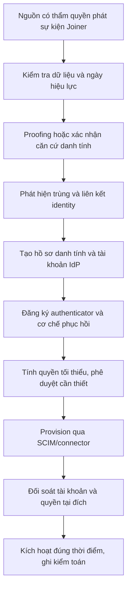

# Đăng ký identity trong quản lý vòng đời danh tính IAM

**Identity enrollment** (đăng ký danh tính) là quá trình thiết lập một danh tính có quản lý trong hệ thống **Identity and Access Management (IAM)**, liên kết danh tính với nguồn thông tin đáng tin cậy và chuẩn bị các yếu tố cần thiết để chủ thể sử dụng dịch vụ. Đối với người dùng, enrollment thường gồm xác định hồ sơ, tạo hoặc liên kết tài khoản, đăng ký phương thức xác thực và kích hoạt theo chính sách. Đối với workload, quá trình tương ứng cần xác định dịch vụ và chủ sở hữu, rồi cấp danh tính kỹ thuật cùng cơ chế xác thực thích hợp.

Enrollment đóng vai trò quan trọng trong giai đoạn **Joiner** của mô hình **Joiner–Mover–Leaver (JML)**. Tuy nhiên, một danh tính đã đăng ký không mặc nhiên được cấp quyền rộng rãi: **xác minh danh tính, tạo tài khoản, xác thực, cấp quyền và kiểm tra truy cập** là các hoạt động có liên hệ nhưng cần được kiểm soát riêng.

## 1. Phân biệt enrollment với những bước liên quan

| Khái niệm | Mục tiêu chính | Ví dụ |
| --- | --- | --- |
| **Identity proofing** | Tạo cơ sở tin cậy rằng một người là người họ khai báo | Kiểm tra bằng chứng và đối chiếu người đăng ký |
| **Identity enrollment** | Thiết lập/liên kết hồ sơ danh tính để được quản lý | Tạo identity từ bản ghi HR đã xác minh |
| **Authenticator enrollment** | Đăng ký và gắn phương thức xác thực với danh tính/tài khoản | Đăng ký passkey hoặc khóa bảo mật |
| **Account provisioning** | Tạo/cập nhật tài khoản tại hệ thống đích | Tạo user tại IdP hoặc CRM qua SCIM |
| **Authentication** | Xác minh chủ thể kiểm soát authenticator khi truy cập | Đăng nhập qua IdP, MFA, SSO |
| **Authorization** | Quyết định được làm gì trên tài nguyên cụ thể | Cho phép xem dữ liệu thuộc nhóm được giao |

Một hệ thống có thể gộp các thao tác này vào giao diện “đăng ký”, nhưng vẫn cần tách rõ trách nhiệm. Chẳng hạn một người đã được HR xác nhận và đăng ký tài khoản thành công có thể chưa đến ngày bắt đầu làm việc, nên **tài khoản đã tồn tại không có nghĩa quyền đã có hiệu lực**.

## 2. Điều kiện đầu vào của quá trình đăng ký

Enrollment cần dựa trên **nguồn có thẩm quyền** (*authoritative source*) tùy loại chủ thể:

- **Nhân viên:** HRIS/HCM cung cấp mã nhân sự, quan hệ lao động, ngày hiệu lực, bộ phận, vị trí và người quản lý.
- **Nhà thầu, đối tác:** hệ thống hợp đồng/đối tác cung cấp đơn vị bảo trợ, đầu mối chịu trách nhiệm, phạm vi hợp đồng và ngày hết hạn.
- **Người dùng bên ngoài:** quy trình đăng ký, xác minh và chấp thuận điều khoản phù hợp với mục đích dịch vụ.
- **Service/workload identity:** hệ thống quản lý dịch vụ hoặc triển khai cung cấp tên workload, môi trường, owner và quyền cần thiết.

Chất lượng dữ liệu đầu vào quyết định chất lượng đăng ký. Mã gốc cần ổn định, phân biệt được các cá nhân và tránh dùng email hay tên hiển thị làm khóa duy nhất vì các giá trị này có thể thay đổi hoặc tái sử dụng.

Một bản ghi đầu vào minh họa:

```json
{
  "personId": "EMP-1048",
  "identityType": "human",
  "relationship": "employee",
  "employmentStatus": "pending",
  "departmentCode": "CUSTOMER_SUPPORT",
  "jobCode": "CS_AGENT_L1",
  "managerPersonId": "EMP-0201",
  "startDate": "2026-12-01",
  "source": "hris"
}
```

Đây là **schema minh họa**, không phải schema chuẩn của SCIM hoặc một sản phẩm IAM. Phải phân biệt trường `startDate` mang ý nghĩa nghiệp vụ với thời điểm hệ thống nhận sự kiện; các quyết định kích hoạt và cấp quyền cần dựa trên ngày có hiệu lực đã được xác nhận.

## 3. Luồng đăng ký identity cơ bản



### Bước 1 — Kiểm tra sự kiện và dữ liệu đầu vào

Trước khi tạo tài khoản, IAM xác minh sự kiện Joiner thuộc đúng người, đúng tổ chức, đúng thời điểm và có chủ sở hữu chịu trách nhiệm. Đầu vào thiếu mã định danh, thiếu ngày hiệu lực hoặc có trạng thái mâu thuẫn phải đi qua cơ chế xử lý ngoại lệ theo chính sách.

**Không nên mặc định cấp quyền chỉ vì một file CSV hoặc yêu cầu thủ công có tên người dùng**; cần kiểm soát người gửi, nguồn dữ liệu, phê duyệt và quyền truy cập vào hệ thống enrollment.

### Bước 2 — Xác minh và chống tạo danh tính trùng

Nếu chính sách yêu cầu **identity proofing**, tổ chức thực hiện việc xác minh danh tính trước khi gắn người đăng ký với tài khoản. Bên cạnh đó, hệ thống kiểm tra xem người này đã có danh tính từ lần làm việc trước hoặc từ một quan hệ khác hay chưa.

Hai người trùng họ tên không được tự động hợp nhất. Một người đổi email cũng không nên bị tạo thành hai danh tính không liên kết. Quy tắc *identity correlation* phải sử dụng mã ổn định và nguồn tin cậy, có quy trình giải quyết các trường hợp không chắc chắn.

### Bước 3 — Tạo hoặc liên kết identity và tài khoản

IAM tạo hồ sơ danh tính trong hệ thống quản trị danh tính, gắn các thuộc tính cần thiết và thiết lập tài khoản tại **Identity Provider (IdP)** nếu phù hợp. Các trạng thái như `pending`, `active`, `suspended` cần được định nghĩa rõ cho từng hệ thống.

Thông thường một human identity có thể liên kết với nhiều account: tài khoản IdP thông thường, tài khoản ứng dụng cũ và đôi khi tài khoản đặc quyền riêng. Hệ thống cần theo dõi được account nào thuộc identity nào để xử lý Mover và Leaver về sau.

### Bước 4 — Đăng ký phương thức xác thực

Chủ thể được hướng dẫn thiết lập phương thức xác thực phù hợp như passkey, khóa bảo mật hoặc MFA. Việc gắn authenticator phải diễn ra qua luồng enrollment có khả năng xác minh đúng người và chống giả mạo yêu cầu đăng ký.

Các mã kích hoạt, liên kết mời hoặc mã khôi phục cần giới hạn thời gian, phạm vi sử dụng và số lần dùng theo thiết kế. Không truyền bí mật qua kênh thiếu bảo vệ hoặc ghi mã khôi phục, mật khẩu và token vào log thông thường.

**Enrollment authenticator không phải là identity proofing:** việc một người kiểm soát số điện thoại hoặc hộp thư không tự chứng minh họ là cá nhân trong hồ sơ HR.

### Bước 5 — Xác định và phê duyệt quyền ban đầu

Quyền khởi đầu nên theo **least privilege**: chỉ cấp những quyền cần cho vai trò và phạm vi trách nhiệm. **RBAC** có thể ánh xạ vai trò nghiệp vụ thành bộ quyền cơ bản; **ABAC** bổ sung điều kiện theo đơn vị, nhóm, dự án, trạng thái, ngày hiệu lực hoặc độ nhạy cảm tài nguyên.

Ví dụ, người mới có job code `CS_AGENT_L1` có thể được xem ticket của nhóm được phân công. Quyền xuất toàn bộ dữ liệu khách hàng hay quyền quản trị hệ thống cần căn cứ/phê duyệt riêng; không suy ra từ chức danh đơn thuần.

### Bước 6 — Provisioning và kiểm chứng ở hệ thống đích

IAM hoặc công cụ provisioning đồng bộ người dùng và nhóm đến ứng dụng qua **SCIM** hoặc connector phù hợp. SCIM có thể quản lý đối tượng User/Group theo khả năng tích hợp, nhưng **không mặc nhiên bảo đảm mọi ứng dụng hỗ trợ mọi thuộc tính, cấp quyền hay thu hồi token**.

Sau khi gửi lệnh tạo user, hệ thống cần nhận kết quả, xử lý retry an toàn, tránh tạo trùng và đối soát tài khoản/quyền thực tế. Enrollment chỉ được coi là hoàn tất về kỹ thuật khi các điều kiện quan trọng tại đích đã được xác minh theo hợp đồng dịch vụ.

### Bước 7 — Kích hoạt và tạo bằng chứng kiểm toán

Quy trình ghi lại nguồn yêu cầu, mã identity, hệ thống đích, các phê duyệt, quyền khởi tạo, thời gian có hiệu lực và kết quả thực thi. Nếu tạo tài khoản trước ngày bắt đầu, cần kiểm soát để không cho phép truy cập sớm.

Các bước xử lý lỗi phải có trạng thái rõ ràng như “chờ dữ liệu”, “chờ phê duyệt”, “provision thất bại” hoặc “đã kích hoạt”, không che giấu lỗi đồng bộ bằng trạng thái thành công chung.

## 4. IdP, SSO, SCIM và RBAC/ABAC phối hợp trong enrollment

| Thành phần | Đóng góp vào enrollment | Điều không nên giả định |
| --- | --- | --- |
| **HRIS/nguồn có thẩm quyền** | Cung cấp sự kiện và dữ liệu nền tảng | Mọi trường đều đúng hoặc luôn cập nhật tức thì |
| **IGA/IAM** | Quản lý vòng đời, workflow cấp quyền, phê duyệt và đối soát | Chỉ tạo identity là đã kiểm soát được mọi ứng dụng |
| **IdP** | Tạo danh tính đăng nhập, liên kết authenticator, quản lý phiên | Đăng nhập thành công đồng nghĩa có mọi quyền |
| **SSO** | Cho phép dùng xác thực từ IdP tại ứng dụng liên kết | Tự động tạo user hay thu hồi mọi phiên ứng dụng |
| **SCIM/connector** | Tạo, cập nhật, vô hiệu hóa tài khoản/nhóm đích | Có thể cấu hình mọi entitlement đặc thù mà không cần tích hợp thêm |
| **RBAC/ABAC** | Xác định quyền theo vai trò và thuộc tính/ngữ cảnh | Role ban đầu luôn đủ hoặc không cần rà soát |
| **Ứng dụng/API** | Thực thi quyền tại thời điểm yêu cầu | Chỉ cần tin claim cũ mà không xét hiệu lực hiện tại |

**SSO và provisioning là hai chức năng riêng:** ứng dụng có thể hỗ trợ đăng nhập SSO nhưng vẫn cần tạo tài khoản thủ công; hoặc hỗ trợ SCIM nhưng dùng cơ chế xác thực khác. Thiết kế enrollment phải kiểm tra khả năng thực tế của từng hệ thống đích.

## 5. Tình huống: đăng ký nhân viên mới

Giả sử Lan bắt đầu làm việc tại nhóm hỗ trợ vào ngày 1/12 và cần dùng CRM.

1. HRIS phát sự kiện Joiner với `personId`, ngày bắt đầu, job code và người quản lý.
2. IAM xác minh căn cứ danh tính, kiểm tra không có hồ sơ trùng hoặc tài khoản cũ cần xử lý.
3. Hệ thống tạo human identity, liên kết tài khoản IdP ở trạng thái phù hợp và hướng dẫn Lan đăng ký MFA/passkey.
4. Quy tắc RBAC đề xuất role hỗ trợ; ABAC giới hạn tài nguyên theo nhóm được giao. Quyền nhạy cảm cần phê duyệt nếu phát sinh.
5. Connector/SCIM tạo tài khoản CRM; quy trình đối soát xác nhận user và quyền đã được thiết lập đúng.
6. Tài khoản được phép sử dụng từ ngày hiệu lực theo chính sách. Lan dùng SSO đăng nhập; CRM vẫn kiểm tra quyền với từng ticket.
7. Khi Lan chuyển nhóm, quy trình **Mover** thu hồi quyền hỗ trợ cũ và cấp quyền mới. Khi nghỉ việc, **Leaver** thu hồi tài khoản, phiên và các entitlement liên quan.

Ví dụ cho thấy enrollment cần **tạo quan hệ quản trị lâu dài**, giúp sự kiện thay đổi và chấm dứt sau này tìm được mọi tài khoản cần cập nhật.

## 6. Enrollment cho tài khoản dịch vụ và workload

Một hệ thống tự động gọi API cũng cần danh tính, nhưng không trải qua proofing người. Trước khi đăng ký, cần xác minh **workload nào**, chạy ở môi trường nào, thuộc nhóm quản lý nào và có mục đích truy cập gì.

Luồng phù hợp gồm đăng ký workload/service identity, gắn owner, xác định phạm vi API, cấp credential hoặc thiết lập **workload identity federation** khi nền tảng hỗ trợ, sau đó cấp quyền tối thiểu và ghi audit. Nên ưu tiên credential ngắn hạn, tránh chia sẻ khóa lâu dài hoặc dùng account cá nhân để chạy tác vụ.

Ví dụ dịch vụ tổng hợp báo cáo hằng đêm chỉ cần đọc dữ liệu đã duyệt; enrollment không nên tự động gắn role quản trị cơ sở dữ liệu. Khi workload bị xóa, đổi owner hoặc đổi môi trường triển khai, vòng đời của danh tính kỹ thuật cũng phải được cập nhật và thu hồi.

## 7. Lỗi thường gặp và cách kiểm soát

| Rủi ro | Tình huống | Biện pháp |
| --- | --- | --- |
| Tạo trùng identity | Người từng nghỉ việc quay lại bằng email mới | Identity correlation và xử lý tái tuyển dụng |
| Tạo account cho sai người | Tin một email hoặc yêu cầu không đủ chứng cứ | Xác minh nguồn, proofing theo mức rủi ro |
| Cấp quyền quá sớm | Account được kích hoạt trước ngày hợp đồng | Phân biệt provisioning với activation, kiểm soát ngày hiệu lực |
| Cấp quyền quá rộng | Sao chép toàn bộ role của người tiền nhiệm | Least privilege và phê duyệt theo nghiệp vụ |
| Enrollment authenticator yếu | Liên kết mời bị chuyển tiếp hoặc lộ | Token mời có hạn, ràng buộc phiên và kiểm tra đúng chủ thể |
| Provisioning thất bại một phần | IdP thành công nhưng ứng dụng đích lỗi | Theo dõi từng đích, retry idempotent, đối soát |
| Trạng thái không nhất quán | IAM ghi active nhưng HR chưa cho bắt đầu | Nguồn có thẩm quyền, trạng thái và thời điểm có hiệu lực |
| Không quản lý account phát sinh | User được tạo thủ công ngoài quy trình | Khám phá và đối soát tài khoản, rà soát định kỳ |

Việc giám sát enrollment có thể đo: tỷ lệ tạo trùng, thời gian từ sự kiện Joiner đến quyền sẵn sàng, tỷ lệ lỗi provisioning, số tài khoản thiếu owner, số quyền ngoại lệ không có phê duyệt và số trường hợp được kích hoạt sớm.

## 8. Enrollment tạo nền tảng cho Mover và Leaver

Quá trình đăng ký tốt phải lưu được **liên kết danh tính gốc → tài khoản → nhóm/role → entitlement → hệ thống đích**, cùng nguồn có thẩm quyền và bằng chứng cấp quyền. Nếu liên kết này thiếu, khi người dùng chuyển vai trò hoặc nghỉ việc, tổ chức khó xác định mọi tài khoản và quyền cần thu hồi.

Với **Mover**, có thể giữ nguyên mã identity nhưng cập nhật thuộc tính, role và quyền sau khi so sánh chính sách cũ/mới. Với **Leaver**, phải ngăn đăng nhập, vô hiệu hóa tài khoản liên quan, thu hồi quyền và xử lý phiên/token còn hiệu lực theo khả năng ứng dụng. Một số access token có thể tiếp tục hợp lệ đến khi hết hạn; vì vậy cần kiểm chứng quyền tại điểm thực thi, không chỉ kiểm tra rằng đã gửi yêu cầu deprovision.

Không nên tự động khôi phục toàn bộ quyền cũ khi một nhân viên quay lại. Enrollment mới hoặc tái kích hoạt phải kiểm tra lại quan hệ hiện tại, chủ sở hữu, rủi ro và quyền cần thiết.

## 9. Câu hỏi tự kiểm tra

**Tình huống A:** Nhân viên mới đã có account IdP trước ngày bắt đầu. Có nên cấp quyền CRM ngay? **Không mặc nhiên.** Cần dựa trên ngày hiệu lực và chính sách kích hoạt; chuẩn bị account có thể tách khỏi việc cho phép sử dụng.

**Tình huống B:** Một người đăng ký passkey thành công bằng liên kết mời. Điều này chứng minh họ là nhân viên đã được HR xác minh chưa? **Chưa đủ.** Authenticator enrollment chỉ chứng minh phương thức xác thực được gắn qua quy trình; mức tin cậy vào người đăng ký phụ thuộc bằng chứng identity proofing và liên kết hồ sơ.

**Tình huống C:** SCIM báo tạo tài khoản CRM thành công nhưng user chưa có role cần thiết. Enrollment có hoàn tất chưa? **Chưa hoàn toàn.** Phải xác minh entitlement và xử lý provisioning phần quyền theo hợp đồng tích hợp.

**Tình huống D:** Nhân viên cũ quay lại, dùng email khác, và yêu cầu giữ quyền quản trị trước đây. Nên làm gì? **Đối chiếu identity và quan hệ mới**, rà soát quyền theo nhiệm vụ hiện tại, xác minh/phê duyệt phần đặc quyền; không mặc nhiên giữ quyền cũ.

## Ghi nhớ

**Đăng ký identity** là bước thiết lập danh tính được quản lý, liên kết với nguồn có thẩm quyền, tài khoản và cơ chế xác thực để chuẩn bị truy cập đúng thời điểm. Enrollment hiệu quả kết hợp xác minh danh tính khi cần, chống trùng hồ sơ, đăng ký authenticator, provisioning qua **IdP/SCIM**, cấp quyền theo **RBAC/ABAC** và kiểm toán kết quả. Đây là nền tảng của **Joiner–Mover–Leaver**: biết chính xác ai hoặc workload nào đang có tài khoản và quyền nào, từ đó cập nhật và thu hồi hiệu quả khi ngữ cảnh thay đổi.
