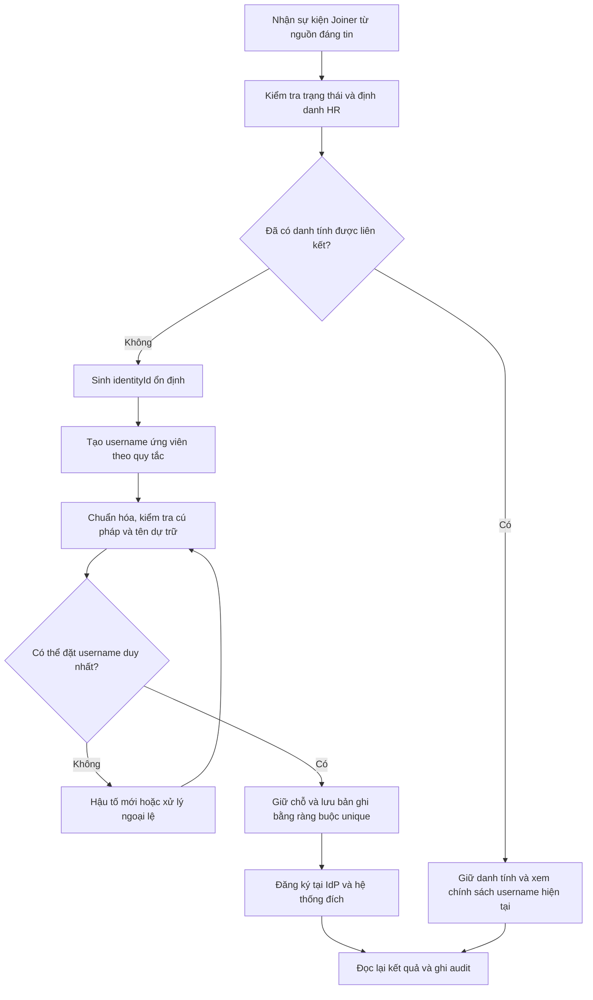
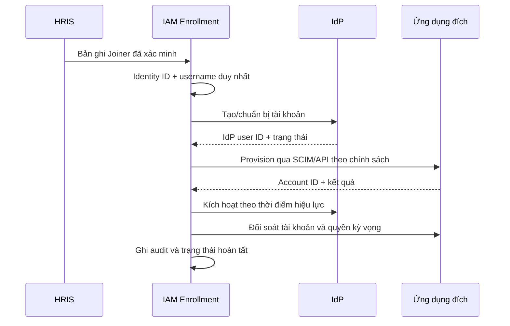

# Tạo username trong quy trình Identity Enrollment

**Username** là tên tài khoản mà người dùng có thể nhập để đăng nhập hoặc để hệ thống hiển thị, tìm kiếm và quản trị tài khoản. Trong quản lý định danh và truy cập (*Identity and Access Management* — **IAM**), việc **tạo username** là một bước của *identity enrollment* — đăng ký và thiết lập danh tính ban đầu. Bước này tưởng như chỉ là nối họ tên thành một chuỗi, nhưng phải giải quyết nhiều yêu cầu: đúng người, không trùng, phù hợp quy tắc của IdP và ứng dụng đích, không làm lộ dữ liệu không cần thiết, có thể đổi tên mà không mất liên kết lịch sử, và không vô tình phục hồi quyền khi tài khoản cũ được sử dụng lại.

Bài thuộc chương **Identity enrollment** của module `SECURITY_IDENTITY_ACCESS_MANAGEMENT_IDENTITY_LIFECYCLE`. Ta xem username trong toàn bộ vòng đời **Joiner–Mover–Leaver (JML)**: từ xác minh danh tính nhân sự, sinh tên đăng nhập, cấp phát IdP/SSO/SCIM đến cập nhật và vô hiệu hóa tài khoản. Mục tiêu là bảo đảm username phục vụ việc truy cập thuận tiện nhưng **không bị nhầm với định danh bất biến hoặc bằng chứng về quyền**.

Sau bài học, bạn có thể phân biệt username với user ID và email; thiết kế quy tắc đặt tên, chuẩn hóa và kiểm tra duy nhất; xử lý trùng lặp và cấp phát đồng thời; hiểu cách đồng bộ username qua IdP/SCIM; và kiểm thử các trường hợp thay đổi họ tên, chuyển vai trò, nghỉ việc và tái tuyển dụng.

## 1. Username là gì, và không phải là gì?

Giả sử công ty tuyển một nhân viên tên **Nguyễn Văn An**. Bộ phận IAM có thể tạo username `nvanan` để người đó đăng nhập. Nhưng hệ thống còn cần một **định danh nội bộ ổn định**, ví dụ `identityId=id-4812`, để biết chính xác tài khoản này thuộc về ai dù username thay đổi sau này.

| Thành phần | Ví dụ minh họa | Mục đích | Có nên xem là bất biến? |
| --- | --- | --- | --- |
| **Identity ID** | `id-4812` | Khóa ổn định liên kết hồ sơ IAM, quyền và lịch sử kiểm toán | Có; nên ổn định, không phụ thuộc tên hiển thị |
| **Username / login name** | `nvanan` | Tên người dùng nhập để đăng nhập hoặc tìm tài khoản | Không bắt buộc; có thể đổi theo chính sách |
| **Display name** | `Nguyễn Văn An` | Tên đọc được trên giao diện | Có thể đổi theo hồ sơ nhân sự |
| **Email** | `an.nguyen@example.com` | Địa chỉ liên lạc hoặc một hình thức login name nếu được cấu hình | Có thể đổi hoặc có bí danh; không mặc nhiên là khóa duy nhất vĩnh viễn |
| **HR person ID** | `EMP-008742` | Định danh hồ sơ nhân sự trong nguồn có thẩm quyền | Thường ổn định trong phạm vi nguồn, cần kiểm tra chính sách tái tuyển dụng |
| **IdP subject / object ID** | `user-9b31` | Khóa tài khoản kỹ thuật tại IdP; trong OIDC, `sub` là định danh chủ thể do issuer cấp | Không được suy từ username; ổn định theo cam kết của IdP và phạm vi issuer |

Các giá trị trên chỉ là ví dụ. Trong hệ thống thực tế, username có thể là email, mã nhân viên, dạng `first.last`, hoặc một chuỗi được sinh riêng. **Không tồn tại một định dạng username bắt buộc cho mọi tổ chức, IdP hoặc giao thức.**

Điểm quan trọng nhất: **username là thuộc tính có thể thay đổi; danh tính là thực thể cần được quản lý liên tục.** Một tên đăng nhập trùng hoặc bị tái sử dụng không được làm IAM nhầm quyền, hồ sơ kiểm toán hay quyền sở hữu tài nguyên giữa hai người.

### Username không phải bằng chứng xác thực hoặc quyền truy cập

Biết một username không chứng minh người gửi yêu cầu là chủ tài khoản. Hệ thống vẫn phải xác thực bằng mật khẩu/MFA, passkey hoặc phương thức được phê duyệt; sau đó kiểm tra quyền theo RBAC/ABAC và ngữ cảnh. Việc tạo username thành công cũng **không có nghĩa** người dùng đã được phép đăng nhập, đã có phiên SSO hoặc đã được cấp quyền ứng dụng.

## 2. Nguồn dữ liệu đầu vào: chỉ tạo username cho danh tính đã được xác minh

Trong luồng Joiner, dữ liệu thường được nhận từ HRIS hoặc hệ thống quản lý đối tác có thẩm quyền. Việc tạo username phải gắn với quy trình xác nhận **người đó là ai**, **tình trạng quan hệ với tổ chức**, và **thời điểm bắt đầu có hiệu lực**.

| Trường đầu vào | Công dụng | Điều cần kiểm tra |
| --- | --- | --- |
| `sourceSystem` và `sourcePersonId` | Nhận diện bản ghi duy nhất tại nguồn nhân sự | Nguồn đáng tin cậy, ID không rỗng, phân biệt namespace |
| `legalName` hoặc tên công việc được phép dùng | Đề xuất username dễ nhớ | Có thể có dấu, ký tự đặc biệt, nhiều hệ chữ viết, tên thay đổi |
| `employmentStatus` | Xác định có đủ điều kiện khởi tạo hay chỉ được chuẩn bị trước | Trạng thái đã được phê duyệt; không suy từ bản ghi thiếu |
| `effectiveAt` | Xác định khi nào danh tính hoặc quyền đăng nhập được kích hoạt | Múi giờ, ngày bắt đầu, thay đổi lịch nhận việc |
| `workerType` / `organizationUnit` | Áp quy tắc namespace hoặc quy trình khác cho nhân viên, nhà thầu | Thuộc tính đúng nguồn, không tự cấp đặc quyền theo tên |
| `sponsorId` (nếu là đối tác) | Gắn người chịu trách nhiệm và thời hạn | Người bảo trợ còn hợp lệ, thời hạn và quy trình thu hồi rõ ràng |

Không cần đưa mọi trường HR vào username. Ví dụ, ngày sinh, số định danh cá nhân, số điện thoại và các dữ liệu nhạy cảm **không nên** được ghép vào username để phân biệt người trùng tên. Username có thể xuất hiện trong địa chỉ email, URL, log, màn hình đăng nhập hoặc danh mục nhân viên; cấu trúc của nó có thể làm lộ thông tin nếu thiết kế thiếu cân nhắc.

Nếu có hai hồ sơ HR cùng tên hoặc một người được tuyển lại, không được tự động kết luận đó là cùng một người dựa trên tên hay email. Phải đối chiếu định danh nguồn và quy trình xác minh theo chính sách trước khi tạo hoặc liên kết tài khoản.

## 3. Thiết kế chính sách đặt username

Một chính sách tốt phải đủ đơn giản để người dùng nhận biết và đủ chính xác để hệ thống thực thi thống nhất.

### 3.1. Xác định phạm vi duy nhất

Trước khi chọn cú pháp, hãy trả lời **username cần duy nhất ở đâu**: trên một IdP, trong toàn bộ tenant, trong một hệ thống directory, hay giữa nhiều tổ chức và ứng dụng? Hai tenant độc lập có thể cùng chứa `nvanan`, nhưng nếu các ứng dụng dùng một namespace đăng nhập chung thì xung đột vẫn xảy ra.

Nên định nghĩa rõ:

- **Namespace:** ví dụ `iam.company.internal`, một tenant cụ thể hoặc toàn bộ tổ chức.
- **Ký tự hợp lệ:** chữ cái, chữ số, dấu chấm, dấu gạch ngang hoặc gạch dưới theo khả năng của IdP/đích.
- **Độ dài tối thiểu/tối đa:** phải kiểm tra giới hạn thực tế của mọi hệ thống mà username sẽ đi qua.
- **Phân biệt chữ hoa/chữ thường:** chính sách phải thống nhất giữa nơi tạo, tìm kiếm và đăng nhập; không được giả định các hệ thống có cùng quy tắc.
- **Tên bị cấm hoặc dự trữ:** `admin`, `root`, `system`, `support`, các tên dịch vụ và tên dễ gây nhầm với tài khoản có quyền cao.
- **Quy tắc xử lý trùng:** thêm hậu tố, tạo chuỗi thay thế hoặc chuyển kiểm tra thủ công theo chính sách.
- **Quy tắc đổi tên và tái sử dụng:** khi nào đổi username, khi nào giữ bí danh cũ và có được cấp lại tên đã ngừng sử dụng không.

### 3.2. Tạo username dễ sử dụng nhưng không phụ thuộc mã định danh nhạy cảm

Các mẫu phổ biến gồm `firstname.lastname`, chữ đầu tên + họ, hoặc tên thân thiện kèm hậu tố ngắn. Ví dụ: `an.nguyen`, `nvanan`, `an.nguyen2`. Mỗi mẫu có ưu và nhược điểm:

| Mẫu | Thuận lợi | Rủi ro / giới hạn |
| --- | --- | --- |
| `ten.ho` | Tương đối dễ đọc, dễ nhớ | Trùng tên; cách tách họ/tên khác nhau theo văn hóa; đổi tên ảnh hưởng login |
| `chu_dau_ho + ten` | Ngắn, thường dễ gõ | Rất dễ trùng trong tổ chức lớn |
| `ten.ho + hau_to` | Giữ khả năng nhận biết khi trùng | Cần hậu tố ổn định, tránh quy tắc phỏng đoán gây nhầm |
| Username ngẫu nhiên | Ít lộ tên thật hơn, dễ bảo đảm duy nhất | Khó nhớ, tăng nhu cầu tìm kiếm hoặc tài liệu onboarding |

**Không nên dùng số căn cước, ngày sinh hoặc mật khẩu một phần làm hậu tố.** Nếu cần tránh trùng, có thể dùng một mã phân biệt được tạo riêng theo chính sách, không chứa thông tin nhạy cảm và được giữ ổn định sau khi phát hành.

### 3.3. Chuẩn hóa tiếng Việt và tên quốc tế

Tên tiếng Việt có dấu và nhiều tên thuộc các hệ chữ khác không thể đưa thẳng vào mọi directory hoặc ứng dụng cũ. Một pipeline có thể dùng chuẩn hóa Unicode, chuyển tự (transliteration) theo chính sách, chuyển về chữ thường, bỏ dấu câu không hợp lệ rồi kiểm tra ký tự. Tuy nhiên, cần thận trọng:

- `Đ` và `đ` cần có quy tắc chuyển thành `d` nếu hệ thống chỉ hỗ trợ ASCII; không phải mọi thao tác xóa dấu tự động đều xử lý đúng chúng.
- Các tên khác nhau có thể tạo ra cùng một chuỗi sau khi bỏ dấu: `Hòa`, `Hoa` và nhiều biến thể khác có thể xung đột.
- Cấu trúc tên theo văn hóa khác nhau; không nên giả định “từ đầu là firstname, từ cuối là lastname” với mọi người.
- Việc chuẩn hóa chữ hoa/chữ thường, dạng Unicode và dấu chấm phải đồng bộ với cơ sở dữ liệu, IdP và ứng dụng đích.
- Nếu không thể sinh tên hợp lệ hoặc dễ bị nhầm, hệ thống nên đưa ra một phương án thay thế hoặc chuyển cho người có trách nhiệm duyệt.

**Ví dụ minh họa:**

```text
Tên hiển thị:     Nguyễn Văn An
Ứng viên username: nvanan

Tên hiển thị:     Nguyễn Văn Ân
Ứng viên username: nvanan  # có thể trùng sau khi bỏ dấu

Kết quả phải được xử lý bằng kiểm tra unique và quy tắc hậu tố,
không được cấp cùng một login name cho hai danh tính khác nhau.
```

Không được xem thuật toán chuyển tự hay cắt tên như một phép chứng minh danh tính. Đó chỉ là cách **đề xuất chuỗi đăng nhập**; ID ổn định mới là điểm liên kết kỹ thuật giữa các hồ sơ.

## 4. Quy trình tạo username an toàn, nhất quán



Các bước có trách nhiệm khác nhau:

1. **Xác minh nguồn và người:** đối chiếu bản ghi HR, tình trạng hợp lệ, namespace và ID duy nhất. Không tạo tài khoản mới nếu bản ghi đã được liên kết đúng với một identity hiện hữu.
2. **Sinh khóa nội bộ bất biến:** IAM tạo `identityId` hoặc nhận khóa đáng tin từ nguồn đã có chính sách. Khóa này dùng để liên kết tài khoản và kiểm toán dài hạn.
3. **Đề xuất username:** thực hiện chuẩn hóa theo phiên bản chính sách đã biết. Không gán quyền dựa trên cấu trúc username.
4. **Kiểm tra quy tắc và uniqueness:** từ chối chuỗi rỗng, quá dài, chứa ký tự cấm hoặc trùng với tài khoản/tên dự trữ trong namespace tương ứng.
5. **Giữ chỗ và tạo bản ghi atomically:** dùng ràng buộc duy nhất ở nơi lưu thông tin để giải quyết hai yêu cầu đồng thời. Chỉ truy vấn xem “tên có tồn tại không” rồi ghi sau **không đủ** chống race condition.
6. **Provision IdP và ứng dụng:** lưu các ID đã tạo, theo dõi lỗi từng hệ thống, và không đánh dấu hoàn tất cho đến khi xác minh kết quả theo phạm vi quy trình.
7. **Ghi audit:** lưu danh tính nguồn, identityId, tên được cấp, phiên bản chính sách, quyết định xử lý trùng và mã liên kết sự kiện; không ghi mật khẩu hoặc token.

### 4.1. Giải quyết trùng tên khi hai người cùng đăng ký

Giả sử hai người tên Nguyễn Văn An được onboarding gần cùng lúc. Cả hai tiến trình đều đề xuất `nvanan`. Nếu chỉ chạy `SELECT username WHERE ...` và cùng thấy tên trống, cả hai có thể cố gắng tạo một login name giống nhau.

Để tránh, nơi quản lý username cần ràng buộc **UNIQUE theo namespace và khóa chuẩn hóa**. Khi ghi tên đầu tiên thành công, giao dịch còn lại nhận thông báo xung đột rồi thử ứng viên kế tiếp. Cần sử dụng cùng quy tắc so sánh khi ghi, tra cứu và cấp phát. Dưới đây là giả mã:

```text
taoUsername(identityId, tenHienThi, namespace):
    neu identityId da co username da cap:
        tra ve username hien co  // idempotent

    base = taoUngVienVaChuanHoa(tenHienThi)
    neu base khong hop le:
        chuyenXuLyNgoaiLe()

    cho moi candidate trong danhSachUngVien(base):
        neu candidate thuoc tap tenDuTru: tiep tuc
        thu:
            giaoDich:
                INSERT usernameReservation(
                    namespace, usernameCanonical=candidate, identityId
                )
                // UNIQUE(namespace, usernameCanonical)
            tra ve candidate
        neu loi unique do trung ten:
            tiep tuc

    chuyenXuLyNgoaiLe("Khong con ung vien hop le")
```

Giả mã không phải mã triển khai hoàn chỉnh. Trong thực tế phải thiết kế xử lý timeout, lỗi giao dịch, danh sách ứng viên, khóa idempotency, trạng thái reservation đang chờ cấp phát, và khả năng IdP có quy tắc riêng. Nếu IdP báo trùng do tài khoản tồn tại ngoài nguồn IAM, **không tự chiếm hoặc đổi chủ tài khoản đó**: cần đối soát và xử lý xung đột theo quy trình.

### 4.2. Username phải nhất quán qua nhiều hệ thống

Một username nội bộ có thể quá dài hoặc chứa ký tự được IdP chấp nhận nhưng ứng dụng đích không hỗ trợ. Có hai hướng chính:

- **Cùng một username trên các hệ thống**, khi tất cả mục tiêu chấp nhận cùng namespace, cú pháp và ngữ nghĩa.
- **Duy trì một login name chính và ánh xạ riêng cho ứng dụng đích**, khi hệ thống cũ hoặc bên thứ ba có yêu cầu khác nhau.

Trong cả hai trường hợp, dùng **ID bền vững** để liên kết các account. Không ghép tài khoản bằng suy đoán username trông giống nhau. Lưu rõ ánh xạ nguồn → identityId → IdP user ID → application user ID, và kiểm soát quyền sửa các ánh xạ này.

## 5. Tạo username, IdP, SSO và SCIM liên kết thế nào?

Một luồng đơn giản:



**IdP** dùng username hoặc thuộc tính đăng nhập để nhận diện tài khoản khi người dùng xác thực. **SSO** cho phép ứng dụng dựa vào kết quả xác thực từ IdP. **SCIM** hỗ trợ provision và quản lý tài khoản/nhóm tại hệ thống tương thích. Các cơ chế này phục vụ những bước khác nhau; có username ở IdP không tự bảo đảm ứng dụng đã nhận đúng quyền, và tạo tài khoản bằng SCIM không có nghĩa người dùng đã được phép đăng nhập.

### Một số trường SCIM dễ nhầm

| Trường SCIM | Vai trò thường gặp | Lưu ý |
| --- | --- | --- |
| `userName` | Tên duy nhất của người dùng trong phạm vi tài nguyên SCIM do nhà cung cấp dịch vụ quản lý | Cần kiểm tra chính sách uniqueness và khả năng đổi tên của đích |
| `externalId` | Định danh do phía client cung cấp để liên kết đối tượng | Do client quản lý; không đồng nhất với `id` của service provider |
| `id` | Định danh do SCIM service provider cấp | Không nên tự suy ra từ username |
| `displayName` | Tên đọc được, phục vụ hiển thị | Có thể thay đổi và không có vai trò xác thực mặc định |
| `active` | Trạng thái hoạt động được hệ thống đích hỗ trợ | Cần xác minh ảnh hưởng thực tế đến khả năng đăng nhập và phiên |

Các ứng dụng có thể triển khai SCIM khác nhau; cần kiểm thử cách chúng xử lý thay đổi `userName`, cập nhật `active` và đồng bộ nhóm. Với OIDC, ứng dụng thường nên dùng định danh chủ thể ổn định trong phạm vi issuer để liên kết user, thay vì dùng username hoặc email thay cho khóa tài khoản.

## 6. Username trong vòng đời Joiner–Mover–Leaver

### 6.1. Joiner: chuẩn bị trước, cấp đúng người và đúng thời điểm

Khi có sự kiện Joiner, IAM có thể **tạo và giữ chỗ username** sau khi nhận đủ bằng chứng và đã liên kết đúng hồ sơ HR. Tuy nhiên, ngày tạo username, ngày tạo account tại IdP và ngày người dùng được phép đăng nhập có thể khác nhau.

**Ví dụ:** HR xác nhận Nguyễn Văn An bắt đầu ngày 01/12 lúc 09:00. Ngày 28/11, IAM có thể chuẩn bị account và đặt username `nvanan` theo chính sách. Tại `effectiveAt`, hệ thống mới kích hoạt đăng nhập và cấp quyền cơ sở được duyệt. Nếu HR lùi ngày bắt đầu, IAM phải cập nhật lịch kích hoạt cũ; không cấp quyền chỉ vì username đã được đăng ký.

Sau provisioning cần kiểm tra username được gắn với **đúng identityId và đúng IdP user ID**, trạng thái đăng nhập phù hợp, các nhóm/role cần thiết và bất kỳ tài khoản đích nào đã được tạo. Nếu có trùng hoặc không xác minh được chủ thể, phải dừng bước liên quan và chuyển kiểm tra thay vì tái sử dụng account có tên giống nhau.

### 6.2. Mover: chuyển vai trò không nhất thiết đổi username

Khi người dùng chuyển phòng ban hoặc dự án, **username thường không cần đổi**. Việc cần làm chính là tính lại quyền theo RBAC/ABAC, thu hồi quyền không còn hợp lệ và cấp quyền mới theo thời điểm được phê duyệt. Nếu tổ chức nhúng tên bộ phận vào username, mỗi lần đổi vai trò có thể kéo theo đổi login name, email, script và liên kết ứng dụng; đây là chi phí cần cân nhắc ngay từ thiết kế.

Khi đổi họ tên hợp pháp hoặc đổi tên hiển thị, tổ chức có thể cho phép đổi username nhưng vẫn giữ `identityId`, IdP subject và lịch sử kiểm toán liên tục. Một số hệ thống đích không hỗ trợ rename trực tiếp; cần migration được kiểm soát hoặc ánh xạ riêng. **Đổi username không được tạo một user mới rồi bỏ lại tài khoản cũ với quyền đang hoạt động.**

### 6.3. Leaver: vô hiệu hóa tài khoản, bảo vệ tên khỏi tái sử dụng sai

Khi có Leaver hợp lệ, IAM phải chặn đăng nhập theo chính sách, thu hồi hoặc vô hiệu hóa quyền tại các ứng dụng, xử lý session/token còn hiệu lực và giữ đủ dữ liệu đối soát. **Xóa hoặc đổi username không phải cơ chế thu hồi truy cập.** Người dùng có thể còn session, token, tài khoản cục bộ hoặc credential không phụ thuộc login name.

Nếu một username đã được phát hành rồi người đó nghỉ việc, nên có chính sách **không tái cấp tên trong khoảng thời gian lưu giữ hoặc dài hạn** khi cần chống nhầm lẫn. Tái cấp quá sớm có thể khiến email, lịch sử audit, dữ liệu tích hợp, thông báo hoặc hệ thống cũ liên kết nhầm người mới với người cũ. Có thể lưu username trong danh mục *reserved/retired aliases* mà không giữ account đăng nhập hoạt động.

### 6.4. Rehire: một người quay lại chưa chắc dùng lại quyền cũ

Khi nhân viên được tuyển dụng lại, hệ thống cần **xác minh cùng chủ thể** qua ID đáng tin cậy và chính sách nhân sự. Tổ chức có thể chọn tái sử dụng username cũ hoặc cấp username mới, tùy ràng buộc. Dù chọn cách nào, **không tự phục hồi nhóm, role, quyền đặc quyền, API key hay session của đợt làm việc trước**. Phải tính quyền mới từ trạng thái và công việc hiện tại.

Trong trường hợp hai người khác nhau có cùng tên, hoặc địa chỉ email cũ được cấp lại, không được dùng username cũ làm căn cứ ghép hai danh tính. Mọi liên kết phải dựa vào ID nguồn, xác minh danh tính và quy tắc chống gộp nhầm.

## 7. Tạo username cho tài khoản dịch vụ và danh tính ứng dụng

Không phải mọi username đều dành cho con người. Một service account có thể có tên như `svc-order-sync-prod`, còn workload identity dùng một định danh kỹ thuật không nằm trong giao diện đăng nhập con người. Mục tiêu đặt tên ở đây là **dễ quản trị, giới hạn phạm vi và phân biệt mục đích**, không phải gắn họ tên của người tạo tài khoản.

Một chính sách cho danh tính máy nên có:

| Thành phần | Cách áp dụng |
| --- | --- |
| Tiền tố hoặc namespace | Phân biệt `svc-`, `job-` hoặc các loại workload theo quy định nội bộ |
| Mục đích | Ví dụ `order-sync`, mô tả tác vụ mà danh tính thực hiện |
| Môi trường | Phân biệt `dev`, `test`, `prod` khi cần cô lập quyền |
| Chủ sở hữu | Ghi nhóm chịu trách nhiệm ở metadata IAM; không dựa vào tên người trong username |
| Quyền và credential | Role tối thiểu, credential được quản lý, ưu tiên xác thực workload/ngắn hạn khi hỗ trợ |
| Kết thúc vòng đời | Thu hồi khi ứng dụng ngừng dùng hoặc chuyển chủ sở hữu, kể cả khóa/API consent liên quan |

Ví dụ, `svc-order-sync-prod` cho dịch vụ đồng bộ dữ liệu không nên chia sẻ secret với `svc-order-sync-test`. Nếu kỹ sư quản lý ứng dụng nghỉ việc, danh tính máy cần được rà soát chủ sở hữu và thông tin xác thực; việc tự động xóa mọi service account liên quan có thể làm gián đoạn sản xuất nếu chưa thực hiện chuyển giao theo kế hoạch.

Không phải hệ thống nào cũng cho workload đăng nhập bằng username. Với managed identity hoặc workload federation, định danh hệ thống cấp có thể là khóa chính; tên thân thiện chỉ là thuộc tính quản trị. Cần phân biệt giữa **display name của ứng dụng**, **client ID**, **service principal ID** và **tên tài khoản kỹ thuật**.

## 8. Những lỗi thường gặp khi tạo username

| Lỗi | Hậu quả | Biện pháp |
| --- | --- | --- |
| Dùng họ tên/email làm khóa liên kết người dùng | Nhầm người khi đổi tên hoặc tái sử dụng email | Dùng identity ID ổn định và ánh xạ từ nguồn đã xác minh |
| Hai tiến trình cùng cấp một username | Xung đột, cấp phát sai hoặc lỗi onboarding | Ràng buộc unique theo namespace, ghi atomically, xử lý retry |
| Dùng trường HR nhạy cảm làm hậu tố | Lộ thông tin cá nhân qua login name và audit | Dùng mã phân biệt không chứa thông tin nhạy cảm |
| Bỏ dấu nhưng không kiểm tra trùng | Hai tên khác nhau trở thành một login name | Chuẩn hóa có chính sách và kiểm tra uniqueness sau chuẩn hóa |
| Mặc định mọi hệ thống hỗ trợ cùng một cú pháp | SCIM/IdP/app đích từ chối hoặc tạo account sai | Kiểm thử ràng buộc từng đích, lưu ánh xạ nếu cần |
| Đổi username bằng cách tạo account mới | Mồ côi quyền và dữ liệu ở account cũ | Giữ ID bất biến; hỗ trợ rename/migration có đối soát |
| Xóa username thay cho khóa quyền | Session, token và tài khoản đích có thể vẫn còn | Thực thi Leaver trên IdP và mọi đường truy cập có liên quan |
| Tái cấp tên cũ cho người khác | Nhầm email, lịch sử và tài nguyên giữa hai chủ thể | Chính sách giữ chỗ/bí danh ngừng sử dụng và identity matching |
| Cho rằng username là bí mật | Thiết kế kiểm soát dựa vào việc giấu tên đăng nhập | Xác thực mạnh, chống enumeration, rate limiting và bảo vệ phục hồi |

### Username enumeration là gì?

Nếu màn hình đăng nhập hoặc khôi phục mật khẩu trả thông báo “username không tồn tại” cho một trường hợp và “mật khẩu sai” cho trường hợp khác, người ngoài có thể thử nhiều tên để suy đoán tài khoản tồn tại (*account enumeration*). Điều này làm tăng khả năng nhắm mục tiêu lừa đảo hoặc dò mật khẩu.

Thiết kế nên hạn chế thông tin phân biệt không cần thiết trong phản hồi công khai, dùng rate limiting và giám sát hành vi đáng ngờ, đồng thời bảo đảm thông báo nội bộ vẫn hữu ích cho người hợp lệ. **Username không được coi là mật khẩu**; việc khó đoán tên không thay thế MFA, quản lý phiên và kiểm tra quyền.

## 9. Kiểm thử và đo chất lượng quy trình tạo username

Một quy trình enrollment tốt cần được đánh giá theo cả tính đúng đắn và khả năng vận hành:

| Chỉ số hoặc kiểm thử | Cần xác nhận điều gì? |
| --- | --- |
| Tỷ lệ tạo username thành công | Bao nhiêu Joiner được tạo tên hợp lệ và được provision đúng hạn? |
| Tỷ lệ collision | Bao nhiêu tên dự kiến bị trùng sau chuẩn hóa? Chính sách hậu tố có xử lý được không? |
| Khả năng chạy lại | Cùng một sự kiện nhập hai lần có giữ nguyên một username, không tạo tài khoản thừa không? |
| Khả năng xử lý đồng thời | Hai Joiner trùng tên được cấp hai tên duy nhất, không có race condition không? |
| Tính nhất quán IdP/SCIM | Username, externalId và account ID có liên kết đúng cùng một danh tính không? |
| Rename và tái tuyển dụng | Có giữ được lịch sử, role hợp lệ và không phục hồi quyền cũ không? |
| Leaver | Khóa quyền và tài khoản đích có hoàn tất dù username còn được lưu trong audit không? |
| Thời gian xử lý | Chậm ở bước kiểm tra nguồn, giữ chỗ, IdP hay connector ứng dụng? |

### Bộ ca kiểm thử tối thiểu

1. **Tên đơn giản:** người mới không có tài khoản, sinh tên hợp lệ và liên kết chính xác HR ID.
2. **Tên có dấu / Unicode:** quy tắc chuyển tự đã định nghĩa tạo username hợp lệ; không làm hỏng tên hiển thị.
3. **Trùng tên sau chuẩn hóa:** hai người khác nhau nhận username riêng biệt, ID không bị ghép nhầm.
4. **Tên dự trữ / quá dài:** từ chối hoặc tạo phương án thay thế theo chính sách; không dùng tên giả quản trị.
5. **Hai sự kiện đồng thời:** chỉ một tiến trình giữ được ứng viên đầu tiên; tiến trình còn lại xử lý collision an toàn.
6. **Sự kiện lặp lại:** tạo tên lần hai trả về kết quả đã có, không sinh username thứ hai.
7. **IdP báo lỗi hoặc bị gián đoạn:** trạng thái reservation được quản lý, retry có kiểm soát và không tạo account mồ côi.
8. **Thay đổi tên hiển thị:** identity ID và lịch sử vẫn giữ nguyên, username chỉ đổi nếu chính sách cho phép.
9. **Mover:** nhóm/role thay đổi chính xác nhưng không đổi identity ID; không để quyền cũ tồn dư.
10. **Leaver và rehire:** username cũ không bị cấp cho người khác ngoài chính sách; người quay lại không tự nhận quyền cũ.

### Dữ liệu audit nên lưu

Khi cấp username, cần lưu `eventId` hoặc correlation ID, nguồn HR đáng tin, identity ID, username đã cấp, namespace, phiên bản quy tắc, thời điểm, danh tính hệ thống thực thi, trạng thái IdP/SCIM và kết quả đối soát. Với rename, ghi quan hệ giữa tên trước/sau cùng ID ổn định. Không lưu mật khẩu, token, bí mật OAuth hoặc dữ liệu HR không liên quan chỉ vì muốn “đầy đủ log”.

## 10. Tình huống thực tế: ba nhân sự có tên gần giống

Giả sử HRIS gửi ba sự kiện Joiner:

| ID nguồn | Tên hiển thị | Username ứng viên | Quyết định minh họa |
| --- | --- | --- | --- |
| `EMP-1001` | Nguyễn Văn An | `nvanan` | Cấp `nvanan` nếu chưa có và hợp lệ |
| `EMP-1002` | Nguyễn Văn Ân | `nvanan` | Phát hiện trùng sau chuyển tự, cấp `nvanan2` hoặc hậu tố được chính sách chọn |
| `EMP-1003` | Nguyễn Văn An | `nvanan` | Phát hiện trùng, cấp tên khác như `nvanan3` sau kiểm tra duy nhất |

Tên cuối cùng phụ thuộc vào **thứ tự giữ chỗ hợp lệ, chính sách hậu tố và trạng thái namespace**. Bảng không hàm ý `nvanan2` hoặc `nvanan3` luôn sẵn có, cũng không nên xây dựng bảo mật dựa trên việc số hậu tố khó đoán.

Sau một năm, `EMP-1001` đổi họ tên; tổ chức cho phép đổi login name nhưng giữ identity ID và ID tài khoản IdP. `EMP-1002` chuyển bộ phận; IAM điều chỉnh role chứ không cần đổi username. `EMP-1003` nghỉ việc; IAM vô hiệu hóa truy cập, giữ bí danh cũ theo chính sách và đối soát session/token ở ứng dụng. Cả ba tình huống cho thấy **định danh ổn định, username, thông tin nhân sự và quyền truy cập** cần được quản trị độc lập nhưng liên kết chặt chẽ.

## 11. Câu hỏi tự kiểm tra

**Câu 1.** Hai nhân viên trùng họ tên. Nếu cùng đề xuất `an.nguyen`, có thể cấp username cho người đến trước bằng cách truy vấn kiểm tra rồi ghi vào database không?

**Trả lời:** Chưa đủ. Cần ràng buộc unique và cơ chế tạo/giữ chỗ atomically để xử lý hai yêu cầu đồng thời; sau khi trùng, ứng viên còn lại cần được cấp một tên khác đúng chính sách.

**Câu 2.** Khi nhân viên chuyển từ phòng hỗ trợ sang phòng kế toán, có bắt buộc đổi username để cập nhật quyền không?

**Trả lời:** Không. Thay đổi vai trò nên được xử lý qua RBAC/ABAC, nhóm và quyền tại ứng dụng. Username có thể giữ nguyên, trong khi identity ID vẫn là liên kết ổn định.

**Câu 3.** Đã xóa username ở IdP thì có bảo đảm người nghỉ việc không còn truy cập ứng dụng không?

**Trả lời:** Không. Có thể còn phiên, token, quyền hoặc tài khoản cục bộ. Quy trình Leaver cần vô hiệu hóa và kiểm chứng các đường truy cập liên quan.

**Câu 4.** Trong SCIM, `userName`, `externalId` và `id` có thể dùng thay thế lẫn nhau không?

**Trả lời:** Không. Chúng có vai trò và bên quản lý khác nhau. Cần lưu ánh xạ chính xác và dựa vào ID ổn định để liên kết danh tính xuyên hệ thống.

**Câu 5.** Khi tái tuyển dụng một nhân viên đã nghỉ, có thể kích hoạt lại toàn bộ vai trò của lần làm việc trước vì username trùng không?

**Trả lời:** Không. Phải xác minh đó là cùng chủ thể và tính tập quyền từ vai trò, chính sách và phê duyệt hiện tại. Username không quyết định quyền.

## Kết luận

**Tạo username** là bước nhỏ nhưng quan trọng trong *Identity enrollment*. Tên đăng nhập phải tuân theo namespace, cú pháp, chuẩn hóa và quy tắc duy nhất; được cấp bằng cơ chế tránh xung đột đồng thời; và luôn liên kết với **định danh bất biến đã được xác minh**. Khi kết hợp với IdP, SSO, SCIM và chính sách RBAC/ABAC, username hỗ trợ người dùng đăng nhập thuận tiện nhưng không thay thế kiểm soát quyền. Quản lý đúng cả lúc Joiner, Mover, Leaver và rehire sẽ giúp hạn chế nhầm danh tính, tài khoản mồ côi và quyền truy cập tồn dư.
