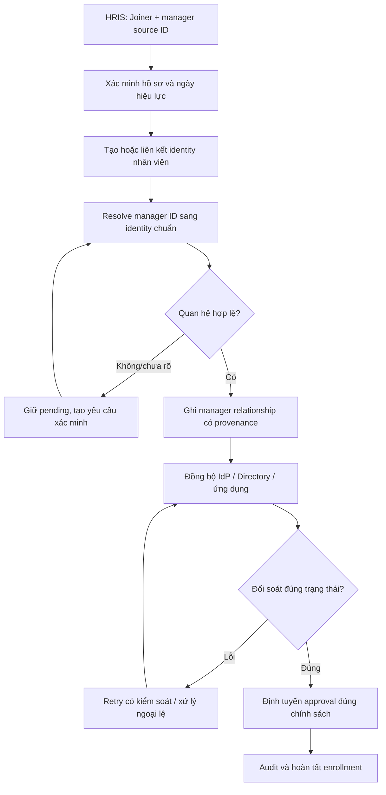
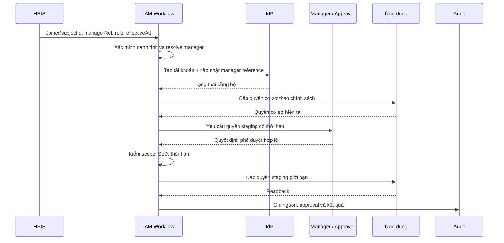

# Gán manager trong Identity Enrollment

Khi một nhân viên mới gia nhập tổ chức, hệ thống Identity and Access Management (IAM) không chỉ cần tạo tài khoản mà còn cần biết **ai chịu trách nhiệm quản lý công việc và xác nhận nhu cầu truy cập của nhân viên đó**. Trong nhiều doanh nghiệp, người quản lý trực tiếp là một mắt xích quan trọng khi phê duyệt quyền truy cập, rà soát định kỳ hoặc xác nhận thay đổi nhiệm vụ. Nếu gán sai manager, yêu cầu cấp quyền có thể đến nhầm người, quyền nhạy cảm có thể được phê duyệt thiếu thẩm quyền, hoặc danh tính đã chuyển bộ phận vẫn giữ quyền cũ.

**Gán manager (manager assignment)** trong **Identity Enrollment** là việc thiết lập, xác minh và duy trì **quan hệ giữa một danh tính với người quản lý hoặc chủ thể chịu trách nhiệm được chỉ định**. Quan hệ này được lưu bằng định danh ổn định và được dùng trong các quy trình quản trị danh tính, cấp quyền và vòng đời **Joiner–Mover–Leaver (JML)**.

Bài học tập trung vào **gán và quản lý quan hệ manager** trong hệ thống IAM. Nội dung liên hệ **nguồn nhân sự có thẩm quyền, IdP, SSO, SCIM, RBAC/ABAC, service account, quy trình phê duyệt, kiểm toán và giảm quyền truy cập tồn dư**.

## 1. Gán manager là gì?

Trong ngữ cảnh IAM, **manager** thường là người quản lý trực tiếp của một chủ thể trong cơ cấu tổ chức. Hệ thống có thể sử dụng quan hệ này để:

- Biết **ai xác nhận vai trò và nhu cầu công việc** khi một danh tính được đăng ký.
- Định tuyến **yêu cầu cấp quyền hoặc gia hạn quyền** đến đúng người.
- Chọn người tham gia **access review / access certification**.
- Xác định tuyến quản lý khi nhân viên **chuyển nhóm, đổi vai trò hoặc nghỉ việc**.
- Tìm người cần được thông báo khi có tài khoản hoặc quyền truy cập **không còn phù hợp**.
- Hỗ trợ cơ cấu tổ chức, truy vấn cấp quản lý và các quy trình nhân sự liên quan.

Một quan hệ đơn giản có thể biểu diễn:

```text
employee-105  --reportsTo-->  employee-019
      │                          │
   Nhân viên                Manager trực tiếp
```

Trong ví dụ này, `employee-019` là **định danh của manager**, không phải tên hiển thị hoặc email của manager.

**Lưu ý:** Việc xuất hiện trong trường `managerId` không tự động cấp cho manager mọi quyền trên tài khoản, dữ liệu hay hệ thống mà nhân viên sử dụng. Quyền phê duyệt hoặc quản trị phải được **chính sách phân quyền riêng** cho phép và kiểm tra tại thời điểm thao tác.

### 1.1. Quan hệ manager là thuộc tính có tham chiếu

Một số thuộc tính như `department` hoặc `jobTitle` chứa mã hoặc chuỗi mô tả. Ngược lại, `managerId` là thuộc tính **tham chiếu đến một danh tính khác**.

Điều này tạo ra một số yêu cầu bổ sung:

1. Danh tính manager phải tồn tại hoặc được xác định theo một quy trình hợp lệ.
2. Khóa tham chiếu cần **ổn định và có namespace rõ ràng**.
3. Hệ thống phải biết **nguồn có thẩm quyền** và thời điểm quan hệ có hiệu lực.
4. Quan hệ không được tạo chu kỳ trái chính sách, ví dụ A quản lý B đồng thời B quản lý A trong sơ đồ cấp trên trực tiếp.
5. Khi manager chuyển vị trí hoặc nghỉ việc, các quan hệ phụ thuộc cần được đánh giá lại.

### 1.2. Phân biệt manager với những vai trò trách nhiệm khác

| Khái niệm | Nhiệm vụ thường gặp | Có luôn trùng manager trực tiếp không? |
|---|---|---|
| **Line manager** | Quản lý công việc, nhân sự và xác nhận nhu cầu theo cơ cấu tổ chức. | Đây thường là giá trị của quan hệ `managerId`. |
| **Access approver** | Phê duyệt một loại quyền theo chính sách và phạm vi được giao. | Không. Quyền nhạy cảm có thể cần chủ dữ liệu hoặc bảo mật. |
| **Resource owner** | Chịu trách nhiệm về hệ thống hoặc tập dữ liệu được truy cập. | Không. Chủ ứng dụng có thể ở đơn vị khác. |
| **Identity sponsor** | Bảo trợ nhà thầu, đối tác hoặc khách bên ngoài. | Không nhất thiết có quan hệ quản lý nhân sự. |
| **Service account owner** | Chịu trách nhiệm cho danh tính workload/ứng dụng và vòng đời credential. | Thường là một nhóm kỹ thuật, không phải line manager. |
| **Delegate approver** | Xử lý yêu cầu thay người phê duyệt trong phạm vi, thời hạn được ủy quyền. | Là quan hệ ủy quyền riêng. |
| **Administrator** | Có đặc quyền quản trị tài khoản, hệ thống hoặc chính sách. | Manager không mặc nhiên là Administrator. |

Cần đặt tên dữ liệu rõ ràng: `lineManagerId`, `sponsorId`, `resourceOwnerId`, `approverId` hoặc `ownerTeamId` có ý nghĩa khác nhau. Không nên gộp tất cả vào một trường `manager` nếu nghiệp vụ có nhiều kiểu trách nhiệm.

## 2. Vì sao gán manager quan trọng trong IAM lifecycle?

Gán manager tưởng như chỉ là cập nhật hồ sơ nhân sự nhưng có thể ảnh hưởng đến quyền truy cập và kiểm soát bảo mật.

### 2.1. Joiner: đúng người xác nhận đúng quyền

Một nhân viên mới cần ứng dụng làm việc theo bộ phận. Nếu manager được lấy từ nguồn nhân sự đúng và cập nhật, yêu cầu có thể chuyển tới người có thẩm quyền xác nhận nhiệm vụ.

Nếu thông tin manager sai:

- Yêu cầu cấp quyền có thể bị gửi đến người không biết nhân viên.
- Các quyền cần thiết không được phê duyệt kịp thời.
- Quyền đặc biệt có thể được duyệt mà không có đánh giá phù hợp.
- Hồ sơ onboarding có thể không xác định được người chịu trách nhiệm khi có ngoại lệ.

### 2.2. Mover: thay đổi manager thường báo hiệu thay đổi ngữ cảnh quyền

Khi nhân viên chuyển nhóm, người quản lý mới có thể xác nhận nhu cầu truy cập hiện tại. Tuy nhiên thay đổi manager **không đồng nghĩa chắc chắn phải thay toàn bộ role**; chính sách cần xét cả bộ phận, chức danh, nhiệm vụ, dự án, phạm vi dữ liệu và các ngoại lệ.

Sai lầm phổ biến là chỉ sửa `managerId` nhưng không kiểm tra những quyền đã được cấp bởi người quản lý cũ. Một số quyền có thể cần thu hồi ngay; số khác được giữ trong thời gian bàn giao có kiểm soát.

### 2.3. Leaver: giảm quyền truy cập tồn dư

Khi nhân viên nghỉ việc, hệ thống cần thu hồi quyền theo thời điểm hiệu lực từ nguồn có thẩm quyền. Manager có thể nhận thông báo, giúp bàn giao tài nguyên và xác nhận ngoại lệ. Nhưng quy trình Leaver **không nên phụ thuộc hoàn toàn** vào việc manager nhấn nút duyệt mới có thể chặn truy cập, đặc biệt khi cần xử lý khẩn cấp.

Đối với manager rời đi, IAM phải rà soát **những nhân viên, nhà thầu hoặc tài khoản kỹ thuật đang trỏ tới họ** để tránh yêu cầu bị kẹt ở một người không còn hoạt động.

## 3. Dữ liệu cần có khi gán manager

Một quan hệ manager có thể gồm những trường sau:

| Trường | Ý nghĩa | Yêu cầu quản trị |
|---|---|---|
| `subjectId` | Danh tính được gán người quản lý. | Khóa nội bộ ổn định. |
| `managerId` | Danh tính người quản lý trực tiếp. | Khóa tham chiếu ổn định, tồn tại trong miền hợp lệ. |
| `relationshipType` | Loại quan hệ: trực tiếp, bảo trợ, quản lý dự án… | Được định nghĩa rõ; tránh hiểu nhầm quyền. |
| `sourceSystem` | Hệ thống có thẩm quyền phát hành quan hệ. | Ví dụ HRIS, hệ thống hợp đồng được chấp thuận. |
| `sourceRecordId` | Mã liên kết bản ghi ở nguồn. | Hỗ trợ đối soát và sửa sai. |
| `effectiveFrom` | Thời điểm quan hệ bắt đầu có hiệu lực. | Dùng để xử lý chuyển manager theo lịch. |
| `effectiveTo` | Thời điểm kết thúc quan hệ, nếu có. | Phục vụ chuyển vai trò và lưu lịch sử. |
| `observedAt` | Thời điểm IAM tiếp nhận hoặc ghi nhận. | Phân biệt thời điểm nhận với hiệu lực nghiệp vụ. |
| `verificationStatus` | Trạng thái đã xác minh nguồn/quan hệ. | Không xem dữ liệu tự khai là đã duyệt. |
| `changeEventId` | Mã sự kiện thay đổi. | Chống xử lý lặp và phục vụ audit. |

**Không phải mọi hệ thống đều cần lưu tất cả trường trong bảng trong cùng một bản ghi.** Đây là cấu trúc khái niệm để thiết kế, không phải schema chuẩn bắt buộc.

### 3.1. Dùng định danh ổn định thay cho email và tên

Tên manager có thể trùng; email có thể đổi khi chuyển miền hoặc đổi tên, và đôi khi được tái sử dụng. Nếu một tài khoản nghỉ việc rồi email cũ được cấp cho người khác, việc gán theo email có thể trỏ đến sai người.

Ví dụ tốt về mặt khái niệm:

```json
{
  "subjectId": "person-105",
  "managerId": "person-019",
  "sourceSystem": "workforce-directory",
  "sourceRecordId": "employment-105",
  "effectiveFrom": "2026-12-01T08:00:00+07:00",
  "relationshipType": "LINE_MANAGER"
}
```

Các mã ở trên là dữ liệu giả. Trong triển khai thật, cần xác định **namespace** của mỗi ID. Nếu HRIS dùng mã `019` và IdP cũng có `019`, hệ thống không được mặc nhiên cho rằng hai mã này chỉ cùng một người. Cần một bảng ánh xạ hoặc khóa danh tính thống nhất.

### 3.2. Giá trị manager có thể thay đổi theo thời gian

Gán manager có thể được nhập trước ngày nhân viên bắt đầu công việc; chuyển manager có thể được lập lịch trong tương lai; sự kiện thay đổi có thể đến trễ. Vì vậy cần phân biệt:

- **Effective time:** khi quan hệ bắt đầu đúng về nghiệp vụ.
- **Observed/received time:** khi IAM nhận được dữ liệu.
- **Processing time:** khi hệ thống xử lý hoặc đồng bộ.
- **Review time:** khi người có thẩm quyền kiểm tra quan hệ có còn đúng không.

Ví dụ, HRIS thông báo ngày 25/11 rằng nhân viên sẽ chuyển sang quản lý mới từ 01/12. Không nên cho manager mới phê duyệt toàn bộ quyền trước ngày hiệu lực chỉ vì hệ thống đã nhận thông báo, trừ khi quy trình cho phép chuẩn bị và phê duyệt trước được xác định rõ.

## 4. Nguồn có thẩm quyền và bước xác minh manager

Thông tin manager có thể đến từ nhiều nguồn:

- **Hệ thống nhân sự (HRIS):** quan hệ quản lý trực tiếp cho nhân viên.
- **Hệ thống quản lý nhà thầu:** sponsor hoặc người phụ trách nhà thầu.
- **Hệ thống dự án:** quản lý dự án hoặc người phê duyệt phạm vi dự án.
- **Service catalog:** owner team hoặc chủ thể chịu trách nhiệm cho service account.
- **Biểu mẫu onboarding:** yêu cầu gán, được kiểm tra và phê duyệt trước khi áp dụng.

Nguồn chuẩn phải được xác định **theo loại quan hệ**, không chỉ theo trường tên `manager`. Ví dụ HRIS có thể là nguồn chuẩn cho line manager nhưng không quyết định người duyệt quyền production của ứng dụng, vì quyền đó do chủ tài nguyên kiểm soát.

### 4.1. Không tin giá trị do người dùng tự khai để thay đổi luồng duyệt

Giả sử biểu mẫu đăng ký cho phép người dùng nhập email manager và hệ thống gửi mọi yêu cầu cấp quyền tới địa chỉ được nhập. Nếu không xác minh, người dùng có thể điền tài khoản do chính mình kiểm soát hoặc một người sẵn lòng phê duyệt, từ đó tạo đường cấp quyền trái chính sách.

Một quy trình an toàn hơn:

1. Nhận giá trị manager từ nguồn có thẩm quyền hoặc yêu cầu thay đổi có kiểm soát.
2. Kiểm tra manager có phải danh tính hợp lệ, đang hoạt động và thuộc phạm vi quản lý phù hợp.
3. Với thay đổi quan trọng, yêu cầu xác nhận từ bên có thẩm quyền độc lập.
4. Đánh dấu trạng thái xác minh trước khi dùng quan hệ để định tuyến phê duyệt nhạy cảm.
5. Ghi nguồn, sự kiện và thời điểm hiệu lực.

### 4.2. Kiểm tra manager trước khi chấp nhận quan hệ

| Kiểm tra | Vấn đề muốn tránh |
|---|---|
| Manager tồn tại trong registry được tin cậy. | Gán đến ID không có thật. |
| Manager có trạng thái phù hợp. | Gửi yêu cầu tới tài khoản đã nghỉ hoặc bị khóa. |
| Manager thuộc loại subject được phép. | Vô tình gán service account làm quản lý nhân sự. |
| Quan hệ nằm trong cơ cấu/phạm vi đã được xác minh. | Gán sang đơn vị không có thẩm quyền. |
| Không tự quản lý chính mình nếu chính sách cấm. | Tự phê duyệt, tạo vòng lặp. |
| Không có chu kỳ quản lý bất hợp lệ. | Lỗi truy vấn cấp trên, luồng duyệt vô hạn. |
| Ngày hiệu lực không mâu thuẫn với sự kiện mới hơn. | Ghi đè quan hệ hiện hành bằng sự kiện cũ. |
| Có cách xử lý khi manager chưa được tạo. | Onboarding bị treo hoặc gán placeholder sai. |

Các quy tắc phụ thuộc mô hình doanh nghiệp. Ví dụ lãnh đạo cao nhất có thể không có manager trực tiếp; `managerId=null` có thể là trạng thái hợp lệ theo quy định, thay vì tạo một tài khoản giả để vượt validation.

## 5. Quy trình gán manager trong Identity Enrollment

Một luồng cơ bản cho nhân viên mới có thể diễn ra như sau.

### Bước 1 — Nhận thông tin Joiner

Nguồn nhân sự gửi hồ sơ gia nhập, mã nhân viên, thời điểm bắt đầu, bộ phận và mã người quản lý dự kiến. Sự kiện cần có định danh nguồn và thông tin hiệu lực để có thể xử lý lại an toàn.

### Bước 2 — Kiểm tra identity của chủ thể

IAM xác minh hồ sơ gia nhập hợp lệ, kiểm tra trùng bản ghi và tạo hoặc liên kết danh tính của nhân viên. Nếu nguồn chưa đáp ứng mức bảo đảm cần thiết, trạng thái có thể tạm chờ. Việc manager đã được cung cấp **không thay thế** bước identity proofing.

### Bước 3 — Giải quyết định danh của manager

Hệ thống ánh xạ mã manager ở HRIS tới `subjectId` chuẩn trong identity registry. Nếu manager chưa có tài khoản IdP nhưng đã có hồ sơ nhân sự tin cậy, quan hệ có thể cần được giữ ở trạng thái chờ cho tới khi liên kết hoàn tất; không tự chọn người có tên giống nhất.

### Bước 4 — Kiểm tra chính sách quan hệ

Xác minh trạng thái manager, cấu trúc tổ chức, thời điểm hiệu lực và những điều kiện bổ sung theo chính sách. Kiểm tra lỗi tự tham chiếu, vòng lặp và yêu cầu phê duyệt thay đổi nếu có.

### Bước 5 — Ghi quan hệ vào hệ thống quản trị danh tính

Lưu bản ghi `subjectId → managerId` cùng nguồn, phiên bản, trạng thái và thời điểm hiệu lực. Nên phân biệt **quan hệ mong muốn** từ nguồn với **quan hệ thực tế** được lưu ở từng ứng dụng.

### Bước 6 — Đồng bộ tới IdP và hệ thống cần thiết

IdP hoặc directory có thể nhận thuộc tính manager qua API, connector hoặc quy trình provisioning. Ứng dụng nào cần quan hệ này phải được đăng ký và chỉ nhận trường cần thiết theo quyền được cấp.

### Bước 7 — Kích hoạt luồng phê duyệt phù hợp

Nếu chính sách yêu cầu manager xác nhận quyền truy cập, hệ thống định tuyến tới người có thẩm quyền, đồng thời kiểm tra phạm vi quyền và trường hợp cần resource owner/security approval.

### Bước 8 — Readback và kiểm toán

Đọc lại giá trị manager trong registry và những hệ thống đích quan trọng, đối chiếu với trạng thái mục tiêu, ghi kết quả và mở tác vụ khắc phục nếu đồng bộ thất bại. Khi mọi điều kiện cần thiết đều thỏa mãn, cập nhật trạng thái enrollment.

### 5.1. Sơ đồ luồng



Điều kiện “đúng trạng thái” cần được xác định theo hệ thống đích; một API trả về thành công có thể chỉ có nghĩa lệnh đã được chấp nhận và đang được xử lý bất đồng bộ.

## 6. Gán manager trong IdP, SSO và SCIM

### 6.1. IdP và directory giữ quan hệ nhưng không quyết định mọi quyền

**Identity Provider (IdP)** hoặc directory có thể lưu thuộc tính quản lý, chẳng hạn manager reference. Ứng dụng dùng thông tin này để hiển thị cơ cấu tổ chức hoặc định tuyến nghiệp vụ.

Tuy nhiên:

- Thông tin manager trong profile không bảo đảm đã được xác minh.
- Một số IdP/ứng dụng dùng các khóa khác nhau, cần ánh xạ đúng.
- Sửa trường manager ở IdP không mặc nhiên cập nhật nguồn nhân sự có thẩm quyền.
- Khả năng đọc/sửa thuộc tính manager phải được phân quyền; không để người dùng tự sửa nếu thuộc tính này chi phối quyền nhạy cảm.

### 6.2. SSO truyền claims theo chính sách

Với **Single Sign-On (SSO)**, ứng dụng có thể nhận các claims qua giao thức như SAML hoặc OpenID Connect (OIDC), nếu IdP được cấu hình phát hành. Có hệ thống gửi claim về manager, có hệ thống không.

Một claim được IdP ký hợp lệ **không đồng nghĩa manager đã được xác minh**. Hệ thống đích vẫn cần kiểm tra issuer, audience, thời hạn và nguồn/trạng thái của thuộc tính. Nếu ứng dụng dùng manager để phân quyền, phải xác định xử lý thế nào khi claim thiếu hoặc đã cũ.

**Không nên gửi email, số điện thoại hoặc toàn bộ sơ đồ nhân sự tới mọi ứng dụng chỉ vì hệ thống hỗ trợ SSO**. Chỉ phát hành thông tin cần thiết cho mục đích đã phê duyệt.

### 6.3. SCIM có thể mang tham chiếu manager

**System for Cross-domain Identity Management (SCIM)** chuẩn hóa một số thao tác quản lý đối tượng User và Group giữa hệ thống nguồn/cấp phát và hệ thống đích. Trong **SCIM Enterprise User extension**, thuộc tính `manager` có thể được biểu diễn như một tham chiếu người quản lý; các trường như `value`, `$ref` và `displayName` mang ý nghĩa khác nhau.

Ví dụ minh họa một đối tượng User với phần mở rộng Enterprise (lược bỏ nhiều thuộc tính khác):

```json
{
  "schemas": [
    "urn:ietf:params:scim:schemas:core:2.0:User",
    "urn:ietf:params:scim:schemas:extension:enterprise:2.0:User"
  ],
  "userName": "new.employee@example.invalid",
  "urn:ietf:params:scim:schemas:extension:enterprise:2.0:User": {
    "manager": {
      "value": "scim-user-019",
      "displayName": "Manager Example"
    }
  }
}
```

Đây là **payload minh họa**, cần kiểm tra đặc tả và khả năng thực tế của từng SCIM provider/server trước khi dùng. Đặc biệt:

- Giá trị `manager.value` được hiểu theo danh tính của **đối tượng quản lý trong hệ thống SCIM liên quan**; không tự giả định trùng `managerId` của HRIS.
- Manager có thể cần được provision trước khi tham chiếu được giải quyết.
- Các sản phẩm có thể hỗ trợ một phần hoặc không hỗ trợ đồng bộ manager.
- `displayName` là tên mô tả, không nên là khóa để kiểm soát quyền.
- SCIM chỉ giúp đồng bộ đối tượng; **không tự xác nhận manager có quyền phê duyệt yêu cầu hoặc thu hồi phiên truy cập**.

Đối với một hệ thống đích không hỗ trợ tham chiếu manager, IAM có thể cần connector riêng, chỉ đồng bộ một giá trị phù hợp hoặc không gửi dữ liệu manager nếu ứng dụng không cần.

### 6.4. Gán manager khác với cấp quyền

**RBAC (Role-Based Access Control)** định nghĩa quyền theo vai trò, còn **ABAC (Attribute-Based Access Control)** có thể sử dụng thuộc tính và ngữ cảnh. Manager là một **quan hệ thuộc tính** có thể tham gia quyết định, ví dụ:

- Manager của một đơn vị được xem trạng thái phê duyệt truy cập của nhân viên trực thuộc.
- Manager được đề xuất là một approver cho quyền chuẩn nhưng không được tự gán quyền quản trị cấp cao.
- Manager của một dự án chỉ được xem yêu cầu liên quan đến dự án đó.

Cần phân biệt quan hệ `reportsTo` với quyền `canApproveAccess`; việc hệ thống tìm ra manager mới chỉ là **một đầu vào** cho quyết định cho phép thao tác.

## 7. Cách manager tham gia quy trình phê duyệt quyền

Không phải yêu cầu nào cũng cần manager duyệt, và manager không phải người duy nhất có thẩm quyền.

| Loại yêu cầu | Người có thể tham gia xét duyệt | Kiểm soát bổ sung |
|---|---|---|
| Quyền làm việc cơ bản theo vai trò | Chính sách tự động hoặc manager xác nhận theo quy trình. | Đối chiếu trạng thái công tác và role mục tiêu. |
| Quyền truy cập dữ liệu nhạy cảm | Manager + data/resource owner theo chính sách. | Phạm vi dữ liệu, mục đích, thời hạn và audit. |
| Quyền Administrator / production | Chủ hệ thống, nhóm bảo mật hoặc approver độc lập phù hợp. | SoD, PAM/JIT, MFA, giới hạn phiên và thời gian. |
| Quyền dự án của nhà thầu | Sponsor nội bộ + chủ dự án/tài nguyên. | Ngày hết hạn hợp đồng, phạm vi và owner. |
| Quyền workload/service account | Service owner + resource owner hoặc nhóm bảo mật. | Workload attestation, secret/token lifecycle. |
| Gia hạn quyền tạm thời | Người có thẩm quyền tại thời điểm gia hạn. | Kiểm tra lại nhu cầu và kết quả sử dụng. |

### 7.1. Chính sách phê duyệt dựa trên quan hệ manager

Giả sử nhân viên thuộc bộ phận Finance cần xem báo cáo nội bộ. Chính sách có thể yêu cầu:

1. Identity đang hoạt động và thuộc đơn vị Finance từ nguồn có thẩm quyền.
2. Yêu cầu có mục đích rõ và tài nguyên hợp lệ.
3. Approver là manager hiện hành **hoặc người được ủy quyền hợp lệ**.
4. Người phê duyệt không phải chính người yêu cầu trong trường hợp SoD cấm.
5. Nếu quyền vượt ngưỡng nhạy cảm, cần resource owner duyệt bổ sung.
6. Mọi phê duyệt gắn với quyền, phạm vi, thời điểm và chính sách cụ thể.

Một mẫu logic khái niệm:

```text
canApprove(request, approver) =
    request.isPending
    AND approver.isActive
    AND approver.hasApprovalAuthorityFor(request.resource, request.action)
    AND (
         approver.id == currentManager(request.subjectId)
         OR validDelegationExists(approver, request)
    )
    AND NOT violatesSeparationOfDuties(approver, request)
```

**Đây là pseudocode**, không phải biểu thức chính sách có thể sao chép trực tiếp vào một IAM product. Các điều kiện bổ sung có thể gồm mức nhạy cảm, thời điểm hiệu lực, nguồn tin cậy, người sở hữu tài nguyên và hiệu lực phiên.

### 7.2. Tránh tự phê duyệt và vòng phê duyệt

Một số lỗi phổ biến:

- Nhân viên được phép tự đổi `managerId` thành chính mình.
- Manager của một nhóm có thể phê duyệt quyền đặc biệt cho chính họ mà không có kiểm soát bổ sung.
- Hệ thống tìm manager theo chuỗi quan hệ nhưng gặp chu kỳ A → B → A.
- Một yêu cầu được định tuyến tới manager đã nghỉ việc nhưng không có phương án thay thế.
- Quyền đã được duyệt từ tháng trước vẫn được cấp sau khi manager và nhiệm vụ của nhân viên thay đổi.

Cần kiểm tra **quyền phê duyệt ở thời điểm quyết định**, không chỉ khi tạo yêu cầu. Với yêu cầu chờ lâu, có thể phải xác nhận lại manager hiện hành, trạng thái người yêu cầu và chính sách áp dụng trước khi cấp quyền.

### 7.3. Ủy quyền khi manager vắng mặt

Manager có thể nghỉ phép hoặc không thể xử lý yêu cầu. Tổ chức có thể cung cấp **approval delegation** cho một người khác, với:

- Danh tính người ủy quyền và người được ủy quyền.
- Phạm vi loại yêu cầu/tài nguyên được duyệt.
- Thời gian bắt đầu và kết thúc.
- Các điều kiện SoD; quyền nhạy cảm có thể cấm hoặc giới hạn ủy quyền.
- Nhật ký cho biết **ai thực sự phê duyệt** và cơ sở ủy quyền.

Không nên ghi đè `managerId` chỉ để xử lý nghỉ phép nếu quan hệ quản lý nhân sự không thay đổi. Quan hệ quản lý và ủy quyền phê duyệt là hai dữ liệu khác nhau.

## 8. Gán manager trong vòng đời Joiner–Mover–Leaver

### 8.1. Joiner: quan hệ đúng ngay lúc onboarding

Trình tự gợi ý:

1. Xác minh nhân viên/nhà thầu từ nguồn có thẩm quyền.
2. Giải quyết danh tính manager hoặc sponsor.
3. Kiểm tra quan hệ hợp lệ, thời gian hiệu lực và loại quan hệ.
4. Thiết lập quan hệ trong identity registry.
5. Đồng bộ đến các hệ thống cần dùng.
6. Định tuyến phê duyệt quyền theo chính sách, không cấp quyền quá rộng do manager tự khai.
7. Đọc lại trạng thái và lưu bằng chứng.

Nếu manager chưa có trong IdP vì quy trình đồng bộ đang chậm, identity có thể tạm ở trạng thái `PENDING_MANAGER_RESOLUTION` theo thiết kế nội bộ. Chỉ nên cấp những quyền được phép cấp độc lập với việc manager đã xác minh; quyền nhạy cảm có thể phải chờ.

### 8.2. Mover: thay manager cùng với thay đổi vai trò

Ví dụ Lan chuyển từ nhóm Support sang nhóm Finance vào ngày 01/12:

| Trường | Trước chuyển đổi | Sau chuyển đổi |
|---|---|---|
| `subjectId` | `person-lan` | `person-lan` |
| `department` | `support` | `finance` |
| `managerId` | `person-manager-A` | `person-manager-B` |
| Vai trò nghiệp vụ | `support-agent` | `finance-analyst` |
| Quyền mục tiêu | Xem phiếu hỗ trợ | Xem báo cáo tài chính được phép |

Khi Mover, hệ thống nên:

- Nhận thay đổi từ HRIS theo đúng thời điểm hiệu lực.
- Cập nhật quan hệ manager, đồng thời xử lý tập thuộc tính vai trò và phòng ban.
- Tính lại quyền mục tiêu, cấp quyền mới theo chính sách.
- **Thu hồi quyền cũ không còn phù hợp**, kể cả quyền được phê duyệt trước đây bởi manager A.
- Rà soát yêu cầu đang chờ: chuyển tới approver hiện hành hoặc xử lý theo quy tắc doanh nghiệp.
- Kiểm tra ngoại lệ bàn giao có owner, phạm vi và thời hạn.
- Đối soát quyền hiệu lực tại các ứng dụng.

Thay manager **không đồng nghĩa tự động hủy mọi quyền được manager cũ phê duyệt**. Việc thu hồi phải dựa trên **trạng thái nhiệm vụ, thuộc tính, thời gian và chính sách hiện hành**, tránh gây gián đoạn không cần thiết.

### 8.3. Leaver: khi nhân viên hoặc manager nghỉ việc

**Trường hợp nhân viên rời tổ chức:**

- Chặn truy cập theo thời điểm hiệu lực từ nguồn có thẩm quyền.
- Thu hồi role, group, account, phiên và credential liên quan.
- Thông báo manager hoặc người chịu trách nhiệm bàn giao theo chính sách.
- Lưu bằng chứng xử lý và giải quyết tài nguyên mà nhân viên sở hữu.
- Giữ hoặc kết thúc quan hệ manager trong hồ sơ lịch sử tùy chính sách; dữ liệu lịch sử **không được dùng để tiếp tục cấp quyền**.

**Trường hợp manager rời tổ chức:**

- Thu hồi truy cập cá nhân và quyền phê duyệt của manager.
- Tìm những danh tính đang trỏ tới người đó trong quan hệ quản lý.
- Nhận manager thay thế từ nguồn có thẩm quyền, hoặc đưa vào hàng đợi xử lý chưa xác định.
- Chuyển hoặc xử lý lại các yêu cầu chờ duyệt theo chính sách; không tự chuyển quyền phê duyệt cho người bất kỳ.
- Xác minh hệ thống đích đã cập nhật và không còn gửi yêu cầu tới tài khoản không hoạt động.

### 8.4. Manager thay đổi trạng thái tạm thời

Manager có thể nghỉ dài ngày, tạm khóa tài khoản hoặc bị hạn chế quyền vì sự cố. Quan hệ nhân sự có thể vẫn đúng, nhưng **khả năng phê duyệt** cần được quyết định theo trạng thái tài khoản, ủy quyền hợp lệ và chính sách an toàn. Không nên xóa lịch sử quan hệ chỉ vì người quản lý vắng mặt tạm thời.

## 9. Tình huống đặc biệt: nhà thầu, đối tác và service account

### 9.1. Nhà thầu và đối tác

Nhà thầu thường cần **sponsor nội bộ** chịu trách nhiệm về mục đích truy cập và ngày hết hạn; sponsor không nhất thiết là line manager của họ theo hợp đồng.

Ví dụ:

```yaml
identityId: contractor-246
identityType: EXTERNAL_CONTRACTOR
sponsorId: person-019
projectId: migration-project
contractEndAt: "2027-02-28"
accessReviewDate: "2027-01-31"
```

YAML này là ví dụ mô hình dữ liệu. Nếu tổ chức sử dụng trường `managerId` cho nhà thầu, phải ghi rõ đó là **sponsor relationship** hay một kiểu quản lý khác, để quy trình phê duyệt không ngầm hiểu rằng sponsor có mọi quyền như người quản lý nhân sự.

Khi sponsor nghỉ việc, hệ thống phải gán người bảo trợ mới bằng quy trình có thẩm quyền hoặc hạn chế quyền của nhà thầu cho đến khi được xử lý theo chính sách rủi ro.

### 9.2. Service account và machine identity

Một dịch vụ như `inventory-sync` không có manager nhân sự trực tiếp. Nó cần **owner team**, người chịu trách nhiệm kỹ thuật, ứng dụng liên kết, mục đích và vòng đời credential.

| Trường quản trị | Ví dụ | Lý do |
|---|---|---|
| `workloadId` | `inventory-sync-prod` | Nhận diện công việc được phép chạy. |
| `ownerTeamId` | `platform-inventory` | Có đội chịu trách nhiệm vận hành. |
| `technicalContactId` | `person-081` | Điểm liên hệ cho sự cố/đối soát. |
| `resourceOwnerId` | `team-data-services` | Người có thẩm quyền duyệt tài nguyên truy cập. |
| `reviewAfter` | `2027-02-01` | Rà soát quyền và credential đúng kỳ. |

Không nên gán tùy tiện một người dùng cá nhân vào `managerId` của service account rồi xem đó là toàn bộ quản trị. Khi nhân viên chủ sở hữu rời đi, dịch vụ hợp lệ có thể tiếp tục hoạt động nếu ownership và quyền được bàn giao đúng.

## 10. Thiết kế dữ liệu và kiểm tra lỗi tham chiếu

### 10.1. Một quan hệ có thể quản lý bằng bản ghi riêng

Trong các hệ thống cần lưu lịch sử, quan hệ manager có thể là một đối tượng độc lập:

```json
{
  "relationshipId": "rel-811",
  "subjectId": "person-105",
  "relatedSubjectId": "person-019",
  "relationshipType": "LINE_MANAGER",
  "sourceSystem": "workforce-directory",
  "sourceEventId": "hr-change-811",
  "effectiveFrom": "2026-12-01T08:00:00+07:00",
  "effectiveTo": null,
  "status": "VERIFIED"
}
```

Đây là schema tự minh họa; việc lưu thuộc tính đơn giản trong bảng User hay thiết kế thành bảng quan hệ riêng đều có thể hợp lý tùy yêu cầu. Với mỗi `subjectId`, cần xác định có cho phép **một hay nhiều manager cùng thời điểm**. Nếu nhiều loại trách nhiệm tồn tại song song, nên lưu riêng theo `relationshipType` và quy tắc rõ ràng.

### 10.2. Kiểm tra chu kỳ quản lý

Giả sử có:

```text
A → B
B → C
C → A
```

Nếu biểu diễn mũi tên là “được quản lý bởi”, chuỗi trên tạo một chu kỳ không hợp lệ trong mô hình quản lý trực tiếp dạng cây. Nó có thể gây vòng lặp khi ứng dụng tìm cấp trên để duyệt hoặc báo cáo.

Để tránh lỗi, khi chấp nhận thay đổi `A → B`:

1. Kiểm tra `A != B`.
2. Đi theo chuỗi manager hiện hành từ B lên cấp trên.
3. Nếu gặp A, từ chối hoặc chuyển xử lý theo quy trình.
4. Đặt giới hạn truy vấn để tránh lặp vô hạn khi dữ liệu đang sai.
5. Lưu nhật ký điều kiện vi phạm.

Với **ma trận quản lý** hoặc các vai trò quản lý dự án song song, không nên áp đặt quy tắc cây một cách cứng nhắc cho toàn bộ quan hệ. Quy tắc chu kỳ phải áp dụng đúng **loại quan hệ và use case**.

### 10.3. Manager chưa được provision

Trong onboarding hàng loạt, hồ sơ manager có thể đến sau hồ sơ nhân viên. Đây là vấn đề thứ tự đồng bộ, không nên giải quyết bằng việc gán một “manager mặc định” không có thẩm quyền.

Các phương án gồm:

- Resolve danh tính manager bằng registry từ nguồn trước khi provision ứng dụng.
- Đưa tác vụ đồng bộ manager vào hàng đợi và retry khi manager xuất hiện.
- Cho phép ứng dụng dùng trạng thái `PENDING` nếu tương thích.
- Thiết lập SLA và cảnh báo cho quan hệ chưa giải quyết.
- Hạn chế phê duyệt quyền nhạy cảm khi manager chưa được xác minh, theo chính sách.

### 10.4. Idempotency và sự kiện sai thứ tự

Một sự kiện HRIS có thể được gửi hai lần hoặc đến sai thứ tự. Nếu hệ thống dùng “lần nhận gần nhất thắng”, sự kiện cũ có thể ghi đè manager mới.

Nên sử dụng:

- Mã sự kiện duy nhất cho deduplication.
- Thời điểm hiệu lực/phiên bản từ nguồn có thẩm quyền.
- So sánh trạng thái nguồn hiện hành trước khi cập nhật.
- Quy tắc xử lý sự kiện lỗi thời.
- Readback sau khi ghi.
- Retry có giới hạn và hàng đợi xử lý ngoại lệ.

Ví dụ một bản tin Mover cũ đến sau Leaver **không được tự kích hoạt lại tài khoản** chỉ vì có một manager hợp lệ trong bản tin đó.

## 11. Ví dụ workflow cụ thể với phê duyệt và đối soát

Giả sử nhân viên Minh gia nhập nhóm kỹ thuật. HRIS cung cấp `subjectId=person-105`, `managerId=person-019` và role `developer`. Minh cần quyền đọc repository và một quyền tạm thời truy cập staging.



Ở đây, manager có thể được định tuyến để xác nhận **nhu cầu**. Nhưng quyền staging vẫn phải qua kiểm tra của policy; một số hệ thống có thể yêu cầu thêm resource owner hoặc security approval. Manager không thể tự động bỏ qua các quy tắc này.

### 11.1. Mover sau ba tháng

Minh chuyển sang nhóm Data với manager mới `person-044`. IAM nhận sự kiện có hiệu lực từ nguồn nhân sự:

- Cập nhật manager hiện hành theo thời điểm chính xác.
- Rà soát yêu cầu chờ duyệt đang gửi tới manager cũ.
- Tính quyền mới dựa trên nhiệm vụ Data.
- Thu hồi quyền staging cũ nếu không còn cần.
- Nếu quyền đặc biệt còn hiệu lực nhờ ngoại lệ bàn giao, yêu cầu owner/phê duyệt và ngày hết hạn.
- Readback quan hệ manager và quyền thực tế ở IdP/ứng dụng.

Nếu chỉ sửa manager reference mà giữ toàn bộ quyền repository và staging cũ, hệ thống đã bỏ sót nhiệm vụ **giảm quyền truy cập tồn dư**.

### 11.2. Leaver của manager mới

Sau đó `person-044` rời tổ chức. Quy trình Leaver khóa quyền truy cập của manager, đồng thời nguồn HRIS cung cấp người quản lý thay thế hoặc tạo yêu cầu xác định. Các phê duyệt đang chờ phải được định tuyến theo đúng quy tắc có hiệu lực, kèm audit, và không để một tài khoản đã bị vô hiệu hóa tiếp tục làm người phê duyệt hợp lệ.

## 12. Kiểm toán và quản trị thay đổi manager

Thông tin manager có thể tham gia **quyết định quyền**, nên phải được bảo vệ gần như những thuộc tính quan trọng khác của IAM.

### 12.1. Bản ghi audit nên chứa gì?

| Nhóm dữ liệu | Ví dụ | Mục đích |
|---|---|---|
| Đối tượng thay đổi | `subjectId` và loại quan hệ. | Biết ai bị ảnh hưởng. |
| Giá trị trước/sau | `oldManagerId` → `newManagerId`. | Truy vết thay đổi. |
| Nguồn và actor | HRIS event / người phê duyệt sửa ngoại lệ. | Xác định thẩm quyền. |
| Thời điểm | Received, effective, applied. | Giải thích độ trễ và thứ tự. |
| Quyết định kiểm tra | PASS/REJECTED/PENDING và lý do. | Giải thích vì sao thay đổi hợp lệ. |
| Hệ thống đích | IdP, ứng dụng, workflow phê duyệt. | Biết nơi cần đồng bộ. |
| Kết quả readback | Khớp/không khớp, thời điểm xác minh. | Chứng minh trạng thái thực tế. |
| Yêu cầu liên quan | Access request, review, delegation. | Kiểm tra ảnh hưởng đến quyền. |

Không nên lưu mật khẩu, access token hay bí mật nhân sự trong nhật ký chỉ để chứng minh có thay manager. Giới hạn quyền đọc audit vì dữ liệu về quan hệ tổ chức cũng có thể là thông tin nội bộ nhạy cảm.

### 12.2. Chỉ số vận hành

- **Manager resolution rate:** tỷ lệ hồ sơ cần manager đã ánh xạ thành công tới identity hợp lệ.
- **Stale manager references:** số quan hệ trỏ tới manager không còn hoạt động hoặc đã thay đổi tại nguồn.
- **Approval routing error rate:** yêu cầu được gửi sai người hoặc không có approver hợp lệ.
- **Manager update latency:** độ trễ từ thời điểm quan hệ có hiệu lực đến lúc các hệ thống cần dùng đã cập nhật.
- **Unresolved ownership cases:** số nhà thầu/danh tính kỹ thuật thiếu sponsor hoặc owner theo chính sách.
- **Access recertification backlog:** yêu cầu rà soát quyền chưa có người chịu trách nhiệm hoặc quá hạn.
- **Post-Mover entitlement drift:** quyền cũ còn tồn tại sau Mover và đã qua thời gian bàn giao được duyệt.

Một tỷ lệ đồng bộ manager thành công cao **không chứng minh toàn bộ quyền truy cập đúng**. Cần kết hợp chỉ số về quyền mục tiêu, quyền thực tế và thời gian thu hồi.

## 13. Những sai lầm thường gặp

| Sai lầm | Rủi ro | Hướng xử lý |
|---|---|---|
| Gán manager chỉ bằng tên hiển thị hoặc email. | Gán nhầm khi trùng tên, đổi địa chỉ hoặc email tái sử dụng. | Sử dụng khóa ID ổn định, ánh xạ namespace rõ ràng. |
| Cho nhân viên tự nhập manager để duyệt quyền nhạy cảm. | Có thể chọn người phê duyệt không đủ thẩm quyền. | Lấy từ nguồn chuẩn, xác minh và kiểm tra quyền approver. |
| Cho manager quyền Administrator mặc định. | Vượt phạm vi least privilege. | Tách quan hệ quản lý và role quản trị. |
| Dùng manager làm người duyệt duy nhất cho mọi quyền. | Không bảo đảm chủ tài nguyên hoặc SoD. | Routing theo loại quyền, mức nhạy cảm và authority. |
| Không xử lý manager nghỉ việc. | Yêu cầu duyệt bị treo, owner không hợp lệ. | Reassignment từ nguồn chuẩn, delegation/fallback có kiểm soát. |
| Manager thay đổi nhưng quyền cũ không được rà soát. | Tồn dư quyền sau Mover. | Tính lại quyền mục tiêu và đối soát thực tế. |
| Ghi đè quan hệ cũ khi nhận sự kiện đến trễ. | Workflow dùng thông tin manager đã hết hiệu lực. | Versioning, thời điểm hiệu lực, kiểm tra nguồn mới nhất. |
| Không kiểm tra chu kỳ quản lý. | Luồng xét duyệt và tra cứu cấp trên bị lặp. | Kiểm tra self-reference/cycle theo loại quan hệ. |
| Đợi manager duyệt mới khóa Leaver khẩn cấp. | Tài khoản rời tổ chức vẫn có thể truy cập. | Chặn truy cập đúng thời điểm theo nguồn và quy trình khẩn cấp. |
| Tin API trả thành công là đã đồng bộ xong. | Ứng dụng đích còn manager hoặc quyền cũ. | Readback, reconciliation, retry và xử lý ngoại lệ. |
| Gán manager nhân sự cho mọi service account. | Không xác định đúng trách nhiệm workload. | Dùng owner team, resource owner và service catalog. |
| Trộn manager với người được ủy quyền khi nghỉ phép. | Làm sai sơ đồ tổ chức và lịch sử quan hệ. | Quản lý delegation riêng, có scope và thời hạn. |

## 14. Bài tập tình huống

### Tình huống A — Manager trong biểu mẫu đăng ký

Một ứng dụng cho nhân viên mới tự nhập email người quản lý. Mọi quyền đọc dữ liệu tài chính được chấp thuận nếu địa chỉ email đó trả lời “Approve”.

**Câu hỏi:** Điều gì thiếu trong quy trình identity enrollment?

**Gợi ý:** thiếu xác minh manager từ nguồn có thẩm quyền, kiểm tra tư cách người phê duyệt theo tài nguyên, tính toàn vẹn quan hệ và các bước kiểm soát quyền nhạy cảm. Xác nhận qua email đơn thuần không chứng minh thẩm quyền.

### Tình huống B — Manager chuyển nhóm

Một nhân viên chuyển từ Support sang Finance và được gán manager mới, nhưng hệ thống chỉ cập nhật profile. Nhân viên vẫn có quyền quản lý phiếu hỗ trợ của nhóm cũ.

**Câu hỏi:** Gán manager đã hoàn tất chưa? Còn bước IAM lifecycle nào?

**Gợi ý:** manager reference có thể đã được ghi đúng nhưng **Mover chưa hoàn tất** vì quyền cũ chưa được đánh giá/thu hồi. Cần đối soát role, group, account và quyền thực tế.

### Tình huống C — Manager rời tổ chức

Một manager đã nghỉ việc nhưng 18 yêu cầu cấp quyền vẫn chờ phê duyệt trong hệ thống workflow. Nhân viên không thể tiếp tục công việc.

**Câu hỏi:** Có nên tự gán tất cả yêu cầu cho người cùng phòng ban gần nhất?

**Gợi ý:** không nên tự suy ra approver. Cần lấy manager/sponsor thay thế từ nguồn chuẩn hoặc cơ chế delegation/fallback có thẩm quyền, kiểm tra trạng thái yêu cầu và lưu audit.

### Tình huống D — Tham chiếu SCIM không khớp

HRIS ghi manager ID là `EMP-019`, trong khi SCIM của ứng dụng đích gán ID manager là `scim-user-77`. Đồng bộ thất bại vì gửi trực tiếp `EMP-019`.

**Câu hỏi:** Cần sửa gì?

**Gợi ý:** giải quyết ánh xạ từ định danh HRIS → identity nội bộ → ID của đối tượng SCIM đích; xác minh manager đã tồn tại ở hệ thống đích. Không dùng tên hiển thị để vá nhanh.

## 15. Checklist triển khai gán manager

Trước khi đưa quy trình vào sử dụng, nên kiểm tra:

1. Đã xác định rõ **loại quan hệ manager** và mục đích sử dụng chưa?
2. Nguồn có thẩm quyền có được chọn đúng theo từng loại nhân viên, nhà thầu và workload không?
3. `subjectId` và `managerId` có ổn định, không trùng namespace và ánh xạ được không?
4. Có kiểm tra manager tồn tại, đang hoạt động và đủ điều kiện theo chính sách không?
5. Có xử lý manager chưa provision, hồ sơ thiếu hoặc mâu thuẫn mà không tạo dữ liệu giả không?
6. Có phát hiện tự tham chiếu và vòng lặp quản lý không?
7. Có lưu thời điểm hiệu lực, nguồn, sự kiện và trạng thái xác minh không?
8. Quan hệ manager có được tách khỏi quyền Administrator, resource owner và delegate approver không?
9. Luồng phê duyệt có kiểm tra **authority, SoD, scope, thời hạn và trạng thái hiện tại** không?
10. Mover có cập nhật cả manager lẫn quyền mục tiêu và thu hồi quyền cũ không?
11. Leaver của manager có xử lý người đang trực thuộc và yêu cầu chờ không?
12. Trường hợp contractor và service account có sponsor/owner đúng loại không?
13. SCIM/IdP và ứng dụng đã ánh xạ đúng ID, schema và khả năng hỗ trợ chưa?
14. Có **readback, reconciliation, retry và audit** sau thay đổi không?
15. Có giới hạn dữ liệu manager đưa vào SSO claims và những ứng dụng không cần không?

## Kết luận

**Gán manager trong Identity Enrollment** là việc tạo và duy trì một **quan hệ có thể kiểm chứng giữa danh tính và người quản lý hoặc chủ thể chịu trách nhiệm**, dựa trên nguồn dữ liệu có thẩm quyền, ID ổn định và thời điểm hiệu lực rõ ràng. Quan hệ này hỗ trợ định tuyến phê duyệt, rà soát quyền và quản lý **Joiner–Mover–Leaver**, nhưng **không tự động cấp quyền Administrator hoặc bảo đảm quyền truy cập đã đúng**.

Để thực thi an toàn, IAM cần phân biệt **line manager, sponsor, resource owner, approver và service owner**; kiểm tra quan hệ hợp lệ và quyền phê duyệt; đồng bộ tới **IdP/SCIM/ứng dụng** theo schema thực tế; chỉ chia sẻ thuộc tính qua **SSO** khi cần thiết; tính quyền mục tiêu theo **RBAC/ABAC**; và thực hiện **đối soát cùng kiểm toán** sau mỗi thay đổi. Khi nhân viên hoặc manager chuyển nhiệm vụ hay rời tổ chức, quan hệ cần được cập nhật cùng quy trình cấp và thu hồi quyền để hạn chế **quyền truy cập tồn dư**.
