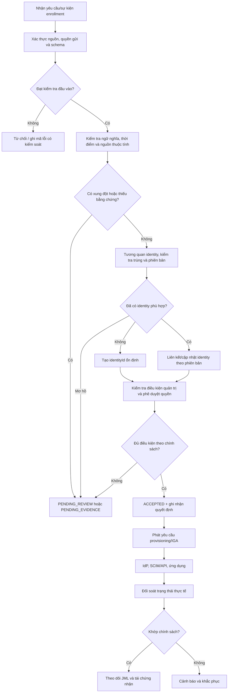

# Kiểm tra dữ liệu enrollment trong Identity Lifecycle Management

## 1. Vì sao enrollment phải được kiểm tra dữ liệu?

**Identity enrollment** là quá trình đăng ký, tiếp nhận và thiết lập một bản ghi danh tính để chủ thể có thể được quản lý trong hệ thống IAM. Đầu vào có thể đến từ HRIS, hệ thống quản lý đối tác, biểu mẫu onboarding, quy trình identity proofing, service registry hoặc hệ thống quản lý tài khoản. **Kiểm tra dữ liệu enrollment** (*enrollment data validation*) là tập hợp những điều kiện xác định đầu vào có đủ **đúng định dạng, đúng ngữ nghĩa, đúng thẩm quyền, nhất quán và an toàn** để tạo hoặc liên kết một danh tính hay chưa.

Giả sử HRIS phát sự kiện nhân viên mới với email `mai.nguyen@example.org`, phòng ban `Finance` và ngày bắt đầu. Nếu hệ thống IAM chỉ kiểm tra trường email không rỗng rồi tạo tài khoản và nhóm `finance-admin`, một thông tin sai nguồn hoặc sự kiện trùng có thể dẫn đến **cấp quyền sai người hoặc sai thời điểm**. Ngay cả khi thông tin đến từ HRIS, IAM vẫn cần kiểm tra khóa định danh, trạng thái nhân sự, hiệu lực, phiên bản sự kiện, trùng lặp và quy tắc phê duyệt quyền.

Trong module **SECURITY_IDENTITY_ACCESS_MANAGEMENT_IDENTITY_LIFECYCLE**, chủ đề này là một kiểm soát đầu vào thiết yếu của mô hình **Joiner–Mover–Leaver (JML)**: xác minh chủ thể, tạo hoặc liên kết tài khoản, cấp quyền, rà soát thay đổi vai trò và thu hồi truy cập. Các kết quả validation sau đó ảnh hưởng đến **IdP, SSO, SCIM, RBAC/ABAC, tài khoản dịch vụ, kiểm toán và việc hạn chế quyền truy cập tồn dư**.

Cần nhớ ba nguyên tắc:

1. **“Dữ liệu hợp lệ” không đồng nghĩa “danh tính đã được xác minh”.** Một JSON đúng schema không chứng minh người đăng ký có danh tính thật.
2. **“Danh tính đã được xác minh” không đồng nghĩa “được phép truy cập”.** Quyền truy cập phải được đánh giá và phê duyệt riêng.
3. **“Provisioning thành công” không đồng nghĩa “trạng thái thực tế đúng”.** IAM phải kiểm tra các hệ thống đích và xử lý sai lệch sau khi cấp phát.

Sau bài này, người học có thể xây dựng hợp đồng dữ liệu enrollment; thiết kế các lớp kiểm tra; xử lý trùng, xung đột và sự kiện đến sai thứ tự; xác định khi nào từ chối, chờ kiểm tra thủ công hoặc chấp nhận; và liên hệ kết quả với JML cùng việc quản trị tài khoản thực tế.

## 2. Enrollment nhận dữ liệu gì và từ đâu?

Một luồng enrollment không phải lúc nào cũng do người dùng tự điền biểu mẫu. Có thể là sự kiện hệ thống hoặc bản ghi do người quản lý phê duyệt.

| Chủ thể / tình huống | Nguồn thường gặp | Dữ liệu cốt lõi | Điều đặc biệt cần kiểm tra |
| --- | --- | --- | --- |
| Nhân viên mới | HRIS | Khóa nhân sự, trạng thái, thời điểm bắt đầu, đơn vị, quản lý | Thẩm quyền HRIS, ngày hiệu lực, trùng hồ sơ, bộ phận có hợp lệ |
| Nhà thầu | Vendor/contract management, sponsor | Khóa đối tác, hợp đồng, thời hạn, người bảo trợ | Hợp đồng còn hiệu lực, sponsor đủ thẩm quyền, không vượt hạn truy cập |
| Guest B2B | Portal mời, danh mục đối tác, IdP ngoài | Khóa guest, tổ chức đối tác, issuer/subject, lời mời | Quan hệ tin cậy, đối chiếu chủ thể, giới hạn phạm vi đối tác |
| Khách hàng B2C | CIAM/đăng ký tài khoản | ID đăng ký, thông tin liên hệ cần thiết, kết quả xác minh theo chính sách | Tránh gộp nhầm, hạn chế thu thập dữ liệu, chống tạo tài khoản hàng loạt |
| Service account | Service registry, hệ thống yêu cầu IAM | Service ID, owner, mục đích, môi trường, hạn rà soát | Owner còn hiệu lực, dịch vụ tồn tại, loại credential và phạm vi quyền |
| Workload identity | Cloud/workload platform, CI/CD | Workload ID, issuer, audience, môi trường, service owner | Trust boundary, liên kết đúng workload, hạn quyền, không tin claim tự khai |
| Danh tính chuyển hệ thống | Hệ thống IAM cũ, bộ chuyển đổi dữ liệu | Khóa legacy, ánh xạ đích, lịch sử trạng thái | Mapping ổn định, dữ liệu cũ không ghi đè thay đổi mới, đối soát trùng |

Đối với mỗi nguồn, tổ chức cần có **data contract**: những trường được cung cấp, nguồn có thẩm quyền đối với từng trường, tính bắt buộc, kiểu dữ liệu, thời điểm hiệu lực, cách xử lý bản ghi thiếu và điều kiện chấp nhận. Một biểu mẫu tự khai có thể được dùng cho tên hiển thị, nhưng không được mặc nhiên trở thành nguồn quyết định `employmentStatus` hay vai trò đặc quyền.

### Enrollment khác gì identity proofing và provisioning?

- **Identity proofing** đánh giá bằng chứng và liên kết chủ thể với danh tính được khai báo. Kết quả proofing có thể là điều kiện để enrollment được chấp nhận.
- **Enrollment** hình thành hoặc cập nhật hồ sơ danh tính và liên kết cần thiết, sau khi kiểm tra nguồn, dữ liệu và chính sách.
- **Provisioning** thực hiện tạo/cập nhật/vô hiệu hóa tài khoản tại IdP hay ứng dụng, có thể qua SCIM/API hoặc tác vụ được kiểm soát.
- **Authentication/SSO** xác thực chủ thể trong các phiên sử dụng sau đó.
- **Authorization** quyết định quyền theo RBAC/ABAC và chính sách tài nguyên.

Việc tách các bước này giúp phân tích đúng lỗi. Ví dụ, một enrollment có thể **hợp lệ** nhưng provisioning đến ứng dụng CRM **thất bại**; không nên ghi nhận đó là lỗi xác minh giấy tờ.

## 3. Hợp đồng dữ liệu enrollment: trường, kiểu và nguồn

Hợp đồng dữ liệu cần rõ ràng trước khi viết logic validation. Ví dụ nghiệp vụ giả định cho sự kiện nhân sự mới:

```json
{
  "eventId": "hr-event-7023",
  "eventType": "WORKFORCE_JOINER",
  "sourceSystem": "HRIS",
  "sourceVersion": 48,
  "subject": {
    "sourceSubjectId": "EMP-1042",
    "type": "EMPLOYEE",
    "employmentStatus": "PRE_HIRE",
    "startAt": "2026-12-01T00:00:00+07:00",
    "departmentCode": "FIN",
    "managerRef": "EMP-0651",
    "displayName": "Mai Nguyen",
    "workEmail": "mai.nguyen@example.org"
  },
  "emittedAt": "2026-11-23T08:30:00+07:00"
}
```

Đây **không phải schema tiêu chuẩn SCIM hay API bắt buộc**; tên trường chỉ minh họa một hợp đồng nội bộ. Mô hình thật phải phân biệt rõ nguồn, loại sự kiện, khóa chủ thể, thời điểm và các thuộc tính được chấp nhận.

| Trường / nhóm | Kiểm tra cú pháp | Kiểm tra ngữ nghĩa / thẩm quyền |
| --- | --- | --- |
| `eventId` | Không rỗng, đúng giới hạn độ dài và định dạng quy ước | Duy nhất trong phạm vi nguồn; phục vụ chống xử lý lặp |
| `sourceSystem` | Nằm trong danh sách định danh nguồn được hỗ trợ | Nguồn phải được xác thực và được phép gửi loại sự kiện/thuộc tính ấy |
| `sourceVersion` | Số nguyên hợp lệ hoặc revision theo hợp đồng | Không được ghi đè phiên bản mới hơn; xác định phạm vi thứ tự của nguồn |
| `sourceSubjectId` | Giá trị hợp lệ, không chứa dữ liệu điều khiển ngoài quy định | Khóa ổn định trong namespace nguồn; không gộp theo email/tên |
| `type` | Giá trị thuộc danh sách cho phép | Kiểu chủ thể phải phù hợp nguồn và workflow; người, guest và workload có quy tắc khác nhau |
| `employmentStatus` | Giá trị enum được chấp nhận | Chỉ nguồn nhân sự có thẩm quyền mới được quyết định; trạng thái tương thích với sự kiện |
| `startAt` | Dấu thời gian parse được, có múi giờ hoặc định nghĩa UTC | Không cấp quyền trước ngày hiệu lực nếu chính sách không cho phép |
| `departmentCode`, `managerRef` | Đúng kiểu, đúng giới hạn trường | Tham chiếu tồn tại và còn hợp lệ ở thời điểm áp dụng |
| `workEmail` | Đúng cấu trúc email, trong giới hạn độ dài | Không dùng làm khóa duy nhất hoặc tự suy quyền từ domain |
| `emittedAt` | Dấu thời gian parse được | Giúp phân tích độ trễ; không thay thế `effectiveAt/startAt` |
| Kết quả proofing | Trạng thái/phạm vi/ID tham chiếu hợp lệ | Đúng chủ thể, đúng chính sách, còn đủ điều kiện sử dụng |

**Bắt buộc hay tùy chọn phụ thuộc tình huống.** `managerRef` có thể bắt buộc cho nhân viên thuộc một đơn vị nhưng không áp dụng cho service account. Không nên dùng chung một danh sách trường `required` cho tất cả `identityType`.

## 4. Các lớp kiểm tra từ cơ bản đến quyết định nghiệp vụ

Một hệ thống tốt không chỉ áp dụng biểu thức chính quy cho email. Việc kiểm tra thường đi qua các lớp sau.

### Lớp 1 — Tin cậy nguồn truyền và quyền gửi dữ liệu

Trước khi đọc các thuộc tính để ra quyết định, xác định dữ liệu đến từ **nguồn được cấu hình tin cậy** qua kết nối/credential phù hợp. Chẳng hạn API có mTLS/OAuth phù hợp, sự kiện có cơ chế xác thực nguồn hoặc qua hàng đợi bảo vệ quyền xuất bản. Phải kiểm tra scope/role của bên gửi và ràng buộc họ được phép đăng ký loại chủ thể nào.

Đừng coi trường `sourceSystem: "HRIS"` do client tự gửi là bằng chứng nguồn HRIS. **Danh tính nguồn phải được xác nhận ngoài payload**, sau đó so sánh với những khai báo trong bản tin.

### Lớp 2 — Schema, độ dài, kiểu dữ liệu, định dạng

Kiểm tra đối tượng có cấu trúc đúng, kiểu từng trường chính xác, enum thuộc tập cho phép, kích thước không vượt giới hạn, dấu thời gian và định danh parse được. Phân biệt `null`, thiếu trường, chuỗi trống và giá trị hợp lệ. Nếu hợp đồng yêu cầu `employeeNumber` là chuỗi vì có số 0 đầu, không ép nó thành số nguyên.

Dữ liệu Unicode cần được xử lý có chủ đích. Việc loại bỏ dấu tiếng Việt, cắt khoảng trắng hoặc tự viết hoa có thể thay đổi danh tính hiển thị; cần quy tắc chuẩn hóa riêng và giữ giá trị gốc ở những nơi cần truy vết.

### Lớp 3 — Quy tắc nghiệp vụ và tính nhất quán

Một trường đúng kiểu có thể sai về nghiệp vụ:

- `startAt` sau `contractEndAt`: thứ tự thời gian mâu thuẫn.
- `employmentStatus=TERMINATED` trong sự kiện `WORKFORCE_JOINER`: cần đối chiếu quy tắc sự kiện và phiên bản.
- `managerRef` trỏ đến bản ghi không tồn tại hoặc không còn thẩm quyền.
- Nhà thầu yêu cầu quyền vượt quá thời hạn hợp đồng.
- Service account không có dịch vụ sở hữu hoặc owner chịu trách nhiệm.
- Đối tác B được cấp `partnerId` của đối tác C do payload sai mapping.

Nên tách **lỗi chặn** và **cảnh báo cần theo dõi**. Ví dụ tên hiển thị thiếu dấu có thể không chặn một tài khoản đã được liên kết bằng khóa chắc chắn; nhưng thiếu sponsor bắt buộc đối với guest có quyền đọc dữ liệu nhạy cảm có thể chặn enrollment.

### Lớp 4 — Nguồn có thẩm quyền của từng thuộc tính

Không có một nguồn duy nhất đúng cho mọi thuộc tính. HRIS thường có quyền quyết định trạng thái việc làm, còn hệ thống hợp đồng có quyền quyết định thời hạn đối tác. IdP quản lý thông tin xác thực và phiên; IGA quản lý yêu cầu/phê duyệt quyền; ứng dụng đích phản ánh quyền thực tế.

Một **attribute authority matrix** xác định cho từng thuộc tính: ai có quyền tạo/sửa, mức tin cậy, cách xử lý xung đột và nơi ghi dấu vết. Nếu hai nguồn gửi `department` khác nhau, lựa chọn dựa trên **thẩm quyền và phiên bản được duyệt**, không đơn giản chọn dữ liệu đến cuối cùng.

### Lớp 5 — Đúng chủ thể và kết quả proofing

Nếu workflow yêu cầu proofing, enrollment phải liên kết đúng `proofingResultId` với chủ thể, chính sách và thời hạn hiệu lực của kết quả. Dữ liệu như tên, ngày sinh hoặc mã hồ sơ có thể được so sánh theo quy tắc phù hợp, nhưng không được tự kết luận chỉ từ một thuộc tính chung.

Đối với người dùng B2B xác thực qua OIDC, cặp `issuer` + `subject` là tín hiệu quan trọng để liên kết chủ thể trong miền issuer; email không phải khóa tương quan mặc định. Đối với tài khoản dịch vụ, việc xác nhận service owner và workload/platform là trọng tâm, không dùng ảnh hộ chiếu để “proofing” cho máy.

### Lớp 6 — Trùng lặp và tương quan danh tính

Kiểm tra xem chủ thể đã tồn tại trong identity registry hay chưa. Một người đổi email hoặc tái tuyển dụng có thể vẫn liên quan đến `identityId` trước đó. Nếu nhiều bản ghi đều có vẻ khớp, phải chuyển sang **manual review** thay vì tự tạo bản ghi mới hoặc gộp hai người.

### Lớp 7 — Điều kiện quản trị và cấp quyền

Trước khi chuyển sang provisioning, xác định danh tính có mục đích hợp lệ, owner/sponsor theo chính sách, ngày hiệu lực, điều kiện phê duyệt và chính sách vai trò. Kết quả enrollment **không được tự động chuyển trường `requestedRole` do người dùng khai thành nhóm quyền**.

### Lớp 8 — Tính lặp an toàn và trạng thái thực thi

Sau khi validation đạt, cập nhật hồ sơ và phát yêu cầu provisioning theo cách chịu được retry, sự kiện lặp, mất mạng và thao tác đồng thời. Sau provisioning, kiểm tra trạng thái thực tế và đối soát thay vì đánh đồng `ACCEPTED` với tài khoản đã sẵn sàng.

## 5. Mô hình trạng thái kiểm tra dữ liệu

Đầu vào chưa đủ điều kiện không nhất thiết luôn bị từ chối vĩnh viễn. Một mô hình trạng thái giúp vận hành rõ ràng:

| Trạng thái minh họa | Ý nghĩa | Hành động tiếp theo |
| --- | --- | --- |
| `RECEIVED` | Đã nhận yêu cầu; chưa quyết định chất lượng | Xác thực nguồn và kiểm tra schema |
| `VALIDATING` | Đang kiểm tra nghiệp vụ, thẩm quyền, tương quan | Không cấp quyền theo yêu cầu đang chờ |
| `PENDING_EVIDENCE` | Thiếu bằng chứng hoặc dữ liệu từ nguồn cần thiết | Yêu cầu bổ sung qua kênh tin cậy |
| `PENDING_REVIEW` | Có mơ hồ/trùng lặp/xung đột cần người đủ thẩm quyền đánh giá | Ghi người nhận việc, thời hạn và lý do |
| `REJECTED` | Không đáp ứng các điều kiện và cần chấm dứt yêu cầu hiện tại | Trả thông báo phù hợp, lưu bằng chứng và cơ chế khắc phục |
| `ACCEPTED` | Qua kiểm tra dữ liệu và đủ điều kiện chuyển bước | Ghi/đọc lại identity, kích hoạt workflow cấp phát |
| `PROVISIONING` | Đang thực thi yêu cầu tạo/cập nhật tài khoản | Theo dõi kết quả từng hệ thống đích |
| `ACTIVE` | Trạng thái nghiệp vụ và thực thi cho phép sử dụng theo chính sách | Rà soát định kỳ, theo dõi JML |
| `NEEDS_RECONCILIATION` | Đã xử lý nhưng phát hiện sai lệch thực tế | Khắc phục, cảnh báo và kiểm toán |

Đây là **tên trạng thái ví dụ** để mô tả quy trình, không phải enum chuẩn bắt buộc của IAM. Cần tách ít nhất **trạng thái xử lý enrollment**, **trạng thái vòng đời danh tính** và **trạng thái tài khoản ở ứng dụng**. Ví dụ yêu cầu enrollment `ACCEPTED` có thể gắn với identity `PRE_HIRE` và application account `DISABLED` cho đến ngày bắt đầu.

### Cơ chế xử lý lỗi theo loại

- **Hard fail:** nguồn không đáng tin, bản tin sai định dạng nghiêm trọng, `identityType` không được chấp nhận, thông tin quyền vượt thẩm quyền không được cho phép.
- **Chờ dữ liệu:** thiếu sponsor hoặc kết quả proofing, chưa có bản ghi hợp đồng, tham chiếu manager chưa đồng bộ nhưng có thể bổ sung.
- **Chờ xét duyệt:** trùng danh tính, hai nguồn có thẩm quyền xung đột, ngoại lệ cần phê duyệt có chủ đích.
- **Cảnh báo:** dữ liệu hiển thị chưa chuẩn, thuộc tính tùy chọn thiếu, sự kiện có độ trễ nhưng chưa vi phạm chính sách.

Chính sách phải ghi rõ **loại lỗi nào chặn loại quyền nào**. Không nên cấp quyền rộng chỉ vì một bước kiểm tra đang tạm lỗi: với các đường truy cập nhạy cảm, cần thiết kế trạng thái an toàn mặc định và tuyến xử lý khẩn cấp có kiểm soát.

## 6. Quy trình validation và enrollment tổng thể



Trong thực tế, các bước có thể được thực hiện song song, có giao dịch và hàng đợi riêng. Điểm quan trọng là **mỗi quyết định có điều kiện chấp nhận rõ ràng**, khả năng truy dấu và cơ chế tránh cấp quyền từ dữ liệu chưa được công nhận.

## 7. Trùng lặp, khóa định danh và tránh gộp sai người

### 7.1 Khóa nguồn và khóa danh tính chuẩn

Ví dụ `EMP-1042` là khóa nhân sự do HRIS cấp. Nếu có hai HRIS ở hai công ty, `EMP-1042` có thể không duy nhất toàn hệ thống. Khóa nguồn hợp lý phải bao gồm **namespace của nguồn**:

```text
sourceIdentityKey = (sourceSystemId, sourceSubjectId)
internalIdentityId = "id-58291"   # định danh chuẩn do IAM cấp
```

Identity registry quản lý quan hệ `sourceIdentityKey -> internalIdentityId` cùng nguồn gốc và lịch sử thay đổi. Nếu đổi email hoặc tên, liên kết không bị mất khi chứng cứ vẫn xác nhận cùng người.

### 7.2 Ba loại trùng lặp cần xử lý

1. **Sự kiện trùng:** cùng `eventId` được gửi lại do retry; lần sau phải trả kết quả phù hợp mà không tạo thêm danh tính.
2. **Nguồn trùng khóa:** hai yêu cầu dùng cùng khóa nhân sự nhưng lại đưa dữ liệu chủ thể không nhất quán; phải xác minh nguồn và phiên bản, không tự chuyển sang bản ghi khác.
3. **Danh tính thực trùng:** cùng một người có các khóa khác nhau ở hai nguồn, ví dụ nhân viên cũ trở lại làm việc hoặc nhà thầu chuyển thành nhân viên. Quyết định gộp hay tạo quan hệ mới cần chính sách và bằng chứng.

**Không nên coi `workEmail` là khóa duy nhất toàn tổ chức.** Email có thể đổi hoặc bị tái sử dụng. Với OIDC, `sub` cần được xét trong phạm vi `iss`; một số IdP còn áp dụng subject identifier theo client hoặc sector, nên phải hiểu hợp đồng tích hợp trước khi tương quan qua ứng dụng.

### 7.3 Ràng buộc cơ sở dữ liệu và xử lý đồng thời

Chỉ kiểm tra “chưa tồn tại” trong ứng dụng rồi `INSERT` không ngăn được hai yêu cầu đồng thời. Nên áp dụng ràng buộc duy nhất phù hợp trên khóa nguồn, khóa danh tính chuẩn và mã xử lý lặp ở tầng lưu trữ, cộng với **transaction hoặc cơ chế đồng bộ phù hợp**. Khi ràng buộc báo trùng, tải lại bản ghi có thẩm quyền và quyết định liên kết hoặc đưa sang review; không tự tạo ID mới để vượt lỗi.

Ví dụ: hai worker nhận hai bản tin joiner cùng `sourceIdentityKey` trong một thời điểm. Cả hai đều có thể thấy “chưa có identity”. Chỉ một bản ghi mới được tạo; worker còn lại phải nhận diện kết quả đã tồn tại và xử lý an toàn, không để lại hai tài khoản IdP độc lập.

## 8. Thời gian hiệu lực, sự kiện đến muộn và chuyển trạng thái

Trong IAM lifecycle, ít nhất ba loại thời gian dễ bị nhầm:

- **Event time / `emittedAt`:** nguồn phát sự kiện vào lúc nào.
- **Received time / `receivedAt`:** IAM nhận được vào lúc nào.
- **Effective time / `effectiveAt`:** quyết định nghiệp vụ bắt đầu có hiệu lực lúc nào.

Ví dụ HR gửi sự kiện chuyển bộ phận lúc 09:00 ngày 20/11, ghi hiệu lực từ 01/12. IAM có thể chuẩn bị quy trình đánh giá quyền trước, nhưng không được mặc nhiên kích hoạt mọi quyền mới từ 20/11. Ngược lại, nếu một sự kiện chấm dứt truy cập khẩn cấp được phê duyệt có hiệu lực ngay, hệ thống cần một đường xử lý ưu tiên theo chính sách thay vì chờ lô đồng bộ cuối ngày.

**Versioning** giúp chống ghi đè từ sự kiện đến sai thứ tự. Số phiên bản chỉ đáng tin khi nguồn định nghĩa thứ tự rõ trong cùng phạm vi (theo subject hoặc stream). Nếu không có version đáng tin, cần cơ chế truy vấn trạng thái cuối cùng từ nguồn hoặc xử lý xung đột; không thể xem `receivedAt` lớn hơn là bằng chứng nghiệp vụ mới hơn.

Một quy tắc triển khai quan trọng: **không để sự kiện joiner hoặc mover cũ tự kích hoạt lại quyền của một danh tính đã bị chấm dứt**. Luồng chấm dứt có thể cần ghi nhận một mốc/epoch trạng thái hoặc kiểm tra trạng thái nguồn hiện tại trước khi cấp phát, theo chính sách rehire riêng.

## 9. Kiểm tra tham chiếu và thuộc tính ảnh hưởng đến RBAC/ABAC

Nhiều thuộc tính dùng trong quyết định quyền là **tham chiếu đến dữ liệu khác**, không chỉ là chuỗi. Trường `departmentCode = "FIN"` có thể hợp lệ về định dạng nhưng không tồn tại trong danh mục đơn vị được cấp quyền. `managerRef` có thể trỏ đến người đã nghỉ việc. `partnerId` có thể thuộc hợp đồng đã hết hạn.

| Thuộc tính | Kiểm tra cần thiết | Rủi ro nếu bỏ qua |
| --- | --- | --- |
| `departmentCode` | Tồn tại trong danh mục, đang có hiệu lực, được nguồn HR cấp | RBAC suy sai vai trò hoặc tạo nhóm không xác định |
| `managerRef` | Tồn tại, trạng thái phù hợp, quan hệ quản lý được nguồn có thẩm quyền xác nhận | Yêu cầu phê duyệt đến sai người, thiếu owner |
| `partnerId` | Gắn đúng hợp đồng/sponsor và phạm vi tài nguyên | Đối tác B truy cập tài nguyên đối tác C |
| `employmentType` | Là giá trị hợp lệ từ nguồn phù hợp | ABAC tin sai loại nhân sự, mở rộng quyền |
| `dataClassification` | Do chủ tài nguyên hoặc hệ thống phân loại đáng tin cậy cung cấp | Cấp quyền cho dữ liệu nhạy cảm do nhãn bị hạ |
| `requestedRole` | Có trong catalog, được yêu cầu/phê duyệt đúng thẩm quyền | Role tùy ý biến thành quyền đặc biệt |
| `serviceOwnerId` | Owner tồn tại, còn thẩm quyền và nhận trách nhiệm | Service account mồ côi tồn tại lâu dài |
| `credentialPolicy` | Phù hợp loại danh tính, môi trường và rủi ro | Dùng khóa tĩnh dài hạn hoặc sai phương thức xác thực |

**Tách dữ liệu tham chiếu với dữ liệu chứng minh quyết định.** Một IdP có thể truyền `groups` dưới dạng claim, nhưng ứng dụng không nên tự ánh xạ mọi tên nhóm do đối tác phát hành sang quyền quản trị của mình nếu chưa có hợp đồng tin cậy và quy tắc cụ thể.

### Quy tắc cấp quyền tối thiểu

Enrollment có thể quyết định danh tính đủ điều kiện tham gia một loại quy trình nhưng **quyết định quyền cuối cùng** phải căn cứ chính sách RBAC/ABAC, phạm vi tài nguyên, người phê duyệt và thời hạn. Nếu một thuộc tính như `department` đang ở trạng thái chưa xác minh, không nên tự đưa người dùng vào vai trò có quyền đọc dữ liệu nhạy cảm chỉ dựa trên giá trị do họ nhập.

## 10. Pseudocode: kiểm tra một yêu cầu enrollment

Đoạn giả mã dưới đây minh họa các điểm ra quyết định; không thể dùng trực tiếp như thư viện IAM hoàn chỉnh. Trong sản xuất, xác thực nguồn, tương quan, transaction, kiểm soát đồng thời, logging và xử lý lỗi cần các thành phần chuyên trách.

```text
validateEnrollment(request, trustedChannelIdentity):
    contract = resolveContractFor(trustedChannelIdentity)

    if not contract.acceptsEventType(request.eventType):
        return REJECTED("UNSUPPORTED_EVENT_TYPE")

    errors = validateSchemaAndSize(request, contract.schema)
    if errors.notEmpty():
        return REJECTED("INVALID_SCHEMA", safeFieldErrors(errors))

    if not contract.canWriteAttributes(request.subject.keys):
        return REJECTED("UNAUTHORIZED_ATTRIBUTE_SOURCE")

    sourceKey = (
        trustedChannelIdentity.sourceId,
        normalizeSourceSubjectId(request.subject.sourceSubjectId)
    )

    if eventLedger.wasProcessed(trustedChannelIdentity.sourceId, request.eventId):
        return previousDecisionFor(request.eventId)

    if isOlderThanAcceptedVersion(sourceKey, request.sourceVersion):
        return IGNORED_STALE_EVENT

    if not validateLifecycleDatesAndReferences(request):
        return PENDING_REVIEW("INCONSISTENT_BUSINESS_DATA")

    proofing = lookupProofingOutcomeIfRequired(request, sourceKey)
    if proofing.isMissingOrInconclusive():
        return PENDING_EVIDENCE("PROOFING_REQUIRED")

    correlation = correlateAgainstCanonicalRegistry(sourceKey, proofing)
    if correlation.isAmbiguous():
        return PENDING_REVIEW("AMBIGUOUS_IDENTITY_MATCH")

    governance = evaluateOwnerSponsorAndPolicy(request, correlation)
    if not governance.isEligible():
        return PENDING_REVIEW("GOVERNANCE_REQUIREMENTS_NOT_MET")

    transaction:
        identity = createOrUpdateCanonicalIdentityIdempotently(
            sourceKey, correlation, request
        )
        recordAcceptedVersionAndDecision(request, identity)
        enqueueProvisioningCommand(identity, governance.approvedScope)

    return ACCEPTED(identity.id)
```

Đây là **mô hình giản lược**. Trong một hệ thống thực, yêu cầu `PENDING_*` cần hạn xử lý, kiểm soát truy cập và đường tiếp tục; trạng thái `IGNORED_STALE_EVENT` vẫn phải có audit trail. Nếu bước đọc và bước ghi dùng cơ sở dữ liệu khác nhau, có thể sử dụng transaction + outbox hoặc kiến trúc tương đương để không xảy ra tình huống “identity được ghi nhưng yêu cầu provisioning bị mất”.

**Không lưu toàn bộ payload trong lỗi trả về** nếu nó chứa dữ liệu cá nhân hoặc credential. Trả mã lỗi, trường liên quan và hướng khắc phục ở mức cần thiết; chi tiết nhạy cảm phải được bảo vệ và chỉ xuất hiện ở hệ thống điều tra có phân quyền.

## 11. Validation cho Joiner, Mover và Leaver

Quy tắc enrollment gắn với **sự kiện JML** và không nên chỉ được dùng tại lần tạo tài khoản đầu tiên.

### 11.1 Joiner: đầu vào đáng tin trước khi tạo quyền

Nhân viên mới có thể ở trạng thái `PRE_HIRE`, `ACTIVE` hoặc tương đương theo HRIS. Cần kiểm tra khóa nhân viên, dữ liệu nhân sự chính, kết quả identity proofing nếu bắt buộc, quản lý/đơn vị và ngày bắt đầu. Có thể tạo tài khoản chờ theo chính sách, nhưng việc cấp quyền sử dụng nhạy cảm trước ngày hiệu lực cần được kiểm soát.

Ví dụ: HR gửi sự kiện `startAt=2026-12-01`, nhưng một ứng dụng định cấp quyền ngày 23/11. Validation phải xác định quyền nào được phép chuẩn bị, quyền nào chưa được kích hoạt, và đảm bảo các dữ liệu `departmentCode`, `role` không thể tự nâng cấp truy cập.

### 11.2 Mover: cập nhật đúng phiên bản và thu hồi quyền cũ

Khi nhân viên chuyển từ Kinh doanh sang Tài chính, hệ thống kiểm tra nguồn HRIS, thời điểm hiệu lực, tính hợp lệ của department/manager và quyền trước–sau. Mover thường gồm cả **thu hồi quyền không còn phù hợp**. Nếu chỉ thêm nhóm `finance-user` mà giữ `sales-customer-export` vô thời hạn, danh tính xuất hiện *permission creep*.

Nếu có ngoại lệ giữ quyền cũ để bàn giao, cần có người phê duyệt, lý do và hạn dùng. Dữ liệu mover phải đánh giá **delta** của vai trò và thuộc tính ABAC chứ không chỉ kiểm tra các trường mới có hợp lệ về cú pháp hay không.

### 11.3 Leaver: tín hiệu chấm dứt và trạng thái an toàn

Sự kiện kết thúc hợp đồng hoặc nghỉ việc có thể đến từ HRIS, vendor registry hoặc sponsor có thẩm quyền. Cần kiểm tra đúng chủ thể, nguồn, hiệu lực và mức độ khẩn cấp. Luồng thu hồi thường có ưu tiên riêng: không nên trì hoãn việc chặn truy cập đã được xác nhận chỉ vì một trường mô tả tùy chọn còn thiếu.

Việc vô hiệu hóa trong IdP hoặc đặt `active=false` ở một tài khoản SCIM không tự chứng minh mọi phiên, token, API key hoặc quyền ứng dụng đã bị thu hồi. Sau khi chặn và gửi lệnh deprovisioning, hệ thống phải xác minh trạng thái thực tế theo khả năng từng đích, xử lý ngoại lệ và giữ lịch sử kiểm toán.

**Rehire là sự kiện có quy tắc riêng.** Không tự kích hoạt quyền trước đây chỉ vì một bản tin joiner mới có cùng email hoặc mã nhân sự; phải giải quyết quan hệ giữa lần tuyển dụng cũ và mới, xác minh danh tính và phê duyệt phạm vi quyền hiện tại.

## 12. Enrollment và các chuẩn/tích hợp IAM

### 12.1 SCIM: dữ liệu cấp phát không thay thế dữ liệu gốc

SCIM giúp trao đổi thông tin về người dùng và nhóm giữa bên provisioning và hệ thống đích. Một số thuộc tính thường gặp trong SCIM User gồm `userName`, `active`, `emails`, `name` và `externalId` tùy triển khai. Tuy nhiên:

- **SCIM `id`** do service provider cấp và định danh tài nguyên tại provider ấy.
- **`externalId`** là định danh bên provisioning có thể gửi để hỗ trợ tương quan trong phạm vi tích hợp; không mặc nhiên là khóa toàn cục của mọi hệ thống.
- **`userName`** có những yêu cầu riêng theo schema/nhà cung cấp; không nên tự coi nó trùng với `identityId` hoặc email bền vững.
- **`active=false`** thường diễn đạt trạng thái vô hiệu hóa ở ứng dụng đích; phạm vi thu hồi phiên, token và quyền ngoài ứng dụng phải được đánh giá riêng.

Validation trước khi gửi SCIM nên bảo đảm mapping thuộc tính, định danh người dùng, trạng thái và quyền được duyệt là đúng. Nếu SCIM API báo lỗi vì trùng hoặc từ chối thao tác, không tự tạo account với hậu tố ngẫu nhiên để né kiểm tra tương quan.

### 12.2 IdP và SSO: nguồn xác thực và hệ quả

IdP quản lý credential, MFA và phiên xác thực. OIDC/SAML giúp các ứng dụng tin cậy kết quả xác thực trong phạm vi hợp đồng. Enrollment có thể chuẩn bị hồ sơ và liên kết danh tính trước lần đăng nhập đầu, hoặc cho phép tạo tài khoản *just-in-time* sau một phiên xác thực hợp lệ; nhưng JIT vẫn cần **quy tắc eligibility, giới hạn vai trò và chống tạo tài khoản sai người**.

Không nên tin bất kỳ claim `email`, `role` hoặc `department` nào từ token mà không kiểm tra issuer, audience, chữ ký, thời hạn và thẩm quyền của nguồn đối với thuộc tính. Việc xác minh token hợp lệ chỉ là một điều kiện; quyền truy cập vẫn do chính sách tổ chức tiếp nhận quyết định.

### 12.3 RBAC/ABAC và phân tách nhiệm vụ

Dữ liệu enrollment đi vào ánh xạ vai trò RBAC hoặc đánh giá thuộc tính ABAC. Các thuộc tính tạo quyền nhạy cảm phải được kiểm tra chặt chẽ: nhân viên không thể tự chọn `department=Security` để được quyền quản trị; service account không thể tự khai `environment=production` nếu owner chưa duyệt.

Khi một vai trò dẫn đến xung đột phân tách nhiệm vụ (*Segregation of Duties — SoD*), workflow phải yêu cầu phê duyệt/giải quyết theo chính sách, ngay cả khi schema và identity proofing đều đạt.

## 13. Enrollment cho danh tính bên ngoài và tài khoản dịch vụ

### Guest / B2B

Một nhân viên đối tác có thể đăng nhập bằng IdP của bên ngoài, nhưng tổ chức tiếp nhận vẫn phải xác nhận **đối tác còn quan hệ, sponsor hợp lệ, quyền đúng phạm vi, ngày hết hạn và liên kết identity chắc chắn**. Email có đuôi công ty đối tác không thay cho quyết định sponsor. Khi đối tác thay người sử dụng, IAM cần thu hồi guest cũ và kiểm tra chủ thể mới, không sửa `displayName` để biến tài khoản cũ thành một người khác.

Ví dụ: guest `guest-901` thuộc hợp đồng `B2B-204` có `approvedUntil=2027-01-31`. Nếu hợp đồng thực tế hết hạn ngày 2026-12-15, workflow phải áp dụng chính sách theo nguồn hợp đồng thay vì giữ quyền chỉ vì thời hạn yêu cầu dài hơn.

### Service account / workload identity

Tài khoản máy không có hồ sơ HR hay giấy tờ cá nhân. Hợp đồng dữ liệu enrollment phải tập trung vào:

- **Service identity:** `serviceId`, workload ID, mục đích, môi trường và nhóm vận hành.
- **Owner:** người/đơn vị chịu trách nhiệm còn thẩm quyền, có cơ chế chuyển giao khi người đó nghỉ việc.
- **Credential:** workload federation, managed identity hoặc secret/chứng chỉ theo chính sách; tránh cấp khóa tĩnh dài hạn khi có giải pháp tốt hơn.
- **Quyền:** tài nguyên, hành động, scope, thời hạn/chu kỳ rà soát và người duyệt.
- **Vòng đời:** sự kiện tạo mới, thay deployment, chuyển dịch vụ, ngừng workload và thu hồi tích hợp.

Một pipeline CI/CD khai `serviceId=payments-export` phải được đối chiếu với service registry và danh tính workload đáng tin, không cấp quyền sản xuất dựa trên tên do pipeline tự gửi. Khi tài khoản tồn tại nhưng owner đã nghỉ việc, phải kích hoạt chuyển giao hoặc đánh giá rủi ro; khi dịch vụ ngừng chạy, phải xem xét chấm dứt identity và credential liên quan.

## 14. Bảo mật và quyền riêng tư trong validation

Dữ liệu enrollment có thể chứa tên, thông tin liên hệ, mã hồ sơ nhân sự, bằng chứng proofing hoặc thuộc tính nhạy cảm. Validation phải bảo vệ cả **kênh nhận**, **quy trình xử lý** và **bằng chứng lưu lại**.

- **Không tin dữ liệu đầu vào:** giới hạn kích thước, kiểu và cấu trúc; chống injection tại tầng truy vấn, đường dẫn, log và giao diện. Sử dụng parameterized queries và cơ chế encode phù hợp khi hiển thị.
- **Kiểm tra quyền gửi dữ liệu:** phân biệt nhân viên tự đăng ký, HRIS, sponsor và quản trị viên. Mỗi nguồn chỉ được cập nhật trường thuộc thẩm quyền của mình.
- **Giới hạn dữ liệu được thu thập:** chỉ nhận các trường có mục đích rõ; tránh sao chép ảnh giấy tờ hoặc dữ liệu sinh trắc vào tất cả kho IAM.
- **Không tiết lộ bằng chứng trong thông báo lỗi:** người yêu cầu chỉ nhận lý do phù hợp, không lộ thông tin định danh của người đã có tài khoản.
- **Không ghi secret/token vào log:** log cần mã tương quan, mã lỗi, nguồn, thời điểm, trạng thái, nhưng không lưu credential và payload nhạy cảm nguyên văn.
- **Kiểm soát người duyệt ngoại lệ:** xác nhận thẩm quyền, lưu lý do, thời hạn và phòng tránh tự phê duyệt quyền nhạy cảm của chính mình.
- **Chính sách retention:** phân biệt dữ liệu cần lưu để kiểm toán và bằng chứng gốc có thể được xóa đúng hạn; tuân thủ quy định dữ liệu cá nhân áp dụng.

Trong xử lý lỗi công khai, cần tránh để API tiết lộ “email này thuộc về nhân viên X” hoặc “mã nhân sự này tồn tại” cho người không có quyền. Thông tin đầy đủ để điều tra nên nằm trong luồng nội bộ có phân quyền.

## 15. Đối soát và kiểm toán sau enrollment

Validation kết thúc ở trạng thái `ACCEPTED` chưa đủ để kết luận quyền đã được thiết lập chính xác. Cần kiểm chứng đầu ra của từng hệ thống đích:

| Nội dung đối soát | Câu hỏi | Kết quả cần lưu |
| --- | --- | --- |
| Danh tính chuẩn | Đã tạo hoặc liên kết đúng `identityId`, không trùng không? | Khóa nguồn, ID nội bộ, bản ghi quyết định |
| IdP | Tài khoản có trạng thái và phương tiện xác thực phù hợp không? | Tài khoản IdP, trạng thái, sự kiện thất bại |
| SCIM/ứng dụng | Mọi tài khoản đích và nhóm đã được cập nhật theo trạng thái mong muốn chưa? | Kết quả từng đích, mã tương quan, trạng thái thực tế |
| Quyền RBAC/ABAC | Quyền thực tế có nằm trong chính sách/đã phê duyệt không? | Chênh lệch quyền, người xử lý, hạn khắc phục |
| Leaver/thu hồi | Có tài khoản, token, phiên, secret hoặc quyền chia sẻ tồn dư không? | Biên bản thu hồi và ngoại lệ chưa xử lý |
| Owner/sponsor | Trách nhiệm có còn rõ ràng và hợp lệ không? | Chủ sở hữu hiện tại, kỳ rà soát, kết quả chứng nhận |
| Lịch sử sự kiện | Có thể truy vì sao một giá trị được chấp nhận hoặc bị từ chối không? | Nguồn, version, policy, actor, thời gian, quyết định |

Một **audit trail** cần kết nối các bước từ nhận dữ liệu đến quyết định và provisioning: `requestId`, `eventId`, `sourceSystemId` xác thực, `sourceSubjectId`/khóa liên kết, `identityId`, phiên bản quy tắc, lỗi/cảnh báo, người phê duyệt ngoại lệ, thời điểm hiệu lực, lệnh gửi đi và kết quả thực tế. Cần bảo vệ và giới hạn lưu giữ theo chính sách.

Các chỉ số vận hành hữu ích:

- Tỷ lệ yêu cầu enrollment được chấp nhận, từ chối, thiếu bằng chứng hoặc chờ review theo nguồn.
- Số bản ghi mơ hồ/trùng và thời gian xử lý đến khi liên kết đúng danh tính.
- Tỷ lệ sự kiện trùng hoặc đến sai thứ tự được xử lý an toàn.
- Độ trễ giữa sự kiện nguồn, ngày hiệu lực và kết quả provisioning.
- Tỷ lệ account ứng dụng mồ côi, quyền sai lệch và yêu cầu leaver còn mở.
- Số service account thiếu owner, hợp đồng hết hạn hoặc credential quá kỳ rà soát.

Không nên tối ưu chỉ số “tỷ lệ được chấp nhận” bằng cách bỏ bớt kiểm tra. Mục tiêu vận hành là **quyết định đúng, có thể giải trình và đưa hệ thống về trạng thái phù hợp**, chứ không phải làm số lượng enrollment hoàn tất cao nhất.

## 16. Bài toán ví dụ: một Joiner, một Mover và một Leaver

### Tình huống A — Joiner bị gửi hai lần

HRIS gửi `eventId=evt-101` cho nhân viên `EMP-1042`. Dịch vụ nhận và tạo `identityId=id-58291`, nhưng mạng gián đoạn trước khi HRIS nhận phản hồi. HRIS gửi lại cùng sự kiện.

**Kết quả đúng:** hệ thống phát hiện trùng event hoặc ràng buộc khóa nguồn, trả quyết định đã có và **không tạo thêm identity/account**. Audit cho thấy một quyết định nguồn và hai lần nhận bản tin, với cùng danh tính chuẩn. Nếu lần gửi lại có payload khác nhau, phải kiểm tra tính nhất quán và quy tắc version; không âm thầm ghi đè.

### Tình huống B — Mover với sự kiện đến sai thứ tự

Nhân viên đã chuyển từ `SALES` sang `FIN` theo `sourceVersion=53`, nhưng một sự kiện cũ `sourceVersion=52` đến muộn và yêu cầu `departmentCode=SALES`.

**Kết quả đúng:** từ chối áp dụng dữ liệu cũ nếu hợp đồng nguồn định nghĩa version tăng theo cùng subject; giữ trạng thái mới, không cấp lại quyền Sales. Nếu thông tin nguồn không đủ để xác định thứ tự, hệ thống hỏi nguồn có thẩm quyền hoặc đưa vào xử lý xung đột.

### Tình huống C — Leaver nhưng vẫn còn phiên truy cập

Đối tác đã hết hợp đồng; sponsor gửi sự kiện thu hồi hợp lệ. IAM cập nhật guest sang trạng thái không được truy cập, IdP chặn đăng nhập mới và SCIM cập nhật `active=false`, nhưng ứng dụng đích còn một phiên hoạt động.

**Kết quả đúng:** workflow phải nhận diện trạng thái thực tế chưa đạt yêu cầu và xử lý phiên/token theo khả năng ứng dụng, tạo cảnh báo nếu chưa thu hồi đủ, lưu bằng chứng hoàn tất hoặc ngoại lệ. **Validation đầu vào PASS không có nghĩa offboarding đã PASS.**

### Tình huống D — Service account được đề nghị quyền production

Một yêu cầu enrollment cho `svc-report-upload` có cú pháp hợp lệ, khai owner là một kỹ sư đã nghỉ việc, `environment=production` và quyền ghi mọi bucket.

**Kết quả đúng:** kiểm tra owner với HRIS/service registry, yêu cầu người có thẩm quyền tiếp nhận trách nhiệm, xác minh service hiện có, giới hạn phạm vi tài nguyên và xét phê duyệt quyền. Không cấp đặc quyền dựa trên việc JSON có đầy đủ trường.

## 17. Checklist thiết kế kiểm tra dữ liệu enrollment

Khi triển khai một luồng enrollment mới, đội IAM nên trả lời cụ thể:

1. **Nguồn:** Ai phát bản tin và bằng cơ chế nào IAM xác nhận nguồn thực sự có thẩm quyền?
2. **Hợp đồng:** Schema, kiểu, enum, giới hạn kích thước, bắt buộc/tùy chọn và cách dùng `null` được định nghĩa theo từng loại identity chưa?
3. **Identity:** Khóa nguồn ổn định là gì, namespace nào bảo đảm duy nhất, quy trình xử lý trùng, đổi email, tái tuyển dụng và gộp sai thế nào?
4. **Proofing:** Loại chủ thể này cần kết quả xác minh nào, được cấp khi nào và trường hợp nào cần kiểm tra lại?
5. **Ngữ nghĩa:** Mốc thời gian, trạng thái, tham chiếu quản lý/đối tác/dịch vụ có hợp lệ ở thời điểm hiệu lực không?
6. **Thẩm quyền thuộc tính:** `employmentStatus`, `department`, `partnerId`, `ownerId` và quyền thuộc về nguồn nào? Khi nguồn mâu thuẫn xử lý theo chính sách nào?
7. **JML:** Joiner có kích hoạt quá sớm không; mover có thu hồi quyền cũ không; leaver có ưu tiên chặn truy cập và chống tái kích hoạt bởi sự kiện cũ không?
8. **Cấp quyền:** Đã tách validation dữ liệu, phê duyệt vai trò, kiểm tra SoD và quyết định RBAC/ABAC chưa?
9. **Tính lặp:** Retry, sự kiện đến muộn, cập nhật đồng thời, transaction và outbox có tránh tạo bản ghi trùng hoặc mất lệnh provisioning không?
10. **Hệ thống đích:** Mapping sang IdP/SCIM/API có được kiểm tra và đối soát trạng thái sau khi thực thi không?
11. **Bảo mật:** API, log, thông báo lỗi, lưu giữ bằng chứng và việc xử lý dữ liệu cá nhân có theo nguyên tắc tối thiểu và phân quyền không?
12. **Vận hành:** Có hàng đợi review, chủ trách nhiệm xử lý, hạn hoàn tất, dấu vết quyết định và số liệu sai lệch không?

**Kiểm tra dữ liệu enrollment là cổng quyết định đưa một chủ thể vào hệ thống quản trị danh tính.** Cổng này chỉ đáng tin khi kết hợp nguồn xác thực, hợp đồng dữ liệu, kiểm tra ngữ nghĩa, nguồn có thẩm quyền, tương quan identity và chính sách vòng đời. Khi các điều kiện được ghi nhận và phối hợp với IdP, SSO, SCIM, RBAC/ABAC, quản trị service account, đối soát cùng kiểm toán, tổ chức có thể tạo đúng tài khoản, cấp đúng quyền, điều chỉnh đúng thời điểm và hạn chế truy cập tồn dư sau những thay đổi JML.
