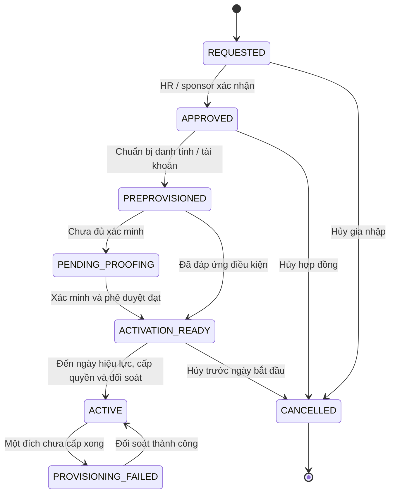
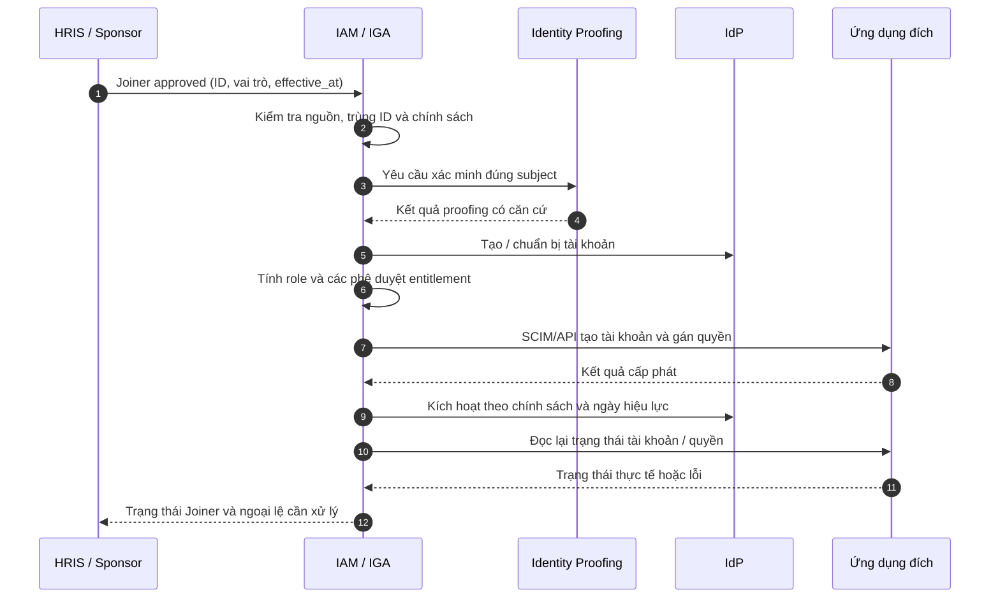

# Joiner là gì trong vòng đời danh tính IAM?

## 1. Khái niệm Joiner

**Joiner** là giai đoạn một cá nhân hoặc chủ thể mới **bắt đầu có quan hệ hợp lệ với tổ chức hoặc bắt đầu được phép truy cập một phạm vi hệ thống**. Trong mô hình quản lý vòng đời danh tính **Joiner–Mover–Leaver (JML)**, Joiner tập trung vào việc xác nhận người mới, thiết lập danh tính số, tạo hoặc liên kết tài khoản và cấp **quyền truy cập ban đầu phù hợp với nhu cầu công việc**.

Đối với nhân sự, Joiner thường được kích hoạt bởi sự kiện tuyển dụng hoặc bắt đầu hợp đồng. Đối với nhà thầu, chuyên gia tư vấn, thực tập sinh hay đối tác, nguồn sự kiện có thể đến từ **hệ thống quản lý hợp đồng** hoặc người bảo trợ nội bộ (*sponsor*). Joiner không đồng nghĩa với chỉ một thao tác “tạo user” trên hệ thống.

Câu hỏi cơ bản của Joiner gồm:

- **Ai** chuẩn bị gia nhập và nguồn nào xác nhận mối quan hệ đó?
- **Danh tính đã được xác minh đến mức phù hợp chưa?**
- **Khi nào** quan hệ hoặc quyền truy cập bắt đầu có hiệu lực?
- **Tài khoản nào** cần được tạo hoặc liên kết?
- **Người đó được làm gì**, tại ứng dụng và dữ liệu nào, theo chính sách nào?
- **Ai phê duyệt** quyền bổ sung và **làm sao xác nhận** các quyền đã được cấp đúng?
- **Điều gì xảy ra** nếu ngày bắt đầu đổi, hợp đồng bị hủy hoặc quá trình cấp phát thất bại?

Mục tiêu là giúp người mới làm việc đúng thời điểm, đồng thời duy trì **least privilege (đặc quyền tối thiểu)** và có thể truy vết việc cấp quyền.

### 1.1. Joiner trong bức tranh JML

| Giai đoạn | Tín hiệu nghiệp vụ thường gặp | Mục tiêu về quyền truy cập |
|---|---|---|
| **Joiner** — gia nhập | Tuyển dụng, bắt đầu hợp đồng, được chấp thuận tham gia dự án | Xác minh danh tính; tạo tài khoản; cấp quyền cần thiết |
| **Mover** — thay đổi | Chuyển bộ phận, vai trò, dự án hoặc thay đổi phạm vi hợp đồng | Tính lại quyền; cấp quyền mới; thu hồi quyền cũ |
| **Leaver** — rời khỏi | Nghỉ việc, hết hợp đồng, kết thúc hợp tác | Vô hiệu hóa truy cập, thu hồi phiên/token và quyền tồn dư |

JML là mô hình **xử lý sự kiện**. Một người có thể là Joiner lần đầu, trở thành Mover nhiều lần, nghỉ việc, rồi được tuyển lại. Vì vậy hệ thống cần định danh ổn định và quy tắc rõ ràng cho **rehire (tái tuyển dụng)**, không giả định mỗi lần gia nhập luôn là một người hoàn toàn mới.

### 1.2. Danh tính, tài khoản và quyền là ba lớp khác nhau

- **Danh tính (identity):** bản ghi đại diện cho con người hoặc chủ thể trong hệ thống quản lý IAM.
- **Tài khoản (account):** thực thể kỹ thuật để truy cập IdP hoặc ứng dụng; một danh tính có thể tương ứng với nhiều tài khoản.
- **Quyền (entitlement):** các khả năng truy cập cụ thể như đọc tài liệu, xem báo cáo, tạo yêu cầu hoặc quản trị tài nguyên.

Ví dụ: một nhân viên có một **worker ID** trong HRIS, một danh tính IAM, một tài khoản tại **Identity Provider (IdP)** và một số tài khoản ứng dụng. Tạo xong tài khoản IdP chưa có nghĩa toàn bộ quyền ở các ứng dụng đã tồn tại; ngược lại, chưa thể cho rằng một người được dùng mọi tài nguyên chỉ vì họ đã đăng nhập thành công.

## 2. Sự kiện nào bắt đầu Joiner?

Trong tổ chức có hệ thống nhân sự, quy trình có thể bắt đầu từ sự kiện **hợp đồng được duyệt**, **chuẩn bị nhận việc** hoặc **ngày làm việc bắt đầu**, tùy chính sách.

| Tình huống | Nguồn có thẩm quyền điển hình | Điểm cần xác minh |
|---|---|---|
| Nhân viên mới | HRIS/HCM hoặc quy trình tuyển dụng đã xác nhận | Mã nhân viên, loại hợp đồng, ngày hiệu lực, quản lý |
| Nhân viên chuyển từ một pháp nhân khác | HRIS của các đơn vị và quy tắc chuyển đổi danh tính | Có phải cùng người? Tài khoản/quyền cũ xử lý thế nào? |
| Thực tập sinh | HRIS hoặc hệ thống chương trình thực tập | Thời hạn, người hướng dẫn, phạm vi công việc |
| Nhà thầu | Hệ thống hợp đồng/VMS và sponsor được chỉ định | Công ty đối tác, hợp đồng, ngày hết hạn và chủ sở hữu |
| Đối tác dự án | Hệ thống quản lý đối tác hoặc lời mời được duyệt | Phạm vi tài nguyên, ranh giới tenant, thời gian hợp tác |
| Nhân viên tái tuyển dụng | HRIS và quy trình đối soát hồ sơ lịch sử | Ghép đúng người và không tự khôi phục quyền cũ |

**Nguồn có thẩm quyền (authoritative source)** là nguồn được tổ chức xác định có quyền công bố loại dữ liệu hoặc sự kiện đó. HRIS có thể là nguồn chuẩn cho ngày bắt đầu làm việc, nhưng chưa chắc là nguồn chuẩn cho **quyền quản trị hệ thống**; quyền quản trị thường cần phê duyệt riêng của chủ sở hữu hệ thống và bộ phận bảo mật.

Một sự kiện “đã tạo bản ghi nhân sự” cũng chưa chắc đồng nghĩa “được phép đăng nhập ngay”. Cần phân biệt **thời điểm ghi nhận**, **ngày bắt đầu có hiệu lực** và **thời điểm cấp quyền**.

## 3. Những trạng thái quan trọng trong Joiner

Joiner có thể trải qua nhiều trạng thái trước khi người dùng thực sự làm việc.

| Trạng thái nghiệp vụ minh họa | Ý nghĩa | Hành động IAM tương ứng |
|---|---|---|
| `REQUESTED` | Có yêu cầu gia nhập nhưng chưa xác nhận đầy đủ | Kiểm tra điều kiện; chưa cấp quyền nghiệp vụ |
| `APPROVED` | Quan hệ làm việc/hợp tác đã được duyệt | Tạo kế hoạch cấp phát, chờ thời điểm hợp lệ |
| `PREPROVISIONED` | Tài khoản được chuẩn bị trước | Có thể tạo hồ sơ IdP nhưng giữ chính sách chặn truy cập |
| `PENDING_PROOFING` | Chưa xác minh đủ danh tính | Chờ xác minh hoặc xử lý ngoại lệ |
| `PENDING_ENTITLEMENT_APPROVAL` | Quyền bổ sung chưa được duyệt | Chỉ cấp quyền nền được chính sách cho phép |
| `ACTIVATION_READY` | Đủ điều kiện nhưng chưa đến lúc kích hoạt | Lên lịch theo mốc hiệu lực và chính sách |
| `ACTIVE` | Danh tính và quyền cần thiết đã sẵn sàng | Cho phép truy cập theo RBAC/ABAC |
| `PROVISIONING_FAILED` | Có hệ thống đích xử lý không thành công | Retry, cảnh báo và không khẳng định đã hoàn tất |
| `CANCELLED` | Sự kiện gia nhập bị hủy | Khóa/hủy phần chuẩn bị, thu hồi quyền đã tạo |

Đây là **một tập trạng thái minh họa**, không phải schema bắt buộc cho mọi sản phẩm. Nhiều hệ thống phân biệt trạng thái hồ sơ HR, tài khoản IdP và từng entitlement. Chẳng hạn, sự kiện Joiner đã `APPROVED` nhưng ứng dụng đích vẫn chưa tạo tài khoản thì **quyền truy cập chưa sẵn sàng**.



Khi thiết kế triển khai, nên mô hình hóa thất bại thành **trạng thái theo từng tác vụ hoặc ứng dụng**, bởi một người có thể đăng nhập IdP thành công nhưng chưa có tài khoản trong hệ thống báo cáo. Một nhãn tổng `ACTIVE` chỉ nên được dùng với ý nghĩa đã định nghĩa rõ.

## 4. Ai chịu trách nhiệm trong quá trình Joiner?

Joiner thường đi qua nhiều bộ phận và hệ thống. Cần xác định ai là nguồn xác nhận, ai phê duyệt và ai thực thi quyền.

| Vai trò/thành phần | Trách nhiệm |
|---|---|
| **HR / bộ phận quản lý hợp đồng** | Xác nhận quan hệ, mã nhân sự, ngày hiệu lực, loại lao động, trạng thái |
| **Người quản lý hoặc sponsor** | Xác nhận nhu cầu công việc và phạm vi tham gia, đề xuất quyền bổ sung |
| **Identity proofing** | Xác minh người đang yêu cầu kích hoạt đúng với chủ thể trong hồ sơ có thẩm quyền |
| **IAM / IGA** | Liên kết danh tính, điều phối workflow, policy, phê duyệt, rà soát và audit |
| **IdP / directory** | Tạo danh tính kỹ thuật, thông tin xác thực, MFA và chính sách đăng nhập |
| **Chủ sở hữu hệ thống/dữ liệu** | Phê duyệt entitlement nhạy cảm, kiểm soát xung đột nhiệm vụ |
| **SCIM / provisioning connector** | Tạo, cập nhật tài khoản/nhóm ở ứng dụng có hỗ trợ tích hợp |
| **Ứng dụng đích** | Thực thi quyền thực tế, duy trì nhóm, role, token hoặc phiên ứng dụng |
| **An ninh và kiểm toán** | Kiểm tra bất thường, chứng cứ phê duyệt, SLA và quyền được cấp |

**SSO (Single Sign-On)** giúp người dùng dùng phiên xác thực tập trung để đăng nhập nhiều ứng dụng. **SCIM (System for Cross-domain Identity Management)** là giao thức thường dùng để đồng bộ người dùng và nhóm. Hai cơ chế phục vụ các phần khác nhau của Joiner: **SSO giải quyết đường đăng nhập; SCIM giải quyết một phần tạo/cập nhật tài khoản**. Quyền trong ứng dụng vẫn cần được kiểm tra theo khả năng và cấu hình thực tế.

## 5. Dữ liệu đầu vào cần có

Mức dữ liệu cần thiết phải phù hợp chính sách; không nên sao chép toàn bộ hồ sơ nhân sự sang IAM.

| Trường logic | Ví dụ | Mục đích |
|---|---|---|
| `worker_id` | `W-2108` | Khóa nhân sự ổn định để đối soát |
| `employment_id` | `E-8870` | Phân biệt các hợp đồng hoặc quan hệ việc làm |
| `worker_type` | `EMPLOYEE` | Chọn chính sách nhân viên/nhà thầu |
| `employment_status` | `APPROVED` | Xác định quan hệ được chấp thuận |
| `start_at` | `2026-12-01T09:00:00+07:00` | Mốc bắt đầu có hiệu lực |
| `end_at` | `2027-03-01T00:00:00+07:00` hoặc `null` | Hạn kết thúc nếu có |
| `department_id` | `DATA` | Đầu vào ánh xạ role hoặc nhóm |
| `job_code` | `DATA-ANALYST` | Xác định quyền nền theo vị trí |
| `manager_id` | `W-1030` | Xác định người quản lý/phê duyệt |
| `source_system` | `HRIS-PRIMARY` | Truy vết nguồn sự thật |
| `event_id`, `record_version` | `join-001`, `42` | Chống xử lý lặp và sự kiện cũ |

Các giá trị trên là **ví dụ**, không phải cấu trúc bắt buộc. Tổ chức cần có *data contract* mô tả trường, nguồn, kiểu dữ liệu, quyền truy cập, quy tắc cập nhật và các trường hợp thiếu/mâu thuẫn.

### 5.1. Vì sao không dùng email làm khóa chính?

Email, username và họ tên có thể thay đổi hoặc trùng. Định danh Joiner phải dựa vào **khóa ổn định do nguồn có thẩm quyền cấp**, có quy trình ghép đúng người trong trường hợp tái tuyển dụng hoặc chuyển pháp nhân. Không nên tự động gộp hai danh tính chỉ vì email trùng nhau.

### 5.2. Cần phân biệt thời điểm nào?

- **`occurred_at`:** lúc sự kiện được ghi nhận tại nguồn.
- **`received_at`:** lúc IAM nhận sự kiện.
- **`effective_at`:** lúc quan hệ gia nhập chính thức có hiệu lực.
- **`activated_at`:** lúc đăng nhập hoặc quyền được kích hoạt.
- **`verified_at`:** lúc xác minh thực tế trạng thái tại đích.

Những mốc này có thể khác nhau. Một bản ghi HRIS nhập trước ngày bắt đầu vài tuần không đồng nghĩa quyền truy cập nghiệp vụ được cấp ngay ngày nhập.

## 6. Quy trình Joiner từ đầu đến cuối

### Bước 1 — Tiếp nhận sự kiện gia nhập có thẩm quyền

IAM nhận sự kiện qua webhook, API, đồng bộ định kỳ hoặc batch. Hệ thống cần xác thực nguồn, kiểm tra cấu trúc, quan hệ lao động và mốc hiệu lực, đồng thời tránh xử lý sự kiện trùng.

Ví dụ một thông điệp logic phục vụ Joiner:

```json
{
  "event_id": "hr-join-001",
  "event_type": "WORKER_JOIN_APPROVED",
  "source_system": "HRIS-PRIMARY",
  "record_version": 42,
  "occurred_at": "2026-11-23T02:00:00Z",
  "effective_at": "2026-12-01T09:00:00+07:00",
  "subject": {
    "worker_id": "W-2108",
    "employment_id": "E-8870",
    "worker_type": "EMPLOYEE",
    "department_id": "DATA",
    "job_code": "DATA-ANALYST",
    "manager_id": "W-1030"
  }
}
```

Thông điệp là **mẫu minh họa**; thông tin thực tế cần được chuẩn hóa theo hợp đồng dữ liệu của tổ chức. Nếu HR sửa hoặc hủy sự kiện, IAM phải nhận ra phiên bản cập nhật và xử lý hậu quả đã phát sinh ở các hệ thống đích.

### Bước 2 — Nhận diện danh tính và xử lý trường hợp trùng

IAM kiểm tra `worker_id` và quan hệ làm việc đã tồn tại chưa:

- **Chưa có danh tính:** tạo identity record mới và liên kết nguồn HR.
- **Đã có danh tính hợp lệ:** xem xét trường hợp tuyển lại, hợp đồng song song hoặc chuyển pháp nhân; không tạo user trùng.
- **Có xung đột dữ liệu:** tạm dừng và yêu cầu xử lý có thẩm quyền.
- **Thông tin không đủ:** giữ trạng thái chờ, tránh tạo tài khoản với danh tính không xác định.

### Bước 3 — Xác minh đúng người sẽ sử dụng tài khoản

**Identity proofing** giúp đảm bảo người được phép kích hoạt là chủ thể gắn với bản ghi nghiệp vụ. Tùy mức rủi ro, có thể cần đối chiếu giấy tờ/nguồn đã xác minh, xác minh trực tiếp hoặc từ xa, hoặc một quy trình tin cậy khác đã được phê duyệt.

Điểm cần nhớ: **bản ghi HRIS hợp lệ không chứng minh người đang thao tác online đúng là người trong hồ sơ**. Mặt khác, xác minh danh tính thành công không đồng nghĩa người đó có quan hệ lao động đã có hiệu lực.

### Bước 4 — Tạo hoặc chuẩn bị tài khoản IdP

IAM có thể tạo trước tài khoản IdP, gán trạng thái chưa kích hoạt và chuẩn bị username, thuộc tính tổ chức, phương thức xác thực. Người dùng được thiết lập **MFA, passkey hoặc authenticator** theo chính sách.

Việc phân phối thông tin kích hoạt phải dùng **kênh được kiểm soát**, tránh gửi mật khẩu mặc định hoặc bí mật lâu dài qua kênh không an toàn. Quy trình tự phục vụ cần ràng buộc với danh tính đã xác minh và chống lạm dụng.

### Bước 5 — Tính quyền truy cập cần thiết

Từ vai trò và dữ liệu nghiệp vụ, IAM/IGA xác định quyền nền và quyền bổ sung:

- **RBAC:** gán quyền theo role, chẳng hạn `data_analyst_viewer`.
- **ABAC:** đánh giá thuộc tính như dự án, đơn vị, thời điểm và độ nhạy tài nguyên.
- **Chủ sở hữu tài nguyên:** phê duyệt quyền yêu cầu riêng, chẳng hạn xuất dữ liệu nhạy cảm.
- **Separation of Duties (SoD):** kiểm tra người dùng không đồng thời nắm các quyền xung đột.
- **Quyền có thời hạn:** cấp tạm thời và tự thu hồi khi hết nhu cầu, nếu policy cho phép.

Một người thuộc phòng Tài chính **không tự động** có quyền phê duyệt thanh toán; chức danh là dữ liệu đầu vào, còn quyền nhạy cảm phải qua chính sách và phê duyệt phù hợp.

### Bước 6 — Provision tài khoản và entitlement tới ứng dụng

IAM đồng bộ tài khoản và nhóm qua **SCIM/API** khi ứng dụng hỗ trợ, hoặc một quy trình quản trị có kiểm soát nếu ứng dụng chưa có connector. Cần biết quyền nào được quản lý tập trung, quyền nào vẫn nằm trong ứng dụng.

Một số ứng dụng dùng **Just-in-Time (JIT) provisioning**: khi người dùng đăng nhập SSO lần đầu, ứng dụng tạo hồ sơ local. JIT chỉ phù hợp khi ứng dụng có chính sách kiểm tra người dùng được chấp thuận; **xác thực IdP thành công không nên tự động cấp mọi quyền**.

### Bước 7 — Kích hoạt theo thời gian và điều kiện

Chỉ khi **nguồn nhân sự/hợp đồng hợp lệ, proofing đạt yêu cầu, phê duyệt cần thiết đã có và mốc hiệu lực đã đến**, hệ thống mới kích hoạt các quyền tương ứng.

Có thể tạo tài khoản từ trước (*pre-provisioning*) nhưng giữ quyền đăng nhập hoặc quyền nghiệp vụ ở trạng thái bị hạn chế cho đến ngày bắt đầu. Một sự kiện hủy hợp đồng trước ngày gia nhập phải khiến hệ thống thu hồi những chuẩn bị đã thực hiện.

### Bước 8 — Đối soát kết quả và bàn giao

Workflow cần xác minh trạng thái cuối tại IdP và từng ứng dụng đích: tài khoản có tồn tại, có được kích hoạt đúng không, nhóm/quyền có khớp chính sách không, các lỗi cấp phát nào chưa được xử lý.

Kết quả **“request sent”** hoặc **“HTTP 200”** chưa luôn là bằng chứng rằng quyền đã hiệu lực. Các hệ thống có thể xử lý bất đồng bộ, có cache hoặc chỉ hỗ trợ một phần thao tác đồng bộ. Kết quả cần được kiểm tra theo đặc tính của đích.



## 7. Chính sách quyền ban đầu: đủ dùng, đúng lúc, đúng phạm vi

Một thiết kế Joiner tốt tính **quyền cần có (desired access)** trước khi cấp quyền thực tế.

| Loại quyền | Ví dụ | Chính sách đề xuất |
|---|---|---|
| **Quyền nền** | Cổng nhân viên, tài liệu giới thiệu | Có thể cấp tự động theo quan hệ hợp lệ và policy |
| **Quyền theo vai trò** | Xem báo cáo bộ phận | Gán theo role và điều kiện ABAC |
| **Quyền theo dự án** | Truy cập kho tài liệu dự án P1 | Yêu cầu dự án/sponsor hợp lệ và thời hạn phù hợp |
| **Quyền nhạy cảm** | Xem dữ liệu cá nhân, phê duyệt giao dịch | Cần phê duyệt của chủ sở hữu và kiểm tra SoD |
| **Quyền đặc quyền** | Quản trị tenant hoặc hệ thống | Quy trình đặc biệt; ưu tiên quyền có thời hạn / JIT access |
| **Quyền của hệ thống kỹ thuật** | Token cho pipeline hoặc service account | Có owner và cơ chế cấp danh tính máy riêng |

Mã giả dưới đây minh họa cách **tách điều kiện cấp quyền và xác nhận hiệu lực**, không phải cú pháp của một sản phẩm IAM cụ thể:

```text
joiner = authoritative_source.get_approved_joiner(worker_id)

if joiner is None or joiner.is_cancelled:
    reject_activation()

identity = resolve_or_create_identity(joiner.stable_person_id)

if not identity.proofing_meets_required_policy:
    hold_activation()

desired_access = policy.baseline(joiner.worker_type)
desired_access += policy.roles(joiner.job_code, joiner.department_id)
desired_access += approved_entitlements(identity, at=joiner.effective_at)

if violates_separation_of_duties(desired_access):
    hold_conflicting_grants()

preprovision_accounts(identity, desired_access)

if now >= joiner.effective_at and identity.is_eligible:
    activate_approved_access(identity, desired_access)

reconcile_effective_access(identity, target_systems)
```

Các quyền theo nhóm có thể được thừa hưởng gián tiếp hoặc kết hợp với quyền gán trực tiếp. Do đó, **tính quyền hiệu lực** phải xét các nguồn quyền thực tế, không chỉ danh sách nhóm mà IAM dự định gán.

## 8. Joiner và mối liên hệ giữa IdP, SSO, SCIM

Ba thành phần này thường đi cùng nhau nhưng chức năng không trùng nhau.

| Thành phần | Trong Joiner làm gì? | Điều chưa giải quyết |
|---|---|---|
| **IdP** | Cấp danh tính đăng nhập, MFA, chính sách phiên và trạng thái tài khoản | Không tự xác minh hợp đồng hoặc phê duyệt mọi quyền |
| **SSO / Federation** | Cho người mới đăng nhập ứng dụng bằng phiên hoặc assertion/token từ IdP | Không bảo đảm mọi ứng dụng đã có local account hay role |
| **SCIM / API Provisioning** | Tạo, cập nhật, vô hiệu hóa tài khoản/nhóm trong ứng dụng có hỗ trợ | Không thay thế xác thực và phê duyệt nghiệp vụ |
| **RBAC/ABAC** | Quyết định nhóm, vai trò hoặc điều kiện truy cập | Không bảo đảm danh tính ban đầu được proofing chính xác |
| **IGA / Access Governance** | Yêu cầu, phê duyệt, rà soát quyền, SoD và audit | Cần connector hoặc workflow để thực thi trên hệ thống đích |

**Federated identity** cho phép ứng dụng tin cậy IdP của tổ chức khác, hữu ích với đối tác. Tuy nhiên, đối tác xác thực đúng một tài khoản **không tự bảo đảm** tài khoản đó được phép vào tài nguyên của doanh nghiệp nhận truy cập. Vẫn cần sponsor, phê duyệt, thời hạn và chính sách theo tài nguyên.

## 9. Những trường hợp đặc biệt của Joiner

### 9.1. Pre-hire và tài khoản tạo sớm

Để sẵn sàng ngày đầu, tổ chức có thể chuẩn bị địa chỉ email, máy tính và tài khoản trước khi nhân viên bắt đầu. Trạng thái chuẩn bị phải tách khỏi **trạng thái được đăng nhập và sử dụng tài nguyên**. Nếu HR hủy tuyển hoặc lùi ngày bắt đầu, IAM phải sửa kế hoạch hoặc vô hiệu hóa các quyền đã tạo.

### 9.2. Rehire: một người trở lại làm việc

Khi một nhân viên quay lại, IAM cần xác minh **đúng là cùng một người**, đánh giá chính sách tái sử dụng danh tính/tài khoản và kiểm tra trạng thái credential cũ. Không mặc nhiên phục hồi nhóm, API key hoặc role đặc quyền từ hợp đồng đã kết thúc. Tập quyền mới cần được tính từ **vai trò hiện tại và phê duyệt mới**.

### 9.3. Nhiều quan hệ hoặc vị trí đồng thời

Một người có thể vừa là nhân viên của đơn vị A vừa tham gia dự án B hoặc có nhiều hợp đồng hợp lệ. Nên tách **person**, **employment/engagement** và **assignment** để gắn quyền đúng phạm vi. Kết thúc một assignment không nhất thiết chấm dứt toàn bộ danh tính nhưng phải tác động đến các quyền chỉ dựa vào assignment đó.

### 9.4. Contractor và đối tác

Với nhà thầu, nguồn có thẩm quyền có thể là VMS, hợp đồng hoặc sponsor. Hệ thống nên có **ngày hết hạn**, người chịu trách nhiệm nội bộ, phạm vi dự án, quy trình gia hạn và thu hồi. Tránh tạo tài khoản nhà thầu vĩnh viễn chỉ vì phía đối tác còn duy trì IdP.

### 9.5. Người dùng không hoàn thành proofing hoặc MFA

Nếu bằng chứng nhận diện mâu thuẫn, không thể hoàn thành xác minh từ xa hoặc gặp khó khăn với thiết bị, workflow nên hỗ trợ **kênh xác minh thay thế có kiểm soát** và người phê duyệt ngoại lệ. Không tự bỏ qua bước kiểm tra chỉ để đạt KPI kích hoạt.

### 9.6. Tài khoản dịch vụ không có sự kiện HR Joiner

**Service account, workload identity, bot và CI/CD runner** cũng cần quy trình “gia nhập” về mặt kỹ thuật: đăng ký chủ sở hữu, mục đích, môi trường, quyền và credential. Tuy nhiên, chúng không phải nhân viên mới và thường lấy sự kiện từ **service catalog, CMDB, nền tảng workload hoặc quy trình đăng ký ứng dụng**. Không dùng giấy tờ cá nhân hoặc trạng thái HR để giả lập identity proofing cho máy.

## 10. Tính nhất quán, idempotency và xử lý lỗi

Trong hệ thống thực tế, các bước Joiner không nhất thiết hoàn tất ngay lập tức. API có thể timeout, webhook đến lặp, trạng thái HR thay đổi hồi tố, hoặc quyền mới bị từ chối do policy.

### 10.1. Sự kiện lặp và đến sai thứ tự

Giả sử HRIS gửi sự kiện Joiner phiên bản `42` hai lần, rồi một sự kiện sửa ngày bắt đầu phiên bản `43`. IAM cần:

- Dùng **event ID** hoặc khóa giao dịch tương đương để chống xử lý lặp.
- Dùng **version/snapshot** có thẩm quyền để tránh áp dụng dữ liệu cũ đè lên dữ liệu mới.
- Kiểm tra quan hệ người–hợp đồng đúng trước khi tạo hoặc liên kết tài khoản.
- Thiết kế hành động provisioning **idempotent**, để retry không tạo user hay grant trùng.
- Có cơ chế xử lý hủy tuyển hoặc thay đổi ngày hiệu lực sau khi đã pre-provision.

Không nên suy luận dữ liệu mới hơn chỉ từ thời điểm thông điệp đến: một sự kiện được giao trễ có thể mô tả trạng thái cũ.

### 10.2. Lỗi cấp phát và quyền chưa sẵn sàng

Ví dụ IdP đã tạo tài khoản nhưng connector đến ứng dụng quản lý dự án trả lỗi. Joiner có thể ở trạng thái **đăng nhập được nhưng chưa làm đủ công việc**. Quy trình cần ghi tác vụ nào lỗi, retry với cơ chế hợp lý, cảnh báo đội sở hữu và yêu cầu xử lý thủ công khi vượt hạn.

Nếu quyền nhạy cảm chưa có phê duyệt, **không nên cấp tạm quyền đó chỉ để vượt qua lỗi workflow**. Các quyền nền khác có thể tiếp tục nếu chính sách cho phép; trạng thái hoàn tất cần phản ánh chính xác phạm vi đã xác minh.

### 10.3. Kiểm tra quyền đã cấp thực tế

Một yêu cầu tạo nhóm thành công chưa bảo đảm **toàn bộ quyền hiệu lực** giống ý định. Có thể còn role mặc định quá rộng của ứng dụng, nhóm được thừa hưởng hoặc quyền gán trực tiếp. Việc đối soát cần đối chiếu ít nhất:

1. **Nguồn nghiệp vụ:** quan hệ và ngày hiệu lực còn hợp lệ.
2. **Chính sách:** tập entitlement nào được phép.
3. **Trạng thái đích:** tài khoản, nhóm, role, quyền trực tiếp và các ngoại lệ thực sự tồn tại.
4. **Bằng chứng:** thao tác đã được kiểm tra, thời điểm và người/tác nhân thực hiện.

## 11. Ví dụ hoàn chỉnh: nhân viên phân tích dữ liệu mới

Giả sử **An** được tuyển vào nhóm Phân tích dữ liệu, làm việc từ ngày **01/12/2026**. HRIS cung cấp mã nhân viên `W-2108` và người quản lý `W-1030`. An cần dùng cổng nội bộ, công cụ cộng tác và dữ liệu tổng hợp đã ẩn thông tin nhạy cảm; quyền xem dữ liệu khách hàng chi tiết phải được duyệt riêng.

**Ngày 23/11 — Nhận hồ sơ Joiner:** HRIS phát sự kiện đã duyệt với ngày bắt đầu 01/12. IAM tạo identity record, xác định An chưa từng có danh tính ở hệ thống và ghi trạng thái chờ.

**Ngày 24–28/11 — Chuẩn bị:** quy trình proofing xác minh An là đúng người đã được tuyển. IdP chuẩn bị tài khoản, đăng ký MFA và đưa ra quy trình kích hoạt bảo mật. Quyền nghiệp vụ chỉ được bật theo chính sách và thời điểm bắt đầu.

**Ngày 01/12 — Kích hoạt:** IAM kiểm tra trạng thái HR vẫn hợp lệ, đến đúng thời gian hiệu lực và các phê duyệt đã hoàn tất. Tài khoản được phép đăng nhập; SCIM/API tạo hoặc cập nhật tài khoản ứng dụng, cấp quyền nền và role `data_analyst_viewer`. Hệ thống đối soát để chắc chắn An chỉ xem được dữ liệu tổng hợp.

**Sau kích hoạt — Quyền bổ sung:** nếu An cần truy cập bộ dữ liệu nhạy cảm cho dự án P1, quản lý tạo yêu cầu và chủ sở hữu dữ liệu phê duyệt một entitlement có giới hạn. IAM kiểm tra SoD và ngày hết hạn trước khi cấp; quyết định này tách biệt với việc An đã hoàn thành Joiner.

| Thời điểm | Hành động | Bằng chứng dự kiến |
|---|---|---|
| Khi HR duyệt | Nhận bản ghi `W-2108`, ngày hiệu lực | Event ID, source/version, trạng thái hợp đồng |
| Trước ngày bắt đầu | Proofing, tạo tài khoản chờ | Kết quả proofing, identity ID, trạng thái IdP |
| Khi có hiệu lực | Kích hoạt và cấp quyền nền | Quy tắc áp dụng, bản ghi grant, kết quả hệ thống đích |
| Sau cấp phát | Kiểm tra danh sách quyền thực tế | Đối soát desired/actual, lỗi và ngoại lệ |
| Khi có nhu cầu thêm | Phê duyệt quyền dự án P1 | Request, approver, purpose, expiry và audit |

**Biến thể quan trọng:** nếu HR thông báo hủy tuyển trước 01/12, IAM phải chặn kích hoạt, đóng các tài khoản đã chuẩn bị, thu hồi token/quyền đã phát hành nếu có và lưu dấu vết hủy. Không thể để pre-provisioning trở thành tài khoản mồ côi.

## 12. Sai lầm phổ biến và hậu quả

| Sai lầm | Hậu quả | Cách kiểm soát |
|---|---|---|
| Tự tạo user khi có email tuyển dụng | Dễ mạo danh, trùng tài khoản hoặc thiếu căn cứ hợp đồng | Chỉ dùng sự kiện/nguồn có thẩm quyền |
| Dùng tên hoặc email làm khóa identity | Ghép nhầm người, khó xử lý đổi tên và rehire | ID ổn định, quy trình liên kết danh tính |
| Cấp quyền ngay ngày HR nhập hồ sơ | Người chưa bắt đầu vẫn truy cập được | Phân biệt thời điểm ghi nhận và hiệu lực |
| Proofing bị bỏ qua | Người khác có thể kích hoạt tài khoản của nhân viên thật | Xác minh danh tính phù hợp rủi ro, kiểm soát kênh kích hoạt |
| Chỉ tạo tài khoản IdP rồi coi Joiner hoàn tất | Ứng dụng chưa provision, người dùng không làm được việc | Đối soát ứng dụng và quyền thực tế |
| Đồng nhất SSO với provisioning | Có đăng nhập liên kết nhưng thiếu local account hoặc role | Phân biệt SSO và SCIM/API |
| Gán role theo chức danh không kiểm tra | Cấp thừa quyền hoặc xung đột SoD | RBAC/ABAC, phê duyệt quyền nhạy cảm |
| Retry không idempotent | Trùng tài khoản, grant hoặc tác vụ | Event ID, version, khóa giao dịch, reconcile |
| Không xử lý hủy tuyển | Tài khoản được chuẩn bị còn tồn tại | Workflow CANCELLED và thu hồi |
| Rehire tự phục hồi mọi quyền cũ | Quyền tồn dư của công việc trước quay lại | Tính quyền mới, rà soát credential và account |
| Không gắn nhà thầu với sponsor/hạn cuối | Tài khoản thiếu chủ sở hữu, hoạt động quá lâu | Bắt buộc owner và hạn truy cập |
| Không lưu phê duyệt và log | Khó giải thích quyền được cấp từ đâu | Audit gắn source event, approver và execution |

## 13. Kiểm toán, đối soát và chỉ số vận hành

Một quy trình Joiner có thể vận hành nhanh nhưng vẫn **không an toàn** nếu quyền không được kiểm soát và không có khả năng truy vết.

### 13.1. Thông tin cần ghi nhận

| Nhóm | Trường ví dụ | Câu hỏi phục vụ |
|---|---|---|
| Danh tính | `identity_id`, `worker_id`, `source_system` | Tài khoản thuộc người nào và do nguồn nào xác nhận? |
| Quan hệ | `employment_id`, `worker_type`, `effective_at` | Vì sao và từ khi nào được phép tham gia? |
| Proofing | `proofing_result`, `verified_at`, `method_ref` | Việc xác minh đúng người đã hoàn tất chưa? |
| Cấp tài khoản | `account_id`, `target_system`, `account_state` | Hệ thống nào đã tạo tài khoản? |
| Quyền | `entitlement`, `policy_version`, `valid_until` | Quyền nào được cấp theo quy tắc nào? |
| Phê duyệt | `requested_by`, `approved_by`, `business_reason` | Ai chịu trách nhiệm quyền bổ sung? |
| Thực thi | `operation_id`, `execution_result`, `observed_state` | Đích có thực sự thực hiện thay đổi? |
| Đối soát | `reconciled_at`, `exception_id` | Đã kiểm tra và xử lý sai lệch chưa? |

Audit log nên ghi metadata cần thiết, **không tự động sao chép giấy tờ xác minh danh tính, mật khẩu, token hoặc dữ liệu HR nhạy cảm**.

### 13.2. Một số chỉ số hữu ích

- **Time to provision:** từ khi quan hệ hợp lệ có hiệu lực đến khi các tài khoản/quyền cần thiết được xác nhận sẵn sàng.
- **First-day readiness:** tỷ lệ người mới có thể truy cập bộ công cụ cần thiết đúng ngày đầu.
- **Joiner exception rate:** tỷ lệ yêu cầu thiếu thông tin, trùng danh tính, lỗi connector hoặc thiếu phê duyệt.
- **Overprovisioning rate:** tỷ lệ hoặc số quyền được cấp vượt quá chính sách mong muốn.
- **Orphan account rate:** tài khoản không đối soát được với danh tính/quan hệ hợp lệ.
- **Reconciliation success:** tỷ lệ hệ thống đích đã xác minh phù hợp với trạng thái mong muốn.
- **Cancellation cleanup:** thời gian và mức độ hoàn tất khi sự kiện gia nhập bị hủy.

Không có một SLA áp dụng cho mọi tổ chức. Thời hạn và mức ưu tiên cần phụ thuộc rủi ro, loại tài khoản, độ nhạy dữ liệu và cam kết nghiệp vụ.

## 14. Joiner kết nối thế nào với Mover và Leaver?

Thiết kế Joiner tốt giúp các bước sau dễ kiểm soát. Ngay từ lúc cấp quyền lần đầu, IAM nên biết:

- **Quyền do đâu mà có:** role nền, thuộc tính, dự án, phê duyệt hay ngoại lệ.
- **Quyền gắn với quan hệ nào:** hợp đồng, phòng ban, vị trí, assignment hoặc sponsor.
- **Ai là người sở hữu:** quản lý, chủ sở hữu dữ liệu và bộ phận phụ trách.
- **Quyền hết hạn khi nào:** khi chuyển dự án, hết hợp đồng, hết phê duyệt hoặc khi bị thu hồi.
- **Hệ thống đích nào phải cập nhật:** IdP, ứng dụng SaaS, hệ thống local và credential liên quan.

Khi người dùng thành **Mover**, IAM có thể tính chênh lệch giữa quyền đang có và quyền mới rồi **thu hồi quyền cũ**, tránh tích lũy đặc quyền. Khi thành **Leaver**, IAM có thể truy xuất đầy đủ tài khoản, nhóm, phiên, token hoặc quyền trực tiếp để vô hiệu hóa và đối soát.

Nếu Joiner tạo tài khoản thủ công nhưng không liên kết với identity ID và nguồn nghiệp vụ, các bước Mover/Leaver sau này sẽ khó tìm đủ tài khoản và dễ để lại **quyền truy cập tồn dư (residual access)**.

## 15. Các tình huống kiểm thử Joiner nên có

| Tình huống | Kết quả mong đợi |
|---|---|
| HRIS xác nhận người mới, thông tin đầy đủ | Tạo/link đúng danh tính; chỉ cấp quyền theo policy |
| Chưa đến ngày bắt đầu | Có thể pre-provision nhưng chặn quyền chưa được phép |
| Bản ghi HR thiếu ID hoặc mâu thuẫn | Chặn/đưa xử lý ngoại lệ, không đoán danh tính |
| Email trùng một tài khoản khác | Không tự động liên kết vào tài khoản cũ |
| Proofing chưa đạt | Không kích hoạt quyền yêu cầu mức proofing đó |
| Quyền nhạy cảm chưa được phê duyệt | Không tự grant; ghi nhận yêu cầu chờ |
| Cấp role gây xung đột SoD | Chặn quyền xung đột hoặc chuyển phê duyệt được phép |
| Webhook Joiner được gửi lặp | Không tạo thêm danh tính/tài khoản hoặc grant trùng |
| HR sửa ngày bắt đầu | Lịch kích hoạt được cập nhật; không áp dụng sự kiện cũ |
| HR hủy tuyển sau khi tạo tài khoản chờ | Khóa/thu hồi mọi quyền đã chuẩn bị; không để tài khoản mồ côi |
| SCIM/API tới một ứng dụng lỗi | Ghi trạng thái lỗi, retry/alert, chưa đánh dấu verified |
| Người cũ được tái tuyển | Xác minh liên kết đúng người; quyền cũ không tự hồi phục |
| Nhà thầu hết hạn hợp đồng | Có quy trình Leaver hoặc hạn truy cập tự thu hồi |
| Quyền thực tế khác policy | Đối soát phát hiện, ghi ngoại lệ và khắc phục |

## 16. Nguyên tắc cần ghi nhớ

**Joiner là quy trình đưa một người mới từ quan hệ nghiệp vụ hợp lệ đến danh tính số và quyền truy cập ban đầu đã được kiểm soát.** Để thực hiện tốt, cần kết hợp:

1. **Nguồn sự thật rõ ràng:** HRIS/HCM, hợp đồng hoặc sponsor có thẩm quyền, với ID ổn định và ngày hiệu lực chính xác.
2. **Xác minh đúng người:** identity proofing và liên kết danh tính an toàn trước khi kích hoạt.
3. **Cấp tài khoản đúng điều kiện:** IdP, MFA và phương thức kích hoạt bảo mật; pre-provision không đồng nghĩa quyền đã có hiệu lực.
4. **Cấp quyền tối thiểu:** RBAC/ABAC, phê duyệt quyền nhạy cảm, kiểm tra SoD và hạn sử dụng khi cần.
5. **Phân biệt đăng nhập và đồng bộ:** SSO/federation phục vụ đăng nhập; SCIM/API hỗ trợ provisioning; ứng dụng đích thực thi quyền.
6. **Chịu lỗi và khôi phục được:** idempotency, xử lý sự kiện cũ, thay đổi ngày bắt đầu, hủy tuyển và lỗi hệ thống đích.
7. **Đối soát và lưu bằng chứng:** trạng thái thực tế, nguồn cấp quyền, người phê duyệt và kết quả kiểm tra phải được truy vết.
8. **Chuẩn bị cho Mover–Leaver:** mọi tài khoản và quyền cấp khi Joiner cần có owner, căn cứ nghiệp vụ và cơ chế thu hồi.

Một người mới có thể hoàn tất Joiner về mặt vận hành khi họ dùng được công cụ công việc; về mặt quản trị IAM, điều quan trọng hơn là **đúng danh tính, đúng quyền, đúng thời điểm và có chứng cứ để thay đổi hoặc thu hồi quyền trong suốt vòng đời**.
