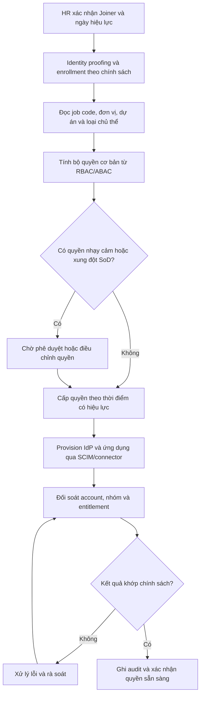

# Gán quyền ban đầu trong Joiner lifecycle

**Gán quyền ban đầu** (*initial access assignment*) là bước xác định và cấp tập quyền truy cập phù hợp cho một chủ thể mới gia nhập tổ chức. Trong **Identity and Access Management (IAM)**, đây là hoạt động quan trọng của giai đoạn **Joiner** thuộc mô hình **Joiner–Mover–Leaver (JML)**: sau khi xác minh và đăng ký danh tính, tổ chức phải bảo đảm nhân viên có đủ quyền để bắt đầu công việc nhưng không được nhận những quyền vượt quá nhu cầu thực tế.

Ví dụ, một nhân viên mới ở bộ phận chăm sóc khách hàng cần đăng nhập cổng nội bộ, xem tài liệu hướng dẫn và xử lý ticket được phân công. Họ không tự động cần quyền xuất toàn bộ dữ liệu khách hàng, quản trị hệ thống hay phê duyệt hóa đơn. Tập quyền khởi đầu phải dựa trên **trạng thái quan hệ, nhiệm vụ, phạm vi công việc, ngày có hiệu lực và chính sách phê duyệt**, thay vì cấp giống mọi quyền của một đồng nghiệp cùng chức danh.

## 1. Đầu vào cần thiết trước khi cấp quyền

| Đầu vào | Nguồn hoặc chủ sở hữu | Vai trò trong quyết định |
| --- | --- | --- |
| Mã danh tính ổn định | HRIS/HCM hoặc nguồn danh tính có thẩm quyền | Liên kết đúng người với tài khoản và quyền |
| Trạng thái làm việc và ngày bắt đầu | HR hoặc hệ thống quản lý hợp đồng | Xác định thời điểm được phép sử dụng quyền |
| Job code, vị trí và bộ phận | Nguồn nhân sự có thẩm quyền | Đề xuất bộ quyền cơ bản |
| Nhóm, dự án, khu vực dữ liệu | Người quản lý hoặc hệ thống phân công | Giới hạn tài nguyên có thể truy cập |
| Loại chủ thể | HR, quản lý đối tác hoặc chủ sở hữu workload | Phân biệt nhân viên, nhà thầu và tài khoản dịch vụ |
| Mức nhạy cảm của quyền | Chủ sở hữu ứng dụng/dữ liệu và bộ phận bảo mật | Quy định phê duyệt, xác thực và rà soát bổ sung |
| Người phê duyệt và thời hạn | Chính sách IAM, quản lý và data owner | Cung cấp căn cứ kiểm toán, giới hạn quyền tạm thời |

**Chức danh không đồng nghĩa với quyền.** Hai nhân viên cùng job title có thể thuộc dự án hoặc chi nhánh khác nhau; một người còn có thêm nhiệm vụ đặc biệt đã được phê duyệt. IAM cần phân biệt bộ quyền chuẩn với quyền bổ sung, đồng thời ghi lại lý do của từng ngoại lệ.

## 2. Nguyên tắc gán quyền ban đầu

### Đặc quyền tối thiểu

**Least privilege** yêu cầu chỉ cấp hành động và phạm vi tài nguyên cần cho công việc. Quyền đọc dữ liệu không nên mặc nhiên bao gồm chỉnh sửa, xuất hàng loạt hoặc xóa dữ liệu. Quyền quản trị sản xuất phải được đánh giá độc lập với quyền sử dụng ứng dụng thông thường.

### Cấp đúng thời điểm

Hệ thống có thể **chuẩn bị tài khoản** trước ngày bắt đầu nhưng cần tách việc tạo tài khoản khỏi **kích hoạt khả năng truy cập**. Ngày sự kiện được nhập vào HRIS không nhất thiết là ngày quyền có hiệu lực. Quy trình phải xử lý cả việc hoãn ngày bắt đầu hoặc hủy tuyển dụng.

### Phân tách nhiệm vụ

**Segregation of Duties (SoD)** ngăn một người giữ các quyền xung đột, chẳng hạn vừa lập vừa tự phê duyệt một khoản thanh toán. Việc một quyền thuộc bộ quyền mặc định cũng không miễn trừ kiểm tra xung đột khi gán cho người mới.

### Có chủ sở hữu và truy vết

Quyền cần liên kết được đến danh tính, tài khoản, vai trò, ứng dụng đích, căn cứ nghiệp vụ và người chịu trách nhiệm. Quyền ngoại lệ hoặc quyền tạm thời nên có ngày hết hạn, nguồn phê duyệt và quy trình thu hồi.

### Kiểm chứng tại hệ thống đích

Một yêu cầu provisioning thành công về mặt giao thức không tự chứng minh ứng dụng đã cấp **đúng entitlement**. Cần đối soát kết quả tại hệ thống đích, kiểm tra cả quyền thiếu và quyền thừa, rồi xử lý lỗi hoặc trạng thái chờ một cách rõ ràng.

## 3. RBAC và ABAC trong cấp quyền khởi tạo

**RBAC (Role-Based Access Control)** ánh xạ vai trò nghiệp vụ thành một tập quyền có quản trị. **ABAC (Attribute-Based Access Control)** dùng các thuộc tính của chủ thể, tài nguyên, hành động và môi trường để giới hạn việc sử dụng quyền. Hai mô hình có thể kết hợp:

| Bối cảnh Joiner | RBAC: vai trò cơ bản | ABAC hoặc giới hạn bổ sung |
| --- | --- | --- |
| Nhân viên hỗ trợ khách hàng | `ticket-reader`, `ticket-editor` | Chỉ ticket thuộc nhóm được phân công |
| Kế toán mới | `invoice-preparer` | Chỉ pháp nhân được giao; không tự phê duyệt |
| Kỹ sư vận hành mới | `monitoring-reader` | Chỉ môi trường được quản lý |
| Nhà thầu dự án | `project-contributor` | Chỉ dự án được bảo trợ; hết hạn theo hợp đồng |

Đây là các vai trò minh họa, không phải chính sách mặc định cho mọi doanh nghiệp. Quyền thực tế phụ thuộc ứng dụng, mô hình tổ chức, phân loại dữ liệu và yêu cầu nghiệp vụ.

Ví dụ giả mã để đánh giá việc đọc ticket:

```text
ALLOW read_ticket IF
    subject.lifecycle_status == "active"
    AND "ticket-reader" IN subject.roles
    AND resource.team_id IN subject.assigned_team_ids
    AND action == "read"
    AND session.assurance >= resource.required_assurance
ELSE DENY
```

Quy tắc này biểu diễn **quyết định sử dụng quyền tại thời điểm yêu cầu**, không phải cú pháp chuẩn của một sản phẩm IAM. Việc cấp role ban đầu vẫn phải được quản lý riêng; ứng dụng phải thực thi chính sách trên tài nguyên thực tế, kể cả khi người dùng đã đăng nhập SSO.

## 4. Quy trình thực hiện từ Joiner đến quyền sẵn sàng



### Bước 1 — Xác minh căn cứ

Sự kiện Joiner phải thuộc nguồn có thẩm quyền; danh tính và quan hệ được kiểm tra theo quy trình identity proofing/enrollment cần thiết. Không cho phép một yêu cầu tự khai chức danh hoặc email chưa xác minh quyết định việc cấp quyền đặc biệt.

### Bước 2 — Xác định bộ quyền cơ bản

IAM đối chiếu job code, department, vị trí, nhóm và dự án với danh mục role đã được quản trị. Quyền có thể được chia thành:

- **Birthright access:** quyền nền tảng có thể cấp tự động theo quan hệ hợp lệ, ví dụ cổng thông tin nội bộ và ứng dụng công việc phổ biến.
- **Role-based access:** quyền theo công việc, đơn vị hoặc nhóm; phải tuân thủ phạm vi và điều kiện có hiệu lực.
- **Request-based access:** quyền ngoài bộ mặc định, cần yêu cầu và phê duyệt riêng.
- **Privileged/temporary access:** quyền nhạy cảm hoặc tạm thời, có kiểm soát bổ sung như MFA mạnh, giới hạn thời gian, giám sát.

Không phải tổ chức nào cũng gọi quyền cơ bản là *birthright*; khái niệm này chỉ nên bao gồm các quyền thật sự an toàn và cần thiết cho nhóm chủ thể tương ứng.

### Bước 3 — Kiểm tra xung đột và phê duyệt

Trước khi cấp, kiểm tra SoD, quyền đặc quyền và phạm vi dữ liệu. Ví dụ nhân viên kế toán được tạo hóa đơn có thể cần một quy trình phê duyệt khác để được duyệt chính hóa đơn đó. Các quyền ngoại lệ phải có người chịu trách nhiệm, lý do và thời hạn; không nên biến yêu cầu cấp quyền một lần thành bộ quyền mặc định mới.

### Bước 4 — Tạo nhóm, role và entitlement

**IdP** quản lý tài khoản/xác thực và có thể cung cấp nhóm hoặc thuộc tính. **SSO** cho phép đăng nhập ứng dụng tin cậy, còn **SCIM** hoặc connector đồng bộ tài khoản và nhóm tới hệ thống đích khi được hỗ trợ. Một ứng dụng có thể hỗ trợ SSO nhưng không hỗ trợ SCIM; role đặc thù vẫn có thể yêu cầu API riêng hoặc workflow thủ công có đối soát.

### Bước 5 — Kích hoạt và xác nhận hiệu lực

Quyền chỉ có hiệu lực đúng ngày/giờ theo chính sách. Hệ thống cần kiểm chứng người mới có thể thực hiện các tác vụ đã duyệt và **không** truy cập vượt phạm vi. Nếu một phần provisioning thất bại, ghi rõ ứng dụng nào chưa sẵn sàng; không đánh dấu toàn bộ quy trình hoàn tất khi quyền quan trọng vẫn thiếu hoặc sai.

### Bước 6 — Lưu bằng chứng và chuyển sang quản trị thường xuyên

Audit nên cho biết ai yêu cầu, ai phê duyệt, nguồn dữ liệu, phiên bản chính sách, tài khoản/nhóm/entitlement đã cấp, thời điểm hiệu lực và kết quả tại đích. Tránh ghi token, mật khẩu, khóa API hoặc thông tin cá nhân không cần thiết.

## 5. Ví dụ: cấp quyền cho nhân viên hỗ trợ mới

Giả sử Lan gia nhập nhóm hỗ trợ khu vực Hà Nội vào ngày 1/12:

1. HRIS phát sự kiện Joiner với mã nhân viên, job code `CS_AGENT_L1`, phòng ban, người quản lý, địa bàn và ngày bắt đầu.
2. IAM liên kết đúng identity, tạo tài khoản IdP và yêu cầu đăng ký phương thức xác thực phù hợp.
3. RBAC gán `ticket-reader` và `ticket-editor` theo bộ quyền cơ bản được phê duyệt.
4. ABAC giới hạn truy cập vào ticket thuộc nhóm Hà Nội; quyền xuất toàn bộ khách hàng không được cấp.
5. SCIM/connector provision tài khoản đến ứng dụng hỗ trợ, đồng bộ nhóm hoặc các thuộc tính được hỗ trợ.
6. IAM xác minh tài khoản chỉ hoạt động từ ngày bắt đầu và các entitlement tại ứng dụng đúng phạm vi.
7. Khi Lan chuyển sang nhóm phân tích, quy trình **Mover** thu hồi quyền ticket không còn phù hợp; khi nghỉ việc, **Leaver** vô hiệu hóa tài khoản, thu hồi quyền và xử lý phiên/token liên quan.

Nếu Lan cần tạm thời hỗ trợ nhóm miền Nam, thay vì mở quyền vĩnh viễn, tổ chức có thể cấp phạm vi tạm thời với căn cứ, người phê duyệt và hạn kết thúc.

## 6. Gán quyền ban đầu cho chủ thể phi nhân sự

**Service account/workload identity** cũng trải qua quy trình đăng ký và cấp quyền, nhưng quyết định không dựa vào job title của con người. Chủ thể kỹ thuật cần chủ sở hữu đang hoạt động, mục đích nghiệp vụ, môi trường chạy, phạm vi API và chính sách credential.

Ví dụ một dịch vụ tạo báo cáo hằng đêm chỉ cần đọc bảng dữ liệu đã duyệt. Không cấp `database-admin` hoặc dùng tài khoản cá nhân của nhân viên lập dịch vụ. Ưu tiên định danh workload riêng, credential ngắn hạn hoặc federation khi khả thi, cùng việc rà soát và thu hồi khi dịch vụ đổi chủ hoặc ngừng hoạt động.

Đối với nhà thầu và partner, quyền ban đầu cần gắn với sponsor nội bộ, hợp đồng, dự án và ngày hết hạn. Không suy ra quyền nhân viên nội bộ chỉ vì đối tác đăng nhập thành công bằng IdP liên kết.

## 7. Rủi ro thường gặp và biện pháp khắc phục

| Rủi ro | Hậu quả | Kiểm soát |
| --- | --- | --- |
| Sao chép quyền của người tiền nhiệm | Mang theo quyền đặc biệt và quyền tồn dư | Dùng bộ role chuẩn, xét nhu cầu từng quyền |
| Mapping job title sai | Cấp nhầm hoặc thiếu quyền | Dùng job code/danh mục có quản trị và xác nhận phạm vi |
| Kích hoạt quá sớm | Người chưa bắt đầu được truy cập | Phân biệt tạo account với ngày hiệu lực |
| Bỏ qua kiểm tra SoD | Một người được thực hiện thao tác xung đột | Kiểm tra trước cấp và quy trình phê duyệt ngoại lệ |
| Chỉ kiểm tra nhóm IdP | Ứng dụng đích thiếu quyền hoặc có quyền cục bộ thừa | Đối soát entitlement tại ứng dụng |
| Provisioning lỗi một phần | Nhân viên không làm việc được hoặc còn đường truy cập ngoài ý muốn | Retry an toàn, cảnh báo và kiểm chứng |
| Không đặt hạn cho quyền tạm thời | Quyền đặc biệt tồn tại quá nhu cầu | TTL, phê duyệt, tự hết hạn và kiểm chứng thu hồi |
| Không quản lý quyền sau Joiner | Quyền tích lũy theo thời gian | Rà soát định kỳ, xử lý Mover và Leaver theo sự kiện |

## 8. Chỉ số và kiểm toán chất lượng cấp quyền

Các chỉ số hữu ích gồm thời gian từ ngày Joiner đến khi **quyền cần thiết sẵn sàng**, tỷ lệ cấp quyền thành công ở từng ứng dụng, số yêu cầu thiếu phê duyệt, số vi phạm SoD, số entitlement ngoài danh mục và tỷ lệ tài khoản được kích hoạt sai ngày.

Rà soát sau khi cấp nên so sánh **quyền đã duyệt** với **quyền hiệu lực thực tế**. Đối với quyền nhạy cảm, có thể yêu cầu kiểm tra độc lập hoặc xác nhận của chủ sở hữu tài nguyên. Việc ghi “đã gửi lệnh cấp quyền” không phải bằng chứng cuối cùng rằng IAM đang thực thi đúng chính sách.

## 9. Câu hỏi tự kiểm tra

**Tình huống A:** Nhân viên mới cùng job title với người tiền nhiệm. Có nên sao chép tất cả nhóm và quyền của người cũ? **Không.** Chỉ cấp bộ quyền phù hợp vị trí hiện tại và yêu cầu bổ sung được duyệt.

**Tình huống B:** IAM tạo tài khoản IdP hôm nay nhưng hợp đồng có hiệu lực tuần sau. Có được bật tất cả quyền từ hôm nay? **Không mặc nhiên.** Cần quản lý ngày hiệu lực, có thể chuẩn bị kỹ thuật trước và chỉ cho truy cập theo chính sách.

**Tình huống C:** SCIM trả thành công nhưng ứng dụng đích chưa có role đọc ticket. Đã hoàn tất cấp quyền ban đầu chưa? **Chưa.** Phải đối soát entitlement thực tế và xử lý phần chưa thành công.

**Tình huống D:** Nhân viên được cấp role hỗ trợ khách hàng nhưng cố xem hồ sơ thuộc vùng khác. Chỉ kiểm tra role có đủ không? **Không.** Cần kiểm tra thêm thuộc tính tài nguyên và phạm vi được giao, ví dụ qua ABAC.

**Tình huống E:** Kỹ sư mới cần quyền sản xuất để xử lý sự cố trong hai giờ. Có nên cấp quyền quản trị vĩnh viễn? **Không.** Cần phê duyệt, giới hạn tài nguyên, thời hạn, xác thực và audit phù hợp.

## Ghi nhớ

**Gán quyền ban đầu** là điểm khởi đầu của quản trị truy cập theo vòng đời: kết nối dữ liệu nhân sự đáng tin cậy và **identity proofing/enrollment** với role **RBAC**, điều kiện **ABAC**, việc cấp phát qua **IdP/SCIM**, xác thực qua **SSO** và kiểm toán tại hệ thống đích. Quyền phải **đúng người, đúng công việc, đúng phạm vi, đúng thời điểm**; đồng thời phải dễ rà soát, điều chỉnh ở **Mover** và thu hồi đầy đủ ở **Leaver** để hạn chế quyền truy cập tồn dư.
