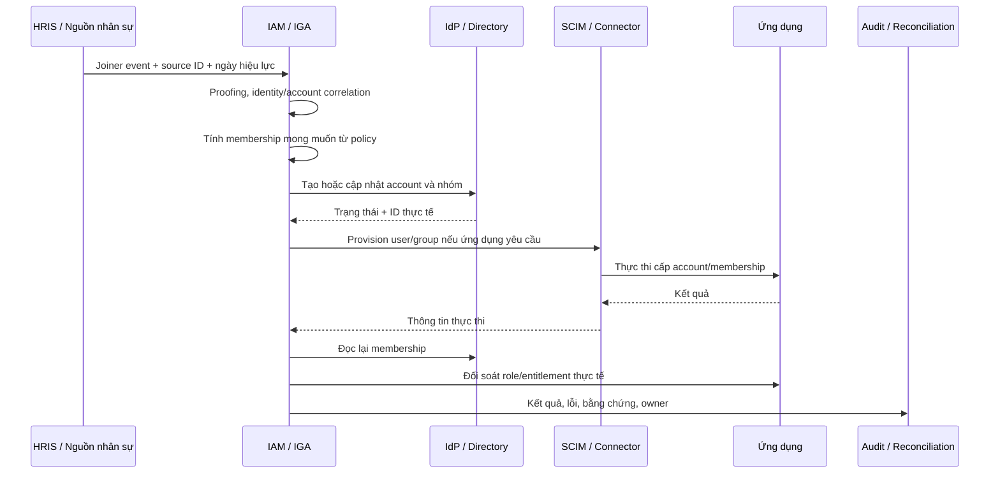
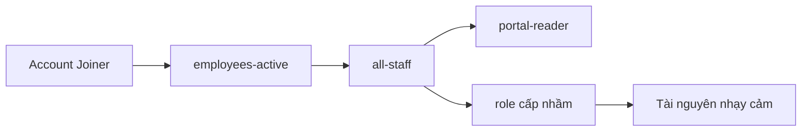

# Gán nhóm mặc định trong Joiner lifecycle của IAM

## Mục tiêu học tập

Sau bài này, người học có thể:

1. Giải thích **nhóm mặc định** (default group) và **birthright access** trong giai đoạn Joiner của quản lý vòng đời danh tính.
2. Phân biệt group, group membership, role, entitlement, tài khoản IdP và quyền thực tế trong ứng dụng.
3. Xây dựng điều kiện tự động gán nhóm dựa trên dữ liệu có thẩm quyền từ HRIS, trạng thái identity, identity proofing và mốc hiệu lực.
4. Triển khai quy trình cấp nhóm qua IAM/IGA, IdP, directory, SCIM hoặc các connector mà vẫn tuân thủ least privilege, RBAC/ABAC và phân tách nhiệm vụ (SoD).
5. Thiết kế workflow idempotent, xử lý lỗi đồng bộ, readback, kiểm toán và đối soát membership.
6. Xác định khi nào phải giữ, điều chỉnh hoặc thu hồi nhóm khi một người Mover, Leaver hoặc tái tuyển dụng.
7. Nhận diện rủi ro từ nhóm chung quá rộng, nested group, account service, token cũ và quyền truy cập tồn dư.

## 1. Gán nhóm mặc định là gì?

Trong **Identity and Access Management (IAM)**, **gán nhóm mặc định** là bước đưa một identity hoặc account **đủ điều kiện** vào một hoặc nhiều group theo quy tắc đã được phê duyệt. Bước này thường diễn ra khi người dùng gia nhập tổ chức (**Joiner**) để họ có được các quyền cơ sở cần thiết ngay khi bắt đầu làm việc.

Ví dụ: nhân viên mới đã được xác minh danh tính, quan hệ lao động đang có hiệu lực, account trong IdP đã được liên kết đúng với hồ sơ HR. IAM có thể đưa account đó vào các nhóm sau:

- `employees-active`: nhận diện tập nhân viên đủ điều kiện đang làm việc.
- `employee-self-service`: cho phép truy cập một số chức năng nhân sự tự phục vụ.
- `security-training`: phục vụ nhiệm vụ đào tạo an toàn thông tin.

Đây chỉ là **tên minh họa**. Không có một danh mục nhóm mặc định chung cho mọi IdP. Cũng không được mặc định rằng nhóm “all users” hoặc “everyone” chỉ chứa nhân viên, vì nhiều nền tảng có thể bao gồm guest, bot và các loại account khác.

**Mặc định không đồng nghĩa không điều kiện.** Membership phải xuất phát từ chính sách được kiểm tra, và quyền phát sinh phải tương ứng với nhu cầu và mức tin cậy của identity.

### 1.1. Phân biệt identity, account, group và quyền

| Khái niệm | Ý nghĩa | Ví dụ |
|---|---|---|
| **Identity** | Đối tượng được IAM quản trị xuyên hệ thống | `identityId=IDN-1042` |
| **Account** | Bản ghi người dùng tại IdP hoặc ứng dụng | `accountId=USR-8382` |
| **Group** | Tập chủ thể/account hoặc tập thành viên được policy xác định | `employee-self-service` |
| **Membership** | Quan hệ một account/principal thuộc group | `USR-8382` là thành viên nhóm |
| **Role** | Tập nhiệm vụ/quyền theo mô hình RBAC | `EmployeePortalReader` |
| **Entitlement** | Quyền hoặc khả năng cụ thể ở đích | `hr.profile.read` |
| **Birthright access** | Quyền cơ sở tự động có khi đủ điều kiện | Đọc tài liệu hội nhập |
| **Dynamic group** | Nhóm xác định membership từ các thuộc tính và rule | Nhân viên active và đúng loại hợp đồng |

Group có thể chỉ phục vụ phân loại mà không cấp quyền. Nhưng cũng có thể được IdP gắn trực tiếp vào ứng dụng, ánh xạ với một role, truyền trong SSO token hoặc đồng bộ thành group tại ứng dụng. **Cần kiểm tra quan hệ từ membership đến quyền có hiệu lực**, kể cả quyền kế thừa từ nhóm khác.

### 1.2. Vì sao Joiner cần nhóm mặc định?

Nếu mỗi người mới phải gửi ticket để được cấp từng quyền cơ sở, quá trình onboarding dễ bị trễ và thiếu nhất quán. Tự động hóa nhóm phù hợp giúp:

- Giảm thao tác cấp quyền lặp lại.
- Cho phép người mới sử dụng những chức năng cần thiết theo ngày hiệu lực.
- Chuẩn hóa chính sách giữa những người có cùng điều kiện nghiệp vụ.
- Tách nhóm **birthright** khỏi nhóm phải phê duyệt riêng.
- Tạo dấu vết rõ ràng về quyền ban đầu, nguồn dữ liệu và phiên bản policy.

Lợi ích chỉ tồn tại khi nguồn HR đáng tin, account correlation chính xác và mapping nhóm sang quyền được rà soát. Nếu một nhóm mặc định có quyền quản trị quá rộng, sự cố sẽ ảnh hưởng mọi Joiner mới và có thể cả người dùng cũ.

## 2. Phân loại nhóm và phạm vi áp dụng

Không nên gom tất cả account mới vào cùng một group vì mỗi loại identity có nhu cầu khác nhau.

| Loại nhóm | Điều kiện thường gặp | Mục đích | Lưu ý |
|---|---|---|---|
| **Nhóm cơ sở toàn nhân viên** | `workerType=EMPLOYEE`, đang hoạt động, đáp ứng proofing | Truy cập cổng nhân sự, tài liệu chung | Không bao gồm guest hoặc service account nếu không có policy riêng |
| **Nhóm cơ sở nhà thầu** | `workerType=CONTRACTOR`, sponsor và hợp đồng hợp lệ | Cổng nhà thầu, tài liệu được phép | Thời hạn theo hợp đồng |
| **Nhóm thực tập sinh** | Quan hệ thực tập hợp lệ | Tài liệu và hoạt động đào tạo | Hạn chế dữ liệu nhạy cảm |
| **Nhóm theo phòng ban** | `departmentId` có thẩm quyền và đang hiệu lực | Tài nguyên nghiệp vụ phổ thông | Không đồng nghĩa cấp quyền đặc biệt |
| **Nhóm theo chức năng** | Vai trò công việc đã xác minh | Quyền ứng dụng theo nhiệm vụ | Có thể cần phê duyệt/SoD |
| **Nhóm đặc quyền** | Chức trách và approval được cấp rõ | Quản trị, tài chính nhạy cảm | Không nên nằm trong birthright thông thường |

**Birthright access** là quyền mà chính sách cho rằng người dùng tự đủ điều kiện được nhận dựa trên thuộc tính đáng tin cậy. Quyền đó **vẫn có điều kiện mất hiệu lực** và phải được rà soát. Một nhân viên trở thành nhà thầu, bị đình chỉ hoặc rời tổ chức có thể không còn phù hợp với các nhóm birthright trước đây.

### 2.1. Nhóm tĩnh, nhóm động và provisioning nhóm

Có hai cách vận hành phổ biến:

**Dynamic group:** một rule trong IdP xác định thành viên từ thuộc tính, ví dụ `workerType == EMPLOYEE AND lifecycleState == ACTIVE`. Khi thuộc tính đổi, nền tảng sẽ đánh giá lại membership theo cơ chế và độ trễ của sản phẩm.

**Static group do IAM tự động quản lý:** IAM/IGA tính tập membership mong muốn rồi gửi yêu cầu thêm/bớt thành viên qua API, directory connector hoặc SCIM.

| Khía cạnh | Dynamic group | Static group + workflow |
|---|---|---|
| Điều kiện | Rule thực thi trong nền tảng group | Policy engine/workflow tính từ nguồn dữ liệu |
| Cập nhật | Theo cơ chế evaluation của nền tảng | Theo event và quy trình cấp/thu hồi |
| Chỗ dễ xảy ra sai lệch | Attribute stale, rule quá rộng, evaluation lag | Connector lỗi, event bị mất, thao tác không idempotent |
| Xác minh | Đọc membership thực tế của group | Đọc lại sau gọi API/connector |
| Khi Mover/Leaver | Rule phải tự loại đối tượng hết điều kiện | Workflow phải tính lại và gửi thao tác revoke |

Không nên giả định chỉ cần cập nhật HR hoặc IdP profile là ứng dụng lập tức nhận quyền mới. Một số ứng dụng đọc role từ SCIM, một số giữ session/token từ lần đăng nhập trước.

## 3. Những dữ liệu cần kiểm tra trước khi gán nhóm

Để tránh gán quyền cho sai người, workflow Joiner cần nhận dữ liệu từ nguồn có thẩm quyền và liên kết đến account đích.

| Trường | Nguồn thường gặp | Ý nghĩa đối với việc gán nhóm |
|---|---|---|
| `personId` / `contractorId` | HRIS hoặc hệ thống nhà thầu | Khóa nhận diện thực thể nguồn |
| `identityId` | IAM/identity registry | Khóa danh tính xuyên hệ thống |
| `accountId` | IdP hoặc ứng dụng đích | Đối tượng thực sự được thêm vào group |
| `workerType` | HR hoặc nguồn hợp đồng | Phân biệt employee, contractor, intern |
| `employmentStatus` | Nguồn quan hệ lao động | Điều kiện active/suspended/terminated |
| `effectiveStart` / `effectiveEnd` | HR/hợp đồng | Xác định thời điểm quyền có thể hoạt động |
| `departmentId` / `jobCode` | Nguồn cơ cấu nhân sự | Điều kiện cho group theo đơn vị/chức năng |
| `proofingStatus` | Hệ thống identity proofing | Mức tin cậy trước kích hoạt quyền cần kiểm chứng |
| `sponsor` / `manager` | HR/chủ quản nhà thầu | Quy trách nhiệm và phê duyệt ngoại lệ |
| `policyVersion` | IAM/IGA | Truy vết quy tắc quyết định membership |

**Một thuộc tính trong IdP không nhất thiết là nguồn chuẩn.** Ví dụ, HRIS có thể là nguồn quyết định loại nhân sự và department; IdP chỉ giữ bản sao để phát token và tính nhóm. IAM cần biết trường nào có thể sửa ở đâu.

### 3.1. Account correlation và identity proofing

Người dùng có thể thay đổi tên, email, số điện thoại. Hai người có thể có tên giống nhau hoặc địa chỉ email được tái sử dụng. Vì vậy:

1. Xác minh sự kiện Joiner từ nguồn được tin cậy.
2. Liên kết hồ sơ nguồn với `identityId` ổn định.
3. Xác định `targetAccountId` trong IdP/ứng dụng bằng mapping có bằng chứng.
4. Kiểm tra hồ sơ trùng, tái tuyển dụng và account đã tồn tại.
5. Kiểm tra trạng thái identity proofing tương ứng với quyền sắp được kích hoạt.
6. Chỉ gán nhóm vào account sau khi mapping đủ chắc chắn.

Không dùng trùng email hoặc họ tên làm căn cứ tự tạo liên kết identity–account.

### 3.2. Tạo account trước và kích hoạt quyền sau

Doanh nghiệp có thể **pre-provision** account để chuẩn bị thiết bị, mailbox và phần mềm trước ngày bắt đầu. Tuy nhiên, account đã được tạo không có nghĩa được phép truy cập tài nguyên ngay.

```text
HR phê duyệt Joiner
    → tạo/liên kết identity
    → tạo account chờ hoặc account disabled (theo chính sách)
    → kiểm tra proofing và điều kiện quyền
    → đến thời điểm có hiệu lực
    → gán/kích hoạt nhóm hợp lệ
    → đọc lại quyền ở IdP và ứng dụng đích
```

Nếu gán group sớm để chuẩn bị hệ thống, cần bảo đảm quyền phát sinh **chưa có thể sử dụng ngoài ngày hiệu lực**. Một account disabled tại IdP chưa chắc cắt quyền đối với ứng dụng có local login hoặc token/API key hoạt động độc lập.

## 4. Thiết kế chính sách nhóm mặc định theo least privilege

Mỗi nhóm đủ điều kiện làm mặc định cần được đánh giá như một **đối tượng cấp quyền có owner**, gồm các thuộc tính: đối tượng đủ điều kiện, phạm vi, quyền phát sinh, hệ thống đích, thời hạn, điều kiện thu hồi và quy tắc ngoại lệ.

Ví dụ ma trận minh họa:

| Dữ liệu đã xác minh | Nhóm mục tiêu | Quyền không tự động cấp |
|---|---|---|
| Employee active, proofing đạt, đến ngày hiệu lực | `employees-active`, `employee-self-service` | `global-admin`, `payment-approver` |
| Contractor active, sponsor hợp lệ, chưa hết hợp đồng | `contractors-active`, `contractor-portal` | Quyền riêng của nhân viên |
| Intern active và đủ điều kiện | `interns-active`, `training-portal` | Dữ liệu khách hàng nhạy cảm |
| Hồ sơ đang chờ proofing theo policy | Chưa cấp quyền phụ thuộc proofing | Nhóm có đường truy cập production |
| Người chưa đến ngày bắt đầu | Chờ kích hoạt hoặc quyền chuẩn bị được phép | Quyền sử dụng công cụ ngoài mốc hiệu lực |
| Người đã Leaver hoặc hết hạn hợp đồng | Không còn nhóm cung cấp truy cập hoạt động | Cấp lại do event Joiner cũ |

Đây là **chính sách giả định cho bài học**, không phải cấu hình sẵn của sản phẩm IAM.

### 4.1. Các câu hỏi bắt buộc trước khi đánh dấu “default”

- Group cho phép những thao tác nào: đọc, ghi, xóa, phê duyệt hay quản trị?
- Có ánh xạ group sang app assignment, role hoặc quyền trong directory không?
- Có nested group hoặc kế thừa permission không?
- Nhóm có chứa khách mời và service principal, hay chỉ tài khoản nhân viên?
- Ai là owner của nhóm và ai được phép sửa mapping?
- Quyền nào cần approval, MFA nâng cao hoặc kiểm tra **Separation of Duties (SoD)**?
- Khi gỡ group, hệ thống đích có thu hồi role và session/token liên quan không?
- Có thể đọc lại bằng chứng đã cấp và đã gỡ hay không?

Một nhóm tên `all-employees` có thể chỉ đọc cẩm nang nhân viên hôm nay, nhưng nếu owner ứng dụng bổ sung quyền xem tài liệu tài chính sau này, mọi thành viên hiện tại sẽ chịu ảnh hưởng. Vì vậy **thay đổi mapping nhóm–quyền cũng cần change review và kiểm tra tác động**.

### 4.2. Quy tắc tên và ID ổn định

Không nên dựa vào tên hiển thị để quyết định gán hoặc gỡ membership. Group có thể bị đổi tên và các tenant khác nhau có thể có tên trùng.

Ví dụ mô hình mapping nội bộ:

```json
{
  "canonicalGroupId": "GRP-EMPLOYEE-SELF-SERVICE",
  "displayName": "employee-self-service",
  "idpGroupId": "IDP-GRP-889",
  "targetSystem": "HR_PORTAL",
  "targetGroupId": "HR-GRP-204",
  "groupOwner": "HR-PLATFORM",
  "eligibilityPolicyId": "birthright-v4",
  "reviewIntervalDays": 90
}
```

`canonicalGroupId` là khóa quản trị trong ví dụ. `idpGroupId` và `targetGroupId` phải lấy từ hệ thống thực; các ID không nên suy từ chuỗi tên.

## 5. Workflow gán nhóm khi Joiner

Một kiến trúc điển hình gồm HRIS, IAM/IGA, IdP, SCIM/connector, ứng dụng và hệ thống đối soát:



Trên thực tế có thể chỉ dùng một số thành phần, hoặc IdP tự thực hiện đồng bộ nhóm. Điều bắt buộc vẫn là xác định **nguồn quyết định, hệ thống thực thi và cách kiểm chứng**.

### 5.1. Ví dụ dữ liệu Joiner

```json
{
  "sourceSystem": "HRIS",
  "eventId": "hr-joiner-4182",
  "sourceVersion": 6,
  "personId": "P-1042",
  "eventType": "JOINER",
  "workerType": "EMPLOYEE",
  "employmentStatus": "ACTIVE",
  "departmentId": "D-240",
  "effectiveAt": "2026-12-01T00:00:00+07:00"
}
```

Ví dụ này là event nghiệp vụ, **không phải cấu trúc chuẩn chung của HRIS**. HR cung cấp trạng thái và thuộc tính có thẩm quyền; IAM quyết định các nhóm mục tiêu dựa trên policy riêng.

```json
{
  "identityId": "IDN-1042",
  "sourcePersonId": "P-1042",
  "idpAccountId": "USR-8382",
  "proofingState": "VERIFIED",
  "lifecycleState": "ACTIVE",
  "policyVersion": "birthright-v4",
  "desiredGroups": [
    "GRP-EMPLOYEES-ACTIVE",
    "GRP-EMPLOYEE-SELF-SERVICE"
  ],
  "membershipState": "READY_TO_APPLY"
}
```

Đây là **schema minh họa của hệ thống điều phối**, không phải SCIM schema hoặc trạng thái chuẩn IdP. Muốn xác định quyền đúng phải hiểu trạng thái account và từng group ở đích.

### 5.2. Điều kiện hiệu lực phải tính cả thời gian

Ví dụ event được nhận ngày 25/11 nhưng nhân viên bắt đầu ngày 01/12. Quy trình có thể chuẩn bị account trước, nhưng quyền cần được kích hoạt theo chính sách và mốc thời gian.

Các tình huống cần xử lý:

- Ngày bắt đầu thay đổi hoặc Joiner bị hủy trước ngày đi làm.
- Khác múi giờ giữa nguồn HR và ứng dụng.
- Account chưa sẵn sàng vào ngày bắt đầu.
- Proofing hoặc đăng ký MFA/passkey chưa hoàn tất.
- Sự kiện đến muộn sau khi người dùng đã chuyển vai trò hoặc nghỉ việc.

Không chỉ kiểm tra `employmentStatus=ACTIVE`; còn phải xét `effectiveStart`, `effectiveEnd` và trạng thái lifecycle mới nhất.

## 6. Tính desired membership và actual membership

Để tránh cấp quyền dư, IAM cần tính tập nhóm **mong muốn (desired)** rồi so với nhóm **thực tế (actual)** đọc từ hệ thống đích.

```text
function desiredDefaultGroups(identity, employment, policy, now):
    if not identity.accountCorrelationVerified:
        return HOLD("ACCOUNT_CORRELATION_REQUIRED")

    if policy.requiresProofing and identity.proofingState != VERIFIED:
        return HOLD("PROOFING_REQUIRED")

    if employment.status != ACTIVE:
        return EMPTY_MANAGED_GROUP_SET

    if now < employment.startAt:
        return HOLD("NOT_EFFECTIVE_YET")

    if employment.endAt != null and now >= employment.endAt:
        return EMPTY_MANAGED_GROUP_SET

    if employment.workerType == EMPLOYEE:
        return {
            "GRP-EMPLOYEES-ACTIVE",
            "GRP-EMPLOYEE-SELF-SERVICE"
        }

    if employment.workerType == CONTRACTOR and employment.sponsorIsValid:
        return {
            "GRP-CONTRACTORS-ACTIVE",
            "GRP-CONTRACTOR-PORTAL"
        }

    return HOLD("REVIEW_REQUIRED")
```

Pseudocode chỉ minh họa. Hệ thống thực cần xem xét suspension, mức tin cậy, ngoại lệ có thời hạn, legal entity và phạm vi áp dụng. Một trạng thái `HOLD` khi thiếu dữ liệu không nên mặc định hạ toàn bộ quyền hiện hữu xuống rỗng; quyền đang hiệu lực cần được đánh giá theo chính sách xử lý rủi ro của tổ chức.

### 6.1. Chỉ tự quản lý membership trong phạm vi sở hữu

```text
desired = evaluatePolicy(identity, authoritativeData)
actual = readMembershipFromTarget(identity)

toAdd = desired - actual
toRemove = (actual INTERSECT groupsManagedByBirthrightWorkflow) - desired

applyAuthorizedChanges(toAdd, toRemove)
verifyFromTarget()
```

Nếu một account có group dự án hoặc nhóm đặc quyền được duyệt qua workflow khác, **không xóa nhóm đó chỉ vì nó không nằm trong danh sách birthright**. Quyền quản trị nhóm cần có owner rõ ràng: nhóm nào do birthright workflow sở hữu, nhóm nào do manager/IGA/PAM hoặc ứng dụng khác sở hữu.

Đối với Mover/Leaver, hệ thống cần điều phối đầy đủ các workflow liên quan để không còn quyền tồn dư.

### 6.2. Dữ liệu sai hoặc thiếu

| Điều kiện phát hiện | Kết quả nên xử lý |
|---|---|
| Không tìm được `personId` tin cậy | Dừng gán, điều tra nguồn |
| Một identity liên kết mơ hồ với nhiều account | Chuyển account correlation review |
| Proofing chưa đạt cho quyền yêu cầu mức tin cậy cao | Không kích hoạt quyền đó |
| Loại nhân sự chưa nhận diện được | Không tự gán group nhân viên |
| Ngày bắt đầu trong tương lai | Chờ thời điểm được phép |
| IdP/connector timeout | Retry an toàn và trạng thái chưa VERIFIED |
| Mapping nhóm phát sinh quyền admin bất thường | Chặn mở rộng cấp quyền và escalation |
| Người đã Leaver nhưng event Joiner cũ mới tới | Bỏ qua event cũ theo version và trạng thái hiện tại |

## 7. IdP, SSO và SCIM trong gán nhóm mặc định

### 7.1. Group ở IdP không phải luôn là group ở ứng dụng

Ứng dụng có thể nhận quyền từ một trong nhiều cơ chế:

1. **IdP app assignment:** group tại IdP quyết định ai được phép khởi tạo đăng nhập ứng dụng qua SSO.
2. **Group claim trong SAML/OIDC:** nhóm được đưa vào assertion/token và ứng dụng dùng để ánh xạ role.
3. **SCIM group provisioning:** connector tạo/cập nhật user, membership trong ứng dụng đích.
4. **App-local authorization:** ứng dụng duy trì role/permission riêng không tự suy từ group IdP.

SSO xác thực cho đăng nhập; nó **không tự bảo đảm đã provisioning đúng group hoặc entitlement** ở ứng dụng. Một token đã phát hành trước khi gỡ nhóm có thể giữ claim cũ cho tới khi hết hạn; application session hoặc local login còn có thể tồn tại.

### 7.2. Ví dụ cập nhật thành viên nhóm bằng SCIM

Theo SCIM 2.0, resource `Group` có thuộc tính `members`; nếu server đích hỗ trợ, client có thể thêm thành viên bằng PATCH:

```http
PATCH /scim/v2/Groups/{targetGroupId}
Content-Type: application/scim+json
Authorization: Bearer <redacted>

{
  "schemas": [
    "urn:ietf:params:scim:api:messages:2.0:PatchOp"
  ],
  "Operations": [
    {
      "op": "add",
      "path": "members",
      "value": [
        { "value": "target-user-8382" }
      ]
    }
  ]
}
```

`target-user-8382` phải là **ID của resource User tại SCIM server đích**, không tự dùng email hay `identityId` nội bộ thay thế. `targetGroupId` cũng là ID thật ở đích.

Ví dụ yêu cầu thu hồi membership bằng SCIM PATCH:

```http
PATCH /scim/v2/Groups/{targetGroupId}
Content-Type: application/scim+json
Authorization: Bearer <redacted>

{
  "schemas": [
    "urn:ietf:params:scim:api:messages:2.0:PatchOp"
  ],
  "Operations": [
    {
      "op": "remove",
      "path": "members[value eq \"target-user-8382\"]"
    }
  ]
}
```

Cú pháp là minh họa theo SCIM 2.0; cần kiểm tra server hỗ trợ filter/PATCH và loại membership của đối tượng. Sau lệnh PATCH, nên đọc lại `GET /Groups/{targetGroupId}` hoặc cơ chế tương đương. Nếu group đã đúng nhưng app role vẫn sai, việc cập nhật quyền **chưa được xác minh hoàn tất**.

### 7.3. Tính nhất quán giữa SSO, provisioning và quyền đích

Một số ứng dụng tạo account theo **JIT (Just-in-Time) provisioning** khi đăng nhập lần đầu. Chúng có thể thiếu account trước lúc người dùng bắt đầu, hoặc không tự xóa account khi người đó rời tổ chức. Cần kiểm tra cách ứng dụng nhận thuộc tính, group và việc thu hồi sau Leaver.

Đối với ứng dụng chứa thông tin nhạy cảm, nên xem xét kiểm tra policy ở request, vòng đời token ngắn hoặc cơ chế vô hiệu hóa phiên thích hợp; đừng chỉ dựa vào thay đổi group claim ở lần đăng nhập tiếp theo.

## 8. RBAC, ABAC, SoD và quyền kế thừa

Group là đầu vào thường dùng cho **RBAC**. Ví dụ `employee-self-service` ánh xạ role `ProfileReader`. Tuy nhiên, việc đọc hồ sơ của một nhân viên khác có thể vẫn bị hạn chế qua **ABAC**, dựa vào danh tính chủ tài nguyên:

```text
ALLOW(subject, action, resource) WHEN
    subject.lifecycleState == ACTIVE
    AND subject.accountState == ENABLED
    AND subject.groups CONTAINS "employee-self-service"
    AND action == "profile.read"
    AND resource.ownerIdentityId == subject.identityId
    AND request.securityContext.isAcceptable
```

Đây là policy giả lập. Group cho phép truy cập chức năng; ABAC giúp giới hạn **đúng đối tượng và điều kiện**.

### 8.1. Nested group và quyền lan truyền

Một group có thể thuộc group khác và kế thừa role theo cấu hình sản phẩm:



Nếu group cha `all-staff` bị thêm một role nhạy cảm, mọi thành viên gián tiếp có thể nhận quyền ngoài dự kiến. **Đánh giá effective permissions** là bắt buộc, không chỉ xem membership trực tiếp. Một số sản phẩm không hỗ trợ nested groups nên phải xác minh hành vi thực.

### 8.2. Separation of Duties

Một người thuộc phòng Tài chính có thể có quyền tạo yêu cầu thanh toán, nhưng không mặc nhiên có quyền duyệt yêu cầu đó. Các role xung đột cần được ngăn hoặc phê duyệt theo SoD.

Do đó, nhóm mặc định tốt nên có quyền cơ sở nhỏ và dễ giải thích. Các quyền như `payment.approve`, `production.admin` hoặc `security.policy.edit` nên đi qua workflow chuyên biệt có approval, least privilege, giới hạn thời gian và có thể cần PAM/JIT access.

### 8.3. Tránh nhầm “mọi người” với “nhân viên”

Các đối tượng guest, contractor, service account, admin account có thể cùng tồn tại trong tenant. Nhóm `everyone` trên sản phẩm này có thể mang ý nghĩa khác `all-employees` trên sản phẩm khác.

Policy cần xét **loại identity, trạng thái, nơi quản lý và mục đích**, không chỉ có account đăng nhập được.

## 9. Lỗi tích hợp, retry và idempotency

Một Joiner event có thể được gửi lại, connector có thể timeout, hoặc phản hồi API đến sau khi người dùng đã chuyển vai trò. Cần tính toán trạng thái và thứ tự sự kiện để tránh nhân đôi account/cấp lại nhóm.

| Trạng thái nội bộ minh họa | Ý nghĩa |
|---|---|
| `ELIGIBILITY_PENDING` | Chưa đủ điều kiện hoặc chưa đến ngày hiệu lực |
| `READY_TO_APPLY` | Đã tính policy và xác minh account |
| `APPLYING` | Đang gửi cập nhật tới IdP/app |
| `APPLIED_UNVERIFIED` | API trả thành công nhưng chưa đọc lại |
| `VERIFIED` | Membership và quyền mục tiêu đã khớp |
| `RETRYABLE_ERROR` | Lỗi tạm thời có thể thử lại |
| `REVIEW_REQUIRED` | Mâu thuẫn dữ liệu hoặc policy |
| `FAILED` | Không hoàn tất sau xử lý theo quy trình |

Các trạng thái không phải schema chuẩn của SCIM.

### 9.1. Retry phải idempotent

Sử dụng `sourceEventId`, `sourceVersion`, `identityId`, `targetAccountId` và `groupId` để:

- Không tạo account trùng khi nhận lại cùng Joiner event.
- Không thêm membership nhiều lần hoặc coi lỗi “đã là thành viên” như một thay đổi cần lặp vô hạn.
- Không sử dụng dữ liệu HR cũ để ghi đè thuộc tính mới.
- Phân biệt yêu cầu đã gửi với kết quả đã đọc lại.
- Không cấp lại quyền từ Joiner event cũ sau khi có sự kiện Leaver.

```text
onJoinerEvent(event):
    validateTrustedSource(event)

    if event.version < currentLifecycleVersion(event.personId):
        auditStaleEvent(event)
        return

    identity = correlateByStableSourceId(event.personId)
    if identity is ambiguous:
        openManualReview()
        return

    groups = evaluateDefaultGroupPolicy(identity, event)
    if groups require review or are not effective yet:
        keepPendingState()
        return

    persistDesiredMembership(identity, groups, event.version)
    reconcileOnlyOwnedGroups(identity)
    readBackMembershipAndAppEntitlements()
    auditFinalOutcome()
```

Đây là pseudocode, không phải implementation hoàn chỉnh. Ứng dụng thực cần transaction/optimistic locking, kiểm soát callback, retry backoff và phân quyền API. **Không đánh dấu thành công chỉ vì gửi request**.

### 9.2. Phân biệt applied và verified

```text
REQUESTED → APPLIED → VERIFIED
              ↘ FAILED / RETRY / REVIEW
```

`APPLIED` có thể là API đích đã trả thành công. `VERIFIED` đòi hỏi đọc lại membership và các role/entitlement liên quan từ hệ thống thực thi. Có hệ thống đồng bộ bất đồng bộ nên cần đối soát sau một khoảng thời gian thích hợp, nhưng các quyền nhạy cảm bị cấp sai cần escalation ngay.

## 10. Ví dụ xuyên suốt: onboarding nhân viên mới

**Bối cảnh:** Lan gia nhập bộ phận Vận hành ngày 01/12. HRIS đã xác minh hồ sơ, identity proofing của Lan đạt yêu cầu; hệ thống cần cung cấp cổng nhân sự, nội dung đào tạo và công cụ trao đổi nội bộ. Lan **không cần quyền quản trị hạ tầng**.

| Bước | Xử lý | Bằng chứng hoàn tất |
|---|---|---|
| 1. Nhận sự kiện | HR thông báo Joiner, personId, ngày hiệu lực | Event nguồn hợp lệ |
| 2. Liên kết identity | Correlate identity với personId, kiểm tra trùng | ID và mapping được xác minh |
| 3. Tạo account | Provision account ở IdP, cấu hình xác thực | Đọc được account đúng chủ thể |
| 4. Kiểm tra eligibility | Proofing, loại lao động, trạng thái, thời gian | Quyết định hợp lệ theo policy |
| 5. Tính group | `employees-active`, `employee-self-service`, `security-training` | Desired groups và policy version |
| 6. Thực thi | Gán group ở IdP, đồng bộ app nếu cần | Trạng thái connector |
| 7. Đối soát | Đọc lại group, role và truy cập thực | Không thiếu hoặc thừa quyền |
| 8. Audit | Ghi nguồn, request, policy, kết quả, owner | Có dấu vết truy vết |

Nếu Lan thuộc Vận hành, quyền `prod-dashboard-editor` có thể cần role/job function, owner approval, SoD và mức xác thực riêng. **Department không phải là căn cứ đủ để gán đặc quyền tự động.**

### 10.1. Trường hợp ngày bắt đầu thay đổi

Nếu HR đổi ngày hiệu lực từ 01/12 sang 05/12, IAM cần:

1. Kiểm tra version sự kiện mới nhất.
2. Điều chỉnh lịch cấp quyền và thông báo cho đầu mối vận hành.
3. Nếu quyền đã được kích hoạt sớm, đánh giá thu hồi/tạm khóa phù hợp.
4. Kiểm tra các account ứng dụng đã được tạo và khả năng login độc lập.
5. Ghi nhận sai lệch và xác minh trạng thái mục tiêu mới.

Điều này cho thấy gán nhóm mặc định là **quản lý trạng thái có hiệu lực**, không phải một lệnh thêm group duy nhất lúc tạo account.

## 11. Mover và Leaver tác động đến nhóm mặc định ra sao?

Dù bài tập trung vào Joiner, chính sách mặc định chỉ đầy đủ khi xác định cả **điều kiện mất quyền**.

### 11.1. Mover: giữ nhóm cơ sở đủ điều kiện, thu hồi nhóm không phù hợp

Ví dụ một nhân viên chuyển từ Sales sang Finance. Identity ID không đổi; người đó vẫn là employee active, nên có thể giữ `employees-active`. Nhưng `sales-crm-user` có thể phải thu hồi và `finance-expense-reader` cần xác nhận nhiệm vụ/phê duyệt mới.

```text
Trước Mover:
  employees-active
  employee-self-service
  sales-crm-user

Sau Mover (theo policy minh họa):
  employees-active
  employee-self-service
  finance-expense-reader

Phải xem xét thu hồi:
  sales-crm-user
```

Chỉ thêm group mới mà không thu hồi group cũ tạo **privilege accumulation**. IAM cần xác định ai sở hữu từng loại membership, xử lý ngoại lệ đã được duyệt và đối soát quyền ở ứng dụng.

Nếu thay đổi loại quan hệ làm việc từ contractor sang employee, các group birthright theo loại nhân sự cũng phải thay đổi tương ứng. Không giữ nhóm contractor vô thời hạn chỉ vì account vẫn còn tồn tại.

### 11.2. Leaver: gỡ nhóm chưa đủ để chặn mọi truy cập

Khi nguồn nhân sự có thẩm quyền xác nhận Leaver, cần thực hiện theo chính sách:

- Chặn login tại IdP và xử lý các tài khoản local ở ứng dụng.
- Thu hồi nhóm mặc định, nhóm nghiệp vụ, role và entitlement không còn hợp lệ.
- Thu hồi hoặc giảm hiệu lực token/session/API key/credential khi nền tảng cho phép.
- Kiểm tra quyền được gán trực tiếp và quyền kế thừa qua group khác.
- Xử lý chuyển giao tài nguyên, mailbox, owner và retention theo chính sách.
- Đọc lại quyền thực tế tại đích và đánh dấu các trường hợp tồn dư.

**Không thể xem “đã xóa khỏi nhóm mặc định” là Leaver hoàn tất** khi còn account local, token đã phát hành hoặc quyền ở hệ thống không đồng bộ qua IdP.

### 11.3. Rehire: không khôi phục tất cả nhóm cũ

Với người quay lại tổ chức, IAM cần kiểm tra identity mapping, dữ liệu HR hiện tại, hiệu lực hợp đồng và yêu cầu proofing trước khi cấp quyền. Tránh tự nối lại mọi group từng có chỉ từ email hay username giống nhau. Quyền phải được tính lại theo **trạng thái và nhiệm vụ mới**, không sao chép nguyên snapshot của lần làm việc trước.

## 12. Ngoại lệ với nhà thầu, account đặc quyền và service account

### 12.1. Nhà thầu và guest

Nhà thầu có thể có sponsor và ngày hết hạn hợp đồng, không thuộc policy birthright của employee. Nhóm `contractors-active` cần giới hạn tài nguyên, thời hạn, khả năng chia sẻ ngoài và quy trình thu hồi.

Guest có thể do người khác mời nhưng không có HR personId. Không cấp nhóm nhân viên chỉ vì địa chỉ email thuộc domain tổ chức hoặc được cấp account trong tenant.

### 12.2. Service account và workload identity

Một bot, job CI/CD hay microservice được tạo trong cùng directory vẫn là **non-human identity**. Không áp dụng group nhân viên cho service account theo mặc định. Workload cần owner đội nhóm, mục đích, trust, credential ngắn hạn hoặc federation, RBAC/ABAC riêng và lịch rà soát.

Người viết job nghỉ việc không tự đồng nghĩa job phải bị tắt ngay; tổ chức cần chuyển giao owner và rà soát quyền của principal đó, không gắn quyền chạy production vào tài khoản cá nhân.

### 12.3. Tài khoản đặc quyền

Một admin có thể có account thường và account đặc quyền riêng. Không nên tự động gán toàn bộ birthright group tương tác thông thường sang account đặc quyền nếu không phục vụ nhiệm vụ. Quyền cao nên qua cơ chế PAM/JIT, approval, MFA mạnh và audit phù hợp.

### 12.4. Membership do hệ thống khác sở hữu

Một group được thêm thủ công có thể có quyết định hợp lệ, nhưng cũng có thể là quyền ngoài luồng. Workflow birthright cần:

- Chỉ thay đổi group trong phạm vi sở hữu được cấp.
- Ghi nguồn và chủ sở hữu của membership.
- Đưa nhóm ngoài policy vào access review.
- Không xóa mù toàn bộ membership mà workflow khác đang quản lý.
- Không cho nhóm thủ công trái policy tồn tại vô thời hạn mà không có review/expiry.

## 13. Kiểm toán và đối soát

Một bản ghi audit minh họa:

```json
{
  "eventType": "DEFAULT_GROUP_ASSIGNMENT",
  "identityId": "IDN-1042",
  "targetAccountId": "USR-8382",
  "targetSystem": "CORPORATE_IDP",
  "targetGroupId": "GRP-EMPLOYEE-SELF-SERVICE",
  "action": "ADD_MEMBER",
  "sourceEventId": "hr-joiner-4182",
  "policyVersion": "birthright-v4",
  "decision": "ELIGIBLE",
  "execution": "APPLIED",
  "readback": "VERIFIED",
  "correlationId": "iam-job-4402"
}
```

Trong môi trường thực, cần thêm timestamps, owner, actor, identity/account mapping và lỗi. Không đưa mật khẩu, secret hoặc access token vào log.

### 13.1. Các trường hợp cần đối soát

| Phát hiện | Rủi ro | Hướng xử lý |
|---|---|---|
| Employee đủ điều kiện nhưng thiếu group birthright | Onboarding chậm | Kiểm tra connector, policy và thêm theo idempotent workflow |
| Contractor nằm trong `employees-active` | Cấp vượt phạm vi | Thu hồi group sai và kiểm tra quyền đã kế thừa |
| Account có group IdP đúng nhưng app không có role | Đồng bộ SCIM/role mapping lỗi | Kiểm tra trạng thái ứng dụng và retry |
| Mover giữ group Sales quá hạn | Quyền tồn dư | Tính lại desired access, thu hồi quyền |
| Leaver vẫn có group active | Deprovision thất bại | Chặn truy cập và khắc phục khẩn theo chính sách |
| Group mặc định được gán quyền nhạy cảm mới | Tác động hàng loạt | Dừng/can thiệp thay đổi mapping, rà soát effective permissions |
| Account đã gỡ group nhưng token còn dùng được | Quyền tồn dư theo session | Kiểm tra invalidation, TTL và policy runtime |
| Joiner event cũ tạo lại membership | Race condition/replay | Kiểm tra version và lifecycle mới nhất |

### 13.2. Chỉ số vận hành

Các chỉ số gợi ý:

- **Joiner baseline provisioning latency:** từ mốc đủ điều kiện đến khi quyền cơ sở được xác minh sẵn sàng.
- **Default membership accuracy:** tỷ lệ membership thực tế phù hợp điều kiện chính sách.
- **Missing birthright membership:** số account đủ điều kiện nhưng chưa được cấp nhóm.
- **Unauthorized membership:** số account nằm trong nhóm nhưng không đủ điều kiện.
- **Inherited privilege anomalies:** số trường hợp group cơ sở dẫn tới entitlement vượt dự kiến.
- **Reconciliation exception age:** thời gian sai lệch chưa được xử lý.
- **Mover/Leaver revocation latency:** thời gian từ khi mất điều kiện đến khi quyền được xác minh thu hồi.
- **Group ownership coverage:** tỷ lệ group có owner, policy và chu kỳ review.

Khi báo cáo, cần làm rõ mẫu số, phạm vi ứng dụng, cửa sổ đồng bộ và ý nghĩa **VERIFIED**. Chỉ số cấp group thành công ở IdP không phản ánh toàn bộ quyền ứng dụng nếu chưa đối soát.

## 14. Tình huống thực hành: gán nhóm mặc định quá rộng

**Bối cảnh:** Một tổ chức có rule “mọi account mới được tạo sẽ được đưa vào nhóm `all-users`”. Ban đầu nhóm chỉ đọc tài liệu onboarding. Sau đó một ứng dụng tài chính gán thêm quyền đọc báo cáo nội bộ cho group này. Tuần sau có ba account mới: nhân viên Lan, nhà thầu An và service account `backup-job`. Cả ba tự động vào `all-users`.

**Câu hỏi phân tích:**

1. Vì sao điều kiện “account mới” không đủ để gán cùng một nhóm?
2. Những đối tượng nào không mặc nhiên cần đọc báo cáo tài chính?
3. Cần thay đổi group và rule nào?
4. Nếu đã gỡ `backup-job` khỏi `all-users`, đã đủ chứng minh nó hết mọi quyền tài chính chưa?
5. Cần kiểm soát gì trước khi thêm quyền mới cho group mặc định?

**Gợi ý lời giải:**

- Account mới không cho biết loại identity, mốc hiệu lực, owner, proofing và nhu cầu quyền.
- Nhà thầu và service account cần chính sách riêng; nhân viên cũng không tự động cần quyền tài chính.
- Tách nhóm onboarding chung khỏi nhóm nghiệp vụ nhạy cảm; áp dụng điều kiện `workerType`, lifecycle state, sponsor/expiry và approval.
- Gỡ nhóm chỉ là một bước. Phải đọc lại app role, nested group, direct entitlement và token/session/credential còn hiệu lực.
- Bổ sung owner cho group, approval khi sửa mapping, kiểm thử policy, access review định kỳ, audit và cảnh báo nhóm mặc định được gán quyền cao.

### 14.1. Câu hỏi tự kiểm tra

Đánh giá đúng/sai và giải thích:

1. “Nhóm mặc định luôn phải chứa mọi account trong một tenant.”
2. “Birthright access vẫn phải bị thu hồi khi không còn đáp ứng điều kiện.”
3. “IdP đã tạo account nghĩa là identity proofing đã hoàn tất.”
4. “Có thể gán group dựa trên account đã liên kết đáng tin cậy với identity.”
5. “SSO thành công bảo đảm mọi membership ở ứng dụng qua SCIM đã đúng.”
6. “Nested group có thể làm một nhóm cơ sở phát sinh quyền vượt mong muốn.”
7. “Mover chỉ cần thêm nhóm mới, không cần bỏ nhóm cũ.”
8. “Leaver cần xem cả account local, token và quyền trực tiếp.”
9. “Event Joiner cũ gửi lại sau Leaver cần bị kiểm tra version và lifecycle.”
10. “SCIM Group members có thể tự dùng email thay cho ID user resource mà không cần kiểm tra server.”
11. “Service account nên được tự động gán nhóm mặc định của nhân viên.”
12. “Kết quả API thêm group vẫn cần readback để kiểm tra trạng thái thực tế.”

**Đáp án:** 1 Sai; 2 Đúng; 3 Sai; 4 Đúng; 5 Sai; 6 Đúng; 7 Sai; 8 Đúng; 9 Đúng; 10 Sai; 11 Sai; 12 Đúng.

## 15. Các nguyên tắc cần ghi nhớ

1. **Gán nhóm mặc định là quyết định theo policy và điều kiện thực tế**, không phải thao tác áp dụng cho mọi account mới.
2. **Identity, account và group là các lớp khác nhau**; chỉ cấp membership sau khi đã xác định account đúng chủ thể và đủ mức kiểm chứng.
3. **Birthright phải nhỏ, rõ owner và có điều kiện thu hồi**. Quyền nghiệp vụ đặc biệt cần RBAC/ABAC, approval, SoD và kiểm soát khác theo mức rủi ro.
4. **Xem effective permissions**, bao gồm nested group, app role mapping và quyền trực tiếp.
5. **IdP group, SSO và SCIM provisioning không đồng nghĩa**; phải biết ứng dụng thực tế nhận và thực thi quyền bằng cách nào.
6. **Thiết kế Mover và Leaver cùng Joiner** để hạn chế tích lũy quyền, account mồ côi và residual access.
7. **Retry idempotent, kiểm tra thứ tự sự kiện, readback và audit** là điều kiện để tự động hóa đáng tin cậy.
8. **Nhân viên, nhà thầu, guest và workload identity cần policy riêng**, không tự chia sẻ nhóm mặc định không có kiểm soát.

Gán nhóm mặc định đúng cách giúp người mới làm việc đúng thời điểm, với tập quyền tối thiểu và có thể kiểm toán. Việc liên kết HR, identity proofing, IdP, SSO, SCIM và RBAC/ABAC khiến nhóm mặc định trở thành một phần an toàn của vòng đời Joiner–Mover–Leaver thay vì nguồn tạo quyền truy cập tồn dư.
