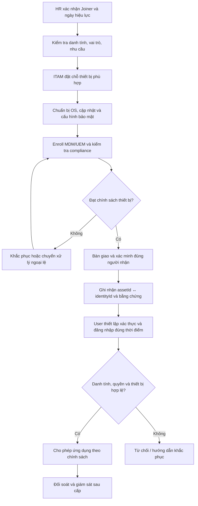
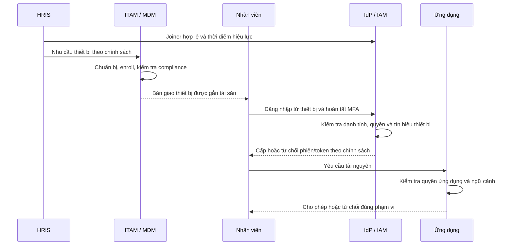

# Cấp thiết bị trong Joiner lifecycle: bàn giao đúng người và kiểm soát truy cập an toàn

Trong mô hình **Joiner–Mover–Leaver (JML)** của quản lý danh tính và truy cập (*Identity and Access Management* — **IAM**), **cấp thiết bị** là bước chuẩn bị máy tính, điện thoại hoặc thiết bị công việc cho người mới gia nhập tổ chức. Đó không chỉ là giao một chiếc laptop: thiết bị cần được gắn với đúng nhân sự, có cấu hình bảo mật phù hợp, được ghi nhận trong hệ thống tài sản và có thể sử dụng để truy cập những ứng dụng mà người đó thực sự được cấp quyền.

Bài học thuộc chương **Joiner lifecycle** của module `SECURITY_IDENTITY_ACCESS_MANAGEMENT_IDENTITY_LIFECYCLE`. Nội dung nối dữ liệu nhân sự đã xác minh, danh tính trong Identity Provider (IdP), đăng nhập SSO, chính sách thiết bị và quyền RBAC/ABAC với quy trình bàn giao và vận hành tài sản. Cách thiết kế tốt phải giúp nhân viên làm việc đúng ngày bắt đầu, đồng thời giảm rủi ro máy chưa được quản lý, tài khoản dùng chung, token bị lưu trên thiết bị thất lạc và quyền truy cập tồn dư khi chuyển vai trò hoặc nghỉ việc.

Sau khi học, bạn có thể xác định điều kiện để cấp thiết bị cho Joiner, phân biệt cấp **tài sản** với cấp **quyền truy cập**, mô tả quy trình đăng ký thiết bị vào hệ thống quản lý, thiết kế bằng chứng bàn giao, xử lý các ngoại lệ và kiểm thử trạng thái bảo mật trước lần đăng nhập đầu tiên.

## 1. Cấp thiết bị nằm ở đâu trong vòng đời Joiner?

Một người mới thường cần đồng thời: danh tính hợp lệ, tài khoản, quyền truy cập và môi trường làm việc. Các phần này có liên quan nhưng mang trạng thái riêng.

| Đối tượng | Hành động chính | Điều kiện hoàn tất cần chứng minh |
| --- | --- | --- |
| **Hồ sơ nhân sự** | Xác nhận tư cách nhân sự, ngày bắt đầu, đơn vị và người quản lý | Bản ghi đến từ nguồn có thẩm quyền, được đối chiếu đúng người |
| **Danh tính IAM / IdP** | Tạo hoặc chuẩn bị user và cơ chế xác thực | User ID ổn định, trạng thái phù hợp với thời điểm hiệu lực |
| **Quyền ứng dụng** | Ánh xạ vai trò công việc thành nhóm/entitlement theo RBAC/ABAC | Quyền tối thiểu được phê duyệt và có hiệu lực đúng lúc |
| **Thiết bị vật lý** | Chọn, cấu hình, vận chuyển và bàn giao | Tài sản được gán cho đúng người, có bằng chứng tiếp nhận |
| **Thiết bị được quản lý** | Enroll vào MDM/UEM, áp chính sách và kiểm tra tuân thủ | Có định danh thiết bị, cấu hình bắt buộc và trạng thái có thể kiểm chứng |
| **Phiên truy cập thực tế** | Đăng nhập IdP/SSO và mở ứng dụng từ thiết bị | Danh tính, quyền, ngữ cảnh và điều kiện thiết bị đều đáp ứng chính sách |

**Bàn giao laptop thành công không tự chứng minh truy cập đã an toàn.** Nhân viên có thể đã nhận máy nhưng thiết bị chưa đăng ký vào nền tảng quản lý; ngược lại máy đã chuẩn bị xong trong kho vẫn chưa thuộc về người đó. Hệ thống IAM nên theo dõi được cả hai trạng thái để tránh việc nhân viên bị chặn nhầm trong ngày đầu hoặc được đăng nhập từ máy chưa đạt yêu cầu.

## 2. Các bên tham gia và trách nhiệm

Tùy quy mô tổ chức, một người có thể kiêm nhiều vai trò. Điều quan trọng là phân định **ai xác nhận dữ liệu**, **ai quản lý tài sản**, **ai cấp quyền** và **ai chịu trách nhiệm khi sai lệch**.

| Bên liên quan | Trách nhiệm trong cấp thiết bị | Dữ liệu hoặc bằng chứng cung cấp |
| --- | --- | --- |
| **HR / hệ thống HRIS** | Thông báo Joiner đã được duyệt, ngày bắt đầu, loại nhân sự và thay đổi lịch | `sourcePersonId`, `employmentStatus`, `effectiveAt`, đơn vị |
| **Người quản lý / bộ phận tiếp nhận** | Xác nhận nhu cầu công việc, loại thiết bị và phần mềm cần dùng | Yêu cầu theo vai trò, phê duyệt ngoại lệ |
| **IT Service Desk / quản lý tài sản (ITAM)** | Cấp, chuẩn bị, giao và ghi nhận tình trạng tài sản | Mã tài sản, số sê-ri, phiếu bàn giao, trạng thái vận chuyển |
| **Đội quản lý endpoint (MDM/UEM/EDR)** | Cấu hình thiết bị, mã hóa, cập nhật, phát hiện rủi ro và chính sách tuân thủ | Enrollment ID, thời điểm kiểm tra, trạng thái compliance |
| **IAM / IdP** | Liên kết user, kiểm soát xác thực, cấp quyền, điều kiện truy cập | Identity ID, nhóm/role, quyết định cho phép hoặc từ chối |
| **Người dùng** | Xác minh khi nhận, bảo vệ thiết bị và đăng ký phương thức xác thực được duyệt | Biên bản tiếp nhận, xác nhận hoàn thành bước thiết lập |
| **An ninh thông tin** | Đặt chính sách thiết bị, xử lý trường hợp nguy cơ cao và ngoại lệ | Chính sách, kiểm soát rủi ro, kết quả xử lý sự cố |

**Điểm kiểm soát:** Service Desk không nên tự cấp vai trò quản trị chỉ vì đang cài máy, và người quản lý tài sản không được xem chữ ký bàn giao là sự phê duyệt truy cập dữ liệu nhạy cảm. Quyền ứng dụng phải được quyết định bởi chính sách và người có thẩm quyền tương ứng.

## 3. Điều kiện đầu vào trước khi cấp thiết bị

Một đơn hàng thiết bị có thể bắt đầu trước ngày nhận việc để bảo đảm sẵn sàng, nhưng phải kiểm tra ít nhất bốn nhóm dữ liệu:

1. **Danh tính và tư cách:** có định danh nhân sự ổn định, nguồn đáng tin cậy, trạng thái Joiner được duyệt và ngày bắt đầu hợp lệ. Không ghép người chỉ bằng họ tên hoặc email có thể tái sử dụng.
2. **Nhu cầu nghiệp vụ:** vai trò, địa điểm làm việc, yêu cầu phần cứng, phần mềm và yêu cầu tiếp cận dành cho người dùng. Không mặc định thiết bị cấu hình đặc quyền cao cho mọi người.
3. **Thông tin giao nhận:** địa điểm hoặc phương thức bàn giao, người nhận hợp lệ, ngày cần có thiết bị và đầu mối hỗ trợ. Thông tin địa chỉ cá nhân phải được xử lý theo quy định bảo vệ dữ liệu.
4. **Khả năng quản lý kỹ thuật:** thiết bị thuộc danh mục được phép, đủ điều kiện enroll, có chính sách mã hóa, cập nhật và quản trị tập trung phù hợp.

Nếu HR trì hoãn ngày bắt đầu, lịch giao máy có thể thay đổi theo tình huống nhưng **việc kích hoạt đăng nhập và quyền truy cập** vẫn phải gắn với thời điểm có hiệu lực đã xác nhận. Không nên dùng việc đã vận chuyển thiết bị làm tín hiệu tự động mở quyền ứng dụng.

### Định danh người và định danh thiết bị phải tách biệt

| Thành phần | Ví dụ minh họa | Dùng để làm gì? |
| --- | --- | --- |
| `identityId` | `id-9d47` | Liên kết người dùng xuyên các hệ thống IAM |
| `hrPersonId` | `EMP-005184` | Đối chiếu với nguồn HR có thẩm quyền |
| `assetId` | `LAP-02417` | Quản lý vòng đời tài sản trong ITAM |
| `serialNumber` | `SERIAL-EXAMPLE-842` | Nhận diện phần cứng; kiểm tra với hệ thống đăng ký thiết bị |
| `deviceId` | `device-4a12` | Định danh thiết bị trong MDM/UEM/IdP, tùy nền tảng |
| `assignmentId` | `assign-01209` | Liên kết người nhận, tài sản và lần bàn giao cụ thể |

Một thiết bị có thể được chuyển từ nhân viên này sang nhân viên khác sau khi thu hồi và làm sạch theo chính sách. Do đó, **thiết bị và người sử dụng không phải cùng một danh tính**; quan hệ giữa chúng có thời điểm bắt đầu, kết thúc và lịch sử. ID thiết bị của MDM cũng không nhất thiết trùng số sê-ri hoặc mã tài sản nội bộ.

## 4. Quy trình cấp thiết bị từ chuẩn bị đến truy cập



Đây là luồng tham khảo. Bước enroll có thể diễn ra trước hoặc sau bàn giao tùy phương thức triển khai: thiết bị có thể được chuẩn bị sẵn trong kho, hoặc tự enroll khi người dùng khởi động và xác thực lần đầu. Nhưng khi chính sách yêu cầu **thiết bị được quản lý trước khi truy cập dữ liệu**, hệ thống phải thực thi điều kiện đó tại đúng điểm cấp token, phiên hoặc API liên quan; chỉ ghi chú trên phiếu bàn giao là chưa đủ.

### 4.1. Chuẩn bị (*pre-provisioning*)

IT chọn thiết bị được phê duyệt, kiểm tra tình trạng và quyền sở hữu, cài hệ điều hành/hình ảnh chuẩn, bản vá, cấu hình mã hóa, bảo vệ endpoint và công cụ quản lý. Có thể dùng cơ chế đăng ký tự động của nền tảng khi phù hợp. Trước khi giao, cần xác định rõ thiết bị đang là hàng tồn, đã đặt chỗ hay đã được gán cho nhân viên; tránh hai Joiner cùng nhận một `assetId` do xử lý song song.

Việc chuẩn bị có thể gồm cài ứng dụng chung, tạo hồ sơ thiết bị và kiểm tra kết nối quản lý. **Không nên đăng nhập thay nhân viên bằng mật khẩu của họ**, lưu mật khẩu mặc định hoặc để token của kỹ thuật viên tồn tại trong hồ sơ của người nhận. Nếu phải dùng tài khoản triển khai kỹ thuật, cần tách khỏi tài khoản người dùng và xử lý sạch dấu vết/truy cập theo chính sách.

### 4.2. Enroll thiết bị và áp cấu hình bảo mật

**Mobile Device Management (MDM)** hoặc **Unified Endpoint Management (UEM)** giúp áp chính sách và thu thập trạng thái thiết bị. **Endpoint Detection and Response (EDR)** bổ sung phát hiện và ứng phó nguy cơ trên endpoint. Các công cụ này có mục đích khác nhau, không thể thay thế trực tiếp cho IdP hoặc quyền ứng dụng.

Một bộ điều kiện thường được cân nhắc gồm:

- Thiết bị đăng ký và thuộc phạm vi quản lý được chấp nhận, có người hoặc nhóm chịu trách nhiệm.
- Hệ điều hành và bản vá đáp ứng mức tối thiểu theo chính sách; không có trạng thái bị chặn đã xác định.
- Mã hóa lưu trữ, khóa màn hình và cơ chế bảo vệ thông tin xác thực được bật khi thiết bị hỗ trợ.
- Công cụ bảo vệ endpoint hoặc tín hiệu sức khỏe thiết bị đang hoạt động theo yêu cầu.
- Không tồn tại cấu hình cấp đặc quyền cục bộ rộng không cần thiết cho người dùng thông thường.
- Kết quả compliance có **thời điểm kiểm tra**; không tin mãi một trạng thái từng đạt chuẩn từ nhiều tháng trước.

Chính sách phải phù hợp với loại thiết bị. Laptop quản lý tập trung, điện thoại dùng cho công việc, máy kiosk dùng chung và thiết bị cá nhân (*Bring Your Own Device* — BYOD) có thể áp dụng những cơ chế khác nhau. Với BYOD, tổ chức cần cân bằng quyền riêng tư cá nhân, khả năng quản lý ứng dụng và bảo vệ dữ liệu; không mặc định có quyền kiểm soát hoặc xóa toàn bộ dữ liệu cá nhân.

### 4.3. Bàn giao và xác nhận người nhận

Đối với nhân viên tại văn phòng, có thể kiểm tra danh tính trực tiếp theo quy trình. Với nhân viên làm việc từ xa, có thể dùng vận chuyển có bằng chứng nhận hàng cộng với một bước xác minh người nhận qua kênh đã được phê duyệt. Chỉ thấy gói hàng “đã giao” tại địa chỉ **không đủ** chứng minh chính nhân viên đã cầm thiết bị.

Biên bản bàn giao nên có mã lần giao, `assetId`, thiết bị, người nhận gắn bằng ID ổn định, thời gian, tình trạng, các phụ kiện liên quan và người hoặc hệ thống xác nhận. Hạn chế đưa dữ liệu cá nhân quá mức vào phiếu công khai. Nếu thiết bị không tới tay đúng người, báo lỗi và xử lý theo quy trình thay vì đánh dấu cấp xong để kịp KPI.

### 4.4. Đăng nhập lần đầu và sử dụng ứng dụng

Sau khi xác minh được người nhận và chính sách cho phép, người dùng tự thiết lập phương thức xác thực, chẳng hạn MFA/passkey theo nền tảng, đăng nhập và nhận đúng quyền đã cấp. Tại thời điểm truy cập ứng dụng, cần phân biệt ba kiểm tra:

1. **Ai đang đăng nhập?** IdP xác thực danh tính người dùng; thiết bị đã đăng ký không tự chứng minh ai đang cầm máy.
2. **Người đó được làm gì?** RBAC/ABAC, trạng thái JML và chính sách của ứng dụng quyết định tài nguyên/hành động được phép.
3. **Thiết bị có được chấp nhận không?** Chính sách truy cập có điều kiện có thể xét trạng thái quản lý/compliance cùng các tín hiệu rủi ro.

Việc đăng nhập SSO thành công không đồng nghĩa mọi ứng dụng đã được SCIM cấp tài khoản và quyền. Cần kiểm tra riêng kết quả provisioning khi quy trình phụ thuộc nó.

## 5. Liên kết thiết bị với IAM, SSO, SCIM và phân quyền



**IdP** quản lý danh tính và xác thực, **SSO** giúp người dùng đăng nhập qua một nguồn tin cậy, còn **SCIM/API** có thể cấp tài khoản hoặc nhóm tại ứng dụng đích. Hệ thống quản lý endpoint cung cấp **tín hiệu thiết bị**, nhưng không thay thế việc xác thực danh tính hay quyết định quyền ở ứng dụng. **RBAC** xác định vai trò và quyền theo công việc; **ABAC** có thể xét trạng thái người dùng, tài nguyên, thiết bị, thời điểm hoặc môi trường.

Ví dụ chính sách minh họa (không phải cú pháp một IdP cụ thể):

```text
Cho phép truy cập ứng dụng tài chính khi:
    subject.active == true
    AND subject.hasRole("finance.viewer")
    AND authentication.meetsRequiredAssurance == true
    AND device.isManaged == true
    AND device.complianceStatus == "compliant"
    AND resource.organizationId IN subject.allowedOrganizations

Nếu không đáp ứng: từ chối hoặc yêu cầu bước khắc phục được chính sách cho phép.
```

Các thuộc tính thiết bị phải đến từ nguồn đáng tin cậy, được liên kết với phiên/thiết bị đang yêu cầu truy cập và có thời gian hiệu lực phù hợp. Không tin vào một header HTTP tự khai báo `deviceCompliant: true`, hay thông tin dễ giả mạo như tên máy. Ứng dụng/API cần thực thi kiểm tra quyền ở đúng điểm truy cập; ẩn nút giao diện không đủ bảo vệ dữ liệu.

### “Thiết bị đạt chuẩn” không có nghĩa “được cấp mọi quyền”

Một nhân viên mới dùng laptop đạt chuẩn vẫn có thể chưa được phép đọc hồ sơ khách hàng hoặc quản trị sản xuất. Ngược lại, nhân viên có quyền `finance.viewer` nhưng dùng thiết bị ngoài chính sách có thể bị chặn truy cập tài nguyên nhạy cảm. Quyền hợp lệ là kết quả tổng hợp của **danh tính + vai trò/thuộc tính + tài nguyên/hành động + ngữ cảnh thiết bị**.

## 6. Quản lý trạng thái cấp thiết bị và tính nhất quán

Thay vì một cờ `deviceIssued=true`, nên theo dõi các trạng thái vận hành có ý nghĩa, chẳng hạn:

| Trạng thái minh họa | Ý nghĩa | Có đồng nghĩa được truy cập ứng dụng không? |
| --- | --- | --- |
| `REQUESTED` | Có yêu cầu thiết bị cho Joiner | Không |
| `RESERVED` | Thiết bị đã được đặt chỗ đúng người | Không |
| `PREPARED` | Thiết bị đã cấu hình theo chính sách chuẩn bị | Chưa chắc; còn điều kiện identity/compliance |
| `ENROLLED` | Có liên kết thiết bị với MDM/UEM | Chưa chắc; chưa xác nhận đạt chuẩn hoặc nhận máy |
| `READY_FOR_HANDOFF` | Thiết bị đủ điều kiện kỹ thuật để bàn giao | Không |
| `DELIVERED` | Có bằng chứng giao nhận | Không |
| `ACKNOWLEDGED` | Người nhận xác minh việc bàn giao | Không mặc nhiên |
| `ACTIVE_ASSIGNED` | Tài sản được gán cho người dùng đang làm việc | Chỉ khi chính sách IAM và ứng dụng đều cho phép |
| `EXCEPTION` | Có lỗi hoặc ngoại lệ cần xử lý | Tùy chính sách, thường phải hạn chế truy cập liên quan |

Đây là ví dụ thiết kế trạng thái, không phải bộ trạng thái chuẩn của mọi ITAM/MDM. Trong hệ thống thật, trạng thái giao nhận, compliance và quyền ứng dụng nên được quản lý thành **những nguồn sự thật riêng** rồi đối soát; không phải tất cả đều biến đổi theo một đường thẳng. Một máy đã nhận có thể trở thành `noncompliant` khi hết hạn cập nhật, trong khi quan hệ tài sản với nhân viên vẫn không đổi.

Ví dụ dữ liệu bàn giao tối thiểu để liên kết (chỉ minh họa):

```yaml
assignmentId: assign-01209
identityId: id-9d47
assetId: LAP-02417
deviceId: device-4a12
assignedBy: it-service-desk
preparedAt: "2026-11-30T04:00:00Z"
acknowledgedAt: "2026-12-01T02:05:00Z"
status: ACTIVE_ASSIGNED
compliance:
  status: compliant
  evaluatedAt: "2026-12-01T02:02:00Z"
```

Thực tế cần thêm nguồn, phiên bản và các kiểm tra thích hợp. **Không dùng trường `assignedBy` tự khai báo trong request công khai làm bằng chứng người giao có thẩm quyền**. Hệ thống phải lấy danh tính người thực hiện từ phiên đã xác thực và tạo audit riêng.

### Phòng tránh cấp trùng và xử lý lỗi từng phần

Hai yêu cầu Joiner có thể đồng thời chọn một laptop còn trong kho. ITAM cần cơ chế giữ chỗ **nguyên tử theo `assetId`**, kiểm tra rằng một tài sản chỉ có một người nhận đang hoạt động tại một thời điểm, và xử lý retry idempotent bằng `assignmentId` hoặc mã yêu cầu ổn định.

Nếu MDM enroll thành công nhưng giao nhận thất bại, **không đánh dấu bàn giao hoàn tất**. Nếu ITAM đã bàn giao nhưng MDM chưa xác nhận tuân thủ, cần theo dõi lỗi và hướng dẫn khắc phục. Không giả định một giao dịch cơ sở dữ liệu sẽ đồng thời khóa được mọi thay đổi ở HRIS, IdP, ITAM, MDM và ứng dụng SaaS; cần trạng thái trung gian, đối soát và bù trừ có kiểm soát.

## 7. Xử lý ngoại lệ khi cấp thiết bị

| Trường hợp | Rủi ro chính | Cách xử lý theo chính sách |
| --- | --- | --- |
| Joiner bị hoãn ngày nhận việc | Quyền và tài sản được kích hoạt quá sớm | Cập nhật lịch onboarding, giữ quyền đăng nhập theo `effectiveAt` mới; xử lý thiết bị đã giao theo quy trình |
| Thiết bị chậm vận chuyển | Người dùng không thể làm việc đúng ngày | Bố trí thiết bị dự phòng đã quản lý, phương án truy cập thay thế được duyệt hoặc đổi lịch công việc |
| Giao nhầm người / mất trong vận chuyển | Lộ thiết bị, thông tin xác thực và dữ liệu | Ghi nhận sự cố, vô hiệu hóa/khóa theo khả năng, đánh giá rủi ro phiên và tổ chức bàn giao lại |
| Không enroll được MDM | Không áp dụng được chính sách thiết bị | Khắc phục kỹ thuật; chỉ cho truy cập theo ngoại lệ được đánh giá và giới hạn |
| Thiết bị không đạt compliance | Nguy cơ từ bản vá, mã hóa hoặc bảo vệ endpoint | Chặn tài nguyên theo policy, hướng dẫn khắc phục và kiểm tra lại |
| Thiết bị BYOD | Khó bảo đảm trạng thái thiết bị và quyền riêng tư người dùng | Áp chính sách BYOD riêng; quản lý ứng dụng/dữ liệu công việc theo khả năng và sự đồng ý cần thiết |
| Nhân viên cần công cụ trợ năng hoặc phần cứng chuyên dụng | Gián đoạn công việc hoặc quy trình không tiếp cận được | Xác định nhu cầu sớm, bố trí thiết bị/phương thức xác thực phù hợp và bảo vệ dữ liệu cá nhân |
| Người dùng chưa đăng ký MFA tại thời điểm nhận máy | Chưa đủ điều kiện truy cập dịch vụ yêu cầu xác thực mạnh | Cho thực hiện quy trình đăng ký/khôi phục an toàn; không tắt MFA đại trà |

Khi có ngoại lệ, tối thiểu cần **lý do, người phê duyệt, tài nguyên và thời hạn áp dụng, biện pháp thay thế, nhật ký và cơ chế hết hạn**. Không hợp thức hóa một ngoại lệ tạm bằng quyền truy cập lâu dài hoặc bằng cách tắt kiểm soát trên toàn bộ tổ chức.

### Tình huống mất thiết bị ngày đầu

Nếu laptop của Joiner mất trước khi người đó đăng nhập lần đầu, đội IT cần xác minh tài sản đã được giao đến đâu, đánh dấu sự cố, áp dụng khóa hoặc xóa từ xa khi nền tảng hỗ trợ và thích hợp, đánh giá xem dữ liệu hoặc token nào đã tồn tại, rồi cấp máy thay thế. Thao tác xóa từ xa không phải lúc nào cũng được thực thi ngay nếu máy không kết nối mạng; vì vậy, mã hóa lưu trữ và không đặt bí mật trước khi bàn giao là lớp bảo vệ quan trọng.

## 8. Sau Joiner: Mover, Leaver và tái sử dụng thiết bị

Cấp thiết bị nằm ở Joiner nhưng tạo ra một mối liên kết phải được quản lý trong toàn bộ vòng đời.

**Mover — đổi vai trò hoặc địa điểm:** người dùng có thể giữ nguyên laptop nhưng cần thay cấu hình, ứng dụng và quyền theo vị trí mới. Nếu chuyển sang công việc có yêu cầu bảo mật cao, cần kiểm tra lại thiết bị có đạt điều kiện hay phải cấp máy khác. Việc giữ nguyên tài sản **không đồng nghĩa giữ nguyên quyền ứng dụng**. Nếu có chuyển tài sản cho người khác, cần chấm dứt quan hệ cấp phát cũ, làm sạch dữ liệu/hồ sơ phù hợp và tạo một assignment mới.

**Leaver — nghỉ việc:** HR và IAM xác định thời điểm chặn truy cập theo chính sách; ITAM tổ chức thu hồi máy, phụ kiện, thẻ hoặc các tài sản liên quan. IdP vô hiệu hóa khả năng đăng nhập phù hợp, các phiên/token và quyền SaaS được xử lý theo khả năng hệ thống, đồng thời công cụ endpoint có thể khóa, làm sạch hoặc xóa dữ liệu công việc theo quy trình. **Chưa lấy lại được máy không phải lý do trì hoãn chặn truy cập của người đã rời tổ chức.**

**Tái sử dụng hoặc thanh lý:** trước khi cấp máy cho người tiếp theo, cần thực hiện quy trình xóa dữ liệu phù hợp, gỡ hồ sơ người dùng cũ, thu hồi đăng ký hoặc điều chỉnh sở hữu trong MDM/UEM và ITAM, kiểm tra thiết bị sẵn sàng rồi mới tái cấp. Lịch sử bàn giao cần được lưu phục vụ kiểm toán; không để quyền hoặc thông tin xác thực cũ tiếp tục có tác dụng trên máy mới cấp.

**Tài khoản dịch vụ / workload identity:** công cụ quản lý endpoint, triển khai phần mềm hoặc tự động hóa có thể dùng danh tính máy để gọi API. Các tài khoản này có vòng đời và chủ sở hữu riêng, cần quyền tối thiểu, credential an toàn và kiểm tra khi người quản trị đổi vai trò hoặc nghỉ việc. Không nên nhúng API key đặc quyền cố định vào image máy rồi phát cho mọi Joiner.

## 9. Kiểm toán và đo hiệu quả quy trình

Để biết cấp thiết bị có thực sự sẵn sàng và an toàn, cần đo cả **tiến độ bàn giao** lẫn **khả năng truy cập hợp lệ**:

| Chỉ số | Cách đo minh họa | Vấn đề giúp phát hiện |
| --- | --- | --- |
| Tỷ lệ có thiết bị trước ngày bắt đầu | Số Joiner đã được xác nhận bàn giao đúng hạn / tổng Joiner cần cấp máy | Tắc nghẽn mua sắm, chuẩn bị hoặc vận chuyển |
| Thời gian chuẩn bị | `preparedAt - requestApprovedAt` | Độ trễ kỹ thuật trước bàn giao |
| Thời gian hoàn thành enrollment | Từ lúc bắt đầu enroll đến khi có trạng thái được xác minh | Lỗi cấu hình MDM/UEM hoặc kết nối |
| Tỷ lệ compliance tại ngày đầu | Số máy Joiner đạt chính sách / tổng máy cần đánh giá | Máy thiếu bản vá, mã hóa, bảo vệ endpoint |
| Tỷ lệ đăng nhập và làm việc thành công | Joiner hoàn tất đăng nhập và sử dụng đúng ứng dụng được cấp / tổng trong phạm vi | Sự lệch giữa cấp máy, IdP và quyền ứng dụng |
| Số ngoại lệ quá hạn | Ngoại lệ chưa khắc phục sau thời hạn phê duyệt | Truy cập tạm biến thành không kiểm soát |
| Sai lệch ITAM–MDM–IAM | Quan hệ người–máy hoặc trạng thái quản lý không khớp giữa các hệ thống | Thiết bị mồ côi, gán nhầm hoặc không được quản lý |

Không nên đánh dấu KPI “cấp máy thành công” chỉ vì yêu cầu đã chuyển sang `DELIVERED`. Thời điểm bàn giao, xác nhận người nhận, trạng thái compliance và kiểm thử lần đăng nhập đầu phải được ghi nhận phù hợp. Các mục tiêu SLA là chính sách riêng của tổ chức, cần thiết kế theo rủi ro, địa điểm và năng lực cung ứng.

### Dấu vết kiểm toán nên có

Đối với mỗi assignment, lưu ID Joiner, ID thiết bị và tài sản, yêu cầu/phê duyệt, thời điểm chuẩn bị, trạng thái MDM, người xác nhận giao/nhận, thay đổi liên quan, chính sách áp dụng, kết quả và đầu mối xử lý lỗi. Bảo vệ nhật ký và thông tin giao nhận; tránh ghi mật khẩu, khóa, access token hoặc dữ liệu cá nhân không cần thiết.

## 10. Ví dụ xuyên suốt: nhân viên mới làm việc từ xa

Giả sử một nhân viên phân tích dữ liệu bắt đầu làm việc vào **09:00 ngày 01/12** và làm việc từ xa. Công ty dự kiến cấp laptop quản lý tập trung.

| Thời điểm | Thao tác | Trạng thái mong đợi |
| --- | --- | --- |
| 26/11 | HR xác nhận Joiner, ngày bắt đầu và nhu cầu thiết bị | IAM nhận đúng ID nhân sự; ITAM tạo yêu cầu có người chịu trách nhiệm |
| 27/11 | ITAM đặt chỗ laptop và chuẩn bị hệ điều hành | `assetId` duy nhất, cấu hình chuẩn, chưa kích hoạt quyền ứng dụng quá sớm |
| 28/11 | Đăng ký thiết bị và gửi cho nhân viên | Có liên kết với MDM/UEM; vận chuyển được theo dõi |
| 30/11 | Người nhận xác minh bàn giao, kiểm tra máy và hướng dẫn MFA | Biên bản tiếp nhận; không nhờ nhân viên gửi mật khẩu hoặc mã MFA cho IT |
| 01/12 lúc 09:00 | Tài khoản và quyền cơ sở có hiệu lực theo HR/IAM | IdP xác thực người dùng, chính sách thiết bị được kiểm tra, ứng dụng cấp đúng quyền |
| Sau ngày đầu | ITAM/IAM đối soát tình trạng và hỗ trợ lỗi | Không còn thiếu tài khoản, máy không đạt chuẩn hoặc quyền ngoài nhu cầu |

Hai sự cố có thể xảy ra:

**Sự cố A — thiết bị đã giao nhưng `noncompliant`:** người dùng đăng nhập SSO vào một ứng dụng nhạy cảm nhưng chính sách thiết bị chặn truy cập. IT kiểm tra nguyên nhân (ví dụ, thiếu bản vá hoặc enrollment chưa hoàn tất), hướng dẫn khắc phục và kiểm tra lại. Không nên tắt kiểm tra thiết bị cho toàn bộ nhân viên chỉ để một Joiner có thể đăng nhập.

**Sự cố B — HR hoãn ngày bắt đầu sang 03/12:** laptop đã đến tay người nhận không chứng minh quyền công việc bắt đầu từ 01/12. IAM cập nhật `effectiveAt` của việc kích hoạt theo dữ liệu có thẩm quyền, giữ quyền hạn chế cho đến mốc mới và ghi lịch sử thay đổi. ITAM có thể tiếp tục theo dõi thiết bị đã giao; hai trạng thái được quản lý độc lập.

Ví dụ này cho thấy **chuẩn bị sớm giúp tăng tính sẵn sàng**, còn **kích hoạt quyền đúng thời điểm và thực thi điều kiện thiết bị** giúp giữ ranh giới bảo mật.

## 11. Checklist và câu hỏi tự kiểm tra

Checklist trước khi chốt một Joiner đã được cấp thiết bị:

1. Hồ sơ HR có nguồn đáng tin, identity ID ổn định, ngày hiệu lực và người quản lý phù hợp chưa?
2. Thiết bị có `assetId`, `deviceId` và assignment rõ ràng, không bị cấp đồng thời cho hai người không?
3. Máy có được cấu hình, mã hóa, cập nhật và enroll theo chính sách không? Trạng thái compliance có còn mới không?
4. Người nhận có được xác minh và có bằng chứng bàn giao, kể cả khi làm việc từ xa không?
5. Quyền đăng nhập và ứng dụng có được kích hoạt theo điều kiện nghiệp vụ, độc lập với thời gian vận chuyển không?
6. Lần đăng nhập đầu có xác thực đúng người và kiểm tra quyền trên ứng dụng không? Thiết bị đạt chuẩn có bị hiểu nhầm thành được quyền mọi tài nguyên không?
7. Có đường xử lý máy chậm giao, không tuân thủ, thất lạc, BYOD và trường hợp cần hỗ trợ đặc biệt không?
8. Có thể đối soát ITAM, MDM, IdP và trạng thái ứng dụng, đồng thời thu hồi máy/quyền khi Mover hoặc Leaver không?

**Câu hỏi 1.** Một nhân viên đã nhận laptop và biên bản ký nhận hợp lệ. Có thể coi họ đã được xác thực vào IdP không?

**Trả lời:** Không. Bàn giao chứng minh trạng thái tài sản theo quy trình, còn IdP cần xác thực danh tính ở thời điểm đăng nhập. Quyền ứng dụng cũng phải được kiểm tra riêng.

**Câu hỏi 2.** Laptop đã đạt trạng thái MDM `compliant` nhưng Joiner chưa đến ngày bắt đầu. Có nên tự mở quyền dữ liệu nội bộ?

**Trả lời:** Không. Compliance chỉ phản ánh điều kiện thiết bị; quyền còn phụ thuộc tư cách, thời điểm hiệu lực, chính sách và phê duyệt.

**Câu hỏi 3.** Khi nhân viên nghỉ việc nhưng chưa trả laptop, tổ chức có cần chờ thu máy mới khóa tài khoản?

**Trả lời:** Không. Chặn truy cập ở IdP và các hệ thống liên quan theo chính sách là bước cần thực hiện đúng thời điểm; thu hồi tài sản và xử lý dữ liệu trên thiết bị là luồng song song cần theo dõi.

**Câu hỏi 4.** Có thể dùng số sê-ri laptop như khóa duy nhất đại diện cho nhân viên trong IAM không?

**Trả lời:** Không. Thiết bị có thể đổi chủ hoặc bị thay thế. Phải dùng ID người ổn định và lưu quan hệ cấp thiết bị có thời hạn.

## Kết luận

**Cấp thiết bị** trong Joiner lifecycle là quy trình kết hợp quản lý tài sản, xác minh người nhận, chuẩn hóa endpoint và kiểm soát truy cập theo danh tính. HR xác nhận người và ngày bắt đầu; ITAM quản lý tài sản và bàn giao; MDM/UEM/EDR cung cấp trạng thái kỹ thuật; IdP, SSO, SCIM và RBAC/ABAC quản lý xác thực và quyền trên ứng dụng. Khi các hệ thống được liên kết bằng định danh ổn định, trạng thái có bằng chứng và quy trình đối soát, người mới có thể bắt đầu công việc đúng hạn trong khi thiết bị, phiên và quyền truy cập vẫn được quản trị an toàn suốt Joiner–Mover–Leaver.
