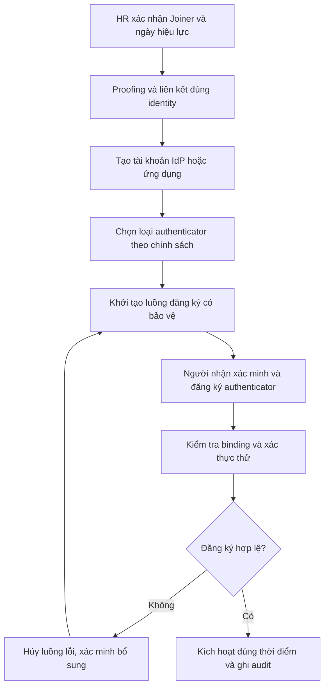

# Cấp credential trong Joiner lifecycle

Trong **Identity and Access Management (IAM)**, **credential** là dữ liệu hoặc phương tiện được sử dụng trong cơ chế chứng thực để chứng minh quyền kiểm soát một danh tính hoặc tài khoản. Credential có thể là mật khẩu, khóa riêng gắn với passkey, chứng thư số, khóa API hoặc bí mật ứng dụng. **Cấp credential** trong giai đoạn **Joiner** là tổ chức việc đăng ký, phát hành, bàn giao hoặc kích hoạt phương tiện chứng thực cho chủ thể mới, sao cho đúng người hoặc đúng workload nhận được phương tiện phù hợp, tại thời điểm được phép.

Đây là một bước của mô hình vòng đời **Joiner–Mover–Leaver (JML)**. Một danh tính đã được xác minh, một tài khoản đã được tạo và quyền đã được phê duyệt vẫn chưa đủ để truy cập an toàn nếu credential được gửi nhầm người, kích hoạt quá sớm, bị lưu lộ hoặc không thể thu hồi. Ngược lại, **có credential hợp lệ không đồng nghĩa được phép truy cập mọi tài nguyên**: hệ thống vẫn cần xác thực qua **IdP/SSO** và phân quyền theo **RBAC/ABAC** tại ứng dụng.

## 1. Credential, authenticator, session và quyền khác nhau thế nào?

| Khái niệm | Chức năng | Ví dụ |
| --- | --- | --- |
| **Identity** | Biểu diễn người hoặc workload mà tổ chức quản lý | Nhân viên có mã `EMP-2048` |
| **Account** | Tài khoản cụ thể tại IdP hoặc ứng dụng | `linh@company.example` |
| **Credential** | Thông tin chứng thực hoặc thành phần mật mã dùng trong quá trình xác thực | Mật khẩu, khóa riêng, client secret |
| **Authenticator** | Phương tiện hoặc cơ chế người dùng kiểm soát để xác thực | Passkey trên thiết bị, khóa bảo mật FIDO2, ứng dụng TOTP |
| **Access token/session** | Đại diện cho quyền truy cập hoặc trạng thái xác thực đã thiết lập trong một khoảng thời gian | OAuth access token, cookie phiên |
| **Role/entitlement** | Tập quyền hoặc hành động được cấp | `ticket-reader`, quyền gọi API báo cáo |

Các thuật ngữ có thể được sản phẩm dùng khác nhau. Ví dụ passkey là thông tin xác thực dựa trên cặp khóa công khai/riêng: phía dịch vụ lưu khóa công khai, còn khóa riêng do authenticator quản lý. **Không nên coi access token, mật khẩu và vai trò là cùng một loại đối tượng** chỉ vì tất cả có thể ảnh hưởng đến việc truy cập.

## 2. Những loại credential thường được cấp

| Chủ thể / mục đích | Phương thức | Điểm cần lưu ý |
| --- | --- | --- |
| Nhân viên đăng nhập hằng ngày | Passkey/FIDO2 hoặc mật khẩu kết hợp MFA | Chống phishing, quy trình đăng ký và khôi phục an toàn |
| Người dùng cần thiết bị vật lý | Khóa bảo mật phần cứng | Bàn giao đúng người, quản lý thất lạc và khóa dự phòng |
| Ứng dụng doanh nghiệp cũ | Mật khẩu ban đầu hoặc liên kết kích hoạt có thời hạn | Bắt buộc thay đổi khi phù hợp, không phát qua kênh không bảo vệ |
| Dịch vụ gọi API | Workload federation, chứng thư hoặc khóa mật mã | Danh tính dịch vụ riêng, phạm vi quyền tối thiểu, xoay vòng |
| Hệ thống không hỗ trợ định danh workload hiện đại | API key/client secret | Lưu ở secret manager, không nhúng mã nguồn và có hạn/chu kỳ đổi |
| Tài khoản có quyền cao | Authenticator kháng phishing và cơ chế kiểm soát đặc quyền | Xác thực mạnh, cấp quyền theo nhu cầu và giám sát |

**Ưu tiên credential chống phishing** khi hệ thống hỗ trợ và mức rủi ro phù hợp. Trong môi trường sử dụng passkey, khóa riêng thường không được hệ thống IAM phát và gửi trực tiếp cho người dùng; thay vào đó, người dùng **đăng ký authenticator** qua một quy trình đã xác minh và hệ thống lưu thông tin khóa công khai tương ứng.

## 3. Điều kiện trước khi cấp credential

Quy trình Joiner cần có những điều kiện đầu vào rõ ràng:

1. **Nguồn có thẩm quyền:** HRIS hoặc hệ thống hợp đồng xác nhận người mới, trạng thái quan hệ, ngày bắt đầu và chủ sở hữu.
2. **Identity proofing/enrollment:** kiểm tra danh tính người nhận theo mức bảo đảm cần thiết; liên kết đúng tài khoản với người hoặc workload.
3. **Trạng thái tài khoản:** IdP hoặc ứng dụng có tài khoản đúng chủ thể, ở trạng thái cho phép đăng ký credential theo chính sách.
4. **Phạm vi quyền:** RBAC/ABAC và phê duyệt quyền đã được đánh giá riêng; cấp credential không làm phát sinh đặc quyền ngoài ý muốn.
5. **Ngày hiệu lực:** phân biệt ngày chuẩn bị tài khoản với ngày người mới được phép đăng nhập hoặc truy cập tài nguyên.
6. **Kênh bàn giao:** có cách xác minh người nhận, ngăn phát lại liên kết kích hoạt và tránh lộ bí mật qua email, log hoặc hệ thống hỗ trợ.
7. **Cơ chế phục hồi:** xác định cách xử lý thiết bị mất, credential thất lạc hoặc lần đăng ký ban đầu bị gián đoạn.

Nếu dữ liệu người nhận và tài khoản không khớp, không nên “cấp tạm” credential và dự định sửa identity sau. Lỗi liên kết ở giai đoạn này có thể dẫn đến một người kiểm soát tài khoản của người khác.

## 4. Quy trình cấp credential cho human identity

### Bước 1 — Chọn cơ chế theo đối tượng và rủi ro

Người dùng thông thường có thể được yêu cầu dùng passkey hoặc MFA phù hợp. Người có quyền quản trị, xử lý dữ liệu nhạy cảm hoặc truy cập từ xa cần yêu cầu xác thực mạnh hơn theo chính sách. Không dùng cùng một mật khẩu khởi tạo chung cho nhiều nhân viên.

### Bước 2 — Mời đăng ký theo kênh được kiểm soát

Lời mời đăng ký phải được gắn với **đúng identity, đúng tài khoản, thời hạn ngắn và mục đích cụ thể**. Một liên kết kích hoạt nên giới hạn số lần sử dụng, được bảo vệ khi truyền và vô hiệu hóa sau khi hoàn thành hoặc quá hạn. Người dùng cần được hướng dẫn nhận biết yêu cầu giả mạo.

Không gửi mật khẩu vĩnh viễn, khóa riêng hoặc mã khôi phục trong email thông thường. Nếu quy trình legacy buộc dùng mật khẩu tạm, cần kiểm soát lần đăng nhập đầu tiên, buộc đổi mật khẩu khi thích hợp và không tiết lộ cùng một bí mật qua nhiều kênh thiếu bảo vệ.

### Bước 3 — Gắn authenticator với tài khoản

Đăng ký passkey hoặc khóa bảo mật cần ràng buộc thao tác với phiên enrollment đã được bảo vệ. Hệ thống lưu định danh đăng ký và thông tin khóa công khai cần thiết, xác nhận người dùng hoàn tất thử thách mật mã và không tin một phản hồi thành công từ giao diện mà thiếu xác minh phía máy chủ.

Với TOTP, mã bí mật dùng để thiết lập phải được bảo vệ trong suốt quá trình phát hành và lưu trữ. TOTP có thể tăng bảo mật so với mật khẩu đơn lẻ nhưng **không có tính kháng phishing như FIDO2/WebAuthn**; cần lựa chọn theo mức rủi ro và khả năng hệ thống.

### Bước 4 — Xác nhận, kích hoạt và kiểm toán

Sau khi đăng ký, cần xác minh phương thức xác thực hoạt động, trạng thái tài khoản đúng và thời điểm kích hoạt được tôn trọng. Audit nên ghi identity/account, loại authenticator, thời điểm đăng ký, phương thức kiểm chứng, trạng thái thành công/thất bại và mã yêu cầu tương quan; **không lưu mật khẩu, mã OTP, mã khôi phục, private key hoặc token thô trong log**.

Việc kiểm tra quyền nghiệp vụ vẫn do ứng dụng hoặc bộ thực thi chính sách đảm nhiệm. Ví dụ Linh đăng nhập SSO thành công với khóa bảo mật, nhưng chỉ được truy cập ticket thuộc nhóm đã giao.

## 5. Credential cho service account và workload identity

Các workload không có người cầm thiết bị để nhập OTP. Do đó, Joiner của **service identity** cần tập trung vào xác minh nguồn triển khai, chủ sở hữu, môi trường và mục đích gọi API.

Một quy trình thích hợp gồm:

- Tạo danh tính workload riêng, không dùng tài khoản cá nhân của kỹ sư triển khai.
- Xác minh nguồn triển khai đáng tin cậy, gắn danh tính vào môi trường chạy hoặc workload cụ thể.
- Ưu tiên **workload identity federation** và credential ngắn hạn khi nền tảng hỗ trợ, tránh bí mật tĩnh tồn tại lâu dài.
- Nếu buộc sử dụng client secret, API key hoặc chứng thư, phát hành qua secret manager hoặc PKI được quản lý, giới hạn phạm vi, quyền truy cập và thời hạn.
- Ghi chủ sở hữu, ứng dụng được phép gọi, kế hoạch xoay vòng và cơ chế thu hồi khi dịch vụ ngừng hoạt động.

Ví dụ dịch vụ `nightly-report` chỉ cần đọc dữ liệu báo cáo. Dịch vụ được cấp một định danh riêng để nhận token có audience và scope phù hợp, không cần quyền `database-admin`. Nếu sử dụng khóa API dài hạn, khóa phải được lưu trong secret manager, có khả năng xoay vòng mà không làm gián đoạn không cần thiết và được thu hồi khi ứng dụng ngừng chạy.

**Credential kỹ thuật không tương đương entitlement:** một workload có chứng thư hợp lệ vẫn chỉ được phép thực hiện những API mà RBAC/ABAC hoặc chính sách tương ứng cho phép.

## 6. Liên hệ IdP, SSO, SCIM và RBAC/ABAC

| Thành phần | Vai trò liên quan đến cấp credential | Giới hạn |
| --- | --- | --- |
| Nguồn HR/đối tác | Xác nhận chủ thể và sự kiện Joiner | Không trực tiếp chứng minh mọi credential đã bàn giao đúng |
| Identity proofing/enrollment | Thiết lập căn cứ danh tính và binding ban đầu | Không thay thế xác thực tại mỗi phiên |
| **IdP** | Quản lý đăng ký authenticator, xác thực và đôi khi phiên SSO | Không tự cho phép mọi tài nguyên của ứng dụng |
| **SSO** | Truyền kết quả đăng nhập đến ứng dụng được liên kết | Ứng dụng vẫn phải thực thi phân quyền |
| **SCIM/connector** | Tạo/cập nhật/vô hiệu hóa tài khoản và nhóm theo tích hợp | SCIM không phải giao thức vận chuyển mật khẩu hay private key an toàn cho mọi ứng dụng |
| **RBAC/ABAC** | Xác định quyền dựa trên vai trò và ngữ cảnh | Đăng ký credential thành công không đồng nghĩa được cấp đặc quyền |
| Audit/IGA | Theo dõi enrollment, cấp quyền, rà soát và thu hồi | Không lưu bí mật vào nhật ký |

Một ứng dụng hỗ trợ SSO chưa chắc hỗ trợ SCIM; ứng dụng hỗ trợ SCIM chưa chắc dùng cùng authenticator với IdP. Thiết kế Joiner cần biết rõ ranh giới của từng hệ thống và trách nhiệm vận hành credential cục bộ nếu ứng dụng chưa tích hợp xác thực tập trung.

## 7. Quản lý credential sau Joiner: Mover và Leaver

**Mover:** khi người dùng chuyển bộ phận, danh tính và credential thường có thể giữ nguyên nếu không phát sinh rủi ro, nhưng **role và quyền truy cập** phải thay đổi. Tuy nhiên, khi chuyển sang tài khoản đặc quyền, thay yếu tố xác thực, đổi thiết bị hoặc xuất hiện sự cố, IAM có thể yêu cầu xác thực tăng cường, đăng ký authenticator mới hoặc xoay vòng credential liên quan.

**Leaver:** khi quan hệ kết thúc, việc chỉ xóa role là không đủ nếu tài khoản hoặc credential vẫn có đường truy cập khác. Cần vô hiệu hóa tài khoản, thu hồi authenticator/credential áp dụng, kết thúc phiên, xử lý refresh token, token ứng dụng và các tài khoản cục bộ. Một số access token không thể bị thu hồi trước khi hết hạn nếu kiến trúc không hỗ trợ; cần kiểm tra thời điểm quyền thực sự mất hiệu lực tại ứng dụng.

**Người quay lại tổ chức:** không nên tự động kích hoạt lại credential hoặc quyền cũ. Phải đánh giá quan hệ hiện tại, tình trạng tài khoản, nhu cầu xác minh lại, cơ chế phục hồi và bộ quyền mới.

## 8. Rủi ro thường gặp và kiểm soát

| Rủi ro | Hậu quả | Kiểm soát |
| --- | --- | --- |
| Phát credential cho sai người | Chiếm quyền tài khoản ngay từ Joiner | Proofing, binding người nhận và tài khoản |
| Gửi bí mật qua email/chat thông thường | Rò rỉ credential, khó truy vết | Enrollment bảo vệ, secret manager và giới hạn thời hạn |
| Dùng mật khẩu chung mặc định | Một bí mật lộ ảnh hưởng nhiều người | Mỗi tài khoản có phương thức riêng, chống reuse |
| Kích hoạt trước ngày bắt đầu | Người chưa đủ điều kiện có thể truy cập | Kiểm soát trạng thái account và ngày hiệu lực |
| Thiếu MFA cho quyền nhạy cảm | Rủi ro phishing và chiếm tài khoản | Authenticator kháng phishing và chính sách xác thực |
| Không có phương án khôi phục | Người dùng bị khóa hoặc help desk bỏ qua xác minh | Quy trình khôi phục có kiểm soát, thiết bị dự phòng |
| Dùng khóa dịch vụ lâu dài | Lộ bí mật khó phát hiện và thu hồi | Credential ngắn hạn, federation, xoay vòng |
| Không thu hồi khi Leaver | Credential hoặc token vẫn được sử dụng | Đối soát hệ thống đích, thu hồi phiên/token khi hỗ trợ |

Các chỉ số vận hành hữu ích gồm tỷ lệ Joiner đăng ký authenticator thành công, thời gian từ tạo account đến xác thực sẵn sàng, số lời mời kích hoạt quá hạn, số tài khoản không có MFA phù hợp, số credential dịch vụ không có owner và thời gian thu hồi sau Leaver.

## 9. Tình huống thực hành

**Tình huống A – Người mới được cấp mật khẩu:** Help desk gửi mật khẩu ban đầu qua email cá nhân và không buộc đổi. Có an toàn không? **Không phù hợp với thông lệ bảo vệ credential.** Nên dùng luồng kích hoạt được bảo vệ, xác minh đúng người nhận và phương thức xác thực mạnh.

**Tình huống B – Có passkey nhưng chưa có quyền:** Lan đăng ký passkey thành công, đăng nhập SSO được nhưng không xem được ticket. Có phải lỗi cấp credential không? **Chưa chắc.** Credential phục vụ xác thực; cần kiểm tra quyền RBAC/ABAC và provisioning tại ứng dụng.

**Tình huống C – Dịch vụ cần API:** Kỹ sư đề nghị dùng token cá nhân để chạy tác vụ báo cáo liên tục. Có nên chấp thuận? **Không.** Nên cấp service/workload identity riêng với owner, quyền tối thiểu và cơ chế credential phù hợp.

**Tình huống D – Nhân viên nghỉ việc:** IdP đã khóa tài khoản nhưng access token cũ vẫn gọi được API. Leaver đã hoàn tất chưa? **Chưa.** Cần kiểm tra cơ chế thu hồi hoặc hết hạn token ở hệ thống đích và quyền thực tế còn hiệu lực.

**Tình huống E – Mất khóa bảo mật:** Nhân viên mới làm mất khóa ngay sau đăng ký. Có nên cấp lại chỉ qua cuộc gọi không xác minh? **Không.** Cần quy trình phục hồi xác minh danh tính theo rủi ro, vô hiệu hóa đăng ký cũ khi cần và ghi audit.

## Ghi nhớ

**Cấp credential** trong Joiner lifecycle là quá trình đưa chủ thể đã được xác minh đến trạng thái có phương thức xác thực phù hợp, được liên kết với đúng tài khoản và kích hoạt đúng thời điểm. Cần ưu tiên credential chống phishing hoặc credential workload ngắn hạn khi khả thi, bảo vệ luồng đăng ký/bàn giao, quản lý phục hồi và kiểm toán. **IdP/SSO** phục vụ xác thực, **SCIM** hỗ trợ vòng đời tài khoản, **RBAC/ABAC** kiểm soát quyền; khi **Mover/Leaver**, tổ chức phải rà soát hoặc thu hồi credential, phiên và quyền tương ứng để hạn chế truy cập tồn dư.
