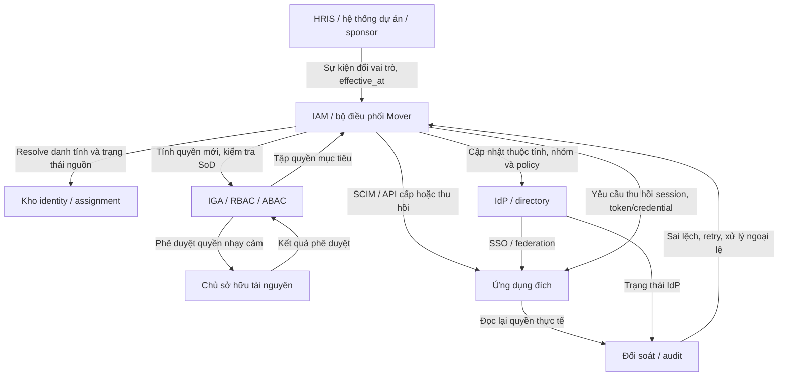
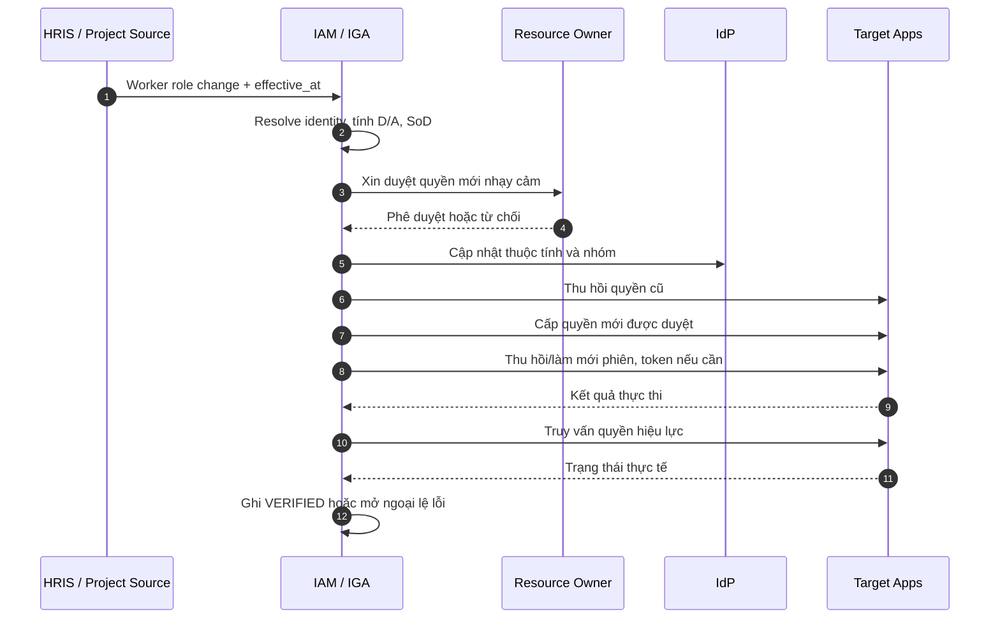

# Mover là gì trong vòng đời danh tính IAM?

## 1. Khái niệm Mover

**Mover** là giai đoạn một danh tính đã tồn tại **thay đổi vị trí, vai trò, đơn vị, dự án, quan hệ công tác hoặc điều kiện sử dụng tài nguyên**, làm phát sinh nhu cầu **đánh giá lại quyền truy cập**. Trong mô hình **Joiner–Mover–Leaver (JML)** của Identity and Access Management (IAM), Mover giữ cho quyền của người dùng phù hợp với nhiệm vụ **hiện tại** khi công việc thay đổi.

Ví dụ: một nhân viên từ bộ phận Kinh doanh chuyển sang Tài chính. Tài khoản và danh tính của người đó vẫn tiếp tục tồn tại, nhưng quyền xem dữ liệu khách hàng của phòng Kinh doanh có thể không còn cần thiết; quyền truy cập báo cáo tài chính mới chỉ nên được cấp theo chính sách và phê duyệt tương ứng. Nếu hệ thống chỉ thêm quyền mới mà không xử lý quyền cũ, người dùng sẽ **tích lũy quyền truy cập** (*privilege accumulation*).

Vì vậy, Mover gồm đồng thời hai nhiệm vụ:

1. **Cấp hoặc điều chỉnh** các quyền phục vụ công việc mới, với điều kiện và phê duyệt hợp lệ.
2. **Thu hồi hoặc giới hạn** các quyền không còn phù hợp với vai trò cũ, kể cả quyền ngoại lệ, quyền trực tiếp, phiên và thông tin xác thực có liên quan.

Điểm mấu chốt là **Mover không có nghĩa tạo một danh tính mới**. Mục đích thường là duy trì đúng một danh tính được quản lý, cập nhật thuộc tính và tập quyền gắn với các quan hệ công việc đang có hiệu lực. Những trường hợp chuyển pháp nhân, thay đổi nguồn định danh hoặc thay đổi hợp đồng có thể cần quy trình liên kết tài khoản phức tạp hơn.

### 1.1. Mover khác Joiner và Leaver thế nào?

| Giai đoạn | Sự kiện điển hình | Mục tiêu chính | Lỗi thường gặp |
|---|---|---|---|
| **Joiner** | Nhận việc, bắt đầu hợp đồng, gia nhập dự án | Xác minh, tạo/liên kết tài khoản, cấp quyền ban đầu | Cấp rộng hơn nhu cầu hoặc kích hoạt quá sớm |
| **Mover** | Chuyển nhóm, đổi vai trò, đổi dự án, thăng chức, thay quản lý | Tính lại tập quyền và thu hồi chênh lệch không còn hợp lệ | Chỉ cộng quyền mới và giữ nguyên đặc quyền cũ |
| **Leaver** | Nghỉ việc, hết hợp đồng, kết thúc hợp tác | Chặn đăng nhập và thu hồi toàn bộ quyền không còn hợp lệ | Phiên, tài khoản local hoặc token tồn dư |

Một cá nhân có thể trải qua nhiều lần Mover; mỗi lần cần đánh giá lại **quyền hiệu lực**, không chỉ một thuộc tính tổ chức.

### 1.2. Mover tác động đến những đối tượng nào?

- **Danh tính:** mã định danh liên kết con người với dữ liệu HR và các tài khoản; thường được giữ ổn định.
- **Thuộc tính danh tính:** phòng ban, vị trí, người quản lý, dự án, địa điểm, loại hợp đồng, cấp độ công việc.
- **Tài khoản:** trạng thái hoặc thuộc tính ở IdP và ứng dụng, bao gồm tài khoản nội bộ và tài khoản liên kết.
- **Entitlement:** nhóm, vai trò, quyền đọc/ghi, quyền phê duyệt, quyền API, quyền quản trị, quyền theo dự án.
- **Phiên và credential:** phiên ứng dụng, refresh token, personal access token, SSH key hoặc thông tin xác thực độc lập có thể mang quyền cũ.
- **Phê duyệt và sở hữu:** chủ sở hữu tài nguyên, người quản lý, người phê duyệt hoặc người chịu trách nhiệm cho tài khoản dịch vụ.

Không phải mọi thay đổi hồ sơ đều đòi đổi quyền. Đổi cách viết tên hiển thị có thể chỉ cần đồng bộ thuộc tính, trong khi một thay đổi nhỏ về **vai trò phê duyệt giao dịch** có thể đòi thu hồi đặc quyền ngay lập tức.

## 2. Những sự kiện kích hoạt Mover

Mover thường bắt đầu từ một **sự kiện nghiệp vụ có thẩm quyền**. Đối với nhân viên, nguồn chủ yếu có thể là **HRIS/HCM**; đối với nhà thầu hoặc đối tác, nguồn có thể là hệ thống hợp đồng, quản lý đối tác hoặc sponsor nội bộ.

| Sự kiện | Ví dụ | Tác động tiềm năng đến quyền |
|---|---|---|
| **Chuyển phòng ban** | Sales → Finance | Thu hồi quyền Sales, cấp quyền Finance theo chính sách |
| **Đổi chức danh/vai trò** | Analyst → Team Lead | Thêm quyền quản lý đã được duyệt, rà soát quyền cũ |
| **Đổi dự án** | Project A → Project B | Loại quyền với tài nguyên A, cấp quyền tương ứng ở B |
| **Thay người quản lý** | Chuyển sang quản lý mới | Thay luồng phê duyệt, rà soát ngoại lệ và ủy quyền |
| **Thay pháp nhân hoặc tenant** | Đơn vị con X → Y | Xem xét phạm vi tin cậy, tài khoản và chính sách dữ liệu |
| **Đổi loại hợp đồng** | Nhà thầu → nhân viên | Xem xét nguồn danh tính, ngày hiệu lực và quyền theo loại lao động |
| **Biệt phái hoặc luân chuyển tạm thời** | Làm cho nhóm khác trong ba tháng | Quyền chồng lấn có thời hạn, tự động thu hồi |
| **Nghỉ dài hạn/tạm đình chỉ** | Tạm ngừng thực hiện nhiệm vụ | Có thể tạm giới hạn hoặc khóa quyền theo chính sách |
| **Tái cơ cấu tổ chức** | Đổi mã đơn vị, hợp nhất bộ phận | Kiểm soát tác động hàng loạt, tránh cấp/thu hồi nhầm |

Nguồn dữ liệu chỉ cho biết **điều gì đã thay đổi**. Quyết định **quyền nào cần thay đổi** thuộc chính sách IAM/IGA, bộ phận nghiệp vụ và chủ sở hữu tài nguyên.

Cần phân biệt:

- **Ngày phát sinh sự kiện:** lúc HR ghi nhận quyết định.
- **Ngày có hiệu lực:** lúc quyền hoặc quan hệ mới bắt đầu được áp dụng.
- **Ngày thi hành:** lúc IdP và ứng dụng thực sự thay đổi trạng thái.
- **Ngày xác minh:** lúc hệ thống xác nhận quyền ở đích đã khớp yêu cầu.

Nếu HR ghi quyết định chuyển phòng trước hai tuần, IAM cần xử lý đúng mốc hiệu lực theo chính sách; không mặc định quyền mới được cấp ngay khi nhận thông điệp.

## 3. Vì sao Mover là giai đoạn dễ để lại quyền tồn dư?

Trong Joiner, hệ thống thường cấp quyền từ một tập quyền nền đã xác định. Qua nhiều lần Mover, người dùng có thể được cấp thêm các role, nhóm, ngoại lệ và đặc quyền phục vụ những công việc khác nhau. Nếu quyền cũ không được thu hồi, **quyền thực tế lớn dần trong khi nhu cầu công việc không tăng tương ứng**.

Giả sử người dùng lần lượt là:

1. **Sales Analyst:** được xem hồ sơ khách hàng và dự báo kinh doanh.
2. **Finance Analyst:** được xem báo cáo tài chính, không cần hồ sơ khách hàng chi tiết.
3. **Finance Lead:** được phê duyệt một số báo cáo và điều phối nhóm.

Nếu sau mỗi lần chuyển vị trí IAM chỉ thêm quyền mới, người dùng cuối cùng có thể giữ cả quyền Sales, Finance Analyst và Finance Lead. Điều này vi phạm **least privilege**, có thể tạo xung đột **Separation of Duties (SoD)** và khiến sự cố tài khoản bị chiếm có tác động lớn hơn.

Các nguồn gây quyền tồn dư thường gồm:

- Nhóm cũ ở IdP hoặc thư mục danh tính chưa bị xóa.
- Quyền gán **trực tiếp trong ứng dụng**, không thể nhìn thấy chỉ từ nhóm IdP.
- Vai trò được thừa hưởng từ nhóm lồng nhau hoặc các vai trò khác.
- Quyền ngoại lệ do dự án cũ cấp, thiếu ngày hết hạn.
- Credential riêng như token API, khóa SSH, chứng thư hoặc tài khoản local.
- Phiên ứng dụng còn sống, có thể giữ lại các claim hoặc quyền đã được tải vào phiên.
- Quyền ủy quyền hoặc khả năng phê duyệt thay cho người khác.
- Quyền tạo hoặc quản lý **service account** thuộc nhóm cũ.

**Thu hồi nhóm ở IdP là một bước**, nhưng chưa phải bằng chứng mọi đường truy cập đã hết hiệu lực.

## 4. Những nguồn tham gia quy trình Mover

Một luồng Mover hiệu quả cần phối hợp nhiều hệ thống, mỗi hệ thống có trách nhiệm riêng.

| Thành phần | Vai trò trong Mover | Giới hạn cần nhớ |
|---|---|---|
| **HRIS/HCM** | Thông báo thay đổi nhân sự, vị trí và ngày hiệu lực | Không quyết định tất cả entitlement nghiệp vụ |
| **Nguồn dự án/hợp đồng** | Xác nhận nhiệm vụ, sponsor, phân công ngoài HR | Không thay thế dữ kiện nhân sự có thẩm quyền |
| **IAM/IGA** | Điều phối, tính tập quyền mong muốn, phê duyệt, audit, đối soát | Cần kết nối với hệ thống thực thi để có hiệu lực |
| **IdP / directory** | Cập nhật thuộc tính, nhóm, trạng thái và chính sách đăng nhập | Không nhìn thấy hết quyền local hay token độc lập |
| **SSO / Federation** | Truyền thông tin xác thực và claim giữa miền tin cậy | Token/phiên đang sống có thể chưa phản ánh thay đổi |
| **SCIM / API provisioning** | Cập nhật account hoặc group ở ứng dụng hỗ trợ | Ứng dụng có thể không đồng bộ mọi role/quyền |
| **RBAC/ABAC policy** | Quyết định quyền dựa trên role, thuộc tính và ngữ cảnh | Thuộc tính cần nguồn chính xác và cập nhật kịp |
| **Chủ sở hữu tài nguyên** | Phê duyệt quyền mới, ngoại lệ, điều kiện truy cập | Không nên tự phê duyệt quyền nhạy cảm trái chính sách |
| **Audit / monitoring** | Theo dõi sự kiện, thực thi, sai lệch và thời gian thu hồi | Log “đã gửi lệnh” không chứng minh quyền đã mất |



Thành công của Mover được xác nhận ở **trạng thái sau cùng**, gồm các quyền đang có và các quyền không còn được phép.

## 5. Nguyên tắc trung tâm: tính lại tập quyền

Thay vì mô hình **“có sự kiện thì thêm một nhóm”**, Mover nên bắt đầu từ việc xác định **tập quyền người dùng cần có sau thay đổi**.

Gọi:

- `D` (*desired access*): tập quyền mong muốn theo vai trò/quan hệ **mới**, cộng ngoại lệ đã duyệt còn hiệu lực.
- `A` (*actual effective access*): tập quyền đang có hiệu lực ở những hệ thống, phiên và cơ chế cấp quyền cần kiểm tra.
- `G = D \ A`: những quyền cần cấp bổ sung.
- `R = A \ D`: những quyền cần thu hồi.

Mã giả minh họa:

```text
current = discover_effective_access(identity, connected_targets)
desired = evaluate_policy(
    identity = identity,
    active_assignments = current_authoritative_assignments(),
    approved_exceptions = active_time_limited_exceptions(),
    policy_version = current_policy_version()
)

to_grant  = desired - current
to_revoke = current - desired

validate_separation_of_duties(desired)
approve_sensitive_grants(to_grant)
apply_revoke(to_revoke, according_to_risk_and_effective_time())
apply_grant(to_grant, only_when_approved_and_eligible())
verify_effective_access_against_policy()
```

Đây là **mã giả mang tính khái niệm**, không phải API thực của sản phẩm. Mức quyền hiệu lực có thể đến từ nhiều nguồn không thể quy ngay về một tập đơn giản: nhóm lồng nhau, deny policy, quyền động theo thuộc tính, vai trò ứng dụng, token hoặc ủy quyền.

### 5.1. Bốn dạng quyết định với một entitlement

| Quyền trước Mover | Quyền sau Mover | Quyết định |
|---|---|---|
| Có | Còn cần | **Giữ** và kiểm tra điều kiện tiếp tục |
| Chưa có | Cần | **Cấp** sau khi đủ phê duyệt |
| Có | Không còn cần | **Thu hồi** và xác minh |
| Chưa có | Không cần | **Không cấp** |

Ngoài bốn trường hợp này còn có **đổi điều kiện quyền**: người dùng vẫn được xem báo cáo nhưng chỉ trong `department=FIN` hoặc `project=P2` thay cho phạm vi trước đó. Cần sửa policy/thuộc tính và kiểm tra dữ liệu họ thực sự có thể truy cập, không chỉ giữ nguyên nhãn role.

### 5.2. Vì sao phải đối chiếu quyền hiệu lực?

Nếu ứng dụng có nhóm `project-viewer` và role `exporter` gán trực tiếp, việc loại người dùng khỏi nhóm có thể chỉ thu hồi quyền xem dự án, còn quyền xuất dữ liệu vẫn tồn tại. Bởi vậy Mover cần một **inventory quyền** đủ chi tiết để phát hiện các kênh cấp quyền ngoài danh sách nhóm chuẩn.

Khi không thể đọc đầy đủ quyền ở ứng dụng, cần ghi rõ **mức độ quan sát được** và quy trình kiểm tra thủ công. Không thể kết luận “thu hồi hoàn tất” chỉ dựa trên cập nhật IdP thành công.

## 6. Quy trình Mover từ sự kiện đến hoàn tất

### Bước 1 — Nhận và xác thực sự kiện thay đổi

Sự kiện đến từ HRIS, hệ thống dự án hoặc nguồn có thẩm quyền khác. IAM kiểm tra:

- Định danh nguồn và tính hợp lệ của thông điệp.
- Worker ID, employment/assignment ID hoặc khóa liên kết ổn định.
- Loại thay đổi, bản ghi cũ/mới và thời điểm hiệu lực.
- Phiên bản hoặc cơ chế chống xử lý lặp.
- Điều kiện quan hệ vẫn tồn tại, không bị hủy hoặc được thay bằng bản cập nhật khác.

Không sử dụng riêng email, tên hiển thị hoặc một claim do người dùng tự nhập để xác định nhân sự nào đang chuyển vai trò.

### Bước 2 — Xác định tác động và phạm vi quyền

IAM giải quyết đúng danh tính, đối chiếu các assignment và tài khoản đang có. Danh mục hệ thống liên quan có thể gồm IdP, ứng dụng dự án cũ, ứng dụng mới, quyền quản trị, tài khoản local, quyền ủy quyền và credential độc lập.

Một sự kiện `department_id` thay đổi có thể chỉ ảnh hưởng một số role; sự kiện `employment_type` hoặc `legal_entity` đổi có thể kéo theo nhiều điều kiện truy cập và ranh giới tenant hơn.

### Bước 3 — Tính quyền mục tiêu và kiểm tra xung đột

IAM/IGA dùng RBAC, ABAC, quy tắc entitlement và các ngoại lệ còn hiệu lực để tính tập quyền mới. Quyền đặc biệt nhạy cảm hoặc role gây xung đột SoD phải được xử lý trước khi cấp.

Ví dụ: người dùng tạo yêu cầu thanh toán có thể **không được tự phê duyệt** cùng một giao dịch. Nếu Mover khiến người đó có cả hai quyền, workflow phải từ chối tổ hợp không hợp lệ hoặc yêu cầu xử lý theo chính sách SoD.

### Bước 4 — Phê duyệt và lên lịch

Chủ sở hữu tài nguyên mới xác nhận các quyền cần cấp. Người quản lý cũ hoặc chủ sở hữu nhóm cũ có thể được thông báo để xác nhận bàn giao, tùy quy trình.

Nên quy định rõ:

- Quyền nào bị **thu hồi ngay** và quyền nào thu hồi khi sự kiện có hiệu lực.
- Có chấp nhận **quyền chồng lấn tạm thời** để bàn giao không.
- Ngoại lệ chồng lấn do ai phê duyệt, giới hạn đến khi nào.
- Có cần xác thực tăng cường hoặc xác minh lại danh tính đối với quyền rủi ro cao không.

### Bước 5 — Thực hiện thay đổi ở IdP và các hệ thống đích

Tùy chính sách và thứ tự phụ thuộc, workflow sẽ:

1. Cập nhật thuộc tính phòng ban, vai trò, quản lý hoặc dự án tại nguồn đích.
2. Thu hồi những quyền cũ không còn cần thiết.
3. Cấp các quyền mới đã được phê duyệt.
4. Chấm dứt hoặc làm mới phiên/token mang quyền cũ khi hệ thống hỗ trợ.
5. Cập nhật tài khoản local, role ứng dụng, credential và các quyền đặc biệt khác.
6. Theo dõi kết quả từng thao tác, không giấu lỗi cấp/thu hồi trong một trạng thái thành công tổng quát.

**Thứ tự cấp và thu hồi không cố định cho mọi tình huống.** Với quyền nhạy cảm hoặc SoD, có thể phải thu hồi quyền xung đột trước khi cấp quyền mới. Với công việc cần chuyển giao liên tục, có thể cho phép khoảng chồng lấn được phê duyệt và tự hết hạn. Không tự chọn “cấp trước, thu hồi sau” cho mọi trường hợp.

### Bước 6 — Đối soát, ghi nhận kết quả và xử lý sai lệch

Sau khi thao tác hoàn tất, IAM đọc lại quyền thực tế tại các đích. Kết quả nên phân biệt:

- `REQUESTED`: đã lên yêu cầu.
- `APPROVED`: được phê duyệt nghiệp vụ.
- `SENT`: đã gửi lệnh tới connector.
- `APPLIED`: hệ thống đích báo đã áp dụng.
- `VERIFIED`: trạng thái thực tế đã được xác nhận.
- `FAILED` / `PARTIALLY_APPLIED`: có lỗi hoặc chỉ hoàn thành một phần.

Các trạng thái trên chỉ là **ví dụ thiết kế workflow**. Việc ứng dụng trả `200 OK` hoặc một job thành công chưa chắc bảo đảm quyền đã hết hiệu lực ở mọi lớp; vẫn cần kiểm tra theo khả năng của đích.



## 7. RBAC và ABAC khi người dùng chuyển vai trò

**RBAC (Role-Based Access Control)** ánh xạ role hoặc nhóm vào entitlement. **ABAC (Attribute-Based Access Control)** cho phép quyết định dựa trên thuộc tính người dùng, tài nguyên và ngữ cảnh.

### 7.1. Khi dùng RBAC

Ví dụ:

| Vai trò | Quyền nền có thể được cấp |
|---|---|
| `sales_analyst` | Xem báo cáo bán hàng tổng hợp |
| `finance_analyst` | Xem báo cáo tài chính được phân công |
| `finance_lead` | Xem báo cáo của nhóm, thực hiện quyền quản lý theo phê duyệt |

Khi chuyển `sales_analyst` sang `finance_analyst`, IAM không chỉ thêm `finance_analyst`; cần đánh giá và thu hồi quyền chỉ còn gắn với vai trò `sales_analyst`. Nếu có quyền chung thuộc nhiều role, thao tác không được vô tình thu hồi quyền vẫn còn căn cứ hợp lệ.

**Một người có nhiều role hợp lệ** là điều có thể xảy ra, nhưng từng role phải gắn với nhiệm vụ, nguồn, owner và thời hạn phù hợp.

### 7.2. Khi dùng ABAC

Ví dụ chính sách giả lập:

```text
allow(user, "read", report) when
    user.identity_status == "ACTIVE"
    and user.department_id == report.department_id
    and user.assigned_projects contains report.project_id
    and report.classification != "restricted"
```

Nếu `department_id` chuyển từ `SALES` sang `FIN`, ABAC có thể làm thay đổi quyền hiệu lực **mà không cần xóa tên role**. Nhưng hệ thống cần bảo đảm thuộc tính ở policy engine, trong token, cache và ứng dụng được cập nhật đúng lúc. **Claim trong access token đã phát hành không tự thay đổi** chỉ vì HRIS cập nhật phòng ban.

### 7.3. Kết hợp role và thuộc tính

Một thiết kế phổ biến: RBAC cung cấp quyền thao tác cơ bản, còn ABAC giới hạn phạm vi đối tượng. Ví dụ role `report_reader` cho phép đọc báo cáo, nhưng policy chỉ cho đọc báo cáo thuộc dự án mà người dùng đang được phân công.

Khi Mover, cả **role** và **phạm vi dữ liệu** đều cần được đánh giá lại; nếu chỉ đổi role mà giữ mọi project ID cũ, người dùng vẫn có thể tiếp cận dữ liệu không còn phục vụ công việc.

## 8. Thời điểm hiệu lực, quyền chồng lấn và bàn giao

Sự kiện Mover có thể được biết trước, có hiệu lực ngay hoặc được sửa hồi tố. Thiết kế thời gian là yếu tố quan trọng để giảm sai quyền.

### 8.1. Chuyển vai trò trong tương lai

Nếu HR ghi nhận ngày 23/11 rằng nhân viên sẽ chuyển ngày 01/12:

- IAM có thể **lập kế hoạch** và xin phê duyệt quyền mới từ trước.
- Việc tạo tài khoản hoặc cấu hình trước phải tách khỏi quyền **thực sự có hiệu lực**.
- Đúng mốc theo chính sách, hệ thống thực hiện cấp/thu hồi và kiểm tra lại.
- Nếu HR hủy hoặc dời ngày chuyển, lịch chưa thực hiện và quyền đã chuẩn bị phải được xử lý tương ứng.

### 8.2. Bàn giao cần quyền chồng lấn

Một nhân viên có thể cần xem dữ liệu cả nhóm cũ và nhóm mới để bàn giao. Nếu tổ chức cho phép:

- Ghi rõ **lý do, phạm vi tài nguyên và người phê duyệt**.
- Đặt **ngày/giờ kết thúc** quyền chồng lấn.
- Không giữ các quyền đặc biệt nhạy cảm hoặc xung đột SoD nếu chính sách cấm.
- Tự động thu hồi khi hết hạn và đối soát kết quả.

**Quyền chồng lấn có căn cứ** khác với quyền tồn dư không được quản lý. Rủi ro xuất hiện khi không có hạn và không biết ai chịu trách nhiệm.

### 8.3. Chuyển vai trò khẩn cấp hoặc hồi tố

Nếu người dùng bị điều chuyển khỏi nhiệm vụ nhạy cảm ngay lập tức, IAM có thể cần thu hồi quyền trước mọi bước bàn giao. Nếu HR sửa ngày hiệu lực trong quá khứ, không nên đơn giản phát lại mọi sự kiện theo thứ tự đến; cần tính **trạng thái hiện hành có thẩm quyền**, xác định các quyền đáng lẽ đã thu hồi và mở đánh giá nếu có giai đoạn truy cập quá quyền.

## 9. IdP, SSO, SCIM và quyền vẫn tồn tại sau Mover

IdP và các ứng dụng có thể lưu nhiều bản sao thuộc tính/nhóm. Thay đổi nguồn không nhất thiết lan truyền ngay lập tức.

| Lớp | Mover thường thực hiện | Rủi ro nếu bỏ sót |
|---|---|---|
| **HRIS / nguồn dự án** | Cập nhật vai trò, dự án, ngày hiệu lực | IAM tính theo dữ liệu cũ |
| **IdP / directory** | Cập nhật thuộc tính và nhóm | SSO tiếp tục phát hành claim cũ hoặc sai |
| **SSO / federation** | Chuyển thông tin xác thực/claim khi đăng nhập | Phiên đã có và token cũ có thể chưa cập nhật |
| **SCIM / provisioning** | Cập nhật người dùng, nhóm ở SaaS | App có role nội bộ không theo SCIM |
| **Ứng dụng nghiệp vụ** | Thu hồi/cấp entitlement, quyền local và ủy quyền | Trực tiếp cấp quyền vẫn tồn tại |
| **VPN / SSH / API** | Kiểm tra quyền truy cập kỹ thuật và credential | Credential độc lập tiếp tục truy cập |
| **IGA / audit** | Phê duyệt, lưu nguyên nhân thay đổi và đối soát | Không biết vì sao quyền còn hoặc đã mất |

**Chặn đăng nhập mới hoặc đổi claim tại IdP chưa chắc thu hồi phiên đang hoạt động.** Ứng dụng có thể giữ cookie phiên riêng; refresh token và access token có vòng đời, cách thu hồi khác nhau. Cần quản lý TTL, cơ chế logout/revocation/introspection nếu hệ thống hỗ trợ và chính sách đối với quyền khẩn cấp.

Đối với một ứng dụng sử dụng **federated identity**, IdP bên ngoài có thể cập nhật vai trò nhưng ứng dụng vẫn chịu trách nhiệm kiểm tra quyền đối với dữ liệu của chính mình. Việc nhận claim nhóm từ đối tác phải có quy tắc mapping và giới hạn tin cậy, không tự động cho bên ngoài cấp quyền quản trị ứng dụng.

## 10. Quyền trực tiếp, ngoại lệ và tách nhiệm vụ (SoD)

Những quyền khó phát hiện nhất khi Mover thường không nằm trong cấu hình role tiêu chuẩn:

- Quyền gán trực tiếp cho người dùng bởi quản trị viên ứng dụng.
- Ngoại lệ được phê duyệt từ dự án cũ nhưng không có ngày kết thúc.
- Vai trò tạm thời dùng khi xử lý sự cố và chưa thu hồi.
- Quyền ủy quyền phê duyệt thay người khác.
- Role quản trị được cấp qua một tài khoản đặc quyền riêng.
- Quyền sử dụng hệ thống phụ hoặc tenant mà nguồn HRIS không ánh xạ trực tiếp.

Nên lưu mỗi quyền đáng chú ý cùng **nguồn cấp**, **lý do nghiệp vụ**, **owner**, **người phê duyệt**, **thời hạn** và **điều kiện thu hồi**.

### 10.1. SoD khi đổi vai trò

Ví dụ, một nhân viên trước đây được **tạo yêu cầu thanh toán**. Sau Mover, vai trò mới cho phép **phê duyệt thanh toán**. Nếu người đó giữ cả hai quyền với cùng phạm vi giao dịch, có thể vi phạm chính sách phân tách nhiệm vụ.

Workflow cần kiểm tra tổ hợp quyền **trước khi cấp mới**. Tùy policy, có thể thu hồi quyền tạo yêu cầu trước, hạn chế phạm vi phê duyệt hoặc chuyển xử lý ngoại lệ với kiểm soát bù trừ được chấp thuận.

### 10.2. Privileged Access Management (PAM)

Đối với quyền quản trị sản xuất hoặc hạ tầng, nên ưu tiên **quyền có thời hạn** và cơ chế cấp khi cần (*Just-in-Time privileged access*) thay vì quyền thường trực. Khi Mover sang vai trò không còn cần quản trị, phải thu hồi role đặc quyền, kiểm tra tài khoản chuyên biệt, session và credential, đồng thời xác minh đích.

Việc Mover được xử lý ở tài khoản người dùng thông thường **không tự động cập nhật** mọi tài khoản đặc quyền thứ cấp nếu chúng chưa được liên kết đúng danh tính.

## 11. Ví dụ sự kiện Mover và cách tính thay đổi

Giả sử một hệ thống HRIS ghi nhận nhân viên `W-4119` chuyển từ Sales sang Finance.

```json
{
  "event_id": "hr-transfer-2026-0152",
  "event_type": "WORKER_TRANSFERRED",
  "source_system": "HRIS-PRIMARY",
  "record_version": 152,
  "occurred_at": "2026-11-23T02:00:00Z",
  "effective_at": "2026-12-01T09:00:00+07:00",
  "subject": {
    "worker_id": "W-4119",
    "employment_id": "EMP-8301",
    "employment_status": "ACTIVE"
  },
  "previous_assignment": {
    "department_id": "SALES",
    "job_code": "SALES-ANALYST",
    "manager_id": "W-1008"
  },
  "new_assignment": {
    "department_id": "FIN",
    "job_code": "FIN-ANALYST",
    "manager_id": "W-1099"
  }
}
```

Đây chỉ là **schema minh họa**. Trong hệ thống thật, có thể chỉ nhận tín hiệu “worker changed” rồi phải truy vấn snapshot mới tại nguồn có thẩm quyền. Mọi event phải được xác thực, khử trùng lặp và xử lý theo phiên bản/thời điểm có hiệu lực.

Tập entitlement tại ứng dụng trước và sau có thể là:

| Entitlement | Trước Mover | Sau Mover | Thực thi |
|---|---|---|---|
| `employee_portal.login` | Có | Có | Giữ |
| `sales.report.read` | Có | Không | Thu hồi |
| `sales.customer_export` | Có, ngoại lệ đến 30/11 | Không | Thu hồi và kiểm tra token liên quan |
| `finance.report.read` | Không | Có nếu chính sách cho phép | Cấp |
| `finance.payment_approve` | Không | Chưa được phê duyệt | Không cấp |
| `project_p1.read` | Có | Chỉ khi assignment P1 còn hợp lệ | Kiểm tra điều kiện dự án |
| `mfa_required` | Có | Có | Giữ hoặc tăng chính sách theo rủi ro |

Các thay đổi trong bảng phải được **kiểm tra với nguồn quyền thực tế**. Một quyền `sales.customer_export` đã bị gỡ ở nhóm IdP nhưng còn trong ứng dụng hoặc token API là kết quả Mover **chưa hoàn tất**.

## 12. Ví dụ xuyên suốt: chuyển vai trò qua ba giai đoạn

Giả sử **Mai** là nhân viên làm phân tích bán hàng, chuẩn bị chuyển sang Tài chính rồi được đề bạt làm trưởng nhóm.

### Giai đoạn 1 — Trước khi chuyển

Mai có quyền đọc báo cáo bán hàng, quyền xem dự án khách hàng A và quyền nền của nhân viên. Tất cả có nguồn gốc từ vai trò Sales và một quyền dự án có hạn. HRIS ghi nhận quyết định chuyển sang Tài chính có hiệu lực ngày 01/12/2026.

IAM đối soát danh sách quyền hiện có, phát hiện một quyền xuất dữ liệu khách hàng đã được cấp trực tiếp nhưng không thấy ngày hết hạn. Quyền này được đưa vào danh sách cần xử lý cùng nhóm Sales.

### Giai đoạn 2 — Chuyển sang Tài chính

Quản lý và chủ sở hữu dữ liệu phê duyệt quyền đọc báo cáo tài chính. IAM:

1. Chuẩn bị kế hoạch thay đổi và kiểm tra SoD.
2. Thu hồi quyền Sales không còn cần thiết, gồm ngoại lệ xuất dữ liệu.
3. Cập nhật thuộc tính phòng ban và nhóm trong IdP.
4. Provision role Finance được duyệt qua connector hoặc API ứng dụng.
5. Kiểm tra token/phiên cũ và quyền local liên quan đến tài nguyên Sales.
6. Đối soát quyền hiệu lực và ghi lại trạng thái từng hệ thống.

Nếu Mai cần quyền xem dự án khách hàng A thêm hai ngày để bàn giao, IAM chỉ giữ quyền này nếu có ngoại lệ được duyệt và tự hết hạn.

### Giai đoạn 3 — Thăng chức

Sau sáu tháng, Mai trở thành trưởng nhóm Tài chính. HRIS phát Mover mới. IAM đánh giá quyền `finance_lead`, đặc biệt quyền phê duyệt giao dịch. Nếu role mới xung đột với quyền tạo thanh toán mà Mai đang có, workflow phải giải quyết xung đột **trước khi cấp quyền phê duyệt**.

Ví dụ này cho thấy **Mover là hoạt động lặp lại**. Nếu lần chuyển thứ nhất còn để sót quyền Sales, lần thăng chức thứ hai có thể làm tổ hợp quyền rủi ro hơn rất nhiều.

## 13. Các tình huống đặc biệt của Mover

### 13.1. Một người có nhiều assignment hợp lệ

Một cá nhân có thể vừa quản lý dự án A vừa tham gia dự án B. Kết thúc A không đồng nghĩa toàn bộ danh tính không còn hợp lệ. Quyền cần được liên kết với **assignment hoặc quan hệ cụ thể**; chỉ thu hồi các entitlement không còn bất kỳ căn cứ hợp lệ nào.

### 13.2. Nhà thầu chuyển dự án hoặc đổi sponsor

Nguồn Mover có thể là **Vendor Management System (VMS)** hoặc hệ thống dự án, không phải HRIS. Cần cập nhật sponsor, hợp đồng, tenant và quyền theo dự án. Đặc biệt tránh để tài khoản đối tác giữ quyền trên dự án cũ chỉ vì IdP đối tác còn xác thực được tài khoản đó.

### 13.3. Chuyển pháp nhân hoặc thay đổi IdP

Một người chuyển giữa hai công ty con có thể cần ứng dụng, tenant hoặc IdP khác. IAM phải **xác minh liên kết danh tính**, chuyển quyền cần thiết và thu hồi quyền ở miền cũ. Không tự gộp tài khoản chỉ vì email trùng; nên dùng khóa/quan hệ danh tính ổn định và quy trình liên kết có kiểm soát.

### 13.4. Thay đổi hàng loạt sau tái cấu trúc

Khi tổ chức gộp phòng ban và đổi mã tổ chức, một rule mapping có thể ảnh hưởng hàng nghìn danh tính. Cần xác định phạm vi, ước lượng quyền cấp/thu hồi, kiểm tra chính sách trước khi áp dụng, triển khai theo đợt nếu phù hợp và sẵn sàng khắc phục sai lệch.

### 13.5. Tạm nghỉ hoặc đình chỉ

Một người vẫn có quan hệ lao động nhưng không được phép truy cập trong một thời gian. Đây có thể được xử lý như một biến thể Mover hoặc luồng trạng thái riêng; cần tách **tạm khóa**, **kết thúc hợp đồng** và **quay lại làm việc**. Không tự khôi phục quyền đặc biệt nhạy cảm nếu chưa kiểm tra điều kiện hiện tại.

### 13.6. Thay đổi người sở hữu service account

Khi chủ sở hữu một **service account**, bot hoặc workload identity chuyển nhóm, tài khoản dịch vụ có thể vẫn cần tiếp tục chạy. IAM phải kích hoạt **chuyển quyền sở hữu**, rà soát quyền, credential, repository và môi trường vận hành liên quan; có thể yêu cầu luân chuyển khóa hoặc thay người phê duyệt.

Không tự động xóa workload quan trọng chỉ vì nhân viên sở hữu chuyển vai trò. Đồng thời không được giữ vô thời hạn tài khoản dịch vụ không có owner hợp lệ. Vòng đời workload phải dựa trên service catalog, CMDB hoặc nguồn kỹ thuật có thẩm quyền.

## 14. Vận hành chịu lỗi và xử lý trạng thái không nhất quán

### 14.1. Sự kiện bị lặp hoặc đến sai thứ tự

Webhook HRIS có thể gửi cùng `event_id` nhiều lần hoặc sự kiện phiên bản cũ sau khi bản mới đã áp dụng. Workflow cần:

- Lưu event ID và phiên bản bản ghi để **idempotent**.
- Đối chiếu snapshot hiện hành nếu sự kiện không đủ thông tin hoặc có nghi vấn cũ.
- Không cấp/thu hồi dựa trên sự kiện lỗi thời chưa đối soát.
- Phát hiện quyết định HR bị hủy hoặc đổi thời điểm hiệu lực.
- Ghi lịch sử các lần tính tập quyền và policy version.

Một thao tác thu hồi được retry phải an toàn khi quyền đó đã bị thu hồi; retry cấp quyền không được tạo nhiều tài khoản hoặc grant trùng nhau.

### 14.2. Chỉ một phần ứng dụng cập nhật thành công

Nếu IdP cập nhật thành công nhưng một SaaS trả lỗi khi xóa role cũ, Mover vẫn còn **quyền tồn dư**. IAM nên lưu kết quả riêng từng đích và xử lý retry theo chính sách. Quyền rủi ro cao hoặc quyền bị cấm theo SoD cần được ưu tiên, có thể áp dụng biện pháp kiểm soát bổ sung theo năng lực hệ thống.

Không nên tự chuyển cả workflow thành `COMPLETED` khi chỉ có những bước ít quan trọng được cập nhật thành công.

### 14.3. Compensating action và rollback

Nếu quyền mới không thể được cấp đúng hạn, tổ chức có thể có quy trình hỗ trợ tạm thời. Nhưng **không mặc nhiên khôi phục quyền cũ đã bị thu hồi** vì điều đó có thể trái chính sách an ninh hoặc tạo xung đột SoD. Mọi biện pháp khắc phục phải dựa trên căn cứ nghiệp vụ và rủi ro hiện tại, có phê duyệt và thời hạn.

### 14.4. Đối soát định kỳ

Event-driven workflow giúp phản ứng nhanh nhưng không bảo đảm mọi sự kiện được nhận. **Reconciliation** định kỳ so sánh HRIS/assignment, tập quyền mong muốn với trạng thái thực tế ở IdP và ứng dụng; nó phát hiện tài khoản mồ côi, nhóm cũ, ngoại lệ quá hạn và sự sai khác từ thao tác quản trị thủ công.

## 15. Bằng chứng kiểm toán và chỉ số đánh giá Mover

Một bản ghi Mover tốt cho phép giải thích **vì sao quyền thay đổi, ai đã duyệt, thao tác gì được thực thi và đã xác minh được chưa**.

| Nhóm bằng chứng | Trường ví dụ | Ý nghĩa |
|---|---|---|
| Danh tính | `identity_id`, `worker_id`, `employment_id` | Xác định đúng chủ thể và quan hệ |
| Sự kiện nguồn | `event_id`, `source_system`, `record_version` | Truy nguồn và chống xử lý lặp |
| Thời gian | `occurred_at`, `effective_at`, `executed_at`, `verified_at` | Đo độ trễ và thời điểm quyền thực sự thay đổi |
| Quyền | `desired_entitlements`, `observed_entitlements` | So sánh quyền mong muốn và thực tế |
| Phê duyệt | `request_id`, `approver`, `justification`, `valid_until` | Lưu căn cứ cấp quyền và ngoại lệ |
| Policy | `role_mapping_version`, `sod_check_result` | Giải thích logic áp dụng |
| Thực thi | `target_system`, `operation_id`, `result` | Theo dõi thay đổi theo hệ thống |
| Ngoại lệ | `failure_reason`, `owner`, `remediation_status` | Quản lý lỗi, không để sót quyền tồn dư |

Không cần đưa access token đầy đủ, bí mật xác thực hoặc hồ sơ HR nhạy cảm vào log để có thể kiểm toán. Nên lưu metadata và tham chiếu an toàn đủ phục vụ điều tra.

### 15.1. Chỉ số vận hành

- **Mover completion time:** từ thời điểm thay đổi có hiệu lực đến khi tập quyền được xác minh khớp.
- **Revocation latency:** độ trễ thu hồi quyền cũ ở các hệ thống đích, đặc biệt quyền nhạy cảm.
- **Residual access count/rate:** số quyền không còn căn cứ hợp lệ nhưng vẫn có hiệu lực.
- **Exception expiry compliance:** tỷ lệ quyền chồng lấn/ngoại lệ được thu hồi đúng hạn.
- **SoD conflict rate:** số lần thay đổi vai trò tạo xung đột cần xử lý.
- **Reconciliation coverage:** tỷ lệ ứng dụng có thể đối soát quyền hiệu lực.
- **Provisioning failure rate:** các thao tác cấp hoặc thu hồi lỗi, bị chậm hoặc cần xử lý thủ công.
- **Orphan and privileged account findings:** tài khoản thiếu owner hoặc đặc quyền còn gắn với nhiệm vụ cũ.

SLA cụ thể phải dựa trên mức nhạy cảm, nghiệp vụ và quy định của tổ chức. Quyền quản trị sản xuất thường cần phản ứng nhanh hơn quyền đọc dữ liệu công khai.

## 16. Kiểm thử những tình huống Mover điển hình

| Tình huống kiểm thử | Kết quả mong đợi |
|---|---|
| Nhân viên chuyển Sales → Finance | Thu hồi quyền Sales không cần thiết; cấp Finance đã được duyệt |
| Một quyền chung thuộc hai role hợp lệ | Giữ quyền nếu vẫn có căn cứ hợp lệ |
| Mover sang role xung đột SoD | Không cấp tổ hợp quyền bị cấm |
| Sự kiện có hiệu lực trong tương lai | Chuẩn bị trước nhưng thi hành theo thời điểm chính sách |
| HR hủy hoặc dời ngày chuyển | Cập nhật lịch, không áp dụng thay đổi cũ sai thời điểm |
| Quyền bàn giao được duyệt hai ngày | Quyền chồng lấn có hạn và tự thu hồi đúng hạn |
| Một người có hai assignment | Chỉ thu hồi quyền không còn bất kỳ nguồn hợp lệ nào |
| Quyền gán trực tiếp tại ứng dụng | Được phát hiện và thu hồi nếu không còn căn cứ |
| Token hoặc phiên cũ mang quyền Sales | Xử lý theo cơ chế hỗ trợ và kiểm tra rủi ro tồn dư |
| SCIM báo thành công nhưng role trong ứng dụng vẫn còn | Không đánh dấu VERIFIED; ghi sai lệch |
| Sự kiện Mover đến lặp | Không tạo grant, tài khoản hoặc tác vụ trùng |
| Sự kiện phiên bản cũ đến sau | Không ghi đè trạng thái mới bằng dữ liệu cũ |
| Chuyển sponsor của contractor | Cập nhật quyền/owner và giới hạn truy cập theo hợp đồng |
| Owner của service account chuyển nhóm | Yêu cầu bàn giao và rà soát credential/quyền workload |
| Không có dữ liệu quyền của hệ thống cũ | Ghi rõ chưa xác minh, chuyển xử lý thay vì tuyên bố thành công |
| Mover khẩn cấp khỏi vai trò nhạy cảm | Ưu tiên thu hồi theo SLA và xác minh mọi đường truy cập |

## 17. Các nguyên tắc cần ghi nhớ

**Mover là quá trình điều chỉnh quyền theo sự thay đổi của danh tính và công việc**, giúp một người tiếp tục làm việc nhưng không mang theo những đặc quyền đã hết nhu cầu. Để quản lý Mover hiệu quả:

1. **Nhận sự kiện từ nguồn có thẩm quyền**, liên kết với danh tính và assignment ổn định.
2. **Phân biệt ngày ghi nhận, ngày hiệu lực và ngày hoàn tất** để cấp/thu hồi đúng thời điểm.
3. **Tính lại tập quyền mong muốn**, so sánh với quyền hiệu lực, xử lý cả chiều cấp và thu hồi.
4. **Dùng RBAC/ABAC phù hợp**, kiểm tra các quyền trực tiếp, role thừa hưởng, thuộc tính và phạm vi dữ liệu.
5. **Kiểm soát phê duyệt và SoD** trước khi cấp quyền mới, nhất là quyền đặc quyền.
6. **Giới hạn quyền chồng lấn**, có owner, lý do và thời hạn tự thu hồi nếu được cho phép.
7. **Phối hợp IdP, SSO, SCIM và ứng dụng đích**, bao gồm phiên, token, credential và tài khoản local khi cần.
8. **Không bỏ qua nhà thầu và tài khoản dịch vụ** khi đổi dự án, sponsor hoặc người sở hữu.
9. **Thiết kế vận hành chịu lỗi** với idempotency, retry, xử lý sự kiện trễ và đối soát định kỳ.
10. **Lưu bằng chứng từng quyền**, chỉ kết luận thành công sau khi có xác minh quyền thực tế theo phạm vi kiểm soát.

Một hệ thống IAM xử lý tốt Mover sẽ giảm đáng kể tình trạng **quyền truy cập tồn dư** khi nhân sự, phòng ban và dự án liên tục thay đổi, đồng thời tạo cơ sở rõ ràng cho các bước **Leaver** sau này.
