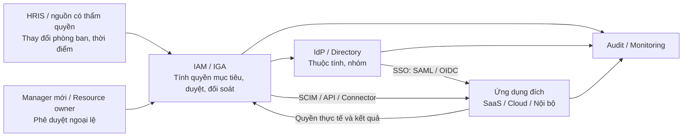
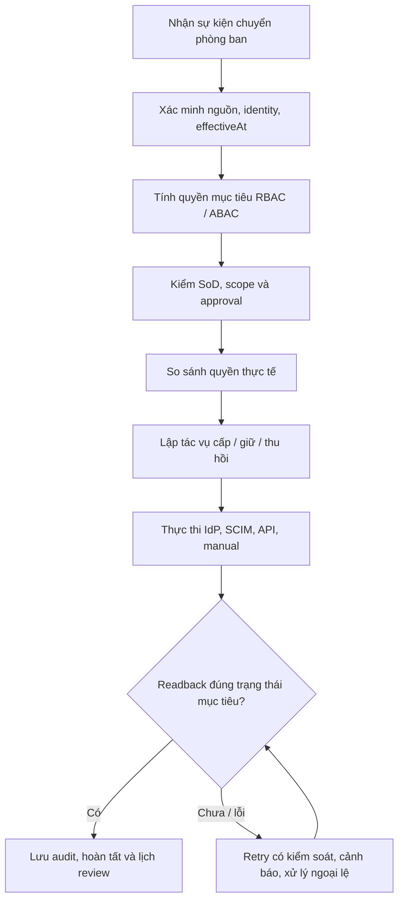

# Thay đổi phòng ban trong Mover Lifecycle (IAM)

Một nhân viên đang làm ở bộ phận Chăm sóc khách hàng được điều chuyển sang bộ phận Tài chính. Ngày chuyển, nhân viên cần truy cập báo cáo đối soát để bắt đầu nhiệm vụ mới. Nhưng quyền xem thông tin khách hàng chi tiết, xử lý hoàn tiền hoặc sửa phiếu hỗ trợ thuộc công việc cũ có thể không còn phù hợp. Nếu tổ chức chỉ **thêm quyền của phòng ban mới** và giữ nguyên quyền cũ, nhân viên sẽ tích lũy quyền truy cập theo thời gian, làm tăng nguy cơ lộ dữ liệu và xung đột nhiệm vụ.

Đây là vấn đề điển hình của **Mover lifecycle** trong **Identity and Access Management (IAM)**. Khi một danh tính thay đổi phòng ban, hệ thống cần cập nhật thuộc tính tổ chức, đánh giá lại vai trò và quyền truy cập, phê duyệt các quyền mới cần thiết, thu hồi quyền không còn hợp lệ và kiểm chứng trạng thái thực tế tại các ứng dụng.

Bài học này tập trung vào sự kiện **thay đổi phòng ban (department transfer)**, đặt trong vòng đời **Joiner–Mover–Leaver (JML)**. Nội dung liên kết hệ thống nhân sự, IdP, SSO, SCIM, RBAC/ABAC, các quyền đặc biệt, tài khoản dịch vụ, kiểm toán và nguyên tắc giảm **quyền truy cập tồn dư (residual access)**.

## 1. Thay đổi phòng ban là loại sự kiện gì?

**Mover** là giai đoạn danh tính vẫn có thể đang hoạt động trong tổ chức nhưng **ngữ cảnh hợp lệ của quyền truy cập đã thay đổi**. Các sự kiện Mover bao gồm chuyển phòng ban, đổi chức danh, dự án, quản lý, khu vực làm việc, hình thức hợp đồng hoặc trách nhiệm nghiệp vụ.

**Thay đổi phòng ban** là sự kiện cập nhật quan hệ của một chủ thể từ đơn vị tổ chức này sang đơn vị khác tại một thời điểm hiệu lực nhất định. Sự kiện có thể kéo theo nhiều tác động:

- Cập nhật trường `department`, mã đơn vị, cấp tổ chức hoặc trung tâm chi phí.
- Thay đổi `managerId`, người bảo trợ, tuyến phê duyệt hoặc chủ sở hữu của yêu cầu quyền.
- Thay đổi vai trò nghiệp vụ (business role) và các nhóm truy cập suy ra từ vai trò.
- Cấp các quyền cần cho công việc ở phòng ban mới.
- Thu hồi quyền của phòng ban cũ và kiểm tra các quyền đặc biệt có thể đã được cấp trực tiếp.
- Rà soát quyền xem dữ liệu, quyền phê duyệt giao dịch, tài khoản quản trị và các phiên/tokens liên quan.
- Ghi nhận lịch sử và kết quả đối soát để giải thích vì sao quyền được cấp hoặc bị gỡ.

**Điểm cốt lõi:** cùng một danh tính có thể đi qua nhiều lần Mover. Quy trình phải cập nhật **quyền mục tiêu theo trạng thái hiện tại**, không coi mỗi lần chuyển phòng ban như một lần Joiner hoàn toàn mới.

### 1.1. Phân biệt thay đổi phòng ban với các thay đổi khác

| Sự kiện | Điều thường thay đổi | Tác động IAM cần xem xét |
|---|---|---|
| Thay đổi phòng ban | `departmentCode`, đơn vị quản lý, vai trò, manager. | Tính lại quyền theo đơn vị, nhóm, phạm vi dữ liệu và luồng phê duyệt. |
| Thăng chức trong cùng phòng ban | Cấp bậc, trách nhiệm, phạm vi phê duyệt. | Cấp/gỡ các quyền theo chức trách; kiểm tra đặc quyền và SoD. |
| Chuyển dự án | Tư cách dự án, resource owner, thời hạn. | Rà soát nhóm dự án và quyền tài nguyên liên quan. |
| Chuyển địa điểm/khu vực | Region, văn phòng, yêu cầu pháp lý và dữ liệu. | Đánh giá điều kiện ABAC và hạn chế truy cập theo vùng. |
| Tạm biệt phái | Đơn vị gốc và đơn vị tiếp nhận cùng tồn tại có thời hạn. | Quản lý quyền tạm thời, phê duyệt và tự hết hạn. |
| Leaver | Tư cách nhân sự/hợp đồng chấm dứt. | Chặn đăng nhập và thu hồi mọi quyền liên quan, không chỉ quyền của một phòng ban. |

Đôi khi thay đổi phòng ban chỉ mang tính kế toán, chưa làm thay đổi chức trách. Khi đó không nên **mặc định** gỡ mọi quyền, nhưng cũng không nên bỏ qua rà soát. Quyết định phải dựa trên tập thuộc tính và chính sách nghiệp vụ thực tế.

### 1.2. Danh tính và tài khoản vẫn cần nhất quán

Một nhân viên có thể có **một identity tổ chức**, nhưng nhiều tài khoản ở IdP, phần mềm quản lý khách hàng, cơ sở dữ liệu, hệ thống mã nguồn và các ứng dụng SaaS. Khi chuyển phòng ban:

- Mã định danh ổn định của nhân viên thường **không đổi**.
- Trường phòng ban và những thuộc tính nghiệp vụ khác thay đổi theo nguồn có thẩm quyền.
- Các tài khoản vẫn phải ánh xạ đến đúng danh tính.
- Quyền và nhóm được tính lại theo nhiệm vụ hiện tại.
- Lịch sử quyền cũ được lưu để kiểm toán, dù quyền cũ đã bị gỡ.

Không nên tạo một identity hoàn toàn mới chỉ vì nhân viên đổi phòng ban. Việc đó có thể gây trùng hồ sơ, ngắt lịch sử kiểm toán, bỏ sót quyền của tài khoản cũ và khiến hệ thống không biết phải thu hồi ở đâu.

## 2. Tại sao chỉ sửa trường department là chưa đủ?

Trường `department` trong hồ sơ IdP có thể được dùng để hiển thị cơ cấu tổ chức; ở một số hệ thống, nó còn điều khiển đồng bộ nhóm hoặc chính sách ABAC. Tuy nhiên, việc cập nhật một thuộc tính **không tự động đảm bảo** mọi ứng dụng đã điều chỉnh quyền.

Xét tình huống:

1. Mai thuộc phòng Chăm sóc khách hàng, được cấp nhóm `support-case-operators`.
2. Mai chuyển sang Tài chính và hệ thống cập nhật `department=finance`.
3. Bộ máy cấp phát gán thêm `finance-report-readers`.
4. Không có quy trình gỡ `support-case-operators` hoặc quyền tương đương đã được cấp trực tiếp trong ứng dụng.
5. Mai tiếp tục vừa truy cập dữ liệu hỗ trợ chi tiết vừa xem báo cáo tài chính.

Kết quả là **privilege creep (tích lũy quyền)**: quyền cũ tồn tại vì việc thu hồi không được thực hiện cùng với cấp quyền mới.

Tác hại có thể là:

- **Vượt nhu cầu công việc:** nhân viên còn đọc/sửa dữ liệu không còn liên quan.
- **Mở rộng phạm vi sự cố:** nếu tài khoản bị chiếm quyền, đối tượng tấn công có thêm hệ thống để truy cập.
- **Xung đột trách nhiệm (Separation of Duties, SoD):** quyền từ hai phòng ban kết hợp có thể cho phép tạo và phê duyệt cùng một nghiệp vụ.
- **Sai lệch kiểm toán:** sơ đồ nhân sự ghi một trạng thái nhưng ứng dụng cho phép nhiều quyền cũ.
- **Khó xử lý Leaver:** về sau danh sách đường truy cập không đầy đủ, tăng khả năng bỏ sót.

Do đó, tiêu chí thành công của Mover phải là **trạng thái quyền hiệu lực đúng với chính sách**, chứ không chỉ có bản ghi `department` mới trong profile.

## 3. Các thành phần tham gia xử lý chuyển phòng ban

| Thành phần | Vai trò | Điều phải xác minh |
|---|---|---|
| **HRIS / nguồn nhân sự** | Phát hành sự kiện thay đổi phòng ban, quản lý, vai trò và ngày hiệu lực. | Nguồn có thẩm quyền và thông tin có còn mới nhất không? |
| **Identity registry** | Liên kết mã nhân viên với identity ổn định, lưu trạng thái và thuộc tính. | Sự kiện có thuộc đúng người và không tạo identity trùng không? |
| **IAM / IGA workflow** | Tính quyền mục tiêu, phê duyệt, quản lý nhiệm vụ cấp/thu hồi và đối soát. | Policy và phê duyệt có phù hợp nhiệm vụ mới không? |
| **IdP / Directory** | Quản lý tài khoản, nhóm, thuộc tính và xác thực. | Group và thuộc tính đã phản ánh thay đổi chưa? |
| **SSO / Federation** | Cho ứng dụng tin cậy kết quả xác thực và claims từ IdP. | Claim có đủ mới và có bị dùng sai để cấp quyền không? |
| **SCIM / Connector** | Đồng bộ account, User/Group hoặc quyền mà ứng dụng đích hỗ trợ. | Lệnh cập nhật đã thực sự được áp dụng chưa? |
| **Ứng dụng đích / Cloud IAM** | Thực thi quyền truy cập và lưu role/nhóm/permission hiệu lực. | Còn role trực tiếp hoặc token/phiên cũ không? |
| **Manager và resource owner** | Xác nhận công việc, phạm vi dữ liệu, trường hợp ngoại lệ. | Đúng người có thẩm quyền tại thời điểm phê duyệt không? |
| **Audit / SIEM** | Ghi sự kiện, quyết định, thao tác và bằng chứng. | Có truy được nguồn và từng kết quả cấp/thu hồi không? |

Không phải doanh nghiệp nào cũng có sản phẩm tách riêng cho mọi thành phần. Điều quan trọng là phân công rõ **nguồn nào xác nhận điều gì**, **thành phần nào quyết định quyền** và **hệ thống nào thực sự thực thi quyền**.

### 3.1. Sơ đồ luồng dữ liệu và quyền



Luồng trên minh họa rằng **đồng bộ dữ liệu** và **đăng nhập liên kết** là hai cơ chế khác nhau. Một ứng dụng có thể nhận claims SSO mới nhưng vẫn giữ role nội bộ cũ, hoặc đã bị gỡ nhóm ở IdP nhưng còn phiên đang hoạt động.

## 4. Dữ liệu đầu vào để nhận diện một sự kiện Mover hợp lệ

Để thực hiện đúng người, đúng ngày và đúng quyền, sự kiện thay đổi phòng ban thường cần:

| Trường | Ý nghĩa | Lưu ý |
|---|---|---|
| `subjectId` hoặc mã nhân viên nguồn | Danh tính đang chuyển phòng ban. | Phải ánh xạ bằng khóa ổn định, không chỉ bằng tên/email. |
| `eventId` | Định danh duy nhất cho sự kiện. | Hỗ trợ deduplication/idempotency. |
| `eventType` | Loại chuyển đổi. | Ví dụ `DEPARTMENT_TRANSFER`. |
| `previousDepartment` | Phòng ban cũ theo nguồn. | Phục vụ truy vết; không đủ để tự suy ra mọi quyền cũ. |
| `newDepartment` | Phòng ban mới. | Giá trị đã được chuẩn hóa và kiểm tra trong danh mục tổ chức. |
| `effectiveAt` | Thời điểm chuyển đổi có hiệu lực. | Phải phân biệt với thời điểm phát hành/nhận sự kiện. |
| `managerId` | Người quản lý hiện hành nếu có thay đổi. | Cần xác minh nguồn và ánh xạ identity. |
| `newBusinessRole` | Vai trò nghiệp vụ mới, nếu có. | Có thể khác với tên phòng ban. |
| `sourceVersion` | Phiên bản hoặc thứ tự thay đổi của nguồn. | Giúp tránh ghi đè bằng sự kiện cũ. |
| `transferType` | Chuyển thường xuyên, biệt phái, tạm thời... | Quyết định cách xử lý ngoại lệ và ngày hết hạn. |

Ví dụ sự kiện **hư cấu**:

```json
{
  "eventId": "hr-transfer-00821",
  "eventType": "DEPARTMENT_TRANSFER",
  "subjectId": "person-0451",
  "sourceSystem": "workforce-records",
  "sourceVersion": 109,
  "previous": {
    "departmentCode": "CUSTOMER_SUPPORT",
    "businessRole": "SUPPORT_AGENT",
    "managerId": "person-010"
  },
  "current": {
    "departmentCode": "FINANCE_OPERATIONS",
    "businessRole": "FINANCE_ANALYST",
    "managerId": "person-088"
  },
  "effectiveAt": "2026-12-01T09:00:00+07:00",
  "receivedAt": "2026-11-27T14:05:00+07:00",
  "transferType": "PERMANENT"
}
```

Đây chỉ là **schema minh họa**, không phải định dạng sự kiện bắt buộc trong một hệ thống IAM cụ thể. Trường `sourceVersion` chỉ có ý nghĩa khi nguồn cung cấp phiên bản có quy tắc nhất quán.

### 4.1. Độ tin cậy của department và manager

Một thuộc tính dùng để quyết định quyền truy cập cần được lấy từ **nguồn có thẩm quyền**. Nếu `departmentCode` được phép thay đổi tùy ý từ trang hồ sơ cá nhân, người dùng có thể sửa giá trị thành phòng ban có quyền cao hơn.

Nguồn có thẩm quyền phải được định nghĩa **theo thuộc tính**:

- HRIS có thể xác nhận phòng ban và trạng thái nhân sự.
- Hệ thống quản trị dự án có thể xác nhận một người tham gia dự án.
- Chủ dữ liệu có thể phê duyệt quyền đọc dữ liệu nhạy cảm.
- Manager mới có thể xác nhận nhu cầu nghiệp vụ; họ không nhất thiết có thẩm quyền cấp quyền admin của hệ thống.
- Service catalog có thể quản lý owner của một workload hoặc tài khoản kỹ thuật.

Thông tin có nguồn tin cậy cũng có thể **bị chậm hoặc sai**. Quy trình cần lưu nguồn, thời điểm và kênh sửa sai để tránh “vá” thủ công ở IdP rồi bị nguồn ghi đè vào lần đồng bộ sau.

## 5. Xác định trạng thái quyền mục tiêu khi đổi phòng ban

Đây là bước quan trọng nhất trong Mover lifecycle.

### 5.1. Khái niệm desired state và actual state

**Desired state (quyền mục tiêu)** là tập quyền mà một danh tính **nên có** dựa trên trạng thái công tác hiện hành, vai trò, chính sách, phê duyệt và ngoại lệ hợp lệ.

**Actual state (quyền thực tế)** là tập quyền mà các hệ thống đích **đang cho phép**, bao gồm quyền trực tiếp, nhóm kế thừa, quyền cloud, tài khoản ứng dụng và đường truy cập riêng.

Có thể biểu diễn ở mức khái niệm:

```text
D = Quyền mục tiêu theo chính sách hiện hành
A = Quyền hiệu lực thực tế ở ứng dụng đích

Quyền cần cấp       = D - A
Quyền cần thu hồi   = A - D
Quyền đã đúng        = D ∩ A
```

Dấu trừ ở đây là **hiệu tập hợp khái niệm**. Trong hệ thống thật, quyền có thể được kế thừa qua nhiều nhóm, gồm các role có điều kiện, policy deny hoặc scope khác nhau. Không thể chỉ lấy tên role trong hai bảng rồi trừ một cách cơ học mà bỏ qua nghĩa của quyền.

### 5.2. Những nguồn tạo quyền mục tiêu

Một mô hình tính quyền có thể kết hợp:

1. **Base access**: quyền cơ sở của một nhân viên đang hoạt động, ví dụ ứng dụng chat và cổng hỗ trợ công việc.
2. **Department-based access**: quyền của phòng ban hiện hành, ví dụ nhóm báo cáo Finance.
3. **Job/business role access**: quyền theo nhiệm vụ cụ thể, không đơn thuần theo phòng ban.
4. **Project/resource access**: quyền do tham gia dự án hoặc tài nguyên với chủ sở hữu riêng.
5. **Privileged access**: quyền quản trị cần PAM, JIT hoặc phê duyệt bổ sung.
6. **Time-bound exceptions**: quyền giữ tạm để bàn giao, có owner, ngày hết hạn và điều kiện rõ.
7. **Explicit restrictions**: SoD, điều kiện ABAC, deny policy và giới hạn khu vực/dữ liệu.

Không nên mặc định một người thuộc Finance thì được xem **toàn bộ** dữ liệu tài chính. Vai trò có thể chỉ cho phép xem báo cáo của đơn vị được giao; dữ liệu nhạy cảm hoặc quyền phê duyệt thanh toán có thể cần chính sách và phê duyệt riêng.

### 5.3. Ví dụ ma trận quyền trước và sau

Giả sử Mai chuyển từ Customer Support sang Finance Operations.

| Quyền | Trước chuyển đổi | Sau chuyển đổi (mục tiêu) | Hành động |
|---|---|---|---|
| Đăng nhập ứng dụng làm việc chung | Có | Có | Giữ nếu phù hợp. |
| Xem phiếu hỗ trợ khách hàng | Có | Không | Thu hồi. |
| Sửa trạng thái xử lý khiếu nại | Có | Không | Thu hồi. |
| Xem báo cáo đối soát tài chính được phép | Không | Có | Cấp theo chính sách. |
| Xuất dữ liệu giao dịch nhạy cảm | Không | Không mặc định | Yêu cầu phê duyệt riêng nếu có nhu cầu. |
| Xem tài liệu dự án chung | Có | Có nếu vẫn tham gia | Xác nhận quyền theo dự án. |
| Phê duyệt hoàn tiền | Có thể có ngoại lệ cũ | Không | Thu hồi, kiểm tra SoD. |
| Quyền Administrator | Không | Không | Giữ trạng thái không có quyền; rà soát đường nâng quyền gián tiếp. |

Ma trận chỉ là **ví dụ**. Trong thực tế cần thu thập quyền thực tế từ ứng dụng, nhóm IdP, cloud IAM và các nguồn quyền khác để biết chính xác những gì đang tồn tại.

## 6. RBAC và ABAC xử lý chuyển phòng ban như thế nào?

### 6.1. RBAC: thay đổi gán role theo vai trò nghiệp vụ

**Role-Based Access Control (RBAC)** gán các quyền vào role, sau đó gán role cho chủ thể hoặc nhóm. Khi chuyển phòng ban, IAM có thể:

- Gỡ role hoặc nhóm gắn với nhiệm vụ cũ.
- Cấp role cho nhiệm vụ mới sau khi xác minh.
- Giữ role chung còn hợp lệ.
- Xử lý role được cấp trực tiếp hoặc role kế thừa qua nhiều nhóm.

Ví dụ khái niệm:

```text
Trước:
  subject: person-0451
  roles:
    - employee-base
    - support-agent
    - project-orion-reader

Sau:
  subject: person-0451
  roles:
    - employee-base
    - finance-report-viewer
    - project-orion-reader  # chỉ giữ khi vẫn hợp lệ
```

**Role `support-agent` cần bị thu hồi**, nhưng không nhất thiết xóa toàn bộ account của Mai. Nếu ứng dụng dùng nhóm để cấp role, phải xem cả **nhóm thành viên trực tiếp và nhóm lồng nhau**.

### 6.2. ABAC: thay thuộc tính có thể đổi kết quả phân quyền

**Attribute-Based Access Control (ABAC)** dùng thuộc tính của subject, resource, action và context để quyết định cho phép hay từ chối. Ví dụ:

> Chỉ nhân viên đang hoạt động, thuộc đơn vị được chỉ định và có role đọc báo cáo mới được xem báo cáo tài chính của đơn vị đó.

Khi `departmentCode` thay đổi, một policy ABAC có thể tự thay đổi kết quả truy cập dù không có nhóm tĩnh cần gỡ. Nhưng điều này chỉ an toàn nếu:

- Thuộc tính được lấy từ nguồn có thẩm quyền.
- Hệ thống đích nhìn thấy giá trị **hiện hành**.
- Token/claim cũ không tiếp tục cho quyền vượt chính sách quá thời gian chấp nhận.
- Resource và scope được ánh xạ chính xác.
- Hệ thống có hành vi được thiết kế khi thiếu, sai hoặc chưa đồng bộ thuộc tính.

### 6.3. Kết hợp RBAC và ABAC

Trong doanh nghiệp, RBAC có thể xác định **loại thao tác** được phép, ABAC xác định **đối tượng/điều kiện** cụ thể:

```text
RBAC:
  finance-report-viewer -> reports.read

ABAC:
  Cho phép reports.read khi:
    subject.employmentStatus == ACTIVE
    subject.departmentCode == resource.ownerDepartment
    resource.classification <= mức được duyệt
    session đáp ứng chính sách xác thực
```

Đoạn trên là **pseudocode**, không phải cú pháp policy áp dụng được nguyên văn cho tất cả sản phẩm. Một người đổi phòng ban có thể vừa cần thay role RBAC, vừa cần cập nhật thuộc tính cho ABAC. Thiếu một trong hai có thể khiến quyền không đúng.

## 7. Trình tự xử lý chuyển phòng ban an toàn

Một quy trình Mover có thể được chia thành các bước có kiểm soát.

### Bước 1 — Tiếp nhận và xác minh sự kiện

Nhận sự kiện `DEPARTMENT_TRANSFER` từ nguồn nhân sự, kiểm tra định danh, tính toàn vẹn, ngày hiệu lực và trạng thái nguồn mới nhất. Không chấp nhận việc một nhân viên tự gửi JSON đổi phòng ban để kích hoạt quyền.

### Bước 2 — Xác định identity và tài khoản liên kết

Ánh xạ mã nhân sự đến identity ổn định; liệt kê những tài khoản, ứng dụng, nhóm và quyền đã biết. Nếu có hai identity nghi trùng, cần giải quyết liên kết theo quy trình trước khi tự động thay quyền nhạy cảm.

### Bước 3 — Tính quyền mục tiêu

Kết hợp vai trò mới, phòng ban, manager, dự án, chính sách RBAC/ABAC và ngoại lệ còn hạn. Kiểm tra SoD, quyền đặc biệt và scope theo môi trường.

### Bước 4 — Phê duyệt khi cần

Quyền cơ sở có thể được gán tự động theo policy đã duyệt. Quyền dữ liệu nhạy cảm hoặc quyền admin thường cần phê duyệt phù hợp từ manager, chủ tài nguyên hoặc nhóm bảo mật. Không coi **cập nhật phòng ban** là giấy phép tự động vượt mọi chính sách.

### Bước 5 — Lập danh sách hành động cấp và thu hồi

So sánh quyền mục tiêu với quyền thực tế. Tạo tác vụ theo từng ứng dụng:

- Quyền nào **giữ**.
- Quyền nào **cấp**.
- Quyền nào **thu hồi**.
- Quyền nào **giữ tạm có hạn** vì bàn giao.
- Quyền nào **cần xác minh thủ công** vì ứng dụng không hỗ trợ connector phù hợp.

### Bước 6 — Thực hiện theo thời điểm và phụ thuộc nghiệp vụ

Áp dụng sự kiện tại đúng thời điểm hiệu lực. Tùy quy trình, một số quyền có thể chuẩn bị sẵn trước thời điểm chuyển, nhưng **chưa được kích hoạt** cho tới khi hợp lệ. Không kéo dài quyền nhạy cảm cũ chỉ vì quyền mới đang chờ nếu điều đó vi phạm chính sách; cần quyết định chuyển tiếp từ người có thẩm quyền.

### Bước 7 — Đối soát và ghi nhận ngoại lệ

Sau khi gửi lệnh cấp/thu hồi, đọc lại nhóm, role, account và trạng thái quyền hiệu lực ở từng ứng dụng. Ghi các hệ thống thất bại vào hàng đợi retry/xử lý thủ công có owner và hạn xử lý.

### Bước 8 — Hoàn tất và đặt lịch rà soát

Lưu bằng chứng cho sự kiện Mover, quyền cũ được thu hồi, quyền mới được cấp, phê duyệt, ngày hiệu lực và ngoại lệ. Đặt thời hạn review cho quyền tạm thời hoặc trường hợp rủi ro cao.

### 7.1. Sơ đồ workflow



Sơ đồ là khái niệm. Tác vụ ở ứng dụng khác nhau có thể xử lý bất đồng bộ; không nên đánh dấu toàn bộ Mover là hoàn tất chỉ vì đã gửi được một đợt lệnh.

## 8. Thời điểm hiệu lực và giai đoạn chuyển tiếp

### 8.1. Lịch chuyển trước ngày hiệu lực

Một sự kiện Mover có thể được duyệt từ trước:

- Ngày 25/11: HRIS xác nhận Mai sẽ chuyển vào ngày 01/12.
- Ngày 28/11: hệ thống chuẩn bị cấu hình hoặc phê duyệt quyền mới.
- Ngày 01/12, 09:00: quyền chuyển đổi có hiệu lực theo chính sách.
- Sau đó: IAM đọc lại quyền ở các ứng dụng, xử lý sai lệch.

**Chuẩn bị** khác với **kích hoạt quyền**. Có thể tạo nhiệm vụ từ trước nhưng phải đảm bảo quyền mới không được dùng trước thời điểm hợp lệ và quyền cũ bị thu hồi đúng mốc yêu cầu.

### 8.2. Giữ quyền bàn giao có thời hạn

Đôi khi nhân viên cần hỗ trợ phòng ban cũ trong vài ngày sau khi chuyển. Một ngoại lệ bàn giao hợp lệ nên nêu rõ:

| Trường | Ý nghĩa |
|---|---|
| `exceptionId` | Mã ngoại lệ duy nhất. |
| `subjectId` | Danh tính được giữ quyền. |
| `resource/actions` | Quyền cụ thể và phạm vi tài nguyên. |
| `businessJustification` | Lý do bàn giao cần thiết. |
| `approvedBy` | Người có thẩm quyền phê duyệt. |
| `effectiveFrom/To` | Thời gian bắt đầu và tự kết thúc. |
| `compensatingControls` | Kiểm soát bổ sung nếu cần. |
| `reviewStatus` | Trạng thái và kết quả rà soát. |

Ngoại lệ cần có **thời điểm hết hạn** và cơ chế thu hồi/giám sát. Không nên để “giữ lại để bàn giao” trở thành quyền vĩnh viễn vì không ai tạo yêu cầu gỡ quyền.

### 8.3. Quyền cũ và quyền mới có thể xung đột

Ví dụ, quyền trong Support cho phép tạo yêu cầu hoàn tiền; quyền Finance cho phép phê duyệt hoàn tiền. Nếu một nhân viên giữ đồng thời hai quyền, họ có thể tự tạo rồi tự phê duyệt giao dịch.

Đây là một trường hợp **Separation of Duties (SoD)**. Hệ thống phải:

- Phát hiện xung đột **trước khi cấp** quyền mới.
- Có thể từ chối một trong hai quyền hoặc áp dụng kiểm soát phân tách ở mức giao dịch.
- Nếu ngoại lệ được phép, yêu cầu người phê duyệt độc lập, phạm vi và thời hạn.
- Đưa ngoại lệ vào audit và access review.

Không thể biện minh cho mọi xung đột SoD chỉ vì “đang bàn giao”.

### 8.4. Thay đổi khẩn cấp

Nếu phòng ban thay đổi do điều chuyển khẩn cấp, sự cố hoặc quyết định của tổ chức, quyền truy cập nhạy cảm cũ có thể cần được hạn chế trước khi luồng cấp quyền mới hoàn tất. Các bước và thẩm quyền phải được quy định trước; không tự tạo khoảng trống bảo mật hoặc khóa toàn bộ truy cập một cách mù quáng.

Mục tiêu là **xử lý rủi ro và duy trì hoạt động hợp lệ** theo chính sách đã được phê duyệt, với kiểm tra sau thực thi.

## 9. IdP, SSO, SCIM và ứng dụng đích phản ứng ra sao?

### 9.1. IdP và nhóm

IdP có thể lưu các trường như `department`, `manager`, `employeeType` và những nhóm truy cập. Một nhóm có thể được gán dựa trên thuộc tính hoặc được quản lý thủ công.

Sau Mover, IAM cần xác minh:

- Các thuộc tính mới có được lưu/đồng bộ đúng không?
- Các nhóm của phòng ban cũ còn hiệu lực không?
- Nhóm mới đã được gán với đúng quyền và đúng ứng dụng chưa?
- Có nhóm lồng nhau hoặc role kế thừa tạo quyền ngoài dự kiến không?
- Các quyền đã được gán **trực tiếp** có được rà soát không?

Không phải mọi ứng dụng đều dùng chính nhóm từ IdP để phân quyền. IdP chỉ là một trong nhiều nguồn quan sát quyền hiệu lực.

### 9.2. SSO không tự thu hồi mọi quyền và phiên

**Single Sign-On (SSO)** cung cấp cơ chế đăng nhập liên kết, thường qua SAML hoặc OpenID Connect (OIDC). Khi nhân viên chuyển phòng ban, token/claims mới có thể phản ánh thuộc tính mới sau lần cập nhật tiếp theo.

Tuy nhiên:

- Phiên ứng dụng đã tạo có thể tiếp tục tồn tại theo thời gian sống hoặc chính sách riêng.
- Token đã phát hành có thể chứa claims cũ cho tới lúc hết hạn.
- Ứng dụng có thể duy trì vai trò nội bộ không đồng bộ từ IdP.
- Một tài khoản có thể còn đường đăng nhập cục bộ hoặc credential API riêng.
- Đổi nhóm ở IdP không luôn làm thay đổi quyền của mọi phiên hiện hữu ngay lập tức.

Với quyền nhạy cảm, cần đánh giá cơ chế **revoke, refresh, session control hoặc buộc đánh giá lại quyền** mà từng hệ thống hỗ trợ. Không nên mặc định rằng khóa SSO hoặc làm mới claim là đủ.

### 9.3. SCIM và provisioning

**System for Cross-domain Identity Management (SCIM)** cung cấp các cấu trúc và API chuẩn để quản lý đối tượng như User và Group ở những hệ thống hỗ trợ. SCIM có thể giúp cập nhật thuộc tính, membership hoặc trạng thái tài khoản, tùy khả năng thực tế.

Ví dụ, khi chuyển phòng ban, connector có thể:

1. Cập nhật thuộc tính phòng ban của User nếu hệ thống đích hỗ trợ.
2. Gỡ membership nhóm Support và thêm vào nhóm Finance nếu nhóm được quản lý qua connector.
3. Ghi nhận lỗi hoặc kết quả xử lý theo từng tài khoản.
4. Đọc lại User/Group ở ứng dụng đích để đối chiếu.

Nhưng SCIM **không đảm bảo** quyền nội bộ riêng, API token, khóa SSH hoặc phiên đang hoạt động đều được thu hồi. Đặc biệt, quyền của ứng dụng có thể không được ánh xạ 1:1 từ nhóm SCIM.

### 9.4. Ứng dụng không hỗ trợ SCIM

Một số hệ thống dùng API riêng, role database hoặc giao diện quản trị thủ công. Chúng vẫn cần có trong phạm vi kiểm kê và đối soát.

Một tác vụ thủ công nên có: **identity/account đích, quyền cần gỡ, thời hạn, người thực hiện, bằng chứng xác minh và trạng thái kết thúc**. Gửi ticket thành công chưa phải là bằng chứng đã thu hồi quyền.

## 10. Tính quyền hiệu lực trên nhiều đường cấp

Một danh tính có thể nhận cùng một quyền qua nhiều nguồn. Ví dụ:

```text
Mai
 ├─ Group A: support-agent
 │    └─ Role: customer-record-read
 ├─ Group B: cross-team-audit
 │    └─ Role: customer-record-read
 └─ Direct grant: customer-record-read
```

Nếu chỉ gỡ Group A, quyền `customer-record-read` vẫn có thể còn hiệu lực qua Group B hoặc direct grant. Quy trình phải hiểu **quyền nào cần tồn tại theo chính sách** và **đường cấp nào đang duy trì quyền**.

Điều này không có nghĩa phải tự động xóa mọi nguồn cấp khi một quyền vẫn có lý do hợp lệ ở dự án khác. Cần phân biệt:

- **Entitlement theo phòng ban cũ:** nên thu hồi khi không còn hợp lệ.
- **Quyền độc lập theo dự án:** có thể giữ nếu dự án vẫn còn và owner xác nhận.
- **Quyền trực tiếp ngoại lệ:** phải có lý do, người duyệt, hạn và review.
- **Quyền đặc biệt:** cần rà soát ngặt hơn, đặc biệt khả năng sửa chính sách hoặc cấp tiếp quyền.

Một hệ thống IAM/IGA cần hỗ trợ báo cáo **effective access** thay vì chỉ báo cáo danh sách group được ghi trong IdP.

## 11. Mover liên quan tài khoản quản trị và tài khoản dịch vụ

### 11.1. Tài khoản Administrator

Nếu nhân viên chuyển khỏi nhóm quản trị, ngoài role ứng dụng thông thường còn phải kiểm tra:

- Tài khoản quản trị riêng liên kết với identity nhân sự.
- Quyền global/tenant/project admin.
- Khả năng kích hoạt quyền qua **Privileged Access Management (PAM)** hoặc **Just-in-Time (JIT)**.
- Khóa SSH, chứng chỉ, khóa API và credential cá nhân liên quan.
- Quyền sửa role, group, policy, trust relationship hoặc secret có thể dẫn đến nâng quyền gián tiếp.
- Quyền xem/xóa nhật ký và cấu hình bảo mật.

Ví dụ, một người chuyển từ nhóm quản trị cloud sang Finance nên bị gỡ khả năng kích hoạt role production admin, kể cả khi họ chưa từng dùng role đó trong tháng gần nhất.

### 11.2. Tài khoản dịch vụ thuộc đội cũ

Một nhân viên có thể từng tạo hoặc sở hữu service account phục vụ hệ thống của phòng ban cũ. Khi họ chuyển nhóm, **không nên tự động xóa service account đang chạy hợp lệ**, vì có thể làm gián đoạn dịch vụ. Thay vào đó:

1. Kiểm kê account, workload, API key, chứng chỉ hoặc secrets mà họ từng quản lý.
2. Xác định **owner team** và người chịu trách nhiệm mới theo service catalog.
3. Thu hồi quyền cá nhân của người chuyển nhóm đối với các secret hoặc tài khoản kỹ thuật không còn thuộc phạm vi công việc.
4. Cập nhật quyền cấp phát/rotation và đánh giá rủi ro với bí mật họ từng có thể truy cập.
5. Rà soát quyền của chính service account theo nhu cầu của workload; thu hồi nếu workload đã ngừng.
6. Ghi lịch sử bàn giao và xác minh rằng dịch vụ không bị mất quyền cần thiết.

Một tài khoản dịch vụ có thể tồn tại độc lập với nhân sự từng tạo nó. **Vòng đời danh tính con người** và **vòng đời workload** cần được liên kết để quản lý ownership nhưng không đồng nhất.

## 12. Thiết kế xử lý sự kiện an toàn và có thể lặp lại

### 12.1. Idempotency

Các hệ thống tích hợp có thể gửi lại một sự kiện vì timeout hoặc lỗi mạng. Việc chạy lại cùng sự kiện phải không tạo account trùng hoặc vô tình mở lại quyền.

Ví dụ khái niệm:

```text
processTransfer(event):
  verifySourceAndSchema(event)
  if eventAlreadyApplied(event.eventId):
      return currentReconciliationStatus(event.eventId)

  latest = fetchAuthoritativeIdentityState(event.subjectId)
  if eventIsStaleComparedWith(latest):
      recordIgnoredStaleEvent(event)
      return

  desired = evaluatePolicy(latest, approvedExceptions)
  actual  = readActualEntitlements(event.subjectId)
  plan    = diffEntitlements(desired, actual)

  executeWithRetriesAndAudit(plan)
  verifyActualMatchesDesired()
```

Đây là **pseudocode**, không phải thuật toán đầy đủ cho mọi hệ thống. Khi xử lý song song, cần cơ chế kiểm soát cạnh tranh hoặc phiên bản để không có hai tiến trình cùng cập nhật một identity theo hai trạng thái khác nhau.

### 12.2. Sự kiện đến sai thứ tự

Giả sử:

- 08:30: HRIS ghi nhận Mover của Mai.
- 09:00: HRIS nhận sự kiện Leaver khẩn cấp và yêu cầu khóa ngay.
- 09:05: bản tin Mover cũ do mạng chậm mới tới IAM.

Nếu IAM chỉ tin “sự kiện đến sau là mới nhất”, nó có thể **kích hoạt lại quyền** cho một danh tính đã Leaver.

Cần phân biệt:

- **Event timestamp:** khi sự kiện được tạo.
- **Effective timestamp:** khi thay đổi có hiệu lực về nghiệp vụ.
- **Received timestamp:** khi hệ thống nhận được.
- **Source sequence/version:** thứ tự do nguồn có thẩm quyền xác lập.
- **Current authoritative state:** trạng thái thực tế mới nhất của chủ thể.

Khi nghi ngờ sự kiện lỗi thời hoặc mâu thuẫn, đối chiếu nguồn hiện hành và ngăn việc mở lại quyền không có thẩm quyền.

### 12.3. Khi một ứng dụng cập nhật thất bại

Ví dụ IdP đã gỡ nhóm Support nhưng CRM cũ chưa gỡ role trực tiếp vì connector lỗi. Không nên đánh dấu trạng thái Mover là **COMPLETED** chỉ vì phần lớn ứng dụng thành công.

Có thể quản lý mỗi target theo trạng thái:

| Trạng thái tác vụ | Ý nghĩa |
|---|---|
| `PENDING` | Đang chờ xử lý hoặc chờ thời điểm hiệu lực. |
| `APPLIED` | Lệnh đã được hệ thống đích chấp nhận/thực thi theo phản hồi. |
| `VERIFIED` | Đã đọc lại và xác nhận trạng thái quyền mong muốn. |
| `FAILED_RETRYABLE` | Lỗi tạm thời; được retry theo chính sách. |
| `MANUAL_ACTION_REQUIRED` | Cần người xử lý vì không thể tự động hóa đầy đủ. |
| `BLOCKED_BY_POLICY` | Không thể cấp quyền do thiếu duyệt/xung đột chính sách. |

Các trạng thái trên là **ví dụ thiết kế**. Phân biệt `APPLIED` và `VERIFIED` giúp tránh hiểu lầm một HTTP 200 hoặc ticket đóng là quyền đã bị gỡ hoàn toàn.

### 12.4. Có nên rollback về quyền cũ khi cấp quyền mới thất bại?

Không có câu trả lời chung. Nếu Mover đã có hiệu lực và quyền Support không còn hợp lệ, khôi phục toàn bộ quyền Support chỉ vì quyền Finance cấp thất bại có thể tạo **vi phạm bảo mật**. Quy trình cần xử lý sự cố theo chính sách: ưu tiên không giữ quyền đã bị cấm, khôi phục hoạt động hợp lệ bằng quyền tạm thời được duyệt khi phù hợp và lưu bằng chứng ngoại lệ.

**Rollback kỹ thuật** phải không đi ngược **trạng thái nghiệp vụ mới nhất**.

## 13. Tình huống xuyên suốt: chuyển từ Support sang Finance

### 13.1. Bối cảnh

Nhân viên Lan chuyển từ bộ phận Support sang Finance Operations, với hiệu lực 09:00 ngày 01/12/2026. Lan có một identity tổ chức và một số tài khoản ứng dụng.

**Trạng thái trước chuyển đổi:**

```yaml
identityId: person-lan
status: ACTIVE
department: CUSTOMER_SUPPORT
managerId: manager-support
businessRole: SUPPORT_AGENT
entitlements:
  - employee-base
  - crm-customer-view
  - crm-ticket-edit
  - finance-report-read-exception
```

Dữ liệu YAML chỉ mô tả tình huống. Quyền `finance-report-read-exception` trước đây là ngoại lệ được phê duyệt cho một dự án cụ thể và sắp hết hạn.

### 13.2. Trạng thái mục tiêu

```yaml
identityId: person-lan
status: ACTIVE
department: FINANCE_OPERATIONS
managerId: manager-finance
businessRole: FINANCE_ANALYST
entitlements:
  - employee-base
  - finance-report-read
  - finance-reconciliation-view
```

Chính sách yêu cầu thu hồi quyền CRM không còn phục vụ nhiệm vụ mới, đóng ngoại lệ cũ nếu không cần và cấp quyền Finance trong phạm vi được duyệt. Quyền phê duyệt chuyển tiền **không được cấp tự động** chỉ vì có chữ Finance trong phòng ban.

### 13.3. Các hành động IAM

| Tác vụ | Hệ thống hoặc người chịu trách nhiệm | Bằng chứng cần có |
|---|---|---|
| Xác minh sự kiện chuyển và ngày hiệu lực | HRIS / IAM | Mã sự kiện, source version, effective time. |
| Cập nhật department/manager/role | Identity registry / IdP | Readback thuộc tính hiện hành. |
| Gỡ nhóm hoặc role CRM cũ | IAM connector / CRM owner | Quyền thực tế không còn cho phép sửa/xem ngoài nhu cầu. |
| Cấp quyền đọc báo cáo Finance | Policy / approver / ứng dụng Finance | Phê duyệt và readback quyền đúng phạm vi. |
| Đóng ngoại lệ dự án cũ | IGA / resource owner | Trạng thái ngoại lệ và quyền đã hết hiệu lực. |
| Kiểm SoD giữa hai bộ quyền | IAM/IGA | Kết quả phân tích xung đột. |
| Kiểm tra sessions và token nhạy cảm | Ứng dụng / security operations | Kết quả thu hồi hoặc chính sách hết hạn có kiểm soát. |
| Chốt đối soát và lưu audit | IAM / audit platform | Từng target VERIFIED hoặc ngoại lệ có owner/hạn. |

### 13.4. Kết quả được coi là đạt

Quy trình đạt yêu cầu nếu:

- Identity của Lan vẫn liên kết đúng với các tài khoản.
- Department, manager và role phản ánh nguồn nhân sự hiện hành.
- Quyền Finance được cấp theo phê duyệt.
- Quyền Support không còn hợp lệ đã bị gỡ và xác minh.
- Không có nhóm kế thừa, quyền trực tiếp hay ngoại lệ cũ âm thầm duy trì truy cập trái chính sách.
- Các hệ thống chưa thể xác minh được đánh dấu ngoại lệ rõ ràng, có người xử lý và hạn đóng.
- Nhật ký ghi đầy đủ quyết định và kết quả.

Một người dùng có thể thấy tài khoản vẫn đăng nhập SSO bình thường; điều đó **không chứng minh** quyền ở tất cả ứng dụng đã đúng.

## 14. Những tình huống đặc biệt khi thay đổi phòng ban

### 14.1. Chuyển phòng ban nhưng giữ dự án liên phòng ban

Một nhân viên đổi từ Support sang Finance nhưng vẫn được mời hỗ trợ dự án chung trong một tháng. Quyền dự án có thể được giữ **vì lý do dự án độc lập**, với resource owner, thời hạn và scope. Cần tránh giữ lại toàn bộ quyền Support chỉ vì một quyền đọc tài liệu dự án vẫn cần.

### 14.2. Chuyển phòng ban đồng thời đổi manager

Manager mới có thể trở thành người tham gia phê duyệt quyền trong tương lai. Các yêu cầu đang chờ manager cũ cần được đánh giá lại theo thời điểm hiệu lực và chính sách; không tự động chuyển toàn bộ phê duyệt sang người mới khi có xung đột SoD hoặc không có authority cho tài nguyên đó.

### 14.3. Phòng ban được sáp nhập hoặc đổi mã

Một mã phòng ban được đổi tên/nhóm không nhất thiết phản ánh thay đổi nhiệm vụ. IAM cần dùng **mã và quan hệ tổ chức được chuẩn hóa**, kiểm tra tác động thực tế và tránh gỡ quyền hàng loạt dựa trên việc chuỗi tên hiển thị thay đổi.

### 14.4. Chuyển tạm thời và trở lại phòng ban cũ

Một nhân viên được biệt phái ba tháng. Nếu được cấp quyền ở đơn vị tiếp nhận, quyền ấy cần tự hết hạn hoặc rà soát khi biệt phái kết thúc. Khi nhân viên quay lại, IAM phải tính lại quyền theo trạng thái mới; không tự khôi phục toàn bộ quyền lịch sử nếu chính sách hoặc công việc đã đổi.

### 14.5. Nhân viên có nhiều vị trí đồng thời

Một người có thể giữ hai trách nhiệm hợp lệ ở nhiều đơn vị. Khi đó dữ liệu `department` dạng một giá trị duy nhất có thể không đủ. Tổ chức cần mô hình hóa **quan hệ công việc/role theo phạm vi và thời hạn**, kiểm tra SoD và biết vai trò nào tạo ra mỗi quyền.

### 14.6. Nhà thầu chuyển giữa hai bộ phận

Nhà thầu có thể đổi **sponsor**, hợp đồng, dự án hoặc phạm vi công việc thay vì chuyển phòng ban theo HRIS. Quy trình cần xác minh sự kiện qua **nguồn quản trị nhà thầu**, kiểm tra ngày hết hạn và cấp/thu hồi quyền đúng theo quan hệ được ủy quyền. Không nên giữ quyền của sponsor cũ khi hợp đồng chuyển sang bộ phận khác nếu không còn cơ sở hợp lệ.

## 15. Kiểm toán và đo lường hiệu quả Mover

Để kiểm soát quyền truy cập tồn dư, tổ chức cần chứng minh **quyền đã thay đổi ở đâu, khi nào và do ai quyết định**.

### 15.1. Bản ghi audit cho một sự kiện chuyển phòng ban

Một bản ghi có thể chứa:

```json
{
  "eventId": "iam-mover-10024",
  "subjectId": "person-0451",
  "sourceEventId": "hr-transfer-00821",
  "effectiveAt": "2026-12-01T09:00:00+07:00",
  "previousDepartment": "CUSTOMER_SUPPORT",
  "currentDepartment": "FINANCE_OPERATIONS",
  "policyVersion": "access-policy-v7",
  "changes": [
    {
      "target": "customer-support-app",
      "action": "REVOKE",
      "entitlement": "crm-ticket-edit",
      "status": "VERIFIED"
    },
    {
      "target": "finance-report-app",
      "action": "GRANT",
      "entitlement": "finance-report-read",
      "status": "VERIFIED"
    }
  ],
  "reconciliationStatus": "PASS"
}
```

Đây là **dữ liệu minh họa**, không phải cấu trúc log tiêu chuẩn áp dụng cho mọi hệ thống. Nhật ký vận hành thực tế cũng có thể cần người phê duyệt, lý do, thời điểm xử lý, lỗi connector, tài liệu ngoại lệ và nguồn readback.

**Không lưu mật khẩu, secret hoặc access token sử dụng được trong audit log.** Cần bảo vệ nhật ký khỏi sửa/xóa trái phép và hạn chế quyền đọc dữ liệu nhân sự.

### 15.2. Các chỉ số nên theo dõi

| Chỉ số | Câu hỏi cần trả lời |
|---|---|
| **Mover completion time** | Mất bao lâu từ thời điểm hiệu lực đến khi quyền mục tiêu được xác minh? |
| **Old entitlement removal rate** | Tỷ lệ quyền phòng ban cũ không còn hợp lệ đã được thu hồi? |
| **Residual privilege count** | Còn bao nhiêu quyền cũ vượt chính sách sau thời hạn bàn giao? |
| **Cross-department SoD violations** | Bao nhiêu tổ hợp quyền giữa phòng ban cũ/mới gây xung đột? |
| **Target reconciliation coverage** | Bao nhiêu ứng dụng có thể đọc lại trạng thái quyền thực tế? |
| **Manual task overdue count** | Bao nhiêu tác vụ thu hồi thủ công đã quá hạn? |
| **Temporary exception expiry rate** | Bao nhiêu ngoại lệ có hạn được đóng đúng thời điểm? |
| **Stale attribute rate** | Bao nhiêu ứng dụng hoặc token còn sử dụng thuộc tính phòng ban cũ quá ngưỡng cho phép? |
| **Mover access failure rate** | Bao nhiêu nhân viên bị thiếu quyền hợp lệ sau chuyển đổi? |

Nên phân biệt **độ trễ tiếp nhận sự kiện**, **độ trễ tính quyền**, **độ trễ đồng bộ** và **độ trễ quyền thực sự bị chặn**. Chỉ số tổng thể có thể che giấu một hệ thống nhạy cảm chưa thu hồi thành công.

## 16. Các lỗi thiết kế thường gặp

| Sai lầm | Hậu quả | Hướng khắc phục |
|---|---|---|
| Chỉ cập nhật department trong hồ sơ. | Quyền cũ ở ứng dụng vẫn tồn tại. | Tính quyền mục tiêu và thực hiện cấp/thu hồi. |
| Chỉ thêm nhóm phòng ban mới. | Privilege creep và SoD conflict. | Gỡ nhóm/quyền cũ không còn hợp lệ. |
| Tạo identity mới khi chuyển phòng ban. | Lịch sử và account cũ không được liên kết. | Dùng khóa identity ổn định, đồng bộ thuộc tính. |
| Tin dữ liệu department tự khai. | Có thể nâng quyền qua RBAC/ABAC. | Dùng nguồn có thẩm quyền, giới hạn quyền sửa. |
| Xem cập nhật SCIM thành công là đã thu hồi mọi truy cập. | Token, role nội bộ, API key có thể còn. | Readback hiệu lực, kiểm tra đường truy cập ngoài SCIM. |
| Không xử lý quyền trực tiếp và nhóm lồng nhau. | Role cũ vẫn được cấp qua đường khác. | Tính effective entitlements và nguồn cấp. |
| Không kiểm SoD khi giữ quyền bàn giao. | Cho phép các thao tác xung đột. | Phát hiện xung đột và kiểm soát ngoại lệ. |
| Giữ quyền cũ “tạm thời” không có hạn. | Quyền tồn dư trở thành vĩnh viễn. | Time-bound exception và thu hồi tự động. |
| Bỏ qua tài khoản admin/PAM và service credential. | Đường đặc quyền cũ còn hiệu lực. | Inventory, ownership handoff, rà soát đặc quyền. |
| Áp dụng sự kiện cũ theo thứ tự nhận. | Có thể ghi đè Mover mới hoặc mở quyền sau Leaver. | Version/effective time, đối chiếu trạng thái nguồn. |
| Rollback về quyền cũ khi cấp quyền mới lỗi. | Khôi phục quyền không còn hợp lệ. | Quy trình xử lý thiếu quyền và ngoại lệ theo chính sách. |
| Không đối soát target sau lệnh. | Báo hoàn tất trong khi quyền chưa đổi. | Readback, retry và xử lý ngoại lệ. |

## 17. Bài tập tình huống

### Tình huống 1 — Nhân viên vẫn truy cập CRM sau chuyển nhóm

Mai chuyển sang Finance. HRIS và IdP hiển thị đúng phòng ban mới. Tuy nhiên Mai vẫn có thể xem thông tin khách hàng trên CRM vì một quyền được gán trực tiếp.

**Câu hỏi:** Vì sao đồng bộ department và nhóm ở IdP chưa giải quyết được vấn đề? Cần thu thập những dữ liệu nào để tìm đường cấp quyền còn sót?

**Gợi ý:** kiểm tra role trực tiếp, nhóm lồng nhau, phân quyền nội bộ CRM, tài khoản riêng, phiên còn hoạt động và chính sách quyền mục tiêu; chỉ đánh dấu hoàn tất khi xác minh quyền hiệu lực tại CRM.

### Tình huống 2 — Quyền bàn giao gây xung đột SoD

Một nhân viên chuyển từ bộ phận xử lý giao dịch sang bộ phận phê duyệt tài chính. Hệ thống định giữ quyền cũ trong 30 ngày nhưng quyền mới cho phép duyệt chính những giao dịch mà quyền cũ có thể tạo.

**Câu hỏi:** Có nên cho phép giữ cả hai quyền? Cần cơ chế kiểm soát nào?

**Gợi ý:** phân tích SoD trước khi cấp quyền mới; cân nhắc chặn tổ hợp, phân tách thao tác theo giao dịch hoặc ngoại lệ có phê duyệt độc lập và kiểm soát bù trừ phù hợp. Không coi thời hạn 30 ngày là đủ để xử lý xung đột.

### Tình huống 3 — Sự kiện Mover đến sau Leaver

Nhân viên nghỉ việc lúc 09:00. Đến 10:00, hệ thống IAM nhận bản tin chuyển phòng ban có hiệu lực từ ngày hôm trước. Connector chuẩn bị thêm nhóm quyền mới.

**Câu hỏi:** Điều gì có thể xảy ra nếu áp dụng mù quáng bản tin này? Cần dùng dữ liệu nào để ngăn mở lại quyền?

**Gợi ý:** kiểm tra source version, effective time và trạng thái nhân sự hiện hành; sự kiện cũ không được làm cho identity đã Leaver hoạt động trở lại.

### Tình huống 4 — Chuyển nhóm nhưng workload vẫn chạy

Một kỹ sư chuyển từ Platform sang Data. Người này từng quản lý service account triển khai production cho nhóm Platform.

**Câu hỏi:** Có nên xóa service account ngay không? Làm sao xử lý quyền của kỹ sư và credential của dịch vụ?

**Gợi ý:** xác định workload còn hợp lệ không, chuyển owner, thu hồi quyền cá nhân không cần, đánh giá rotation đối với bí mật kỹ sư từng có thể đọc, rà soát quyền của service account và lưu audit.

### Tình huống 5 — Phòng ban thay tên mà nghiệp vụ không đổi

Do tái cấu trúc, mã `SALES_NORTH` đổi thành `COMMERCIAL_NORTH`; nhiệm vụ, manager, hệ thống và phạm vi dữ liệu của nhân viên vẫn giữ nguyên.

**Câu hỏi:** Có nên xóa toàn bộ quyền rồi cấp lại? Làm thế nào xác định thay đổi tác động thực sự?

**Gợi ý:** dùng mapping tổ chức và dữ liệu vai trò có thẩm quyền; so sánh quyền mục tiêu trước/sau. Tránh thay đổi quyền không cần thiết nhưng vẫn phải ghi nhận event và đối soát.

## 18. Checklist triển khai thay đổi phòng ban

Khi thiết kế hoặc vận hành luồng Mover, có thể kiểm tra:

1. Sự kiện chuyển phòng ban có đến từ nguồn đáng tin và có **thời điểm hiệu lực** rõ chưa?
2. Danh tính và các tài khoản đã được ánh xạ bằng **ID ổn định** chưa?
3. Thuộc tính phòng ban, manager, vai trò, dự án và hợp đồng đã cập nhật theo nguồn hợp lệ chưa?
4. Đã tính **quyền mục tiêu** từ RBAC/ABAC và những ngoại lệ còn được phê duyệt chưa?
5. Đã kiểm tra **SoD**, quyền đặc quyền, tài khoản admin và khả năng nâng quyền gián tiếp chưa?
6. Đã liệt kê quyền **cấp, giữ, gỡ và giữ tạm có hạn** ở từng ứng dụng chưa?
7. Quyền giữ lại để bàn giao có owner, phê duyệt, phạm vi và ngày hết hạn chưa?
8. Đã xét việc các ứng dụng dùng tài khoản cục bộ, role trực tiếp, API key và phiên riêng chưa?
9. Connector SCIM/API đã cập nhật đúng các đối tượng mà hệ thống đích hỗ trợ chưa?
10. Quyền được cấp qua nhóm lồng nhau hoặc nhiều nguồn đã được đánh giá theo **effective access** chưa?
11. Quy trình có chống xử lý lặp, sự kiện sai thứ tự và ghi đè trạng thái mới hơn chưa?
12. Có kế hoạch khi một ứng dụng không thể tự động thu hồi hoặc bị mất kết nối chưa?
13. Đã **readback** trạng thái thực tế, theo dõi lỗi và không đánh dấu thành công khi còn quyền sai chưa?
14. Có lưu audit từ nguồn sự kiện đến quyết định policy và kết quả ở mỗi target chưa?
15. Đã rà soát ownership/credential của các service account mà nhân viên từng quản lý chưa?
16. Có chỉ số theo dõi **độ trễ thu hồi** và quyền tồn dư sau Mover chưa?

## Kết luận

**Thay đổi phòng ban trong Mover lifecycle** là một sự kiện chuyển đổi quyền và trách nhiệm của danh tính trong IAM. Bài toán không kết thúc ở việc ghi `department` mới lên IdP; tổ chức phải dùng dữ liệu có thẩm quyền để **tính lại quyền mục tiêu**, cấp quyền hợp lệ của nhiệm vụ mới, **thu hồi quyền cũ**, quản lý ngoại lệ bàn giao và kiểm tra xung đột nhiệm vụ.

**RBAC/ABAC** giúp diễn đạt chính sách, **IdP và SSO** hỗ trợ xác thực và phân phối thuộc tính, **SCIM/connector** giúp đồng bộ tài khoản và nhóm, còn **IAM/IGA, PAM, kiểm toán và reconciliation** giúp quản lý quyền và chứng minh kết quả ở các hệ thống đích. Khi mỗi lần Mover đều so sánh **quyền mục tiêu với quyền thực tế** và xử lý các sai lệch đến khi hoàn tất, tổ chức giảm quyền truy cập tồn dư mà vẫn hỗ trợ nhân viên làm việc hiệu quả ở phòng ban mới.
