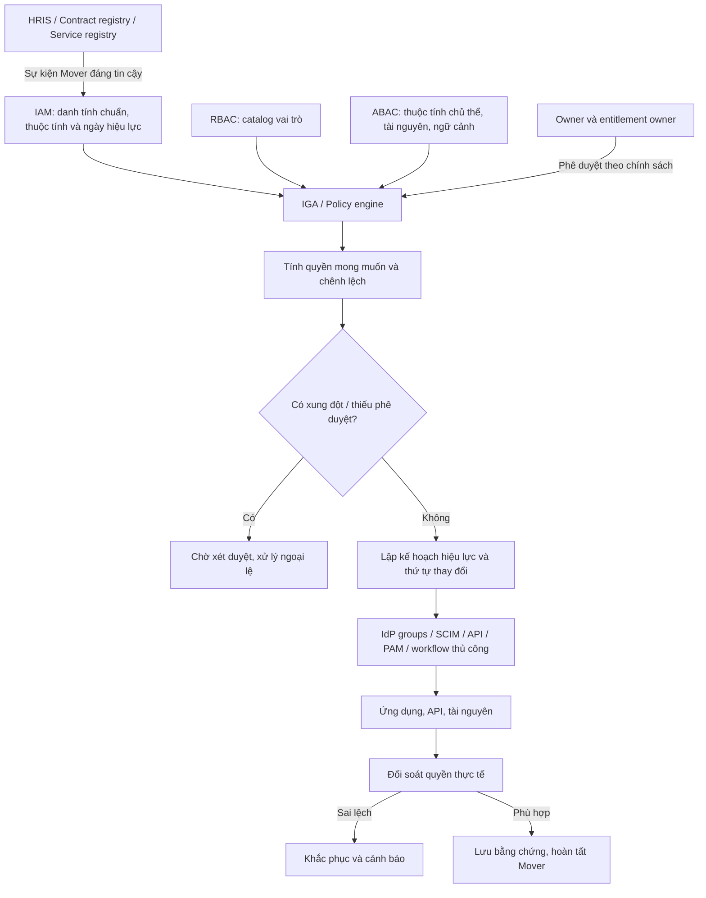

# Cấp quyền mới trong Mover lifecycle của IAM

## 1. Cấp quyền mới là gì khi một danh tính thay đổi vai trò?

Trong quản lý vòng đời danh tính (*Identity Lifecycle Management*), **Mover** là giai đoạn chủ thể đang có danh tính và tài khoản hợp lệ nhưng **quan hệ công việc, trách nhiệm, tổ chức, dự án hoặc phạm vi sử dụng dịch vụ thay đổi**. Một phần của quy trình này là **cấp quyền mới** (*grant new access/provision new entitlements*): đưa vào hiệu lực những quyền đã được xác định là cần thiết và được phê duyệt cho vai trò mới.

Ví dụ, nhân viên từ bộ phận Chăm sóc khách hàng chuyển sang Tài chính. Người đó cần quyền đọc báo cáo tài chính, nhưng quyền xuất danh sách khách hàng của vị trí cũ có thể không còn hợp lệ. Một quy trình mover đầy đủ phải tính **quyền mới cần có**, **quyền cũ phải bỏ**, **quyền được phép giữ** và **thời điểm thay đổi có hiệu lực**. Chỉ thêm người dùng vào nhóm `finance-users` mà không xem các quyền cũ sẽ dẫn đến *permission creep* (quyền tích lũy) và truy cập tồn dư.

Trong module **SECURITY_IDENTITY_ACCESS_MANAGEMENT_IDENTITY_LIFECYCLE**, cấp quyền mới là một mắt xích của **Joiner–Mover–Leaver (JML)**: tiếp nhận thông tin đã xác minh, đánh giá lại quyền, cấp phát đến hệ thống đích, kiểm toán kết quả và rà soát những quyền không còn phù hợp. Những thành phần liên quan có thể gồm **HRIS, IGA, IdP, SSO, SCIM, RBAC/ABAC, PAM, các ứng dụng đích và kho danh tính dịch vụ**.

Bài học tập trung vào **cách quyết định và thực hiện cấp quyền mới an toàn trong Mover lifecycle**, đồng thời chỉ ra quan hệ không thể tách rời với thu hồi và đối soát quyền cũ. Sau khi học, người đọc có thể xác định quyền mới từ nguồn dữ liệu có thẩm quyền; thiết kế luồng phê duyệt, thời điểm hiệu lực và cấp phát; nhận diện lỗi cấp quyền; và xác minh trạng thái cuối cùng bằng bằng chứng kiểm toán.

## 2. Xác định nhu cầu cấp quyền từ sự kiện Mover

Không phải mọi thay đổi hồ sơ đều phải tạo quyền mới. Chỉ những thay đổi tác động đến **nhiệm vụ, vai trò hoặc điều kiện truy cập** mới khiến IAM cần tính lại tập quyền.

| Sự kiện Mover | Ví dụ | Điều IAM cần xem xét |
| --- | --- | --- |
| Đổi bộ phận hoặc đơn vị | Sales → Finance | Vai trò nghiệp vụ mới, tập ứng dụng cần dùng và quyền Sales phải thu hồi |
| Thăng chức hoặc thay trách nhiệm | Nhân viên → trưởng nhóm | Quyền phê duyệt, giới hạn chi phí, phân tách nhiệm vụ và mức bảo đảm xác thực |
| Đổi dự án | Dự án A → dự án B | Nhóm repository, môi trường, tài nguyên dự án, thời hạn bàn giao |
| Đổi vị trí địa lý/pháp nhân | Đơn vị A → đơn vị B | Phạm vi dữ liệu được phép truy cập, điều kiện pháp lý, chính sách địa phương |
| Nhà thầu đổi hợp đồng/sponsor | Hợp đồng cũ → hợp đồng mới | Quan hệ bảo trợ, thời hạn, tài nguyên của từng đối tác |
| Tài khoản dịch vụ đổi workload hoặc nhóm sở hữu | Service thuộc team A chuyển sang team B | Owner mới, môi trường, quyền API, credential và quyền cũ |
| Đổi loại quan hệ | Nhà thầu trở thành nhân viên | Liên kết danh tính, trạng thái tài khoản, xem lại mọi quyền và ngoại lệ cũ |

**Nguồn kích hoạt phải có thẩm quyền.** HRIS thường xác nhận bộ phận, chức danh, quản lý và ngày hiệu lực của nhân viên; hệ thống quản lý hợp đồng xác nhận phạm vi nhà thầu; service registry xác nhận chủ sở hữu workload. Email, tên phòng ban người dùng tự nhập hoặc nhóm đã tồn tại trong một ứng dụng không đủ để quyết định quyền mới.

Một sự kiện Mover có thể đến trước ngày có hiệu lực. Hệ thống có thể **chuẩn bị yêu cầu** nhưng không được mặc định kích hoạt quyền mới ngay khi nhận sự kiện. Cần phân biệt thời điểm phát sự kiện, thời điểm nhận và thời điểm hiệu lực nghiệp vụ.

### Phân biệt quyền mới, quyền duy trì và quyền tạm thời

Giả sử vai trò cũ có quyền `{crm-read, customer-export, office-login}`; vai trò mới yêu cầu `{finance-report-read, invoice-review, office-login}`.

| Tập quyền | Kết quả mong muốn |
| --- | --- |
| **Quyền mới cần cấp** | `finance-report-read`, `invoice-review` |
| **Quyền chung được giữ** | `office-login` |
| **Quyền cũ không còn cần** | `crm-read`, `customer-export` |
| **Quyền chuyển tiếp được duyệt riêng** | Chỉ những quyền cũ có lý do bàn giao, người duyệt và thời hạn kết thúc |

Không nên hiểu “cấp quyền mới” là thao tác giữ nguyên mọi quyền rồi cộng thêm tập mới. **Desired entitlements** (quyền mong muốn hợp lệ) cần được tính lại từ nhiều nguồn, sau đó đối chiếu với **actual entitlements** (quyền thực tế ở từng hệ thống).

## 3. Luồng từ sự kiện nghiệp vụ đến quyết định quyền



Các bước có thể được tổ chức bằng nhiều dịch vụ và hàng đợi. Điều quyết định là **quyền mới được tính từ nguồn đáng tin cậy, kiểm tra chính sách, thực thi có kiểm soát và được kiểm chứng tại đích**. Một thao tác cập nhật HRIS hay gán nhóm IdP thành công không tự chứng minh mọi ứng dụng đã nhận đúng quyền.

### Vai trò của từng hệ thống

- **Nguồn nhân sự/hợp đồng/dịch vụ:** xác nhận sự thay đổi trong quan hệ nghiệp vụ và thời điểm hiệu lực.
- **IAM/identity registry:** duy trì `identityId` ổn định, liên kết account nguồn và đích, ghi nguồn gốc thuộc tính.
- **IGA:** quản lý catalog quyền, workflow phê duyệt, phân tách nhiệm vụ (*Segregation of Duties — SoD*), yêu cầu cấp/thu hồi và rà soát định kỳ.
- **IdP:** quản lý phương tiện xác thực, MFA và các nhóm/chính sách đăng nhập; tùy tích hợp có thể tham gia cấp phát tới ứng dụng.
- **SSO với OIDC/SAML:** cung cấp kết quả xác thực cho ứng dụng. SSO **không thay thế** toàn bộ quá trình cấp quyền cục bộ.
- **SCIM/API/connector:** chuyển yêu cầu thay đổi tài khoản hoặc nhóm đến hệ thống đích; hành vi và khả năng hỗ trợ khác nhau theo nhà cung cấp.
- **Application/data owner:** xác nhận quyền ứng dụng hoặc dữ liệu có phù hợp nhiệm vụ mới và mức độ rủi ro không.
- **Reconciliation/audit:** phát hiện quyền thực tế còn thừa, thiếu hoặc chưa đúng thời gian hiệu lực.

## 4. Dữ liệu đầu vào phải đủ để tính quyền mới

Một sự kiện Mover cần cho phép người xử lý biết **ai thay đổi, từ trạng thái nào sang trạng thái nào, khi nào và do nguồn nào xác nhận**. Nếu chỉ có `newDepartment = Finance`, việc xác định quyền cũ phải bỏ sẽ khó đáng tin.

Ví dụ sự kiện nội bộ **minh họa** (không phải chuẩn SCIM hoặc hợp đồng API bắt buộc):

```json
{
  "eventId": "hr-mover-8051",
  "eventType": "WORKFORCE_MOVED",
  "sourceSystem": "HRIS",
  "sourceSubjectId": "EMP-1042",
  "sourceVersion": 87,
  "effectiveAt": "2026-12-01T00:00:00+07:00",
  "old": {
    "department": "SALES",
    "jobCode": "SALES_SPECIALIST",
    "managerRef": "EMP-0170"
  },
  "new": {
    "department": "FINANCE",
    "jobCode": "FINANCE_ANALYST",
    "managerRef": "EMP-0251"
  },
  "reasonCode": "INTERNAL_TRANSFER",
  "emittedAt": "2026-11-23T08:40:00+07:00"
}
```

Đây là một **sự kiện nghiệp vụ**. Thông tin `sourceSystem` trong payload không đủ chứng minh nguồn: IAM phải xác thực bên gửi qua kênh, credential hoặc cơ chế ký phù hợp, rồi kiểm tra nguồn được phép cập nhật `department`, `jobCode` và `managerRef`.

Các trường kiểm soát quan trọng:

| Dữ liệu | Mục đích kiểm tra |
| --- | --- |
| `sourceSubjectId` + định danh hệ thống nguồn | Liên kết đúng chủ thể với `identityId`, tránh gán quyền nhầm người |
| `eventId` | Chống xử lý lặp khi nguồn retry |
| `sourceVersion` hoặc revision đáng tin | Chặn sự kiện cũ ghi đè trạng thái vai trò mới hơn |
| `effectiveAt` | Quyết định khi nào quyền cần có hiệu lực và khi nào quyền cũ hết |
| Thuộc tính trước–sau | Tính quyền được thêm/giữ/bỏ; giúp kiểm toán quyết định |
| Dữ liệu owner/manager và hợp đồng | Định tuyến phê duyệt đúng người có trách nhiệm |
| Bản ghi phê duyệt hoặc ngoại lệ | Xác định quyền nhạy cảm được duyệt, hạn dùng và cơ sở quyết định |
| Mã tương quan xuyên hệ thống | Kết nối sự kiện, quyết định, lệnh provisioning và trạng thái thực tế |

**Không lấy yêu cầu quyền do người dùng tự khai làm kết quả cuối cùng.** Nếu biểu mẫu có trường `requestedRole = finance-admin`, đó chỉ là đầu vào để xét duyệt theo catalog và chính sách, chưa phải quyết định được quyền đó.

## 5. Tính quyền mới từ RBAC, ABAC và chính sách quản trị

### 5.1 RBAC: gán vai trò nghiệp vụ rồi suy ra quyền kỹ thuật

Với **Role-Based Access Control (RBAC)**, tổ chức ánh xạ vị trí nghiệp vụ sang một tập vai trò đã được quản lý. Một `FINANCE_ANALYST` có thể được gán `finance-report-reader`, `invoice-reviewer` và quyền dùng portal báo cáo. Mỗi vai trò ánh xạ đến nhóm, scope API hoặc quyền cụ thể ở ứng dụng.

Một catalog minh họa:

| Vai trò nghiệp vụ | Quyền gợi ý | Điều kiện/giới hạn |
| --- | --- | --- |
| `SALES_SPECIALIST` | `crm-customer-read`, `sales-export` | Chỉ dữ liệu khách hàng thuộc nhóm bán hàng được duyệt |
| `FINANCE_ANALYST` | `finance-report-read`, `invoice-review` | Không được phê duyệt khoản chi của chính mình |
| `FINANCE_APPROVER` | `payment-approve` | Cần phê duyệt riêng, MFA và giới hạn trách nhiệm |
| `PLATFORM_OPERATOR` | `monitoring-view`, quyền hỗ trợ vận hành | Scope theo môi trường; production có thể dùng PAM/JIT |

Một vai trò nghiệp vụ không nên tự động kéo theo toàn bộ các quyền cao nhất trong ứng dụng. Phải kiểm soát **role explosion** (quá nhiều vai trò khó quản trị), vai trò có ngoại lệ và tài khoản được gán trực tiếp quyền thủ công ngoài RBAC.

### 5.2 ABAC: xét thuộc tính và ngữ cảnh tại thời điểm truy cập

Với **Attribute-Based Access Control (ABAC)**, điều kiện truy cập có thể phụ thuộc `department`, `employmentType`, `region`, `projectId`, mức nhạy cảm tài nguyên, môi trường và mức bảo đảm phiên xác thực. Khi mover đổi thuộc tính, việc cập nhật các giá trị nguồn có thể tác động trực tiếp đến quyết định ABAC, dù danh sách nhóm không đổi.

Ví dụ, chính sách đọc báo cáo có thể yêu cầu:

```text
allowReadReport(subject, report, context):
    return subject.lifecycleStatus == ACTIVE
       and subject.department == FINANCE
       and subject.approvedRole includes finance-report-reader
       and report.allowedLegalEntities includes subject.legalEntity
       and context.authenticationAssurance >= report.requiredAssurance
```

Đây là giả mã cho **một quyết định truy cập**, không phải phép cấp quyền tại IdP. Nếu ứng dụng cache token hoặc thuộc tính lâu, việc thay `department` ở IAM có thể chưa được phản ánh ngay trong phiên hiện tại; hệ thống cần quy tắc về độ mới của claim, phiên, token và cách kích hoạt lại đánh giá chính sách.

### 5.3 Phân tách nhiệm vụ và quyền nhạy cảm

Một thay đổi vai trò có thể vô tình tạo xung đột **SoD**. Ví dụ nhân viên vừa có `invoice-create` của vai trò cũ vừa nhận `invoice-approve` của vai trò mới, tạo khả năng tự lập và tự phê duyệt một khoản chi.

Đánh giá SoD cần xét **quyền tổng hợp sau Mover**, bao gồm quyền cấp trực tiếp, quyền qua nhóm lồng nhau, quyền ứng dụng cục bộ và ngoại lệ chưa hết hạn. Nếu có xung đột, hệ thống phải xử lý theo chính sách: thu hồi quyền cũ trước, từ chối quyền mới hoặc yêu cầu ngoại lệ có kiểm soát và thời hạn. Không xem việc người quản lý phê duyệt là đủ để vô hiệu mọi chính sách an toàn.

## 6. Quy trình yêu cầu và phê duyệt quyền mới

Không phải tất cả quyền đều cần một người phê duyệt thủ công. Một số quyền cơ bản có thể được cấp tự động theo vai trò đã được tổ chức chấp thuận; quyền đặc biệt cần đánh giá kỹ hơn.

### Luồng quyết định chuẩn

1. **Nhận thay đổi đã được xác minh:** nguồn có thẩm quyền xác nhận mover và ngày hiệu lực.
2. **Tính tập quyền đích:** dùng catalog RBAC, điều kiện ABAC, vai trò và phạm vi tài nguyên hiện hành.
3. **Tách quyền tự động và quyền cần duyệt:** quyền mặc định hợp lệ có thể đi theo policy; quyền đặc biệt phải chuyển đến người có thẩm quyền.
4. **Kiểm tra SoD và quyền đang có:** tính cả các nhóm cũ, quyền trực tiếp, ngoại lệ và quyền chưa đồng bộ ở hệ thống đích.
5. **Phê duyệt với ngữ cảnh đầy đủ:** hiển thị vì sao cần quyền, ứng dụng/tài nguyên nào, hành động nào, người nhận và thời hạn.
6. **Tạo kế hoạch cấp phát và thu hồi:** xác định thời điểm hiệu lực, thứ tự, phụ thuộc nghiệp vụ và đường khắc phục khi thất bại.
7. **Thực thi, đối soát, ghi bằng chứng:** chỉ đánh dấu hoàn tất khi trạng thái đích đạt tiêu chí theo chính sách.

| Vai trò | Trách nhiệm thường gặp trong phê duyệt |
| --- | --- |
| Chủ thể/nhân viên | Nêu nhu cầu nghiệp vụ; không tự phê duyệt quyền nhạy cảm cho mình |
| Manager hoặc sponsor mới | Xác nhận nhiệm vụ và quan hệ nghiệp vụ sau chuyển đổi |
| Application/entitlement owner | Duyệt quyền trong ứng dụng, phạm vi và mức đặc quyền |
| Data owner | Duyệt truy cập tập dữ liệu nhạy cảm nếu chính sách yêu cầu |
| IAM/IGA | Vận hành workflow, áp chính sách, ghi log, thực thi và theo dõi |
| Security/SoD/PAM owner | Xét các trường hợp đặc quyền, xung đột nhiệm vụ hoặc ngoại lệ rủi ro cao |

Nếu người quản lý mới chưa được ghi nhận trong HRIS, đừng tự động chuyển yêu cầu đặc quyền cho người quản lý cũ chỉ vì hồ sơ IdP chưa cập nhật. Cần giải quyết **nguồn dữ liệu phê duyệt** và thời điểm hiệu lực trước khi đưa ra quyết định.

### Quyền tự động theo chính sách và ngoại lệ có thời hạn

Quyền mặc định có thể được tính từ job code, nhưng vẫn cần hồ sơ chính sách: ai duyệt role catalog, phiên bản nào, ngày nào áp dụng và khi nào rà soát. Quyền đặc biệt ngoài vai trò nên có **lý do, owner, hạn sử dụng, mức rủi ro và người phê duyệt**. Ngoại lệ “cấp tạm” nhưng không có cơ chế tự hết hạn dễ biến thành quyền tồn dư lâu dài.

## 7. Chọn thời điểm và thứ tự grant/revoke khi Mover

Đây là khó khăn đặc trưng của mover: **cấp quyền mới và thu hồi quyền cũ có thể liên quan đến nhiều hệ thống không hỗ trợ giao dịch nguyên tử**. Do đó cần quản lý *cutover* (điểm chuyển đổi) và sự nhất quán từng giai đoạn.

### 7.1 Ba thời điểm khác nhau

- **`eventTime`:** nguồn phát thông tin thay đổi khi nào.
- **`receivedAt`:** IAM nhận thông tin khi nào.
- **`effectiveAt`:** vai trò/quyền mới bắt đầu có hiệu lực khi nào.

Ví dụ HR gửi thông báo ngày 23/11 cho thay đổi hiệu lực ngày 01/12. IAM có thể tính trước quyền và nhận phê duyệt từ ngày 23/11, nhưng những quyền nhạy cảm mới không nên hoạt động trước 01/12, trừ khi có phê duyệt ngoại lệ. Có thể tạo tài khoản ở trạng thái chưa hoạt động hoặc lập lịch provisioning theo khả năng hệ thống.

### 7.2 Không có một thứ tự phù hợp cho mọi quyền

| Tình huống | Hướng xử lý cần cân nhắc | Lý do |
| --- | --- | --- |
| Chuyển giữa hai nhiệm vụ thông thường, có thời gian bàn giao được phê duyệt | Lên lịch quyền mới và hạn thu hồi quyền cũ rõ ràng | Giảm gián đoạn công việc mà vẫn giới hạn quyền chồng lấn |
| Quyền cũ và mới xung đột SoD | Thu hồi/quyết định vô hiệu quyền xung đột **trước khi** quyền mới có hiệu lực | Tránh khoảng thời gian có thể tự thực hiện và phê duyệt cùng nghiệp vụ |
| Chuyển khỏi vai trò đặc quyền | Ưu tiên thu hồi quyền cao, credential và phiên liên quan | Giảm rủi ro giữ quyền đặc quyền sau khi hết nhiệm vụ |
| Quyền mới phụ thuộc tài khoản đích được tạo | Tạo/liên kết account trước, gán quyền theo thời gian được duyệt | Tránh lệnh cấp quyền thất bại do thiếu account |
| Hệ thống có độ trễ SCIM hoặc đánh giá claim | Theo dõi trạng thái đích và thời điểm token/phiên phản ánh thay đổi | Lệnh gửi đi chưa chắc có hiệu lực ngay |
| Hệ thống offline/không có connector | Ticket, người xử lý, hạn và bằng chứng xác minh độc lập | Không được coi việc gửi ticket là hoàn tất thu hồi/cấp quyền |

**Không dùng công thức “luôn grant trước, revoke sau”**. Với quyền có nguy cơ tạo xung đột, thiết kế an toàn có thể buộc thu hồi quyền cũ trước và chấp nhận gián đoạn ngắn có kiểm soát. Khi tính liên tục công việc quan trọng, phải có phương án phân quyền tạm và điểm hết hạn được phê duyệt, thay vì quyền chồng lấn vô thời hạn.

### 7.3 Nếu bước thay đổi chỉ hoàn tất một phần

Giả sử cấp quyền mới ở ERP thành công nhưng thu hồi quyền CRM cũ thất bại. Hệ thống phải ghi **partial success**, mở tác vụ khắc phục và áp kiểm soát phù hợp theo mức độ rủi ro; không ghi `MOVER_COMPLETED` chỉ vì một phần quyền mới có hiệu lực.

Nếu quyền mới thất bại, không tự động giữ hoặc phục hồi mọi quyền cũ: quyết định tiếp theo phụ thuộc chính sách bảo mật và nghiệp vụ. Đối với quyền xung đột hoặc vai trò rủi ro cao, rollback tự động có thể tái tạo lỗ hổng cần tránh. Hệ thống cần người chịu trách nhiệm và cơ chế xử lý ngoại lệ có thể kiểm toán.

## 8. Cấp phát quyền đến IdP, ứng dụng và tài nguyên

### IdP và nhóm

Một số ứng dụng nhận vai trò từ nhóm IdP, ví dụ nhóm `fin-report-readers`. Khi người dùng được thêm vào nhóm, ứng dụng có thể nhìn thấy nhóm này trong token mới, qua directory lookup hoặc qua đồng bộ riêng. **Thay đổi nhóm ở IdP không bảo đảm mọi ứng dụng lập tức thay đổi quyền**; phải xác định cách ứng dụng đọc và cache thông tin nhóm.

### SCIM hoặc API provisioning

SCIM hỗ trợ quản lý tài nguyên như User và Group tùy khả năng triển khai. Hệ thống provisioning có thể tạo hoặc cập nhật membership, thuộc tính hoặc trạng thái tài khoản ở ứng dụng đích. Quy tắc mapping giữa `identityId`, `externalId`, tài khoản đích và quyền phải rõ ràng. SCIM `id` là định danh tài nguyên do service provider cấp; nó không nên bị coi là định danh chuẩn toàn hệ thống IAM.

Ví dụ **minh họa** một yêu cầu SCIM PATCH thêm thành viên vào nhóm tại một service provider (điểm cuối và ID giả định):

```http
PATCH /scim/v2/Groups/finance-report-readers HTTP/1.1
Content-Type: application/scim+json
Authorization: Bearer <access-token>

{
  "schemas": ["urn:ietf:params:scim:api:messages:2.0:PatchOp"],
  "Operations": [
    {
      "op": "add",
      "path": "members",
      "value": [{ "value": "sp-user-5831" }]
    }
  ]
}
```

`sp-user-5831` ở đây là ID User **trong service provider**, đã được IAM đối chiếu với danh tính chuẩn. Lệnh ví dụ giả định service provider hỗ trợ PATCH Group theo cách đó; endpoint, token và mapping thực tế phải theo tài liệu tích hợp. Trong triển khai, không đặt bearer token thật vào mã nguồn hoặc log.

Sau PATCH, cần kiểm tra kết quả và **đọc lại trạng thái membership** khi quan trọng. Nếu người dùng đang có phiên cũ, ứng dụng có thể vẫn dùng claim trước thay đổi; cần chính sách re-evaluation, session/token lifecycle và thời hạn truyền cập nhật.

### Ứng dụng không hỗ trợ SCIM

Một số hệ thống có API riêng hoặc chỉ cho phép đổi quyền qua console quản trị. IGA cần tạo ticket có tài nguyên và quyền cụ thể, chỉ định người thực hiện, xác nhận sau thay đổi và đối soát kết quả. **Ticket ở trạng thái “resolved” không phải bằng chứng đầy đủ** nếu quyền thực tế chưa được xác nhận.

### Quyền đặc quyền và PAM

Đối với quyền production hoặc tài khoản quản trị, nên cân nhắc **Privileged Access Management (PAM)**, cấp đặc quyền theo thời gian hoặc theo yêu cầu (*just-in-time*, *just-enough access*), phê duyệt bổ sung và ghi log phiên theo chính sách. Grant quyền đặc quyền mới cần kiểm tra cả MFA, điều kiện thiết bị, phạm vi tài nguyên và hạn sử dụng; không nên gán vai trò admin cố định chỉ vì được thăng chức.

## 9. Thuật toán tính chênh lệch quyền và tổ chức thực thi

Giả sử có ba tập quyền:

- `actual`: quyền hiện đang có trong ứng dụng, IdP và hệ thống liên quan.
- `desired`: quyền hợp lệ sau mover, được tính từ vai trò, thuộc tính, chính sách và phê duyệt.
- `approvedTemporary`: quyền chuyển tiếp có lý do và hạn dùng, được xét như các ngoại lệ riêng.

Không nên tính `desired` bằng cách lấy đơn thuần tập quyền cũ cộng tập quyền vai trò mới. Một mô hình đơn giản:

```text
effectiveDesired = policyEntitlements(newAuthoritativeAttributes)
                 union explicitlyApprovedEntitlements
                 union unexpiredApprovedTemporaryAccess

toGrant  = effectiveDesired - actual
toRevoke = actual - effectiveDesired
toKeep   = actual intersection effectiveDesired
```

Trong môi trường thật, phép so sánh phải xét **scope, resource, action, điều kiện, thời gian hiệu lực và nguồn grant**, không chỉ tên group. Ví dụ `orders-read` cho đối tác A khác với cùng tên quyền ở đối tác B. Các quyền tính từ nhóm lồng nhau, policy cloud hoặc quyền được gán trực tiếp cũng cần được chuẩn hóa để không bị bỏ sót.

### Pseudocode cho quy trình Mover

```text
onMoverEvent(event, authenticatedSource):
    require authority.allows(authenticatedSource, event.changedAttributes)
    require validateSchema(event)
    identity = identityRegistry.correlate(event.sourceSubjectId, authenticatedSource)

    if identity is ambiguous:
        return PENDING_REVIEW("AMBIGUOUS_SUBJECT")
    if event is duplicate or older than accepted source version:
        return IGNORE_OR_RETURN_PREVIOUS_DECISION

    authoritativeState = verifyCurrentStateAndEffectiveTime(identity, event)
    policyVersion = policyCatalog.activeVersionFor(event.effectiveAt)

    desired = evaluateDesiredAccess(identity, authoritativeState, policyVersion)
    actual = discoverActualAccessAcrossTargets(identity)

    changes = calculateScopedDifference(actual, desired)
    conflicts = evaluateSoDAndHighRiskOverlap(actual, desired, changes)

    if conflicts need review or approvals missing:
        return PENDING_APPROVAL_WITH_EXACT_SCOPE

    plan = buildTransitionPlan(changes, event.effectiveAt, conflicts)
    persistDecisionAndPlanIdempotently(identity, event, plan)

    for change in plan.orderedSteps:
        dispatchToTargetWithCorrelationId(change)
        verifyObservedTargetState(change)
        recordResultOrEscalate(change)

    if all required target states are verified:
        markMoverCompleted(identity, plan)
    else:
        markMoverPartiallyAppliedAndRemediate(identity, plan)
```

Đây là **giả mã khái niệm**, không phải logic sử dụng nguyên xi. Nhiều bước phải được thiết kế bất đồng bộ với lưu trạng thái bền vững. Kiểm tra nguồn, lấy trạng thái mới nhất và ghi quyết định cần giải quyết race condition; ở kiến trúc phân tán có thể dùng outbox, idempotency key, hàng đợi retry và reconciliation để giảm nguy cơ mất lệnh.

### Điều kiện an toàn khi retry

Dùng khóa yêu cầu như `(identityId, eventId, policyVersion, targetSystem, operation)` hoặc cơ chế tương đương để tránh cấp lại quyền khi API timeout rồi được gọi lại. Tuy nhiên, ngay cả khi một lệnh `add member` idempotent, **thứ tự giữa grant và revoke** vẫn phải được quản lý: không để event cũ cấp lại quyền đã thu hồi sau Mover mới hơn hoặc sau Leaver.

## 10. Những trường hợp đặc biệt trong Mover

### 10.1 Chuyển vai trò có thời gian bàn giao

Một nhân viên Sales được giao hướng dẫn người thay thế trong bảy ngày. Nếu cần quyền CRM tạm thời, nên có **ngoại lệ tách biệt**: quyền cụ thể, dữ liệu, thời gian kết thúc, người duyệt và điều kiện giám sát. Hết hạn thì tự thu hồi hoặc kích hoạt một yêu cầu thu hồi có kiểm chứng. Không giữ quyền chỉ vì chưa ai đóng ticket.

### 10.2 Mover vào vai trò có đặc quyền cao

Nhân viên chuyển sang nhóm vận hành production. Grant quyền `prod-admin` có thể cần xác minh tư cách, MFA mạnh, phê duyệt riêng, PAM, session logging và quyền có thời hạn. SoD phải xét mọi quyền họ vẫn sở hữu ở nhóm cũ. Nếu đang có quyền phê duyệt thay đổi và quyền triển khai, phải xác định điều kiện tách trách nhiệm theo chính sách tổ chức.

### 10.3 Đổi vai trò nhưng dữ liệu nguồn đến muộn

HRIS phát event `version=103` sau khi IAM đã xử lý `version=104`. Với hợp đồng version tăng theo subject, IAM bỏ qua event cũ và ghi bằng chứng, thay vì hạ quyền/khôi phục quyền của vai trò trước. Nếu không có revision đáng tin, có thể phải truy vấn nguồn để xác nhận trạng thái cuối cùng.

### 10.4 Thay từ nhà thầu thành nhân viên

Một người từng có guest identity ở ứng dụng B2B rồi trở thành nhân viên. IAM cần **xác minh liên kết giữa hai quan hệ**, quyết định giữ một identity hay tạo liên kết theo chính sách và rà soát các tài khoản/nhóm cũ. Không gộp tự động theo email và không phục hồi quyền nhà thầu cùng quyền nhân viên mới nếu không có căn cứ. Trạng thái hợp đồng, sponsor và danh tính workforce là các nguồn riêng phải được đối chiếu.

### 10.5 Chuyển quyền sở hữu service account

Một workload `svc-billing-batch` chuyển từ team A sang team B. Bước Mover nên cập nhật owner trong service registry, kiểm tra môi trường/ứng dụng, đánh giá quyền mới, tài khoản cloud, khóa và token, rồi thu hồi quyền hoặc secret không còn cần. **Owner đổi không nhất thiết khiến workload phải ngừng**, nhưng không được giữ quyền bất biến chỉ vì service account không xuất hiện trong HRIS.

### 10.6 Quyền được cấp ở nhiều nơi

Người dùng có thể cùng một quyền nghiệp vụ qua nhóm IdP, gán trực tiếp trong SaaS hoặc vai trò cloud. Nếu IAM chỉ bỏ một nhóm nhưng quyền trực tiếp vẫn tồn tại, lần đối soát phải phát hiện. Khi cấp quyền mới, nên ưu tiên đường quản trị được chỉ định và hạn chế những grant ngoài luồng khó kiểm soát.

## 11. Ghi nhận quyết định và trạng thái cấp quyền

Một bản ghi quyết định nên cho phép kiểm toán phân biệt **được phê duyệt**, **đã gửi lệnh** và **đã được xác nhận tại đích**. Ví dụ cấu trúc minh họa:

```json
{
  "changeId": "move-8051",
  "identityId": "id-5831",
  "sourceEventId": "hr-mover-8051",
  "effectiveAt": "2026-12-01T00:00:00+07:00",
  "policyVersion": "role-catalog-v14",
  "requestedChanges": [
    {
      "target": "finance-reporting",
      "action": "GRANT",
      "entitlement": "finance-report-read",
      "scope": "legal-entity-01",
      "approval": "POLICY_APPROVED",
      "executionStatus": "VERIFIED"
    },
    {
      "target": "crm",
      "action": "REVOKE",
      "entitlement": "customer-export",
      "approval": "POLICY_REQUIRED",
      "executionStatus": "VERIFIED"
    }
  ],
  "moverStatus": "COMPLETED",
  "reconciledAt": "2026-12-01T00:10:00+07:00"
}
```

Đây là **schema minh họa**, không phải một chuẩn giao thức. Trong hệ thống thật cần ràng buộc kết quả với mã yêu cầu và tài khoản đích, thời điểm/actor xử lý, chứng cứ phê duyệt và lỗi cụ thể; không ghi bí mật hoặc access token vào log.

**Các trạng thái nên tách biệt:**

| Trạng thái | Ý nghĩa |
| --- | --- |
| `REQUESTED` | Có nhu cầu cấp quyền, chưa có quyết định |
| `PENDING_APPROVAL` | Đang kiểm tra chính sách, SoD hoặc người duyệt |
| `APPROVED` | Quyền mới và điều kiện đã được chấp thuận |
| `SCHEDULED` | Đã lên lịch cấp phát theo thời điểm hiệu lực |
| `SENT` / `IN_PROGRESS` | Đã gửi lệnh, chưa xác nhận trạng thái đích |
| `VERIFIED` | Quyền mục tiêu đã được đối soát tại đích |
| `FAILED` / `PARTIALLY_APPLIED` | Một phần thay đổi lỗi hoặc chưa phù hợp; cần khắc phục |
| `EXPIRED` / `REVOKED` | Quyền tạm hết hạn hoặc đã được thu hồi và xác nhận |

Một request `APPROVED` **không tương đương** quyền đã có hiệu lực. Tương tự, `SENT` không đồng nghĩa `VERIFIED`. Để kết luận Mover hoàn tất, nên dựa vào tiêu chí đã định nghĩa cho toàn bộ thay đổi cần thiết, bao gồm quyền cũ phải thu hồi.

## 12. Đối soát, cảnh báo và tiêu chí hoàn tất

Sau khi grant được gửi, IAM/IGA cần đọc lại hoặc nhận xác nhận có căn cứ từ hệ thống đích. Quan sát có thể thực hiện qua API, SCIM readback, directory sync, truy vấn nhóm/quyền hoặc quy trình kiểm tra thủ công có bằng chứng.

| Kiểm tra | Câu hỏi cần trả lời | Nếu không đạt |
| --- | --- | --- |
| Đúng chủ thể | Grant có gắn đúng `identityId` và account đích không? | Dừng/thu hồi sai quyền, điều tra ánh xạ |
| Đúng quyền | Quyền mới có đúng action, scope và resource được duyệt không? | Thu hẹp hoặc sửa quyền, đánh giá ảnh hưởng |
| Đúng thời điểm | Quyền có hiệu lực theo `effectiveAt` và hạn được duyệt không? | Điều chỉnh lịch, đánh giá quyền mở sớm/quá hạn |
| Không xung đột SoD | Vai trò cũ và mới có đồng thời tạo khả năng thao tác trái chính sách không? | Ưu tiên khắc phục hoặc khóa luồng rủi ro |
| Quyền cũ đã thu hồi | Các quyền không còn lý do đã biến mất ở mọi đích chưa? | Mở incident/ticket, theo dõi đến khi đối soát |
| Session/token | Phiên/token có phản ánh mức quyền hiện hành theo yêu cầu không? | Xử lý phiên/token theo khả năng sản phẩm |
| Nguyên tắc tối thiểu | Có quyền ngoài catalog hoặc cấp trực tiếp mà policy không cho phép không? | Rà soát ngoại lệ, thu hồi hoặc phê duyệt có thời hạn |
| Audit trail | Có truy được nguồn, phiên bản, người duyệt, lệnh và kết quả không? | Bổ sung bằng chứng hoặc xử lý thiếu kiểm soát |

**Chỉ số vận hành có thể đo** gồm thời gian từ khi có quyết định đến khi quyền mới được xác nhận ở đích, tỷ lệ provisioning thất bại, số mover đang `PARTIALLY_APPLIED`, số xung đột SoD chưa giải quyết, số quyền cũ còn tồn tại sau hiệu lực và tỷ lệ ngoại lệ quyền bàn giao quá hạn. Mục tiêu cụ thể phụ thuộc rủi ro, loại tài nguyên và khả năng từng connector; không thể suy ra một SLA từ việc “ứng dụng đã bật SCIM”.

### Audit trail cho quyền mới

Cần lưu nguồn sự kiện có thẩm quyền, thời gian hiệu lực, danh tính và tài khoản đích, thuộc tính trước–sau, policy version, quyết định quyền, người duyệt, lý do/ngoại lệ, timestamp thực thi, kết quả của từng connector và trạng thái đối soát. Log phải được bảo vệ phân quyền, tránh lưu token, secret, dữ liệu cá nhân không cần thiết; mức lưu giữ tuân theo quy định và chính sách tổ chức.

## 13. Tình huống thực tế: chuyển từ Sales sang Finance

Một nhân viên có `identityId=id-5831`, làm `SALES_SPECIALIST` và đang có các quyền `crm-customer-read`, `customer-export`, `office-login`. Từ ngày 01/12/2026 người đó chuyển thành `FINANCE_ANALYST`.

**Trước ngày hiệu lực.** HRIS gửi sự kiện Mover đã xác minh, gồm `sourceVersion`, bộ phận và chức danh cũ/mới, người quản lý mới, `effectiveAt`. IGA tính role catalog: quyền mới cần `finance-report-read`, `invoice-review`; `office-login` được giữ; `crm-customer-read` và `customer-export` cần thu hồi. Người quản lý mới xác nhận nhu cầu, owner ứng dụng duyệt các quyền không nằm trong policy tự động. Một yêu cầu giữ quyền CRM bảy ngày để bàn giao được xét **riêng**, có thời hạn và phạm vi.

**Đến ngày hiệu lực.** Bộ điều phối thực hiện theo kế hoạch đã duyệt. Nếu quyền `invoice-review` xung đột với quyền cũ, quyền xung đột cần được thu hồi trước hoặc trong điểm chuyển đổi theo yêu cầu SoD. Connector cấp quyền Finance qua nhóm IdP hoặc API/SCIM, và gửi yêu cầu thu hồi CRM. Các thay đổi phải có mã tương quan riêng, có thể retry an toàn.

**Sau chuyển đổi.** Đối soát xác nhận Finance đã có đúng quyền. Tuy nhiên, ứng dụng CRM vẫn hiển thị `customer-export` vì trước đó quyền được cấp trực tiếp ngoài nhóm IdP. IAM ghi `PARTIALLY_APPLIED`, thông báo chủ sở hữu ứng dụng, xử lý grant trực tiếp và kiểm tra lại. Chỉ khi quyền không hợp lệ đã biến mất hoặc được xử lý theo ngoại lệ hợp lệ, quá trình Mover mới đạt điều kiện hoàn tất.

**Sau bảy ngày.** Nếu quyền CRM để bàn giao được phê duyệt có thời hạn, hệ thống tự kích hoạt thu hồi theo chính sách và xác minh. Việc nhân viên vẫn đăng nhập thành công qua SSO không chứng minh rằng quyền dữ liệu cũ đã được thu hồi; phải kiểm chứng từng ứng dụng.

Kết quả mong muốn:

```text
BEFORE:
  crm-customer-read
  customer-export
  office-login

AFTER:
  finance-report-read
  invoice-review
  office-login

TEMPORARY (only if approved):
  crm-customer-read until handover deadline
```

Ví dụ cho thấy cấp quyền mới là **một quyết định về quyền mong muốn sau thay đổi**, đi kèm loại bỏ quyền không còn phù hợp và kiểm tra quyền thực tế. Một danh tính không nên giữ quyền của hai vị trí vô thời hạn chỉ vì hai hệ thống hoạt động độc lập.

## 14. Những lỗi thường gặp khi cấp quyền mới

**Lỗi 1 — Chỉ thêm nhóm mới, không thu hồi nhóm và quyền cũ.** Mover tạo quyền tích lũy. Cách khắc phục là tính chênh lệch từ tập quyền mong muốn, rà soát cả grant trực tiếp và đối soát các đích.

**Lỗi 2 — Lấy tên phòng ban hoặc role do người dùng nhập để cấp quyền.** Thuộc tính nhạy cảm phải lấy từ nguồn có thẩm quyền và được xác thực; yêu cầu tự khai chỉ là đề nghị xét quyền.

**Lỗi 3 — Chỉ dựa vào kết quả cập nhật IdP/SSO.** Quyền ứng dụng có thể nằm ở local group hoặc token cũ. Cần kiểm tra mapping, connector và trạng thái thực tế.

**Lỗi 4 — Không kiểm tra SoD khi quyền cũ và mới giao nhau.** Có thể tạo khả năng tự tạo và tự phê duyệt giao dịch. Cần xét toàn bộ quyền hiện có và thời gian chồng lấn.

**Lỗi 5 — Cấp quyền ngay khi nhận sự kiện tương lai.** Quyền mới có thể mở sớm hơn ngày bắt đầu vai trò. Phải dùng `effectiveAt` và lịch thực thi có kiểm chứng.

**Lỗi 6 — Retry vô điều kiện và xử lý sự kiện cũ.** Gây tài khoản trùng hoặc khôi phục quyền đã thu hồi. Cần correlation, versioning, idempotency và ràng buộc trạng thái nguồn hiện hành.

**Lỗi 7 — Mặc định một bước thất bại thì rollback tất cả về quyền cũ.** Có thể khôi phục đặc quyền hoặc xung đột SoD. Kế hoạch khắc phục phải xét rủi ro và mức an toàn của từng quyền.

**Lỗi 8 — Bỏ qua service account và guest.** Những danh tính này cũng đổi owner, hợp đồng hoặc phạm vi dự án, dù không nhận sự kiện chuyển phòng từ HRIS.

**Lỗi 9 — Kết thúc request khi connector trả thành công.** Cần xác nhận trạng thái đích, quyền thực tế, phiên/token và các ngoại lệ còn mở theo chính sách.

## 15. Checklist thiết kế và vận hành

Để triển khai **cấp quyền mới trong Mover lifecycle**, đội IAM/IGA và chủ sở hữu ứng dụng cần trả lời:

1. **Sự kiện:** nguồn nào có thẩm quyền xác nhận mover; có khóa chủ thể ổn định, phiên bản và thời điểm hiệu lực không?
2. **Danh tính:** các tài khoản IdP/ứng dụng có được liên kết đúng `identityId` khi người dùng đổi tên, email, tổ chức hoặc hợp đồng không?
3. **Chính sách:** vai trò RBAC và thuộc tính ABAC nào quyết định quyền mới, quyền nào tự động, quyền nào cần phê duyệt?
4. **SoD:** tập quyền cũ cộng quyền mới có tạo xung đột hay đặc quyền vượt chuẩn không? Kiểm tra cả grant trực tiếp và nhóm lồng nhau chưa?
5. **Quyền mong muốn:** đã tính riêng tập quyền thêm, giữ, bỏ và ngoại lệ chuyển tiếp có hạn sử dụng chưa?
6. **Approval:** manager/sponsor, application/data owner và người quản trị đặc quyền có được định tuyến đúng theo thời điểm chuyển vai trò không?
7. **Lịch thực thi:** grant/revoke bắt đầu khi nào, hệ thống nào cần sẵn sàng trước và thứ tự nào tránh gián đoạn hoặc vượt quyền?
8. **Provisioning:** IdP group, SCIM/API, IAM connector, PAM và quy trình thủ công có mapping tài khoản, scope và trạng thái rõ ràng không?
9. **Sự kiện bất đồng bộ:** retry, event lặp, event đến muộn, thay đổi đồng thời và các bước chỉ thành công một phần được xử lý thế nào?
10. **Phiên hiện hành:** ứng dụng đánh giá nhóm/claim và quyền trong session/token như thế nào; khi nào cần làm mới hoặc thu hồi phiên?
11. **Đối soát:** sau thực thi đã kiểm tra được quyền thực tế ở mọi hệ thống đích, quyền cũ bị thu hồi, ngoại lệ hết hạn và SoD còn hiệu lực không?
12. **Kiểm toán:** có bản ghi sự kiện nguồn, version chính sách, phê duyệt, grant/revoke, kết quả connector, người chịu trách nhiệm và các sai lệch đang mở không?

**Cấp quyền mới trong Mover lifecycle cần kết thúc bằng trạng thái truy cập phù hợp với nhiệm vụ hiện tại, chứ không chỉ bằng một lệnh thêm nhóm thành công.** Khi quyết định quyền dựa trên nguồn có thẩm quyền, RBAC/ABAC, phê duyệt và SoD; khi thời điểm grant/revoke được điều phối; và khi quyền thực tế được đối soát trên IdP, SSO, SCIM, PAM cùng các ứng dụng đích, tổ chức có thể hỗ trợ chuyển vai trò nhanh mà vẫn giảm quyền truy cập tồn dư và duy trì dấu vết kiểm toán.
