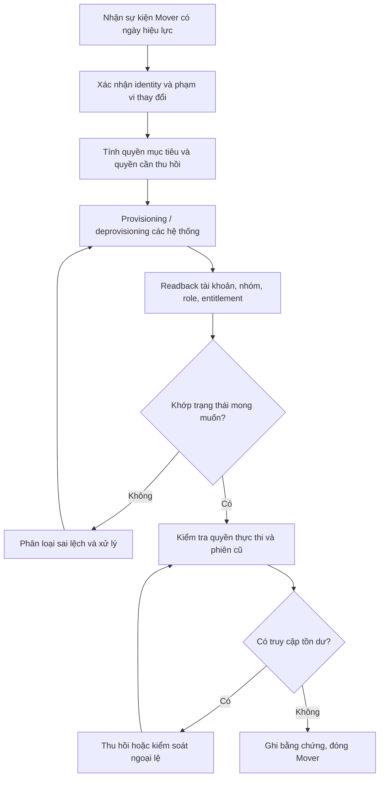

# Xác minh hoàn tất Mover trong vòng đời danh tính IAM

Trong **Identity and Access Management (IAM)**, **Mover** là quy trình cập nhật danh tính, tài khoản và quyền truy cập khi một người thay đổi vị trí, bộ phận, nhiệm vụ hoặc phạm vi trách nhiệm mà vẫn tiếp tục có quan hệ với tổ chức. **Xác minh hoàn tất Mover** là bước chứng minh rằng các thay đổi đã được thực thi đúng ở những hệ thống liên quan: quyền mới cần thiết đã được cấp, quyền cũ không còn phù hợp đã bị thu hồi, các phiên hoặc credential liên quan được xử lý và không còn sai lệch ngoài những ngoại lệ được phê duyệt.

Trong mô hình **Joiner–Mover–Leaver (JML)**, Mover thường khó xác nhận hơn Joiner vì danh tính đã tồn tại trên nhiều ứng dụng. Một thao tác đổi department trong HRIS hoặc đổi nhóm ở **Identity Provider (IdP)** không có nghĩa mọi ứng dụng đã cập nhật quyền. Đặc biệt, **SSO** giúp đăng nhập nhưng không tự bảo đảm quyền cục bộ, token, phiên cũ hoặc tài khoản đặc quyền đã được xử lý. Vì vậy, kết thúc Mover phải dựa trên **bằng chứng tại hệ thống đích**, thay vì chỉ dựa trên trạng thái workflow “thành công”.

## 1. Khi nào một Mover được coi là hoàn tất?

Một Mover chỉ nên được đóng khi đáp ứng các điều kiện theo chính sách:

1. **Nguồn nghiệp vụ được xác nhận:** sự kiện thay đổi có danh tính đúng, ngày hiệu lực, vị trí/phạm vi mới và người phê duyệt hoặc nguồn có thẩm quyền.
2. **Quyền mục tiêu được xác định:** biết bộ quyền mới dựa trên nhiệm vụ và chính sách **RBAC/ABAC**; không chỉ “sao chép quyền của người cùng chức danh”.
3. **Quyền phải thu hồi được xử lý:** nhóm, entitlement, tài khoản đặc quyền và quyền ngoại lệ từ vai trò cũ không còn nhu cầu đã mất hiệu lực.
4. **Quyền cần giữ hoặc cấp mới hoạt động:** người dùng thực hiện được các tác vụ hợp lệ trong phạm vi mới mà không có quyền vượt mức.
5. **Hệ thống đích được đối soát:** các ứng dụng liên quan phản ánh trạng thái mong muốn, kể cả ứng dụng không hỗ trợ provisioning tự động.
6. **Phiên, token và credential được đánh giá:** những đường truy cập còn hiệu lực theo vai trò cũ được chặn, thu hồi hoặc quản lý bằng biện pháp bù trừ đã duyệt.
7. **Bằng chứng và ngoại lệ được lưu:** có thể truy nguyên yêu cầu, kết quả, lỗi còn tồn, người chịu trách nhiệm và thời hạn khắc phục.

**Hoàn tất quy trình** và **hoàn tất thu hồi quyền thực tế** là hai khái niệm khác nhau. Nếu SCIM trả mã thành công nhưng ứng dụng vẫn giữ role cục bộ, trạng thái cần tiếp tục được theo dõi thay vì đóng Mover là thành công.

## 2. Phạm vi cần kiểm tra

| Lớp kiểm tra | Trạng thái mong muốn | Bằng chứng gợi ý |
| --- | --- | --- |
| HRIS / nguồn có thẩm quyền | Chức danh, bộ phận, người quản lý, ngày hiệu lực mới đúng | Sự kiện nhân sự và phiên bản bản ghi |
| IAM / IGA | Quyền mục tiêu và quyền phải thu hồi được tính theo chính sách | So sánh entitlement trước/sau, phê duyệt |
| IdP / directory | Nhóm, thuộc tính và trạng thái tài khoản phản ánh vai trò mới | Readback từ IdP hoặc directory |
| Ứng dụng đích | Quyền mới hoạt động và quyền cũ mất hiệu lực | Truy vấn role/ACL thực tế, kiểm tra phân quyền |
| SCIM / connector | Các thao tác cập nhật/thu hồi đã được hệ thống đích xử lý | Log giao dịch, trạng thái đồng bộ và đối soát |
| SSO, session, token | Không thể tiếp tục khai thác quyền cũ từ phiên hoặc token không phù hợp | Thử truy cập theo kịch bản được phép, log policy |
| Tài khoản đặc quyền | Quyền quản trị cũ, quyền khẩn cấp và tài khoản thứ cấp được xử lý | Bản kê PAM, thời hạn và bằng chứng thu hồi |
| Audit / ticket | Các quyết định và kết quả có thể truy nguyên | Correlation ID, thời điểm, người duyệt, báo cáo |

Không phải mọi hệ thống đều hỗ trợ đọc quyền hoặc thu hồi token tức thì. Khi không có API readback, cần phương pháp kiểm chứng khác được phê duyệt, chẳng hạn truy vấn dữ liệu quản trị, kiểm tra chính sách tại ứng dụng hoặc xác nhận độc lập của chủ sở hữu hệ thống. Cần ghi rõ độ tin cậy và giới hạn của từng bằng chứng.

## 3. Luồng xác minh hoàn tất Mover



### Bước 1 — Đối chiếu sự kiện với danh tính gốc

Xác nhận yêu cầu thay đổi là của đúng cá nhân, từ nguồn có thẩm quyền và đúng ngày hiệu lực. Nên dùng mã danh tính ổn định như `personId`; không chỉ dựa vào tên hoặc email. Nếu một người có nhiều tài khoản, danh sách kiểm tra phải bao gồm tất cả tài khoản được liên kết với danh tính đó.

Ví dụ, một nhân viên đổi email khi chuyển bộ phận không nhất thiết phải tạo identity mới. Nếu tài khoản cũ không còn liên kết được với identity gốc, quy trình có thể bỏ sót quyền còn tồn dư.

### Bước 2 — Xây dựng trạng thái quyền mục tiêu

IAM so sánh quyền hiện tại với quyền cần có sau Mover. **RBAC** mô tả quyền theo vai trò; **ABAC** giới hạn quyền theo thuộc tính như bộ phận, dự án, địa bàn, mức nhạy cảm dữ liệu và trạng thái công việc.

Có thể biểu diễn tập quyền bằng:

```text
current = quyền đang có tại các hệ thống đích
target  = quyền được phép theo vai trò mới và ngoại lệ đã duyệt

to_grant  = target - current
to_revoke = current - target
to_keep   = current ∩ target
```

Phép so sánh trên chỉ là **mô hình logic**. Trong thực tế, cần tách quyền trực tiếp, quyền kế thừa qua nhóm, điều kiện ABAC, quyền tạm thời và quyền do ứng dụng tự quản lý. Có những quyền cũ được giữ trong một giai đoạn bàn giao hợp lệ; chúng phải có thời hạn, chủ sở hữu và phê duyệt rõ ràng.

### Bước 3 — Thực thi cập nhật và ghi kết quả

IAM có thể cập nhật nhóm tại IdP, dùng **SCIM** hoặc connector để đồng bộ đến ứng dụng và gọi các API riêng để thay entitlement. Mỗi hành động cần có định danh giao dịch, trạng thái, thời gian, chính sách áp dụng và cơ chế retry an toàn.

Không nên coi sự kiện gửi thành công là hệ thống đích đã áp dụng hoàn toàn. Một số ứng dụng duy trì cache, nhóm nội bộ hoặc cơ chế phân quyền độc lập; vì vậy kết quả phải được đối soát riêng.

### Bước 4 — Đọc lại trạng thái và kiểm thử quyền

Kiểm tra danh sách nhóm, role, ACL, quyền dự án và tài khoản đặc quyền **thực tế**. Sau đó xác minh hai chiều:

- **Positive test:** tác vụ hợp lệ của vị trí mới vẫn được phép.
- **Negative test:** thao tác thuộc quyền cũ hoặc ngoài phạm vi mới phải bị từ chối.

Kiểm thử phải sử dụng tài khoản thử hoặc quy trình kiểm soát phù hợp, tránh truy xuất dữ liệu thật không cần thiết. Với hệ thống nhạy cảm, có thể dùng bằng chứng từ policy engine hoặc kết quả kiểm tra phân quyền có giám sát.

### Bước 5 — Kiểm tra session và token cũ

Một nhân viên có thể đăng nhập qua SSO trước ngày chuyển bộ phận và giữ phiên ứng dụng hoặc access token với claims cũ. Khi đó, cập nhật nhóm IdP chưa chắc vô hiệu hóa phiên ngay.

Tùy kiến trúc, biện pháp có thể gồm thu hồi session/refresh token, dùng token ngắn hạn, cập nhật chính sách kiểm tra ở mỗi yêu cầu hoặc yêu cầu xác thực lại. Một số token tự chứa vẫn có thể được chấp nhận đến hạn hết hiệu lực nếu ứng dụng không có cách thu hồi tức thì. **Đánh giá hoàn tất phải dựa trên hành vi truy cập thực tế và giới hạn đã được ghi nhận.**

### Bước 6 — Đóng yêu cầu và lưu bằng chứng

Chỉ đóng thành công khi điều kiện kiểm tra đạt hoặc khi có ngoại lệ được phê duyệt phù hợp với chính sách đóng yêu cầu. Bằng chứng nên gồm phiên bản sự kiện nguồn, danh tính, quyền mục tiêu, hệ thống đích, thời điểm hiệu lực, phép đối soát, kiểm tra quyền và trạng thái các ngoại lệ.

Nếu một hệ thống chưa thể thu hồi quyền, thông thường Mover cần giữ trạng thái **chưa hoàn tất** hoặc **hoàn tất có ngoại lệ được phê duyệt**, tùy quy trình quản trị rủi ro; không được báo rằng mọi quyền đã thu hồi khi chưa có chứng cứ.

## 4. Ví dụ thực tế: chuyển từ tài chính sang phân tích dữ liệu

Giả sử Hà đang là kế toán và chuyển sang nhóm phân tích dữ liệu. Trước Mover, Hà có quyền `invoice-preparer` tại hệ thống kế toán và quyền truy cập báo cáo tổng hợp.

| Hạng mục | Trước Mover | Trạng thái mục tiêu | Xác minh |
| --- | --- | --- | --- |
| Department | Finance | Data Analytics | Đọc lại từ HRIS và IdP |
| Vai trò kế toán | `invoice-preparer` | Thu hồi | Kiểm tra role ở ứng dụng kế toán |
| Vai trò phân tích | Chưa có | `analytics-reader` | Kiểm tra role mới được cấp |
| Dữ liệu | Chứng từ kế toán theo phạm vi cũ | Tập báo cáo phân tích đã duyệt | Kiểm tra ABAC/quyền cấp dữ liệu |
| Phiên ứng dụng kế toán | Có thể còn tồn tại | Không sử dụng được quyền cũ | Kiểm tra session và quyết định truy cập |
| Quyền đặc biệt | Quyền hỗ trợ cuối kỳ nếu có | Hết hạn hoặc được phê duyệt thời gian bàn giao | Kiểm tra ngoại lệ và thời hạn |

Một tình huống lỗi dễ gặp: IdP đã bỏ nhóm `finance`, nhưng hệ thống kế toán vẫn lưu role `invoice-preparer` độc lập. Nếu Hà truy cập hệ thống bằng session cũ, quyền cũ có thể vẫn hoạt động. **Mover chưa đạt mục tiêu thu hồi quyền** dù workflow thay đổi nhóm được đánh dấu thành công.

Một tình huống khác: quyền kế toán đã thu hồi đầy đủ, nhưng quyền đọc báo cáo mới chưa được cấp. Về bảo mật có thể không còn quyền dư, song **Mover vẫn chưa hoàn tất về tính sẵn sàng nghiệp vụ**. Cần kiểm tra cả thiếu quyền và thừa quyền.

## 5. Tiêu chí nghiệm thu và bằng chứng tối thiểu

Một bảng nghiệm thu dùng trong vận hành có thể gồm:

| Mã | Tiêu chí | Kết quả mong đợi |
| --- | --- | --- |
| M1 | Xác minh đúng identity và ngày hiệu lực | Mã nhân sự và sự kiện nguồn khớp |
| M2 | Danh sách tài khoản đích đầy đủ | Không bỏ sót ứng dụng/tài khoản liên kết thuộc phạm vi |
| M3 | Quyền cũ không phù hợp đã thu hồi | Không còn entitlement hiệu lực tại đích |
| M4 | Quyền mới đã cấp đúng | Tác vụ được duyệt hoạt động trong phạm vi mới |
| M5 | RBAC/ABAC và SoD phù hợp | Không có quyền xung đột hoặc truy cập ngoài phạm vi |
| M6 | Session, token và quyền đặc quyền đã đánh giá | Rủi ro quyền tồn dư được xử lý theo chính sách |
| M7 | Đối soát hệ thống đích | Có bằng chứng xác nhận, không chỉ request thành công |
| M8 | Ngoại lệ và audit đầy đủ | Có chủ sở hữu, hạn xử lý và quyết định phê duyệt |

**Tiêu chí phải gắn với hệ thống thực tế.** Chẳng hạn không thể kết luận “thu hồi token thành công” nếu sản phẩm không hỗ trợ thu hồi token; thay vào đó phải đo hạn hiệu lực còn lại, kiểm soát bù trừ và kết quả truy cập tại ứng dụng.

## 6. Xử lý sai lệch và ngoại lệ

Trong thực tế, quá trình đối soát có thể phát hiện:

- **Missing grant:** quyền mới chưa được cấp; nhân viên không thể thực hiện công việc.
- **Residual access:** quyền cũ vẫn còn tại ứng dụng; đây là rủi ro cần ưu tiên kiểm soát.
- **Orphaned account:** tài khoản cũ không còn được liên kết đúng với danh tính hoặc chủ sở hữu.
- **Stale claim/session:** phiên hoặc token vẫn chứa thuộc tính vai trò cũ.
- **Conflicting role:** vai trò mới kết hợp quyền cũ tạo xung đột phân tách nhiệm vụ (**Segregation of Duties – SoD**).
- **Unmanaged exception:** quyền tạm thời chưa có hạn hoặc thiếu người phê duyệt.

Mỗi sai lệch cần có hệ thống bị ảnh hưởng, mức độ ưu tiên, người xử lý, thời điểm phát hiện, bằng chứng và trạng thái khắc phục. Đối với quyền đặc quyền hoặc dữ liệu nhạy cảm, có thể cần biện pháp giảm rủi ro tức thời như khóa quyền ở ứng dụng hoặc chặn truy cập tài nguyên cho đến khi đối soát xong.

Không nên giải quyết một lỗi đồng bộ bằng cách cấp thêm quyền rộng cho người dùng. Cần xử lý nguyên nhân tại nguồn ánh xạ, connector, cache, ứng dụng đích hoặc chính sách.

## 7. Vai trò của IdP, SSO, SCIM, RBAC/ABAC và audit

| Thành phần | Đóng góp vào xác minh Mover | Giới hạn cần nhớ |
| --- | --- | --- |
| HRIS / nguồn có thẩm quyền | Xác nhận thay đổi vai trò và ngày hiệu lực | Trạng thái HR không phản ánh ngay quyền của ứng dụng |
| **IdP** | Cập nhật thuộc tính và nhóm đăng nhập | Nhóm IdP không bao phủ mọi entitlement cục bộ |
| **SSO** | Cung cấp xác thực liên kết giữa các ứng dụng | Phiên SSO hợp lệ không có nghĩa quyền vẫn phù hợp |
| **SCIM/connector** | Đồng bộ tài khoản/nhóm và trạng thái | Thành công giao dịch không thay thế readback quyền thực tế |
| **RBAC/ABAC** | Tính và thực thi quyền theo vai trò, thuộc tính, ngữ cảnh | Cần dữ liệu hiện hành và điểm thực thi đáng tin |
| **IGA / audit** | Quản lý phê duyệt, rà soát, chứng cứ và ngoại lệ | Không tự khẳng định truy cập đã chặn nếu chưa xác minh |

Với **service account/workload identity**, thay đổi owner, nhiệm vụ hoặc môi trường cũng là một dạng thay đổi vòng đời tương tự Mover. Cần kiểm tra quyền API, scope, secret/chứng thư, liên kết workload và owner mới; quyền dịch vụ không được bỏ quên chỉ vì không có sự kiện luân chuyển nhân viên trực tiếp.

## 8. Đo lường hiệu quả xác minh Mover

Các chỉ số vận hành hữu ích gồm:

1. **Thời gian hoàn tất thực tế:** từ thời điểm Mover có hiệu lực đến khi mọi quyền cần thu hồi tại đích được xác nhận mất hiệu lực.
2. **Tỷ lệ đối soát thành công:** phần trăm hệ thống đích có trạng thái khớp quyền mục tiêu.
3. **Số quyền tồn dư:** entitlement cũ còn hiệu lực sau thời hạn chính sách.
4. **Số thiếu quyền:** quyền mới chưa hoạt động, ảnh hưởng đến năng suất làm việc.
5. **Số ngoại lệ quá hạn:** quyền bàn giao hoặc quyền tạm thời vượt thời điểm được phê duyệt.
6. **Tỷ lệ Mover có bằng chứng đầy đủ:** bao gồm trạng thái ứng dụng, session, kiểm tra quyền và audit.

Các chỉ số nên được phân tách theo ứng dụng, nhóm quyền và mức độ rủi ro. Thời gian workflow chạy xong không đủ để thay thế chỉ số thời gian quyền thực tế mất hiệu lực.

## 9. Câu hỏi tự kiểm tra

**Tình huống A:** HR đã đổi phòng ban và IdP đã cập nhật nhóm, nhưng ứng dụng cũ vẫn có role tài chính. Có thể đóng Mover không? **Không nên.** Phải xác minh và thu hồi quyền ở ứng dụng đích hoặc xử lý ngoại lệ theo chính sách.

**Tình huống B:** Quyền cũ đã thu hồi, nhưng nhân viên chưa có quyền làm công việc mới. Có thể coi hoàn tất Mover không? **Chưa.** Cần kiểm tra đủ bộ quyền mục tiêu, không chỉ phần thu hồi.

**Tình huống C:** Một token cũ còn hiệu lực trong 20 phút và ứng dụng không hỗ trợ thu hồi trực tiếp. Có thể khẳng định truy cập cũ đã dừng ngay không? **Không.** Phải nêu rõ giới hạn token, đánh giá khả năng thực thi quyền hiện tại, biện pháp bù trừ và thời điểm hết hiệu lực.

**Tình huống D:** Một quyền quản trị cũ được giữ trong hai ngày để bàn giao, có người phê duyệt và hạn rõ ràng. Đây có phải sai lệch không? **Có thể là ngoại lệ hợp lệ nếu chính sách cho phép**, nhưng cần theo dõi và xác minh thu hồi đúng hạn.

**Tình huống E:** Connector báo cập nhật thành công nhưng ứng dụng chưa thể trả danh sách role. Nên làm gì? **Dùng phương pháp kiểm chứng được phê duyệt khác**, ghi giới hạn bằng chứng và không tự suy ra quyền đã thay đổi đúng.

## Ghi nhớ

**Xác minh hoàn tất Mover** là chứng minh trạng thái truy cập sau thay đổi đã khớp chính sách mới: **cấp đủ quyền cần thiết, thu hồi quyền không còn phù hợp, kiểm tra session/token và đối soát từng ứng dụng đích**. Sự kiện HR, nhóm IdP hoặc thông báo thành công từ SCIM là đầu vào quan trọng nhưng chưa đủ để đóng quy trình. Trong IAM, phối hợp **RBAC/ABAC, IdP, SSO, SCIM, quản trị tài khoản dịch vụ và audit** giúp phát hiện quyền tồn dư, giảm tích lũy đặc quyền và duy trì tính liên tục của công việc qua **Joiner–Mover–Leaver**.
