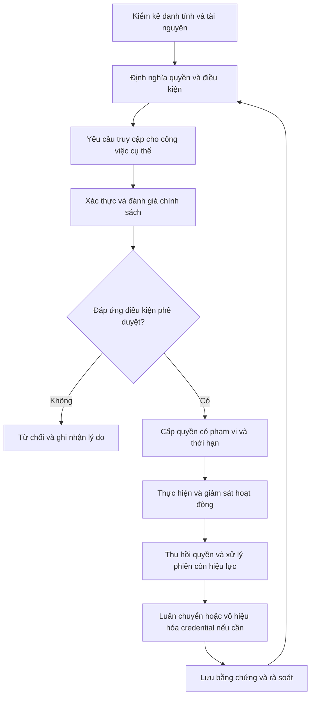

# Privileged Access Management là gì

## Mục tiêu bài học

Trong chương **Khái niệm PAM**, bài học này giải thích Privileged Access Management (PAM), tức quản lý quyền truy cập đặc quyền, và cách áp dụng vào tài khoản quản trị, tài khoản dịch vụ cùng hạ tầng nhạy cảm. Nội dung thuộc phạm vi `SECURITY_IDENTITY_ACCESS_MANAGEMENT_PRIVILEGED_ACCESS_MANAGEMENT`.

Sau bài học, bạn có thể:

- Nhận diện một quyền truy cập là đặc quyền dựa trên tác động thực tế của nó.
- Phân biệt trách nhiệm của IAM, PAM và các thành phần liên quan.
- Mô tả vòng đời kiểm soát từ kiểm kê, phê duyệt, cấp quyền đến thu hồi và lưu bằng chứng.
- Giải thích vai trò của least privilege, JIT, JEA, vault, luân chuyển credential và giám sát phiên.
- Phác thảo một luồng quản trị có kiểm soát cho con người và một luồng truy cập cho workload.

## 1. Đặc quyền được xác định bằng khả năng gây tác động

**Quyền truy cập đặc quyền** là quyền cho phép một chủ thể thực hiện những thay đổi hoặc truy cập dữ liệu có ảnh hưởng lớn đến tính bí mật, tính toàn vẹn hay tính sẵn sàng của hệ thống. Chủ thể có thể là một người, một ứng dụng, một dịch vụ hoặc một tiến trình tự động.

Các ví dụ thường gặp gồm:

- Tạo người dùng, cấp vai trò hoặc thay đổi cơ chế xác thực.
- Đọc kho bí mật, giải mã dữ liệu hoặc truy xuất dữ liệu sản xuất nhạy cảm.
- Cài phần mềm, sửa cấu hình máy chủ, dừng dịch vụ hoặc xóa bản sao lưu.
- Thay đổi chính sách mạng, cấu hình kiểm toán hoặc vô hiệu hóa cơ chế bảo vệ.
- Tạo danh tính mới và tự cấp thêm quyền cho danh tính đó.

Không thể chỉ nhìn tên `admin` hoặc `root` để kết luận. Một tài khoản tên `report-reader` nhưng đọc được toàn bộ dữ liệu khách hàng vẫn có mức nhạy cảm cao. Một danh tính không được gắn vai trò quản trị nhưng có quyền sửa chính sách để tự nâng quyền cũng tạo ra đường đi đặc quyền.

**Tài khoản đặc quyền** là danh tính nắm giữ các quyền đó. **Credential** là thông tin dùng để chứng minh danh tính hoặc quyền truy cập, chẳng hạn mật khẩu, khóa SSH, API key, chứng thư hoặc token. Credential và quyền hạn là hai khái niệm khác nhau: cất mật khẩu an toàn không tự làm giảm quyền của tài khoản sử dụng mật khẩu đó.

## 2. PAM là một chương trình kiểm soát truy cập

**Privileged Access Management là tập hợp chính sách, quy trình và cơ chế kỹ thuật để kiểm soát ai hoặc workload nào được dùng đặc quyền, trên tài nguyên nào, để làm việc gì, trong khoảng thời gian nào và với bằng chứng gì.**

PAM cần trả lời được một chuỗi câu hỏi liên tục:

1. Những tài khoản, credential và đường truy cập đặc quyền nào đang tồn tại?
2. Ai chịu trách nhiệm cho từng tài khoản và tài nguyên?
3. Ai có thể yêu cầu quyền, ai được phép duyệt và điều kiện nào phải thỏa mãn?
4. Quyền được giới hạn theo thao tác, phạm vi tài nguyên và thời hạn ra sao?
5. Hệ thống cấp hoặc chuyển giao credential như thế nào để hạn chế lộ lọt?
6. Khi quyền được sử dụng, có thể giám sát, can thiệp và truy nguyên đến chủ thể ban đầu không?
7. Khi công việc kết thúc hoặc phát hiện sự cố, quyền và phiên truy cập được thu hồi như thế nào?

Một giải pháp công nghệ có thể hỗ trợ nhiều câu hỏi trên, nhưng triển khai sản phẩm không tự hoàn tất chương trình PAM. Nếu không có chủ sở hữu tài nguyên, chính sách phê duyệt và cơ chế thu hồi, tổ chức vẫn có thể vận hành một kho credential tập trung với quyền quản trị thường trực ở khắp nơi.

### Vấn đề PAM hướng tới

Khi tài khoản có quyền mạnh và credential sống lâu bị lộ, một lỗi nhỏ có thể biến thành sự cố trên nhiều hệ thống. Các nguyên nhân phổ biến là dùng chung tài khoản quản trị, giữ secret trong script, cấp quyền rộng để tiện vận hành và không biết ai còn cần quyền sau khi đổi công việc.

PAM giảm rủi ro bằng cách giảm số chủ thể có quyền mạnh, thu hẹp quyền cần cấp, rút ngắn thời gian quyền có hiệu lực và tăng khả năng phát hiện, quy trách nhiệm. PAM không loại bỏ mọi rủi ro: một thao tác đã được phê duyệt vẫn có thể sai, và một phiên hợp lệ vẫn có thể bị lợi dụng nếu các điều kiện bảo vệ khác không đủ.

## 3. Phạm vi: con người, dịch vụ và các tầng hạ tầng

| Nhóm | Ví dụ | Rủi ro chính | Kiểm soát cần xem xét |
|---|---|---|---|
| Quản trị viên | Tài khoản vận hành hệ điều hành, cơ sở dữ liệu, mạng | Thao tác nhầm, mất tài khoản, quyền thường trực quá rộng | Danh tính cá nhân, MFA phù hợp, JIT/JEA, theo dõi hoạt động |
| Nhà cung cấp, đối tác | Kỹ sư bảo trì truy cập hệ thống nội bộ | Quyền tồn tại quá thời hạn hợp đồng, khó xác định người sử dụng | Sponsor nội bộ, lịch truy cập, phê duyệt, tự hết hạn |
| Tài khoản dịch vụ | Dịch vụ sao lưu, đồng bộ dữ liệu | Credential tồn tại lâu, nhiều hệ thống dùng chung | Chủ sở hữu, vault, phạm vi hẹp, luân chuyển có phối hợp |
| Workload tự động | Pipeline triển khai, tác vụ theo lịch | Secret bị sao chép vào log, cấp quyền sản xuất quá rộng | Danh tính workload, token ngắn hạn, ràng buộc môi trường |
| Danh tính khẩn cấp | Tài khoản break-glass | Trở thành đường truy cập thường ngày hoặc bị bỏ quên | Bảo quản độc lập phù hợp, cảnh báo sử dụng, rà soát sau sự kiện |
| Hệ thống điều khiển đặc quyền | Vault, nền tảng PAM, quản trị cloud/IAM | Một điểm kiểm soát bị chiếm có thể mở rộng ảnh hưởng | Phân quyền quản trị, bảo vệ khóa, kiểm toán và phục hồi |

Phạm vi cần bao phủ cả máy chủ, cơ sở dữ liệu, cloud, thiết bị mạng, hệ thống sao lưu và công cụ bảo mật. Với mỗi hệ thống, cần xét cả đường truy cập trực tiếp, console khẩn cấp, API và đường tự động hóa. Một máy chủ đi qua cổng PAM khi SSH vẫn có thể còn một đường quản trị khác qua console hoặc API cloud.

## 4. Phân biệt PAM với IAM và các cơ chế liên quan

| Khái niệm | Câu hỏi trọng tâm | Quan hệ với PAM |
|---|---|---|
| IAM — Identity and Access Management | Danh tính nào được truy cập tài nguyên nào trong toàn hệ thống? | Cung cấp nền tảng danh tính, xác thực và phân quyền; PAM tập trung kiểm soát việc dùng đặc quyền |
| MFA — xác thực đa yếu tố | Chủ thể có chứng minh đủ yếu tố để đăng nhập không? | Tăng độ chắc chắn của xác thực; không xác định toàn bộ thao tác được phép sau đăng nhập |
| RBAC — phân quyền theo vai trò | Vai trò nào được thực hiện các hành động nào? | Có thể dùng để định nghĩa quyền đặc quyền và người có quyền yêu cầu |
| Vault hoặc secrets manager | Credential được lưu, cấp phát và quản lý như thế nào? | Là thành phần quan trọng; riêng vault chưa bao phủ toàn bộ phê duyệt và kiểm soát sử dụng quyền |
| PIM — quản lý danh tính hoặc vai trò đặc quyền | Danh tính nào đủ điều kiện nhận vai trò và khi nào vai trò được kích hoạt? | Có phần giao với PAM; cách gọi và ranh giới tính năng thay đổi theo giải pháp |
| Giám sát phiên đặc quyền | Trong một phiên truy cập, chủ thể đã thực hiện hoạt động gì? | Hỗ trợ truy nguyên, phát hiện và can thiệp; độ bao phủ phụ thuộc giao thức và kiến trúc |

Trong thực tế, một nền tảng có thể kết hợp nhiều chức năng. Khi đánh giá, nên hỏi cơ chế đó giải quyết được yêu cầu kiểm soát nào, thay vì dựa hoàn toàn vào nhãn sản phẩm.

## 5. Các nguyên tắc nền tảng

### 5.1. Kiểm kê và xác định chủ sở hữu

Không thể thu hồi hoặc bảo vệ một tài khoản chưa được biết đến. Bản kiểm kê tối thiểu nên liên kết danh tính, tài nguyên đích, quyền thực tế, người chịu trách nhiệm, mục đích sử dụng và vòng đời credential.

Ví dụ minh họa một mục kiểm kê:

```text
Danh tính: svc-backup-prod
Loại: tài khoản dịch vụ
Tài nguyên: cụm cơ sở dữ liệu sản xuất A
Chủ sở hữu: nhóm vận hành dữ liệu
Mục đích: thực hiện sao lưu theo lịch
Quyền cần thiết: các thao tác sao lưu đã xác định cho công cụ đang dùng
Nguồn credential: kho bí mật tập trung
Phụ thuộc: tác vụ sao lưu trên hai máy thực thi
Luân chuyển: theo chính sách và ngay khi có dấu hiệu bị lộ
Lần rà soát tiếp theo: theo lịch của nhóm sở hữu
```

Đây là mô hình ghi nhận, không phải cấu hình có thể áp dụng trực tiếp. Quyền sao lưu cụ thể phải được xác định theo công nghệ và cách vận hành thực tế. Ngay cả chức năng sao lưu cũng có thể cho phép đọc một lượng dữ liệu rất lớn.

### 5.2. Least privilege — đặc quyền tối thiểu

Least privilege yêu cầu chỉ cấp những quyền cần thiết để hoàn thành nhiệm vụ đã xác định. Cần xem xét đồng thời:

- **Hành động:** được đọc trạng thái, khởi động lại dịch vụ hay sửa cấu hình?
- **Tài nguyên:** một dịch vụ, một nhóm máy hay toàn bộ môi trường?
- **Dữ liệu:** được truy cập tập dữ liệu nào, với mức nhạy cảm nào?
- **Thời gian và điều kiện:** quyền có hiệu lực khi nào, từ nguồn truy cập nào?

Ví dụ, nhiệm vụ khởi động lại một dịch vụ không mặc nhiên đòi hỏi shell quản trị toàn máy. Tuy nhiên, một lệnh tưởng như giới hạn vẫn có thể mở đường nâng quyền nếu người dùng sửa được cấu hình, tham số hoặc tệp thực thi mà lệnh đó sử dụng. Việc giới hạn phải xét cả các đường đi gián tiếp.

### 5.3. Danh tính cá nhân và tách tài khoản quản trị

Người vận hành nên có danh tính cá nhân để ghi nhận người thực hiện yêu cầu. Khi kiến trúc cần tài khoản đích dùng chung, PAM phải giữ được liên kết giữa danh tính cá nhân, yêu cầu truy cập và phiên sử dụng tài khoản đích.

Tách tài khoản làm việc hằng ngày với tài khoản quản trị giúp giảm việc dùng đặc quyền cho hoạt động thông thường. Tài khoản quản trị vẫn cần được bảo vệ và giám sát; việc tạo thêm một tài khoản không tự giải quyết rủi ro nếu hai tài khoản dùng chung credential hoặc đều đăng nhập từ thiết bị không được kiểm soát.

### 5.4. JIT và JEA giải quyết hai chiều khác nhau

**Just-in-Time (JIT)** giới hạn thời gian quyền có hiệu lực. Chủ thể đủ điều kiện yêu cầu kích hoạt quyền cho một công việc; khi điều kiện được đáp ứng, quyền được cấp trong một khoảng thời gian và phải được thu hồi khi hết hạn hoặc công việc kết thúc.

**Just Enough Administration (JEA)** giới hạn những thao tác quản trị thực sự cần thiết. Ở mức nguyên tắc, đó là cung cấp đủ khả năng quản trị cho nhiệm vụ. Tên JEA cũng được dùng cho một cơ chế cụ thể trong hệ sinh thái PowerShell; bài học này tập trung vào ý nghĩa kiểm soát quyền.

| Cơ chế | Chiều kiểm soát | Ví dụ minh họa | Điểm cần chú ý |
|---|---|---|---|
| JIT | Khi nào và trong bao lâu? | Kích hoạt quyền xử lý sự cố trong 30 phút | Token hoặc phiên đã tạo có thể cần cơ chế thu hồi riêng |
| JEA | Làm được những gì? | Chỉ xem trạng thái và khởi động lại dịch vụ A | Giới hạn thao tác phải chặn được đường nâng quyền gián tiếp |
| JIT kết hợp JEA | Thời hạn và phạm vi thao tác | Cho phép khởi động lại dịch vụ A trong cửa sổ đã duyệt | Cần xác minh cả hết hạn quyền lẫn giới hạn thực tế trên đích |

Ba mươi phút chỉ là ví dụ, không phải giá trị mặc định cho mọi tổ chức. Thời hạn cần phù hợp mức rủi ro và thời gian thực hiện nhiệm vụ.

### 5.5. Tách nhiệm vụ và phê duyệt theo rủi ro

Ở các hoạt động có tác động lớn, người yêu cầu, người phê duyệt và người quản trị cơ chế kiểm soát không nên có khả năng tự hợp thức hóa toàn bộ chuỗi hành động. Mục tiêu là hạn chế một chủ thể đơn lẻ vừa cấp quyền cho mình vừa che giấu việc sử dụng quyền đó.

Không phải mọi yêu cầu đều cần một người duyệt thủ công. Một tác vụ rủi ro thấp có thể được cho phép theo chính sách đã duyệt trước, còn truy cập dữ liệu sản xuất hoặc thay đổi chính sách bảo mật có thể cần phê duyệt riêng. Mức kiểm soát phải rõ ràng, có thể giải thích và có bằng chứng.

## 6. Các thành phần kỹ thuật thường gặp

### 6.1. Vault và cấp phát credential

Vault bảo vệ credential và kiểm soát việc ai hoặc workload nào có thể lấy hoặc sử dụng credential. Các chức năng thường được xem xét gồm mã hóa lưu trữ, kiểm soát truy cập, ghi nhật ký, quản lý phiên bản và tích hợp luân chuyển.

Có hai mô hình sử dụng phổ biến:

- **Cấp credential cho chủ thể:** chủ thể nhận credential theo chính sách. Cần kiểm soát việc sao chép, thời hạn và luân chuyển sau sử dụng khi phù hợp.
- **Sử dụng credential qua trung gian:** hệ thống thiết lập kết nối tới tài nguyên đích mà không hiển thị credential cho người dùng. Cách này giảm nhu cầu người dùng biết secret, nhưng vẫn phải kiểm soát quyền và hoạt động bên trong phiên.

Đưa secret vào vault chỉ cải thiện được tình hình nếu các bản sao ngoài vault cũng được xử lý. Một mật khẩu vẫn nằm trong script, bản sao lưu cấu hình hoặc lịch sử lệnh tiếp tục là một đường lộ lọt.

### 6.2. Luân chuyển credential và credential ngắn hạn

**Luân chuyển credential** là thay thế credential cũ bằng credential mới theo chính sách hoặc sự kiện, đồng thời đảm bảo các bên sử dụng chuyển sang giá trị mới và credential cũ không còn dùng được theo thiết kế.

Một chu trình điển hình gồm xác định các phụ thuộc, tạo giá trị mới, cập nhật nơi sử dụng, kiểm tra chức năng và vô hiệu hóa giá trị cũ. Thứ tự cụ thể, khả năng tồn tại song song và phương án khôi phục phụ thuộc công nghệ đích. Một số hệ thống chỉ chấp nhận một credential tại một thời điểm, nên cần phối hợp thời điểm chuyển đổi để tránh gián đoạn.

Credential ngắn hạn giảm khoảng thời gian một credential bị lộ có thể bị lợi dụng. Nhưng token ngắn hạn vẫn có thể bị đánh cắp trong thời gian còn hiệu lực; cần kết hợp phạm vi hẹp, kiểm soát nguồn cấp và bảo vệ môi trường thực thi.

Không ghi secret thật vào tài liệu, yêu cầu phê duyệt hoặc log. Bằng chứng kiểm toán cần nhận diện credential bằng mã tham chiếu hoặc phiên bản an toàn, thay vì lưu giá trị bí mật.

### 6.3. Kiểm soát và giám sát phiên

Một cổng truy cập hoặc bộ môi giới phiên có thể xác thực người dùng, áp chính sách, kết nối tới đích và thu thập hoạt động trong phiên. Tùy giải pháp và giao thức, bằng chứng có thể là thời điểm kết nối, tài nguyên đích, lệnh, sự kiện thao tác hoặc bản ghi hình phiên.

Không nên mặc định rằng ghi hình màn hình cho biết toàn bộ tác động. Hoạt động chạy nền, API gọi ngoài luồng hoặc nội dung đã mã hóa có thể cần nhật ký từ hệ thống đích và các nguồn bổ sung. Cũng không phải mọi giải pháp đều chặn lệnh hoặc ngắt phiên theo cùng một cách.

Bản ghi phiên có thể chứa dữ liệu nhạy cảm, thậm chí credential bị nhập thủ công. Cần hạn chế quyền xem, bảo vệ nơi lưu, kiểm soát xuất dữ liệu và áp dụng thời hạn lưu giữ theo yêu cầu thực tế. Giám sát chỉ hữu ích nếu có người hoặc quy trình xử lý tín hiệu bất thường.

## 7. Vòng đời một yêu cầu truy cập đặc quyền



Luồng trên mô tả logic kiểm soát. Một giải pháp cụ thể có thể kết hợp hoặc thay đổi thứ tự các bước, nhưng phải giữ được liên kết từ yêu cầu ban đầu đến kết quả thu hồi.

Cần phân biệt **thu hồi quyền trên danh tính** với **chấm dứt khả năng truy cập đang tồn tại**. Xóa một vai trò không nhất thiết lập tức hủy mọi token đã phát hành, kết nối cơ sở dữ liệu hoặc shell đang mở. Thiết kế PAM phải xác định hệ thống đích xử lý từng trường hợp ra sao và bằng chứng nào xác nhận truy cập đã kết thúc.

## 8. Ví dụ xuyên suốt: xử lý lỗi dịch vụ sản xuất

Giả sử kỹ sư Lan cần khởi động lại dịch vụ thanh toán A trên một máy chủ sản xuất. Công việc đã có mã sự cố, không yêu cầu sửa dữ liệu hoặc thay đổi cấu hình hệ điều hành.

### 8.1. Xác định quyền cần dùng

Chủ sở hữu dịch vụ xác định Lan cần xem trạng thái và khởi động lại đúng dịch vụ A. Vai trò xử lý công việc không có quyền tạo tài khoản, sửa chính sách bảo mật hoặc khởi động lại các dịch vụ khác. Nhóm vận hành kiểm tra các phụ thuộc để xác nhận quyền này không cho phép sửa tệp thực thi hoặc cấu hình theo cách nâng quyền.

### 8.2. Yêu cầu và cấp quyền

Lan đăng nhập bằng danh tính cá nhân, thực hiện MFA theo chính sách và gửi yêu cầu gắn với mã sự cố. Yêu cầu nêu rõ tài nguyên đích, thao tác và thời gian dự kiến. Người có thẩm quyền hoặc cơ chế chính sách phù hợp đánh giá yêu cầu.

Sau khi được duyệt, Lan được kích hoạt quyền trong 30 phút. Nếu dùng tài khoản quản trị đích dùng chung, hệ thống thiết lập kết nối qua trung gian và gắn phiên với danh tính Lan. Nếu hệ thống đích hỗ trợ quyền trực tiếp theo danh tính cá nhân, mô hình có thể cấp vai trò tạm thời trên đích.

### 8.3. Thực hiện và kết thúc

Trong lúc Lan thao tác, hệ thống thu thập bằng chứng phù hợp từ cổng truy cập và dịch vụ đích. Khi công việc hoàn tất, quyền được thu hồi sớm; khi hết hạn, cơ chế tự động xử lý theo chính sách. Nhóm vận hành xác nhận phiên và token liên quan không tiếp tục cho phép thao tác đặc quyền ngoài cửa sổ đã cấp.

Nếu credential tĩnh đã được tiết lộ hoặc chính sách yêu cầu luân chuyển sau sử dụng, hệ thống thực hiện luân chuyển và kiểm tra truy cập bằng credential cũ đã bị vô hiệu. Nếu sử dụng token tạm thời, cần xác nhận hành vi hết hạn hoặc thu hồi theo cơ chế của nền tảng.

### 8.4. Bằng chứng cần liên kết

| Câu hỏi kiểm toán | Bằng chứng minh họa |
|---|---|
| Ai thực hiện? | Danh tính Lan, kết quả xác thực và mã phiên |
| Vì sao được truy cập? | Mã sự cố, nội dung yêu cầu, quyết định và người hoặc chính sách phê duyệt |
| Được phép làm gì? | Vai trò, tài nguyên đích, cửa sổ thời gian và phiên bản chính sách |
| Đã làm gì? | Sự kiện của phiên, hoạt động tại dịch vụ đích và kết quả thao tác |
| Quyền đã kết thúc chưa? | Sự kiện thu hồi, kết quả xử lý phiên/token và kiểm tra quyền sau kết thúc |
| Credential còn hợp lệ không? | Sự kiện hết hạn, vô hiệu hóa hoặc luân chuyển, khi có áp dụng |

Không cần lưu cùng một loại bằng chứng cho mọi công nghệ. Điều cần đạt là có thể tái dựng chuỗi hành động và giải thích các khoảng trống quan sát được.

## 9. Tài khoản dịch vụ và workload cần cách tiếp cận riêng

Tài khoản dịch vụ thường chạy liên tục, không có người ngồi chờ để nhập MFA hoặc xin duyệt mỗi lần thực thi. Do đó, không thể sao chép nguyên luồng quản trị của con người sang mọi workload.

Ví dụ một pipeline chỉ cần triển khai dịch vụ A vào môi trường staging:

1. Pipeline được nhận diện bằng danh tính workload và các điều kiện tin cậy của nền tảng thực thi.
2. Chính sách cho phép lấy quyền triển khai vào đúng môi trường staging cho dịch vụ A.
3. Hệ thống cấp credential hoặc token có phạm vi và thời hạn phù hợp, nếu hạ tầng hỗ trợ.
4. Pipeline sử dụng quyền trong tác vụ; secret không xuất hiện trong log, artifact hoặc cấu hình được lưu lâu dài.
5. Quyền hết hiệu lực sau tác vụ hoặc theo thời hạn; lần chạy sau có một lần cấp phát mới.
6. Nhật ký liên kết được danh tính workload, mã lần chạy, phiên bản triển khai, tài nguyên và kết quả.

Nếu hệ thống cũ buộc dùng mật khẩu tĩnh, vẫn cần vault, tài khoản riêng theo mục đích, chủ sở hữu và luân chuyển đã kiểm tra phụ thuộc. Không gộp tất cả tác vụ vào một tài khoản quản trị chung chỉ để đơn giản hóa tích hợp.

Luân chuyển thất bại có thể làm dừng dịch vụ. Bởi vậy, chất lượng triển khai được đánh giá cả ở khả năng giảm rủi ro truy cập lẫn khả năng vận hành ổn định, phát hiện lỗi và khôi phục có kiểm soát.

## 10. Truy cập khẩn cấp và độ sẵn sàng

PAM có thể trở thành thành phần quan trọng trên đường quản trị. Khi nhà cung cấp danh tính, kết nối mạng hoặc chính nền tảng PAM gặp sự cố, tổ chức vẫn cần khả năng phục hồi hạ tầng bằng một quy trình khẩn cấp đã chuẩn bị.

Một thiết kế break-glass cần xác định:

- Điều kiện được kích hoạt và người có thẩm quyền sử dụng.
- Cách bảo quản thông tin truy cập, tránh phụ thuộc hoàn toàn vào thành phần đang cần được cứu.
- Quyền tối thiểu đủ cho việc phục hồi cùng các biện pháp kiểm soát khả thi trong tình huống đó.
- Cảnh báo sử dụng và cách ghi nhận sự kiện khi một số nguồn log tạm thời không hoạt động.
- Thu hồi, luân chuyển credential nếu cần và rà soát sau khi tình huống kết thúc.
- Lịch diễn tập để kiểm tra tài khoản vẫn hoạt động và người phụ trách hiểu quy trình.

Đường khẩn cấp phải được biết đến, kiểm soát và kiểm tra định kỳ. Nếu không, nó có thể trở thành đường truy cập đặc quyền nằm ngoài toàn bộ chính sách thường ngày.

## 11. Bằng chứng kiểm toán và ứng phó sự cố

Bằng chứng PAM cần hỗ trợ cả câu hỏi quản trị lẫn điều tra sự cố. Những dữ liệu hữu ích gồm danh tính nguồn, đích truy cập, quyết định chính sách, thời điểm cấp/thu hồi, hoạt động thực tế và kết quả luân chuyển khi có áp dụng.

Để liên kết nhiều hệ thống, nên có mã yêu cầu, mã phiên hoặc mã lần chạy xuyên suốt. Đồng bộ thời gian và ghi rõ múi giờ giúp giảm nhầm lẫn khi dựng lại diễn biến. Cần bảo vệ nhật ký trước việc sửa hoặc xóa trái phép, hạn chế quyền truy cập và xác định thời hạn lưu giữ phù hợp. Tài khoản đang được giám sát không nên có khả năng dễ dàng xóa mọi dấu vết về chính hoạt động của nó.

Khi nghi ngờ tài khoản đặc quyền bị chiếm, quy trình có thể bao gồm:

1. Xác định danh tính, tài nguyên, phiên và credential có liên quan.
2. Hạn chế truy cập hoặc ngắt phiên theo khả năng hệ thống và kế hoạch ứng phó.
3. Vô hiệu hóa hoặc luân chuyển credential, đồng thời kiểm tra các token và phiên còn hiệu lực.
4. Bảo toàn nhật ký, bản ghi phiên và dữ liệu liên quan theo quy trình điều tra.
5. Kiểm tra thay đổi đã thực hiện, tài khoản mới, quyền được cấp thêm và các đường duy trì truy cập.
6. Khôi phục quyền hợp lệ, khắc phục nguyên nhân và rà soát phạm vi ảnh hưởng.

Chỉ đổi mật khẩu chưa chứng minh sự cố đã kết thúc. Kẻ tấn công có thể đã tạo một danh tính khác, thay đổi chính sách hoặc lấy credential của hệ thống khác trước khi bị phát hiện.

## 12. Những hiểu nhầm cần tránh

| Hiểu nhầm | Cách hiểu đúng hơn |
|---|---|
| Có MFA là đã có PAM | MFA bảo vệ một bước xác thực; vẫn cần giới hạn quyền, thời hạn, giám sát và thu hồi |
| Đưa mật khẩu vào vault là hoàn thành PAM | Còn phải xử lý quyền thừa, bản sao secret, đường truy cập khác và quy trình sử dụng |
| JIT luôn xóa mọi truy cập ngay khi hết giờ | Cần kiểm tra cách đích xử lý phiên và token đã tồn tại |
| Ghi hình phiên đồng nghĩa chặn được hành vi nguy hiểm | Ghi nhận, phát hiện và chặn là các khả năng khác nhau |
| Chỉ tài khoản con người mới cần PAM | Dịch vụ, pipeline và công cụ tự động cũng có thể giữ đặc quyền rất lớn |
| Tài khoản chỉ đọc thì luôn ít rủi ro | Quyền đọc secret, khóa hoặc dữ liệu nhạy cảm vẫn có tác động lớn |
| Một đường truy cập qua PAM là đủ | Cần xét cả đường console, API, truy cập trực tiếp và các đường khẩn cấp |
| Thu hồi quyền sau sự cố là đủ | Cần điều tra thay đổi đã xảy ra và các đường truy cập được tạo thêm |

## 13. Phác thảo triển khai ban đầu

Một bước khởi đầu thực tế là chọn một phạm vi nhỏ nhưng có rủi ro rõ ràng, chẳng hạn nhóm quản trị một cụm máy chủ sản xuất, rồi hoàn thiện vòng đời truy cập cho phạm vi đó.

Trình tự có thể là:

1. Kiểm kê danh tính đặc quyền và các đường kết nối thực tế tới tài nguyên.
2. Chỉ định chủ sở hữu, mục đích sử dụng và mức độ nhạy cảm.
3. Loại bỏ quyền không còn cần thiết; định nghĩa vai trò theo nhiệm vụ.
4. Thiết kế xác thực, phê duyệt, cấp credential hoặc quyền tạm thời.
5. Kết nối giám sát, lưu bằng chứng và cơ chế xử lý bất thường.
6. Kiểm tra hết hạn, thu hồi, luân chuyển và đường khẩn cấp.
7. Rà soát kết quả rồi mở rộng sang tài khoản dịch vụ và hệ thống liên quan.

Một số chỉ số giúp theo dõi tiến triển:

| Chỉ số | Ý nghĩa | Cần đọc kèm |
|---|---|---|
| Tỷ lệ tài khoản đặc quyền đã có chủ sở hữu | Mức rõ ràng về trách nhiệm | Độ đầy đủ và độ mới của bản kiểm kê |
| Tỷ lệ truy cập nằm trong luồng kiểm soát | Độ bao phủ của PAM | Các đường quản trị chưa đưa vào phạm vi |
| Số quyền đặc quyền thường trực | Mức tồn tại quyền mạnh ngoài cửa sổ công việc | Nhu cầu vận hành và ngoại lệ đã được chấp thuận |
| Thời gian từ kết thúc công việc đến thu hồi thực tế | Hiệu quả thu hồi | Phiên và token còn hoạt động, không chỉ sự kiện xóa vai trò |
| Tỷ lệ luân chuyển thành công | Khả năng vận hành quản lý credential | Mức ảnh hưởng dịch vụ và các phụ thuộc chưa cập nhật |
| Tỷ lệ yêu cầu có chuỗi bằng chứng đầy đủ | Khả năng truy nguyên | Chất lượng log và các khoảng trống dữ liệu |

Không đặt mục tiêu chỉ để tăng số tài khoản trong vault. Một tài khoản được đưa vào kho nhưng vẫn có quyền vượt nhu cầu và có thể truy cập ngoài luồng chưa thể hiện một kết quả kiểm soát tốt.

## 14. Bài tập tự kiểm tra

### Tình huống

Một nhóm vận hành có ba kỹ sư dùng chung mật khẩu `db-admin` để xử lý sự cố cơ sở dữ liệu sản xuất. Mật khẩu nằm trong ghi chú nội bộ, không có thời hạn, và máy chủ cơ sở dữ liệu chỉ ghi nhận tên `db-admin`. Một tác vụ sao lưu cũng dùng tài khoản này.

Hãy trả lời:

1. Có những vấn đề nào về danh tính, phạm vi quyền, thời hạn và bằng chứng?
2. Vì sao chỉ chuyển mật khẩu vào vault chưa đủ?
3. Nên tách luồng con người và tác vụ sao lưu như thế nào?
4. Cần kiểm tra điều gì trước khi khẳng định quyền đã được thu hồi?

### Gợi ý phân tích

- Ba người dùng chung danh tính đích làm mất liên kết trực tiếp tới người thực hiện; cần danh tính cá nhân và khả năng liên kết phiên hoặc cấp quyền theo từng người.
- Mật khẩu trong ghi chú dễ bị sao chép và tiếp tục tồn tại sau khi nhân sự đổi vai trò. Vault cần đi kèm xử lý bản sao và luân chuyển theo chính sách.
- Quyền quản trị thường trực rộng hơn nhu cầu của nhiều công việc. Cần định nghĩa quyền theo nhiệm vụ, xem xét JIT và giới hạn thao tác.
- Tác vụ sao lưu cần danh tính riêng, chủ sở hữu riêng và quyền theo công cụ sao lưu thực tế; luân chuyển phải cập nhật các phụ thuộc của tác vụ.
- Phải kiểm tra quyền trên đích, credential cũ, token và kết nối đang mở. Một sự kiện thu hồi trong giao diện quản trị chưa đủ chứng minh mọi đường truy cập đã bị chặn.
- Bằng chứng cần nối yêu cầu, quyết định phê duyệt, danh tính cá nhân, phiên và hành động tại cơ sở dữ liệu.

## 15. Kiến thức cần ghi nhớ

PAM kiểm soát cả vòng đời sử dụng đặc quyền cho con người và danh tính máy. Nền tảng của nó là biết quyền ở đâu, ai chịu trách nhiệm và quyền nào thực sự cần cho từng nhiệm vụ.

Least privilege thu hẹp phạm vi, JIT giới hạn thời gian, JEA giới hạn thao tác, vault bảo vệ credential, còn giám sát và nhật ký cung cấp khả năng phát hiện và truy nguyên. Những cơ chế này cần phối hợp với thu hồi thực tế, luân chuyển phù hợp và quy trình truy cập khẩn cấp có kiểm soát.

Một thiết kế PAM có thể giải thích rõ: **chủ thể nào đã được cấp đặc quyền gì, trên tài nguyên nào, vì lý do gì, trong bao lâu, đã làm gì và bằng cách nào xác nhận quyền đã kết thúc**.
