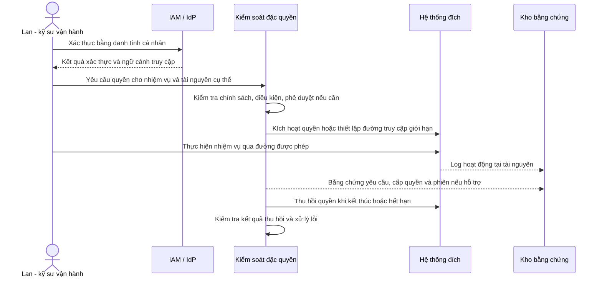

# PAM so với IAM thông thường

## 1. Hiểu đúng mối quan hệ giữa IAM và PAM

Identity and Access Management (IAM) là tập hợp chính sách, quy trình và cơ chế kỹ thuật dùng để quản lý danh tính cùng quyền truy cập vào tài nguyên. IAM trả lời các câu hỏi: chủ thể là ai, được truy cập tài nguyên nào, được làm gì, trong điều kiện nào và quyền đó được thu hồi ra sao.

Privileged Access Management (PAM) tập trung vào phần truy cập có đặc quyền: những quyền có thể quản trị hệ thống, thay đổi cơ chế bảo vệ, truy xuất bí mật hoặc tác động lớn đến dữ liệu và hoạt động của tổ chức. Ví dụ gồm quyền quản trị máy chủ, quản trị cơ sở dữ liệu, thay đổi chính sách cloud, đọc kho bí mật hoặc sửa cấu hình hệ thống định danh.

**PAM là một phần chuyên biệt trong bức tranh IAM, đồng thời thường được triển khai thành các quy trình và thành phần riêng.** IAM không chỉ dành cho người dùng thông thường; nó cũng quản lý danh tính quản trị và có thể cung cấp nhiều cơ chế kiểm soát đặc quyền. PAM bổ sung mức kiểm soát phù hợp với rủi ro của các đường truy cập đặc quyền.

Trong bài này, “IAM thông thường” chỉ các quy trình IAM phổ biến như quản lý vòng đời tài khoản, đăng nhập một lần, xác thực đa yếu tố và cấp quyền ứng dụng. Cụm từ này không có nghĩa IAM chỉ làm đăng nhập hoặc không thể quản lý quyền chi tiết.

Một cách phân biệt thực tế:

- IAM quản lý quyền của nhân viên truy cập ứng dụng chăm sóc khách hàng và thu hồi quyền khi họ chuyển bộ phận.
- PAM kiểm soát việc một quản trị viên nhận quyền sửa cấu hình cơ sở dữ liệu khách hàng, sử dụng quyền đó trong bao lâu và để lại bằng chứng gì.
- Hai lớp cùng tham gia nếu quản trị viên phải dùng danh tính công ty, đáp ứng chính sách xác thực và được cấp quyền tạm thời cho một nhiệm vụ đã xác định.

Mục tiêu không phải đặt hai hệ thống đối lập nhau. Mục tiêu là quản lý được cả danh tính, quyền được cấp và cách quyền mạnh được sử dụng trên tài khoản quản trị, tài khoản dịch vụ và hạ tầng nhạy cảm.

## 2. Các khái niệm cần tách biệt

### 2.1. Danh tính, tài khoản và credential

**Danh tính** đại diện cho một chủ thể như nhân viên, nhà thầu, ứng dụng hoặc workload. **Tài khoản** là biểu diễn của danh tính trên một hệ thống cụ thể. Một người có thể có tài khoản làm việc hằng ngày và tài khoản quản trị riêng.

**Credential** là phương tiện hoặc bằng chứng dùng để xác thực, chẳng hạn mật khẩu, khóa riêng, chứng thư hoặc token. Credential không đồng nghĩa với quyền: quyền thực tế phụ thuộc vào tài khoản, vai trò, chính sách và ngữ cảnh mà hệ thống đích áp dụng.

Một tài khoản dùng credential được cất trong vault vẫn có thể được cấp quyền quá rộng. Ngược lại, một workload nhận token thời hạn ngắn vẫn có thể gây thiệt hại lớn trong thời gian token còn hiệu lực nếu phạm vi quyền quá rộng.

### 2.2. Xác thực, cấp quyền và thực thi kiểm soát

- **Xác thực — authentication:** kiểm tra chủ thể có đúng là danh tính đã khai báo không.
- **Cấp quyền — authorization:** quyết định chủ thể có được thực hiện hành động cụ thể trên tài nguyên cụ thể không.
- **Thực thi kiểm soát:** hệ thống đích hoặc thành phần trung gian thực sự cho phép, giới hạn hay từ chối hành động.
- **Ghi nhận và quy trách nhiệm:** liên kết quyền được cấp với hoạt động thực tế để có thể điều tra và kiểm toán.

SSO và MFA hỗ trợ xác thực, nhưng một lần đăng nhập thành công không tự động cho phép quản trị mọi máy chủ. Tương tự, phê duyệt một yêu cầu trên cổng PAM chỉ có ý nghĩa khi quyền tại hệ thống đích hoặc đường truy cập được cấu hình tương ứng.

### 2.3. Truy cập nhạy cảm và truy cập đặc quyền

Quyền đặc quyền được nhận diện qua khả năng tác động, không chỉ qua tên tài khoản `admin` hay `root`. Một tài khoản có thể trở thành điểm kiểm soát đặc quyền nếu nó có thể:

- Tạo tài khoản mới hoặc cấp quyền cho chính mình và người khác.
- Tắt logging, sửa chính sách bảo mật hoặc thay đổi cấu hình hạ tầng.
- Đọc bí mật cho phép truy cập sang hệ thống khác.
- Thực thi mã, triển khai bản phát hành hoặc điều khiển pipeline có quyền trên môi trường sản xuất.
- Sao lưu, khôi phục hay xuất dữ liệu với phạm vi vượt xa nhiệm vụ thông thường.

Tuy vậy, không phải mọi dữ liệu nhạy cảm đều cần đường truy cập PAM. Nhân viên nhân sự đọc hồ sơ theo vai trò nghiệp vụ vẫn cần IAM và kiểm soát dữ liệu chặt chẽ; việc đưa luồng đó vào PAM phụ thuộc khả năng tác động, mô hình rủi ro và kiến trúc của tổ chức.

Một tài khoản chỉ đọc toàn bộ cơ sở dữ liệu có thể có rủi ro rất cao dù không được sửa cấu hình. Vì vậy, đánh giá đặc quyền phải xem cả khả năng thay đổi hệ thống lẫn khả năng truy xuất dữ liệu trên diện rộng.

## 3. Bảng đối chiếu IAM và PAM

| Khía cạnh | IAM trong các luồng truy cập phổ biến | PAM trong các luồng đặc quyền |
|---|---|---|
| Trọng tâm | Quản lý danh tính và quyền truy cập trong tổ chức | Kiểm soát quyền mạnh và việc sử dụng quyền mạnh |
| Chủ thể | Nhân viên, đối tác, khách hàng, ứng dụng, workload | Quản trị viên, nhà thầu vận hành, dịch vụ và workload có đặc quyền |
| Tài nguyên điển hình | Ứng dụng nghiệp vụ, cổng nội bộ, API và dữ liệu | Máy chủ, cơ sở dữ liệu, control plane, kho bí mật, nền tảng triển khai |
| Vòng đời | Tạo, thay đổi, vô hiệu hóa danh tính và quyền | Kế thừa vòng đời đó, đồng thời quản lý quyền quản trị, credential và đường truy cập |
| Cấp quyền | Vai trò, nhóm, thuộc tính và chính sách theo ngữ cảnh | Thu hẹp tài nguyên, thao tác, thời gian và điều kiện sử dụng quyền đặc biệt |
| Xác thực | SSO, MFA, liên kết danh tính, chính sách truy cập | Dùng danh tính nền và có thể yêu cầu xác thực bổ sung khi nâng quyền |
| Thời hạn | Có thể lâu dài hoặc tạm thời tùy chính sách | Ưu tiên giảm quyền thường trực, cấp quyền vừa đủ trong thời gian cần thiết |
| Credential | Quản lý phương thức xác thực và liên kết danh tính | Có thể quản lý bí mật đặc quyền, cấp phát động, luân chuyển hoặc trung chuyển truy cập |
| Theo dõi | Sự kiện đăng nhập, thay đổi quyền, truy cập ứng dụng | Bổ sung bằng chứng về yêu cầu, nâng quyền, sử dụng credential và phiên đặc quyền khi hỗ trợ |
| Thu hồi | Khóa danh tính, bỏ nhóm, bỏ vai trò, xử lý phiên và token | Thu hồi quyền tạm thời, xử lý phiên, token và credential liên quan tại các điểm thực thi |
| Chứng minh kiểm soát | Ai có quyền và vì sao | Ai đã sử dụng quyền mạnh, trên đâu, lúc nào, cho nhiệm vụ nào và kết quả ra sao |

Các cột mô tả trọng tâm thường gặp, không phải ranh giới tính năng tuyệt đối. Một nền tảng IAM có thể hỗ trợ JIT, kiểm soát phiên hoặc quản trị vai trò đặc quyền; một nền tảng PAM có thể có kho tài khoản riêng. Đánh giá mức bảo vệ cần dựa trên đường truy cập thực tế và hiệu quả thực thi, thay vì chỉ dựa vào nhãn sản phẩm.

## 4. Vì sao có IAM rồi vẫn có thể cần PAM?

### 4.1. Danh tính hợp lệ vẫn có thể sử dụng quyền quá mức

Giả sử một kỹ sư có tài khoản công ty, đăng nhập bằng MFA và thuộc nhóm quản trị cơ sở dữ liệu. Các kiểm soát này giúp xác định người đăng nhập và quyền đã cấp. Chúng chưa tự trả lời được:

- Kỹ sư có cần quyền quản trị liên tục hay chỉ cần trong một cửa sổ bảo trì?
- Công việc cần xem chỉ số, tạo bản sao lưu hay thực sự cần quyền thay đổi toàn bộ cơ sở dữ liệu?
- Có thể truy cập trực tiếp bằng credential cũ để bỏ qua quy trình không?
- Khi hết thời hạn, phiên đang mở và token đã phát hành có còn hoạt động không?
- Có đủ bằng chứng để đối chiếu thao tác với yêu cầu bảo trì không?

PAM tập trung làm rõ và thực thi các điều kiện này. IAM tiếp tục cung cấp nền tảng danh tính, vòng đời và chính sách truy cập xuyên suốt.

### 4.2. Quyền thường trực làm tăng thời gian có thể bị lạm dụng

**Standing privilege** là quyền tồn tại thường xuyên, kể cả lúc không có nhiệm vụ cần dùng. Nếu một tài khoản bị chiếm hoặc thiết bị đầu cuối bị kiểm soát, quyền thường trực có thể trở thành khả năng sẵn có cho kẻ tấn công.

**JIT — Just-in-Time** hướng đến cấp hoặc kích hoạt quyền đúng lúc cần, với thời hạn rõ ràng. Ví dụ: một người đủ điều kiện yêu cầu vai trò bảo trì, nhưng chỉ nhận quyền có hiệu lực trong 30 phút cho hệ thống được chỉ định.

JIT không nhất thiết là thao tác thêm người vào nhóm rồi xóa sau đó. Nó có thể được thực hiện qua vai trò tạm thời, token ngắn hạn hoặc một đường truy cập được trung chuyển. Hiệu lực thực tế phụ thuộc cơ chế của hệ thống đích.

### 4.3. Một tài khoản quản trị dùng chung làm yếu khả năng quy trách nhiệm

Nhiều hệ thống cũ chỉ có một tài khoản quản trị cục bộ. Nếu cả nhóm cùng biết mật khẩu, log tại hệ thống đích thường chỉ cho thấy tên tài khoản chung. Việc xác định người thực hiện trở nên khó khăn.

PAM có thể bổ sung quy trình nhận quyền bằng danh tính cá nhân, ghi nhận checkout bí mật hoặc trung chuyển phiên để liên kết hoạt động với người yêu cầu. Tuy nhiên, liên kết đó có thể bị suy yếu nếu nhiều người đồng thời dùng credential chung hoặc tồn tại đường đăng nhập ngoài kiểm soát.

Khi hệ thống hỗ trợ, nên dùng tài khoản riêng cho từng người và cơ chế ủy quyền có kiểm soát. Nếu phải giữ tài khoản chung, cần xử lý đường truy cập ngoài luồng, giới hạn sử dụng đồng thời phù hợp và thay credential theo chính sách cũng như khả năng kỹ thuật.

## 5. Những lớp kiểm soát PAM bổ sung vào nền IAM

### 5.1. Kiểm kê đặc quyền theo khả năng thực tế

Kiểm kê không chỉ là lập danh sách người thuộc nhóm quản trị. Cần xác định tài khoản người dùng, tài khoản dịch vụ, khóa, token, vai trò và quan hệ ủy quyền có thể dẫn tới quyền mạnh.

Mỗi mục nên có chủ sở hữu, mục đích, môi trường, tài nguyên được tác động, cách xác thực, đường truy cập và thời điểm rà soát. Cũng cần xem quyền gián tiếp: người sửa được pipeline có thể tác động tới workload chạy với quyền sản xuất dù bản thân không có tài khoản quản trị máy chủ.

IAM cung cấp nhiều dữ liệu về danh tính và nhóm. Hoạt động kiểm kê PAM đối chiếu dữ liệu đó với quyền cục bộ, chính sách của hệ thống đích và cách credential đang được sử dụng.

### 5.2. Least privilege và giới hạn nhiệm vụ quản trị

**Least privilege** nghĩa là chỉ cấp quyền cần thiết để hoàn thành nhiệm vụ trong phạm vi và thời gian phù hợp. Đây là nguyên tắc chung của IAM; PAM áp dụng nó sâu vào hoạt động đặc quyền.

**JEA — Just Enough Administration** nhấn mạnh giới hạn khả năng quản trị vào những thao tác cần thiết. Ví dụ, kỹ thuật viên chỉ được xem tình trạng và khởi động lại một dịch vụ đã định danh, thay vì có shell quản trị toàn bộ máy chủ. Cách thực hiện cụ thể phụ thuộc nền tảng và các khả năng ủy quyền mà nó hỗ trợ.

JIT giải quyết câu hỏi “khi nào, trong bao lâu”; JEA giải quyết câu hỏi “được quản trị đến mức nào”. Một quyền quản trị toàn bộ cấp trong năm phút vẫn có thể quá rộng. Một tập thao tác rất hẹp nhưng tồn tại vô thời hạn vẫn cần được rà soát.

Việc giới hạn câu lệnh cũng phải xét tham số, chương trình con và khả năng thoát sang ngữ cảnh quyền cao hơn. Cho phép một công cụ chạy với quyền quản trị không mặc nhiên có nghĩa mọi cách dùng công cụ đó đều an toàn.

### 5.3. Vault và quản lý credential

Vault cung cấp cơ chế lưu giữ, kiểm soát truy xuất và ghi nhận việc sử dụng bí mật. Tùy kiến trúc, người dùng có thể nhận một bí mật trong thời gian giới hạn hoặc truy cập qua thành phần trung gian mà không trực tiếp nhìn thấy bí mật đó.

Hai mô hình cần phân biệt:

| Mô hình | Cách hoạt động | Điều cần kiểm tra |
|---|---|---|
| Credential tồn tại lâu dài | Lưu bí mật của tài khoản hiện có, thay định kỳ hoặc theo sự kiện | Đồng bộ thay đổi với hệ thống đích và các bên sử dụng; tránh để bản cũ còn hiệu lực ngoài dự kiến |
| Credential động hoặc thời hạn ngắn | Cấp credential cho một nhiệm vụ hay workload với phạm vi và thời hạn xác định | Hệ thống đích thực thi phạm vi, hết hạn và thu hồi ra sao; các phiên đã tạo có bị ảnh hưởng không |

Với tài khoản dịch vụ, thay mật khẩu mà không cập nhật ứng dụng có thể gây gián đoạn. Quy trình luân chuyển cần xác định phụ thuộc, thứ tự cập nhật, kiểm tra khả năng kết nối và cách xử lý nếu thay đổi thất bại. Khi nền tảng hỗ trợ, workload identity và credential ngắn hạn có thể giảm nhu cầu phân phối bí mật tĩnh.

Vault không thay thế chính sách phân quyền tại hệ thống đích. Việc che mật khẩu khỏi người sử dụng cũng không ngăn mọi hành vi lạm dụng nếu phiên truy cập vẫn cho phép thao tác quá rộng.

### 5.4. Giám sát phiên và bằng chứng kiểm toán

Tùy giao thức và sản phẩm, có thể ghi nhận thời điểm mở phiên, người yêu cầu, tài khoản đích, tài nguyên, câu lệnh hoặc hình ảnh phiên làm việc. Không nên giả định mọi phiên đều có bản ghi đầy đủ mọi thao tác.

Ví dụ, truy cập qua API, công cụ tự động, tunnel hoặc ứng dụng tương tác có thể tạo ra các loại bằng chứng khác nhau. Cần kết hợp log từ IAM, PAM và hệ thống đích; dùng mã yêu cầu hoặc mã phiên để đối chiếu, cùng cơ chế đồng bộ thời gian phù hợp.

Bản ghi có thể chứa dữ liệu nhạy cảm, bí mật hoặc nội dung nghiệp vụ. Cần giới hạn người được xem, bảo vệ tính toàn vẹn và xác định thời hạn lưu theo nhu cầu của tổ chức. Ghi hình phiên không tự động chứng minh hành động là hợp lệ; vẫn cần chính sách, đối chiếu và xử lý cảnh báo.

## 6. Ví dụ xuyên suốt: từ truy cập ứng dụng đến bảo trì cơ sở dữ liệu

### 6.1. Bối cảnh

Một công ty có ứng dụng quản lý đơn hàng và cơ sở dữ liệu sản xuất. Lan là kỹ sư vận hành, có nhiệm vụ làm việc hằng ngày và thỉnh thoảng bảo trì cơ sở dữ liệu.

Với tác vụ hằng ngày, Lan đăng nhập qua IdP của công ty, dùng MFA và được cấp vai trò xem tình trạng ứng dụng. IAM quản lý danh tính của Lan, nhóm công việc và việc thay đổi quyền khi Lan chuyển vị trí.

Một yêu cầu bảo trì cần Lan xem cấu hình kết nối và khởi động lại dịch vụ kết nối dữ liệu trong cửa sổ đã định. Nhiệm vụ này không mặc nhiên đòi quyền đọc toàn bộ dữ liệu khách hàng hoặc thay đổi cấu trúc cơ sở dữ liệu.

### 6.2. Luồng phối hợp IAM và PAM



Sơ đồ mô tả luồng logic; không quy định mọi kết nối đều phải đi qua proxy. Một triển khai có thể cấp vai trò tạm thời ngay trên hệ thống đích, triển khai khác trung chuyển phiên. Điều kiện bắt buộc là chính sách phải được thực thi trên đường truy cập thực sự được sử dụng.

Các bước cụ thể:

1. **Xác định người yêu cầu:** Lan dùng danh tính cá nhân còn hoạt động; hệ thống đánh giá điều kiện xác thực và thiết bị theo chính sách.
2. **Xác định nhiệm vụ:** yêu cầu ghi rõ hệ thống, môi trường, thao tác, lý do và khoảng thời gian. Vai trò đủ điều kiện yêu cầu chưa đồng nghĩa quyền đã có hiệu lực.
3. **Đánh giá trước khi cấp:** kiểm tra quyền phù hợp nhiệm vụ, xung đột trách nhiệm và phê duyệt nếu mức rủi ro yêu cầu. Có thể tự động cấp các nhiệm vụ đã chuẩn hóa và đáp ứng điều kiện.
4. **Thực thi quyền hẹp:** chỉ cho phép xem cấu hình cần thiết và khởi động lại dịch vụ được chỉ định. Nếu nền tảng không thực thi được mức hẹp này, cần đánh giá lại phương án và phần rủi ro còn lại.
5. **Ghi nhận hoạt động:** liên kết yêu cầu với danh tính, vai trò hoặc credential được dùng, tài nguyên đích, thời gian và kết quả tác vụ.
6. **Kết thúc quyền:** thu hồi quyền được kích hoạt; xác định riêng cách xử lý phiên, token hoặc credential đã phát hành và kiểm tra kết quả.

### 6.3. Một mẫu yêu cầu quyền dễ kiểm tra

Ví dụ dưới đây là dữ liệu minh họa, không phải cú pháp cấu hình của sản phẩm và không thể tự thực thi kiểm soát:

```yaml
request_id: CHG-2026-042
subject: lan.ops
identity_type: human
resource: orders-prod-connection-service
environment: production
requested_actions:
  - view_connection_health
  - restart_connection_service
reason: Apply an approved connection configuration change
requested_duration_minutes: 30
conditions:
  personal_identity_required: true
  additional_authentication_required: true
  approved_change_required: true
evidence:
  - access_decision
  - privilege_activation
  - target_activity
  - revocation_result
```

Mẫu này làm rõ chủ thể, tài nguyên, hành động, thời gian và bằng chứng cần có. Người triển khai còn phải ánh xạ từng hành động sang quyền thật của hệ thống đích. Trường `requested_duration_minutes` chỉ thể hiện yêu cầu; nó không đảm bảo phiên tự đóng sau 30 phút nếu nền tảng chưa có cơ chế thực thi tương ứng.

### 6.4. Bằng chứng cần đủ để nối các sự kiện

| Thời điểm | Bằng chứng hữu ích | Mục đích |
|---|---|---|
| Trước khi cấp | Danh tính, điều kiện xác thực, nội dung yêu cầu, quyết định chính sách | Giải thích vì sao người này được nhận quyền |
| Khi kích hoạt | Vai trò hoặc tài khoản đích, tài nguyên, thời điểm bắt đầu, thời hạn | Xác định quyền thực tế đã được mở |
| Khi sử dụng | Log hệ thống đích, mã phiên, thao tác hoặc kết quả theo khả năng hỗ trợ | Đối chiếu việc sử dụng với nhiệm vụ |
| Khi kết thúc | Kết quả thu hồi, trạng thái phiên và credential liên quan | Chứng minh quyền không còn tồn tại ngoài thời gian dự kiến |

Một log “đã gửi yêu cầu thu hồi” chỉ cho thấy hệ thống đã khởi động thao tác. Nó chưa đủ chứng minh hệ thống đích đã thu hồi thành công.

## 7. PAM cho tài khoản dịch vụ và workload

PAM không chỉ dành cho người mở SSH hoặc màn hình quản trị. Ứng dụng, pipeline triển khai và công cụ sao lưu có thể giữ những quyền mạnh nhất trong môi trường.

Với người dùng, luồng thường có thể yêu cầu MFA hoặc phê duyệt tương tác. Với workload chạy tự động, cần xác thực bằng danh tính máy hoặc workload phù hợp; không thể áp nguyên xi thao tác nhập mã của con người cho mỗi lần chạy.

Ví dụ một pipeline cần triển khai ứng dụng lên môi trường sản xuất:

- IAM quản lý danh tính workload và quan hệ tin cậy để pipeline được xác thực.
- Chính sách quyền giới hạn pipeline vào ứng dụng và môi trường được giao; người sửa pipeline hoặc quan hệ tin cậy cũng phải được kiểm soát.
- Cơ chế quản lý đặc quyền cấp credential hoặc vai trò ngắn hạn nếu hệ thống hỗ trợ, tránh nhúng khóa quản trị dùng lâu dài vào mã nguồn.
- Log liên kết lần chạy, danh tính workload, credential hoặc vai trò được cấp và thay đổi tại môi trường đích.
- Khi workload ngừng hoạt động hoặc bị nghi xâm nhập, phải thu hồi quan hệ tin cậy, quyền và credential có liên quan theo khả năng của nền tảng.

Một người được quyền chỉnh pipeline có thể gián tiếp sử dụng quyền triển khai của pipeline. Kiểm kê và phân quyền phải nhìn cả chuỗi ủy quyền đó, thay vì chỉ kiểm tra tài khoản tương tác.

## 8. Thu hồi quyền, sự cố và truy cập khẩn cấp

### 8.1. Vô hiệu hóa danh tính chưa chắc kết thúc mọi quyền đã cấp

Khi nhân viên nghỉ việc, IAM có thể vô hiệu hóa tài khoản và bỏ các nhóm. Nếu trước đó người này đã có phiên quản trị, token độc lập hoặc bản sao khóa riêng, cần xác định từng cơ chế còn hiệu lực bao lâu và hệ thống nào có thể thu hồi.

Quy trình phối hợp phải xét các lớp:

- Danh tính nguồn và khả năng đăng nhập mới.
- Vai trò hoặc nhóm tại hệ thống đích.
- Phiên đang hoạt động và token đã phát hành.
- Credential tĩnh mà chủ thể từng biết hoặc có thể đã sao chép.
- Quyền gián tiếp qua tài khoản dịch vụ, pipeline hoặc quan hệ ủy quyền.

Trong ứng phó sự cố, khóa tài khoản, kết thúc phiên, thu hồi token và thay credential là các hành động khác nhau. Chọn hành động dựa trên bằng chứng và khả năng kỹ thuật; không coi một thao tác trên IdP là xác nhận hoàn tất mọi lớp thu hồi.

### 8.2. Truy cập khẩn cấp vẫn cần danh tính và bằng chứng

Một quy trình phụ thuộc hoàn toàn vào IdP hoặc cổng PAM có thể không sử dụng được khi chính các thành phần đó gặp sự cố. Tổ chức cần thiết kế đường truy cập khẩn cấp — thường gọi là break-glass — cho những tình huống được xác định trước.

Đường khẩn cấp phải có phạm vi tối thiểu đủ khôi phục hoạt động, cách bảo quản credential, người chịu trách nhiệm và cơ chế ghi nhận hoặc thông báo khi sử dụng. Cần kiểm thử khả năng truy cập theo kịch bản mất phụ thuộc, rồi đối chiếu hoạt động và xử lý credential sau khi dùng.

Không nên biến đường khẩn cấp thành tài khoản quản trị dùng hằng ngày. Đồng thời, việc yêu cầu phê duyệt qua một dịch vụ đang hỏng có thể làm quy trình khẩn cấp không thực hiện được. Kiến trúc cần cân bằng khả năng khôi phục với kiểm soát và bằng chứng phù hợp.

## 9. Những nhầm lẫn thường gặp

| Nhầm lẫn | Cách hiểu đúng | Hệ quả khi thiết kế |
|---|---|---|
| Có SSO và MFA là đã kiểm soát đủ quyền quản trị | Xác thực mạnh cần đi cùng quyền phù hợp và kiểm soát sử dụng | Kiểm tra quyền tại tài nguyên, thời hạn và đường truy cập |
| IAM quản lý người dùng thường, PAM quản lý tất cả admin | IAM bao quát danh tính và quyền; PAM chuyên sâu cho đặc quyền | Xác định rõ trách nhiệm và tích hợp hai lớp |
| Mọi tài khoản quản trị đều cần toàn quyền | Nhiệm vụ quản trị khác nhau cần tập quyền khác nhau | Tách vai trò theo tài nguyên và hành động |
| Có vault là đã hoàn tất PAM | Vault xử lý một phần bài toán credential | Bổ sung kiểm kê, cấp quyền, thực thi, giám sát và thu hồi |
| Quyền hết hạn thì mọi phiên đều dừng | Phiên, token và quyền tại đích có cơ chế hiệu lực khác nhau | Xác định và kiểm tra từng lớp kết thúc truy cập |
| Ghi hình phiên là thấy mọi thao tác | Mức quan sát phụ thuộc giao thức và đường truy cập | Kết hợp bằng chứng của PAM với log hệ thống đích |
| Có phê duyệt là đủ an toàn | Phê duyệt có thể chấp thuận một quyền quá rộng | Chuẩn hóa yêu cầu và giới hạn quyền ngay tại điểm thực thi |
| Đưa mọi truy cập qua PAM là mục tiêu cuối cùng | Mức kiểm soát phải phù hợp đặc quyền và rủi ro | Ưu tiên các đường quyền mạnh và duy trì quy trình khả dụng |

PAM cũng không thay thế bảo mật thiết bị đầu cuối, vá lỗi, bảo vệ mạng hay sao lưu. Thiết bị quản trị bị chiếm có thể lạm dụng phiên hợp lệ; lỗ hổng tại máy chủ có thể tạo ra đường nâng quyền khác với luồng cấp quyền đã thiết kế.

## 10. Cách phân chia trách nhiệm khi triển khai

Để phối hợp hiệu quả, cần thống nhất ai sở hữu từng quyết định và ai xử lý khi kiểm soát không hoạt động. Bảng sau là một cách phân chia tham khảo; mô hình tổ chức có thể khác nhưng trách nhiệm phải được chỉ định rõ.

| Công việc | Vai trò thường chịu trách nhiệm chính | Phần phối hợp cần có |
|---|---|---|
| Xác nhận danh tính và trạng thái làm việc | Nhóm IAM cùng chủ nguồn danh tính | Truyền thay đổi vòng đời sang các hệ thống nhận quyền |
| Xác định quyền cần cho nhiệm vụ | Chủ hệ thống và chủ nghiệp vụ | Nhóm IAM/PAM ánh xạ sang chính sách thực thi |
| Kiểm kê tài khoản và đường truy cập đặc quyền | Nhóm PAM cùng đội vận hành | Đối chiếu quyền trong IAM, quyền cục bộ và workload |
| Quản lý credential và luân chuyển | Chủ dịch vụ cùng nhóm quản lý bí mật/PAM | Cập nhật phụ thuộc, kiểm tra vận hành và xử lý lỗi |
| Giám sát, điều tra hoạt động đặc quyền | Đội an ninh cùng chủ hệ thống | Liên kết log IAM, PAM và hệ thống đích |
| Kiểm tra thu hồi và truy cập khẩn cấp | Chủ kiểm soát cùng đội vận hành | Kiểm thử trên cơ chế thực tế và lưu bằng chứng kết quả |

Một lộ trình thực tế bắt đầu bằng kiểm kê các quyền có tác động lớn và đường truy cập của chúng. Sau đó giảm tài khoản dùng chung, thu hẹp quyền, quản lý credential, bổ sung cấp quyền tạm thời và kiểm tra khả năng thu hồi. Mỗi bước cần xét ảnh hưởng tới ứng dụng và công việc vận hành.

Có thể theo dõi tiến độ bằng tỷ lệ tài khoản đặc quyền có chủ sở hữu, phạm vi quyền thường trực, mức bao phủ của đường truy cập được kiểm soát, kết quả luân chuyển credential và kết quả thu hồi tại hệ thống đích. Mỗi chỉ số cần có mẫu số rõ ràng từ kiểm kê; một tỷ lệ cao trên danh sách thiếu vẫn có thể bỏ sót đường quyền quan trọng.

Ví dụ, “100% tài khoản trong vault đã luân chuyển thành công” không cho biết các tài khoản đặc quyền chưa được đưa vào vault đang được bảo vệ thế nào. Tương tự, số phiên được ghi nhận không phản ánh các kết nối trực tiếp nằm ngoài đường giám sát.

## 11. Ghi nhớ cốt lõi

IAM tạo nền tảng để biết chủ thể là ai, có quyền gì và quản lý quyền xuyên suốt vòng đời. PAM tập trung vào quyền có khả năng gây tác động lớn, với các kiểm soát về phạm vi, thời gian, credential, hoạt động sử dụng và bằng chứng.

Một thiết kế phối hợp tốt phải nối được chuỗi: **danh tính → nhiệm vụ → quyết định cấp quyền → quyền thực tế tại tài nguyên → hoạt động → thu hồi và bằng chứng**. Nếu chuỗi này còn đường truy cập ngoài kiểm soát, quyền quá rộng hoặc kết quả thu hồi chưa được xác nhận, việc có cả IAM lẫn PAM chưa đủ để kết luận đặc quyền đã được quản lý hiệu quả.