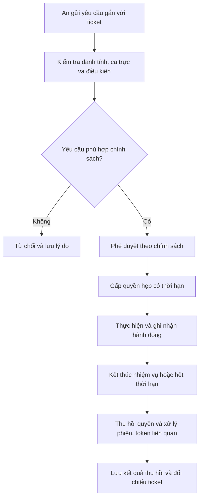

# Least privilege trong PAM

## 1. Least privilege giải quyết vấn đề gì?

Trong quản lý truy cập đặc quyền (Privileged Access Management — PAM), **least privilege** là nguyên tắc chỉ cấp cho một danh tính những quyền cần thiết để hoàn thành nhiệm vụ đã được cho phép, trên đúng tài nguyên, trong đúng điều kiện và khoảng thời gian cần thiết.

Danh tính có thể là quản trị viên, kỹ sư trực vận hành, tài khoản dịch vụ hoặc một workload tự động. Đặc quyền có thể là khả năng sửa cấu hình hệ điều hành, quản lý danh tính, đọc bí mật, triển khai phần mềm, thay đổi chính sách hoặc truy cập dữ liệu nhạy cảm. Vì vậy, least privilege không chỉ là loại bỏ quyền `root` hay `Administrator`; nó còn phải xử lý các quyền có ảnh hưởng tương đương ở cơ sở dữ liệu, nền tảng đám mây và hệ thống điều phối.

Một kỹ sư được giao khởi động lại dịch vụ thanh toán trên một máy chủ không mặc nhiên cần quyền sửa mọi dịch vụ, đọc toàn bộ biến môi trường, thay đổi firewall hoặc tạo quản trị viên mới. Nếu cấp quyền quản trị toàn máy vì thao tác đó dễ cấu hình hơn, tổ chức đã mở rộng khả năng tác động vượt quá nhu cầu công việc.

Trong chương Khái niệm PAM, bài học này giúp người học:

- Phân tách nhu cầu công việc thành danh tính, tài nguyên, hành động và điều kiện cấp quyền.
- Nhận ra quyền thường trực, quyền thừa và đường đi làm phát sinh đặc quyền gián tiếp.
- Kết hợp phân vai, JIT, JEA, vault, credential và giám sát phiên để thực thi least privilege.
- Thiết kế cách cấp, thu hồi và lưu bằng chứng cho tài khoản quản trị lẫn tài khoản dịch vụ.

## 2. Mô tả một quyền theo nhiều chiều

Câu hỏi “người này có cần làm quản trị viên không?” thường quá rộng. Hãy chuyển nó thành câu hỏi: “danh tính nào được thực hiện hành động nào, trên tài nguyên nào, với điều kiện gì và trong bao lâu?”.

| Chiều kiểm soát | Câu hỏi cần trả lời | Ví dụ có phạm vi rõ |
| --- | --- | --- |
| Danh tính | Ai hoặc workload nào thực hiện? | Tài khoản quản trị riêng của kỹ sư trực ca |
| Tài nguyên | Tác động đến đối tượng nào? | Dịch vụ `payment-api` trên máy `prod-app-03` |
| Hành động | Được làm chính xác việc gì? | Xem trạng thái và khởi động lại dịch vụ |
| Môi trường | Quyền áp dụng ở đâu? | Production của ứng dụng thanh toán |
| Thời gian | Khi nào quyền bắt đầu và kết thúc? | Trong cửa sổ xử lý sự cố đã duyệt |
| Điều kiện | Cần những ràng buộc nào? | Xác thực mạnh, thiết bị quản trị hợp lệ, ticket còn hiệu lực |
| Thu hồi và bằng chứng | Quyền kết thúc ra sao, ai kiểm tra được? | Thu hồi quyền tạm, xử lý phiên còn sống và lưu log gắn với ticket |

Không phải hệ thống nào cũng biểu diễn được mọi chiều trong một chính sách duy nhất. Khi đó có thể phối hợp kiểm soát ở IAM, PAM, hệ điều hành và ứng dụng. Điều cần kiểm tra là phạm vi quyền thực tế sau khi các lớp này kết hợp, không chỉ tên vai trò hiển thị trên giao diện.

Ví dụ, một vai trò tên `PaymentViewer` vẫn có thể mang rủi ro cao nếu được đọc bản sao lưu chứa dữ liệu nhạy cảm hoặc đọc credential của tài khoản quản trị. Tên vai trò không chứng minh được mức độ hạn chế của quyền.

## 3. Phân biệt quyền đủ dùng, quyền tạm thời và quyền thường trực

**Quyền đủ dùng** là tập hành động đáp ứng nhiệm vụ đã xác định. **Quyền thường trực** là quyền có sẵn ngoài thời điểm thực hiện nhiệm vụ, không cần một lần kích hoạt riêng. Hai khái niệm này mô tả hai chiều khác nhau.

Một quyền chỉ cho khởi động lại một dịch vụ vẫn có thể là quyền thường trực nếu luôn được gán. Ngược lại, quyền quản trị toàn máy trong mười phút là quyền tạm thời nhưng vẫn rất rộng trong mười phút đó. Muốn giảm rủi ro cần xem xét đồng thời độ rộng và thời gian tồn tại của quyền.

| Cách cấp | Phạm vi hành động | Thời gian | Nhận xét |
| --- | --- | --- | --- |
| Quản trị toàn máy thường trực | Rộng | Liên tục | Có thể gây tác động lớn khi tài khoản bị chiếm dụng |
| Quản trị toàn máy qua JIT | Rộng | Có thời hạn | Giảm thời gian phơi lộ nhưng vẫn cần kiểm soát phiên và hành động |
| Vai trò vận hành giới hạn thường trực | Hẹp | Liên tục | Giảm phạm vi nhưng vẫn tồn tại khả năng bị lạm dụng ngoài nhiệm vụ |
| Vai trò vận hành giới hạn qua JIT | Hẹp | Có thời hạn | Phù hợp khi nhiệm vụ có thể được tách thành thao tác rõ ràng |

Không có một mức quyền nhỏ nhất cố định cho mọi tình huống. Điều tra một sự cố chưa rõ nguyên nhân có thể cần nhiều khả năng hơn một thao tác vận hành lặp lại. Trường hợp đó cần nêu rõ lý do, phạm vi, thời hạn, kiểm soát bổ sung và người chịu trách nhiệm xem xét lại.

## 4. Kiểm kê quyền thực tế trước khi thu hẹp

Muốn áp dụng least privilege phải hiểu người dùng hoặc dịch vụ đang thực sự làm được gì. Danh sách vai trò được gán trực tiếp chỉ là một phần của bức tranh.

### 4.1. Các nguồn hình thành đặc quyền

Quyền hiệu lực có thể xuất hiện từ:

- Quyền gán trực tiếp cho tài khoản.
- Thành viên của nhóm, kể cả nhóm lồng nhau hoặc nhóm được đồng bộ từ hệ thống khác.
- Vai trò được kế thừa từ tổ chức, tài khoản, dự án hoặc tài nguyên cha.
- Khả năng chuyển sang danh tính khác hoặc nhận một vai trò đặc quyền.
- Quyền đọc vault, credential, khóa riêng, token hoặc bản sao lưu chứa bí mật.
- Quyền sửa script, cấu hình, pipeline hoặc tệp thực thi mà một tiến trình đặc quyền sử dụng.
- Phiên, token hoặc credential đã được phát hành trước khi quyền gán bị thay đổi.

Ví dụ, bỏ quyền quản trị trực tiếp khỏi tài khoản nhưng vẫn cho tài khoản đó sửa script chạy bằng `root` theo lịch không loại bỏ được đường đi đến đặc quyền. Tương tự, quyền đọc credential quản trị có thể tạo ra khả năng truy cập rộng hơn nhiều so với quyền đọc thông thường.

### 4.2. Hồ sơ kiểm kê tối thiểu

| Thông tin | Mục đích |
| --- | --- |
| Chủ sở hữu tài khoản và chủ tài nguyên | Xác định ai chịu trách nhiệm xác nhận nhu cầu |
| Loại danh tính và môi trường sử dụng | Phân biệt quản trị viên, workload, production và môi trường thử nghiệm |
| Quyền trực tiếp, kế thừa và đường đi gián tiếp | Xác định phạm vi tác động thực tế |
| Nhiệm vụ sử dụng quyền | Liên kết quyền với công việc có thể giải thích được |
| Dữ liệu sử dụng và ngoại lệ đã biết | Hỗ trợ thu hẹp quyền mà vẫn giữ hoạt động cần thiết |
| Credential, token và phiên liên quan | Chuẩn bị phương án thu hồi đầy đủ |
| Ngày rà soát, người duyệt, thời hạn | Tránh quyền tồn tại vô thời hạn do bị bỏ quên |

Log sử dụng giúp phát hiện quyền có thể dư thừa, nhưng không thấy quyền được dùng trong một khoảng thời gian không có nghĩa là quyền đó chắc chắn không cần thiết. Công việc khôi phục, xử lý cuối kỳ hoặc ứng phó sự cố có thể hiếm khi diễn ra. Cần đối chiếu với chủ sở hữu và kịch bản nghiệp vụ trước khi quyết định.

## 5. Chuyển nhiệm vụ thành vai trò có giới hạn

### 5.1. Bắt đầu từ công việc cụ thể

Một yêu cầu như “cần quyền admin để hỗ trợ ứng dụng” chưa đủ rõ để cấp quyền. Hãy phân rã thành các tác vụ:

1. Xem trạng thái và chỉ số sức khỏe của ứng dụng.
2. Đọc log đã được xử lý để tránh lộ bí mật không cần thiết.
3. Khởi động lại đúng dịch vụ trong phạm vi được giao.
4. Triển khai một phiên bản đã được phê duyệt qua quy trình triển khai.
5. Thay đổi cấu hình hoặc truy cập dữ liệu khi có yêu cầu riêng phù hợp.

Các tác vụ trên không nhất thiết thuộc cùng một vai trò. Người trực vận hành có thể cần ba tác vụ đầu, còn triển khai và thay đổi cấu hình được thực hiện qua pipeline có kiểm soát.

### 5.2. Dùng vai trò để đơn giản hóa, dùng điều kiện để giới hạn

RBAC tổ chức quyền theo vai trò, còn các điều kiện dựa trên thuộc tính có thể giới hạn thêm theo tài nguyên, môi trường, thời gian hoặc ngữ cảnh truy cập. Dù dùng mô hình nào, cần tránh một vai trò gom nhiều công việc không liên quan chỉ vì người dùng có cùng chức danh.

Ví dụ, `ProductionPaymentOperator` có thể được giới hạn ở dịch vụ thanh toán. Nếu người đó hỗ trợ thêm dịch vụ kho hàng, hãy quyết định riêng nhu cầu bổ sung thay vì mặc nhiên mở rộng vai trò sang toàn bộ production.

Cũng cần tránh tạo quá nhiều vai trò gần như giống nhau đến mức không thể rà soát. Có thể dùng một vai trò nhiệm vụ ổn định cùng phạm vi tài nguyên rõ ràng, miễn hệ thống đích hỗ trợ thực thi giới hạn đó.

### 5.3. Tách tài khoản làm việc thông thường và tài khoản quản trị

Tài khoản dùng để đọc thư, họp hoặc làm công việc hằng ngày không nên luôn mang quyền quản trị hạ tầng. Tài khoản quản trị riêng giúp giới hạn bối cảnh sử dụng và liên kết hoạt động đặc quyền với đúng danh tính.

Tuy nhiên, tách tài khoản chưa đủ nếu cả hai dùng chung credential, có thể tự nâng quyền qua một nhóm khác hoặc truy cập từ thiết bị không được kiểm soát. PAM cần kết hợp xác thực, điều kiện truy cập, giới hạn quyền và khả năng truy vết.

## 6. Kết hợp JIT và JEA

### 6.1. JIT: cấp quyền khi thực sự cần

**Just-in-Time access — JIT** giảm quyền thường trực bằng cách cho phép kích hoạt quyền khi có nhu cầu và kết thúc sau một khoảng thời gian được xác định.

Một luồng JIT điển hình:

1. Người dùng gửi yêu cầu, nêu tài nguyên, nhiệm vụ, ticket và thời lượng.
2. Hệ thống kiểm tra điều kiện như danh tính, thiết bị, lịch trực và chính sách phê duyệt.
3. Người có thẩm quyền duyệt nếu chính sách yêu cầu.
4. PAM kích hoạt vai trò hoặc môi giới phiên có phạm vi phù hợp.
5. Các hành động được ghi nhận theo danh tính người yêu cầu.
6. Khi hết thời hạn hoặc nhiệm vụ kết thúc, hệ thống thu hồi quyền và xử lý các quyền truy cập đã phát sinh.

Không phải mọi yêu cầu đều cần duyệt thủ công. Một tác vụ lặp lại, có phạm vi hẹp và đủ điều kiện có thể được duyệt theo chính sách tự động. Ngược lại, thao tác nhạy cảm có thể cần thêm người duyệt độc lập. Phê duyệt là một kiểm soát trong luồng, không tự làm cho tập quyền rộng trở thành least privilege.

### 6.2. JEA: chỉ cho thực hiện thao tác cần thiết

**Just Enough Administration — JEA** hướng đến việc giới hạn khả năng quản trị ở mức hành động đủ dùng. Trong một số nền tảng, JEA còn là tên một cơ chế triển khai cụ thể; ở đây thuật ngữ được dùng để mô tả cách tiếp cận giới hạn thao tác quản trị.

Thay vì cấp shell quản trị toàn máy, hệ thống có thể cung cấp một endpoint hoặc tác vụ được kiểm soát để xem trạng thái và khởi động lại đúng dịch vụ. Cách triển khai phải xem xét cả lệnh, tham số, tệp cấu hình và tài nguyên mà thao tác có thể tác động.

Một lệnh “được cho phép” vẫn có thể quá rộng nếu nhận tên dịch vụ tùy ý, tải script từ vị trí do người gọi sửa được, hoặc mở đường chạy lệnh khác. Chỉ lọc tên lệnh mà bỏ qua tham số và quyền sửa các thành phần phụ thuộc có thể để lại đường leo thang đặc quyền.

### 6.3. Thu hồi vai trò không luôn kết thúc quyền truy cập ngay

Xóa thành viên nhóm hoặc kết thúc thời hạn kích hoạt không bảo đảm mọi phiên và token đang tồn tại lập tức mất hiệu lực. Hành vi phụ thuộc vào cơ chế thực thi của từng hệ thống.

Thiết kế thu hồi cần làm rõ:

- Có đóng phiên đặc quyền đang hoạt động hay chỉ chặn phiên mới?
- Token đã phát hành còn dùng được trong bao lâu và có thể thu hồi sớm không?
- Credential đã được xem hoặc tải xuống có cần đổi hay vô hiệu hóa không?
- Tác vụ nền đã khởi chạy tiếp tục chạy với danh tính nào?
- Có bằng chứng nào chứng minh việc thu hồi đã có hiệu lực ở hệ thống đích?

JIT có giá trị khi vòng đời quyền được quản lý đến bước kết thúc, không chỉ khi yêu cầu được cấp thành công.

## 7. Vault, credential và giám sát phiên hỗ trợ least privilege thế nào?

Vault bảo vệ bí mật và kiểm soát việc cấp phát credential. Luân chuyển credential giảm thời gian một bí mật cũ còn hữu ích. Giám sát phiên tạo khả năng quan sát và hỗ trợ điều tra. Các cơ chế này phối hợp với least privilege nhưng mỗi cơ chế xử lý một vấn đề riêng.

| Cơ chế PAM | Đóng góp | Điều vẫn cần thiết kế thêm |
| --- | --- | --- |
| Vault | Tập trung quản lý và kiểm soát truy cập bí mật | Tài khoản phía sau credential chỉ có quyền cần thiết |
| Môi giới phiên | Có thể đưa người dùng tới hệ thống đích mà không lộ credential, tùy cách triển khai | Phạm vi hành động trong phiên và đường truy cập ngoài môi giới |
| Luân chuyển credential | Thay bí mật theo chính sách hoặc sau một sự kiện | Cập nhật bên sử dụng và xử lý phiên/token không phụ thuộc trực tiếp vào mật khẩu cũ |
| JIT | Giảm thời gian quyền khả dụng | Giới hạn độ rộng của quyền khi kích hoạt |
| Ghi log hoặc ghi hình phiên | Hỗ trợ quy trách nhiệm và xem lại hành động | Kiểm soát ngăn chặn, bảo vệ bằng chứng và giới hạn người xem |

Cất một mật khẩu quản trị toàn hệ thống vào vault không thu hẹp quyền của tài khoản đó. Tương tự, ghi hình một phiên có toàn quyền không ngăn phiên thực hiện hành động vượt quá nhu cầu nếu không có cơ chế thực thi tương ứng.

Khi người dùng đã xem được credential dùng chung, việc quy trách nhiệm có thể khó hơn, nhất là khi có đường đăng nhập trực tiếp ngoài PAM. Cần giảm số nơi phải lộ credential, gắn yêu cầu và phiên với danh tính cá nhân, và kiểm soát các đường truy cập thay thế.

Bản ghi phiên, log và dữ liệu kiểm toán cũng có thể chứa thông tin nhạy cảm. Least privilege phải áp dụng cho người được đọc, xuất, xóa hoặc quản trị các bằng chứng này.

## 8. Least privilege cho tài khoản dịch vụ và workload

Tài khoản dịch vụ thường hoạt động liên tục và không có người đứng trước màn hình để xin quyền từng lần. Không nên sao chép nguyên luồng phê duyệt thủ công của quản trị viên sang mọi tác vụ tự động. Thay vào đó, hãy giới hạn danh tính, tài nguyên, quyền, thời hạn credential và điều kiện phát hành theo cách workload có thể vận hành ổn định.

Các quyết định quan trọng gồm:

- Dùng danh tính riêng cho từng dịch vụ và môi trường khi có thể, tránh một tài khoản quản trị dùng chung cho nhiều ứng dụng.
- Giới hạn quyền đúng dữ liệu và hành động; dịch vụ đọc dữ liệu không mặc nhiên được sửa schema hoặc tạo người dùng.
- Hạn chế đăng nhập tương tác khi workload không cần chức năng đó.
- Ưu tiên cơ chế danh tính workload và credential ngắn hạn khi nền tảng hỗ trợ; vẫn giới hạn quyền được gắn với danh tính.
- Nếu dùng bí mật dài hạn, quản lý trong vault, xác định chủ sở hữu và luân chuyển có phối hợp với các bên sử dụng.
- Kiểm soát quyền sửa pipeline, cấu hình và mã chạy bằng danh tính dịch vụ, vì các quyền này có thể dẫn tới việc sử dụng đặc quyền của dịch vụ.

Ví dụ, dịch vụ đối soát chỉ cần đọc các bảng dữ liệu giao dịch đã xác định và ghi vào vùng kết quả riêng. Quyền quản trị toàn bộ cơ sở dữ liệu không trở nên hợp lý chỉ vì tài khoản được dùng bởi ứng dụng thay vì con người.

Một pipeline triển khai có thể cần quyền thay phiên bản ứng dụng nhưng không cần đọc toàn bộ bí mật sản xuất. Nếu khả năng triển khai cho phép đưa mã tùy ý vào workload đang giữ quyền nhạy cảm, đó vẫn là một đường tác động cần đánh giá. Phải xem cả chuỗi quyền thay vì chỉ đếm các API được gọi trực tiếp.

## 9. Ví dụ xuyên suốt: khởi động lại dịch vụ thanh toán

### 9.1. Bối cảnh

Kỹ sư An trực production cần xử lý dịch vụ `payment-api` không phản hồi trên `prod-app-03`. Ticket `INC-4821` ghi nhận nhu cầu xem trạng thái, đọc phần log phục vụ chẩn đoán và khởi động lại dịch vụ. Hiện tại, nhóm trực có quyền quản trị mọi máy chủ ứng dụng vào mọi thời điểm.

Cách cấp hiện tại tạo phạm vi tác động lớn hơn công việc: một tài khoản bị chiếm dụng có thể ảnh hưởng các máy khác, thay đổi chính sách hoặc đọc credential không liên quan. Mục tiêu là giữ khả năng xử lý sự cố nhưng thu hẹp hành động, tài nguyên và thời gian.

### 9.2. Thiết kế quyền theo nhiệm vụ

| Thành phần | Quyết định minh họa |
| --- | --- |
| Danh tính người thao tác | Tài khoản quản trị riêng của An, xác thực mạnh |
| Tài nguyên | `payment-api` trên `prod-app-03` |
| Hành động | Xem trạng thái, đọc log được cho phép, khởi động lại đúng dịch vụ |
| Những khả năng không được cấp từ vai trò này | Sửa cấu hình hệ thống, quản lý người dùng, đọc vault khác, mở shell quản trị tùy ý |
| Kích hoạt | JIT gắn với `INC-4821`, kiểm tra An thuộc ca trực hợp lệ |
| Thời lượng | Ví dụ 20 phút, được chọn theo nhiệm vụ và chính sách vận hành |
| Bằng chứng | Danh tính yêu cầu, quyết định cấp, thời điểm, hành động, kết quả và thu hồi |

Con số 20 phút chỉ minh họa cho bài học, không phải thời lượng bắt buộc cho mọi hệ thống. Nếu cần gia hạn, yêu cầu gia hạn phải được kiểm tra lại thay vì âm thầm biến quyền tạm thành quyền thường trực.

### 9.3. Mô tả chính sách bằng dữ liệu

Đoạn JSON dưới đây là **mô hình minh họa để trao đổi thiết kế**, không phải cấu hình có thể áp dụng trực tiếp cho một sản phẩm PAM. Các tên hành động biểu diễn ý định; việc triển khai phải ánh xạ chúng thành khả năng thực thi của hệ thống đích.

```json
{
  "policy": "payment-incident-operator",
  "subject": "admin-an",
  "resource": {
    "environment": "production",
    "host": "prod-app-03",
    "service": "payment-api"
  },
  "allowedActions": [
    "service.status",
    "service.restart",
    "service.readApprovedLogs"
  ],
  "activation": {
    "ticket": "INC-4821",
    "maxDurationMinutes": 20,
    "requireStrongAuthentication": true,
    "requireManagedAdminDevice": true
  },
  "evidence": {
    "recordDecision": true,
    "recordActions": true,
    "recordRevocationResult": true
  }
}
```

Danh sách `allowedActions` trong ví dụ không tự phủ định những quyền mà An có qua nhóm hoặc đường truy cập khác. Khi triển khai, cần đồng thời xử lý các quyền quản trị cũ, cơ chế mặc định từ chối và đường truy cập có thể bỏ qua chính sách.

Nếu thao tác được hiện thực bằng một script đặc quyền, phải bảo đảm người gọi không sửa được script, tệp phụ thuộc hoặc cấu hình làm script chạy hành vi tùy ý. Tham số như tên dịch vụ phải được giới hạn theo chính sách.

### 9.4. Vòng đời từ yêu cầu đến kết thúc



Nếu chẩn đoán cho thấy phải sửa cấu hình, An cần yêu cầu phù hợp với tác vụ mới. Không mở rộng ngầm vai trò khởi động lại dịch vụ thành quyền quản trị toàn máy chỉ vì cùng nằm trong một sự cố.

## 10. Quyền khẩn cấp và phân tách nhiệm vụ

### 10.1. Break-glass có giới hạn và trách nhiệm

Trong một số sự cố, hạ tầng PAM hoặc hệ thống nhận dạng chính có thể không khả dụng. Cơ chế **break-glass** cung cấp đường truy cập khẩn cấp đã được chuẩn bị trước để khôi phục hoạt động.

Quyền khẩn cấp có thể cần rộng hơn quyền vận hành thông thường, nhưng vẫn cần xác định rõ:

- Sự kiện nào cho phép sử dụng và ai được kích hoạt.
- Phạm vi hệ thống cần khôi phục, người chịu trách nhiệm và cách xác nhận người dùng.
- Cách bảo quản credential và cách truy cập khi các thành phần thông thường bị lỗi.
- Cách tạo cảnh báo, thu thập bằng chứng và rà soát sau sự cố khi kênh chính không hoạt động.
- Cách kết thúc phiên, đổi credential đã lộ và đưa hệ thống về chế độ kiểm soát thông thường.

Một tài khoản quản trị dự phòng được dùng hằng ngày không còn là ngoại lệ khẩn cấp có kiểm soát. Cũng cần diễn tập khả năng dùng và thu hồi quyền khẩn cấp trong bối cảnh khôi phục phù hợp; chỉ có tài khoản dự phòng trong danh sách chưa chứng minh nó sử dụng được khi cần.

### 10.2. Phân tách nhiệm vụ bổ sung cho least privilege

Least privilege giới hạn mỗi danh tính được làm gì. **Phân tách nhiệm vụ** kiểm soát việc một người có thể nắm các vai trò xung đột hay không.

Ví dụ, với một thao tác nhạy cảm, người đề nghị cấp quyền có thể không được tự duyệt yêu cầu của mình. Người thực hiện thay đổi cũng không nên có khả năng tùy ý xóa bằng chứng về chính thay đổi đó. Mỗi vai trò riêng lẻ có vẻ hẹp nhưng tổ hợp vai trò vẫn có thể tạo khả năng lạm dụng; vì vậy cần xem xét cả các tổ hợp quyền.

## 11. Triển khai từng bước và giữ khả năng vận hành

Việc gỡ toàn bộ quyền quản trị đang tồn tại ngay lập tức có thể làm gián đoạn vận hành nếu chưa biết các phụ thuộc. Một lộ trình thực tế gồm:

1. **Kiểm kê và xác nhận chủ sở hữu:** lập danh sách danh tính, tài nguyên, quyền hiệu lực và đường sử dụng credential.
2. **Chọn một nhóm tác vụ:** ưu tiên phạm vi có chủ sở hữu rõ, thao tác lặp lại và khả năng quan sát được.
3. **Thiết kế quyền đủ dùng:** ghi rõ hành động, tài nguyên, điều kiện, thời hạn và các phụ thuộc có thể mở rộng quyền.
4. **Kiểm chứng trong môi trường phù hợp:** xác nhận các thao tác cần thiết thành công và các thao tác vượt phạm vi bị từ chối, kể cả qua đường truy cập thay thế.
5. **Triển khai có kiểm soát:** cung cấp hướng dẫn sử dụng, cách yêu cầu mở rộng và phương án xử lý nếu tác vụ thiết yếu bị chặn.
6. **Thu hồi quyền cũ:** gỡ quyền thường trực hoặc đường truy cập thừa sau khi xác nhận luồng mới đáp ứng nhiệm vụ.
7. **Theo dõi và rà soát:** xem dữ liệu từ chối, ngoại lệ, gia hạn, quyền không còn nhu cầu và kết quả thu hồi.

Trong giai đoạn quan sát, log chỉ cho biết điều gì đã xảy ra; nó chưa chứng minh hệ thống có khả năng ngăn thao tác trái phép. Khi chuyển sang thực thi, cần kiểm chứng hành vi từ chối thực tế của hệ thống đích.

Phương án khôi phục khi thay đổi gây lỗi phải có phạm vi, người quyết định và thời hạn. Nếu chỉ bật lại quyền quản trị rộng rồi bỏ quên, quá trình triển khai sẽ quay về trạng thái quyền thường trực ban đầu.

## 12. Bằng chứng và chỉ số theo dõi

Một quyết định cấp quyền có thể giải thích được cần nối được chuỗi: **nhu cầu → chính sách → quyết định → hành động → thu hồi**.

Bằng chứng hữu ích gồm danh tính yêu cầu, chủ tài nguyên, ticket, phạm vi đã cấp, thời điểm kích hoạt, điều kiện được kiểm tra, người hoặc chính sách phê duyệt, hoạt động thực tế và kết quả kết thúc quyền. Các bản ghi cần được bảo vệ khỏi sửa hoặc xóa trái phép; quyền truy cập và thời gian lưu được xác định theo nhu cầu của tổ chức.

| Chỉ số | Cách sử dụng | Điểm cần đọc kèm |
| --- | --- | --- |
| Số danh tính còn quyền quản trị thường trực | Theo dõi việc giảm quyền tồn tại liên tục | Phải nêu phạm vi và loại hệ thống được đo |
| Tỷ lệ tác vụ đặc quyền đi qua luồng được kiểm soát | Phát hiện mức bao phủ PAM | Cần tìm cả đường truy cập trực tiếp ngoài PAM |
| Số quyền hoặc ngoại lệ không có chủ sở hữu, không có hạn | Phát hiện quyền dễ bị bỏ quên | Ngoại lệ cần có lý do và người chịu trách nhiệm |
| Thời gian từ lúc kết thúc nhiệm vụ đến khi mất quyền thực tế | Theo dõi hiệu quả thu hồi | Phân biệt quyền gán, phiên, token và credential |
| Tác vụ hợp lệ bị chặn và số yêu cầu gia hạn | Phát hiện thiết kế quyền hoặc thời hạn chưa phù hợp | Từ chối tăng không tự chứng minh hệ thống an toàn hơn |
| Số lần dùng quyền khẩn cấp và kết quả rà soát | Nhận diện phụ thuộc vào ngoại lệ | Xem lý do sử dụng và việc đưa quyền về trạng thái bình thường |

Giảm số lượng vai trò không nhất thiết giảm rủi ro nếu các vai trò còn lại rộng hơn. Tăng số phiên được ghi hình cũng không chứng minh đã thu hẹp quyền. Chỉ số cần phản ánh đúng mục tiêu: giảm quyền thừa, giảm thời gian phơi lộ và duy trì khả năng thực hiện nhiệm vụ hợp lệ.

## 13. Những sai lầm thường gặp

| Cách làm | Vì sao chưa đáp ứng least privilege | Hướng xử lý |
| --- | --- | --- |
| Cấp admin vì chưa xác định được quyền cần thiết | Đẩy sự không rõ ràng thành quyền rộng thường trực | Phân tích tác vụ, kiểm chứng phạm vi và quản lý ngoại lệ có hạn |
| Chỉ dùng vault nhưng giữ tài khoản toàn quyền | Credential được bảo vệ hơn, quyền phía sau vẫn rộng | Thu hẹp quyền của tài khoản đích và giới hạn nơi sử dụng |
| Chỉ áp dụng JIT cho vai trò rất rộng | Rủi ro vẫn lớn trong thời gian kích hoạt | Kết hợp giới hạn tài nguyên và hành động |
| Chỉ nhìn quyền trực tiếp | Bỏ sót kế thừa, chuyển vai trò và khả năng lấy credential | Kiểm kê quyền hiệu lực và các đường đi gián tiếp |
| Tin rằng hết hạn vai trò là mất mọi truy cập | Phiên hoặc token cũ có thể còn hiệu lực | Thiết kế, kiểm chứng và ghi nhận thu hồi ở hệ thống đích |
| Chia sẻ tài khoản quản trị mà thiếu liên kết danh tính | Khó xác định cá nhân đã thực hiện hành động | Môi giới phiên hoặc cơ chế gắn người yêu cầu với hoạt động thực tế |
| Chặn quá nhiều khiến người dùng đi đường vòng | Tác vụ hợp lệ không được hỗ trợ đầy đủ | Cải thiện vai trò nhiệm vụ, thời gian cấp và quy trình mở rộng |
| Để người vận hành tự sửa hoặc xóa log của mình | Bằng chứng dễ bị can thiệp | Phân tách quyền thao tác và quản trị bằng chứng |

## 14. Bài tập thực hành trên giấy

Giả sử một tổ chức có ba nhu cầu:

- Kỹ sư trực cần khởi động lại một dịch vụ khi có sự cố.
- Tài khoản sao lưu cần đọc dữ liệu nguồn và ghi vào kho sao lưu riêng.
- Nhóm triển khai cần phát hành một phiên bản ứng dụng đã được duyệt.

Với mỗi nhu cầu, hãy viết một đề xuất cấp quyền gồm danh tính, tài nguyên, hành động, thời gian, điều kiện, cách thu hồi và bằng chứng. Sau đó tìm ít nhất một đường đi gián tiếp có thể làm quyền rộng hơn dự kiến.

Gợi ý đối chiếu:

| Nhu cầu | Phạm vi nên xem xét | Đường đi cần kiểm tra |
| --- | --- | --- |
| Khởi động lại dịch vụ | Đúng dịch vụ và máy chủ, kích hoạt theo nhiệm vụ | Có sửa được script hoặc cấu hình đặc quyền không? |
| Sao lưu | Dữ liệu nguồn và vùng đích cần thiết | Có xóa được mọi bản sao, đọc bí mật hoặc đăng nhập tương tác không? |
| Triển khai | Đúng ứng dụng, môi trường và quy trình phê duyệt | Có sửa pipeline hoặc đưa mã sử dụng quyền nhạy cảm của workload không? |

Không có một đáp án quyền cụ thể áp dụng cho mọi sản phẩm. Mục tiêu của bài tập là đưa ra quyền có thể giải thích, thực thi và thu hồi, đồng thời nhận ra phụ thuộc giữa vận hành, bảo vệ dữ liệu và đặc quyền.

## 15. Ghi nhớ

Least privilege trong PAM là một vòng đời quản lý quyền: hiểu nhiệm vụ, giới hạn quyền hiệu lực, cấp khi cần, quan sát việc sử dụng và xác nhận kết thúc truy cập. Quyền “nhỏ nhất” phải gắn với một nhiệm vụ và tài nguyên cụ thể, thay vì chỉ dựa vào tên vai trò.

JIT giảm thời gian quyền tồn tại; JEA thu hẹp thao tác; vault và credential bảo vệ cách tiếp cận tài khoản; giám sát và bằng chứng giúp quy trách nhiệm. Khi phối hợp các cơ chế này, phải kiểm tra cả đường truy cập gián tiếp, danh tính dịch vụ và những phiên hoặc token còn sống sau khi thu hồi quyền.
