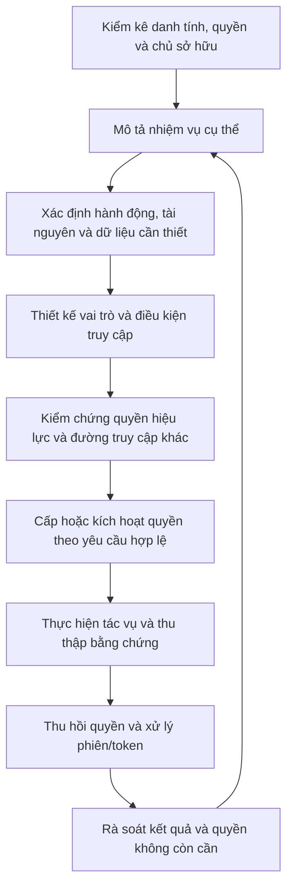

# Just-enough access

## Mục tiêu bài học

Trong chương **Khái niệm PAM**, just-enough access là cách thiết kế quyền truy cập sao cho mỗi chủ thể có đủ khả năng hoàn thành nhiệm vụ được giao, trong phạm vi cần thiết và với điều kiện sử dụng rõ ràng. Bài học thuộc module `SECURITY_IDENTITY_ACCESS_MANAGEMENT_PRIVILEGED_ACCESS_MANAGEMENT`, áp dụng cho tài khoản quản trị, tài khoản dịch vụ và hạ tầng nhạy cảm.

Sau bài học, bạn có thể:

- Chuyển một yêu cầu công việc thành tập hành động và tài nguyên cần được phép truy cập.
- Phân biệt just-enough access với least privilege, just-in-time và Just Enough Administration.
- Nhận ra quyền vượt nhu cầu trong vai trò, dữ liệu, credential và đường truy cập gián tiếp.
- Thiết kế một luồng cấp quyền đủ dùng cho con người hoặc workload.
- Xác định bằng chứng cần lưu để kiểm toán quyền đã cấp và hỗ trợ ứng phó sự cố.

## 1. Just-enough access là gì?

**Just-enough access** nghĩa là cấp đủ quyền truy cập cho một nhiệm vụ hợp lệ, đồng thời giới hạn những khả năng không cần thiết cho nhiệm vụ đó. Điểm xuất phát là công việc cần hoàn thành, thay vì tên vai trò có sẵn như `Administrator`, `Owner` hoặc `Superuser`.

Ví dụ, một kỹ sư cần xem trạng thái và khởi động lại dịch vụ đặt hàng. Nhu cầu đó không tự tạo ra lý do để kỹ sư có thể sửa chính sách mạng, tạo tài khoản quản trị, đọc dữ liệu khách hàng hoặc xóa bản sao lưu. Một quyền có thể thuận tiện cho vận hành nhưng vẫn vượt nhu cầu của công việc.

Để mô tả quyền đủ dùng, cần trả lời ít nhất sáu câu hỏi:

| Chiều kiểm soát | Câu hỏi cần trả lời | Ví dụ minh họa |
|---|---|---|
| Chủ thể | Ai hoặc workload nào cần truy cập? | Kỹ sư trực ca hoặc pipeline triển khai cụ thể |
| Hành động | Cần làm gì? | Xem trạng thái và khởi động lại dịch vụ A |
| Tài nguyên | Được làm trên đối tượng nào? | Hai máy thuộc nhóm vận hành dịch vụ A |
| Dữ liệu | Được xem hoặc thay đổi phần dữ liệu nào? | Nhật ký đã che trường nhạy cảm của dịch vụ A |
| Điều kiện | Trong hoàn cảnh nào quyền được dùng? | Có yêu cầu hợp lệ, xác thực theo chính sách và nguồn truy cập được chấp nhận |
| Thời hạn | Khi nào quyền bắt đầu và kết thúc? | Cửa sổ xử lý sự cố đã được duyệt |

Chiều thời hạn thường được thực hiện bằng JIT. Nó bổ sung cho việc giới hạn phạm vi, nhưng một quyền tồn tại ngắn vẫn có thể quá rộng. Trong bài học này, trọng tâm là xác định **đủ quyền để làm việc gì**, rồi đặt quyền đó vào vòng đời truy cập có kiểm soát của PAM.

Không có một vai trò nhỏ nhất phù hợp cho mọi người hoặc mọi hệ thống. Tập quyền đủ dùng phụ thuộc công việc, kiến trúc, công nghệ đích và cách các quyền kết hợp với nhau.

## 2. Quan hệ với least privilege, JIT và JEA

| Khái niệm | Nội dung chính | Ví dụ | Giới hạn nếu đứng riêng |
|---|---|---|---|
| Least privilege | Nguyên tắc chỉ cấp quyền cần thiết | Bỏ quyền xóa dữ liệu khỏi vai trò chỉ cần đọc | Cần cách chuyển nguyên tắc thành chính sách và cơ chế thực thi cụ thể |
| Just-enough access | Cách thiết kế quyền truy cập đủ cho nhiệm vụ | Vai trò chỉ được vận hành dịch vụ A và đọc phần log phục vụ nhiệm vụ | Vẫn cần quản lý thời hạn, danh tính, credential và bằng chứng |
| Just-in-time — JIT | Cấp hoặc kích hoạt quyền vào thời điểm cần, trong thời hạn phù hợp | Kích hoạt vai trò xử lý sự cố trong 30 phút | Vai trò được kích hoạt vẫn có thể quá rộng |
| Just Enough Administration — JEA | Giới hạn khả năng quản trị vào những thao tác cần thiết | Một giao diện quản trị chỉ công bố các thao tác đã chọn | Cần bảo vệ cả cấu hình, tham số và các khả năng gián tiếp |

Trong thực tế, cách dùng thuật ngữ có thể khác nhau giữa các giải pháp. **JEA** còn là tên một công nghệ quản trị cụ thể trong PowerShell. Không nên mặc định rằng mọi mô hình just-enough access đều là triển khai PowerShell JEA, hoặc một tên tính năng đã chứng minh quyền thực tế đủ hẹp.

Ví dụ đối chiếu:

- Cấp toàn quyền quản trị trong 15 phút: có giới hạn thời gian, nhưng chưa chứng minh phạm vi quyền phù hợp.
- Cấp quyền khởi động lại đúng dịch vụ A vô thời hạn: đã thu hẹp hành động, nhưng vẫn còn quyền thường trực cần được xem xét.
- Cấp quyền khởi động lại dịch vụ A trong cửa sổ đã duyệt, có xác thực và bằng chứng: phối hợp được phạm vi quyền với thời gian sử dụng.

Các khoảng thời gian trên chỉ minh họa. Chính sách thực tế cần dựa trên nhiệm vụ và mức rủi ro.

## 3. Vì sao vai trò có tên hợp lý vẫn có thể vượt nhu cầu?

Một vai trò có thể chứa quyền thừa do được tạo cho nhiều nhóm công việc, kế thừa từ một vai trò cha hoặc được mở rộng dần sau các sự cố. Tên vai trò mô tả ý định, còn **quyền hiệu lực** mới cho biết khả năng thực tế của chủ thể.

Một người dùng có thể nhận quyền từ nhiều nguồn:

- Vai trò được gán trực tiếp.
- Thành viên nhóm và nhóm lồng nhau, nếu nền tảng hỗ trợ.
- Chính sách trên tài nguyên.
- Credential hoặc danh tính khác mà người đó được phép sử dụng.
- Khả năng chuyển vai trò, ủy quyền hoặc mạo danh theo cơ chế của hệ thống.
- Khả năng sửa cấu hình, script hoặc chính sách dẫn đến thao tác đặc quyền ở bước sau.

Không có một công thức cộng quyền chung cho tất cả công nghệ. Có nền tảng áp dụng điều kiện, ranh giới quyền hoặc quy tắc từ chối theo cách riêng. Việc đánh giá cần theo cơ chế phân quyền của hệ thống đích và được kiểm chứng bằng hoạt động thực tế phù hợp.

### Ví dụ về quyền kết hợp

Một tài khoản không được quyền triển khai trực tiếp vào sản xuất nhưng có thể sửa pipeline sẽ chạy dưới danh tính triển khai sản xuất. Nếu không có kiểm soát bổ sung, khả năng sửa pipeline có thể tạo đường tác động tới sản xuất.

Tương tự, quyền khởi động lại dịch vụ không còn hẹp như dự kiến nếu người sử dụng đồng thời sửa được tệp thực thi của dịch vụ đó. Do vậy, cần đánh giá cả **quyền trực tiếp** và **những khả năng mà tổ hợp quyền tạo ra**.

## 4. Bắt đầu bằng mô tả nhiệm vụ có thể kiểm chứng

Yêu cầu như “cần quyền admin để hỗ trợ” quá rộng để thiết kế just-enough access. Một yêu cầu hữu ích cần nêu mục tiêu, đối tượng, thao tác, đầu ra mong đợi và những bước cần thực hiện.

Ví dụ:

```text
Nhiệm vụ: khôi phục hoạt động dịch vụ order-api bị treo.
Người thực hiện: kỹ sư trực ca thuộc nhóm vận hành dịch vụ.
Tài nguyên: order-api trên hai máy sản xuất đã xác định.
Hành động cần thiết:
  - Xem trạng thái dịch vụ.
  - Xem log chẩn đoán đã giới hạn phạm vi.
  - Khởi động lại dịch vụ.
Kết quả: dịch vụ hoạt động trở lại và kiểm tra sức khỏe thành công.
Thời hạn truy cập: cửa sổ xử lý sự cố đã được duyệt.
Bằng chứng: mã sự cố, quyết định cấp quyền, sự kiện thao tác và thu hồi.
```

Sau đó tách yêu cầu thành các quyền cụ thể:

| Bước công việc | Quyền cần xem xét | Điều không tự động được cấp |
|---|---|---|
| Xác định tình trạng | Đọc trạng thái của đúng dịch vụ | Đọc mọi cấu hình hoặc secret trên máy |
| Chẩn đoán | Đọc log trong phạm vi cần thiết | Xuất toàn bộ dữ liệu khách hàng |
| Khôi phục dịch vụ | Khởi động lại đối tượng đã xác định | Dừng các dịch vụ khác hoặc khởi động lại toàn máy |
| Xác nhận kết quả | Đọc chỉ số sức khỏe liên quan | Thay đổi cơ chế giám sát hoặc xóa cảnh báo |

Không phải mọi thao tác trong mô tả nghiệp vụ đều tương ứng với một quyền riêng trên công nghệ đích. Nếu nền tảng chỉ cung cấp quyền quá rộng, cần xem xét giao diện trung gian, tự động hóa tác vụ hoặc kiểm soát bù, thay vì gọi quyền đó là tối thiểu chỉ vì chưa tìm được cách khác.

## 5. Thiết kế một chính sách quyền đủ dùng

Một chính sách cần diễn đạt được điều kiện cho phép và được thực thi tại các điểm phù hợp. Ví dụ dưới đây chỉ mô tả logic, không phải cú pháp của một sản phẩm PAM:

```text
CHÍNH SÁCH MINH HỌA

Chủ thể:
  kỹ sư đủ điều kiện thuộc nhóm vận hành order-api

Tài nguyên:
  các mã định danh máy chủ đã được duyệt cho order-api

Thao tác:
  service.status(order-api)
  service.restart(order-api)
  logs.read(order-api, phạm_vi_được_duyệt, dữ_liệu_đã_che)

Điều kiện:
  xác thực đáp ứng yêu cầu của tổ chức
  có yêu cầu truy cập hợp lệ gắn với công việc
  nguồn kết nối đáp ứng chính sách
  quyết định phê duyệt phù hợp mức rủi ro
  đang trong cửa sổ truy cập được cấp

Mặc định:
  không cho phép các thao tác và tài nguyên ngoài phạm vi này

Kết thúc:
  thu hồi quyền, xử lý phiên/token còn hiệu lực và lưu bằng chứng
```

Có ba điểm cần làm rõ khi chuyển mô hình này thành cấu hình thực:

**Một là, chọn tài nguyên bằng định danh đáng tin cậy.** Một bộ lọc dựa trên tên hoặc nhãn có thể mở rộng phạm vi nếu chủ thể được phép tự sửa chính tên hoặc nhãn đó. Quyền thay đổi điều kiện lựa chọn tài nguyên cũng cần được quản lý.

**Hai là, giới hạn tham số và dữ liệu đầu vào.** Cho phép chạy một thao tác quản trị với tham số tùy ý có thể tạo nhiều khả năng hơn dự kiến. Cần kiểm soát cách tham số được kiểm tra, cách lệnh hoặc API được gọi và những đối tượng mà thao tác có thể tham chiếu.

**Ba là, bảo vệ chính sách khỏi tự sửa đổi.** Chủ thể sử dụng quyền không nên tự thay đổi vai trò, giao diện quản trị hoặc danh sách tài nguyên được cho phép để mở rộng quyền của mình.

## 6. Chọn cơ chế thực thi theo khả năng của hệ thống

Just-enough access có thể được thực hiện bằng nhiều cơ chế phối hợp.

### 6.1. Vai trò chuyên biệt trên hệ thống đích

Nếu hệ thống hỗ trợ quyền đủ chi tiết, có thể tạo vai trò theo nhiệm vụ và gán cho danh tính cá nhân hoặc workload. Đây là cách đưa giới hạn gần tài nguyên, nơi các hành động thực sự diễn ra.

RBAC phù hợp để gom các quyền ổn định theo nhiệm vụ. Các điều kiện theo thuộc tính hoặc ngữ cảnh có thể bổ sung phạm vi tài nguyên, môi trường hoặc điều kiện sử dụng khi nền tảng hỗ trợ. Không nên giả định chỉ cần tạo một vai trò mới là quyền cũ, quyền nhóm hoặc đường ủy quyền khác đã biến mất.

### 6.2. Giao diện quản trị có giới hạn

Một cổng hoặc API quản trị có thể chỉ cung cấp thao tác định trước như xem trạng thái hoặc khởi động lại một dịch vụ. Danh tính thực thi phía sau có thể cần quyền mạnh hơn người yêu cầu.

Khi đó, cần bảo vệ giao diện trung gian như một thành phần đặc quyền: kiểm tra danh tính và tham số, giới hạn tài nguyên, ngăn sửa tác vụ và lưu liên kết giữa người yêu cầu với hoạt động tại đích. Nếu người dùng vẫn truy cập trực tiếp bằng danh tính thực thi rộng quyền, giới hạn tại giao diện có thể bị bỏ qua.

### 6.3. Tự động hóa một tác vụ đã được kiểm soát

Với công việc lặp lại, một workflow định sẵn có thể giảm nhu cầu cấp shell quản trị cho con người. Ví dụ, người vận hành yêu cầu khởi động lại dịch vụ qua một tác vụ có kiểm tra điều kiện và báo kết quả.

Danh tính chạy workflow vẫn phải có quyền phù hợp. Người yêu cầu không nên tự sửa mã tác vụ hoặc cấu hình thực thi để biến một workflow hẹp thành công cụ quản trị tùy ý.

### 6.4. Vault và môi giới phiên

Vault hỗ trợ bảo vệ credential, còn môi giới phiên có thể giúp kết nối đến tài nguyên mà người dùng không cần biết secret. Các thành phần này hỗ trợ just-enough access, nhưng việc giấu mật khẩu không tự thu hẹp quyền của phiên.

Nếu tài khoản đích là quản trị toàn phần, cần đánh giá cơ chế nào thực sự giới hạn hành động trong phiên. Khả năng ghi hình hoặc ghi lệnh cung cấp bằng chứng; khả năng đó không đồng nghĩa với việc mọi hành động ngoài phạm vi đều bị chặn.

## 7. Kiểm soát dữ liệu cũng là kiểm soát đặc quyền

Quyền chỉ đọc có thể mang tác động rất lớn nếu cho phép truy cập secret, khóa giải mã, bản sao lưu hoặc dữ liệu khách hàng. Vì vậy, thiết kế quyền đủ dùng phải xét cả nội dung được đọc và khả năng xuất dữ liệu.

Ví dụ, hỗ trợ điều tra lỗi ứng dụng có thể cần mã lỗi và mã giao dịch, nhưng chưa chắc cần toàn bộ thông tin cá nhân trong bản ghi. Một giao diện chẩn đoán có thể cung cấp dữ liệu đã che trường nhạy cảm, giới hạn khoảng thời gian và giới hạn dịch vụ.

Cần kiểm tra các hành động có vẻ phụ trợ:

- Có thể tải toàn bộ tập log thay vì xem phần cần thiết không?
- Có thể đọc bản sao lưu để lấy dữ liệu ngoài phạm vi được duyệt không?
- Có thể gọi chức năng xuất dữ liệu hoặc xem phiên bản cũ của secret không?
- Có thể đọc cấu hình chứa credential để truy cập một hệ thống khác không?

Khi log hoặc bản ghi phiên chứa dữ liệu nhạy cảm, chính quyền xem bằng chứng cũng phải được giới hạn. Người có thể kiểm toán một phiên không mặc nhiên cần biết mọi secret xuất hiện trong phiên đó.

## 8. Áp dụng cho tài khoản dịch vụ và workload

Một dịch vụ chạy liên tục hoặc pipeline tự động không có cùng cách tương tác với hệ thống phê duyệt như con người. Just-enough access vẫn áp dụng, nhưng chính sách được gắn vào danh tính máy, nhiệm vụ tự động và điều kiện thực thi.

### Ví dụ: pipeline triển khai vào staging

Giả sử một pipeline chỉ cần triển khai `order-api` vào staging:

| Thành phần | Thiết kế quyền đủ dùng |
|---|---|
| Danh tính | Danh tính workload riêng cho luồng triển khai đã xác định |
| Hành động | Cập nhật đúng ứng dụng và đọc trạng thái triển khai cần thiết |
| Tài nguyên | Môi trường staging của order-api |
| Ranh giới | Không có quyền cấp vai trò, sửa cơ chế tin cậy hoặc triển khai sản xuất |
| Credential | Ưu tiên cơ chế cấp credential ngắn hạn phù hợp nếu nền tảng hỗ trợ |
| Bằng chứng | Mã lần chạy, danh tính workload, phiên bản artifact, tài nguyên đích và kết quả |

Nếu nền tảng cho phép, credential cần được giới hạn cho bên nhận dự kiến và phạm vi sử dụng phù hợp. Token ngắn hạn chỉ giảm thời gian bị lợi dụng; token có thể triển khai toàn bộ môi trường vẫn rộng hơn nhu cầu của pipeline này.

Cần đánh giá cả người hoặc workload có quyền sửa pipeline. Một ranh giới triển khai có thể mất tác dụng nếu cùng chủ thể được tự thay đổi cấu hình tin cậy, danh tính thực thi hoặc bước cấp credential.

### Tài khoản dịch vụ dùng credential tĩnh

Với hệ thống cũ cần mật khẩu hoặc khóa dài hạn, nên có tài khoản riêng theo mục đích và chủ sở hữu rõ ràng. Vault, luân chuyển credential và kiểm tra phụ thuộc hỗ trợ kiểm soát vòng đời, còn giới hạn quyền trên đích quyết định tài khoản đó thực sự làm được gì.

Khi luân chuyển, cần xác định những nơi đang sử dụng credential, cập nhật chúng theo khả năng công nghệ và kiểm tra tác vụ vẫn hoạt động. Credential cũ phải được vô hiệu hóa theo thiết kế. Luân chuyển thành công không chứng minh phạm vi quyền đã đúng; đây là hai yêu cầu cần được kiểm chứng riêng.

## 9. Vòng đời của một quyền đủ dùng trong PAM



Bản kiểm kê nên ghi nhận danh tính, chủ sở hữu, tài nguyên, quyền hiện có, nhiệm vụ liên quan, credential và đường truy cập. Nếu thiếu chủ sở hữu, rất khó xác nhận một quyền còn cần thiết hay chỉ được giữ lại theo thói quen.

Khi con người đổi vai trò, workload ngừng hoạt động hoặc kiến trúc thay đổi, quyền phải được xem xét lại. Quyền đủ dùng tại thời điểm triển khai có thể thành quyền thừa sau khi chức năng được chuyển sang hệ thống khác.

## 10. Kiểm chứng quyền thực tế bằng hai phía

Đánh giá cần xem cả **công việc hợp lệ có thực hiện được không** và **hành động ngoài phạm vi có bị từ chối không**. Chỉ chứng minh đăng nhập thành công hoặc một thao tác đã chạy chưa đủ.

Ma trận minh họa cho vai trò vận hành `order-api`:

| Trường hợp | Kết quả mong đợi | Bằng chứng cần có |
|---|---|---|
| Xem trạng thái order-api trên máy đã duyệt | Được phép | Danh tính, đích, thao tác và kết quả |
| Khởi động lại order-api trong cửa sổ truy cập | Được phép | Quyết định cấp quyền và sự kiện tại đích |
| Khởi động lại dịch vụ khác | Bị từ chối | Kết quả từ chối tại điểm thực thi |
| Đọc log chứa dữ liệu ngoài phạm vi | Bị từ chối hoặc chỉ trả dữ liệu đã giới hạn theo thiết kế | Chính sách truy cập và kết quả quan sát |
| Sửa vai trò hoặc cấu hình giao diện quản trị | Bị từ chối | Sự kiện kiểm tra quyền phù hợp |
| Truy cập cùng máy bằng một credential khác ngoài luồng | Bị chặn nếu chính sách yêu cầu chỉ dùng luồng được kiểm soát | Kiểm tra đường kết nối và quyền của danh tính đích |
| Tiếp tục thao tác sau khi kết thúc quyền tạm thời | Không còn khả năng thao tác đặc quyền theo yêu cầu thiết kế | Trạng thái quyền, phiên và token liên quan |

Các trường hợp cần được thực hiện trong môi trường và phạm vi được phép, ưu tiên kiểm tra không gây tác động hoặc đối tượng thử nghiệm phù hợp. Không thực hiện thao tác phá hủy trên sản xuất chỉ để xác nhận rằng thao tác có bị chặn hay không.

Kết quả kiểm chứng cần phân biệt rõ một hành động bị chặn tại giao diện với một hành động bị từ chối trên tài nguyên đích. Nếu giao diện không có nút xóa nhưng API đích vẫn cho phép xóa bằng cùng credential, quyền thực tế chưa được giới hạn như mong muốn.

### Kiểm tra thời điểm kết thúc

Xóa vai trò, đóng cửa sổ phê duyệt và chấm dứt truy cập có thể là những sự kiện khác nhau. Token đã phát hành hoặc kết nối đang mở có thể tiếp tục hiệu lực tùy cơ chế của hệ thống.

Cần xác định cách thu hồi, thời hạn token, khả năng ngắt phiên và tình trạng kết nối tại đích. Khi một phần không thể thu hồi ngay, thiết kế phải ghi nhận giới hạn đó cùng biện pháp giảm rủi ro, thay vì coi sự kiện xóa vai trò là bằng chứng toàn bộ truy cập đã dừng.

## 11. Bằng chứng kiểm toán và ứng phó sự cố

Bằng chứng cần giúp giải thích quyền được cấp có tương ứng với nhiệm vụ hay không. Một chuỗi ghi nhận hữu ích gồm:

```text
Mã công việc hoặc yêu cầu
    -> danh tính người hoặc workload
    -> quyết định cho phép và phiên bản chính sách
    -> hành động, tài nguyên, điều kiện và thời hạn được cấp
    -> mã phiên hoặc mã lần chạy
    -> hoạt động thực tế và kết quả tại đích
    -> thu hồi quyền, kết thúc phiên/token theo thiết kế
    -> luân chuyển hoặc vô hiệu hóa credential khi có áp dụng
```

Không đưa giá trị secret vào bằng chứng. Có thể sử dụng mã tham chiếu credential, mã phiên bản an toàn và sự kiện luân chuyển. Cần kiểm soát người được xem, sửa hoặc xuất dữ liệu kiểm toán, đồng thời giữ thời gian giữa các nguồn đủ nhất quán để liên kết diễn biến.

Nếu phát hiện hoạt động vượt nhu cầu, quy trình ứng phó cần xem xét cả quyền đang có và những thay đổi đã xảy ra. Một chủ thể từng có thể sửa pipeline, tạo khóa hoặc gán vai trò có thể đã tạo thêm đường truy cập trước khi bị thu hồi quyền ban đầu.

Thông tin về nhiệm vụ và tập quyền dự kiến hỗ trợ khoanh vùng: thao tác nào phù hợp công việc, thao tác nào bất thường, tài nguyên nào có thể đã bị tác động và credential nào cần xử lý. Chỉ có bản ghi “đã đăng nhập” thường không đủ để trả lời các câu hỏi đó.

## 12. Ngoại lệ, công việc mới và truy cập khẩn cấp

Một tập quyền quá hẹp hoặc thiết kế sai có thể khiến công việc hợp lệ thất bại. Cách xử lý là tìm hành động thực sự còn thiếu, đánh giá mức rủi ro và cập nhật phạm vi phù hợp. Không nên tự động giải quyết mọi lỗi bằng cách thêm quyền quản trị toàn phần vào vai trò dùng chung.

Khi cần ngoại lệ, nên xác định:

- Công việc cụ thể và lý do chính sách hiện tại chưa đáp ứng.
- Phạm vi quyền bổ sung, tài nguyên và dữ liệu có thể bị tác động.
- Người có thẩm quyền chấp thuận và thời hạn ngoại lệ.
- Cách theo dõi hoạt động và điều kiện thu hồi.
- Người chịu trách nhiệm rà soát để quyết định sửa thiết kế hay kết thúc ngoại lệ.

Truy cập break-glass có thể cần quyền rộng hơn để phục hồi một thành phần đang hỏng. Quy trình vẫn phải xác định người được dùng, điều kiện kích hoạt, bảo quản credential, cảnh báo, bằng chứng và xử lý sau sự kiện. Ngoại lệ khẩn cấp không nên âm thầm trở thành quyền mặc định cho vận hành hằng ngày.

## 13. Các lỗi thiết kế thường gặp

| Lỗi | Vì sao làm suy yếu quyền đủ dùng? | Hướng xử lý |
|---|---|---|
| Cấp vai trò quản trị ngắn hạn rồi coi là đã tối thiểu | Giới hạn thời gian chưa thu hẹp hành động và tài nguyên | Tách nhiệm vụ và xây vai trò phù hợp |
| Chỉ ẩn nút trên giao diện | Quyền trên API hoặc hệ thống đích có thể vẫn tồn tại | Thực thi kiểm soát ở các điểm truy cập thực tế |
| Cho phép một công cụ với đầu vào tùy ý | Công cụ có thể thực hiện nhiều khả năng ngoài ý định | Giới hạn chức năng, tham số và đối tượng được sử dụng |
| Chỉ xem quyền gán trực tiếp | Bỏ sót nhóm, vai trò khác, credential và đường ủy quyền | Đánh giá quyền hiệu lực và tổ hợp quyền |
| Giới hạn thao tác nhưng cho sửa cấu hình thực thi | Chủ thể có thể thay đổi tác dụng của thao tác được phép | Bảo vệ script, cấu hình và danh tính thực thi |
| Dùng chung tài khoản cho nhiều workload | Khó thu hẹp quyền theo từng nhiệm vụ và khó truy nguyên | Tách danh tính theo ranh giới vận hành phù hợp |
| Lưu tất cả credential trong vault nhưng cấp quyền đọc quá rộng | Một danh tính có thể lấy secret của nhiều hệ thống | Giới hạn chính quyền truy cập vault và phạm vi credential |
| Coi mọi quyền đọc là ít rủi ro | Có thể đọc secret, dữ liệu nhạy cảm hoặc bản sao lưu | Phân loại dữ liệu và kiểm soát cả khả năng xuất |
| Rà soát dựa hoàn toàn vào tên vai trò | Tên không phản ánh quyền và đường đi gián tiếp | Kiểm tra cấu hình, quyền hiệu lực và kết quả thực tế |
| Giữ ngoại lệ vô thời hạn | Quyền vượt nhu cầu trở thành quyền thường trực | Gắn chủ sở hữu, thời hạn và lịch xem xét |

## 14. Đo hiệu quả mà không chỉ đếm vai trò

Mục tiêu là giảm khả năng truy cập vượt nhu cầu trong khi vẫn hoàn thành được công việc hợp lệ. Tạo nhiều vai trò nhỏ không tự chứng minh mục tiêu đó đã đạt.

| Chỉ số gợi ý | Điều cần hiểu kèm |
|---|---|
| Tỷ lệ nhiệm vụ có ánh xạ rõ sang quyền và tài nguyên | Chất lượng ánh xạ quan trọng hơn số biểu mẫu hoàn thành |
| Tỷ lệ danh tính đặc quyền có chủ sở hữu và mục đích được xác nhận | Phải xét cả tài khoản dịch vụ, không chỉ tài khoản người dùng |
| Số quyền rộng hoặc thường trực đã được thu hẹp | Cần chứng minh quyền cũ và đường truy cập khác đã được xử lý |
| Tỷ lệ trường hợp ngoài phạm vi bị từ chối như dự kiến | Cần kiểm tra tại điểm thực thi phù hợp, không chỉ trên giao diện |
| Tỷ lệ công việc hợp lệ hoàn thành bằng vai trò đã thiết kế | Tỷ lệ thất bại cao có thể cho thấy quyền thiếu hoặc quy trình không phù hợp |
| Số ngoại lệ quá hạn hoặc không có chủ sở hữu | Cần theo dõi lý do và tác động của từng ngoại lệ |
| Tỷ lệ yêu cầu có bằng chứng cấp, sử dụng và thu hồi liên kết được | Phải đánh giá chất lượng log, thời gian và các khoảng trống quan sát |

Không nên thu hẹp quyền chỉ dựa trên việc một hành động chưa xuất hiện trong log gần đây. Một thao tác phục hồi hiếm khi sử dụng vẫn có thể cần thiết. Dữ liệu sử dụng hỗ trợ rà soát, còn quyết định phải gắn với nhiệm vụ, chủ sở hữu và yêu cầu vận hành đã xác nhận.

## 15. Bài tập tình huống

### Đề bài

Nhóm hỗ trợ cần chẩn đoán lỗi `invoice-api`. Hiện tại, mỗi kỹ sư được kích hoạt vai trò quản trị toàn bộ máy chủ trong 20 phút. Họ chỉ cần xem log liên quan và khởi động lại dịch vụ. Một pipeline cũng triển khai ứng dụng bằng tài khoản quản trị này. Credential nằm trong vault, nhưng kỹ sư được phép lấy trực tiếp và kết nối đến máy chủ ngoài cổng truy cập.

Hãy xác định:

1. Những điểm nào đã hỗ trợ kiểm soát PAM và những điểm nào còn vượt nhu cầu?
2. Quyền dành cho kỹ sư hỗ trợ nên bao gồm hành động và dữ liệu nào?
3. Vì sao cần tách danh tính pipeline khỏi luồng hỗ trợ của con người?
4. Cần kiểm chứng những đường truy cập và quyền kết hợp nào?
5. Bằng chứng nào giúp xác nhận quyền được dùng đúng và đã kết thúc?

### Gợi ý phân tích

Cửa sổ 20 phút giúp giới hạn thời gian, còn vault giúp quản lý credential. Tuy nhiên, vai trò quản trị toàn máy vẫn rộng hơn nhiệm vụ chẩn đoán và khởi động lại một dịch vụ. Quyền lấy credential trực tiếp cùng đường kết nối ngoài cổng có thể làm mất các giới hạn hoặc bằng chứng mà cổng đang cung cấp.

Vai trò hỗ trợ có thể được thiết kế để đọc trạng thái, đọc phần log cần thiết đã xử lý dữ liệu nhạy cảm và khởi động lại đúng dịch vụ. Cần kiểm tra liệu người hỗ trợ có đồng thời sửa được tệp thực thi, cấu hình dịch vụ, vai trò hoặc tác vụ trung gian hay không.

Pipeline có mục đích và vòng đời khác: cần triển khai phiên bản ứng dụng, không cần kế thừa toàn bộ khả năng quản trị của người hỗ trợ. Danh tính riêng giúp giới hạn môi trường, tài nguyên, credential và liên kết hoạt động tới từng lần chạy. Đồng thời phải kiểm soát quyền sửa pipeline và danh tính thực thi của nó.

Việc kiểm chứng cần bao gồm thao tác hợp lệ, thao tác ngoài phạm vi, đường kết nối trực tiếp, quyền từ các nhóm hoặc vai trò khác và trạng thái phiên/token sau khi hết thời hạn. Bằng chứng phải nối được yêu cầu, danh tính, chính sách, thao tác tại đích và kết quả thu hồi; khi có sử dụng credential tĩnh, cần thêm xử lý credential theo chính sách.

## 16. Kiến thức cần ghi nhớ

Just-enough access chuyển nguyên tắc đặc quyền tối thiểu thành một thiết kế truy cập theo nhiệm vụ: **đúng chủ thể, đúng hành động, đúng tài nguyên và đúng phạm vi dữ liệu**. JIT bổ sung chiều thời gian; vault, luân chuyển credential, kiểm soát phiên và bằng chứng hỗ trợ việc quản lý quyền trong toàn bộ vòng đời PAM.

Để đánh giá một quyền có đủ dùng hay không, cần quan sát khả năng thực tế của chủ thể, bao gồm quyền kế thừa, credential có thể sử dụng và các đường tác động gián tiếp. Một thiết kế tốt vừa cho phép công việc hợp lệ hoàn thành, vừa có thể chứng minh những hành động ngoài phạm vi bị ngăn chặn và quyền đã kết thúc theo yêu cầu.
